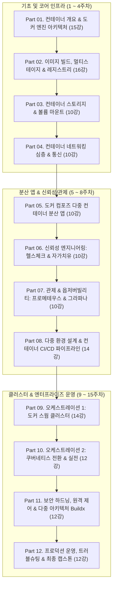

# 🐳 도커 & 클라우드 네이티브 바이블: 12대 파트 · 144강 통합 커리큘럼

> **9권의 권위 있는 도커 바이블 도서 분석을 바탕으로 재정리된 최적의 12대 파트 마스터 커리큘럼**  
> 대학교 15주 학기제 강의, 실무 부트캠프, 기업 인프라/데브옵스 엔지니어 육성 표준 로드맵

---

## 🧭 커리큘럼 재정리 배경 및 핵심 개편 포인트

### 1. 현행 8파트 130강의 한계점
* **Part 04의 과도한 결합(20강)**: 단일 파트에 도커 컴포즈(5강), 헬스체크/자가치유(6강), 프로메테우스/그라파나(9강)가 결합되어 학습 호흡이 무겁고 주제가 분산됨.
* **네트워킹의 고립**: 도커 네트워킹은 실무에서 가장 중요한 핵심 주제임에도 기존에는 Part 02(이미지 빌드) 중간의 `025` 1개 강의로만 축소되어 있었음.
* **쿠버네티스의 비중 부족**: 9권 도서 중 다수가 쿠버네티스 실전 전환을 깊게 다루고 있으나, 기존 강의에서는 스웜 중심 단원에 2개 강의(`080~081`)로만 편중됨.
* **프로덕션 운영 및 트러블슈팅의 복합성**: 로깅, 리버스 프록시, 메시지 큐, 실전 장애 트러블슈팅이 Part 08에 혼재되어 있어 독립적인 전문성을 살리기 어려움.

### 2. 9권 도커 바이블 통합 반영 결과 (신설 및 분리 파트)
* **⭐ Part 04. 컨테이너 네트워킹 심층 (10강 전담 신설)**: bridge, host, none, container 네트워크, macvlan, iptables 패킷 분석, DNS 서비스 디스커버리 체계화.
* **⭐ Part 06. 애플리케이션 신뢰성 & 자가치유 (10강 독립 분리)**: HEALTHCHECK, Fail-Fast, 커스텀 유틸, service_healthy, 재시작 정책과 자가치유 분리.
* **⭐ Part 07. 컨테이너 관제와 옵저버빌리티 (10강 독립 분리)**: Prometheus, Grafana, cAdvisor, Node Exporter, PromQL, Alerting 관제 센터 독립 전담.
* **⭐ Part 10. 쿠버네티스 핵심과 클라우드 네이티브 전환 (12강 대폭 확장)**: Pod, Deployment, Service, Ingress, ConfigMap/Secret, PV/PVC, Helm 패키징.
* **⭐ Part 12. 프로덕션 운영 실무 & 실전 트러블슈팅 (12강 고도화)**: 12-Factor, Fluentd 로깅, Nginx/Traefik, NATS 큐, nsenter 침투/tcpdump 분석, 엔터프라이즈 도입.

---

## 🗺️ 12대 파트 요약 및 주차별 로드맵

---

## 📋 12대 파트 144강 전수 상세 목록

### 🐳 Part 01. 컨테이너 개요와 도커 엔진 아키텍처 (15강)
| 번호 | 강의명 | 핵심 내용 및 실습 | 기존 매핑 |
| :---: | :--- | :--- | :---: |
| **000** | 강의 오리엔테이션: 클라우드 네이티브와 도커 대모험 | 도로시 & 지니와 함께하는 코스 안내 및 로드맵 | 기존 000 |
| **001** | 컨테이너가 IT 세상을 점령한 이유 1: 클라우드 이주와 레거시 현대화 | 모놀리스의 위기와 하이퍼바이저 가상화의 한계 | 기존 001 |
| **002** | 컨테이너가 IT 세상을 점령한 이유 2: 마이크로서비스와 데브옵스 | MSA, DDD 바운디드 컨텍스트, CI/CD와 컨테이너 결합 | 기존 002 |
| **003** | 실습 환경 구축 1: Windows WSL2와 macOS Docker Desktop | Windows 11 WSL2 및 macOS Apple Silicon 설정 최적화 | 기존 003 |
| **004** | 실습 환경 구축 2: Linux 서버 Docker Engine과 CLI 검증 | Ubuntu 24.04 Docker CE 설치 및 `daemon.json` 기본 세팅 | 기존 004 |
| **005** | 첫 번째 컨테이너: Hello World와 빌드-공유-실행 워크플로 | `docker run hello-world`, OCI 런타임 표준 흐름 | 기존 005 |
| **006** | 컨테이너란 무엇인가: 격리와 밀집의 두 마리 토끼 | 프로세스 수준 격리와 엔터프라이즈 서버 밀집도 극대화 | 기존 006 |
| **007** | 가상머신(VM) vs 도커 컨테이너: 커널 공유의 원리 | Guest OS 오버헤드 비교, Ring 0 커널 직접 호출 원리 | 기존 007 |
| **008** | 대화형 컨테이너: 원격 컴퓨터처럼 셸 접속하기 | `-it`, bash 셸, 표준 입출력 스트림(stdin/stdout) | 기존 008 |
| **009** | 백그라운드 컨테이너: 데몬 실행과 포트 포워딩 웹 호스팅 | `-d`, `-p 8080:80`, 호스트 포트 바인딩 원리 | 기존 009 |
| **010** | 컨테이너 생애주기: 상태 전이와 모니터링 | Created, Running, Paused, Stopped, Dead 라이프사이클 | 기존 010 |
| **011** | 실행 중인 컨테이너 내부 진단: `exec`와 파일 복사 `cp` | 비침습적 진단, `docker exec`, `docker cp` 실전 활용 | 기존 011 |
| **012** | 도커 엔진 내부 아키텍처: CLI, 데몬, containerd, runc | 4계층 분리 아키텍처, OCI 표준 런타임의 진화 | 기존 012 |
| **013** | 리눅스 커널 격리 기술: 네임스페이스와 cgroups | 6대 네임스페이스(`clone`/`unshare`/`setns`), CFS 자원 통제 | 기존 013 |
| **014** | Part 01 실전 미션: 컨테이너 파일시스템 탐색과 커스텀 웹 서버 | 격리된 파일시스템 수정, 나만의 Nginx 웹 서버 기동 | 기존 014 |

---

### 🐳 Part 02. 도커 이미지 빌드와 멀티스테이지, 레지스트리 (16강)
| 번호 | 강의명 | 핵심 내용 및 실습 | 기존 매핑 |
| :---: | :--- | :--- | :---: |
| **015** | 도커 허브 공식 이미지 활용과 런타임 환경 변수(`-e`) 주입 | MySQL, Redis 공식 이미지 탐색 및 환경 설정 주입 | 기존 015 |
| **016** | Dockerfile 기초 문법: FROM, ENV, WORKDIR, COPY, CMD | 핵심 5대 인스트럭션과 재현 가능한 환경 정의 | 기존 016 |
| **017** | 컨테이너 이미지 빌드와 빌드 컨텍스트의 원리 | `docker build .`, 컨텍스트 전송 최적화 기본기 | 기존 017 |
| **018** | 도커 이미지 레이어 아키텍처와 불변성(Immutability) | 유니온 마운트, Read-Only 레이어 스택과 해시 식별자 | 기존 018 |
| **019** | 레이어 캐시 최적화: 수정 빈도에 따른 인스트럭션 배치 | 패키지 의존성과 소스코드 분리 배치로 빌드 1초 컷 | 기존 019 |
| **020** | CMD vs ENTRYPOINT: 실행 명령과 인자 전달 패턴 | Shell Form vs Exec Form, 기본값 전달과 가변 인자 | 기존 020 |
| **021** | 빌드 서버가 필요 없는 혁명: 멀티스테이지 빌드 원리 | 단일 Dockerfile 내 다중 `FROM`과 아티팩트 복사 | 기존 021 |
| **022** | 실전 멀티스테이지 1: Java Maven/Spring 애플리케이션 빌드 | JDK 빌더에서 JRE 초경량 런타임으로 산출물 이관 | 기존 022 |
| **023** | 실전 멀티스테이지 2: Node.js와 Python 패키징 최적화 | `npm install --production`, Python 가상환경 휠 빌드 | 기존 023 |
| **024** | 실전 멀티스테이지 3: Go 언어 네이티브 바이너리와 `scratch` | 0MB 기반 `scratch` 이미지와 정적 링크 초소형 바이너리 | 기존 024 |
| **025** | 레지스트리, 리포지터리, 이미지 태그의 정확한 네이밍 구조 | `[호스트:포트]/[네임스페이스]/[리포지터리]:[태그]` 체계 | 기존 026 |
| **026** | 도커 허브와 GitHub Container Registry(GHCR) 배포 | `docker login`, Personal Access Token(PAT), 푸시 자동화 | 기존 027 |
| **027** | 사설 도커 레지스트리 구축과 insecure-registries 설정 | `registry:2` 컨테이너 구동, 로컬 저장소 볼륨 마운트 | 기존 028 |
| **028** | 시맨틱 버저닝, 이미지 태그 전략과 샤256 다이제스트 | SemVer v1.2.3, 가변 태그의 위험과 고정 `@sha256` 앵커 | 기존 029 |
| **029** | 검증된 공식 이미지에서 기업 표준 골든 이미지로 | 보안 패치 선반영, 사내 공통 라이브러리 탑재 표준화 | 기존 030 |
| **030** | Part 02 실전 미션: 폴리글랏 마이크로서비스 빌드 및 레지스트리 배포 | Spring + Node.js + Go 3대 서비스 동시 패키징 푸시 | 기존 031 |

---

### 🐳 Part 03. 컨테이너 스토리지: 도커 볼륨과 파일시스템 마운트 (10강)
| 번호 | 강의명 | 핵심 내용 및 실습 | 기존 매핑 |
| :---: | :--- | :--- | :---: |
| **031** | 컨테이너 속 데이터가 사라지는 이유: 기록 가능 레이어와 CoW | 휘발성 컨테이너 레이어의 한계와 Copy-on-Write 비용 | 기존 032 |
| **032** | 도커 볼륨(Docker Volume) 기초: 독립된 영속적 스토리지 | Named Volume 생성, `/var/lib/docker/volumes` 관리 | 기존 033 |
| **033** | 도커 볼륨을 활용한 무중단 애플리케이션 버전 업그레이드 | DB 데이터 보존 상태에서 MySQL 컨테이너 교체 실습 | 기존 034 |
| **034** | Dockerfile VOLUME 인스트럭션과 익명 볼륨의 함정 | 댕글링(Dangling) 익명 볼륨의 생성 메커니즘과 청소 | 기존 035 |
| **035** | 바인드 마운트(Bind Mount): 호스트 디렉터리 실시간 직결 | 로컬 소스코드 수정 즉시 컨테이너 반영 개발 환경 | 기존 036 |
| **036** | 읽기 전용(`:ro`) 마운트와 컨테이너 파일시스템 보안 | 설정 파일 무단 변경 방지 및 불변 인프라 강제 | 기존 037 |
| **037** | 파일시스템 마운트의 한계와 운영체제 간 호환성 이슈 | macOS VirtioFS, Windows WSL2 마운트 성능 튜닝 | 기존 038 |
| **038** | 인메모리 스토리지: `tmpfs` 마운트와 고속 캐시 처리 | 디스크 I/O 없이 메모리에서만 고속 동작하는 임시 저장소 | 기존 039 |
| **039** | 볼륨 데이터 백업, 복원, 마이그레이션 실전 테크닉 | 임시 알파인 컨테이너를 통한 tar 아카이브 백업/복원 | 기존 040 |
| **040** | Part 03 실전 미션: 영속적 DB 볼륨과 바인드 마운트 통합 풀스택 웹앱 | 데이터 무손실 DB와 코드 실시간 핫리로딩 웹앱 구축 | 기존 041 |

---

### 🐳 Part 04. 컨테이너 네트워킹 심층: 브리지, macvlan, iptables와 DNS (10강) - ⭐[신설 독립]
| 번호 | 강의명 | 핵심 내용 및 실습 | 신규/이동 |
| :---: | :--- | :--- | :---: |
| **041** | 도커 네트워크 개요와 기본 3대 드라이버(bridge, host, none) | 기본 드라이버별 네임스페이스 분리 및 네트워크 토폴로지 | **신규 보강** |
| **042** | 사용자 정의 브리지 네트워크와 컨테이너 간 이름 기반 통신 | 디폴트 bridge와 사용자 정의 bridge의 차이, 격리 서브넷 | 기존 025 이동 |
| **043** | 리눅스 가상 이더넷: veth pair와 docker0 브리지 패킷 전달 | 호스트 eth0에서 veth를 거쳐 컨테이너 eth0로의 흐름 | **신규 보강** |
| **044** | 호스트 네트워크 모드(`--net=host`)의 초고속 성능과 포트 충돌 주의점 | 네트워크 네임스페이스 공유, 제로 오버헤드 고속 통신 | **신규 보강** |
| **045** | 컨테이너 네트워크 공유: `--net=container:id`와 사이드카 패턴 | 동일 네트워크 스택 공유를 통한 localhost 통신 | **신규 보강** |
| **046** | L2 물리 네트워크 직결: `macvlan` 및 `ipvlan` 드라이버 구성 | 호스트 네트워크 스위치에 직접 MAC 주소를 부여하는 구성 | **신규 보강** |
| **047** | 도커와 리눅스 커널 iptables: PREROUTING, POSTROUTING, DOCKER 체인 | DNAT 포트포워딩과 SNAT 외부 인터넷 연결 패킷 추적 | **신규 보강** |
| **048** | 컨테이너 간 통신 격리와 인터-컨테이너 통신(`--icc=false`) 보안 | 동일 브리지 내 무단 패킷 스누핑 차단 방화벽 정책 | **신규 보강** |
| **049** | 도커 임베디드 DNS 서버(`127.0.0.11`)와 서비스 디스커버리 작동 원리 | 컨테이너 이름 해석, 라운드로빈 DNS, 역방향 조회 | 기존 044 흡수 |
| **050** | Part 04 실전 미션: 복수 서브넷 격리와 사이드카 네트워크를 적용한 마이크로서비스 망 구축 | 외부망/내부망 분리 및 사이드카 모니터링 망 구축 | **신규 미션** |

---

### 🐳 Part 05. 도커 컴포즈(Docker Compose)와 다중 컨테이너 분산 애플리케이션 (10강)
| 번호 | 강의명 | 핵심 내용 및 실습 | 기존 매핑 |
| :---: | :--- | :--- | :---: |
| **051** | 단일 컨테이너 실행의 한계와 도커 컴포즈(Compose)의 탄생 | 분산 컨테이너 기동의 복잡성을 해결하는 선언적 IaC | 기존 042 |
| **052** | `compose.yaml` 사양과 서비스 선언적 구조 | services, networks, volumes 3대 최상위 섹션 문법 | 기존 042 |
| **053** | 컴포즈로 다중 컨테이너 분산 애플리케이션 일괄 기동 | Web + API + DB + Redis 4개 컴포넌트 원클릭 오케스트레이션 | 기존 043 |
| **054** | 컴포즈 내장 DNS, 서비스 디스커버리와 수평 스케일링(`--scale`) | 서비스명 통신, `docker compose up --scale api=3` 로드밸런싱 | 기존 044 |
| **055** | 컴포즈 환경 변수 관리: `environment`, `env_file`, 변수 기본값 | 컨테이너별 환경 변수 격리 주입과 `.env` 변수 치환 | 기존 045 |
| **056** | 컴포즈 볼륨과 네트워크 명시적 정의와 외부(External) 리소스 연결 | 기구축된 사내 DB 볼륨 및 공용 네트워크 연동 기법 | 기존 045 |
| **057** | 컴포즈 생애주기 제어: up, down, start, stop, restart, logs | 백그라운드 기동, 볼륨 보존(`down -v` 주의점), 실시간 로그 | 기존 046 |
| **058** | 프로젝트 이름(`-p`)을 통한 단일 호스트 내 복수 환경 완전 격리 | 동일 호스트에 `project-a`, `project-b` 독립 기동 | 기존 062 |
| **059** | 컴포즈 설정 검증(`docker compose config`)과 dry-run 테스트 | YAML 문법 파싱 및 변수 치환 최종 결과 사전 검증 | 기존 063 |
| **060** | Part 05 실전 미션: 4계층 컴포즈 풀스택 마이크로서비스 구축 | 프런트, 백엔드, 캐시, DB 완벽 연동 분산 시스템 | 기존 043 확장 |

---

### 🐳 Part 06. 애플리케이션 신뢰성: 헬스체크, 디펜던시 체크 & 자가치유 (10강) - ⭐[독립 분리]
| 번호 | 강의명 | 핵심 내용 및 실습 | 기존 매핑 |
| :---: | :--- | :--- | :---: |
| **061** | 신뢰성 엔지니어링: 프로세스는 살아있는데 서비스는 죽었다 | 데드락, 메모리 누수로 응답 불가 상태인 컨테이너 진단 | 기존 047 |
| **062** | Dockerfile HEALTHCHECK 인스트럭션과 4대 파라미터 | `interval`, `timeout`, `retries`, `start-period` 튜닝 | 기존 048 |
| **063** | 헬스체크 상태 전이: starting, healthy, unhealthy 라이프사이클 | 불건전 상태 자동 전이 메커니즘과 inspect 상태 확인 | 기존 048 |
| **064** | 디펜던시 체크: 실행 순서만으로는 부족한 이유와 Fail-Fast 전략 | 포트 열림 vs DB 쿼리 가능 상태의 차이와 즉시 실패 | 기존 049 |
| **065** | 컴포즈 조건부 의존성: `condition: service_healthy` | DB가 완전히 정상 응답할 때까지 API 기동을 안전하게 지연 | 기존 051 |
| **066** | Fail-Fast 전략: 지수 백오프 재시도와 무한 루프 방지 | 재시도 횟수 제한과 장애 전파 차단 회로 구현 | 기존 049 |
| **067** | 보안을 위한 커스텀 헬스체크 경량 유틸리티 제작 | curl 없는 경량 이미지에서 소켓 테스트 전용 유틸 작성 | 기존 050 |
| **068** | 컨테이너 재시작 정책: no, on-failure, always, unless-stopped | 데몬 재부팅 및 크래시 상황별 최적의 복구 정책 매핑 | 기존 009/보강 |
| **069** | 자기치유(Self-Healing) 아키텍처의 원리와 자동 회복 메커니즘 | 불량 인스턴스 자동 격리 및 건강한 인스턴스로 트래픽 우회 | 기존 052 |
| **070** | Part 06 실전 미션: 지연 기동 DB와 네트워크 단절 상황에서도 100% 자가치유되는 분산 시스템 | 장애 유발 시뮬레이션을 통과하는 무결점 신뢰성 검증 | 기존 052/미션 |

---

### 🐳 Part 07. 컨테이너 관제와 옵저버빌리티: 프로메테우스 & 그라파나 (10강) - ⭐[독립 분리]
| 번호 | 강의명 | 핵심 내용 및 실습 | 기존 매핑 |
| :---: | :--- | :--- | :---: |
| **071** | 클라우드 네이티브 옵저버빌리티 3대 기둥: 메트릭, 로그, 트레이스 | 보이지 않는 컨테이너 내부를 투명하게 관측하는 전략 | 기존 053 |
| **072** | 컨테이너 메트릭 지표: 런타임 지표 vs 비즈니스 골든 시그널 | CPU/메모리/네트워크 I/O vs 요청률/에러율/응답시간(RED) | 기존 054 |
| **073** | 리소스 수집기 cAdvisor 구축과 Node Exporter 연동 | 컨테이너 cgroups 메트릭과 호스트 하드웨어 메트릭 수집 | 기존 055 |
| **074** | 프로메테우스(Prometheus) 아키텍처: 풀(Pull) 기반 스크래핑과 TSDB | 타임시리즈 데이터베이스 구조와 주기적 폴링 수집 모델 | 기존 056 |
| **075** | `prometheus.yml` 설정과 다중 서비스 타깃 엔드포인트 수집 | 정적 타깃 등록, 스크래핑 주기, 레이블 부여 기법 | 기존 056 |
| **076** | PromQL 기초와 핵심 함수: rate, increase, histogram_quantile | 카운터 변화율 계산, 95백분위수 응답 지연 시간 산출 | 기존 057 |
| **077** | 그라파나(Grafana) 구축: 데이터 소스 연동과 실시간 시각화 | 프로메테우스 연동, 시계열 그래프, 게이지, 싱글스탯 차트 | 기존 058 |
| **078** | 대시보드 코드화(Dashboard as Code): Grafana 프로비저닝 자동화 | JSON 대시보드 및 YAML 데이터 소스 자동 로딩 구축 | 기존 059 |
| **079** | 임계치 알림(Alerting) 설계: 서비스 장애 및 자원 고갈 자동 경보 | Alertmanager 연동, Slack/이메일 채널 알림 발송 | 기존 060 |
| **080** | Part 07 실전 미션: 전 컨테이너 풀스택 메트릭 관제 대시보드 완성 | 트래픽 부하 테스트와 실시간 임계치 경보 발령 검증 | 기존 061 |

---

### 🐳 Part 08. 다중 환경(Dev/Test/Prod) 설계와 컨테이너 기반 CI/CD 파이프라인 (14강)
| 번호 | 강의명 | 핵심 내용 및 실습 | 기존 매핑 |
| :---: | :--- | :--- | :---: |
| **081** | 12-Factor App 설정 원칙: 개발, 테스트, 프로덕션 환경의 동일성 | 코드와 설정의 분리, 환경별 동일한 컨테이너 이미지 재사용 | 기존 062/112 |
| **082** | 도커 컴포즈 오버라이드 파일 병합 원리와 config 검증 | `compose.yaml` + `compose.override.yaml` 레이어 병합 | 기존 063 |
| **083** | 환경 변수 파일 dotenv와 컴포즈 변수 치환 기본값 문법 | `${VAR:-default}`, `${VAR:?error}` 문법을 통한 검증 강제 | 기존 064 |
| **084** | 도커 컴포즈 비밀값 Secrets와 민감정보 은닉 기법 | DB 암호, API 토큰을 파일 형태로 안전하게 주입 | 기존 065 |
| **085** | YAML 앵커(`&`)와 확장 필드(`x-`)로 컴포즈 중복 완벽 제거 | 공통 환경 설정 템플릿화로 수백 줄 YAML을 50줄로 압축 | 기존 066 |
| **086** | 환경별 설정 워크플로: 개발, 테스트, 운영 아키텍처 설계 | 로컬 핫리로딩 환경 vs 프로덕션 고성능 빌드 분리 구성 | 기존 067 |
| **087** | Part 08 중간 미션: 단일 소스코드로 Dev, Test, Prod 3대 환경 동시 구동 | 오버라이드 파일 기반 3대 환경 격리 기동 검증 | 기존 068 |
| **088** | 도커를 이용한 지속적 통합(CI) 원리와 컨테이너 빌드 인프라 | 호스트 종속성 제로 빌드 파이프라인 개념과 이점 | 기존 069 |
| **089** | 도커 컴포즈 `build` 속성 심화: context, args, labels, target | 멀티스테이지 특정 단계 빌드 및 빌드 시점 인자 전달 | 기존 070 |
| **090** | 호스트 의존성 제로: Docker-out-of-Docker(DooD) 소켓 마운트 | `/var/run/docker.sock` 마운트를 통한 러너 컨테이너 구축 | 기존 071 |
| **091** | 선언적 CI 파이프라인 스크립트 작성: 빌드, 테스트, 패키징 | GitHub Actions / 로컬 bash 기반 자동화 파이프라인 구현 | 기존 072 |
| **092** | 이미지 메타데이터: OCI 표준 레이블과 감사 추적성 확보 | Git Commit SHA, 빌드 일시, 작성자 메타데이터 각인 | 기존 073 |
| **093** | CI 파이프라인 단계별 컨테이너 역할과 품질 게이트 | 단위 테스트 통과 시에만 이미지 레지스트리 푸시 승인 | 기존 074 |
| **094** | Part 08 실전 미션: Git 푸시로 동작하는 완전 자동화 CI 파이프라인 구축 | 코드 커밋부터 빌드, 테스트, OCI 태깅, 푸시 원스톱 완성 | 기존 075 |

---

### 🐳 Part 09. 컨테이너 오케스트레이션 1: 도커 스웜(Docker Swarm) 클러스터 운영 (14강)
| 번호 | 강의명 | 핵심 내용 및 실습 | 기존 매핑 |
| :---: | :--- | :--- | :---: |
| **095** | 컨테이너 오케스트레이션이란: 왜 클러스터가 필요한가 | 단일 호스트 한계 극복, 고가용성, 로드밸런싱의 원리 | 기존 076 |
| **096** | 도커 스웜 클러스터 구축: 매니저 노드와 워커 노드 | `docker swarm init`, 조인 토큰 발급 및 멀티 노드 결성 | 기존 077 |
| **097** | 도커 스웜 서비스 생성: 선언적 레플리카와 자동 자가치유 | `docker service create --replicas=5`, 노드 사망 시 재배치 | 기존 078 |
| **098** | 클러스터 오버레이 네트워크와 인그레스 라우팅 메시 | VXLAN UDP 4789 오버레이, 어느 노드로 접근해도 서비스 도달 | 기존 079 |
| **099** | 도커 스웜 스택 배포: `docker stack deploy`와 운영 컴포즈 | 컴포즈 V3 사양을 이용한 다중 서비스 클러스터 일괄 배포 | 기존 082 |
| **100** | 스웜 컨피그 객체 `docker config`를 이용한 중앙 설정 관리 | 설정 파일의 분산 클러스터 전파 및 무중단 갱신 | 기존 083 |
| **101** | 스웜 비밀값 `docker secret`: 암호화 저장소와 보안 주입 | Raft 트랜잭션 암호화와 컨테이너 내 메모리(`/run/secrets`) 탑재 | 기존 084 |
| **102** | 클러스터 환경의 퍼시스턴트 볼륨과 노드 레이블 배치 제약 | `node.labels` 기반 DB 전용 노드 타깃 배치 기법 | 기존 085 |
| **103** | 스웜 클러스터의 서비스 관리: 복제(Replicated) vs 글로벌(Global) 모드 | 노드당 1개 실행 모니터링 에이전트 vs 수평 확장 웹앱 | 기존 086 |
| **104** | Part 09 중간 미션: 컨피그와 시크릿이 적용된 고가용성 스택 배포 | 3-Tier 분산 앱의 스웜 스택 배포 및 서비스 확인 | 기존 087 |
| **105** | 롤링 업데이트 정밀 제어: parallelism, delay, order | 점진적 컨테이너 교체와 다운타임 제로 무중단 배포 | 기존 089 |
| **106** | 불량 배포 자동 감지와 자동 롤백(`failure_action: rollback`) | 헬스체크 실패 시 구버전으로 즉시 자동 원상 복구 | 기존 090 |
| **107** | 클러스터 노드 유지보수: `drain` 모드와 무중단 서버 점검 | 활성 태스크를 타 노드로 안전하게 대피시키는 드레인 실습 | 기존 092 |
| **108** | 스웜 고가용성: 멀티 매니저와 Raft 분산 합의 알고리즘 | 과반수 쿼럼(Quorum), 스플릿 브레인 방지, 리더 장애 복구 | 기존 093~094 |

---

### 🐳 Part 10. 컨테이너 오케스트레이션 2: 쿠버네티스(Kubernetes) 핵심과 클라우드 네이티브 전환 (12강) - ⭐[대폭 확장!]
| 번호 | 강의명 | 핵심 내용 및 실습 | 신규/이동 |
| :---: | :--- | :--- | :---: |
| **109** | 도커 스웜 vs 쿠버네티스(Kubernetes) 아키텍처 완벽 비교 | 단순함과 편의성(Swarm) vs 거대한 생태계와 확장성(K8s) | 기존 080 이동 |
| **110** | 쿠버네티스 전체 아키텍처: 마스터 컨트롤 플레인과 워커 노드 | API Server, etcd, Scheduler, Controller, kubelet, kube-proxy | **신규 확장** |
| **111** | 컨테이너 런타임 인터페이스(CRI)와 도커: dockershim 퇴역과 containerd | 도커 엔진과 쿠버네티스의 현대적 관계 및 OCI 표준화 | **신규 확장** |
| **112** | 로컬 쿠버네티스 실습 환경 구축: Minikube 또는 Docker Desktop K8s | kubectl CLI 설치, 클러스터 컨텍스트 설정, 노드 상태 점검 | 기존 081 확장 |
| **113** | 쿠버네티스 최소 배포 단위: 파드(Pod)의 개념과 라이프사이클 | 다중 컨테이너 사이드카 패턴, 파드 네트워크 네임스페이스 | **신규 확장** |
| **114** | 선언적 파드 관리: 디플로이먼트(Deployment)와 레플리카셋(ReplicaSet) | 선언적 매니페스트(`spec.replicas`), 롤링 업데이트 선언 | **신규 확장** |
| **115** | 쿠버네티스 서비스 1: 내부 통신 ClusterIP와 서비스 디스커버리 | K8s 내장 코어DNS(CoreDNS), L4 라운드로빈 로드밸런싱 | **신규 확장** |
| **116** | 쿠버네티스 서비스 2: 외부 노출 NodePort와 클라우드 LoadBalancer | 호스트 포트 개방 vs 클라우드 공급자 LB 연동 | **신규 확장** |
| **117** | L7 애플리케이션 게이트웨이: 인그레스(Ingress)와 호스트 경로 라우팅 | Nginx Ingress Controller, 단일 IP로 다중 도메인 라우팅 | **신규 확장** |
| **118** | 쿠버네티스 설정 관리: ConfigMap과 Secret을 이용한 환경 주입 | 환경 변수 및 볼륨 파일 형태로 설정과 암호 주입 | **신규 확장** |
| **119** | 쿠버네티스 퍼시스턴트 스토리지: PV와 PVC의 분리와 바인딩 | 인프라 관리자의 PV 프로비저닝 vs 개발자의 PVC 요청 | **신규 확장** |
| **120** | Part 10 실전 미션: 도커 컴포즈 애플리케이션을 쿠버네티스 매니페스트로 완벽 변환 배포 | Kompose 변환 및 실전 배포를 통한 클라우드 네이티브 완성 | 기존 081 실전화 |

---

### 🐳 Part 11. 보안 하드닝, 원격 엔진 제어 & 다중 아키텍처(Buildx) (12강)
| 번호 | 강의명 | 핵심 내용 및 실습 | 기존 매핑 |
| :---: | :--- | :--- | :---: |
| **121** | 도커 엔진 API 엔드포인트와 비보안 TCP 포워딩의 치명적 위험 | 2375 포트 노출 시 호스트 루트 권한 탈취 해킹 시나리오 | 기존 096 |
| **122** | 상호 TLS(mTLS) 인증서 생성: CA, 서버 키, 클라이언트 키 | openssl을 이용한 인증 기관 구축 및 암호화 채널 수립 | 기존 097 |
| **123** | SSH 기반 원격 도커 엔진 보안 접속과 최소 권한 설정 | 복잡한 인증서 없이 SSH 터널을 통한 안전한 원격 제어 | 기존 098 |
| **124** | 도커 컨텍스트(`docker context`): 멀티 클러스터 자유자재 전환 | 로컬 머신에서 원격 서버 도커를 손쉽게 오가는 컨텍스트 전환 | 기존 099 |
| **125** | CI 파이프라인에 지속적 배포(CD) 결합하기 | SSH/TLS 컨텍스트를 활용한 원격 프로덕션 배포 파이프라인 | 기존 100 |
| **126** | 다중 아키텍처(Multi-Arch) 이미지가 필수인 이유 | Intel/AMD x86_64, Apple Silicon ARM64, AWS Graviton 호환 | 기존 102 |
| **127** | 아키텍처 호환 Dockerfile 작성과 TARGETARCH 크로스 컴파일 | Go/Rust 등 크로스 컴파일러를 이용한 아키텍처별 바이너리 생성 | 기존 103 |
| **128** | Docker Buildx와 QEMU 에뮬레이터 원스톱 멀티 아키텍처 빌드 | `docker buildx build --platform linux/amd64,linux/arm64` 일괄 푸시 | 기존 105 |
| **129** | 도커 이미지 최적화 1: `.dockerignore`와 불필요한 파일 제거 | 빌드 컨텍스트 누수 방지 및 보안 파일 제외 | 기존 106 |
| **130** | 도커 이미지 최적화 2: 최적의 기반 이미지 선택과 취약점 스캔 | Debian vs Alpine vs Distroless, Trivy 취약점 감사 | 기존 107 |
| **131** | 도커 이미지 최적화 3: RUN 레이어 병합, 캐시 청소와 비루트(non-root) 유저 | 패키지 매니저 캐시 삭제, `USER 10001` 최소 권한 보안 | 기존 108~109 |
| **132** | Part 11 실전 미션: 800MB 레거시 이미지를 15MB 멀티 아키텍처 보안 이미지로 혁신하기 | 이미지 다이어트 및 Trivy 보안 취약점 제로 인증 | 기존 111 |

---

### 🐳 Part 12. 프로덕션 운영 실무, 실전 트러블슈팅 & 최종 엔드투엔드 캡스톤 (12강)
| 번호 | 강의명 | 핵심 내용 및 실습 | 기존 매핑 |
| :---: | :--- | :--- | :---: |
| **133** | 프로덕션 다단 설정 아키텍처: 내장 기본값, 환경 파일, 런타임 오버라이드 | 12-Factor 원칙에 입각한 클라우드 네이티브 애플리케이션 설정 | 기존 112 |
| **134** | 도커의 컨테이너 로깅 모델: stdout/stderr와 로그 드라이버 | 파일 로깅 지양, 표준 출력 통합 및 `json-file` 크기 제한 설정 | 기존 114 |
| **135** | 중앙집중식 로그 수집 파이프라인: Fluentd와 로그 저장소 연동 | 다중 노드 컨테이너 로그를 중앙 Fluentd 에그리게이터로 취합 | 기존 116 |
| **136** | 로그 검색과 시각화 스택: OpenSearch / Grafana Loki 통합 로그 검색 | 실시간 에러 로그 추적 및 분산 트레이스 상관관계 검색 | 기존 117 |
| **137** | 리버스 프록시 1: Nginx 컨테이너로 가상 호스트와 SSL Termination | HTTPS 인증서 적용, L7 경로 라우팅, 업스트림 로드밸런싱 | 기존 118~119 |
| **138** | 클라우드 네이티브 리버스 프록시: Traefik 자동 서비스 디스커버리 | 컨테이너 레이블만으로 Nginx 재시작 없이 동적 라우팅 등록 | 기존 121 |
| **139** | 비동기 메시징 1: 동기 HTTP의 한계와 Redis Pub/Sub, NATS 이벤트 큐 | 마이크로서비스 간 느슨한 결합과 이벤트 기반 아키텍처 | 기존 122~123 |
| **140** | 비동기 메시징 2: 메시지 핸들러 워커와 큐 그룹 수평 스케일링 | 경쟁적 소비자(Competing Consumers) 패턴과 메시지 팬아웃 | 기존 124~125 |
| **141** | 실전 트러블슈팅 1: 컨테이너 3대 재난(CrashLoopBackOff, ImagePullBackOff, OOMKilled) 긴급 처방 | Exit Code 137, 메모리 리밋, 즉시 종료 Exited(0) 해결 | **트러블슈팅 집대성** |
| **142** | 실전 트러블슈팅 2: `nsenter` 네임스페이스 로우레벨 침투와 패킷/시스템콜 분석 | 셸이 없는 scratch 컨테이너에 호스트에서 직접 침투하여 진단 | **트러블슈팅 집대성** |
| **143** | 현업 도입 가이드: 조직 내 PoC 성공 전략과 비즈니스 ROI 입증 | 개발·보안·운영팀 이해관계 설득, 클라우드 관리형 컨테이너 이전 | 기존 126~128 |
| **144** | 최종 캡스톤: 도로시와 지니의 풀스택 클라우드 네이티브 플랫폼 완성 | 144강의 모든 기술이 집약된 글로벌 분산 MSA 플랫폼 론칭 | 기존 129 완성 |

---

## 🎓 15주 학기제 강의 계획서 매핑

| 주차 | 주차별 대주제 | 다루는 파트 | 해당 강의 번호 | 주차별 핵심 마일스톤 |
| :---: | :--- | :---: | :---: | :--- |
| **1주차** | 클라우드 네이티브와 컨테이너 기초 | Part 01 | 000 ~ 006 | 도커 데스크톱/엔진 설치, 첫 컨테이너 구동 |
| **2주차** | 컨테이너 생애주기와 리눅스 커널 격리 기술 | Part 01 | 007 ~ 014 | namespaces, cgroups, 엔진 4계층 아키텍처 |
| **3주차** | Dockerfile 빌드 기본기와 캐시 최적화 | Part 02 | 015 ~ 020 | 레이어 아키텍처, 캐시 최적화, CMD vs ENTRYPOINT |
| **4주차** | 멀티스테이지 빌드 혁명과 사설 레지스트리 | Part 02 | 021 ~ 030 | Spring/Node/Go 경량화, 레지스트리 푸시, 골든 이미지 |
| **5주차** | 퍼시스턴트 스토리지와 도커 볼륨 | Part 03 | 031 ~ 040 | 볼륨, 바인드 마운트, tmpfs, 무중단 DB 업그레이드 |
| **6주차** | 컨테이너 네트워킹 심층과 서비스 통신 | Part 04 | 041 ~ 050 | veth, bridge, host, macvlan, iptables 패킷 분석 |
| **7주차** | 도커 컴포즈 다중 컨테이너 분산 앱 구축 | Part 05 | 051 ~ 060 | compose.yaml 선언적 인프라, 4계층 풀스택 구축 |
| **8주차** | **중간고사 및 실전 분산 프로젝트 평가** | - | - | **4계층 분산 마이크로서비스 구축 및 네트워킹 평가** |
| **9주차** | 애플리케이션 신뢰성 엔지니어링과 자가치유 | Part 06 | 061 ~ 070 | HEALTHCHECK, condition 의존성, 자가치유 |
| **10주차** | 컨테이너 관제와 옵저버빌리티 구축 | Part 07 | 071 ~ 080 | 프로메테우스, 그라파나 대시보드 코드화, Alerting |
| **11주차** | 다중 환경 설계와 컨테이너 기반 CI/CD | Part 08 | 081 ~ 094 | 오버라이드, DooD 소켓 마운트, 빌드/테스트 자동화 |
| **12주차** | 컨테이너 오케스트레이션 1: 도커 스웜 | Part 09 | 095 ~ 108 | 스웜 클러스터, 오버레이 네트워크, 무중단 롤링 배포 |
| **13주차** | 컨테이너 오케스트레이션 2: 쿠버네티스 핵심 | Part 10 | 109 ~ 120 | Pod, Deployment, Service, Ingress, K8s 전환 |
| **14주차** | 보안 하드닝, 원격 제어 및 멀티 아키텍처 | Part 11 | 121 ~ 132 | mTLS, Docker Context, Buildx 멀티 아키텍처 빌드 |
| **15주차** | 프로덕션 운영, 트러블슈팅 & 최종 캡스톤 | Part 12 | 133 ~ 144 | Fluentd, Traefik, 실전 트러블슈팅, 최종 수료 발표 |

