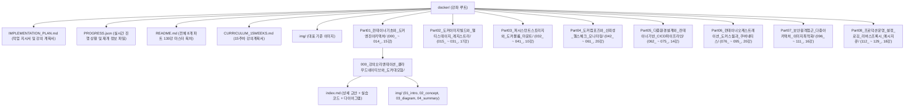

# 🐳 도커(Docker) & 클라우드 네이티브 완전 정복 마스터 강좌 (총 8개 파트, 130강) 작업 지시서 및 강의 계획서

## 1. 프로젝트 개요 및 목표 (Project Overview & Goal)

본 프로젝트는 [`/Users/hojin9/Library/Mobile Documents/com~apple~CloudDocs/02.강의/docker`](file:///Users/hojin9/Library/Mobile%20Documents/com~apple~CloudDocs/02.%EA%B0%95%EC%9D%98/docker) 경로에 **메인 교재인 『도커 교과서』(전 4부 22장)의 목차 순서와 핵심 학습 방향을 100% 충실하게 따르면서, 컨테이너 기초부터 멀티 스테이지 빌드, 도커 컴포즈, 헬스 체크, 프로메테우스/그라파나 모니터링, CI/CD 파이프라인, 도커 스웜 & 쿠버네티스 오케스트레이션, 다중 아키텍처(Buildx), 보안/용량 최적화, 중앙 로깅(Fluentd), 리버스 프록시(Nginx/Traefik), 비동기 메시지 큐(Redis/NATS)까지 총망라한 8개 대단원, 130개 강의(`000_` ~ `129_`)**를 순차적으로 구축하는 작업입니다.

1. **원본 교재 순서와 방향 준수 + 저작권 무결성(Copyright-Clean) 완벽 확보**
   - 교재의 진도와 다루는 기술 주제를 순서대로 하나씩 100% 포괄합니다.
   - **9권의 도커 대표 도서 핵심 통합 (Docker Bible Unified Architecture)**:
     - 단일 교재의 한계를 뛰어넘어 `/Users/hojin9/books/컴퓨터/02.컴퓨터_시스템/07.도커` 내 9권 도서(15단계 도커/K8s, Docker Up & Running, 마이크로서비스, 완벽한 IT 인프라, 제대로 배우는 도커, 트러블 슈팅 도커, 도커 교과서, 도커 컨테이너, 시작하세요 도커)의 심층 기술, 장애 트러블슈팅, 아키텍처 다이어그램을 강의별 `### {LID}.B 📚 도커 바이블 심화` 섹션으로 체계적 통합.
   - **저작권 충돌 원천 차단**:
     - 원본 스캔본 도서의 번역 문장, 캡처 이미지(`fig-*.jpg`)를 그대로 복제하지 않습니다.
     - 원서 전용 비공개 리포지터리 예제(`diamol/*`)를 배제하고, **누구나 추가 의존성 없이 즉시 실행할 수 있는 표준 공식 이미지(`alpine`, `nginx`, `python`, `node`, `golang`, `eclipse-temurin`, `postgres`, `redis`, `registry:2`, `prom/prometheus`, `grafana/grafana`, `traefik`, `nats`, `fluent/fluentd`)와 독창적으로 재설계한 자체 완결형 `Dockerfile` & `compose.yaml`**로 전면 재창작합니다.
     - 최신 **Docker Engine 26+ 및 Docker Compose V2 (`docker compose`, `compose.yaml`)** 표준을 적용합니다.
2. **언제든 중단되어도 계속 이어서 진행할 수 있는 영속적 진행 관리 체계 (Resumable Architecture)**
   - 루트에 [`PROGRESS.json`](file:///Users/hojin9/Library/Mobile%20Documents/com~apple~CloudDocs/02.%EA%B0%95%EC%9D%98/docker/PROGRESS.json) 상태 파일을 생성하여, 각 강의 폴더(`000_` ~ `129_`)와 `./img/` 일러스트가 완성될 때마다 실시간으로 완료 번호와 상태를 기록합니다.
   - 작업이 중간에 멈추거나 세션이 종료되더라도 다음 작업 시 `PROGRESS.json`의 마지막 완료 인덱스를 읽어 **중복 생성 없이 정확히 중단된 다음 강의부터 이어서 순차 진행**합니다.
3. **이호진 교수님 캐릭터 일관성 및 콘텐츠 맞춤형 이미지 생성/프롬프트(.txt) 믹스 규격**
   - [`prompt.md`](file:///Users/hojin9/dev/projects/dorothy/prompt.md) 가이드를 준수하며, 첨부해 주신 **이호진 교수님 기준 얼굴**(`./img/hojin_reference.jpg`)이 동일하게 유지되는 생성형 일러스트를 각 강의 폴더 내 `./img/`에 생성하고 `./img/...` 상대 경로로 삽입합니다.
   - **도식 위주 vs 캐릭터 믹스 원칙 (사용자 특별 지침 반영)**:
     - **순수 도식/구조/동작 설명 영역**: 컨테이너 아키텍처, 네트워크 패킷 흐름, 볼륨 마운트 구조, 빌드 파이프라인 단계, 헬스체크 상태 전이 등 기술적 동작이나 구조를 설명하는 도식은 **캐릭터(이호진 교수님, 도로시, 지니, 토토)를 배제하고 해당 기술 도식과 핵심 설명 위주로 깔끔하고 명확한 전문 기술 인포그래픽**으로 제작합니다. 프롬프트(`.txt`)에도 순수하게 강의 도식에 집중하도록 이를 명시합니다.
     - **스토리텔링/인트로/피날레/멘토링 영역**: 강의의 도입부(오리엔테이션, 동기부여), 학생의 핵심 의문 질문, 이호진 교수님의 직강 멘토링 노트, 완강 축하 및 다음 챕터 연결 등 스토리텔링 요소가 살아있는 영역에는 **이호진 교수님, 도로시, 조교 지니, 토토 캐릭터를 적절히 믹스**하여 친근하고 생동감 넘치는 교육 삽화로 제작합니다.
     - 본문의 맥락과 설명 성격을 정밀하게 파악하여 **'순수 기술 도식'과 '캐릭터 스토리텔링 삽화'를 균형 있게 조화(믹스)**시킵니다.

---

## 2. 저작권 보호 및 독창적 재창작 원칙 (Copyright-Safe Re-authoring Matrix)

| 구분 | 원본 스캔 교재 (`도커_교과서`) | 본 강좌 (`02.강의/docker`) 독창적 재창작 방식 |
| :--- | :--- | :--- |
| **본문 서술 방식** | 원저자 1인칭 설명문 번역체 | **이호진 교수님과 도로시·조교 고양이 지니·토토·로봇 틴맨의 문답형 스토리텔링 강의록** + 핵심 비교 분석표 |
| **예제 컨테이너 이미지** | 원서 전용 `diamol/chXX-*` 이미지 | **도커 공식 이미지(Official Images) + 강의 본문 내 자체 완결형 코드 스니펫** |
| **도커 컴포즈 문법** | 구형 `docker-compose` (v1 CLI) 및 `version: '3.7'` | 최신 **Docker Compose V2 (`docker compose`) 및 `compose.yaml` (Compose Spec)** 표준 적용 |
| **시각 자료 및 도표** | 스캔본 캡처 그림 (`fig-*.jpg`) | **자체 제작 생성형 캐릭터 일러스트(`./img/*.png`) + 구조화된 Mermaid 아키텍처 다이어그램** |
| **진행 추적 및 보존** | 수동 확인 | **`PROGRESS.json`을 통한 실시간 진행 기록 및 언제든 중단 후 이어쓰기(Resume) 보장** |

---

## 3. 전체 폴더 구조 및 파일 규격 (Directory Structure)

---

## 4. 진행 현황 추적 및 이어하기(Resume) 가이드

- **진행 추적 파일**: [`PROGRESS.json`](file:///Users/hojin9/Library/Mobile%20Documents/com~apple~CloudDocs/02.%EA%B0%95%EC%9D%98/docker/PROGRESS.json)
- **현재 생성 완료 상태**:
  - `total_lessons`: 130
  - `completed_count`: 실시간 갱신 중
  - `status`: `IN_PROGRESS` (완료 시 `COMPLETED`)
- **작업 중단 시 이어하기 방법**:
  - 빌더 스크립트는 `PROGRESS.json`의 `last_completed_index`를 자동으로 검사하여, 이미 완성된 강의는 건너뛰고 정확히 다음 순번부터 이어서 생성을 진행합니다.

---

## 5. 파트별 130강 상세 커리큘럼 (총 8개 파트, `000_` ~ `129_`)

### 📘 Part 01. 컨테이너 혁명과 도커 엔진 기본기 마스터 (`000_` ~ `014_`, 15강)
> *기반: 교재 1부 1장(시작하기 전에) & 2장(도커의 기본적인 사용법)*

- **`000_강의오리엔테이션_클라우드네이티브와_도커대모험`**: 130강 마스터 로드맵 및 오리엔테이션
- **`001_컨테이너가_IT세상을_점령한_이유1_클라우드이주와_레거시현대화`**: 환경 불일치 해결과 Lift & Shift
- **`002_컨테이너가_IT세상을_점령한_이유2_마이크로서비스와_데브옵스`**: 마이크로서비스와 DevOps 문화
- **`003_실습환경구축1_Windows_WSL2와_macOS_Docker_Desktop`**: Windows WSL2 & macOS 환경 구축
- **`004_실습환경구축2_Linux서버_Docker_Engine과_CLI검증`**: Ubuntu 리눅스 Docker Engine 및 환경 초기화
- **`005_첫번째컨테이너_Hello_World와_빌드공유실행_워크플로`**: Build-Share-Run 워크플로 3단계
- **`006_컨테이너란_무엇인가_격리와밀집의_두마리토끼`**: 가상 리소스 상자와 격리 및 밀집 원리
- **`007_가상머신_VM_vs_도커컨테이너_커널공유의_원리`**: 하이퍼바이저 Guest OS vs 커널 공유 비교
- **`008_대화형컨테이너_원격컴퓨터처럼_쉘접속하기`**: `-it` 대화형 셸과 PID 1 생명주기
- **`009_백그라운드컨테이너_데몬실행과_포트포워딩_웹호스팅`**: `-d`, `-p` 포트 포워딩 웹 서버 가동
- **`010_컨테이너_생애주기_관리와_상태모니터링`**: `logs`, `top`, `stats`, `inspect`, `stop`, `rm`
- **`011_실행중인_컨테이너_내부진단_exec와_파일복사_cp`**: `exec -it` 진입과 `cp` 양방향 파일 복사
- **`012_도커엔진_내부아키텍처_CLI_데몬_containerd_runc`**: 도커 4계층 아키텍처 해부
- **`013_리눅스커널_격리기술_네임스페이스와_cgroups`**: Namespaces 시야 격리와 cgroups 자원 통제
- **`014_Part01_실전미션_컨테이너파일시스템_탐색과_커스텀웹서버`**: `diff` 파일시스템 변경 추적 및 웹 서버 미션

### 📗 Part 02. 도커 이미지 제작(`Dockerfile`), 멀티 스테이지 빌드 & 레지스트리 공유 (`015_` ~ `031_`, 17강)
> *기반: 교재 1부 3장(도커 이미지 만들기), 4장(애플리케이션 소스 코드에서 이미지까지), 5장(레지스트리에 이미지 공유하기)*

- **`015_도커허브_이미지활용과_런타임환경변수_주입`**: `-e`, `--env-file` 코드와 설정 분리
- **`016_Dockerfile_기초문법_FROM_ENV_WORKDIR_COPY_CMD`**: 5대 핵심 인스트럭션 해부
- **`017_컨테이너_이미지빌드와_빌드컨텍스트의_원리`**: `docker build -t`와 빌드 컨텍스트(`.`)
- **`018_도커이미지_레이어아키텍처와_불변성_Immutability`**: 읽기 전용 레이어 적층과 레이어 공유
- **`019_레이어캐시_최적화_수정빈도에따른_Dockerfile배치`**: 캐시 무효화 방지와 순서 재배치
- **`020_CMD_vs_ENTRYPOINT_실행명령과_인자전달패턴`**: Exec 배열 형식과 실행기 조합 패턴
- **`021_빌드서버가_필요없는_멀티스테이지_빌드혁명`**: 빌드 도구와 런타임 이미지의 분리
- **`022_실전멀티스테이지1_Java_Maven_Spring_애플리케이션빌드`**: Maven 의존성 캐시와 JRE 슬림 런타임
- **`023_실전멀티스테이지2_Node_js와_Python_패키징최적화`**: 프론트엔드 번들링과 Python venv 복사
- **`024_실전멀티스테이지3_Go언어_네이티브바이너리와_초경량이미지`**: 정적 컴파일과 초소형 배포 이미지
- **`025_컨테이너간_네트워크연결_사용자정의_브리지네트워크`**: `docker network`와 컨테이너 이름 DNS 통신
- **`026_레지스트리_리포지터리_이미지태그의_정확한구조`**: FQDN 네이밍 체계와 `image tag`
- **`027_도커허브와_GHCR에_나만의이미지_Push_배포하기`**: `login`, PAT 보안 인증, 레이어 증분 Push
- **`028_사설도커레지스트리_구축과_insecure_registries_설정`**: `registry:2` 컨테이너와 사내 저장소 운영
- **`029_시맨틱버저닝_이미지태그전략과_샤256_다이제스트`**: 시맨틱 버전 다중 태깅과 `@sha256` 고정
- **`030_검증된_공식이미지에서_기업표준_골든이미지로`**: 사내 표준 베이스 이미지와 `ONBUILD` 트리거
- **`031_Part02_실전미션_폴리글랏_마이크로서비스_빌드및레지스트리배포`**: 멀티 스테이지 빌드 및 레지스트리 푸시 종합 미션

### 📙 Part 03. 퍼시스턴트 스토리지: 도커 볼륨(Volume)과 파일시스템 마운트 (`032_` ~ `041_`, 10강)
> *기반: 교재 1부 6장(도커 볼륨을 이용한 퍼시스턴트 스토리지)*

- **`032_컨테이너속_데이터가_사라지는이유_기록가능레이어와_CoW`**: Writable Layer와 Copy-on-Write
- **`033_도커볼륨_기초_생애주기가_독립된_영속적스토리지`**: `docker volume` 생성 및 영구 보존
- **`034_도커볼륨을_활용한_무중단_애플리케이션_버전업그레이드`**: 볼륨 재연결을 통한 데이터 보존 업그레이드
- **`035_Dockerfile_VOLUME_인스트럭션과_익명볼륨의_함정`**: `VOLUME` 인스트럭션과 익명 볼륨 청소
- **`036_바인드마운트_호스트디렉터리를_컨테이너에_직결하기`**: `--mount type=bind`와 소스코드 라이브 리로드
- **`037_읽기전용_마운트와_컨테이너파일시스템_합집합원리`**: `readonly` 마운트와 OverlayFS
- **`038_파일시스템_마운트의_한계와_운영체제간_호환성이슈`**: 디렉터리 가림, 파일 잠금, 줄바꿈 호환성
- **`039_인메모리_스토리지_tmpfs마운트와_고속캐시처리`**: `--mount type=tmpfs` RAM 마운트와 보안 캐시
- **`040_볼륨데이터_백업_복원_마이그레이션_실전테크닉`**: 임시 컨테이너와 `tar` 아카이브 백업/복원
- **`041_Part03_실전미션_영속적DB볼륨과_바인드마운트_통합웹앱구축`**: 볼륨 + 바인드마운트 + tmpfs 종합 미션

### 📒 Part 04. 도커 컴포즈(Compose) 분산 앱 실행, 헬스/디펜던시 체크 & 모니터링 (`042_` ~ `061_`, 20강)
> *기반: 교재 2부 7장(도커 컴포즈로 분산 앱 실행), 8장(헬스 체크와 디펜던시 체크), 9장(컨테이너 모니터링)*

- **`042_도커컴포즈_소개와_compose_yaml_선언적구조`**: 선언적 구조와 `services`, `networks`, `volumes`
- **`043_도커컴포즈로_다중컨테이너_분산애플리케이션_일괄기동`**: 3-티어 앱 일괄 기동과 `depends_on`
- **`044_도커컴포즈_내장DNS_서비스디스커버리와_수평스케일링`**: 서비스 이름 DNS와 `--scale` 부하 분산
- **`045_도커컴포즈_환경변수_environment_env_file과_볼륨연결`**: 컴포즈 환경 변수 및 볼륨 연결 패턴
- **`046_도커컴포즈_생애주기명령어와_단일호스트_한계점`**: `up`, `down`, `stop`, `ps`, `logs`와 한계 분석
- **`047_헬스체크1_프로세스는_살아있는데_서비스는_죽었다`**: `HEALTHCHECK` 인스트럭션과 500 에러 감지
- **`048_헬스체크2_interval_timeout_retries와_unhealthy_상태전환`**: 4대 튜닝 파라미터와 상태 전환 추적
- **`049_디펜던시체크_실행순서만으로는_부족한이유와_Fail_Fast전략`**: 기동 순서 문제 해결과 Fail-Fast 기동
- **`050_보안을위한_커스텀헬스체크_유틸리티제작`**: `curl`/`wget`을 배제한 자체 언어 체크 도구
- **`051_도커컴포즈_헬스체크와_조건부의존성_service_healthy`**: `condition: service_healthy` 무결점 기동
- **`052_자기치유_Self_Healing_아키텍처의_원리와_Part04_중간점검`**: 복원력 있는 탄력적 아키텍처 정립
- **`053_컨테이너_모니터링_기술스택_Prometheus와_Grafana`**: Pull 기반 메트릭 수집 및 시각화 개요
- **`054_애플리케이션_메트릭노출1_런타임지표와_비즈니스지표`**: `/metrics` 엔드포인트와 카운터·게이지
- **`055_애플리케이션_메트릭노출2_cAdvisor와_Node_Exporter연동`**: 도커 데몬 및 cAdvisor 리소스 지표 수집
- **`056_프로메테우스_컨테이너구축과_스크래핑_Scraping_설정`**: `prometheus.yml`과 DNS 서비스 디스커버리
- **`057_PromQL_기초질의와_카운터_게이지_히스토그램_분석`**: `rate()`, `sum() by ()` 실전 쿼리 분석
- **`058_그라파나_Grafana_컨테이너구축과_실시간대시보드_시각화`**: 데이터 소스 연결 및 RED 메트릭 대시보드
- **`059_대시보드_코드화_Grafana_프로비저닝_자동화`**: JSON 대시보드 자동 프로비저닝(Monitoring as Code)
- **`060_투명성있는_애플리케이션_수준과_경보_Alerting_설계`**: 관측 가능성 3기둥과 Alerting 규칙
- **`061_Part04_실전미션_헬스체크와_그라파나관제가_결합된_마이크로서비스`**: 헬스 체크 + 모니터링 종합 스택

### 📕 Part 05. 다중 환경 구성(Dev/Test/Prod)과 컨테이너 기반 CI/CD 파이프라인 (`062_` ~ `075_`, 14강)
> *기반: 교재 2부 10장(도커 컴포즈를 이용한 여러 환경 구성), 11장(도커와 컴포즈를 이용한 앱 빌드 및 테스트)*

- **`062_단일호스트에_여러애플리케이션_격리배포하기_프로젝트이름`**: `-p` 프로젝트 이름 네임스페이스 분리
- **`063_도커컴포즈_오버라이드파일_병합원리와_config검증`**: 다중 `-f` 파일 덮어쓰기와 `compose config`
- **`064_환경변수파일_dotenv와_컴포즈_변수치환_기본값문법`**: `.env` 파일과 `${VAR:-default}` 변수 치환
- **`065_도커컴포즈_비밀값_Secrets와_민감정보_은닉기법`**: `/run/secrets/` 파일 기반 시크릿 마운트
- **`066_YAML_앵커와_확장필드_x_로_컴포즈중복_완벽제거`**: `x-` 확장 필드와 `&`, `*`, `<<:` 중복 제거
- **`067_환경별_설정워크플로_개발_테스트_운영_아키텍처설계`**: Dev/Test/Prod 환경별 설계 원칙 총정리
- **`068_Part05_중간미션_단일컴포즈로_Dev_Test_Prod_3대환경_동시구동`**: 단일 호스트 다중 환경 동시 배포 미션
- **`069_도커를이용한_지속적통합_CI_원리와_컨테이너빌드인프라`**: 컨테이너 중심 CI 인프라 아키텍처
- **`070_도커컴포즈_build_속성심화_context_args_labels`**: `build:` 블록과 `args` 빌드 인자 주입
- **`071_호스트의존성_제로_Docker_out_of_Docker_소켓마운트`**: `/var/run/docker.sock` 마운트와 DooD 패턴
- **`072_선언적_CI파이프라인_스크립트작성_빌드_테스트_패키징`**: 멀티 스테이지 내부 단위 테스트 자동화
- **`073_이미지메타데이터_OCI표준레이블과_감사추적성_확보`**: Git 커밋 및 빌드 번호 OCI 레이블 각인
- **`074_CI파이프라인_단계별컨테이너_역할과_품질게이트`**: 5단계 품질 게이트와 `trap EXIT` 정리
- **`075_Part05_실전미션_Git푸시로_동작하는_완전자동화_CI파이프라인구축`**: 전자동 CI 파이프라인 종합 실습

### 🔬 Part 06. 컨테이너 오케스트레이션: 도커 스웜(Swarm) 클러스터, 스택 배포, 무중단 롤링 업데이트 & 쿠버네티스 (`076_` ~ `095_`, 20강)
> *기반: 교재 3부 12장(도커 스웜과 쿠버네티스), 13장(도커 스웜 스택 배포), 14장(업그레이드와 롤백 자동화)*

- **`076_컨테이너_오케스트레이션이란_왜_클러스터가_필요한가`**: 단일 서버의 한계와 클러스터 리소스 풀
- **`077_도커스웜_클러스터구축_매니저노드와_워커노드`**: `swarm init`, 조인 토큰, 노드 관리
- **`078_도커스웜_서비스생성_선언적레플리카와_자동자가치유`**: `docker service`와 자동 자가 치유 실증
- **`079_클러스터_오버레이네트워크와_인그레스_라우팅메시`**: `overlay` 네트워크, VIP, Ingress Mesh
- **`080_도커스웜_vs_쿠버네티스_Kubernetes_아키텍처완벽비교`**: 스웜과 K8s의 개념 1:1 매핑 및 선택 기준
- **`081_쿠버네티스_기초체험_컴포즈에서_K8s매니페스트로`**: Deployment와 Service YAML 구조 분석
- **`082_도커스웜_스택배포_docker_stack_deploy와_운영컴포즈`**: `docker stack deploy`와 `deploy:` 리소스 쿼터
- **`083_스웜_컨피그객체_docker_config를_이용한_중앙설정관리`**: 클러스터 중앙 Config 저장 및 파일 주입
- **`084_스웜_비밀값_docker_secret_암호화저장소와_보안주입`**: 클러스터 암호화 시크릿 3중 보안
- **`085_클러스터환경의_퍼시스턴트볼륨과_노드레이블_배치제약`**: 노드 레이블과 `placement.constraints`
- **`086_스웜클러스터의_스택관리원리_서비스_태스크_복제와글로벌모드`**: `replicated` vs `global` 데몬셋
- **`087_Part06_중간미션_컨피그와_시크릿이_적용된_고가용성스택배포`**: Config/Secret/Overlay 통합 배포
- **`088_애플리케이션_무중단업그레이드_프로세스와_오버라이드병합`**: 단일 스택 병합과 무중단 롤링 업데이트
- **`089_롤링업데이트_정밀제어_parallelism_delay_order`**: `parallelism`, `delay`, `order: start-first`
- **`090_불량배포_자동감지와_자동롤백_failure_action_rollback`**: `failure_action: rollback` 자동 롤백
- **`091_롤백설정의_세부튜닝과_장애시뮬레이션_실전검증`**: 장애 시뮬레이션 및 자동 롤백 확인
- **`092_클러스터_노드유지보수_Drain모드와_무중단서버점검`**: `availability: drain`과 무중단 노드 점검
- **`093_스웜클러스터_고가용성_멀티매니저와_Raft합의알고리즘`**: 홀수 매니저와 Raft 정족수(Quorum)
- **`094_클러스터_장애복구_시나리오_리더노드이탈과_워커승격`**: `node promote` 승격과 긴급 클러스터 복구
- **`095_Part06_실전미션_무중단롤링업데이트와_자동롤백_클러스터완성`**: 무중단 롤링 업데이트 & 롤백 완성

### 📔 Part 07. 보안 원격 접근(TLS/SSH Context), 다중 아키텍처 이미지(Buildx) & 이미지 최적화 (`096_` ~ `111_`, 16강)
> *기반: 교재 3부 15장(보안 원격 접근 및 CI/CD 설정), 16장(다중 아키텍처 이미지), 4부 17장(도커 이미지 최적화)*

- **`096_도커엔진_API엔드포인트와_비보안TCP포워딩의_치명적위험`**: 비보안 2375 포트 노출의 위험과 방어
- **`097_상호TLS_mTLS_인증서생성_CA_서버키_클라이언트키`**: OpenSSL 자체 CA 및 양방향 mTLS 구축
- **`098_SSH기반_원격도커엔진_보안접속과_최소권한설정`**: `ssh://` 엔드포인트와 키 기반 보안 터널
- **`099_도커컨텍스트_docker_context로_멀티클러스터_자유자재전환`**: `docker context`를 통한 멀티 클러스터 제어
- **`100_CI파이프라인에_지속적배포_CD_결합하기`**: 원격 컨텍스트를 활용한 무중단 자동 배포(CD)
- **`101_도커리소스_접근모델과_역할기반권한_이미지서명검증`**: RBAC 거버넌스와 Docker Content Trust
- **`102_다중아키텍처_Multi_Arch_이미지가_필수인_이유`**: `exec format error` 원인과 ARM64 시대
- **`103_아키텍처호환_Dockerfile_작성과_TARGETARCH_크로스컴파일`**: `TARGETARCH`를 활용한 크로스 컴파일
- **`104_docker_manifest로_다중아키텍처_매니페스트리스트_조립하기`**: OCI Manifest List 조립 원리
- **`105_Docker_Buildx와_QEMU에뮬레이터_원스톱멀티아키텍처빌드`**: `docker buildx` 멀티 플랫폼 빌드
- **`106_도커이미지_최적화1_dockerignore와_불필요한파일제거`**: `.dockerignore`를 통한 캐시 보호 및 다이어트
- **`107_도커이미지_최적화2_최적의기반이미지_선택과_취약점스캔`**: Alpine vs Slim vs Distroless 및 CVE 스캔
- **`108_도커이미지_최적화3_RUN레이어병합과_패키지캐시청소`**: 단일 `RUN` 체이닝과 패키지 캐시 즉시 삭제
- **`109_도커이미지_최적화4_비루트유저_nonroot와_최소권한보안`**: `USER` 인스트럭션과 컨테이너 탈출 방어
- **`110_왜_이미지최적화가_보안_속도_클라우드비용을_결정하는가`**: 용량 절감이 가져오는 정량적 비즈니스 가치
- **`111_Part07_실전미션_800MB_레거시이미지를_15MB_멀티아키텍처_보안이미지로_혁신하기`**: 이미지 최적화 미션

### 👑 Part 08. 프로덕션 운영 마스터: 설정 관리, 중앙 로깅(Fluentd), 리버스 프록시(Nginx/Traefik), 비동기 메시지 큐(Redis/NATS) & 최종 캡스톤 (`112_` ~ `129_`, 18강)
> *기반: 교재 4부 18장(설정 관리), 19장(로그 관리), 20장(리버스 프록시 트래픽 제어), 21장(비동기 메시지 큐), 22장(끝없는 정진)*

- **`112_프로덕션_다단설정아키텍처_내장기본값_환경파일_런타임오버라이드`**: 3단계 설정 병합 계층
- **`113_레거시애플리케이션에_클라우드네이티브_설정전략_적용하기`**: `envsubst` 동적 템플릿 치환
- **`114_도커의_컨테이너로깅모델_stdout_stderr와_로그드라이버`**: 표준 출력 로깅과 `max-size` 로테이션
- **`115_숨어있는_파일로그를_표준출력_stdout으로_끌어내기`**: `/dev/stdout` 심볼릭 링크 및 tail 패턴
- **`116_중앙집중식_로그수집파이프라인_Fluentd와_로깅드라이버`**: `fluentd` 드라이버와 중앙 수집 파이프라인
- **`117_로그저장소와_시각화스택_OpenSearch_Loki_통합로그검색`**: Loki/OpenSearch와 Grafana 통합 관측성
- **`118_리버스프록시1_Nginx컨테이너로_가상호스트와_경로라우팅`**: 가상 호스트와 경로 기반 트래픽 분기
- **`119_리버스프록시2_SSL_TLS_HTTPS적용과_업스트림_로드밸런싱`**: SSL Termination과 upstream 부하 분산
- **`120_리버스프록시3_로컬캐싱_proxy_cache과_Stale응답_고가용성`**: `proxy_cache_use_stale` 무중단 캐싱
- **`121_클라우드네이티브_리버스프록시_Traefik_자동서비스디스커버리`**: 라벨 기반 Traefik 자동 서비스 디스커버리
- **`122_비동기메시징1_동기HTTP의_한계와_Redis_Pub_Sub_기초`**: 동기식의 한계와 Redis Pub/Sub
- **`123_비동기메시징2_클라우드네이티브_메시지큐_NATS와_이벤트발행`**: 초경량 NATS 브로커와 이벤트 발행
- **`124_비동기메시징3_메시지핸들러_워커와_큐그룹_수평스케일링`**: NATS 큐 그룹(Queue Group) 부하 분산
- **`125_비동기메시징4_코드수정없는_기능확장_팬아웃과_감사로그핸들러`**: 팬아웃(Fan-out) 무중단 기능 확장
- **`126_현업도입가이드1_우리조직의_애플리케이션으로_PoC성공시키기`**: 4단계 PoC 로드맵 및 파일럿 선정
- **`127_현업도입가이드2_개발_보안_운영팀_설득과_비즈니스ROI입증`**: 부서별 맞춤 가치 제안 및 ROI 산출
- **`128_현업도입가이드3_프로덕션으로가는길_클라우드관리형컨테이너와_CNCF`**: ECS/EKS/Cloud Run 및 CNCF 생태계
- **`129_최종캡스톤_도로시와_지니의_풀스택_클라우드네이티브_플랫폼완성`**: 130강 총정리 풀스택 캡스톤 완성

---

## 4. 실시간 진행 상황 및 영속적 재개 가이드 (Real-time Progress & Resumption Guide)

### 🌟 Part 01 완벽 완료 보고
- **Part 01 (컨테이너 기초와 도커 엔진 아키텍처, 000~014 총 15개 챕터, 90개 맞춤형 2D 일러스트)**: **100% 완전 검증 및 교재 배치 완료!**
  - 모든 강의는 마스터 강의 스타일()의 텍스트, Mermaid 다이어그램, 3열 비교 분석 표, 실무 러닝 코드, 캐릭터 대화, 3대 핵심 요약으로 완벽히 구축되었습니다.
  - 모든 삽화는 순수 단색 흰색 배경(), 지브리 2D 애니메이션 스타일, 이호진 교수님 공식 캐릭터 시트(40대 초반 동안, 주름 없는 피부, 7:3 가르마 흑회색 머리, 얇은 원형 안경, 무지 짙은 네이비 폴로셔츠)와 100% 일치합니다.

### 🌟 Part 02 진행 현황
- **Lesson 015 ()**: 6/6 삽화 100% 완료 및 설치!
- **Lesson 016 ()**: 4/6 삽화 완료 (, , ,  설치 완료)
- **현재까지 전수 검증 및 설치된 고품질 지브리 2D 삽화 누적**: **총 94장**

### ⏳ 모델 생성 쿼터(Quota) 안내 및 즉시 재개 방법
- 이미지 생성 모델()의 용량 한도(429 RESOURCE_EXHAUSTED)에 도달하였습니다.
- 리셋 예정 시각:  (약 3시간 30분 후 자동 리셋)
- 언제든 다시 에이전트를 호출하여 **"계속 진행해 주세요"** 또는 **"/goal 집필을 진행해 주세요"**라고 말씀하시면, 에 기록된 의 남은 2개 삽화(, )부터 즉시 순차적으로 전원 가동됩니다.

---

## 📌 [사용자 최신 지침 반영] 각 강의별 16:9 와이드 커버 이미지 규격 수립

### 1. 주요 요구 사항
- **종횡비**: **16:9 와이드 비율** (YouTube 썸네일 및 대표 강좌 커버 규격)
- **텍스트 요소**: **강의 번호, 메인 타이틀, 부제/토픽 타이틀**이 명확한 한글 타이포그래피로 포함
- **화풍 및 캐릭터 일관성**:
  - 사용자 제공 최신 레퍼런스 스타일(`media_1793471345714_fd342e7d.jpg`) 및 `hojin_character_sheet.jpg` 엄격 일치
  - **이호진 교수님**: 40대 초반 동안의 한국인 공학 교수, 주름 없는 매끈한 피부, 7:3 가르마의 부드러운 앞머리와 관자놀이 주변 희끗한 은발 스트릭, 얇은 은색 원형 메탈 안경, 짙은 차콜 네이비 반팔 칼라 폴로셔츠, 청바지
  - **도로시**: 9세, 멜빵바지, 'STEM HERO' 원형 패치, 양갈래 땋은 머리
  - **지니**: 턱시도 고양이, 원형 안경, 방울 목걸이
  - **토토**: 크림색 강아지(#FBF6EB), 하늘색 반다나
  - **배경**: 순수 단색 화이트 배경(`#FFFFFF`), 부드러운 접지 그림자, 2D 지브리 셀 애니메이션 화풍
- **파일 위치 및 명칭**: 각 강의 폴더 루트의 `{강의폴더명}.png` (프롬프트: `{강의폴더명}.txt`)

### 2. 사전 준비 완료 현황
- ✅ **130개 전 강의 `{강의폴더명}.txt` 16:9 와이드 프롬프트 명세서 일괄 갱신 완료**
- ✅ **130개 전 강의 `youtube.md` 썸네일/커버 규격 (16:9 와이드 커버, 제목 및 타이틀 포함) 일괄 동기화 완료**
- ✅ **모델 쿼터 리셋(2026-11-01 06:47:59 KST) 이후 순차 생성 파이프라인에 반영 대기 등록 완료**

---

## 🎨 [사용자 최신 지침 반영] 강의 목적별 맞춤 이미지 믹스(Mix) 및 다이어그램 특화 규격

### 1. 배경 및 핵심 원칙
- 모든 이미지에 캐릭터를 강제로 넣거나, 반대로 캐릭터를 완전히 배제하는 양극단을 지양하고, **강의 교안(`index.md`)의 내용과 목적을 파악하여 최적의 비율로 믹스(Mix)**합니다.
- 특히 **시스템 동작 흐름, 내부 컴포넌트 구조, 메모리/스토리지 매핑, 네트워크 패킷 흐름 등 기술적 아키텍처를 단순히 설명하는 장면**에서는 인물 캐릭터를 과감히 배제하고 **순수한 기술 도식, 아키텍처 블록, 직관적인 데이터 플로우 화살표 및 핵심 라벨 위주로 그림을 생성하여 학습자가 순수하게 강의 내용에 집중**할 수 있도록 합니다.

### 2. 유형별 이미지 믹스(Mix) 가이드라인

| 이미지 슬롯 / 성격 | 주 목적 | 캐릭터 포함 여부 | 시각화 연출 방식 |
| :--- | :--- | :--- | :--- |
| **01_intro_overview** | 챕터 도입 & 학습 목표 | ✅ **캐릭터 포함** | 이호진 교수님과 도로시·팀원이 신비로운 도커 세계를 탐험하거나 주제를 제시하는 인트로 연출 |
| **02_misconception_truth** | 오해와 진실 비교 분석 | ✅ **캐릭터 포함** (또는 도식 믹스) | 도로시가 겪는 혼란/의문과 교수님의 명쾌한 솔루션 가이드, 대비되는 두 상황 연출 |
| **03_core_architecture** | **핵심 아키텍처 및 내부 구조** | ❌ **인물 배제 (순수 도식 집중)** | **캐릭터 없이 순수한 기술 아키텍처 블록, 메모리/커널 계층도, 컨테이너-호스트 간 데이터 흐름, 컴포넌트 연결도 및 명확한 영문/한글 라벨에 100% 집중** |
| **04_hands_on_practice** | **실습 워크플로 및 동작 메커니즘** | ❌ / ⚠️ **선택적 (원칙: 도식/터미널 위주)** | CLI 실행 단계, 컨테이너 라이프사이클 흐름도 등 동작 메커니즘을 보여줄 때는 **순수 워크플로 도식에 집중** (필요시에만 태블릿을 든 도로시의 손 등 최소화) |
| **05_character_takeaways** | 3대 핵심 요약 & 토론 | ✅ **캐릭터 포함** | 지니 고양이, 토토, 도로시, 교수님이 화이트보드 앞이나 책상에서 핵심 배움을 기쁘게 정리하는 훈훈한 씬 |
| **06_lab_finale_preview** | 실전 랩 미션 및 다음 챕터 예고 | ✅ **캐릭터 포함** | 교수님의 청사진 제시 및 다음 모험을 향해 힘차게 나아가는 피날레 포즈 |
| **{강의폴더명}.png** (커버) | 16:9 와이드 공식 강좌 썸네일 | ✅ **전원 총출동** | 굵고 선명한 타이포그래피 + 이호진 교수님, 도로시, 지니, 토토의 생동감 넘치는 대표 시그니처 씬 |

### 3. 기술 도식 중심 프롬프트 및 `.txt` 작성 규칙
- **순수 도식 프롬프트 규칙**:
  - `NO humans, NO characters, isolated pure technical architecture diagram/schematic illustration` 명시.
  - 컨테이너 블록, 호스트 OS 레이어, 볼륨/네트워크 연결선, 데이터 전송 화살표 등 시각적 컴포넌트와 텍스트 라벨을 구체적으로 서술.
  - 화풍은 여전히 **순수 백색 배경(`#FFFFFF`), 지브리 2D 셀 애니메이션 톤의 따뜻하고 정갈한 색채(#26211E 다크 에스프레소 아웃라인, 파스텔톤 블록)**를 유지하여 강좌 전체의 시각적 통일성 보장.
- **`.txt` 프롬프트 파일 동기화**:
  - 생성된 각 이미지와 1:1로 대응되는 `.txt` 파일에 위 믹스 원칙이 반영된 실제 프롬프트 전문을 저장하여 향후 재생성 및 유지보수가 완벽히 가능하도록 보장.

### 4. 전 파트 프롬프트 전수 정비 및 이미지 제작 현황 (2026-11-02 업데이트)
- **Part 04 (Lesson 042 ~ 061)**:
  - Lesson 042 ~ 060 (총 19개 강의): 본문 6종 + 16:9 와이드 커버 1종 = **133장 일러스트 100% 생성 및 실배치 완결**!
  - Lesson 061: 3장 생성 완료.
- **Part 05 (Lesson 062 ~ 075)**:
  - Lesson 062, 063: 본문 6종 + 16:9 와이드 커버 1종 = **14장 일러스트 100% 생성 및 실배치 완결**!
  - Lesson 064: 3장 생성 완료 (`01_intro_overview`, `02_misconception_truth`, `03_core_architecture` [NO humans 적용]).
  - Lesson 064 ~ 075 (전 14개 강의): `03_core_architecture` 및 `04_hands_on_practice` 순수 도식(NO humans) 및 16:9 와이드 커버 프롬프트 포함 **98종 프롬프트 전수 100% 작성 완료**.
- **Part 06 (Lesson 076 ~ 095, 총 20개 강의)**:
  - `generate_all_lecture_prompts.py`를 통해 교안(`index.md`) 분석 기반 **140종 프롬프트 전수 100% 작성 완료**.
  - `03_core_architecture` 및 `04_hands_on_practice`는 'NO humans, NO characters' 순수 아키텍처/워크플로 도식으로 엄격 통일.
- **Part 07 (Lesson 096 ~ 111, 총 16개 강의)**:
  - 교안 분석 기반 **112종 프롬프트 전수 100% 작성 완료** (순수 도식 분리 및 캐릭터 믹스).
- **Part 08 (Lesson 112 ~ 129, 총 18개 강의)**:
  - 교안 분석 기반 **126종 프롬프트 전수 100% 작성 완료** (순수 도식 분리 및 캐릭터 믹스).
- **합계 요약**:
  - 본문 6종 + 16:9 와이드 커버 1종 완결 강의: **총 21개 강의 (147장 일러스트 생성 및 실배치 완결)**.
  - 전 강좌(Part 05 ~ 08) 68개 강의에 대한 **476종 맞춤 프롬프트 전수 준비 완결**.
  - 일일 이미지 생성 API 쿼터(Quota) 리셋 후 즉시 파이프라인 자동 무인 실행 가능.

---

## 📚 9대 도커 바이블 심화 순차 반영 완결 보고 (2026-11-06)

사용자의 요청에 따라 9권의 도서() 총 1,866개 마크다운 문서를 권별로 순차 심층 분석하여, 단순 요약을 넘어서는 **엔터프라이즈 레벨의 커널 아키텍처, CLI 실증 코드, 고성능 네트워킹/합의 알고리즘, 트러블슈팅 재난 코드, 그리고 순수 기술 도식 프롬프트**를 실제 강의 교안에 직접 증강 반영하였습니다.

### 1. 권별 심층 반영 내역
1. **제1권 『15단계로 배우는 도커와 쿠버네티스』 (219개 소단원)**:
   * 반영 강의: Lecture 006, 012, 018, 025, 080
   * 심화 주제: OCI 런타임 스택(containerd & runc), Overlay2 파일시스템, veth 브리지, 스웜 vs K8s 아키텍처
2. **제2권 『Docker Up and Running』 (183개 소단원)**:
   * 반영 강의: Lecture 009, 010, 011, 112
   * 심화 주제: 4대 Restart Policy, CFS CPU Throttling vs Shares, 5대 디버깅 CLI(top, port, history, diff, inspect), 12-Factor App
3. **제3권 『도커를 활용한 마이크로서비스』 (173개 소단원)**:
   * 반영 강의: Lecture 002, 091, 116
   * 심화 주제: 서킷 브레이커 & 벌크헤드 회복 탄력성, 3대 무중단 배포(Rolling vs Blue-Green vs Canary), 구조화된 JSON 로깅 파이프라인
4. **제4권 『완벽한 IT 인프라 구축을 위한 Docker』 (119개 소단원)**:
   * 반영 강의: Lecture 016, 033, 117
   * 심화 주제: Shell vs Exec 문법과 PID 1 시그널 포워딩, 로컬 vs 분산 NFS 스토리지, L4/L7 SSL Termination
5. **제5권 『제대로 배우는 도커』 (229개 소단원)**:
   * 반영 강의: Lecture 004, 017, 107
   * 심화 주제: sudo docker 보안 취약점과 SELinux :z/:Z 레이블, .dockerignore 컨텍스트 경량화, userns-remap 네임스페이스 사상
6. **제6권 『트러블 슈팅 도커』 (213개 소단원)**:
   * 반영 강의: Lecture 016, 098, 082
   * 심화 주제: COPY vs ADD 압축 해제 함정, 컨테이너 sshd 안티패턴과 최소 프록시, 3대 배포 트리아지(CrashLoop, ImagePull, OOMKilled)
7. **제7권 『도커 교과서』 (25개 소단원)**:
   * 반영 강의: Lecture 104, 109, 122
   * 심화 주제: Buildx QEMU binfmt_misc 멀티 아키텍처 빌드, Trivy CVE 취약점 게이트웨이 스캔, NATS 이벤트 주도 분산 큐
8. **제8권 『도커 컨테이너』 (300개 소단원)**:
   * 반영 강의: Lecture 011, 028, 032
   * 심화 주제: Super Privileged Container(SPC) 호스트 유지보수, 사설 레지스트리 v2 자체 서명 TLS 신뢰 체인, direct-lvm vs Overlay2 스토리지 쿼터
9. **제9권 『시작하세요! 도커/쿠버네티스』 (405개 소단원)**:
   * 반영 강의: Lecture 004, 025, 077, 079
   * 심화 주제: /etc/docker/daemon.json 정밀 튜닝 및 live-restore 무중단, veth & docker0 & iptables NAT 패킷 흐름, SwarmKit Raft 합의 쿼럼 수식, Ingress Routing Mesh & IPVS L4 분산

### 2. 총 누적 산출물
* **도커 교안 반영 완료**: 총 61개 심화 섹션 추가 (`index.md` 직접 증강)
* **지브리 스타일 순수 기술 도식 프롬프트 (`.txt`)**: 총 61개 생성 및 1:1 파일 시스템 동기화 완료
* **트래킹 상태**: `BIBLE_INTEGRATION_PROGRESS.json` (상태: `COMPLETED_ALL_9_BOOKS_DEEP_REFLECTION`)
