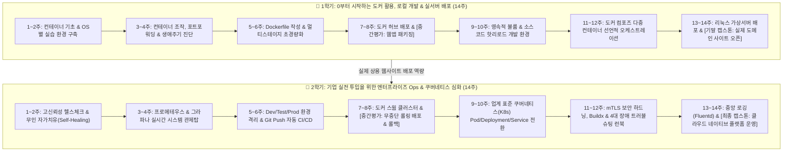

# 🐳 지니와 도로시가 함께 학습하는 도커와 컨테이너
### 🎓 대학생을 위한 실무 웹 배포 & 엔터프라이즈 Ops 전문가 양성 28주 마스터 클래스

[](https://docker.jiny.dev)
[](https://docker.jiny.dev/curriculum/)
[](https://docker.jiny.dev/curriculum/practice/)
[](https://docker.jiny.dev)
[](https://www.docker.com/)

> **비전공자·초보 대학생을 위한 친절한 로컬 개발과 실제 클라우드 서버 배포(1학기 14주)**부터  
> **기업 현업에 즉시 투입 가능한 엔터프라이즈 Ops, 쿠버네티스, CI/CD & 실전 트러블슈팅(2학기 14주)**까지!  
> **이호진 교수님, 도로시, 조교 지니, 반려견 토토, 로봇 티니**와 함께 130강의 실전 랩노트로 도커를 완전 정복합니다.

---

## 🎯 전용 실전 프로젝트: 최신 PHP 8.5 라라벨 & Nginx & PostgreSQL
### 모놀리스에서 엔터프라이즈 MSA 분산 아키텍처 & 대규모 스케일아웃까지

> [👉 실전 프로젝트 상세 커리큘럼 바로가기](https://docker.jiny.dev/curriculum/practice/)

* **백엔드 WAS**: 최신 **PHP 8.5 & 라라벨(Laravel)** (PHP-FPM, OPcache, non-root 격리, 최신 CGI 보안 취약점 원천 차단)
* **웹서버 & 리버스 프록시**: **Nginx (Alpine)** (FastCGI 통신, 정적 캐싱, SSL/TLS Termination, Upstream 로드밸런싱)
* **데이터베이스**: **PostgreSQL 16 (pgsql)** (도커 볼륨 영속화, ACID 트랜잭션, 읽기 전용 복제본 확장)
* **캐시 & 비동기 메시징**: **Redis & NATS** (세션 클러스터링, 백그라운드 큐 워커, MSA 비동기 이벤트 발행/구독)
* **아키텍처 진화 단계**:
  1. `Dockerfile` 단일 이미지 (PHP 8.5 멀티스테이지 초경량화)
  2. `compose.yaml` 3-Tier 모놀리스 개발 (Nginx ↔ PHP-FPM ↔ PostgreSQL ↔ Redis 라이브 핫리로드)
  3. 비동기 큐 워커 분리 (Queue Worker + Redis 이벤트 버스)
  4. 도메인 기반 마이크로서비스(MSA) 분리 (Web + Auth + Order 서비스 & Database-per-Service)
  5. 대규모 트래픽 수평 스케일아웃 (`docker compose up --scale was=5`, Nginx 부하 분산)
  6. 엔터프라이즈 운영 (무중단 롤링 배포, Prometheus/Grafana 관제, Fluentd 중앙 로깅)

---

## 🌟 교육 철학 및 과정 개요

* **교육 대상**: 리눅스나 서버 인프라를 한 번도 다뤄보지 않은 **비전공자 / 컴퓨터공학 학부생 (Zero-Base)**
* **강의 구성**: 총 130강 (000강 ~ 129강) / 8대 핵심 파트 / 2개 학기(총 28주)
* **웹사이트**: [https://docker.jiny.dev](https://docker.jiny.dev) (GitHub Pages)
* **강의 아키텍처**:
  - 📖 **이론 & 실습 교재 (`index.md`)**: Docs 레이아웃, 풍부한 엔지니어링 내러티브, 3열 비교 분석표, 실전 코드 블록, 머메이드 다이어그램, 3대 핵심 교훈
  - 🖥️ **강의 슬라이드 원고 (`slides.md`)**: 주차별 핵심 개념 3대 불릿 포인트 + 구어체 강의 대본
  - 🎬 **유튜브/온라인 강의 메타데이터 (`youtube.md`)**: 펀치라인 썸네일 카피, 추천 타이틀, 타임스탬프 타임라인
  - 🎨 **지브리 화풍 보조 일러스트 (`img/`)**: 스튜디오 지브리 2D 애니메이션 스타일의 직관적 시각 자료

---

## 🧭 2학기 28주 마스터 로드맵 구조



---

## 🌸 1학기: 도커 기초, 로컬 개발 & 실서버 배포 (14주)

> **목표**: 아무것도 모르는 상태에서 시작하여, 로컬 소스코드 수정이 즉시 반영되는 개발 환경(DX)을 체득하고, **실제 리눅스/클라우드 서버에 도메인과 HTTPS가 연결된 상용 웹사이트를 직접 배포**합니다.

| 주차 | 주차별 대주제 | 핵심 학습 및 실습 활동 | 연계 강의 | 실전 마일스톤 |
|:---:|:---|:---|:---:|:---|
| **1주차** | **클라우드 세상과 컨테이너 이야기** | 가상머신(VM)과 컨테이너의 차이, 격리와 밀집의 원리 | 000 ~ 002강 | 컨테이너 패러다임 이해 |
| **2주차** | **내 PC에 도커 연구실 차리기** | Windows WSL2, macOS, Linux 도커 엔진 설치 및 검증 | 003 ~ 005, 012강 | `hello-world` 기동 |
| **3주차** | **첫 컨테이너 실행과 웹서버 접속** | 셸 접속(`-it`), 데몬(`-d`), 포트포워딩(`-p 8080:80`) 웹 접속 | 006 ~ 009, 013강 | 첫 웹서버 로컬 브라우저 접속 |
| **4주차** | **실행 중인 컨테이너 점검과 생애주기** | 컨테이너 셸 침투(`exec`), 양방향 파일 복사(`cp`), 핫패치 | 010 ~ 011, 014강 | **[1차 실습]** 웹페이지 핫패치 |
| **5주차** | **Dockerfile 기초와 레이어 아키텍처** | FROM, WORKDIR, COPY, RUN, CMD, 레이어 캐시 최적화 | 015 ~ 019강 | 커스텀 웹 애플리케이션 빌드 |
| **6주차** | **실행 인자와 멀티스테이지 초경량화** | CMD vs ENTRYPOINT, Spring/Node/Go 이미지 90% 다이어트 | 020 ~ 024강 | 초경량(수십MB) 배포 이미지 |
| **7주차** | **세계인과 공유하는 이미지: 레지스트리** | Docker Hub & GHCR 푸시, 시맨틱 버저닝, 사설 레지스트리 | 026 ~ 031강 | **[2차 실습]** GHCR 이미지 푸시 |
| **8주차** | **[1학기 중간평가] 웹앱 패키징 실기** | 다국어 웹 애플리케이션 Dockerfile 작성 및 경량화 실기 시험 | - | **중간고사 실기 평가** |
| **9주차** | **컨테이너를 지워도 데이터는 안전하게** | 컨테이너 휘발성 쓰기 레이어 극복, 도커 볼륨으로 DB 영속화 | 032 ~ 035, 040강 | DB 데이터 영속성 확보 |
| **10주차** | **로컬 개발자 경험(DX): 바인드 마운트** | 호스트 코드 직결(`-v`), 새로고침만으로 반영되는 라이브 핫리로드 | 036 ~ 039, 041강 | **[3차 실습]** 핫리로드 개발 환경 |
| **11주차** | **명령어 하나로 복합 서비스 기동: 컴포즈** | `compose.yaml` 선언적 파일, Web + App + DB 원클릭 동시 기동 | 042 ~ 043, 046강 | 3개 컨테이너 일괄 기동 |
| **12주차** | **컨테이너 간 대화: 네트워크 & 환경변수** | 도커 내장 DNS 서비스명 통신, `.env` 파일로 DB 암호 은닉 | 025, 044 ~ 045강 | IP 하드코딩 없는 안전한 통신 |
| **13주차** | **진짜 서버로 떠나자: 클라우드 서버 배포** | 클라우드 가상서버(VPS) 생성, 방화벽 개방, 원격 컴포즈 배포 | 004, 062강 | 공인 IP 원격 서버 배포 |
| **14주차** | **[1학기 기말 캡스톤] 실전 웹사이트 배포** | 도메인 연결 + Nginx 프론트 + DB + Let's Encrypt SSL 적용 | 126 ~ 127강 | **1학기 캡스톤: 실제 서비스 오픈** |

---

## 🍁 2학기: 엔터프라이즈 Ops, 쿠버네티스 & SRE 전문가 (14주)

> **목표**: 1학기 배포 경험을 바탕으로 **고가용성 자가치유, 실시간 관제탑(Prometheus/Grafana), 컨테이너 CI/CD 파이프라인, 쿠버네티스(K8s) & 스웜 오케스트레이션, 4대 실전 장애 트러블슈팅, 엔터프라이즈 보안**을 총망라하여 기업 현업 수준의 DevOps/SRE 엔지니어로 완성합니다.

| 주차 | 주차별 대주제 | 기업 현업 실무 내용 및 실습 활동 | 연계 강의 | 실전 마일스톤 |
|:---:|:---|:---|:---:|:---|
| **1주차** | **서버가 죽지 않는 마법: 헬스체크** | 데드락/500 에러 자동 감지, `HEALTHCHECK` 파라미터 정밀 설계 | 047 ~ 050강 | 불량 컨테이너 자동 감지 |
| **2주차** | **자가치유(Self-Healing) & 조건부 의존성** | `condition: service_healthy`, 프로세스 다운 시 1초 만에 자동 부활 | 051 ~ 052, 061강 | 무인 자가치유 시스템 |
| **3주차** | **시스템 관제탑 1: 프로메테우스 메트릭** | 풀(Pull) 기반 모니터링, cAdvisor/Node Exporter, PromQL 질의 | 053 ~ 057강 | 인프라 자원 메트릭 수집 |
| **4주차** | **시스템 관제탑 2: 그라파나 대시보드 코드화** | 대시보드 프로비저닝 자동화(YAML/JSON), 슬랙 긴급 알림 | 058 ~ 060강 | 실시간 관제탑 & 경보 완성 |
| **5주차** | **기업형 다중 환경 설계: Dev/Test/Prod** | 컴포즈 오버라이드 병합, Docker Secrets 민감정보 암호화 주입 | 063 ~ 068강 | 3대 환경 격리 오버라이드 |
| **6주차** | **손 하나 까딱 않는 배포: 컨테이너 CI/CD** | DooD 소켓 러너, Git Push ➔ 자동 테스트 ➔ 빌드 ➔ 배포 자동화 | 069 ~ 075강 | **[심화 실습]** 완전 자동화 CI/CD |
| **7주차** | **단일 서버의 한계를 넘어: 도커 스웜** | 3대 서버 클러스터링, 오버레이(VXLAN) 네트워크, Raft 합의 쿼럼 | 076 ~ 079, 093강 | 3-노드 고가용성 클러스터 |
| **8주차** | **[2학기 중간평가] 무중단 롤링 배포 & 롤백** | 사용자 트래픽 무중단 버전 교체 및 불량 배포 시 1초 만에 자동 롤백 | 088 ~ 091, 095강 | **중간고사: 무중단 롤백 실기** |
| **9주차** | **엔터프라이즈 스택 배포와 노드 유지보수** | `docker stack deploy`, 서버 점검 시 무중단 작업 대피(Drain 모드) | 082 ~ 087, 092, 094강 | 프로덕션 스택 무중단 유지보수 |
| **10주차** | **클라우드 표준: 쿠버네티스(K8s) 핵심 전환** | 스웜 vs K8s 아키텍처 대조, Pod/Deployment/Service 매니페스트 전환 | 080 ~ 081강 | K8s 클러스터 배포 성공 |
| **11주차** | **엔터프라이즈 보안 하드닝 & 멀티 아키텍처** | mTLS 상호 인증서 통신, non-root 보안, Docker Buildx 크로스 컴파일 | 096 ~ 109강 | 보안 하드닝 골든 이미지 |
| **12주차** | **프로덕션 장애 해결 훈련: 4대 트러블슈팅** | 포트 충돌, 디스크 고갈(Overlay2), 볼륨 권한 거부, 좀비 프로세스(Tini) | 트러블슈팅 특화랩 | **실전 장애 복구 런북(Runbook)** |
| **13주차** | **대규모 트래픽 분산과 중앙 로깅 파이프라인** | Traefik/Nginx 리버스 프록시 자동 라우팅, Fluentd/Loki 중앙 로그 검색 | 114 ~ 125강 | L7 프록시 & 통합 로깅 구축 |
| **14주차** | **[2학기 최종 캡스톤] 엔터프라이즈 플랫폼 운영** | 5대 캐릭터 가상 기업 풀스택 플랫폼 고가용성 운영 시연 및 수료 평가 | 128 ~ 129강 | **2학기 최종 캡스톤 완성** |

---

## 👥 도로시 원정대 캐릭터 소개

본 코스는 도로시 세계관의 5대 주인공이 튜터와 동료로 등장하여 복잡한 인프라 개념을 유쾌하고 직관적으로 안내합니다:

* **이호진 교수님 (총괄 멘토)**: 원리와 본질을 꿰뚫는 엔지니어링 멘토! 리눅스 커널 격리 기술부터 아키텍처 설계까지 든든하게 이끌어줍니다.
* **도로시 (주니어 메이커)**: 호기심 많은 주니어 개발자! 직접 Dockerfile을 작성하고 마이크로서비스를 구축하며 함께 성장합니다.
* **조교 지니 (연구실 조교)**: 천재 수석 연구실 냥이! 포트 충돌이나 레이어 캐시 실수가 발생하면 날카롭게 원인을 짚어줍니다.
* **토토 (동반자 & 긍정 비타민)**: 도로시의 단짝 강아지! 빌드가 성공하면 꼬리를 흔들고, 에러가 나면 곁에서 힘을 북돋워 줍니다.
* **로봇 티니 (인프라 서포터)**: 컨테이너를 가뿐히 들어 나르고 좀비 프로세스를 쓸어 담는 든든한 서포터 로봇입니다.

👉 자세한 캐릭터 프로필은 [캐릭터 소개 페이지](https://docker.jiny.dev/character/)를 참고하세요.

---

## 📁 프로젝트 디렉터리 구조

GitHub Pages 표준 배포 규격에 맞추어 원본 소스(`src/`)와 정적 컴파일 산출물(`docs/`)로 분리 운영됩니다:

```
docker/
├── _config.yml               # Jekyll 빌드 설정 (source: src, destination: docs)
├── Gemfile / Gemfile.lock    # 루비 & 지킬 플러그인 의존성
├── CNAME                     # 커스텀 도메인 (docker.jiny.dev)
├── README.md                 # 본 프로젝트 문서
│
├── src/                      # 📂 강의 원본 소스 관리 디렉터리
│   ├── _data/                # 상단 네비게이션 데이터 (header_nav.yml)
│   ├── _includes/            # 공통 모듈 (hero, roadmap, character, footer 등)
│   ├── _layouts/             # 레이아웃 (bootstrap, docs, home)
│   ├── _sass/                # SCSS 스타일시트
│   ├── assets/               # CSS, JS, 히어로 메인 일러스트
│   ├── img/                  # 5대 캐릭터 및 로고 애셋
│   ├── index.html            # 메인 홈 페이지 소스
│   ├── character.md          # 캐릭터 소개 페이지 소스
│   ├── curriculum/           # 2학기제 커리큘럼 페이지 소스
│   └── Part01 ~ Part08/      # 130개 강의 마크다운 본문 및 실습 이미지
│
└── docs/                     # 🚀 GitHub Pages 배포용 정적 빌드 산출물 (자동 생성)
    ├── index.html
    ├── character/
    ├── curriculum/
    ├── Part01 ~ Part08/
    └── CNAME (docker.jiny.dev)
```

---

## 🚀 로컬 개발 및 실시간 미리보기 (Live Reload)

로컬 머신에서 사이트를 빌드하고 브라우저로 실시간 확인하려면 다음 명령어를 실행합니다:

```bash
# 의존성 설치
bundle install

# 로컬 개발 서버 기동 (LiveReload 활성화)
bundle exec jekyll serve --livereload --host 0.0.0.0 --port 4000
```

브라우저에서 `http://localhost:4000/`으로 접속하면 `src/`의 소스 변경 사항이 실시간으로 감지되어 `docs/`에 자동 반영됩니다.
