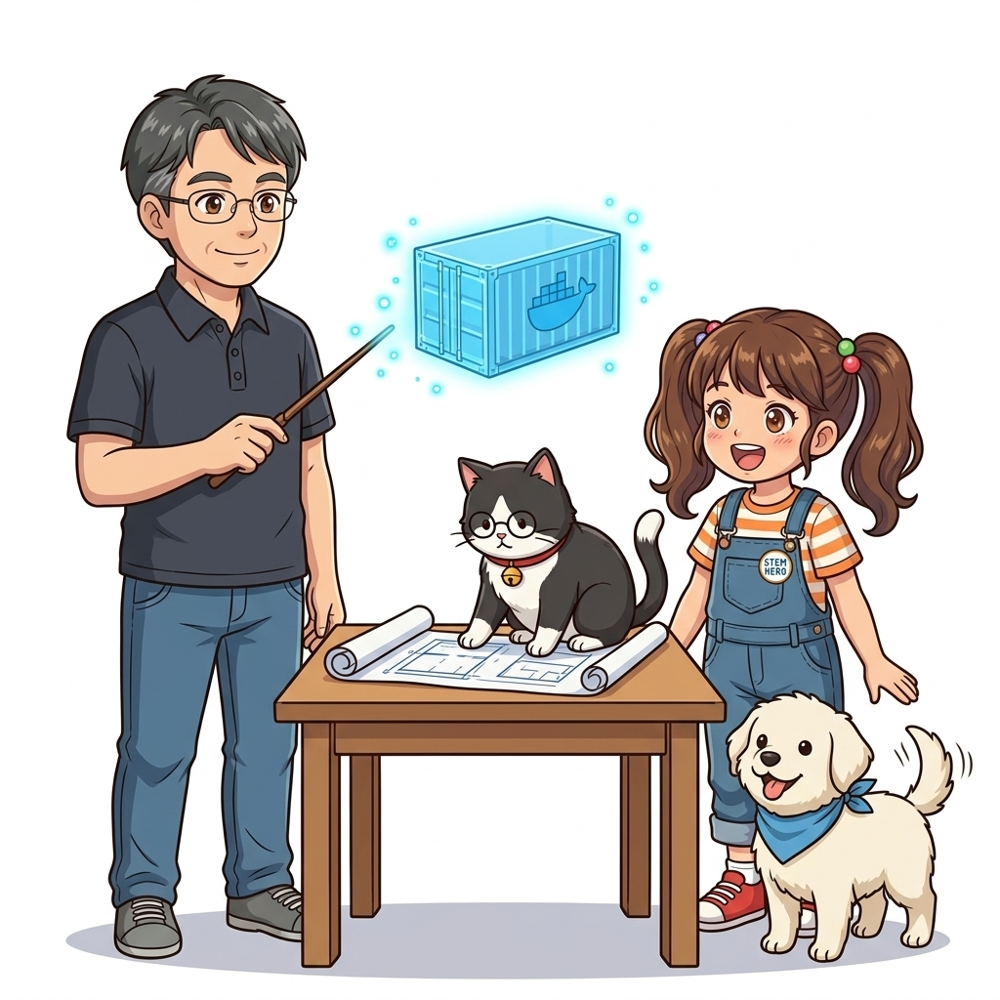
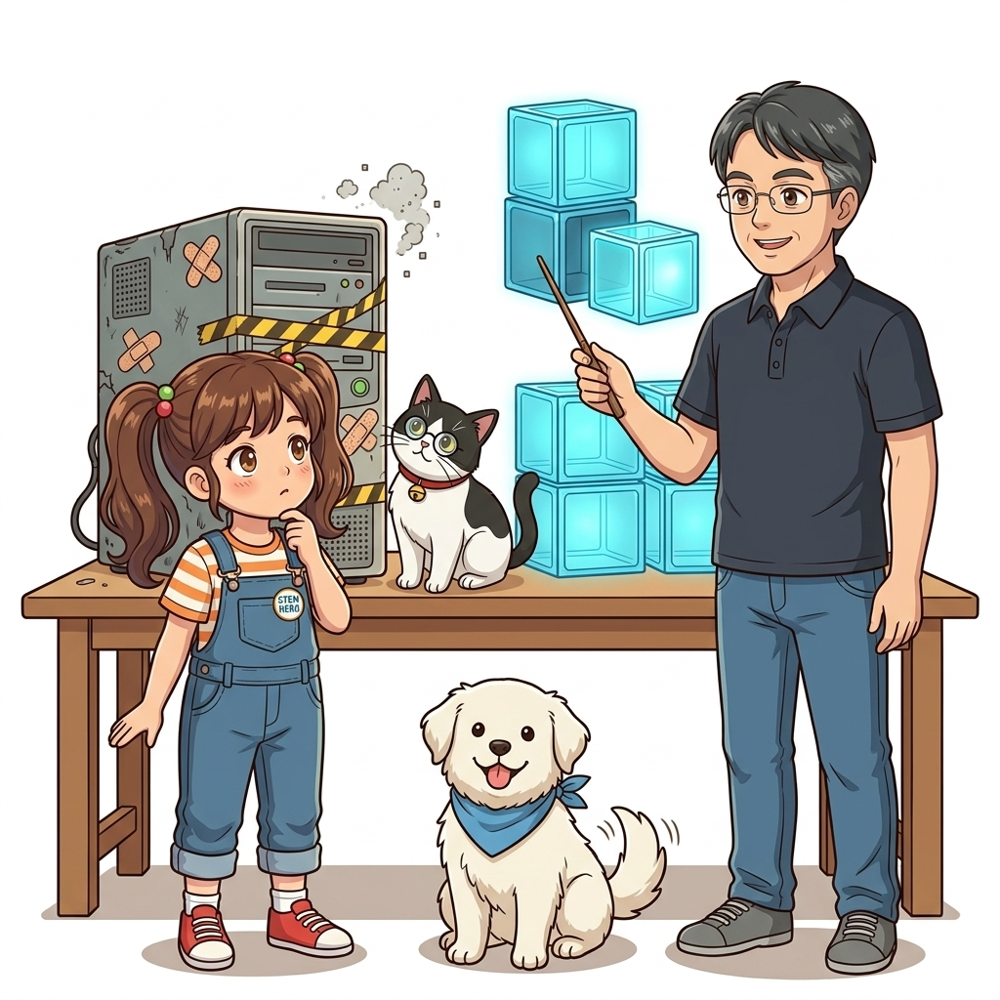
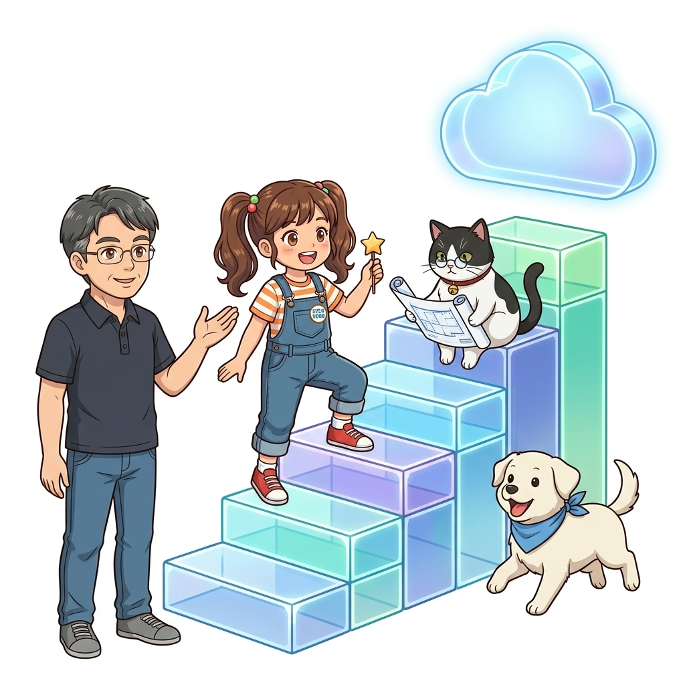
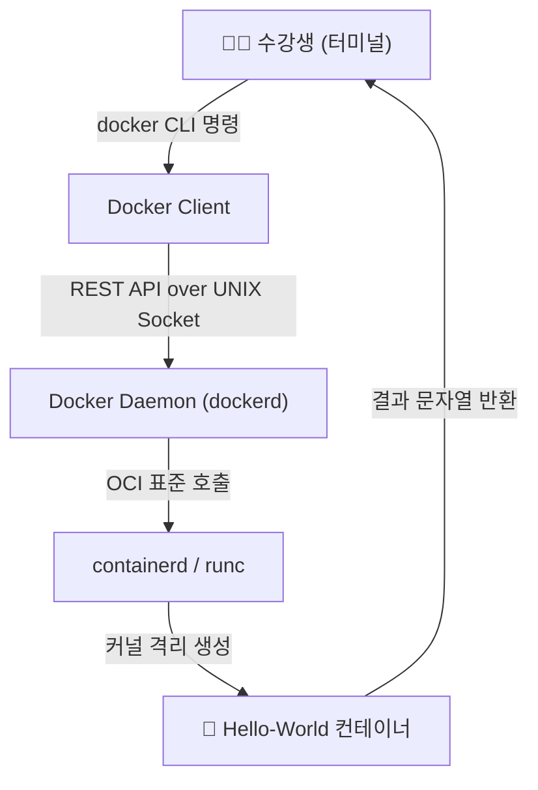
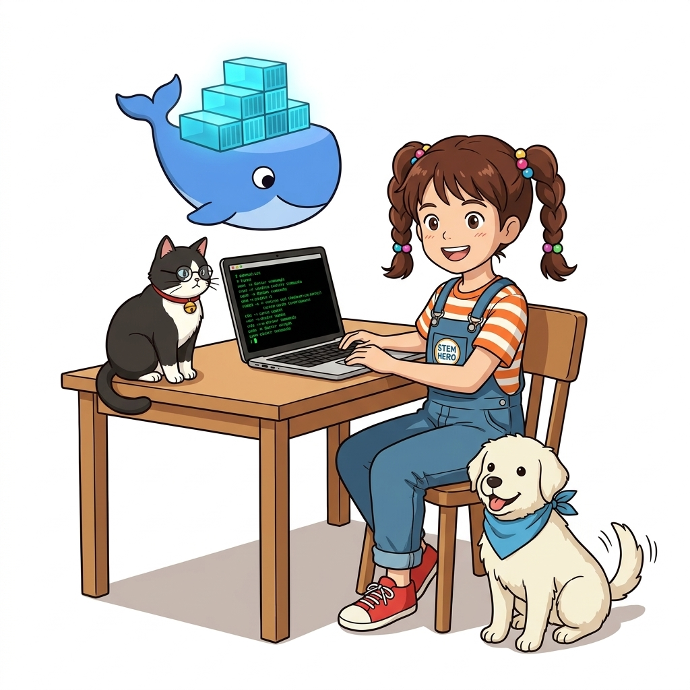
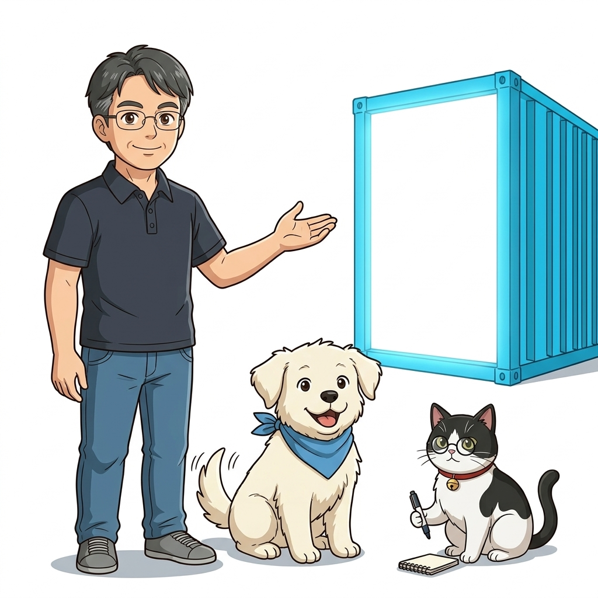

# 000. 강의 오리엔테이션: 클라우드 네이티브와 도커 대모험

현대 소프트웨어 공학의 판도는 **도커(Docker)**의 등장 이전과 이후로 명확하게 나뉩니다. 과거의 서버 개발자들은 새로운 기능을 배포할 때마다 운영체제 버전의 미세한 차이, 설치된 라이브러리의 충돌, 복잡하게 얽힌 환경 변수의 불일치 때문에 밤을 지새우며 서버실을 지켜야 했습니다. "제 로컬 노트북에서는 완벽하게 실행되는데, 왜 운영 서버에만 올리면 죽을까요?"라는 질문은 전 세계 수많은 개발자들의 가슴을 짓누르는 공포였습니다.


**그림 01-1-1** 클라우드 네이티브 대항해의 시작과 130강 도커 마스터 여정의 비전

하지만 2013년 도커가 리눅스 컨테이너 기술을 대중적인 표준으로 격상시키면서, 소프트웨어는 물리적 하드웨어나 특정 호스트 운영체제의 굴레에서 완전히 해방되었습니다. 애플리케이션 실행에 필요한 모든 바이너리, 라이브러리, 설정 파일을 하나의 표준화된 박스(컨테이너)에 담아 선적함으로써, 우리는 개발 노트북에서 테스트 서버, 그리고 수천 대의 AWS/GCP 클라우드 노드에 이르기까지 **단 1비트의 환경 오차도 없는 완벽한 불변 인프라(Immutable Infrastructure)**를 구축할 수 있게 되었습니다.

이번 130강 마스터 클래스는 단순한 명령어 암기용 튜토리얼이 아닙니다. 기초적인 `docker run` 명령어부터 시작하여 멀티 스테이지 빌드, 도커 컴포즈 분산 시스템, 프로메테우스·그라파나 풀스택 관제, 도커 스웜과 쿠버네티스 오케스트레이션, 그리고 엔터프라이즈 프로덕션 운영(Fluentd 중앙 로깅, Traefik 리버스 프록시, NATS 비동기 메시징)에 이르기까지 **클라우드 네이티브 엔지니어링의 A부터 Z까지를 철저한 원리 중심과 실습**으로 정복하는 대장정입니다.

---

### 000.1 클라우드 네이티브란 무엇인가? 단순 가상화와의 근본적 차이

많은 사람들이 '클라우드 네이티브(Cloud Native)'라는 용어를 단순히 "AWS나 Azure 같은 퍼블릭 클라우드 가상머신 위에서 코드를 돌리는 것"으로 오해하곤 합니다. 하지만 서버 호스팅 장소를 온프레미스 IDC에서 클라우드로 옮겼다고 해서 저절로 클라우드 네이티브가 되는 것은 아닙니다.


**그림 01-1-2** 단순히 서버를 클라우드로 옮긴 것과 진정한 클라우드 네이티브 불변 인프라의 개념적 차이

클라우드 네이티브의 핵심 철학은 **"인프라의 모든 자원을 동적으로 프로비저닝하고, 소프트웨어 패키징과 확장을 선언적(Declarative)으로 관리하며, 개별 노드의 장애에도 시스템 전체는 자가 치유(Self-healing)되도록 설계하는 것"**입니다.
* **가상머신 시대**: 서버 한 대를 마치 정성 들여 키우는 '애완동물(Pet)'처럼 다루며 장애가 나면 원인을 찾고 패치를 적용했습니다.
* **클라우드 네이티브 컨테이너 시대**: 컨테이너를 언제든 버리고 교체할 수 있는 '가축(Cattle)'처럼 다루며, 문제가 발생한 인스턴스는 즉시 폐기하고 사전에 빌드된 불변 이미지로 1초 만에 새로 기동합니다.

이 패러다임 전환의 심장에 바로 도커와 OCI(Open Container Initiative) 표준 컨테이너 기술이 자리 잡고 있습니다.

---

### 000.2 130강 대장정의 8대 마일스톤 지도

본 강의는 기초부터 최고급 실무 아키텍처까지 8개의 대단원으로 체계적으로 구조화되어 있습니다:


**그림 01-1-3** 000강부터 129강까지 이어지는 8대 대단원 엔지니어링 성장 곡선

#### 📊 8대 대단원 구성 및 학습 목표 분석

| 대단원 구분 | 핵심 학습 영역 | 습득하게 되는 엔지니어링 역량 |
| :--- | :--- | :--- |
| **Part 01 (000~014)** | 컨테이너 기초, 도커 엔진, 커널 격리 원리 | 리눅스 namespaces/cgroups 이해, 단일 컨테이너 완벽 제어 |
| **Part 02 (015~031)** | Dockerfile 빌드, 멀티 스테이지, 레지스트리 | 프로덕션 수준의 초경량 불변 이미지 패키징 및 배포 자동화 |
| **Part 03 (032~041)** | 퍼시스턴트 스토리지, 볼륨, 바인드 마운트 | 상태 저장(Stateful) 데이터베이스의 무손실 영속성 관리 기법 |
| **Part 04 (042~061)** | 도커 컴포즈, 헬스체크, Prometheus/Grafana | 다중 마이크로서비스 연동, 복원력 있는 헬스체크 및 실시간 풀스택 모니터링 |
| **Part 05 (062~075)** | 다중 환경(Dev/Test/Prod) 설계, CI/CD | 환경별 구성 분리, GitHub Actions 기반 무중단 빌드/테스트 파이프라인 |
| **Part 06 (076~095)** | 도커 스웜 & 쿠버네티스 오케스트레이션 | 다중 노드 클러스터링, 선언적 스케일링, 무중단 롤링 업데이트 및 롤백 |
| **Part 07 (096~111)** | 보안 원격 제어, Multi-Arch, 이미지 최적화 | Docker Context, Buildx 크로스 플랫폼 빌드, Trivy 보안 스캐닝 |
| **Part 08 (112~129)** | 프로덕션 운영: Fluentd, Traefik, NATS | 중앙 로그 수집, 클라우드 리버스 프록시, 비동기 이벤트 기반 메시징 플랫폼 완성 |

---

### 000.3 도로시 연구팀과 함께하는 선언적 학습 방법론

우리의 학습은 일방적인 명령어 나열이 아닙니다. 호기심 많은 주니어 메이커 **도로시**, 날카로운 눈으로 아키텍처를 검증하는 수석 조교 고양이 **지니**, 지치지 않는 긍정 에너지로 부품을 나르는 반려견 **토토**, 그리고 모든 원리를 쉽고 명쾌한 현실 비유로 풀어주는 **이호진 교수님**이 한 팀이 되어 매 강의마다 생생한 실험을 진행합니다.

특히 본 코스의 모든 실습은 **"내 컴퓨터에서 즉시 재현되는 선언적 코드"** 원칙을 고수합니다. 복잡한 외부 유료 서비스 없이, 공식 도커 이미지와 표준 설정 파일만으로 즉시 구동할 수 있습니다.

```bash
# [실습 000-1] 도커 엔진과 컴포즈 설치 상태 및 버전 확인
docker --version
docker compose version

# [실습 000-2] 130강 대모험의 신호탄: Hello-World 공식 컨테이너 실행
docker container run --rm hello-world
```

#### 🔍 아키텍처 흐름도 (Mermaid Diagram)




**그림 01-1-4** 클라이언트-데몬-OCI 런타임으로 이어지는 도커의 첫 실행 파이프라인

---

### 000.4 핵심 정리: 캐릭터 대화와 3대 교훈

> 👧 **도로시**: "교수님! 단순한 소프트웨어 실행기가 아니라, 현대 클라우드 전체를 지탱하는 거대한 불변 인프라 표준을 배우는 거군요!"
> 
> 🐱 **조교 지니**: "야옹~ 맞습니다. 특히 개발 환경과 프로덕션 환경의 차이를 0으로 만드는 것이 엔지니어의 가장 강력한 무기랍니다!"
> 
> 🐶 **토토**: "멍멍! 130개 강의를 모두 달리면 나도 클라우드 네이티브 마스터가 될 수 있어요!"
> 
> 👨‍🏫 **이호진 교수님**: "그렇단다. 하드웨어와 커널의 근본 원리부터 탄탄히 다지면, 아무리 복잡한 대규모 쿠버네티스 클러스터도 두렵지 않단다. 다 함께 즐겁게 출발해 보자!"


**그림 01-1-5** 130강 완주를 향한 도로시 연구팀의 결의와 3대 핵심 학습 원칙

1. **표준화된 불변성 (Immutability)**:
   * 환경의 차이로 인한 장애를 제거하기 위해 실행 바이너리와 런타임을 하나의 불변 패키지로 캡슐화합니다.
2. **선언적 인프라 명세 (Declarative Infrastructure)**:
   * 모든 인프라와 배포 구성을 사람이 수작업으로 입력하지 않고, 버전 관리 가능한 텍스트 코드(`Dockerfile`, `compose.yaml`)로 관리합니다.
3. **단계적 원리 내재화 (Principle-First Learning)**:
   * 단순 명령어 암기를 지양하고, 리눅스 커널 수준의 프로세스 격리 원리와 OCI 표준 아키텍처를 정확히 이해합니다.

---

### 000.5 랩노트 피날레와 다음 강의 예고


**그림 01-1-6** 130강 완주의 첫 페이지를 열며 다음 강의의 역사적 배경을 예고하는 이호진 교수님과 연구팀

> 💡 **다음 강의 안내**:
> [001. 컨테이너가 IT 세상을 점령한 이유 1: 클라우드 이주와 레거시 현대화](../001_컨테이너가_IT세상을_점령한_이유1_클라우드이주와_레거시현대화/)에서는 개발자와 인프라 엔지니어를 수십 년간 괴롭혀 온 '환경 불일치(Configuration Drift)'의 생생한 악몽과, 오래된 레거시 시스템을 코드 한 줄 수정 없이 클라우드로 안전하게 옮겨내는 '리프트 앤 시프트(Lift & Shift)'의 마법 같은 비결을 파헤칩니다!

---

## 🧭 강의 네비게이션
* *첫 번째 강의입니다.*
* [📋 Part 01. 컨테이너 혁명과 도커 엔진 기본기 마스터 (000 ~ 014) 목차로 돌아가기](../)
* [▶️ 다음 강의: 001_컨테이너가_IT세상을_점령한_이유1_클라우드이주와_레거시현대화](../001_컨테이너가_IT세상을_점령한_이유1_클라우드이주와_레거시현대화/)
