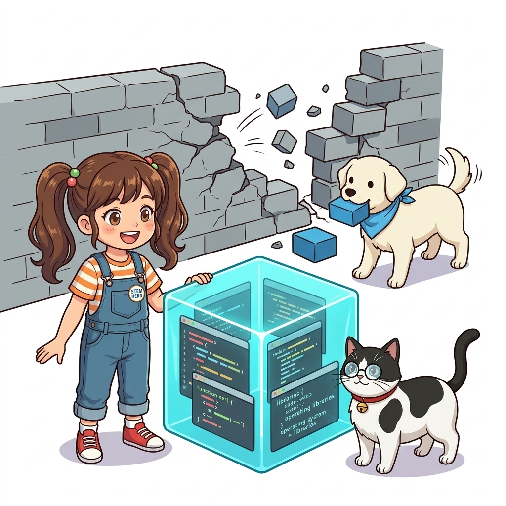
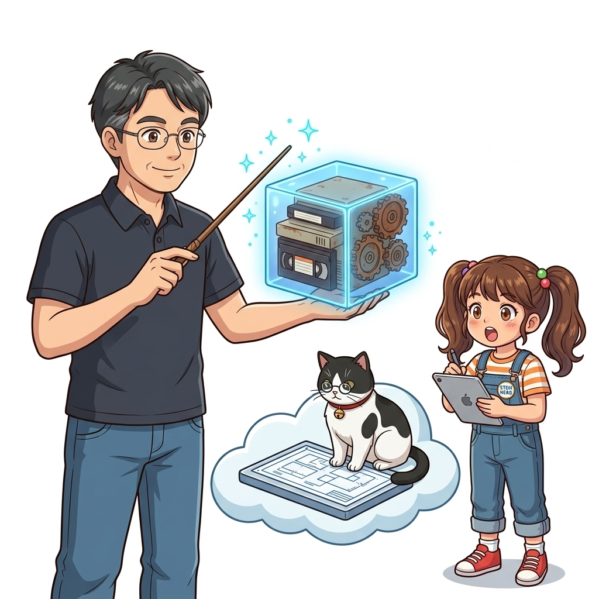
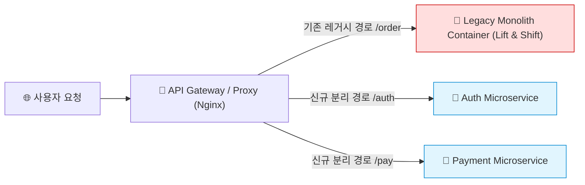
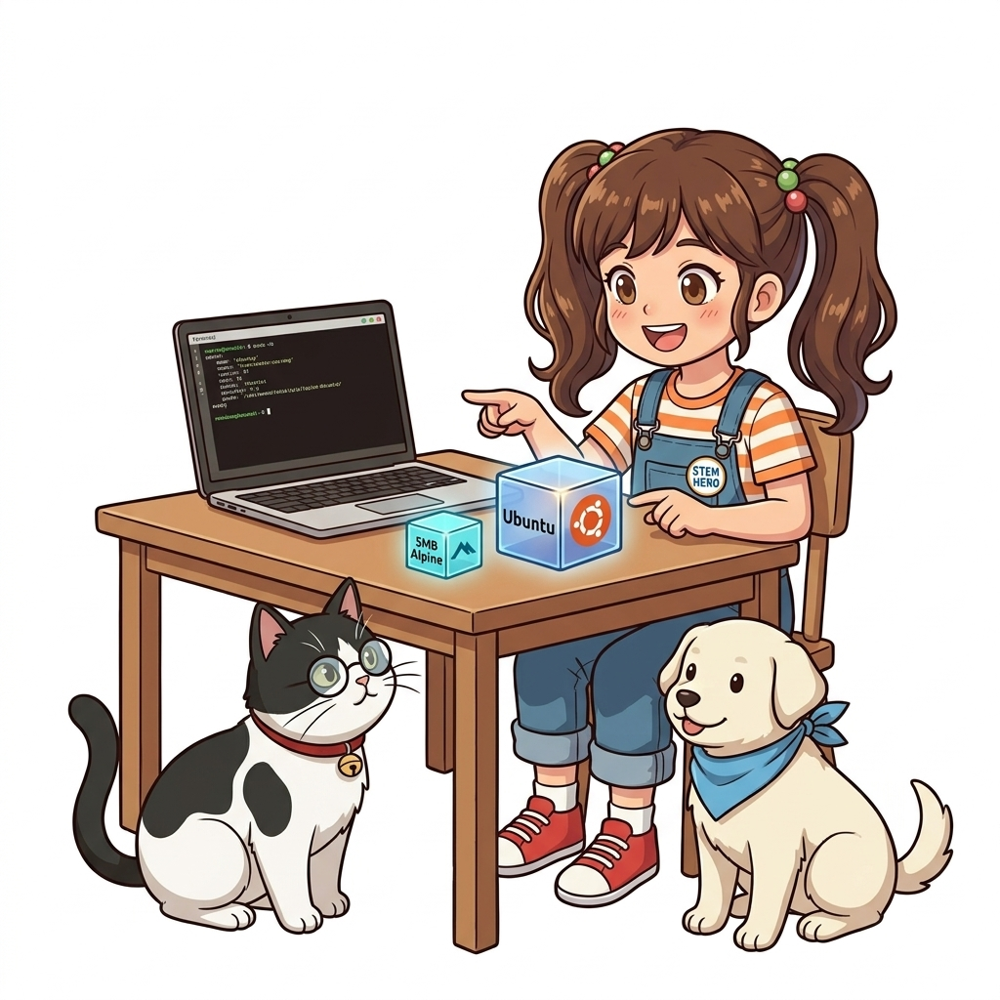
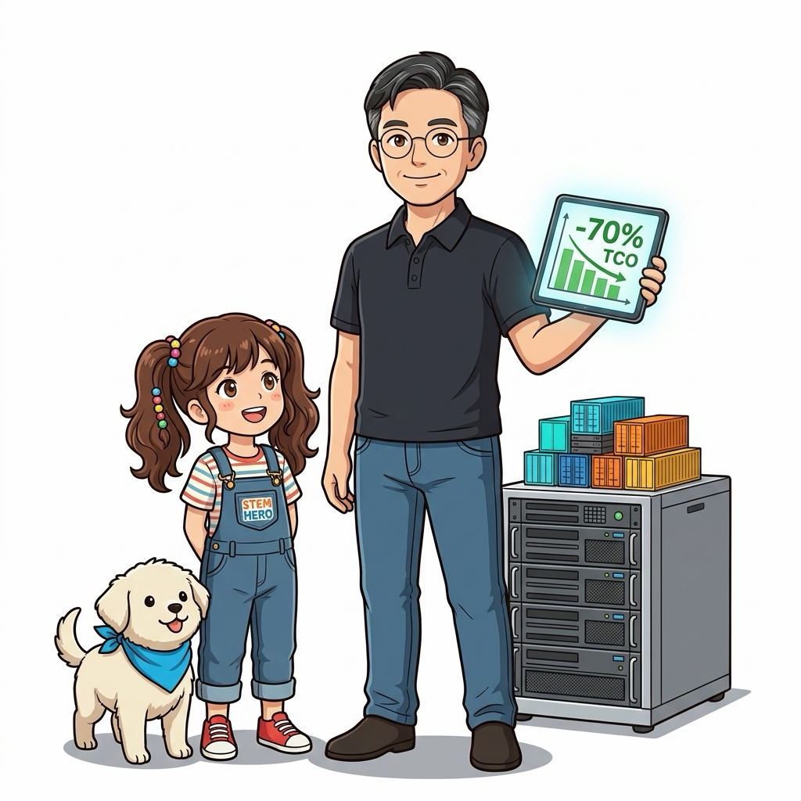
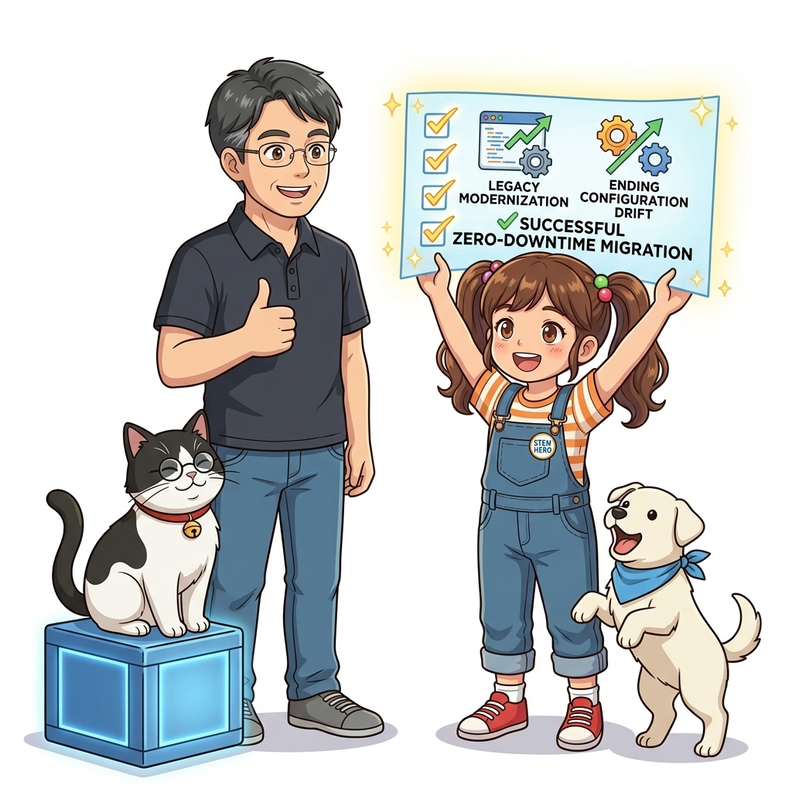
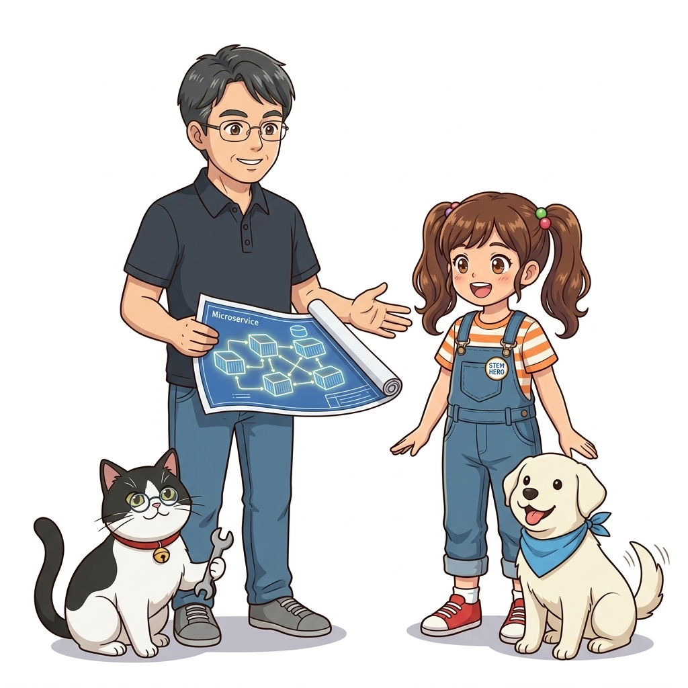

# 001. 컨테이너가 IT 세상을 점령한 이유 1: 클라우드 이주와 레거시 현대화

소프트웨어 개발의 역사에서 가장 오래되고 뼈아픈 비극은 바로 **"내 컴퓨터에서는 정말 완벽하게 돌아갔는데, 왜 운영 서버에 배포만 하면 터질까?"**라는 절규입니다. 개발자의 노트북, 스테이징 테스트 서버, 그리고 운영(Production) 데이터센터의 하드웨어와 운영체제가 조금씩 다르고, 설치된 라이브러리 패키지의 마이너 버전이 0.1만 어긋나도 프로그램은 치명적인 세그멘테이션 오류나 의존성 충돌을 일으키며 멈춰 섰습니다.


**그림 01-2-1** 개발 환경과 운영 서버의 미세한 차이로 인해 발생하는 환경 불일치(Configuration Drift)의 악몽

이러한 현상을 소프트웨어 공학에서는 **'구성 드리프트(Configuration Drift)'** 또는 **'환경 불일치'**라고 부릅니다. 수많은 기업들이 이를 해결하기 위해 수백 페이지에 달하는 '서버 세팅 가이드 문서'를 작성하고, 인프라 엔지니어들이 며칠 밤을 새우며 설정을 동기화하려 애썼지만, 인간의 실수는 결코 완전히 사라지지 않았습니다.

도커 컨테이너는 이 뿌리 깊은 문제를 소프트웨어를 다루는 근본적인 발상의 전환을 통해 완벽하게 해결했습니다.

---

### 001.1 개발팀과 운영팀의 영원한 갈등: 사일로(Silo)와 핑퐁 게임

전통적인 IT 조직에서는 소프트웨어를 만드는 개발팀(Dev)과 서버 인프라를 안정적으로 유지해야 하는 운영팀(Ops) 사이에 거대한 장벽이 존재했습니다.
1. 개발팀은 최신 기능과 라이브러리를 빠르게 도입하여 배포하고 싶어 합니다.
2. 운영팀은 서버의 안정성을 위해 운영체제 패치나 라이브러리 변경을 극도로 꺼립니다.
3. 장애가 발생하면 개발팀은 "코드에는 문제가 없으니 서버 환경이 이상하다"고 주장하고, 운영팀은 "어제까지 멀쩡하던 서버인데 당신들 코드가 문제다"라며 서로 책임을 떠넘기는 핑퐁 게임이 반복되었습니다.


**그림 01-2-2** 개발팀과 운영팀의 벽을 허물고 단일한 불변 실행 패키지를 제공하는 컨테이너

컨테이너는 이 갈등의 경계선을 명확하게 재정의했습니다. **"애플리케이션 코드뿐만 아니라, 그 코드가 동작하는 데 필요한 OS 파일시스템, 라이브러리, 환경 변수까지 통째로 하나의 불변 캡슐로 패키징한다"**는 원칙을 세운 것입니다. 이제 개발팀은 애플리케이션과 그 실행 환경 전체를 책임지고, 운영팀은 표준화된 컨테이너 엔진이 안정적으로 구동되는 인프라 플랫폼만을 책임지는 명확한 역할 분담이 가능해졌습니다.

---

### 001.2 레거시 애플리케이션의 클라우드 이주: 리프트 앤 시프트 (Lift & Shift)

기업들이 클라우드로 전환할 때 맞닥뜨리는 가장 큰 암초는 바로 10년, 20년 전에 개발된 **오래된 레거시 시스템(Legacy System)**입니다. 
* 소스코드를 작성했던 개발자들은 이미 퇴사했고,
* 최신 리눅스 배포판에서는 지원조차 중단된 낡은 라이브러리와 구버전 런타임(Python 2.7, Java 6, 옛날 C 라이브러리)에 강하게 결속되어 있어,
* 코드를 현대적으로 다시 작성하려면 수억 원의 비용과 막대한 장애 리스크가 따릅니다.


**그림 01-2-3** 낡은 레거시 애플리케이션의 런타임 환경을 그대로 보존하여 클라우드로 이주시키는 리프트 앤 시프트 아키텍처

도커는 이 난제를 **리프트 앤 시프트(Lift and Shift)** 기법으로 우아하게 돌파합니다. 레거시 프로그램이 필요로 하는 구형 운영체제의 파일 시스템과 라이브러리 전체를 도커 이미지로 캡슐화하면, 최신 커널이 탑재된 최신 클라우드 서버(Ubuntu 24.04, AWS Graviton 등) 위에서도 레거시 코드를 단 한 줄도 수정하지 않고 그대로 격리 실행할 수 있습니다.

#### 📊 레거시 현대화 전략 비교 분석

| 전략 구분 | 마이그레이션 방식 및 특징 | 장점 및 비즈니스 효과 | 주의점 및 한계 |
| :--- | :--- | :--- | :--- |
| **전면 재작성 (Big Bang Rewrite)** | 기존 시스템을 폐기하고 클라우드 네이티브 MSA로 완전히 새로 개발 | 최신 기술 스택 도입, 기술 부채 완전 청산 | 천문학적인 비용, 프로젝트 실패 및 비즈니스 중단 위험 극대 |
| **리프트 앤 시프트 (Lift & Shift via Docker)** | 레거시 환경 그대로 컨테이너로 감싸 호스트 OS 제약 없이 클라우드 이전 | 수일 내 초고속 마이그레이션, 기존 검증된 비즈니스 로직 100% 보존 | 컨테이너 내부 구조는 여전히 무겁고 모놀리식 구조 유지 |
| **교살자 패턴 (Strangler Fig Pattern)** | 컨테이너화된 레거시 주변에 새로운 기능을 개별 마이크로서비스 컨테이너로 점진 분리 | 무중단으로 점진적 아키텍처 혁신, 리스크 최소화 | 과도기 동안 레거시와 신규 서비스 간의 동기화 및 라우팅 복잡성 관리 필요 |

---

### 001.3 점진적 레거시 현대화: 교살자 무화과(Strangler Fig) 패턴

리프트 앤 시프트로 클라우드에 안착한 레거시 컨테이너는 점진적인 현대화의 든든한 출발점이 됩니다. 마치 오래된 나무의 줄기를 감싸고 자라나며 결국 새로운 나무가 되는 '교살자 무화과(Strangler Fig)'처럼, 우리는 거대한 레거시 덩어리를 한 번에 쪼개는 대신:
1. 기존 레거시 앞단에 도커 리버스 프록시(Nginx 등)를 배치하고,
2. 새로 추가되는 기능(예: 결제, 회원 인증, 알림)만 작고 가벼운 독립 컨테이너로 분리 개발하여 연동하며,
3. 레거시의 오래된 기능을 하나씩 신규 컨테이너로 이전해 나감으로써 **비즈니스를 1초도 중단하지 않고 현대적인 마이크로서비스 아키텍처로 탈바꿈**시킬 수 있습니다.

```bash
# [실습 001-1] 호스트 OS와 완전히 분리된 5MB 초경량 알파인 리눅스 컨테이너 즉시 가동
docker container run --rm alpine:3.20 cat /etc/os-release

# [실습 001-2] 구버전 우분투 환경이 필요한 레거시 런타임 캡슐화 테스트
docker container run --rm ubuntu:18.04 cat /etc/issue
```

#### 🔍 교살자 무화과 마이그레이션 흐름도 (Mermaid Diagram)




**그림 01-2-4** 5MB 초경량 알파인과 구버전 우분투 런타임이 호스트 환경 위에서 완벽히 공존하는 실습

---

<!-- BIBLE_INTEGRATION_book4_enterprise_tco_density -->
---

### 001.B 📚 도커 바이블 심화: 엔터프라이즈 인프라 집적도 극대화와 물리 서버 가상화 TCO 절감 모델
*출처 도서: 『완벽한 IT 인프라 구축을 위한 Docker』 핵심 분석*

기존의 전통적인 데이터센터 가상화(VMware ESXi, KVM 등) 환경에서는 하이퍼바이저 위에 각 게스트 OS마다 최소 2~4GB의 메모리와 수십 GB의 디스크가 고정 할당되었습니다. 이로 인해 단일 고성능 블레이드 서버에서 구동할 수 있는 VM의 개수는 수십 대 수준에 머물렀습니다.

도커 컨테이너는 커널 공유와 페이징 메모리 관리 덕분에 동일한 물리 하드웨어 스펙에서 **서버 집적도(Server Density)를 3배에서 최대 10배까지 끌어올립니다**:
* **유휴 자원 낭비 제거**: 프로세스가 실제로 사용하는 메모리 페이지만 점유하므로, 메모리 오버커밋(Overcommit) 없이도 밀집 배포가 가능합니다.
* **TCO(총소유비용)의 극적 절감**: 물리 서버 대수 축소는 곧 데이터센터 상면(랙) 임대료, 전력 소비량, 항온항습 비용, 그리고 OS 및 하이퍼바이저 라이선스 비용의 비약적인 절감으로 직결됩니다.


**그림 001-B-1** 무거운 VM 스택 대비 5배 높은 집적도로 데이터센터 서버 비용을 획기적으로 줄이는 도커 인프라 모델

```bash
# [실습] 고집적 컨테이너 50대 동시 가동 리소스 점유율 측정
# 초경량 Nginx 컨테이너 50대 일괄 기동
for i in $(seq 1 50); do
  docker container run -d --name density-test-$i --memory=32m alpine sleep 3600 >/dev/null
done

# 50대 컨테이너의 총 메모리 점유율 요약 확인 (전체 합산해도 수백 MB에 불과함)
docker container stats --no-stream --format "table {{.Name}}\t{{.MemUsage}}" | head -n 10

# 테스트 컨테이너 일괄 정리
docker container rm -f $(docker container ps -q -f "name=density-test-") >/dev/null
```

> 👨‍🏫 **이호진 교수님의 바이블 멘토링 노트**:
> "인프라 엔지니어에게 도커의 가장 큰 매력은 '가성비의 혁신'입니다. 동일한 클라우드 예산으로 3배 더 많은 트래픽을 감당할 수 있는 인프라 구조를 만드는 것이 수석 아키텍트의 실력입니다."
>
> 👧 **도로시의 깨달음**:
> "물리 서버 10대가 필요했던 일을 단 2대로 끝낼 수 있으니 전기세도 아끼고 지구 환경에도 큰 도움이 되겠네요!"
>
> 🐱 **조교 지니의 아키텍처 체크포인트**:
> "다만 높은 집적도를 달성할 때는 특정 컨테이너가 메모리를 독식하지 못하도록 `--memory`와 `--cpus` 제한을 철저히 걸어두어야 노드 전체가 보호됩니다."


### 001.4 핵심 정리: 캐릭터 대화와 3대 교훈

> 👧 **도로시**: "와! 오래된 소프트웨어를 고치느라 골머리를 앓을 필요 없이, 실행 환경째로 유리 큐브에 쏙 집어넣으니 최신 클라우드에서도 마법처럼 잘 돌아가네요!"
> 
> 🐱 **조교 지니**: "야옹~ 그것이 바로 캡슐화의 미학이란다. '내 컴퓨터에선 됐는데'라는 변명이 도커 앞에서는 더 이상 통하지 않지!"
> 
> 🐶 **토토**: "멍멍! 구형 프로그램도 신형 프로그램도 사이좋게 컨테이너에 담기니 정말 평화로워요!"
> 
> 👨‍🏫 **이호진 교수님**: "정확하단다. 컨테이너는 과거의 유산과 미래의 클라우드 아키텍처를 이어주는 가장 안전하고 견고한 가교란다."


**그림 01-2-5** 환경 불일치 종식과 레거시 현대화의 3대 핵심 교훈

1. **환경 불일치(Configuration Drift)의 근본 해결**:
   * 코드와 시스템 의존성을 하나의 불변 이미지로 묶어 어디서나 100% 동일한 실행 결과를 보장합니다.
2. **비파괴적 클라우드 이주 (Lift & Shift)**:
   * 수억 원의 재작성 비용 없이, 레거시 시스템을 그대로 캡슐화하여 클라우드로 신속하게 안착시킵니다.
3. **점진적 현대화의 발판 마련**:
   * 교살자 패턴을 통해 거대한 모놀리식을 단계적으로 안전하게 마이크로서비스로 전환할 수 있습니다.

---

### 001.5 랩노트 피날레와 다음 강의 예고


**그림 01-2-6** 레거시를 품은 컨테이너가 이제 마이크로서비스와 데브옵스로 진화함을 예고하는 교수님과 연구팀

> 💡 **다음 강의 안내**:
> [002. 컨테이너가 IT 세상을 점령한 이유 2: 마이크로서비스와 데브옵스](../002_컨테이너가_IT세상을_점령한_이유2_마이크로서비스와_데브옵스/)에서는 수백 명의 개발자가 각자 좋아하는 언어(Python, Go, Java, Node.js)로 만든 서비스를 어떻게 조화롭게 배포하는지, 그리고 하루에 수십 번씩 무중단 배포를 가능하게 만드는 데브옵스 CI/CD 자동화 파이프라인의 진정한 실체를 살펴봅니다!

---

## 🧭 강의 네비게이션
* [◀️ 이전 강의: 000_강의오리엔테이션_클라우드네이티브와_도커대모험](../000_강의오리엔테이션_클라우드네이티브와_도커대모험/)
* [📋 Part 01. 컨테이너 혁명과 도커 엔진 기본기 마스터 (000 ~ 014) 목차로 돌아가기](../)
* [▶️ 다음 강의: 002_컨테이너가_IT세상을_점령한_이유2_마이크로서비스와_데브옵스](../002_컨테이너가_IT세상을_점령한_이유2_마이크로서비스와_데브옵스/)
