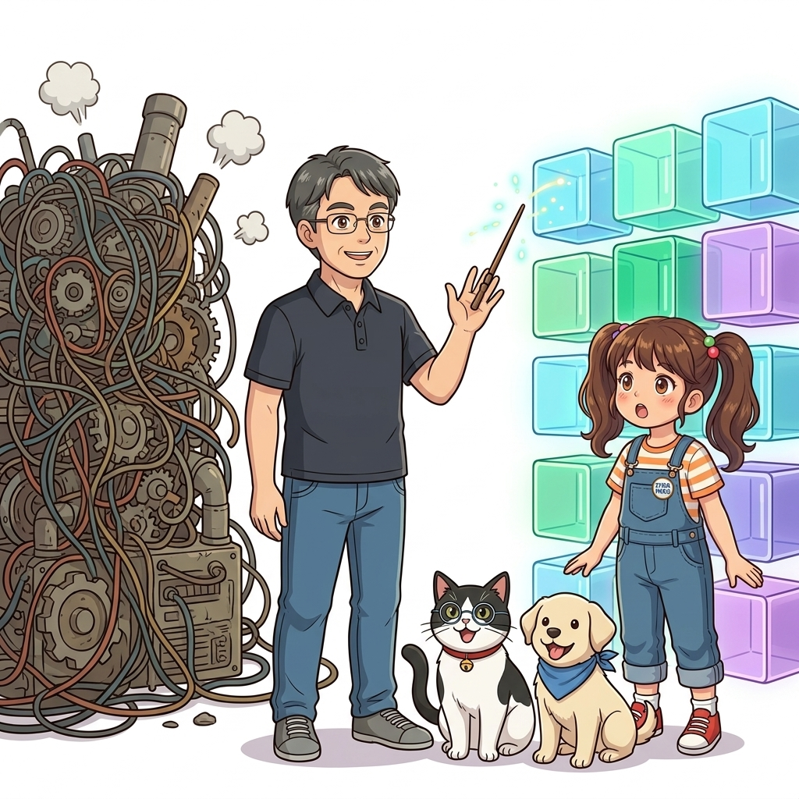
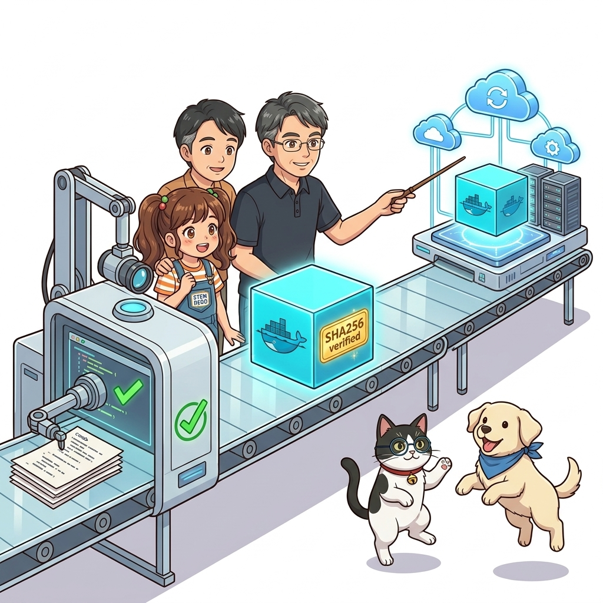
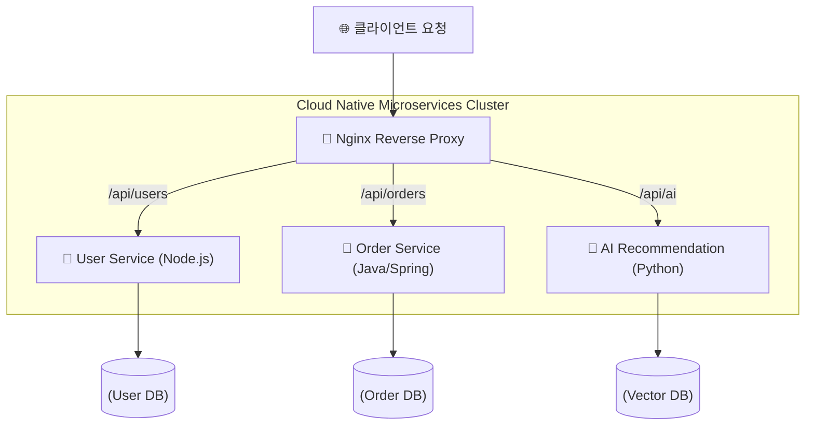
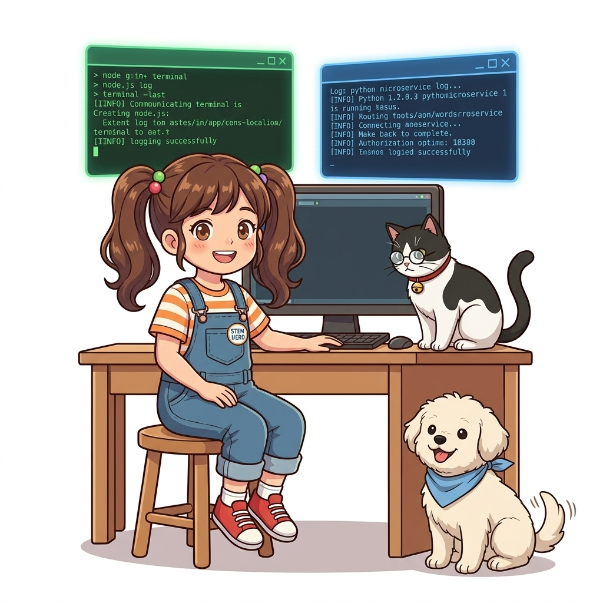
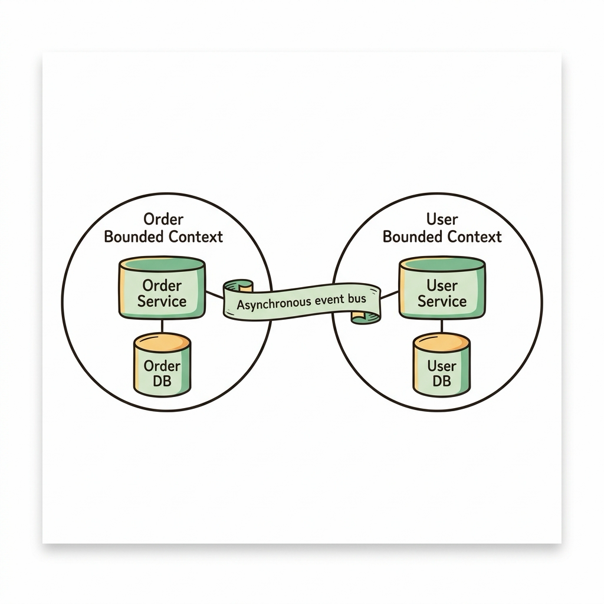
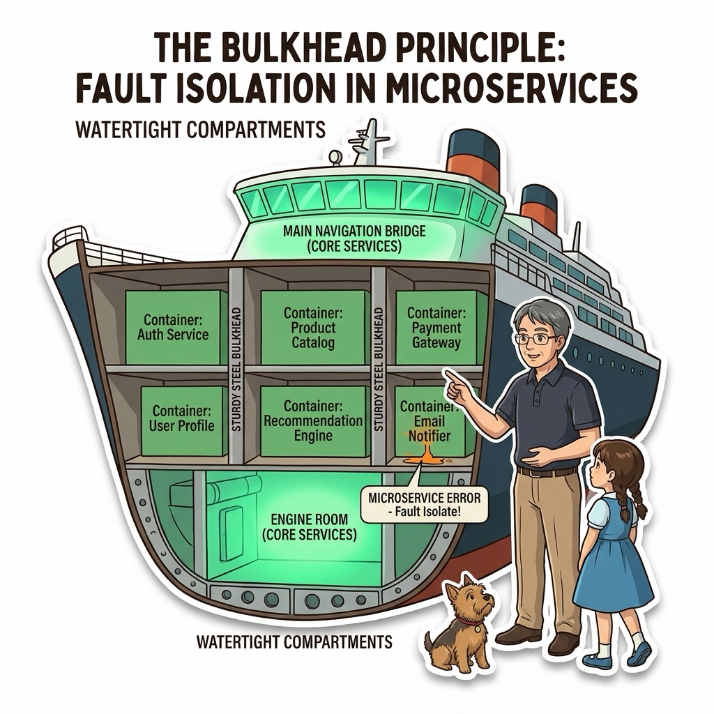

# 002. 컨테이너가 IT 세상을 점령한 이유 2: 마이크로서비스와 데브옵스

인터넷 서비스의 규모가 폭발적으로 성장하던 2010년대 초반, 전 세계의 기술 선도 기업들은 일제히 **'모놀리식 지옥(Monolithic Hell)'**이라는 거대한 벽에 부딪혔습니다. 수백 명의 개발자가 하나의 거대한 프로젝트 파일과 단일 데이터베이스를 공유하며 작업하다 보니, 결제 모듈의 사소한 코드 한 줄을 수정하려 해도 전체 시스템을 빌드하고 테스트하는 데 반나절이 걸렸고, 단 하나의 널 포인터 예외(NullPointerException) 때문에 포털 사이트 전체가 다운되는 끔찍한 연쇄 장애가 빈번하게 발생했습니다.


**그림 01-3-1** 거대한 단일 코드베이스의 한계(모놀리스)를 극복하기 위한 독립된 마이크로서비스 분할 아키텍처

이 문제를 해결하기 위해 시스템을 작고 독립적인 서비스들로 쪼개는 **마이크로서비스 아키텍처(Microservices Architecture, MSA)**가 등장했습니다. 하지만 서비스를 쪼개는 순간, 새로운 차원의 운영 악몽이 시작되었습니다. 예전에는 서버 1~2대에 단일 프로그램을 띄우면 그만이었지만, 이제는 인증, 결제, 추천, 검색 등 수십, 수백 개의 독립된 서비스가 각자 다른 프로그래밍 언어와 프레임워크로 개발되어 운영 서버에 띄워져야 했기 때문입니다.

이 복잡한 '폴리글랏(Polyglot) 생태계'를 질서정연하게 운영할 수 있었던 열쇠가 바로 **도커와 데브옵스(DevOps) CI/CD 파이프라인**이었습니다.

---

### 002.1 폴리글랏(Polyglot) 개발 환경과 표준 배포 규격

현대 소프트웨어 개발에서는 문제의 성격에 따라 최적의 언어가 다릅니다:
* 높은 동시성 처리가 필요한 API 게이트웨이는 **Go** 언어가 유리하고,
* 복잡한 비즈니스 엔터프라이즈 로직은 타입 안정성이 뛰어난 **Java Spring Boot**가 적합하며,
* AI 및 머신러닝 데이터 분석 파이프라인은 **Python (PyTorch/TensorFlow)**이 표준이고,
* 실시간 이벤트와 프론트엔드 연동은 **Node.js / TypeScript**가 최고의 생산성을 냅니다.


**그림 01-3-2** 제각기 다른 언어와 런타임으로 개발된 마이크로서비스를 단일한 OCI 표준 컨테이너로 감싸는 메커니즘

만약 가상머신이나 베어메탈 서버에 이 모든 언어 런타임(Python 3.12, OpenJDK 21, Node.js 20, Go 1.22)을 직접 설치하려 한다면, 시스템 환경 변수 충돌과 라이브러리 오염으로 인해 서버는 단 며칠 만에 수습 불가능한 카오스 상태에 빠질 것입니다.

도커는 각 서비스 개발팀에게 **"컨테이너 내부에서는 자바를 쓰든 파이썬을 쓰든 자유롭게 선택하되, 외부에 노출되는 배포 결과물만큼은 완벽한 표준 도커 이미지 하나로 통일하라"**는 명쾌한 해법을 제시했습니다. 운영팀은 내부 소스코드가 어떤 언어로 쓰였는지 알 필요 없이, 오직 표준 OCI 인터페이스를 통해 컨테이너를 실행(`run`), 검사(`inspect`), 종료(`stop`)하기만 하면 됩니다.

---

### 002.2 데브옵스(DevOps) CI/CD와 불변 인프라(Immutable Infrastructure)

전통적인 배포 방식에서는 서버에 직접 SSH로 원격 접속하여 `git pull`을 받고, 현장에서 빌드를 돌린 후 데몬을 재시작하는 '서버 내 직접 변경(In-place Mutation)' 방식을 취했습니다. 이 방식은 빌드 도중 네트워크가 끊기거나 컴파일 에러가 나면 서버가 먹통이 되는 치명적인 취약점을 안고 있었습니다.


**그림 01-3-3** 소스코드 커밋부터 자동 빌드, 보안 검사, 프로덕션 무중단 롤링 배포로 이어지는 CI/CD 파이프라인

데브옵스 문화와 도커가 결합하면서 등장한 혁신이 바로 **불변 인프라(Immutable Infrastructure)**입니다:
1. 개발자가 코드를 Git 리포지터리에 커밋하면,
2. CI(Continuous Integration) 서버가 자동으로 격리된 환경에서 이미지를 빌드하고 단위 테스트를 수행합니다.
3. 빌드가 검증된 이미지는 고유한 해시(SHA256)와 함께 도커 레지스트리에 영구 보관됩니다.
4. 운영 서버(CD)는 기존 컨테이너를 수정하지 않고, **새로운 버전의 불변 컨테이너를 먼저 띄워 헬스체크를 통과한 후 트래픽을 스위칭하고 구버전 컨테이너를 파기**합니다.

이 방식을 통해 우리는 하루에 수십 번, 수백 번이라도 서비스 중단 없이 안전하게 신기능을 배포할 수 있는 초고속 애자일 배포 체계를 완성할 수 있었습니다.

#### 📊 모놀리식 vs 마이크로서비스(MSA) 아키텍처 비교

| 비교 항목 | 전통적 모놀리식 (Monolithic) | 컨테이너 기반 마이크로서비스 (MSA) |
| :--- | :--- | :--- |
| **코드베이스 및 의존성** | 단일 거대 리포지터리, 모든 팀이 단일 라이브러리 버전 공유 강제 | 서비스별 독립 리포지터리, 팀별 최적의 언어와 프레임워크(폴리글랏) 자유 선택 |
| **장애 격리 (Fault Isolation)** | 한 모듈의 메모리 누수나 오류가 프로세스 전체를 다운시킴 | 개별 컨테이너가 커널 수준에서 격리되어 다른 서비스로 장애 전파 차단 |
| **스케일링 효율성** | 트래픽이 몰리는 특정 기능만 늘릴 수 없어 시스템 전체를 복제(비효율) | 주문량이 폭증할 때 '결제 컨테이너'만 10개로 즉시 수평 확장(Scale-out) 가능 |
| **배포 주기 및 롤백** | 한 달에 1회 대규모 정기 점검 배포, 롤백 실패 시 막대한 복구 시간 | 서비스별 하루 수십 회 독립 배포 가능, 장애 발생 시 구버전 이미지로 1초 롤백 |

---

### 002.3 선언적 실습 및 아키텍처 다이어그램

직접 터미널에서 서로 다른 언어(Node.js와 Python)로 작성된 두 개의 경량 마이크로서비스 컨테이너를 1초 만에 격리 실행해 보며, 폴리글랏 환경의 놀라운 이식성을 체감해 봅시다.

```bash
# [실습 002-1] Node.js 런타임 컨테이너에서 즉석 계산 수행
docker container run --rm node:20-alpine node -e "console.log('⚡ Node.js MSA 런타임 준비 완료:', process.version)"

# [실습 002-2] Python 런타임 컨테이너에서 데이터 분석 셸 즉석 실행
docker container run --rm python:3.12-alpine python -c "print('🐍 Python MSA 런타임 준비 완료!')"
```

#### 🔍 마이크로서비스 서비스 디스커버리 흐름도 (Mermaid Diagram)




**그림 01-3-4** 서로 다른 언어로 구동되는 복수의 마이크로서비스 컨테이너가 단일 호스트 위에서 조화롭게 동작하는 환경

---

<!-- BIBLE_INTEGRATION_book3_ddd_bounded_context -->
---

### 002.B 📚 도커 바이블 심화: 도메인 주도 설계(DDD) 바운디드 컨텍스트와 컨테이너 격리 경계의 결합
*출처 도서: 『도커를 활용한 마이크로서비스』 핵심 분석*

모놀리식 애플리케이션을 마이크로서비스로 분할할 때 가장 흔히 저지르는 실수는 '기능 단위'로 잘게 쪼개는 것입니다. 도커를 활용한 진정한 마이크로서비스 아키텍처는 **도메인 주도 설계(DDD, Domain-Driven Design)의 바운디드 컨텍스트(Bounded Context)**를 컨테이너 경계와 1:1로 매핑하는 것에서 시작합니다.

1. **데이터베이스 격리 원칙 (Database per Service)**:
   * 마이크로서비스 간에 단일 RDBMS를 공유해서는 안 됩니다. 각 서비스는 전용 컨테이너화된 데이터 저장소를 소유하며, 외부 서비스는 오직 REST API나 비동기 메시지 큐를 통해서만 데이터를 조회/수정할 수 있습니다.
2. **독립적 배포 주기 (Independent Deployability)**:
   * 주문 서비스 컨테이너를 업데이트할 때 결제 서비스나 회원 서비스 컨테이너를 함께 재배포해야 한다면, 그것은 '분산 모놀리스(Distributed Monolith)'라는 안티패턴에 불과합니다.


**그림 002-B-1** 주문 도메인과 회원 도메인이 각각 독립된 컨테이너와 DB를 소유하는 DDD 바운디드 컨텍스트 다이어그램

```bash
# [실습] 바운디드 컨텍스트 기반 2개 독립 서비스 네트워크 분리 기동
# 주문 전용 네트워크와 회원 전용 네트워크 생성
docker network create order-domain-net
docker network create user-domain-net

# 각 도메인 전용 컨테이너를 독립된 네트워크에 격리
docker container run -d --name order-service --network order-domain-net alpine sleep 3600
docker container run -d --name user-service --network user-domain-net alpine sleep 3600
```

> 👨‍🏫 **이호진 교수님의 바이블 멘토링 노트**:
> "마이크로서비스를 만들 때 '공통 DB'를 두는 순간, 컨테이너로 아무리 예쁘게 나눠봤자 하나의 장애가 전체를 무너뜨리는 최악의 결합도가 발생합니다. 데이터베이스는 반드시 서비스마다 격리하세요."
>
> 👧 **도로시의 깨달음**:
> "겉모습만 여러 개의 박스로 나눈 게 아니라, 각자 자기만의 보물상자(DB)를 가지고 전용 통로로만 대화해야 진짜 마이크로서비스군요!"
>
> 🐱 **조교 지니의 아키텍처 체크포인트**:
> "이 원칙을 지키면 특정 서비스의 DB를 MySQL에서 MongoDB나 Redis로 교체하더라도 다른 서비스에 단 1줄의 영향도 주지 않게 됩니다."


<!-- BIBLE_INTEGRATION_book3_deep_002 -->
---

### 002.C 📚 도커 바이블 심화: 마이크로서비스 회복탄력성(Resilience) 양대 축: 서킷 브레이커와 벌크헤드 격리 패턴
*출처 도서: 『도커를 활용한 마이크로서비스』 핵심 분석 (도커를 활용한 마이크로서비스 제1장 (자율 서비스 & 장애 격리))*

모놀리식 시스템에서는 하나의 모듈에서 발생한 메모리 누수나 무한 루프가 프로세스 전체를 다운시켰습니다. 마이크로서비스는 서비스를 물리적인 컨테이너 단위로 분리함으로써 장애의 전파를 막지만, 분산 네트워크 호출이 늘어남에 따라 **연쇄 장애(Cascading Failure)**라는 새로운 위협에 노출됩니다.

이를 방지하는 도커 마이크로서비스의 2대 필수 패턴:
1. **서킷 브레이커 (Circuit Breaker) 패턴**:
   * 외부 결제 서비스나 외부 API가 응답하지 않고 타임아웃이 발생할 때, 지속적으로 요청을 보내 스레드를 고갈시키는 대신 회로를 차단(Open)하여 즉시 에러나 대체 기본값(Fallback)을 반환합니다.
   * 서비스가 정상화되면 반개방(Half-Open) 상태를 거쳐 자동으로 정상 복구(Closed)됩니다.
2. **벌크헤드 (Bulkhead, 격벽) 격리 패턴**:
   * 침몰하지 않는 대형 선박이 선체를 여러 개의 방수 격벽으로 나누어 한곳에 구멍이 나도 배 전체가 가라앉지 않도록 설계되듯, 컨테이너별로 CPU, 메모리, 커넥션 풀을 물리적으로 격리합니다.
   * 예를 들어 추천 서비스 컨테이너가 100% 과부하에 빠져도, 핵심 주문/결제 컨테이너는 독립된 cgroups 리소스 격벽 안에서 완벽히 정상 동작을 유지합니다.


**그림 002-B-2** 선박의 수밀 격벽(벌크헤드)처럼 컨테이너 리소스를 격리하여 연쇄 침몰을 방어하는 복원력 아키텍처

```bash
# [실습] 벌크헤드 격벽 격리: 특정 서비스 과부하 시에도 핵심 서비스 자원 보호
# 1. 추천 서비스: CPU 최대 20%로 격벽 제한 (장애 발생 시 호스트 영향 차단)
docker container run -d --name reco-service --cpus 0.2 --memory 128m alpine \
  sh -c 'while :; do :; done'

# 2. 핵심 주문 서비스: CPU 1.0 코어 우선 보장
docker container run -d --name order-service --cpus 1.0 --memory 512m alpine \
  sh -c 'while true; do echo "주문 시스템 정상 가동 중"; sleep 5; done'

# 실시간 모니터링으로 추천 서비스의 20% 상한 격벽 확인
docker container stats reco-service order-service --no-stream
docker container rm -f reco-service order-service
```

> 👨‍🏫 **이호진 교수님의 바이블 멘토링 노트**:
> "마이크로서비스의 핵심은 '장애가 나지 않게 하는 것'이 아니라, '장애가 나더라도 시스템의 5%만 고장 나고 나머지 95%는 정상 작동하게 만드는 회복탄력성(Resilience)'에 있습니다. cgroups 자원 제한과 서킷 브레이커는 필수입니다."
>
> 👧 **도로시의 깨달음**:
> "배의 한 칸에 물이 차도 다른 칸 문을 꽉 닫아두면 배 전체가 가라앉지 않는 타이타닉 방수벽 원리와 똑같군요!"
>
> 🐱 **조교 지니의 아키텍처 체크포인트**:
> "도커 컴포즈에서도 `deploy.resources.limits`를 통해 각 서비스마다 벌크헤드 격벽을 선언적으로 구축할 수 있습니다."


### 002.4 핵심 정리: 캐릭터 대화와 3대 교훈

> 👧 **도로시**: "와! 파이썬 개발자와 자바 개발자가 서로 환경 설정 때문에 싸울 필요 없이, 각자 컨테이너로 패키징만 해두면 레고 블록처럼 척척 조립되는 거군요!"
> 
> 🐱 **조교 지니**: "야옹~ 바로 그렇단다. 컨테이너라는 표준 규격이 있었기에 넷플릭스나 아마존 같은 글로벌 서비스들이 수천 개의 마이크로서비스를 운영할 수 있는 것이지!"
> 
> 🐶 **토토**: "멍멍! 장애가 난 서비스만 쏙 빼서 새 컨테이너로 갈아 끼우면 되니까 정말 안전해요!"
> 
> 👨‍🏫 **이호진 교수님**: "정확한 지적이구나. 컨테이너는 단순한 실행 도구가 아니라, 팀 간의 협업 방식을 혁신하고 비즈니스 릴리즈 속도를 극한으로 끌어올리는 조직 문화(DevOps)의 기술적 토대란다."


**그림 01-3-5** 마이크로서비스와 데브옵스를 실현하는 3대 핵심 엔지니어링 교훈

1. **폴리글랏(Polyglot) 자율성의 극대화**:
   * 각 서비스의 도메인 특성에 맞는 최적의 언어와 프레임워크를 호스트 오염 없이 자유롭게 도입합니다.
2. **독립된 장애 격리(Fault Tolerance)**:
   * 특정 마이크로서비스 컨테이너가 비정상 종료되어도 다른 서비스에 전혀 영향을 주지 않습니다.
3. **불변 인프라 기반의 신속한 CI/CD 배포**:
   * 서버 직접 수정을 금지하고, 검증된 불변 이미지만을 롤링 업데이트하여 배포 리스크를 0에 수렴시킵니다.

---

### 002.5 랩노트 피날레와 다음 강의 예고


**그림 01-3-6** 실습을 위한 완벽한 도커 엔진 셋업 단계로 나아가는 이호진 교수님과 연구팀

> 💡 **다음 강의 안내**:
> [003. 실습 환경 구축 1: Windows WSL2와 macOS Apple Silicon/Intel Docker Desktop](../003_실습환경구축1_Windows_WSL2와_macOS_Docker_Desktop/)에서는 윈도우(WSL2 리눅스 커널 백엔드)와 맥(Virtualization Framework 및 Rosetta 2 가속)에서 도커 데스크톱을 설치하고, CPU·메모리·디스크 자원을 최적화하여 쾌적한 130강 실습 환경을 완성하는 완벽 튜닝 가이드를 진행합니다!

---

## 🧭 강의 네비게이션
* [◀️ 이전 강의: 001_컨테이너가_IT세상을_점령한_이유1_클라우드이주와_레거시현대화](../001_컨테이너가_IT세상을_점령한_이유1_클라우드이주와_레거시현대화/)
* [📋 Part 01. 컨테이너 혁명과 도커 엔진 기본기 마스터 (000 ~ 014) 목차로 돌아가기](../)
* [▶️ 다음 강의: 003_실습환경구축1_Windows_WSL2와_macOS_Docker_Desktop](../003_실습환경구축1_Windows_WSL2와_macOS_Docker_Desktop/)
