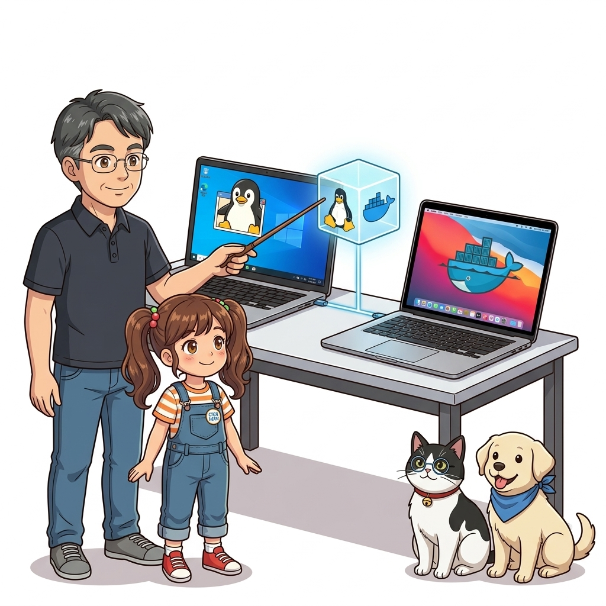
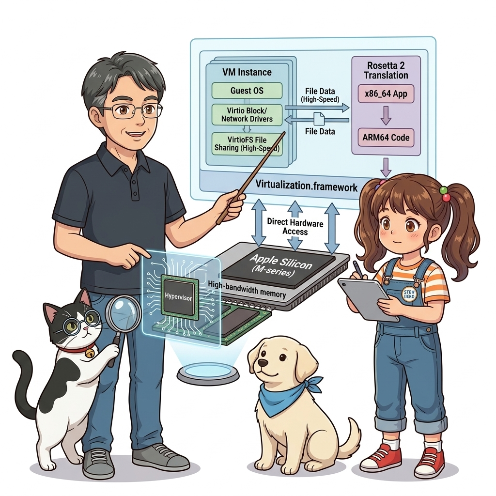
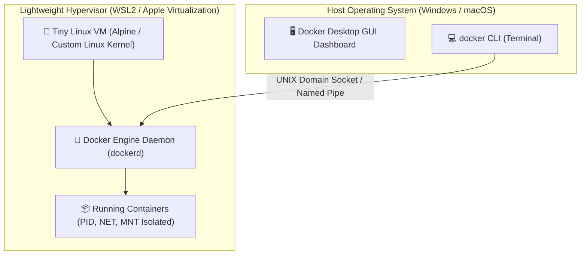
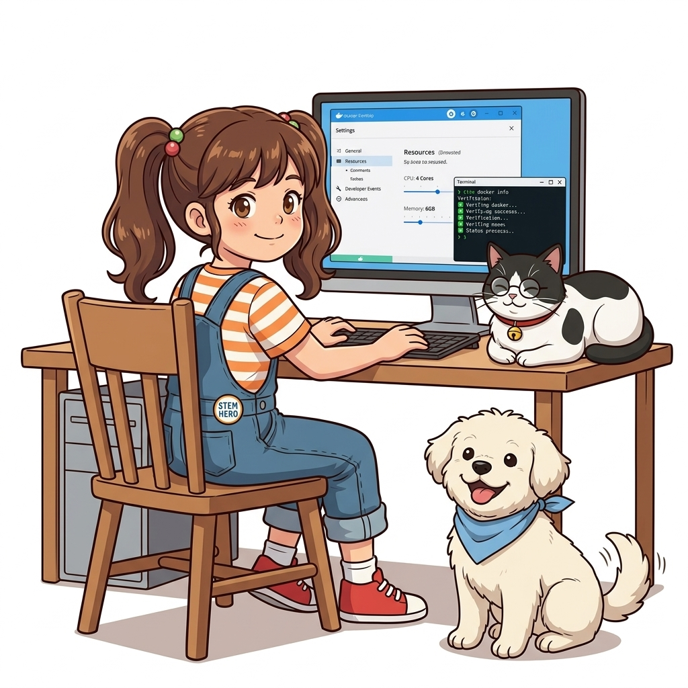
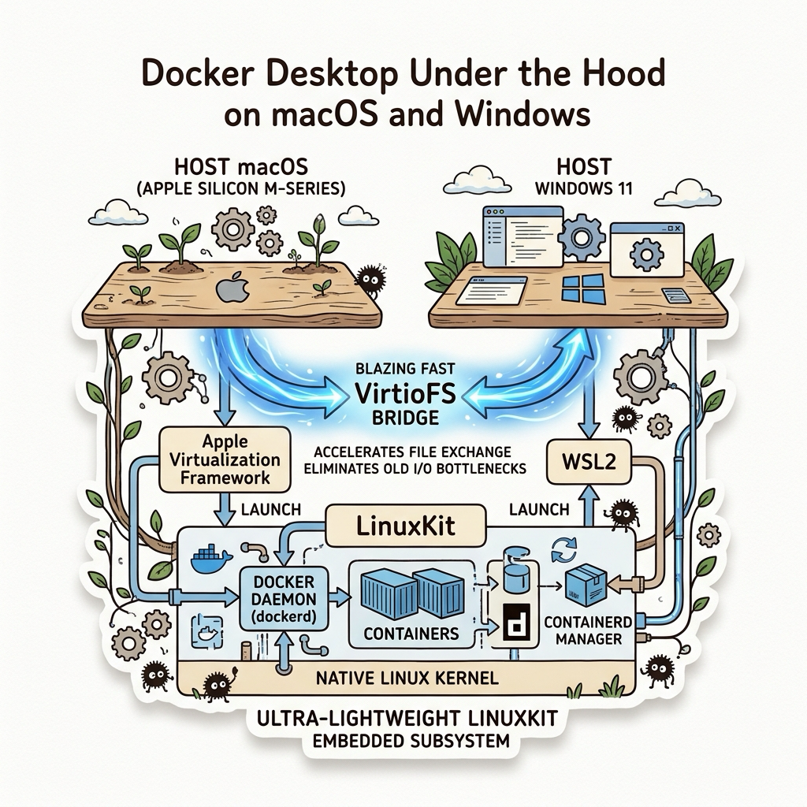

# 003. 실습 환경 구축 1: Windows WSL2와 macOS Apple Silicon/Intel Docker Desktop

도커 컨테이너 기술은 태생적으로 **리눅스 커널(Linux Kernel)**의 독자적인 프로세스 격리 기술(Namespaces, Control Groups)에 기반을 두고 있습니다. 따라서 리눅스 운영체제에서는 도커 엔진이 커널 위에서 네이티브(Native)하게 직접 실행되지만, 대다수의 개발자들이 일상적으로 사용하는 **마이크로소프트 윈도우(Windows)**나 **애플 맥(macOS)**은 리눅스 커널을 내장하고 있지 않습니다.


**그림 01-4-1** Windows와 macOS 환경에서 리눅스 컨테이너를 구동하기 위한 가상화 백엔드 아키텍처

그렇다면 윈도우와 맥에서는 어떻게 리눅스 컨테이너를 그토록 빠르고 매끄럽게 구동할 수 있을까요? 이번 절에서는 과거의 무거운 가상머신 방식(VirtualBox 기반의 도커 툴박스)에서 탈피하여, 오늘날의 초경량 네이티브 하이퍼바이저 백엔드로 진화한 **Docker Desktop의 내부 아키텍처와 최적의 리소스 튜닝법**을 상세히 파헤쳐 봅니다.

---

### 003.1 Windows 환경의 혁명: WSL2 (Windows Subsystem for Linux 2)

과거 윈도우에서 도커를 돌리기 위해서는 Hyper-V 가상머신을 통째로 띄우거나 VirtualBox를 써야 했기에 시스템 부팅이 느리고 메모리를 기가바이트 단위로 낭비했습니다. 하지만 마이크로소프트가 **WSL2**를 발표하면서 판도가 완전히 바뀌었습니다.


**그림 01-4-2** 윈도우 커널과 완벽한 정품 리눅스 커널이 경량 가상화(Hyper-V 격리)를 통해 공존하는 WSL2 아키텍처

WSL2의 핵심 특징:
1. **진짜 완전한 리눅스 커널 탑재**: 에뮬레이션이 아니라 마이크로소프트가 직접 빌드한 최신 롱텀(LTS) 리눅스 커널이 윈도우 내부에서 실행됩니다.
2. **경량 유틸리티 VM (Lightweight Utility VM)**: 1초 미만의 초고속 부팅과 함께, 사용하지 않는 메모리를 자동으로 윈도우 호스트로 반환하는 동적 메모리 할당을 지원합니다.
3. **99% 이상의 완벽한 시스템 콜 호환성**: cgroups v2, 오버레이 파일시스템(OverlayFS), eBPF 등 도커 엔진이 요구하는 최신 리눅스 커널 기능을 100% 네이티브 속도로 처리합니다.

#### 💡 Windows 사용자 권장 설치 절차
PowerShell을 관리자 권한으로 실행한 후 아래 명령어로 WSL2를 활성화하고 도커 데스크톱을 설치합니다:
```powershell
# WSL2 최신 리눅스 커널 설치 및 활성화
wsl --install

# 기본 WSL 버전을 2로 설정
wsl --set-default-version 2

# 설치된 배포판 및 WSL 버전 확인
wsl --list --verbose
```

---

### 003.2 macOS 환경의 진화: Virtualization.framework와 Apple Silicon

맥(macOS)은 유닉스(UNIX) 계열 운영체제이지만, 커널은 리눅스가 아닌 **XNU (Darwin/Mach)** 커널을 사용합니다. 따라서 맥에서도 도커 컨테이너를 실행하기 위해서는 초소형 리눅스 VM 레이어가 반드시 필요합니다.


**그림 01-4-3** Apple Silicon(M1~M4)의 ARM64 아키텍처와 macOS 가상화 프레임워크를 활용한 도커 구동

최신 macOS 환경의 Docker Desktop 핵심 최적화:
1. **Apple Virtualization.framework 채택**: 과거의 무거운 가상화 계층 대신, 애플 공식 하이퍼바이저 API를 사용하여 CPU 사용량을 획기적으로 낮추고 배터리 효율을 극대화했습니다.
2. **VirtioFS 고속 파일 공유**: 맥 호스트 디렉터리를 컨테이너에 바인드 마운트할 때 발생하던 지독한 파일 I/O 병목 현상을 VirtioFS 가속 기술로 최대 10배 이상 개선했습니다.
3. **Rosetta 2 for Linux (Apple Silicon 전용)**: M1/M2/M3/M4 실리콘 맥에서 x86_64(인텔 64비트) 전용 도커 이미지를 구동할 때, 애플의 강력한 바이너리 변환 엔진인 Rosetta를 리눅스 가상머신 내부에 주입하여 네이티브에 준하는 놀라운 에뮬레이션 성능을 발휘합니다.

#### 📊 OS별 Docker Desktop 백엔드 비교

| 플랫폼 구분 | 가상화 백엔드 기술 | 파일 시스템 공유 가속 | 권장 리소스 설정 가이드 |
| :--- | :--- | :--- | :--- |
| **Windows 10/11** | WSL2 (Microsoft Linux Kernel) | 9P 프로토콜 / WSL2 네이티브 vhd | 메모리: 최소 4GB (8GB 권장), `.wslconfig`로 상한선 제어 |
| **macOS (Apple Silicon)** | Apple Virtualization.framework | VirtioFS (Docker Desktop 설정에서 활성화) | CPU: 코어 수의 절반, 메모리: 최소 4GB, Rosetta 체크 활성화 |
| **macOS (Intel Core)** | HyperKit / Virtualization.framework | gRPC FUSE / VirtioFS | CPU: 2~4코어, 메모리: 최소 4GB, Swap: 1~2GB |

---

### 003.3 도커 데스크톱 리소스 튜닝 및 터미널 통합 검증

도커 데스크톱을 설치한 후 기본 설정 그대로 방치하면 개발 도중 팬이 심하게 돌거나 노트북 배터리가 급격히 소모될 수 있습니다. 다음 설정을 점검하십시오:
* **Settings > Resources**:
  * **CPU**: 보유한 전체 코어 수의 50% 할당 (예: 8코어인 경우 4개 할당)
  * **Memory**: 전체 램의 25~50% 할당 (16GB RAM 기준 4GB~6GB 할당)
  * **Swap**: 1GB~2GB 설정 (SSD 수명 보호를 위해 과도한 스왑 방지)
  * **Virtual disk limit**: 64GB 내외 설정

```bash
# [실습 003-1] 터미널에서 도커 엔진 상태 및 시스템 리소스 확인
docker info

# [실습 003-2] 현재 활성화된 도커 컨텍스트(Context) 확인
docker context ls
```

#### 🔍 Docker Desktop 내부 3계층 아키텍처 (Mermaid Diagram)




**그림 01-4-4** 터미널 CLI와 도커 데스크톱 대시보드가 리눅스 가상머신 엔진과 통신하는 아키텍처

---

<!-- BIBLE_INTEGRATION_book1_desktop_linuxkit_virtiofs -->
### 003.B 📚 도커 바이블 심화: Docker Desktop 언더 더 후드: LinuxKit 서브시스템과 VirtioFS 가속 메커니즘
> **출처 및 학술적 배경**: 『15단계로 배우는 도커와 쿠버네티스』 제1장 (1.13 가상 서버와 컨테이너의 차이점: LinuxKit 생태계) & 『제대로 배우는 도커』 제2장 (설치하기)  
> **핵심 주제**: 비-리눅스 OS에서 도커 데몬을 지탱하는 LinuxKit 초경량 서브시스템, 호스트-컨테이너 간 파일 I/O 병목을 해결하는 VirtioFS 가속 원리, 그리고 Windows WSL2 메모리 폭주 방지(`.wslconfig`) 튜닝.

#### 1. LinuxKit: 컨테이너 전용 미니멀 리눅스 서브시스템
macOS와 Windows에는 리눅스 커널이 없기 때문에, 도커는 사용자가 의식하지 못하는 백그라운드에 초경량 리눅스 서브시스템인 **LinuxKit**을 기동합니다:
* **탄생 배경**: 도커(Docker), IBM, Microsoft, Linux Foundation, ARM, HPE, Intel이 오직 컨테이너 실행만을 목적으로 합작 개발한 모듈형 오픈소스 리눅스입니다.
* **초미니멀 설계**: 불필요한 OS 유틸리티나 데몬을 모두 배제하고 커널과 `containerd` 런타임만 단 수십 MB 크기로 패키징하여, 사용자가 Docker Desktop을 켤 때 단 1~2초 만에 즉각 백그라운드로 부팅됩니다.
* **가상화 브리지**:
  * **macOS**: 과거 HyperKit에서 현대의 Apple 공식 **Virtualization.framework**로 진화하여 네이티브 하이퍼바이저 가속을 받습니다.
  * **Windows**: Hyper-V 가상화 기반의 **WSL2(Windows Subsystem for Linux 2)** 엔진과 통합되어 구동됩니다.

#### 2. 파일 공유의 진화와 VirtioFS의 10배 I/O 혁신
로컬 소스코드를 컨테이너에 바인드 마운트할 때, 호스트 OS 파일시스템(macOS APFS, Windows NTFS)과 컨테이너 내부 리눅스 파일시스템 간의 변환 오버헤드는 개발자의 오랜 골칫거리였습니다:
* **과거(osxfs / 9P 프로토콜)**: Node.js의 `node_modules`나 PHP 프레임워크처럼 수만 개의 작은 파일이 존재하는 프로젝트에서 `npm install`이나 코드 핫리로드 시 수 분씩 멈추는 극심한 병목이 발생했습니다.
* **현대 표준(VirtioFS)**: 리눅스 커널의 `vhost-user` 공유 메모리 기반 가상화 직접 매핑 기술을 적용하여, 파일 메타데이터 조회를 제로 카피(Zero-Copy)로 처리합니다. 그 결과 파일 읽기/쓰기 속도가 기존 대비 **최대 10배 이상 비약적으로 향상**되었습니다.

#### 3. Windows 환경 필수: `.wslconfig`를 통한 메모리 누수 방지
Windows WSL2는 기본적으로 호스트 RAM의 최대 80%까지 동적으로 잠식할 수 있어, 장시간 도커를 쓰다 보면 PC 전체가 버벅거리는 현상이 발생합니다:
```ini
# %UserProfile%\.wslconfig 파일 생성
[wsl2]
memory=6GB        # WSL2 가상머신이 점유할 최대 RAM 상한선 지정
processors=4      # 할당할 논리 CPU 코어 수
swap=2GB          # 스왑 파일 크기
guiApplications=false
```


**그림 003-B-1** Docker Desktop의 LinuxKit 서브시스템과 VirtioFS 가속 아키텍처 도식

```bash
# [실습] Docker Desktop 내부 리눅스 VM 커널 및 마운트 드라이버 확인
# 1. 도커 데스크톱 내부 LinuxKit 커널 정보 조회
docker run --rm alpine uname -a

# 2. 호스트 파일시스템 마운트 속도 및 파일 공유 방식 점검
docker run --rm -v $(pwd):/workspace alpine df -T /workspace
```

> 👨‍🏫 **이호진 교수님의 바이블 멘토링 노트**:
> "macOS나 Windows에서 도커를 쓸 때는 '내 노트북 OS'와 '실제 컨테이너가 도는 LinuxKit VM'이라는 두 개의 공간이 존재한다는 사실을 항상 인지해야 합니다. Docker Desktop 설정에서 'VirtioFS'를 활성화하고, Apple Silicon 사용자는 'Rosetta for x86/amd64 emulation'을 켜두는 것이 실무 개발 생산성을 좌우하는 핵심 비결입니다."
>
> 👧 **도로시의 깨달음**:
> "맥북 안에서 작은 리눅스 친구(LinuxKit)가 비밀리에 일하고 있었군요! 작은 파일이 수만 개씩 오갈 때 느려지지 않도록 초고속 다리(VirtioFS)를 놓아주는 게 정말 중요하네요!"
>
> 🐱 **조교 지니의 아키텍처 체크포인트**:
> * macOS에서 배터리 절약 모드를 켜면 Virtualization.framework의 CPU 스케줄링 우선순위가 떨어져 도커 빌드 속도가 급격히 느려질 수 있으니 주의하세요.

---

### 003.4 핵심 정리: 캐릭터 대화와 3대 교훈

> 👧 **도로시**: "아하! 윈도우와 맥은 리눅스 커널이 없으니까, 아주 작고 날렵한 초소형 리눅스 엔진을 밑에 살짝 깔아두고 그 위에서 컨테이너들을 띄우는 원리군요!"
> 
> 🐱 **조교 지니**: "야옹~ 정확합니다. 특히 맥에서는 VirtioFS와 Rosetta 2 설정을 켜야 파일 읽기 속도와 인텔 이미지 호환성이 비약적으로 빨라진답니다!"
> 
> 🐶 **토토**: "멍멍! 내 컴퓨터 사양에 맞춰 CPU와 램을 딱 알맞게 조절해 두니 팬도 안 돌고 시원해요!"
> 
> 👨‍🏫 **이호진 교수님**: "훌륭하구나. 개발 장비의 특성을 정확히 이해하고 도커 엔진을 튜닝하는 것은 모든 클라우드 네이티브 엔지니어의 가장 기본적인 덕목이란다."


**그림 01-4-5** 데스크톱 개발 환경 완성과 리소스 튜닝의 3대 핵심 교훈

1. **OS별 가상화 백엔드 원리 이해**:
   * 윈도우는 WSL2, 맥은 Apple Virtualization.framework를 통해 네이티브에 준하는 리눅스 커널 환경을 확보합니다.
2. **I/O 병목 해소를 위한 VirtioFS 활용**:
   * 호스트 소스코드와 컨테이너를 공유할 때 최신 파일 공유 엔진을 활성화하여 빌드 및 리로드 속도를 극대화합니다.
3. **안정적인 리소스 상한선 설정**:
   * CPU와 메모리 한도를 호스트 자원의 50% 내외로 적절히 분배하여 개발 머신의 쾌적성을 보장합니다.

---

### 003.5 랩노트 피날레와 다음 강의 예고


**그림 01-4-6** 실제 프로덕션 리눅스 서버에서 GUI 없는 순수 도커 엔진 설치를 예고하는 교수님과 연구팀

> 💡 **다음 강의 안내**:
> [004. 실습 환경 구축 2: Linux 서버 Docker Engine과 CLI 검증](../004_실습환경구축2_Linux서버_Docker_Engine과_CLI검증/)에서는 그래픽 UI가 없는 진짜 클라우드 운영 서버(Ubuntu 24.04 LTS / Debian)에 공식 APT 리포지터리를 등록하여 경량 Docker Engine(CE)을 설치하고, 일반 사용자로 안전하게 제어하는 권한 구성(non-root docker group)을 배웁니다!

---

## 🧭 강의 네비게이션
* [◀️ 이전 강의: 002_컨테이너가_IT세상을_점령한_이유2_마이크로서비스와_데브옵스](../002_컨테이너가_IT세상을_점령한_이유2_마이크로서비스와_데브옵스/)
* [📋 Part 01. 컨테이너 혁명과 도커 엔진 기본기 마스터 (000 ~ 014) 목차로 돌아가기](../)
* [▶️ 다음 강의: 004_실습환경구축2_Linux서버_Docker_Engine과_CLI검증](../004_실습환경구축2_Linux서버_Docker_Engine과_CLI검증/)
