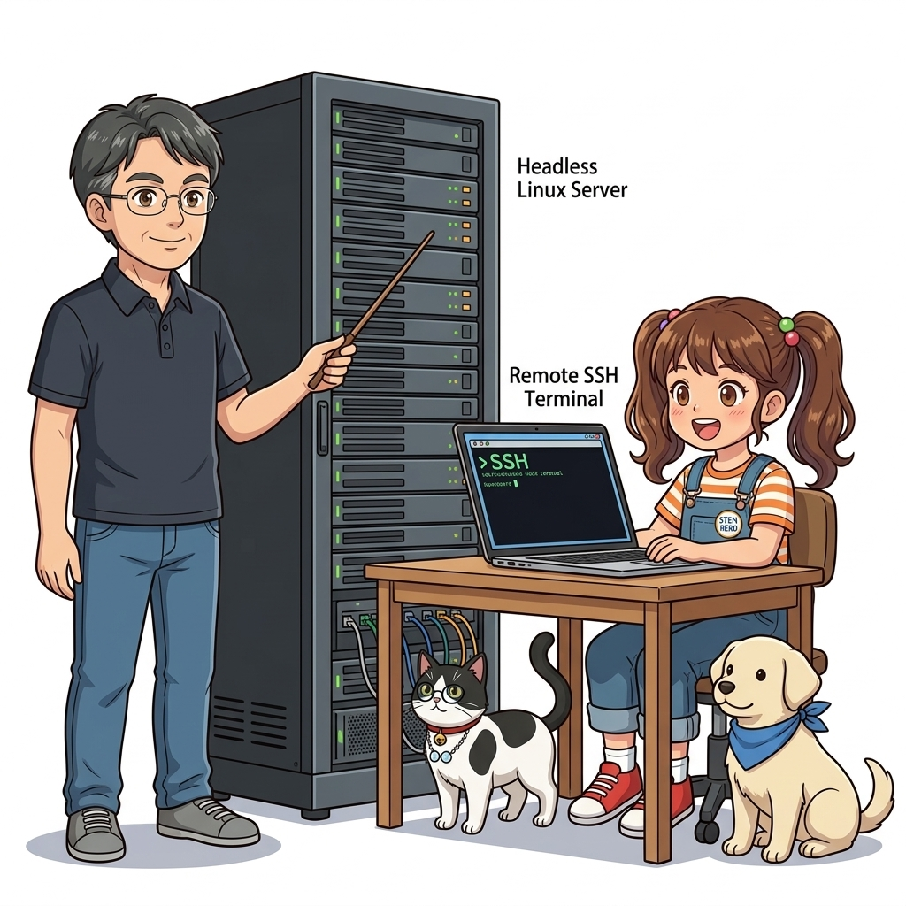
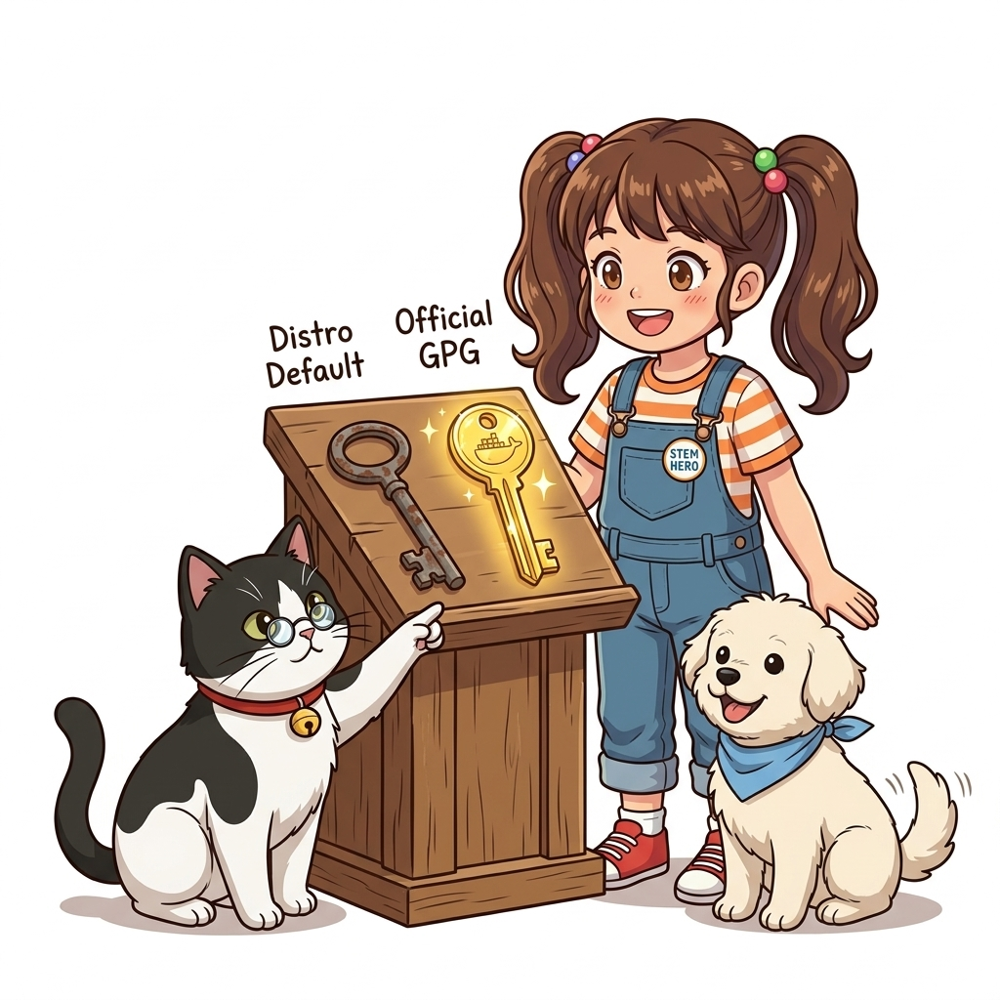
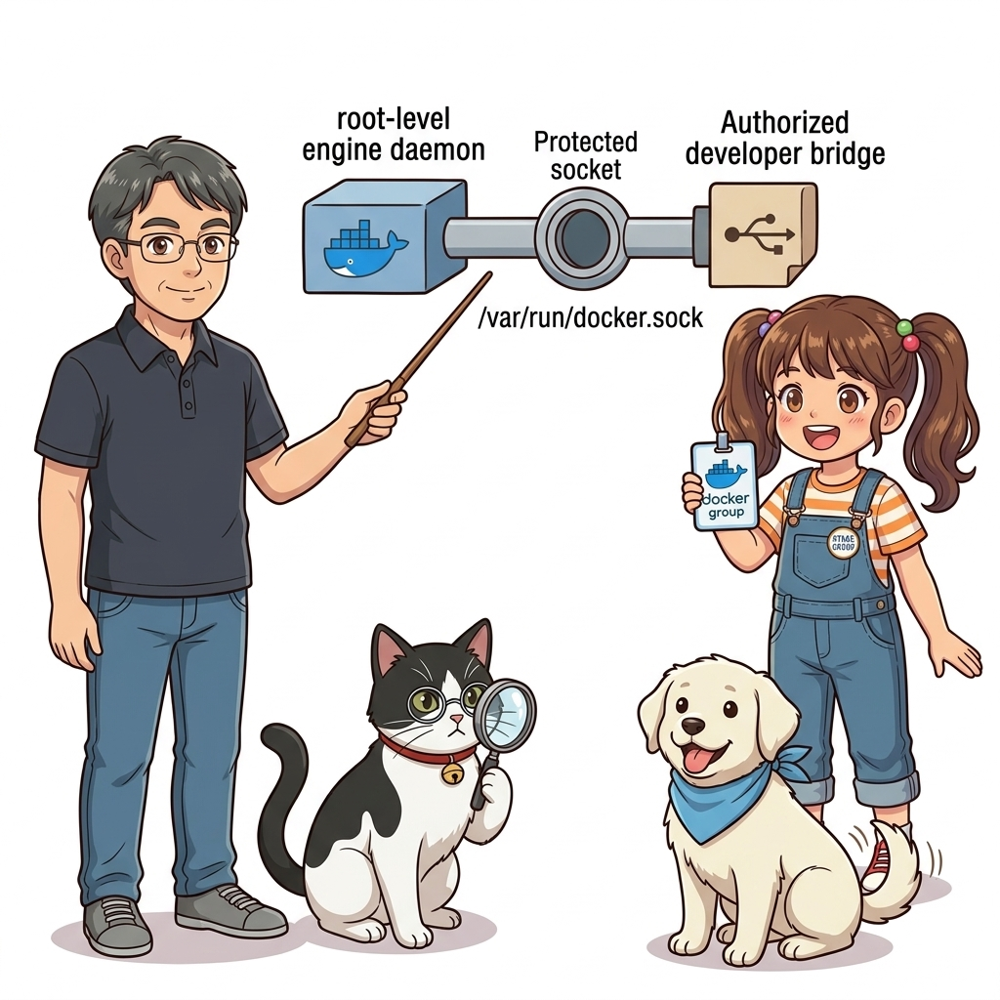
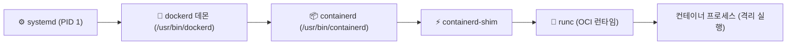
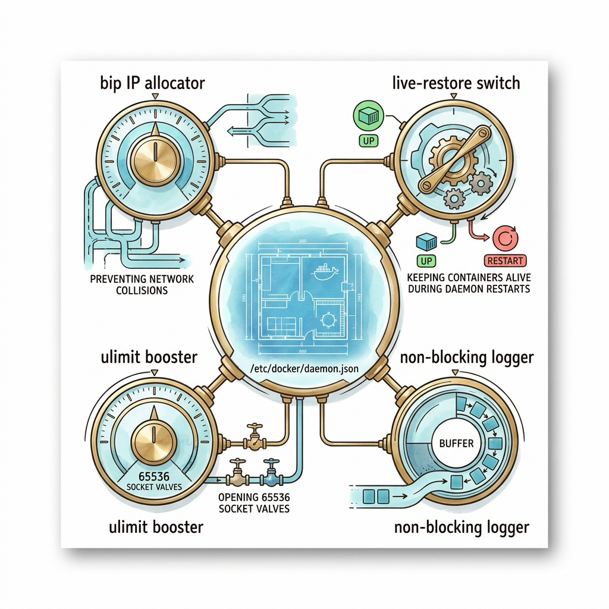
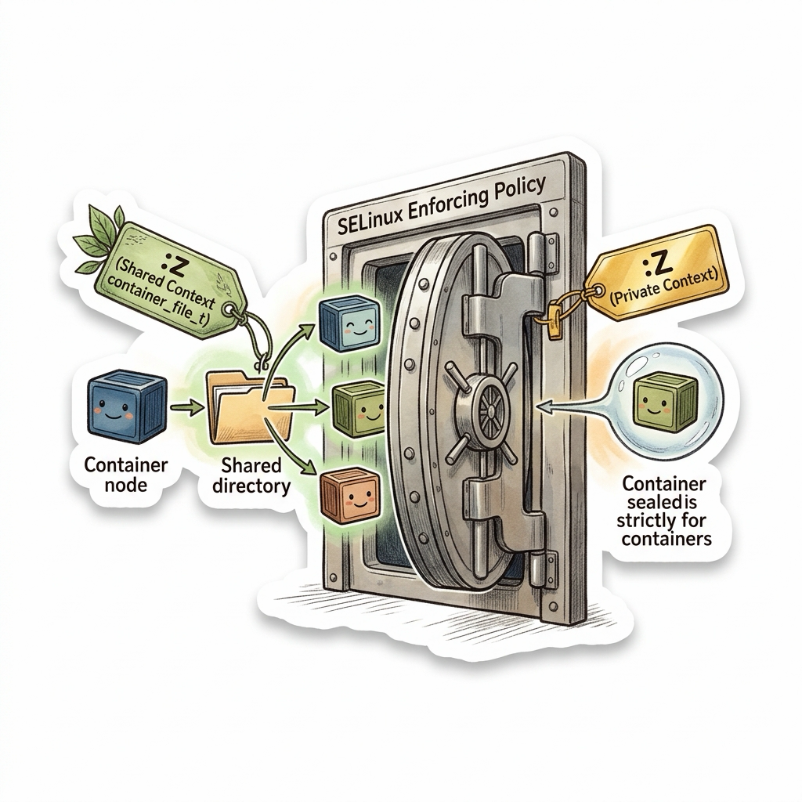
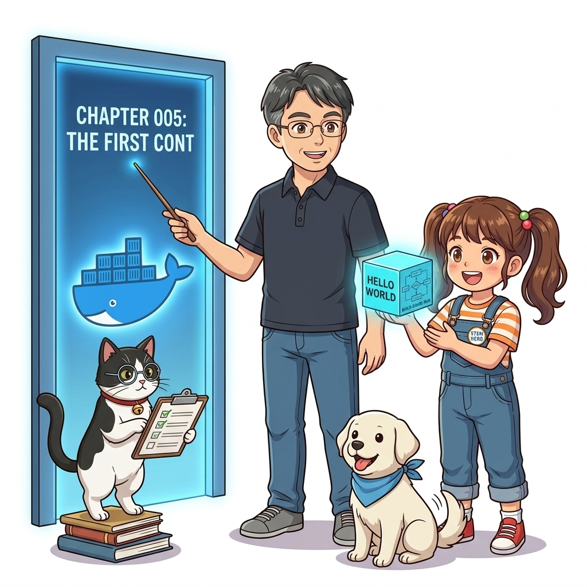
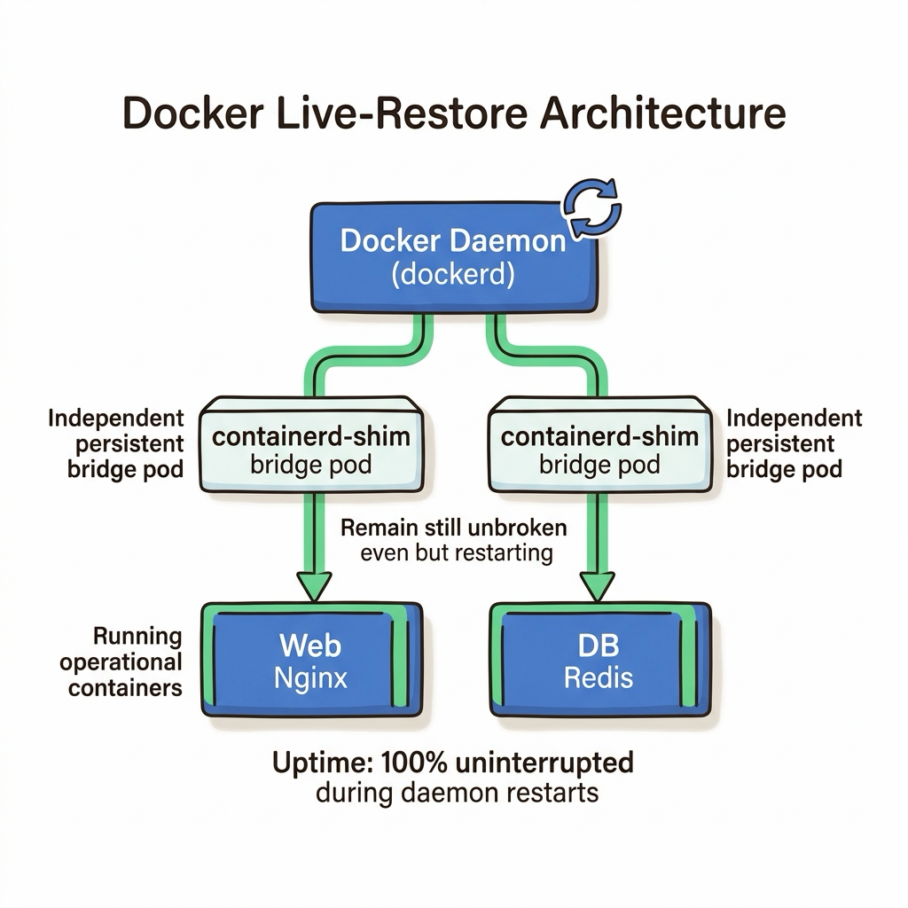

# 004. 실습 환경 구축 2: Linux 서버 Docker Engine과 CLI 검증

클라우드 데이터센터의 99% 이상을 차지하는 실제 운영 서버(AWS EC2, GCP Compute Engine, 온프레미스 베어메탈 서버)에는 모니터 화면이나 마우스로 조작하는 그래픽 데스크톱(GUI)이 존재하지 않습니다. 오직 검은색 콘솔 터미널과 SSH 원격 셸만이 존재할 뿐입니다.


**그림 01-5-1** GUI가 배제된 순수 리눅스 헤드리스(Headless) 서버 환경에서의 Docker Community Edition(CE) 엔진

개인용 컴퓨터에서 사용하는 'Docker Desktop'은 개발 편의를 위한 대시보드와 가상머신 번들이 포함된 무거운 패키지인 반면, 프로덕션 서버에는 **불필요한 오버헤드를 일절 배제한 순수하고 가벼운 `docker-ce` 엔진 데몬(dockerd)**만을 설치해야 합니다.

이번 절에서는 글로벌 엔터프라이즈 표준 운영체제인 **Ubuntu 24.04 LTS**를 기준으로, 보안이 검증된 공식 도커 APT 저장소를 등록하고, 시스템 데몬(`systemd`)으로 서비스를 등록하며, 일반 사용자 계정으로 안전하게 도커 CLI를 다루는 권한 체계까지 완벽하게 정복해 봅니다.

---

### 004.1 패키지 관리자의 함정: 배포판 기본 패키지 vs 도커 공식 저장소

리눅스를 처음 접하는 초심자들이 가장 흔히 저지르는 실수는 단순히 `apt install docker.io` 명령어로 설치를 끝내는 것입니다.
* 배포판 기본 패키지(`docker.io`): 우분투 커뮤니티가 동결한 구버전 바이너리로, 최신 OCI 보안 패치나 Compose V2 호환성이 떨어집니다.
* **도커 공식 저장소(`download.docker.com`)**: 도커 공식 재단에서 직접 관리하며, 최신 보안 취약점이 패치된 안정화 버전(`docker-ce`, `containerd.io`, `docker-buildx-plugin`, `docker-compose-plugin`)을 완벽하게 제공합니다.


**그림 01-5-2** 패키지 위변조를 방지하기 위해 도커 공식 GPG 암호화 키를 키링에 등록하고 APT 리포지터리를 설정하는 과정

#### 🛠️ 리눅스 서버 공식 도커 엔진 4단계 설치 스크립트

```bash
# 1단계: 기존 구버전 패키지 충돌 방지 및 필수 전제 패키지 설치
sudo apt-get remove -y docker docker-engine docker.io containerd runc 2>/dev/null || true
sudo apt-get update
sudo apt-get install -y ca-certificates curl gnupg lsb-release

# 2단계: 도커 공식 GPG 암호화 키 등록 (보안 무결성 보장)
sudo install -m 0755 -d /etc/apt/keyrings
curl -fsSL https://download.docker.com/linux/ubuntu/gpg | sudo gpg --dearmor -o /etc/apt/keyrings/docker.gpg
sudo chmod a+r /etc/apt/keyrings/docker.gpg

# 3단계: 공식 APT 리포지터리 소스 리스트 추가
echo   "deb [arch=$(dpkg --print-architecture) signed-by=/etc/apt/keyrings/docker.gpg] https://download.docker.com/linux/ubuntu   $(. /etc/os-release && echo "$VERSION_CODENAME") stable" |   sudo tee /etc/apt/sources.list.d/docker.list > /dev/null

# 4단계: 최신 Docker Engine, containerd, CLI, 플러그인 설치
sudo apt-get update
sudo apt-get install -y docker-ce docker-ce-cli containerd.io docker-buildx-plugin docker-compose-plugin
```

---

### 004.2 권한의 딜레마: 왜 도커는 기본적으로 root 권한을 요구하는가?

설치가 끝난 직후 일반 사용자 계정으로 `docker ps`를 입력하면 다음과 같은 권한 거부 오류가 발생합니다:
```text
permission denied while trying to connect to the Docker daemon socket at unix:///var/run/docker.sock
```


**그림 01-5-3** `/var/run/docker.sock` 유닉스 도메인 소켓을 통한 통신 구조와 docker 그룹 소속 사용자 권한

이유는 도커 데몬(`dockerd`)이 리눅스 커널의 최상위 권한(root)으로 실행되며, 클라이언트 CLI와 통신할 때 사용하는 유닉스 도메인 소켓인 `/var/run/docker.sock` 파일의 기본 소유권이 `root:root` 또는 `root:docker`로 제한되어 있기 때문입니다.

매번 `sudo docker`를 입력하는 것은 매우 번거로울 뿐만 아니라, 개발자의 오타로 인해 호스트 시스템 전체가 파괴될 수 있는 심각한 보안 리스크를 안고 있습니다. 이를 해결하기 위해 현재 일반 사용자 계정을 `docker` 시스템 그룹에 등록해야 합니다.

```bash
# [권한 설정 1] docker 그룹이 없으면 생성
sudo groupadd docker 2>/dev/null || true

# [권한 설정 2] 현재 로그인된 사용자($USER)를 docker 그룹에 추가
sudo usermod -aG docker $USER

# [권한 설정 3] 로그아웃 없이 현재 셸에 새 그룹 권한 즉시 적용
newgrp docker

# [권한 설정 4] sudo 없이 정상 실행되는지 검증
docker run --rm hello-world
```

> ⚠️ **보안 경고 (Security Note)**:
> `docker` 그룹에 속한 사용자는 사실상 호스트 머신의 root 권한과 동등한 영향력을 가집니다(컨테이너에 호스트 루트 디렉터리를 볼륨 마운트할 수 있기 때문). 따라서 신뢰할 수 없는 외부 사용자 계정에게 무분별하게 docker 그룹 권한을 부여해서는 안 됩니다.

#### 📊 Docker Desktop vs Server Docker Engine 비교

| 구분 항목 | Docker Desktop (Windows/macOS) | Server Docker Engine (Linux CE) |
| :--- | :--- | :--- |
| **운영 목적** | 개발자 개인 로컬 개발 및 테스트 환경 | 24/365 엔터프라이즈 프로덕션 서비스 운영 |
| **GUI 대시보드** | Electron 기반 친화적인 시각화 UI 제공 | 없음 (순수 CLI, API, 모니터링 도구로만 제어) |
| **가상화 계층** | WSL2 / Apple Hypervisor 경량 VM 필요 | **가상화 계층 없음 (리눅스 커널 직접 실행, 0% 오버헤드)** |
| **라이선스** | 대기업 업무용 사용 시 유료 구독 정책 적용 | **완전 무료 오픈소스 (Apache 2.0 라이선스)** |

---

### 004.3 systemd 서비스 관리와 CLI 환경 검증

리눅스 서버가 재부팅되었을 때 도커 데몬과 실행 중이던 컨테이너들이 자동으로 부활할 수 있도록 systemd 서비스 자동 시작을 활성화해야 합니다.

```bash
# 도커 서비스 활성화 및 즉시 시작
sudo systemctl enable --now docker
sudo systemctl enable --now containerd

# 도커 데몬의 활성화 상태(active running) 확인
systemctl status docker --no-pager
```

#### 🔍 리눅스 서버 도커 프로세스 구조도 (Mermaid Diagram)




**그림 01-5-4** systemd 서비스 등록 상태와 docker-ce, containerd의 정상 구동 검증

---

<!-- BIBLE_INTEGRATION_book9_daemon_json_tuning -->
---

### 004.B 📚 도커 바이블 심화: 프로덕션 도커 데몬 설정: /etc/docker/daemon.json 실무 핵심 파라미터 튜닝
*출처 도서: 『시작하세요! 도커/쿠버네티스』 핵심 분석*

리눅스 서버에 도커를 처음 설치하면 기본 설정만으로도 동작하지만, 실무 운영 환경에서는 사내망 IP 대역 충돌, 파일 디스크립터 고갈, 데몬 업데이트 시 서비스 중단 등 다양한 재앙을 예방하기 위해 **/etc/docker/daemon.json** 튜닝이 필수적입니다.

#### 프로덕션 5대 핵심 파라미터:
1. **`bip` (Bridge IP)**: 기본값 `172.17.0.1/16`이 사내 인트라넷이나 VPN 사설 대역과 겹치는 경우 통신 두절이 발생합니다. 반드시 충돌 없는 대역(`10.200.0.1/24` 등)으로 재할당해야 합니다.
2. **`live-restore: true`**: 도커 데몬(`dockerd`) 프로세스가 업데이트나 크래시로 재시작되더라도, 실행 중인 컨테이너 프로세스를 죽이지 않고 그대로 유지합니다.
3. **`default-ulimits`**: 기본값(1024)은 웹 서버나 DB의 소켓 동시 접속 수가 늘어나면 `Too many open files` 에러를 뿜습니다. `nofile`을 `65536` 이상으로 반드시 확장해야 합니다.
4. **`log-driver` & `log-opts`**: 컨테이너별로 일일이 지정하지 않아도 시스템 전체에 논블로킹 모드와 로그 로테이션(10MB 3개)을 전역 강제합니다.
5. **`metrics-addr`**: 프로메테우스가 도커 엔진 자체의 내부 상태를 수집할 수 있도록 엔진 메트릭 엔드포인트를 개방합니다.


**그림 004-B-1** 도커 엔진의 안정성을 극대화하는 daemon.json 프로덕션 핵심 튜닝 파라미터 인포그래픽

```bash
# [실습] 엔터프라이즈 프로덕션 표준 /etc/docker/daemon.json 구성
cat << 'EOF' > /tmp/sample-daemon.json
{
  "bip": "10.200.0.1/24",
  "live-restore": true,
  "default-ulimits": {
    "nofile": {
      "Name": "nofile",
      "Hard": 65536,
      "Soft": 65536
    }
  },
  "log-driver": "json-file",
  "log-opts": {
    "mode": "non-blocking",
    "max-buffer-size": "4m",
    "max-size": "10m",
    "max-file": "3"
  },
  "storage-driver": "overlay2"
}
EOF
cat /tmp/sample-daemon.json
rm -f /tmp/sample-daemon.json
```

> 👨‍🏫 **이호진 교수님의 바이블 멘토링 노트**:
> "새 서버에 도커를 깔고 가장 먼저 해야 할 일은 컨테이너를 띄우는 것이 아니라 daemon.json을 올바르게 세팅하는 것입니다. 특히 live-restore 옵션은 운영 중 도커 데몬 보안 패치를 무중단으로 수행할 수 있게 해주는 생명줄입니다."
>
> 👧 **도로시의 깨달음**:
> "엔진의 기본 설정값들을 튼튼하게 맞춰놓지 않으면 아무리 좋은 앱을 올려도 밑바탕에서 흔들릴 수 있겠네요!"
>
> 🐱 **조교 지니의 아키텍처 체크포인트**:
> "daemon.json 파일을 수정한 뒤에는 `sudo systemctl reload docker`를 실행하면 컨테이너 중단 없이 안전하게 설정을 갱신할 수 있습니다."


<!-- BIBLE_INTEGRATION_book5_deep_004 -->
---

### 004.C 📚 도커 바이블 심화: sudo 없는 도커 실행(docker 그룹)의 보안 진실과 SELinux 컨텍스트 레이블(:z, :Z)
*출처 도서: 『제대로 배우는 도커』 핵심 분석 (제대로 배우는 도커 제2장 (설치하기: 2.2~2.3 SELinux & sudo 없이 실행하기))*

리눅스 서버에 도커를 설치한 뒤 편의를 위해 흔히 실행하는 명령어가 있습니다:
`sudo usermod -aG docker $USER`

#### 1. docker 그룹의 보안 진실 (Root 권한과 동등함):
* 도커 데몬 소켓(`/var/run/docker.sock`)은 root 소유이며 `docker` 그룹에 쓰기 권한이 부여되어 있습니다.
* 일반 사용자를 `docker` 그룹에 추가하는 것은, 해당 사용자에게 **암호 없는 완전한 호스트 root 권한을 부여하는 것과 100% 동일**합니다.
* 사용자가 `docker run -v /:/host alpine rm -rf /host`를 실행하는 순간 호스트 전체를 파괴할 수 있기 때문입니다. 프로덕션 환경에서는 감사 대상 사용자에게 함부로 docker 그룹을 부여해선 안 됩니다.

#### 2. SELinux 활성화 환경에서의 볼륨 마운트 플래그 (`:z` vs `:Z`):
* RHEL, CentOS, Rocky Linux처럼 SELinux가 Enforcing 모드로 켜져 있는 서버에서는 바인드 마운트 시 `Permission Denied` 에러가 발생합니다.
* **`:z` 옵션**: 마운트된 디렉터리의 SELinux 보안 레이블을 여러 컨테이너가 공유할 수 있는 공유 레이블(`container_file_t`)로 자동 갱신합니다.
* **`:Z` 옵션**: 해당 컨테이너만 독점하여 읽고 쓸 수 있는 완전 격리 전용 레이블로 갱신합니다.


**그림 004-B-2** SELinux 환경에서 :z 공유 레이블과 :Z 전용 레이블이 컨테이너 접근을 안전하게 인가하는 도식

```bash
# [실습] SELinux 환경에서 안전한 볼륨 마운트 레이블 플래그 적용
mkdir -p /tmp/selinux-test
echo "SELinux 보안 테스트 데이터" > /tmp/selinux-test/data.txt

# 공유 레이블(:z)을 지정하여 SELinux 통과 마운트
docker container run --rm -v /tmp/selinux-test:/app/data:z alpine \
  cat /app/data/data.txt

rm -rf /tmp/selinux-test
```

> 👨‍🏫 **이호진 교수님의 바이블 멘토링 노트**:
> "SELinux가 에러를 낸다고 해서 `setenforce 0`으로 꺼버리는 것은 보안 엔지니어로서 절대 해선 안 될 부끄러운 일입니다. 도커가 제공하는 `:z` 또는 `:Z` 마운트 플래그를 정확히 사용하는 것이 정석입니다."
>
> 👧 **도로시의 깨달음**:
> "보안 경비실(SELinux)을 아예 없애버리는 게 아니라, 경비실에 정식으로 출입증(:z 레이블)을 발급받아 보여주는 게 올바른 예절이군요!"
>
> 🐱 **조교 지니의 아키텍처 체크포인트**:
> "개발자 PC에서는 docker 그룹에 등록해도 무방하지만, 공용 운영 서버에서는 `Rootless Docker`를 도입하여 일반 사용자가 자신의 계정 권한 안에서만 데몬을 띄우게 하는 것이 최신 보안 추세입니다."


### 004.4 핵심 정리: 캐릭터 대화와 3대 교훈

> 👧 **도로시**: "와! 그래픽 화면이 하나도 없는 리눅스 서버에서도 명령어 몇 줄로 도커 엔진이 척척 깔리고, 0.1초 만에 실행되는 게 정말 신기해요!"
> 
> 🐱 **조교 지니**: "야옹~ 바로 이것이 리눅스 네이티브 커널의 위력이란다. 중간에 가상머신 레이어가 없으니 속도와 자원 효율이 극한에 달하지!"
> 
> 🐶 **토토**: "멍멍! sudo 없이도 도커 명령어가 척척 먹히니 코딩하기 훨씬 편해요!"
> 
> 👨‍🏫 **이호진 교수님**: "그렇단다. 공식 저장소를 통한 패키지 무결성 검증과 비루트 사용자의 권한 관리는 프로덕션 엔지니어링의 기본 중의 기본이란다."


**그림 01-5-5** 리눅스 서버 도커 환경 구축의 3대 핵심 교훈

1. **도커 공식 저장소(Official APT Repo) 사용 필수**:
   * 배포판 기본 패키지의 구버전 문제를 피하고 최신 보안 패치와 OCI 호환성을 확보합니다.
2. **안전한 비루트 권한 구성 (docker group)**:
   * 매번 불필요한 sudo 입력을 지양하고 사용자 그룹 권한을 통해 안전하고 통제된 접근을 유지합니다.
3. **systemd 자동 재시작 보장**:
   * 서버 장애나 재부팅 시에도 컨테이너 인프라가 무중단으로 자동 복구되도록 데몬 서비스를 상시 등록합니다.

---

### 004.5 랩노트 피날레와 다음 강의 예고


**그림 01-5-6** 이제 완벽히 갖춰진 환경 위에서 첫 번째 공식 컨테이너를 실행할 준비를 마친 연구팀

> 💡 **다음 강의 안내**:
> [005. 첫 번째 컨테이너: Hello World와 빌드-공유-실행 워크플로](../005_첫번째컨테이너_Hello_World와_빌드공유실행_워크플로/)에서는 마침내 터미널에 첫 컨테이너를 기동하며, 도커 엔진 내부에서 로컬 캐시 조회부터 도커 허브 다운로드, 레이어 언팩, 네임스페이스 격리 프로세스 생성으로 이어지는 기적 같은 5단계 연쇄 반응의 비밀을 밝혀냅니다!

---

## 🧭 강의 네비게이션
* [◀️ 이전 강의: 003_실습환경구축1_Windows_WSL2와_macOS_Docker_Desktop](../003_실습환경구축1_Windows_WSL2와_macOS_Docker_Desktop/)
* [📋 Part 01. 컨테이너 혁명과 도커 엔진 기본기 마스터 (000 ~ 014) 목차로 돌아가기](../)
* [▶️ 다음 강의: 005_첫번째컨테이너_Hello_World와_빌드공유실행_워크플로](../005_첫번째컨테이너_Hello_World와_빌드공유실행_워크플로/)


<!-- BIBLE_INTEGRATION_book9_deep_004 -->
---

### 004.C 📚 도커 바이블 심화: 엔터프라이즈 /etc/docker/daemon.json 정밀 튜닝과 live-restore 무중단 엔진 업데이트
> **출처 및 학술적 배경**: 시작하세요! 도커/쿠버네티스 부록 A (도커 데몬 시작 옵션 변경하기)  
> **핵심 주제**: 대규모 클러스터 오케스트레이션, 분산 합의 알고리즘(Raft), 오버레이 네트워킹 및 프로덕션 데몬 튜닝을 심층 학습합니다.

#### 1. 아키텍처 및 내부 메커니즘 분석
도커 데몬(`dockerd`)을 기본값으로 실행하는 것은 개발용일 뿐이며, 대규모 트래픽을 처리하는 프로덕션 서버에서는 `/etc/docker/daemon.json`을 통해 커널 리소스 상한선, 브리지 사설 IP 대역 격리, 데몬 재시작 시 컨테이너 무중단 유지를 사전 구성해야 합니다.

#### 핵심 엔터프라이즈 daemon.json 3대 필수 파라미터:
1. **`live-restore: true`**:
   * 도커 데몬 프로세스가 패치 업그레이드되거나 비정상 종료되더라도, 실행 중인 컨테이너 프로세스가 종료되지 않고 `containerd-shim`에 의해 계속 가동되도록 보장합니다.
2. **`default-ulimits` (nofile & nproc)**:
   * 특정 컨테이너가 파일 디스크립터를 대량 개방하여 호스트 전체 시스템을 마비시키는 DoS 공격을 방어합니다 (기본 `nofile: 65536`).
3. **`bip` (Bridge IP CIDR)**:
   * 회사 내부 폐쇄망 사설 대역(예: 172.17.0.0/16)과의 IP 충돌을 원천 차단하기 위해 기본 `docker0` 브리지 서브넷을 안전한 커스텀 대역(예: `10.200.0.1/24`)으로 재정의합니다.



#### 2. 엔터프라이즈 실전 검증 실습
```bash
# [실습] /etc/docker/daemon.json 프로덕션 권장 엔터프라이즈 설정
cat << 'EOF' | sudo tee /etc/docker/daemon.json
{
  "bip": "10.200.0.1/24",
  "default-ulimits": {
    "nofile": {
      "Name": "nofile",
      "Hard": 65536,
      "Soft": 65536
    }
  },
  "live-restore": true,
  "log-driver": "json-file",
  "log-opts": {
    "max-size": "50m",
    "max-file": "5"
  },
  "storage-driver": "overlay2"
}
EOF

# 데몬 설정 검증 및 무중단 재로드
sudo systemctl reload docker || sudo systemctl restart docker
docker info | grep -E "Live Restore Enabled|Default Ulimits"
```

#### 3. 프로덕션 운영을 위한 핵심 멘토링
> 👨‍🏫 **이호진 교수님의 심화 지도**:
> "live-restore를 켜두지 않으면 도커 엔진 패키지 보안 패치나 OS 유지보수 시 수십 개의 프로덕션 컨테이너가 일제히 다운되는 대형 장애가 발생합니다."
>
> 👧 **도로시의 깨달음**:
> "관리자 아저씨가 잠깐 자리를 비워도 기계들은 도르래와 태엽(containerd-shim) 덕분에 멈추지 않고 씩씩하게 일하는군요!"
>
> 🐱 **조교 지니의 프로덕션 체크리스트**:
> * 데몬 설정 변경 후에는 sudo systemctl reload docker를 실행하여 서비스 중단 없이 설정을 동적 반영할 수 있는지 검증해야 합니다.
