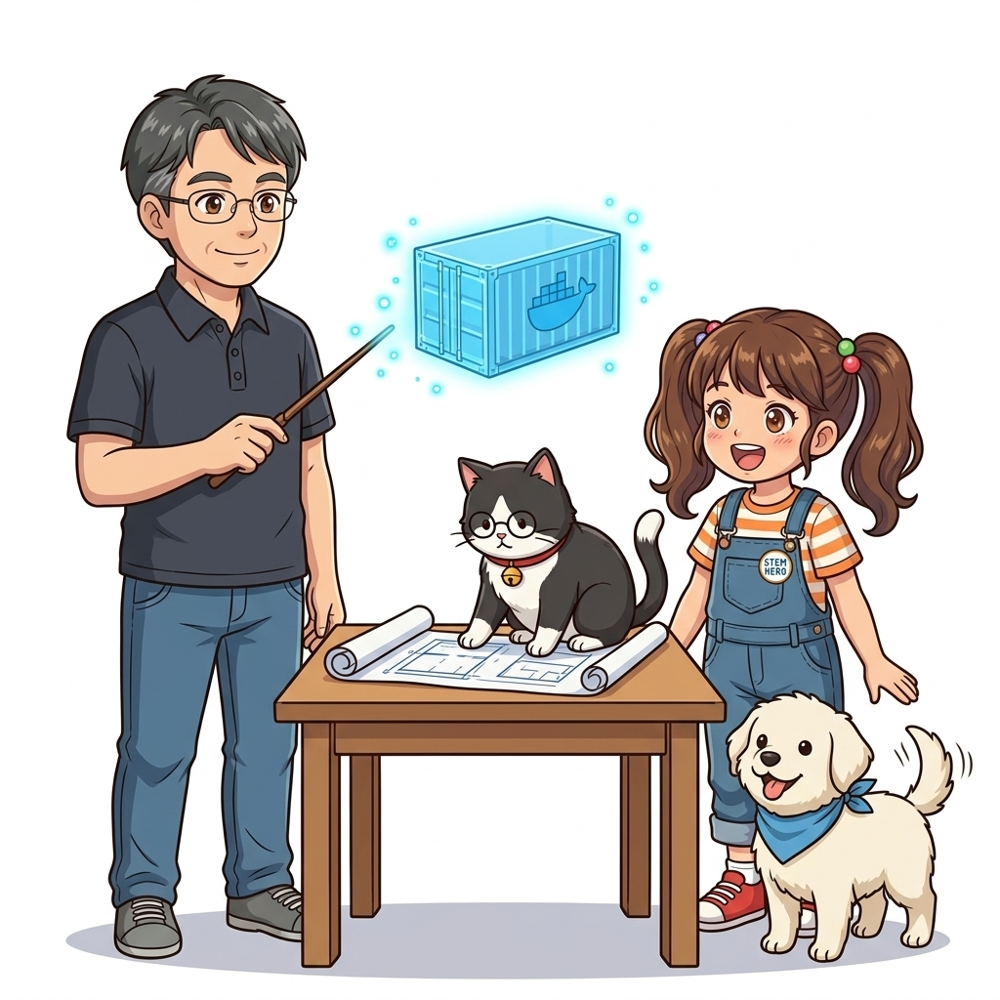
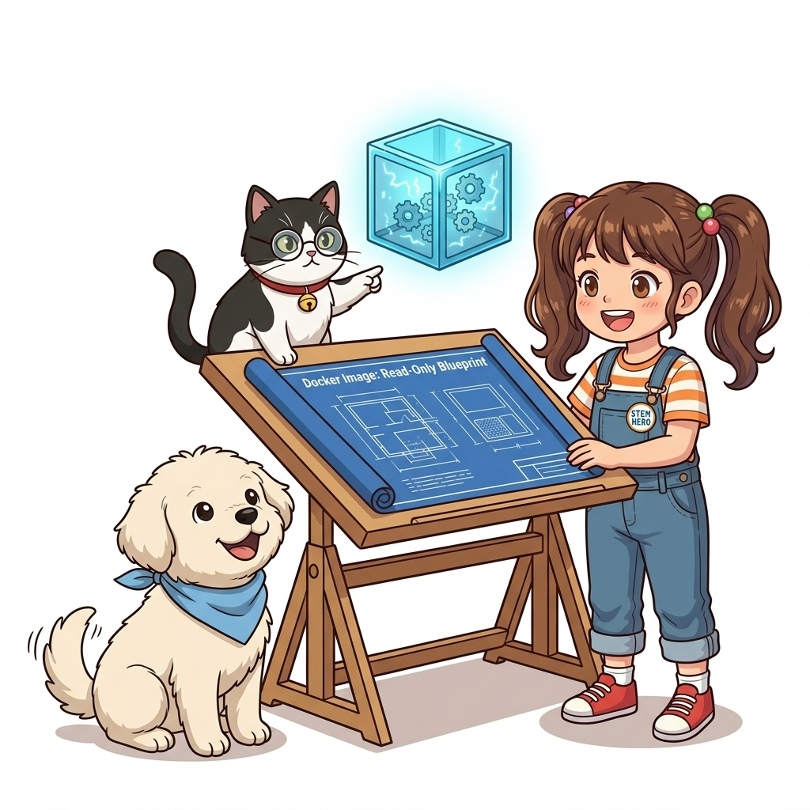
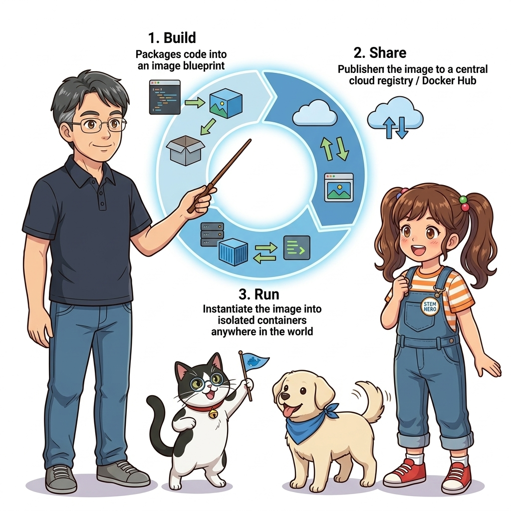
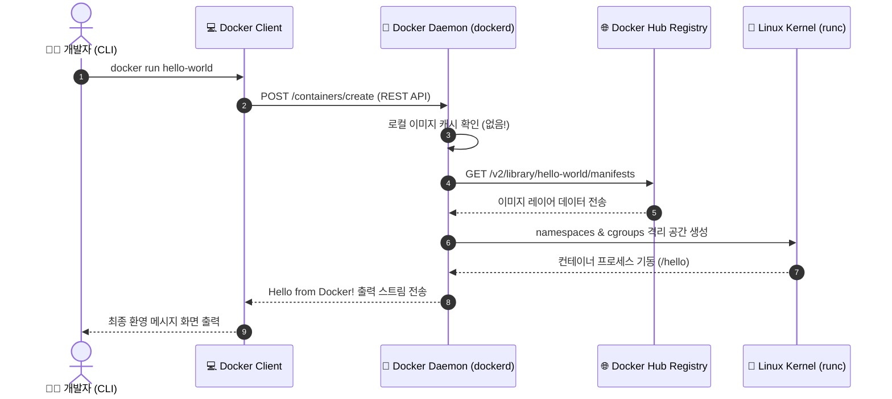
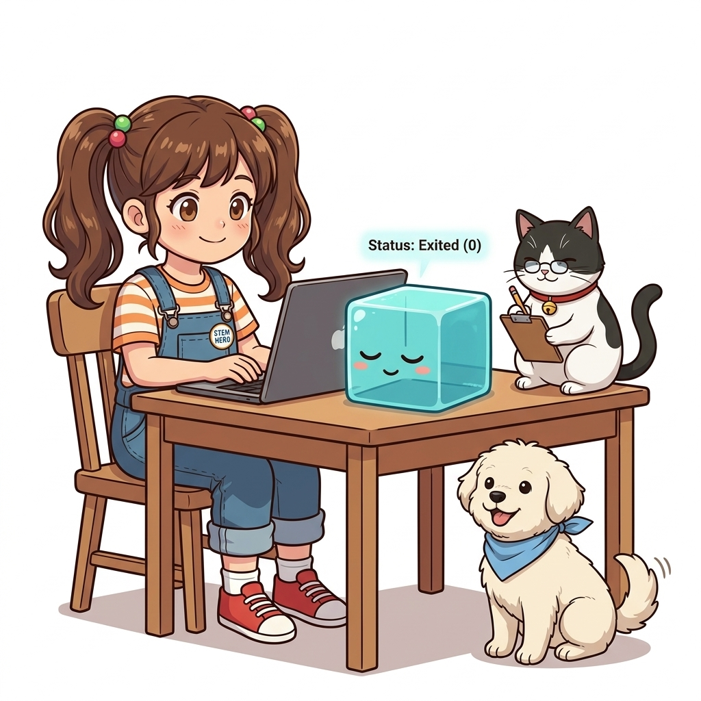
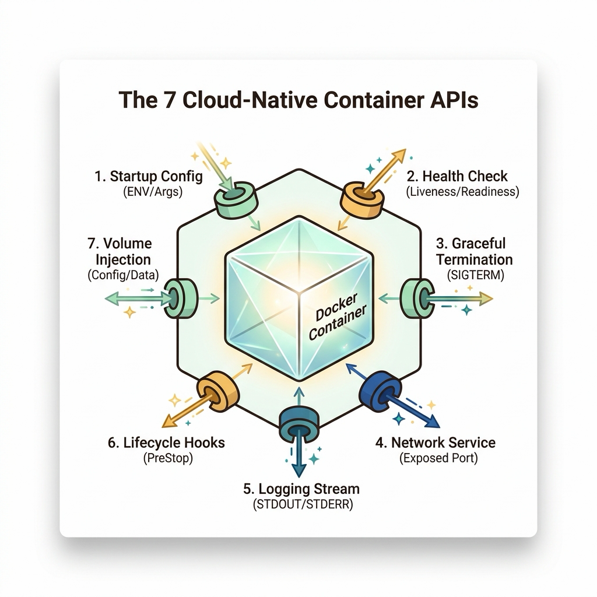
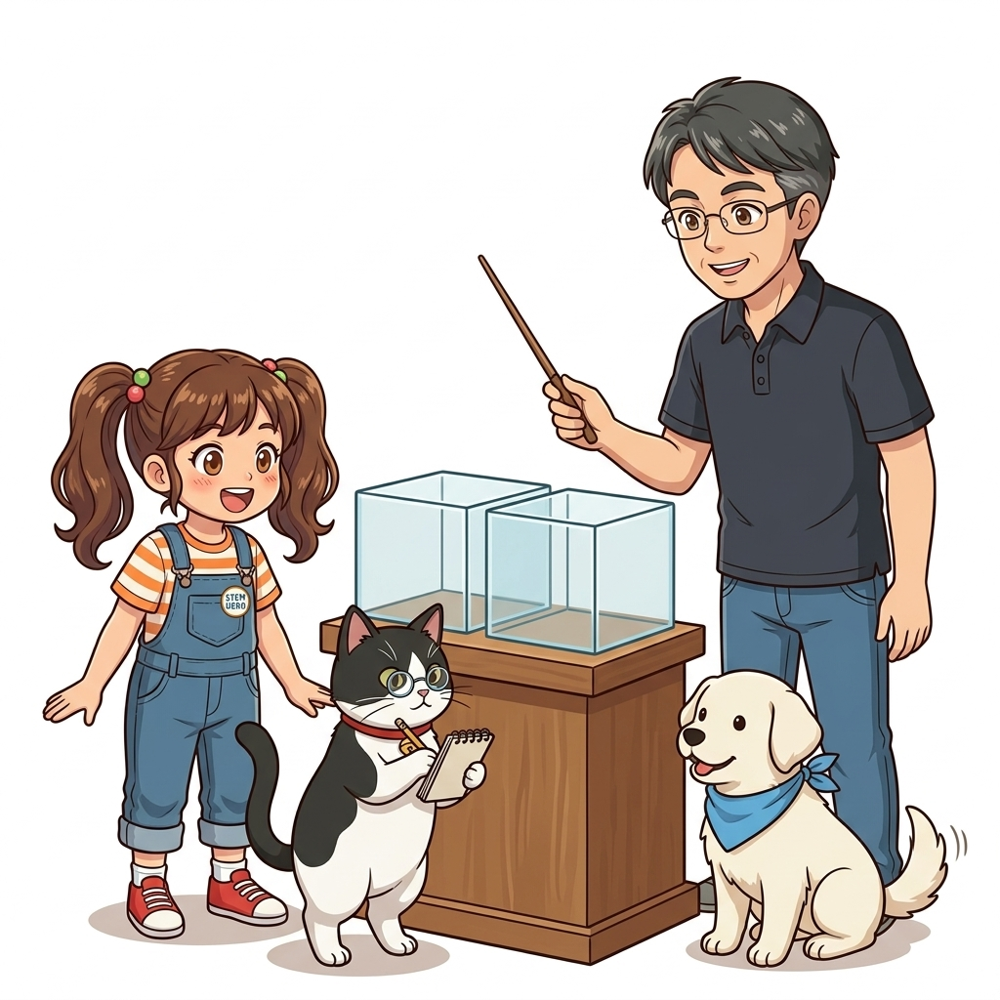

# 005. 첫 번째 컨테이너: Hello World와 빌드-공유-실행 워크플로

프로그래밍을 처음 배울 때 화면에 `"Hello, World!"`를 출력하며 컴퓨터와의 첫 대화를 시작하듯, 도커의 세계에 입문한 모든 엔지니어는 반드시 다음 한 줄의 명령어로 컨테이너 혁명의 첫걸음을 뗍니다:
```bash
docker container run hello-world
```


**그림 01-6-1** 단 한 줄의 명령어가 일으키는 클라우드 네이티브 연쇄 반응: Hello-World 컨테이너의 탄생

이 명령어는 단순한 텍스트 몇 줄을 콘솔에 출력하고 종료되는 것처럼 보이지만, 사실 그 배후에서는 **로컬 이미지 캐시 탐색, 글로벌 레지스트리(Docker Hub)와의 통신, 암호화 다이제스트 검증, 계층형 레이어 다운로드 및 압축 해제, 리눅스 커널 네임스페이스와 cgroups 자원 격리, OCI 런타임을 통한 프로세스 실행**이라는 현대 분산 컴퓨팅의 가장 위대한 5단계 메커니즘이 단 1초 만에 일어납니다.

---

### 005.1 `docker run hello-world`의 내부 동작 5단계 해부

터미널에 명령어를 입력했을 때 출력되는 로그를 유심히 살펴보면 도커 엔진의 치밀한 동작 순서가 고스란히 드러납니다:

```text
Unable to find image 'hello-world:latest' locally
latest: Pulling from library/hello-world
c1ec31eb5944: Pull complete 
Digest: sha256:d58e752213a51785838f9eed2b7a498ffa1cb3aa7f946dacb167361cabe864b0
Status: Downloaded newer image for hello-world:latest

Hello from Docker!
This message shows that your installation appears to be working correctly.
...
```


**그림 01-6-2** 로컬 캐시 조회부터 도커 허브 다운로드, 커널 격리 공간 생성으로 이어지는 5단계 메커니즘

1. **1단계: 로컬 캐시 탐색 (Local Cache Check)**:
   * 도커 클라이언트는 도커 데몬에게 "hello-world:latest 이미지가 내 컴퓨터 로컬 스토리지에 있는가?"라고 묻습니다. 처음 실행 시에는 없으므로 `Unable to find image locally`를 출력합니다.
2. **2단계: 도커 허브 원격 조회 (Registry Query)**:
   * 데몬은 공인 컨테이너 저장소인 도커 허브(`registry-1.docker.io`)에 접속하여 `library/hello-world` 리포지터리의 최신 매니페스트를 조회합니다.
3. **3단계: 계층형 레이어 병렬 다운로드 (Layer Pull & Verification)**:
   * 이미지의 고유한 불변 해시(SHA256)를 검증하고, 압축된 루트 파일시스템 레이어를 다운로드하여 호스트 디스크의 OverlayFS 스토리지 드라이버에 마운트합니다.
4. **4단계: 격리된 컨테이너 환경 프로비저닝 (Container Provisioning)**:
   * 데몬은 containerd와 runc를 호출하여 새로운 독립된 리눅스 네임스페이스(새로운 PID, Mount, Network 공간)를 할당합니다.
5. **5단계: 프로세스 기동 및 결과 반환 (Execution & Cleanup)**:
   * 컨테이너 내부의 `/hello` 바이너리를 실행하여 콘솔 환영 메시지를 표준 출력(stdout)으로 뿜어낸 뒤 프로세스는 정상 종료(Exit code 0) 상태로 전환됩니다.

---

### 005.2 빌드-공유-실행 (Build-Ship-Run) 3대 핵심 워크플로

도커의 진정한 힘은 이 간단한 1회성 실행을 전 세계 규모의 표준 소프트웨어 유통 파이프라인으로 승화시킨 **'빌드-공유-실행(Build-Ship-Run)'** 철학에서 나옵니다.


**그림 01-6-3** 개발자가 코드를 빌드하고, 레지스트리에 공유하며, 전 세계 어디서나 실행하는 3대 핵심 라이프사이클

* **1. 빌드 (Build)**:
  * 개발자는 `Dockerfile`이라는 선언적 레시피를 작성하여 소스코드와 런타임 환경을 하나의 불변 이미지(`docker build`)로 컴파일합니다.
* **2. 공유 (Ship)**:
  * 빌드된 이미지는 도커 허브, GitHub Packages(GHCR), AWS ECR 같은 중앙 레지스트리에 푸시(`docker push`)되어 안전하게 공유됩니다.
* **3. 실행 (Run)**:
  * 운영팀이나 클라우드 오케스트레이터는 복잡한 설치 과정 없이 단 한 줄의 명령어(`docker run`)로 완벽히 동일한 실행 환경을 1초 만에 복원합니다.

#### 📊 객체지향 프로그래밍과 도커의 완벽한 비유

| 객체지향 프로그래밍 개념 | 도커(Docker) 엔지니어링 개념 | 핵심 특징 및 관계 |
| :--- | :--- | :--- |
| **클래스 (Class)** | **도커 이미지 (Docker Image)** | 붕어빵 틀처럼 실행에 필요한 코드와 읽기 전용 파일시스템이 얼어붙은 불변(Read-only)의 설계도 |
| **객체/인스턴스 (Object/Instance)** | **도커 컨테이너 (Docker Container)** | 붕어빵처럼 이미지라는 클래스를 기반으로 메모리와 CPU 자원을 할당받아 살아 움직이는 격리된 프로세스 |
| **클래스 상속 (Inheritance)** | **베이스 이미지 레이어 (`FROM`)** | 부모 클래스의 기능을 물려받듯, Ubuntu나 Alpine 베이스 이미지 위에 내 앱 레이어를 차곡차곡 쌓아 올림 |
| **패키지/모듈 리포지터리 (Maven/NPM)** | **컨테이너 레지스트리 (Docker Hub)** | 전 세계 개발자들과 사전 검증된 클래스(이미지)를 안전하게 배포하고 공유하는 공식 저장소 |

---

### 005.3 선언적 실습 및 아키텍처 다이어그램

직접 터미널에서 `hello-world`를 실행해 보고, 종료된 컨테이너의 상태와 로컬에 캐시된 이미지를 확인해 봅시다.

```bash
# [실습 005-1] 공식 Hello-World 컨테이너 실행
docker container run hello-world

# [실습 005-2] 실행이 완료되어 멈춰 있는 컨테이너 목록 확인 (-a: All)
docker container ls -a

# [실습 005-3] 로컬에 영구 캐시된 hello-world 이미지 확인 (크기가 겨우 수 KB에 불과함)
docker image ls hello-world

# [실습 005-4] 테스트가 끝난 멈춘 컨테이너 정리
docker container prune -f
```

#### 🔍 Docker CLI와 데몬 간 REST API 통신 흐름도 (Mermaid Diagram)




**그림 01-6-4** 터미널에서 hello-world 실행 시 도커 데몬과 레지스트리 사이에서 일어나는 API 통신 검증

---

<!-- BIBLE_INTEGRATION_book1_seven_container_apis -->
### 005.B 📚 도커 바이블 심화: 클라우드 네이티브 컨테이너 애플리케이션의 7대 계약 인터페이스(Container API)
> **출처 및 학술적 배경**: 『15단계로 배우는 도커와 쿠버네티스』 제2장 (Step 05 컨테이너 API: 2.28 ~ 2.29 컨테이너 API의 종류와 개요)  
> **핵심 주제**: 컨테이너가 단순한 프로세스를 넘어 엔터프라이즈 오케스트레이터(Docker, Kubernetes)와 상호작용하기 위해 반드시 준수해야 하는 7대 표준 계약 API.

#### 1. 컨테이너 API란 무엇인가?
컨테이너화된 애플리케이션은 고립된 섬이 아닙니다. 컨테이너 런타임 및 외부 오케스트레이터와 유기적으로 통신하며 자신의 상태를 보고하고 외부 지시를 수신해야 합니다. 이를 위해 애플리케이션 코드가 갖추어야 할 규격을 **컨테이너 API(Container API)**라고 부릅니다.

#### 2. 엔터프라이즈 컨테이너 7대 계약 규격

| 구분 | 컨테이너 계약 API | 내부 동작 메커니즘 및 엔지니어링 구현 가이드 |
| :---: | :--- | :--- |
| **1** | **기동 API (Startup / Config)** | 애플리케이션은 시작 시 하드코딩된 설정 파일 대신 **환경 변수(`ENV`)나 실행 인자(`CMD`)**를 읽어 데이터베이스 주소, 포트, 구동 모드를 동적으로 결정해야 함 |
| **2** | **서비스 API (Service Port)** | 외부 클라이언트 요청을 수신하기 위해 지정된 포트(예: 8080)를 열고, 도커의 포트 포워딩(`-p 8080:8080`)이나 서비스 가상 IP(VIP)에 응답해야 함 |
| **3** | **로깅 API (Logging Stream)** | 로컬 디스크 파일에 로그를 쓰면 컨테이너 종료 시 유실되므로, 모든 로그를 **표준 출력(`STDOUT`)과 표준 에러(`STDERR`)** 파이프로 직접 방출해야 함 |
| **4** | **종료 API (Termination Signal)** | 런타임이 보내는 **`SIGTERM` 시그널**을 감지하여, 진행 중인 DB 트랜잭션을 커밋하고 연결을 정리한 뒤 `Exit Code 0`으로 그레이스풀하게 종료해야 함 |
| **5** | **헬스체크 API (Health Probe)** | 서비스 수신 준비가 끝났음을 알리는 **Readiness Probe**와 프로세스 생존을 증명하는 **Liveness Probe**(HTTP `/healthz` 또는 TCP 핑) 엔드포인트를 노출해야 함 |
| **6** | **볼륨 API (Volume & Storage)** | 상태가 보존되어야 하는 영속 데이터나 외부 보안 비밀값(Secret/ConfigMap)은 컨테이너 루트 파일시스템이 아닌 **마운트된 외부 볼륨 경로**에 읽고 써야 함 |
| **7** | **라이프사이클 훅 (Lifecycle Hooks)** | 컨테이너 시작 직후(`postStart`) 또는 종료 직전(`preStop`)에 오케스트레이터가 주입하는 비동기 알림 스크립트나 HTTP 콜백을 적절히 수신해야 함 |


**그림 005-B-1** 오케스트레이터와 컨테이너 애플리케이션 간의 7대 계약 인터페이스(Container API) 규격

```bash
# [실습] 7대 컨테이너 API를 모범적으로 구현한 Node.js 웹서버 기동 및 검증
# 1. 환경변수(기동 API), 포트매핑(서비스 API), 표준출력(로깅 API) 실시간 연동
docker container run -d --name api-contract-demo \
  -e PORT=3000 \
  -e APP_ENV=production \
  -p 8080:3000 \
  nginx:alpine

# 2. 로깅 API 검증 (표준 출력 로그가 도커 JSON 로깅 드라이버로 즉시 수집됨)
docker container logs api-contract-demo

# 3. 종료 API 검증 (SIGTERM 전달 후 정상 정지 여부 점검)
docker container stop --time 10 api-contract-demo
docker container inspect api-contract-demo --format '{{.State.ExitCode}}'  # Exit Code 0 확인!

# 4. 실습 완료 후 컨테이너 정리
docker container rm api-contract-demo
```

> 👨‍🏫 **이호진 교수님의 바이블 멘토링 노트**:
> "단순히 코드를 컨테이너 안에 집어넣는다고 해서 진정한 '클라우드 네이티브 애플리케이션'이 되는 것이 아닙니다. 파일 로깅 대신 STDOUT을 쓰고, SIGTERM을 받아 안전하게 종료(Graceful Shutdown)하는 7대 컨테이너 API 계약을 준수할 때 비로소 어떤 클라우드나 쿠버네티스에서도 무중단으로 생존하는 명품 서비스가 탄생합니다."
>
> 👧 **도로시의 깨달음**:
> "컨테이너를 상자 속에 혼자 가두는 게 아니라, 바깥 오케스트레이터와 7가지 신호(환경변수, 포트, 로그, 종료신호 등)로 끊임없이 대화하며 팀플레이를 펼치는 거였군요!"
>
> 🐱 **조교 지니의 아키텍처 체크포인트**:
> * `docker stop` 명령은 먼저 `SIGTERM`을 보내고 10초(기본값) 동안 기다립니다. 애플리케이션이 10초 내에 스스로 꺼지지 않으면 도커 데몬이 무자비한 `SIGKILL`을 날리므로, 반드시 시그널 핸들러를 등록해 두어야 합니다.

---

### 005.4 핵심 정리: 캐릭터 대화와 3대 교훈

> 👧 **도로시**: "와! `docker run` 한 줄을 쳤을 뿐인데, 로컬에 파일이 없으면 자동으로 글로벌 저장소에서 다운받아 커널 격리 공간까지 뚝딱 만들어 주는군요!"
> 
> 🐱 **조교 지니**: "야옹~ 맞습니다. 이미지가 '붕어빵 틀(클래스)'이라면, 컨테이너는 그 틀에서 찍어낸 '붕어빵(인스턴스)'이라는 점을 절대 잊지 마세요!"
> 
> 🐶 **토토**: "멍멍! 한 번 다운받은 이미지는 컴퓨터에 캐시되니까 두 번째 실행할 때는 0.01초 만에 뜬대요!"
> 
> 👨‍🏫 **이호진 교수님**: "정확하단다. 이처럼 '빌드하고, 공유하고, 어디서나 똑같이 실행한다'는 3대 워크플로가 현대 클라우드 소프트웨어 유통의 글로벌 표준이 되었단다."


**그림 01-6-5** 첫 번째 컨테이너 실행과 Build-Ship-Run의 3대 핵심 교훈

1. **5단계 연쇄 실행 메커니즘의 이해**:
   * 로컬 탐색 -> 레지스트리 풀 -> 레이어 검증 -> 격리 공간 생성 -> 프로세스 실행의 흐름을 파악합니다.
2. **이미지(Image)와 컨테이너(Container)의 이분법**:
   * 읽기 전용 불변 파일시스템(이미지)과 동적으로 살아 숨 쉬는 프로세스 인스턴스(컨테이너)의 차이를 명확히 구분합니다.
3. **Build-Ship-Run 표준 파이프라인의 체화**:
   * 소스코드부터 글로벌 배포까지 이어지는 컨테이너의 표준 라이프사이클을 실무의 기본 척도로 삼습니다.

---

### 005.5 랩노트 피날레와 다음 강의 예고


**그림 01-6-6** 다음 강의인 격리와 밀집의 심층 원리를 연구실 칠판에 적어보는 교수님과 연구팀

> 💡 **다음 강의 안내**:
> [006. 컨테이너란 무엇인가: 격리와 밀집의 두 마리 토끼](../006_컨테이너란_무엇인가_격리와밀집의_두마리토끼/)에서는 도커가 어떻게 다른 프로세스에 전혀 간섭받지 않는 '철통 격리(Isolation)'를 유지하면서도, 단일 서버에 수백 개의 서비스를 구겨 넣는 '초고밀도 배치(Density)'라는 상충하는 두 마리 토끼를 완벽하게 잡아냈는지 그 놀라운 엔지니어링 비결을 파헤칩니다!

---

## 🧭 강의 네비게이션
* [◀️ 이전 강의: 004_실습환경구축2_Linux서버_Docker_Engine과_CLI검증](../004_실습환경구축2_Linux서버_Docker_Engine과_CLI검증/)
* [📋 Part 01. 컨테이너 혁명과 도커 엔진 기본기 마스터 (000 ~ 014) 목차로 돌아가기](../)
* [▶️ 다음 강의: 006_컨테이너란_무엇인가_격리와밀집의_두마리토끼](../006_컨테이너란_무엇인가_격리와밀집의_두마리토끼/)
