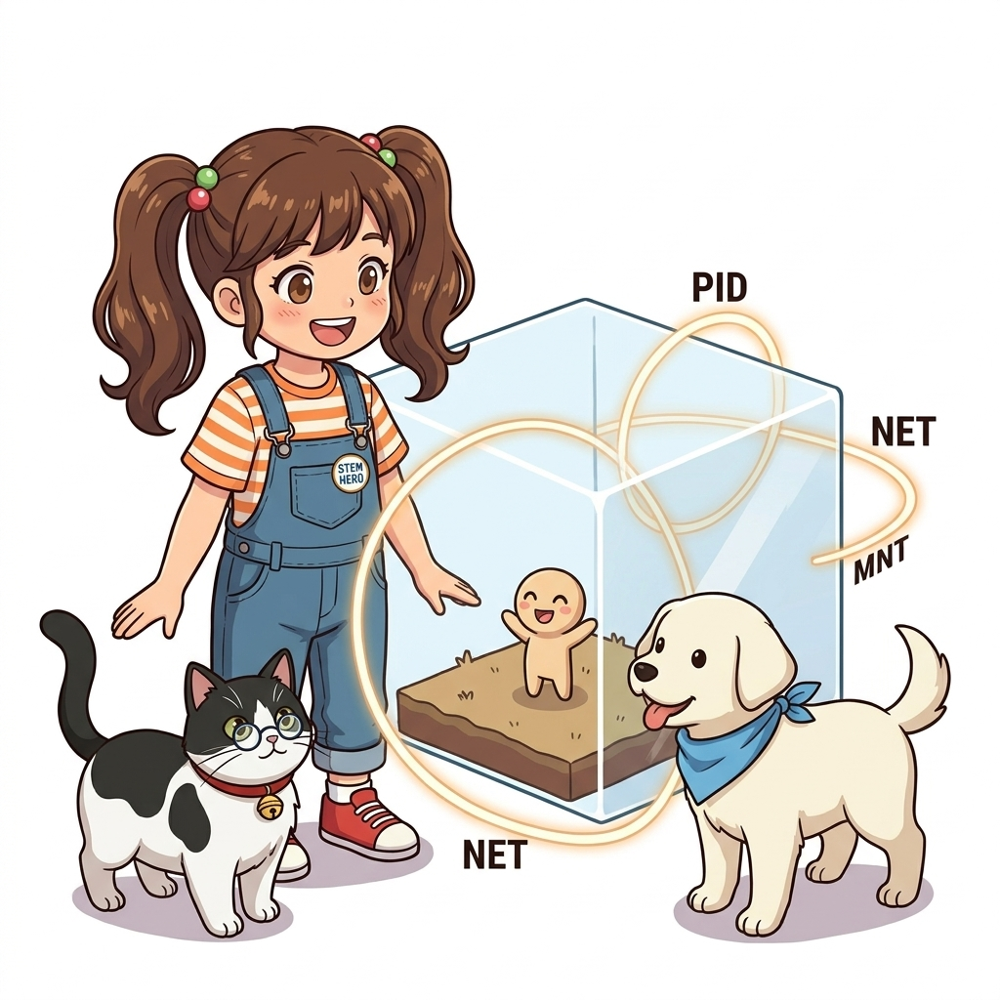
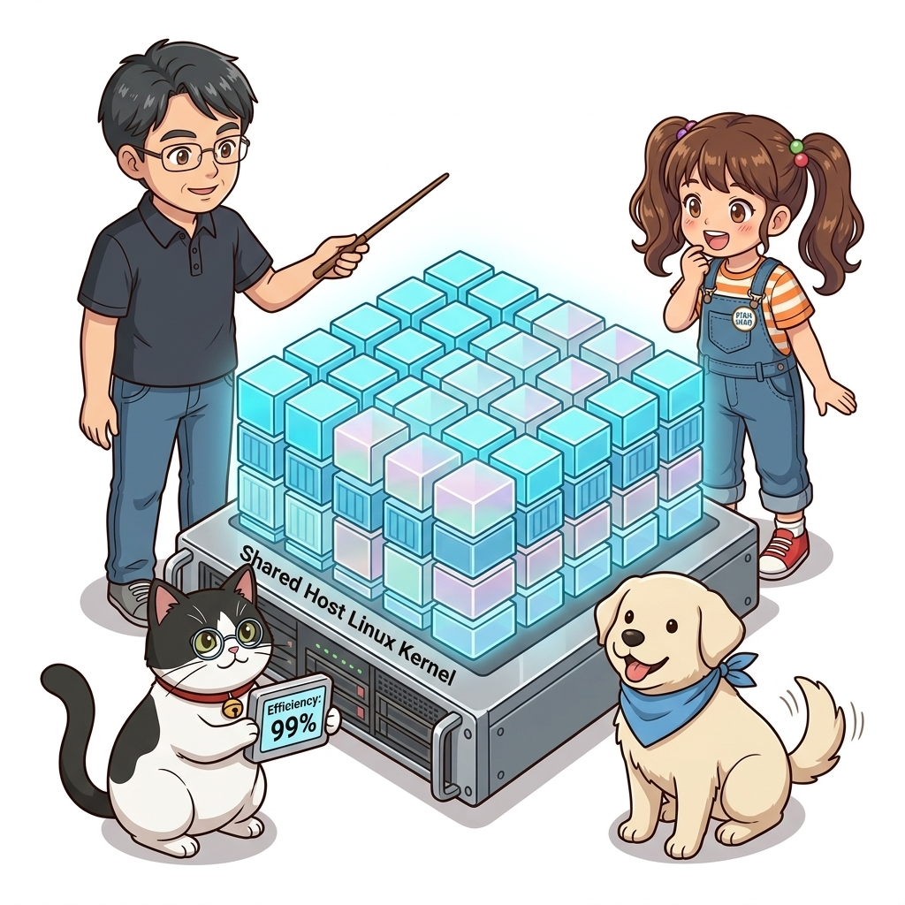
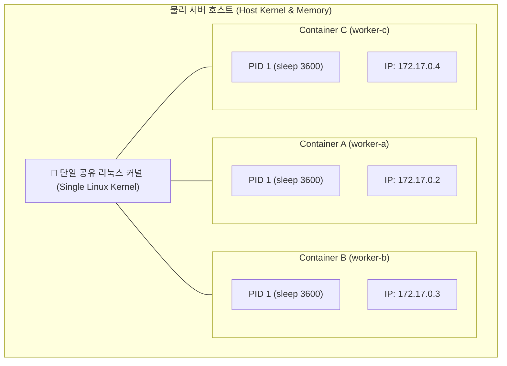
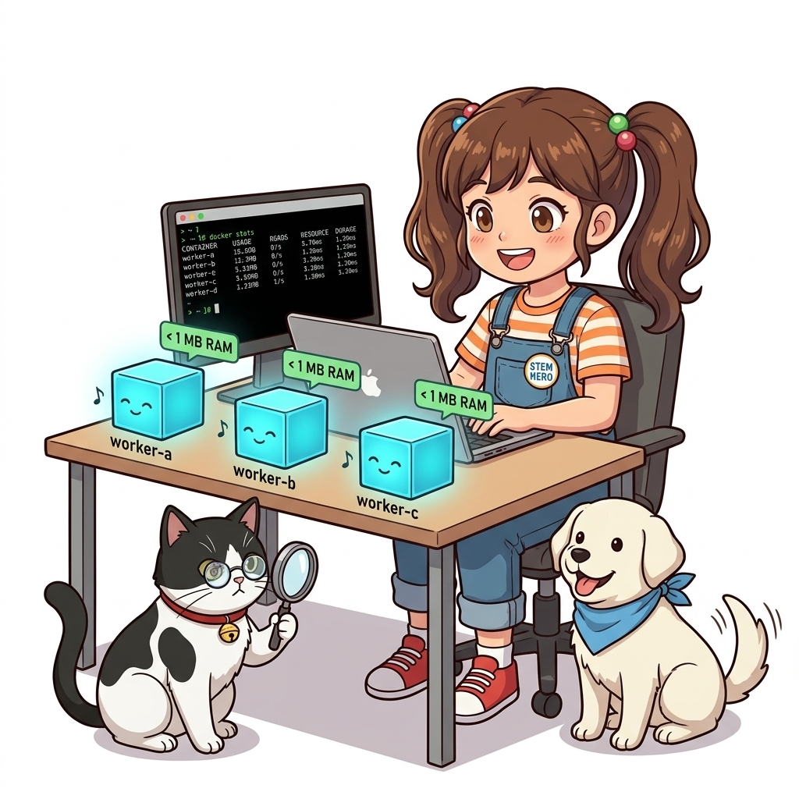
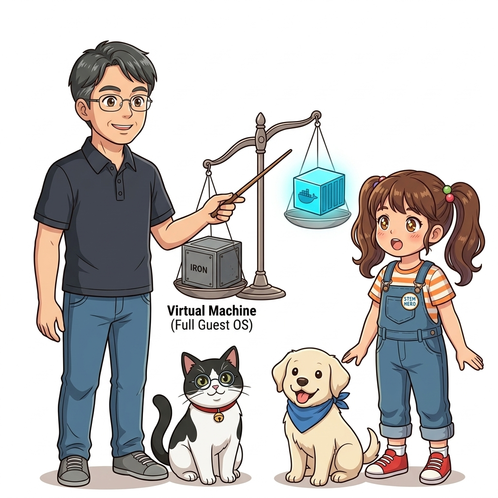

# 006. 컨테이너란 무엇인가: 격리와 밀집의 두 마리 토끼

컴퓨터 공학과 시스템 인프라 설계의 역사에서 **격리(Isolation)**와 **밀집(Density)**은 언제나 서로를 가로막는 영원한 트레이드오프(Trade-off) 관계였습니다.
* 한 프로세스가 다른 프로세스의 메모리를 침범하지 못하도록 완벽하게 격리하려면 무거운 가상머신(VM)이나 물리적 전용 서버를 따로 두어야 했고, 이는 엄청난 비용과 메모리 낭비를 초래했습니다.
* 반대로 단일 서버에 최대한 많은 애플리케이션을 빽빽하게 밀집시켜 자원 효율을 높이려 하면, 단 하나의 프로그램이 메모리 누수를 일으키거나 CPU를 100% 점유하는 순간 서버 전체가 뻗어버리는 '이웃 침범 장애(Noisy Neighbor)'를 피할 수 없었습니다.


**그림 01-7-1** 완벽한 프로세스 보안 격리와 하드웨어 자원 극한 밀집이라는 상충하는 두 목표의 공존

도커 컨테이너는 이 모순된 두 마리 토끼를 **"운영체제를 가상화하는 것이 아니라, 리눅스 커널 내부의 경계선(Boundary)을 정밀하게 제어한다"**는 혁신적인 접근법으로 동시에 포획했습니다.

---

### 006.1 첫 번째 토끼: 철통같은 격리 (Isolation)

도커 컨테이너 안에서 실행되는 프로그램은 자신이 단일 전용 서버에서 혼자 돌아가고 있다고 '착각'합니다:
1. **프로세스 격리 (PID Namespace)**: 컨테이너 내부에서 `ps` 명령어를 치면 자신이 1번 프로세스(`PID 1`)로 보이며, 호스트의 다른 프로세스는 전혀 보이지 않습니다.
2. **네트워크 격리 (NET Namespace)**: 컨테이너마다 고유한 가상 IP 주소, 독립된 라우팅 테이블, 독립된 포트 바인딩 공간을 가집니다. 따라서 호스트 서버에서 80 포트를 이미 쓰고 있더라도, 10개의 컨테이너가 각자의 내부 80 포트를 충돌 없이 열 수 있습니다.
3. **파일시스템 격리 (Mount Namespace & Chroot)**: 호스트의 루트 디렉터리와 완전히 분리된 자신만의 독립된 루트 파일시스템(`/`)을 바라보므로, 컨테이너 내부에서 파일을 지우거나 패키지를 설치해도 호스트 OS에는 단 1바이트의 영향도 주지 않습니다.


**그림 01-7-2** 동일한 커널 위에서 PID, Network, Mount 경계선을 그어 상호 간섭을 원천 차단하는 네임스페이스 격리

---

### 006.2 두 번째 토끼: 극한의 자원 밀집 (Density)

가상머신은 아무리 작은 프로그램을 돌리려 해도 최소 1~2GB의 메모리와 수십 GB의 디스크를 '게스트 운영체제(Guest OS)' 부팅용으로 사전에 떼어놓아야 합니다. 서버의 램이 32GB라면 기껏해야 가상머신을 15개 안팎밖에 띄우지 못합니다.


**그림 01-7-3** 게스트 OS 없이 호스트 커널을 직접 공유하여 10배 이상의 컨테이너를 가동하는 초고밀도 배치 아키텍처

반면 컨테이너는 자체적인 게스트 운영체제를 전혀 탑재하지 않습니다.
* 컨테이너가 소비하는 메모리는 순수하게 **'그 안에서 실행되는 내 애플리케이션 코드가 소비하는 램'**뿐입니다.
* 5MB짜리 마이크로서비스라면 32GB 메모리 서버에 **수백 개, 심지어 1,000개 이상의 컨테이너를 동시에 가동**할 수 있습니다.
* 유휴 상태(Idle)인 컨테이너는 CPU를 거의 0% 소비하며, 실제 트래픽이 들어올 때만 호스트 커널의 연산 자원을 나누어 씁니다.

이러한 놀라운 집적도 덕분에 기업들은 클라우드 인프라 유지 비용(AWS EC2 비용 등)을 기존 대비 50%에서 최대 80%까지 절감할 수 있게 되었습니다.

#### 📊 격리와 밀집 관점의 3대 기술 비교

| 비교 지표 | 베어메탈 프로세스 (Bare-metal) | 전통적 가상머신 (VM) | 도커 컨테이너 (Container) |
| :--- | :--- | :--- | :--- |
| **격리 수준 (Isolation)** | 격리 전무 (서로의 메모리와 포트 침범 가능) | **최상 (하드웨어 수준의 물리적 격리)** | **우수 (리눅스 커널 네임스페이스 기반 논리적 격리)** |
| **자원 밀집도 (Density)** | 높음 (오버헤드는 없으나 충돌 위험 극대) | **최하 (게스트 OS 오버헤드로 인한 낭비 극심)** | **최상 (오버헤드 0에 가까운 고밀도 배치 가능)** |
| **부팅 및 시작 시간** | 밀리초(ms) 단위 즉시 실행 | 수십 초 ~ 수 분 소요 | **수십 밀리초(ms) ~ 1초 이내 초고속 기동** |
| **스토리지 낭비** | 없음 | 가상머신 이미지당 수십 GB 필요 | CoW 레이어 공유로 수 MB~수십 MB 수준 |

---

### 006.3 선언적 실습 및 아키텍처 다이어그램

호스트의 CPU와 메모리를 전혀 낭비하지 않는 3개의 독립된 컨테이너를 동시에 띄워보고, 각 컨테이너 내부의 격리된 프로세스 목록을 확인해 봅시다.

```bash
# [실습 006-1] 3개의 서로 다른 독립된 알파인 컨테이너 백그라운드 구동
docker container run -d --name worker-a alpine:3.20 sleep 3600
docker container run -d --name worker-b alpine:3.20 sleep 3600
docker container run -d --name worker-c alpine:3.20 sleep 3600

# [실습 006-2] 각 컨테이너 내부에서 자신의 PID 1번 프로세스 확인 (완벽한 프로세스 격리 검증)
docker container exec worker-a ps -ef

# [실습 006-3] 실시간 리소스 점유율 확인 (메모리 사용량이 1MB 미만임을 눈으로 확인)
docker stats --no-stream worker-a worker-b worker-c

# [실습 006-4] 테스트 컨테이너 일괄 정리
docker container rm -f worker-a worker-b worker-c
```

#### 🔍 호스트 커널과 격리된 프로세스 뷰 (Mermaid Diagram)




**그림 01-7-4** 단 1MB 미만의 메모리만으로 완벽한 독립 PID 공간을 유지하는 3개 컨테이너의 실시간 측정

---

<!-- BIBLE_INTEGRATION_book1_container_isolation -->
---

### 006.B 📚 도커 바이블 심화: 하이퍼바이저 가상화의 한계와 LinuxKit 기반 컨테이너 아키텍처
> **출처 및 학술적 배경**: 『15단계로 배우는 도커와 쿠버네티스』 제1장 (1.11 컨테이너의 이해 ~ 1.13 가상 서버와 컨테이너의 차이점)  
> **핵심 주제**: 오픈소스 라이브러리 버전 표류(Dependency Drift) 극복, 하이퍼바이저 벤치마크 실측 비교(65% vs 90%+), 비-리눅스 OS에서의 LinuxKit 가상화 서브시스템 및 클라우드 IaaS 2단 하이브리드 배치 모델.

#### 1. 오픈소스 생태계의 모순과 불변 인프라(Immutable Infrastructure)
현대 애플리케이션 개발은 파이썬, 자바, Go, Node.js의 수많은 오픈소스 라이브러리와 프레임워크를 조립하는 방식으로 이루어집니다. 하지만 오픈소스 프로젝트는 보안 패치와 버그 수정을 위해 극도로 빈번하게 버전 업그레이드가 발생합니다:
* **버전 표류(Dependency Drift)**: 동일한 소스 코드라도 빌드하는 날짜나 서버 환경에 따라 서로 다른 마이너 버전의 라이브러리가 땡겨져 API 호환성이 깨지거나 의도치 않은 버그가 잠복합니다.
* **재현 불가능한 환경(It Works on My Machine!)**: 개발자의 노트북, QA 스테이징 서버, 프로덕션 클라우드의 미세한 OS 커널 차이와 라이브러리 파편화가 배포 사고의 80% 이상을 유발합니다.
* **도커의 해결책**: 런타임에 필요한 OS 유저스페이스 바이너리, 라이브러리, 환경 설정을 단 하나의 읽기 전용 이미지에 고정(Freeze)하는 **불변 인프라(Immutable Infrastructure)**를 구현하여 환경 격차를 원천 소멸시켰습니다.

#### 2. 가상 서버(VM) vs 컨테이너 엔터프라이즈 벤치마크 실측 비교
가상 서버는 하이퍼바이저(VMware, Xen, KVM, Hyper-V)가 물리 하드웨어를 에뮬레이션하여 게스트 OS를 부팅하는 반면, 컨테이너는 호스트 리눅스 커널의 네임스페이스와 cgroups를 직접 활용하여 프로세스 경계만 분리합니다.

| 엔터프라이즈 비교 항목 | 하이퍼바이저 가상 서버 (VM) | 도커 컨테이너 (Container) | 비고 및 아키텍처적 차이 |
| :--- | :--- | :--- | :--- |
| **최소 이미지 크기 (CentOS 기준)** | **최소 1.54 GB** | **최소 0.20 GB (1/8 이하)** | 게스트 OS 전체 커널 및 유틸리티 포함 여부 |
| **기본 메모리 풋프린트** | 기본 640 MB ~ 수 GB | **기본 수 MB ~ 512 MB** | 유휴 상태(Idle) 시 낭비되는 게스트 OS 램 차이 |
| **연산 처리 벤치마크 성능** | **물리 성능의 약 65%** (Xen HVM 기준) | **물리 성능의 90% ~ 99%** | 하이퍼바이저 CPU 트랩 및 I/O 가상화 오버헤드 부재 |
| **부팅 및 기동 시간** | **수 분 단위 (Minutes)** | **밀리초 ~ 1초 단위 (Seconds)** | BIOS/UEFI 초기화 및 OS 커널 부팅 생략 |
| **스토리지 격리 방식** | 고정 가상 디스크(VMDK, QCOW2) | **유니온 파일시스템 (Overlay2 CoW)** | 레이어 재사용으로 호스트 디스크 낭비 제로화 |

#### 3. macOS와 Windows에서의 비밀: LinuxKit 경량 서브시스템
컨테이너는 리눅스 커널의 기술이므로, 리눅스 커널이 없는 macOS나 Windows에서는 어떻게 동작할까요?
* 도커는 **LinuxKit**이라는 초경량 리눅스 서브시스템을 내장하여 구동합니다. LinuxKit은 **Docker, IBM, Linux Foundation, Microsoft, ARM, HPE, Intel**이 협력하여 만든 오직 컨테이너 실행만을 위한 초미니멀 임베디드 리눅스 OS입니다.
* **macOS**: Apple의 Hypervisor.framework 기반 **HyperKit / Virtualization.framework** 위에서 LinuxKit VM이 단 1초 만에 백그라운드로 기동하고, 그 위에서 `containerd` 런타임이 동작합니다.
* **Windows 10/11**: **Hyper-V** 가상화 아키텍처 또는 **WSL2(Windows Subsystem for Linux 2)**의 경량 유틸리티 VM 위에서 리눅스 커널이 직접 가동됩니다.

#### 4. 클라우드 실무: IaaS 가상머신과 컨테이너의 2단 하이브리드 아키텍처
엔터프라이즈 현장에서는 "가상머신이냐, 컨테이너냐"를 양자택일하지 않습니다:
* **물리 하드웨어 -> 하이퍼바이저(AWS Nitro, KVM) -> IaaS 가상 머신(EC2, GCE) -> 도커 엔진/containerd -> 다수의 마이크로서비스 컨테이너**
* 클라우드 사업자가 제공하는 안전한 멀티테넌시 하드웨어 경계(IaaS VM) 위에, 소프트웨어 개발팀이 자유롭게 초고밀도로 컨테이너를 패킹(Packing)하여 하드웨어 비용 절감과 보안 격리를 동시에 달성하는 **2단 하이브리드 아키텍처**가 글로벌 표준으로 안착했습니다.


**그림 006-B-1** 하이퍼바이저 가상머신과 컨테이너의 하드웨어 스택 및 클라우드 2단 하이브리드 구조

```bash
# [실습] 컨테이너 격리 프로세스와 호스트 PID 매핑 확인
# 1. 백그라운드 웹서버 컨테이너 기동
docker container run -d --name nginx-isolation -p 8080:80 nginx:alpine

# 2. 컨테이너 내부의 격리된 프로세스 목록 (컨테이너 안에서는 PID 1로 보임)
docker container top nginx-isolation

# 3. 호스트 시스템 관점에서의 실제 리눅스 프로세스 추적
# (호스트의 일반 PID 번호로 네임스페이스 격리 옷을 입고 실행 중임을 확인)
ps aux | grep nginx | grep -v grep

# 4. 실습 완료 후 컨테이너 정리
docker container rm -f nginx-isolation
```

> 👨‍🏫 **이호진 교수님의 바이블 멘토링 노트**:
> "컨테이너는 새로운 하드웨어나 독립된 컴퓨터가 아니라 '격리된 네임스페이스 옷을 입고 실행되는 호스트 리눅스 프로세스'에 불과합니다. 특히 macOS나 Windows에서 개발할 때는 백그라운드에 LinuxKit 초경량 커널 서브시스템이 투명하게 돌고 있다는 점을 이해해야 파일 마운트 퍼포먼스(VirtioFS) 이슈를 올바르게 해결할 수 있습니다."
>
> 👧 **도로시의 깨달음**:
> "교수님 설명을 들으니 왜 도커 컨테이너가 1초 만에 켜지는지, 그리고 윈도우나 맥북에서도 어떻게 리눅스 컨테이너가 마법처럼 돌아가는지(LinuxKit) 확실히 이해되었어요! 무거운 OS를 새로 켜는 게 아니라, 이미 켜진 커널 위에서 문패만 따로 달고 달리는 초경량 프로세스였군요!"
>
> 🐱 **조교 지니의 아키텍처 체크포인트**:
> * 호스트에서 `ps aux`나 `pstree`를 입력하면 컨테이너 안의 프로세스가 호스트 일반 프로세스와 똑같이 보입니다. 컨테이너 내부의 PID 1은 호스트에서는 PID 24890 같은 일반 PID에 불과하다는 점을 꼭 기억하세요!
> * 엔터프라이즈 운영 시 가상 머신(AWS EC2)과 컨테이너를 함께 쓰는 2단 하이브리드 구조에서는 IaaS VM의 vCPU 개수와 컨테이너의 cgroups CPU Quota를 함께 계산해야 성능 저하를 예방할 수 있습니다.


### 006.4 핵심 정리: 캐릭터 대화와 3대 교훈

> 👧 **도로시**: "와! 각자 자기 방(네임스페이스) 안에 갇혀 있어서 바깥세상은 전혀 보지 못하지만, 아래에서는 하나의 커널 침대를 같이 쓰고 있으니 공간을 전혀 낭비하지 않는 거군요!"
> 
> 🐱 **조교 지니**: "야옹~ 아주 정확한 비유란다! 가상머신이 집을 통째로 새로 짓는 것이라면, 컨테이너는 튼튼한 아파트의 개별 호실을 분양하는 것과 같지!"
> 
> 🐶 **토토**: "멍멍! 메모리를 1MB도 안 쓰니까 우리 낡은 컴퓨터에서도 컨테이너를 100개는 띄울 수 있겠어요!"
> 
> 👨‍🏫 **이호진 교수님**: "그렇단다. 이 '격리'와 '밀집'의 균형이야말로 오늘날 클라우드 데이터센터의 비용 효율을 수십 배로 끌어올린 혁신의 본질이란다."


**그림 01-7-5** 격리와 밀집의 조화를 완성하는 3대 핵심 엔지니어링 원칙

1. **네임스페이스 기반의 완벽한 논리적 격리**:
   * 프로세스, 네트워크, 파일시스템의 독립성을 확보하여 타 서비스와의 간섭을 원천 차단합니다.
2. **게스트 OS 제거를 통한 극단적 고밀도 배치**:
   * 불필요한 OS 부팅 오버헤드를 0으로 만들어 단일 하드웨어 자원을 극한으로 집약 활용합니다.
3. **실시간 자원 효율과 비용 최적화**:
   * 유휴 자원의 낭비를 줄이고 필요한 만큼만 탄력적으로 스케일링하는 클라우드 비용 효율성을 확보합니다.

---

### 006.5 랩노트 피날레와 다음 강의 예고


**그림 01-7-6** 가상머신과 컨테이너의 정밀한 물리적 아키텍처 비교를 예고하는 이호진 교수님과 연구팀

> 💡 **다음 강의 안내**:
> [007. 가상머신(VM) vs 도커 컨테이너: 커널 공유의 원리](../007_가상머신_VM_vs_도커컨테이너_커널공유의_원리/)에서는 하이퍼바이저 기반의 무거운 Type-1/Type-2 가상머신과 도커 컨테이너가 하드웨어 CPU 링(Ring 0 vs Ring 3) 및 메모리 페이지 테이블 수준에서 어떻게 물리적으로 다르게 작동하는지 그 심층 메커니즘을 밝혀냅니다!

---

## 🧭 강의 네비게이션
* [◀️ 이전 강의: 005_첫번째컨테이너_Hello_World와_빌드공유실행_워크플로](../005_첫번째컨테이너_Hello_World와_빌드공유실행_워크플로/)
* [📋 Part 01. 컨테이너 혁명과 도커 엔진 기본기 마스터 (000 ~ 014) 목차로 돌아가기](../)
* [▶️ 다음 강의: 007_가상머신_VM_vs_도커컨테이너_커널공유의_원리](../007_가상머신_VM_vs_도커컨테이너_커널공유의_원리/)
