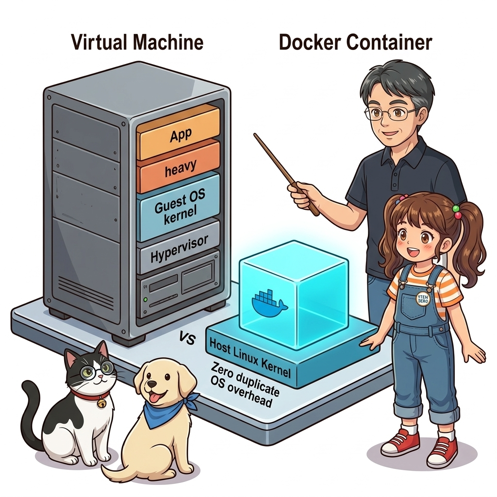
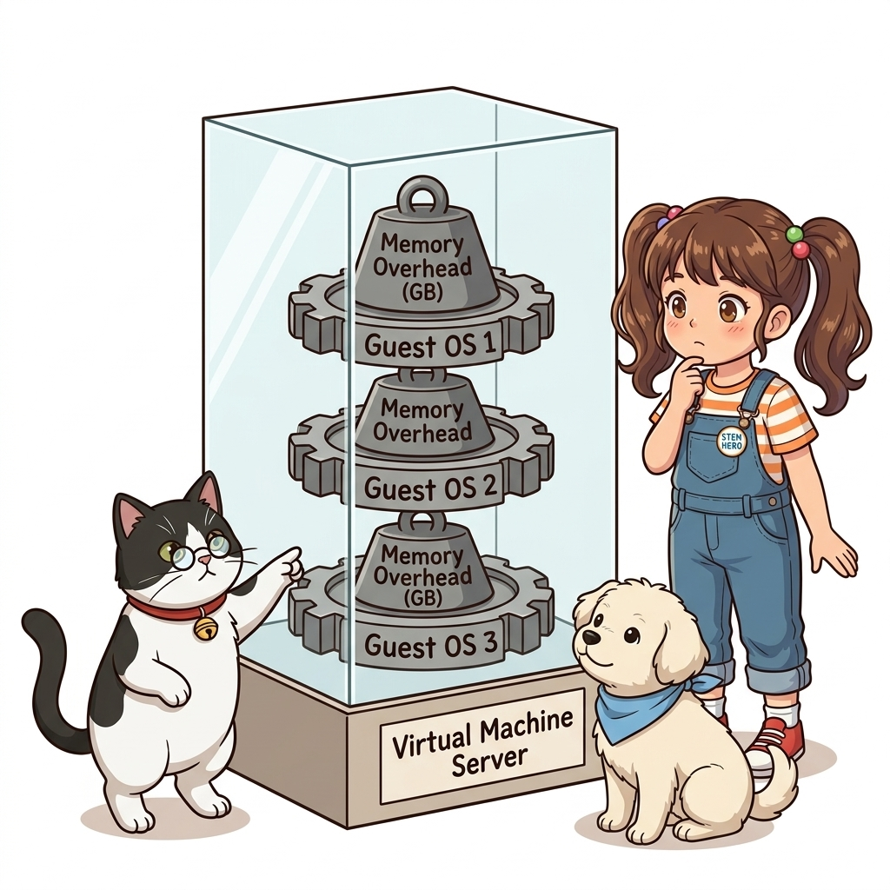
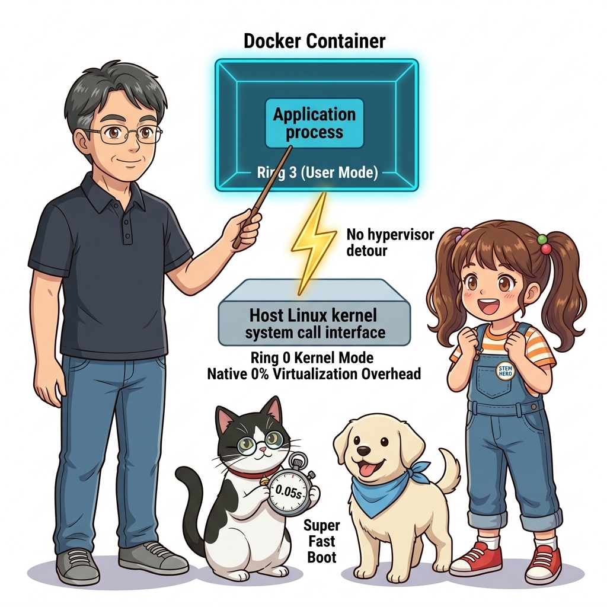
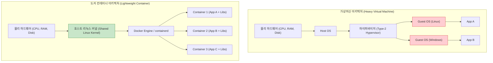
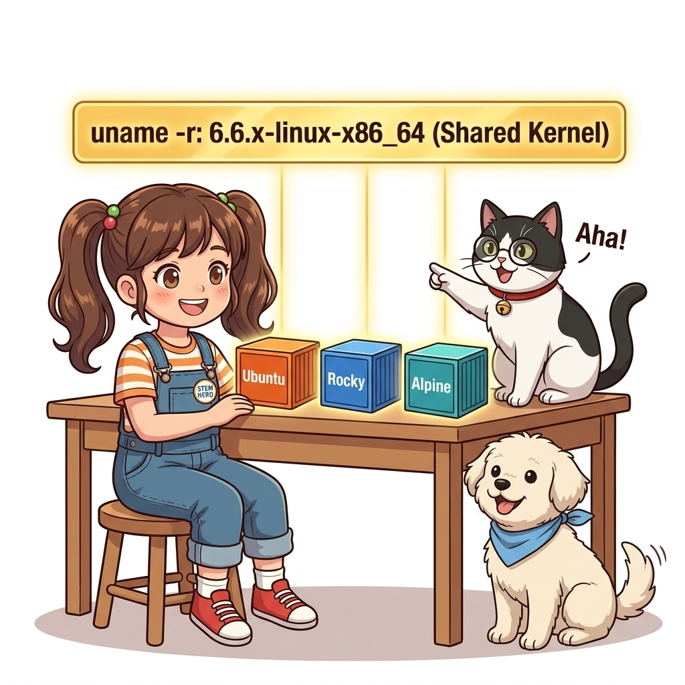
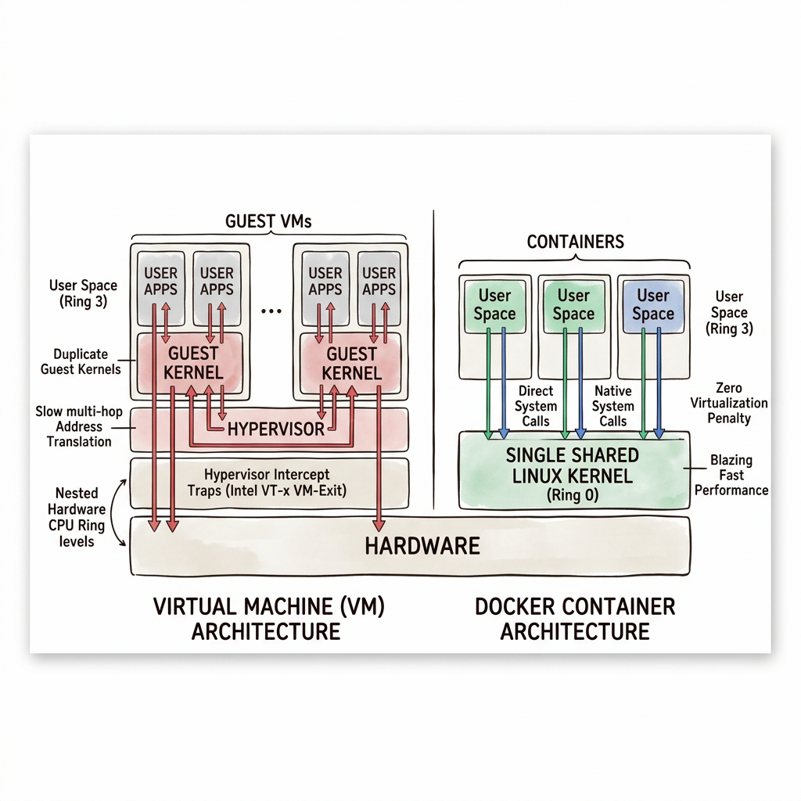
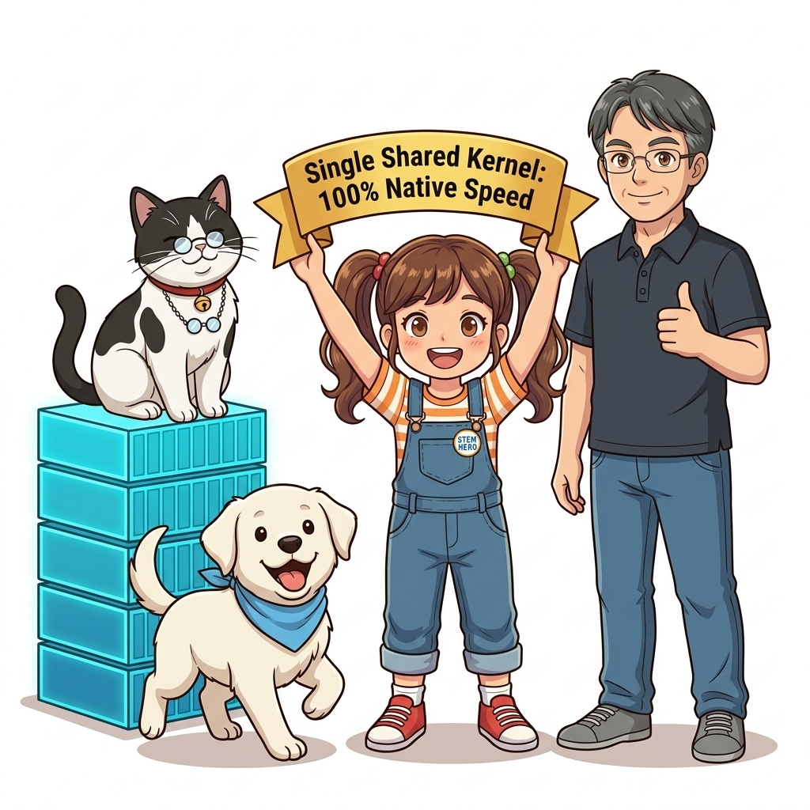

# 007. 가상머신(VM) vs 도커 컨테이너: 커널 공유의 원리

IT 기술 면접에서 가장 빈번하게 출제되면서도, 수많은 지원자들이 피상적인 답변에 그치는 단골 질문이 있습니다:
**"가상머신(VM)과 도커 컨테이너의 가장 근본적인 차이는 무엇입니까?"**

대다수는 "컨테이너가 가상머신보다 가볍고 빠릅니다"라는 상투적인 대답을 내놓습니다. 하지만 왜 가벼운지, 왜 수십 초가 걸리는 가상머신 부팅에 비해 컨테이너는 수십 밀리초(ms) 만에 기동되는지, 그리고 하드웨어 수준에서 두 기술이 CPU 명령어와 시스템 콜(System Call)을 어떻게 다르게 처리하는지 명쾌하게 설명하는 엔지니어는 드뭅니다.


**그림 01-8-1** 하이퍼바이저 기반 게스트 OS 가상화(VM)와 단일 호스트 커널 공유(Container)의 물리적 아키텍처 대조

두 기술의 운명을 가른 결정적인 분기점은 바로 **'운영체제의 심장인 커널(Kernel)을 복제할 것인가, 공유할 것인가'**였습니다. 이번 절에서는 CPU 보호 링(Ring Level)과 메모리 주소 변환의 관점에서 가상머신과 컨테이너의 물리적 차이를 명쾌하게 해부합니다.

---

### 007.1 가상머신(VM)의 해부: 하이퍼바이저와 무거운 게스트 OS

가상머신(VMware, VirtualBox, KVM 등)은 물리적 컴퓨터 전체를 하드웨어 수준에서 에뮬레이션합니다.
1. 물리 CPU와 메모리 위에 **하이퍼바이저(Hypervisor, VMM)**라는 특수한 가상화 소프트웨어가 탑재됩니다.
2. 하이퍼바이저는 가상의 가짜 CPU, 가짜 메모리 컨트롤러, 가짜 디스크 인터페이스를 소프트웨어로 만들어냅니다.
3. 그 가짜 하드웨어 위에 **완전한 정품 운영체제인 게스트 OS(Guest OS)**를 처음부터 끝까지 새로 설치해야 합니다.


**그림 01-8-2** 가상머신마다 독립된 커널, 디바이스 드라이버, 시스템 데몬이 중복 실행되는 구조적 오버헤드

이 구조는 심각한 비효율을 낳습니다:
* **중복된 시스템 부팅 과정**: 전원 켜기 -> BIOS/UEFI 에뮬레이션 -> GRUB 부트로더 -> 커널 메모리 로딩 -> systemd 서비스 초기화로 이어지는 수십 초의 헛된 대기 시간이 발생합니다.
* **거대한 메모리 사재기**: 웹 서버 하나를 띄우고 싶을 뿐인데, 게스트 OS 자체를 유지하기 위해 1~2GB의 물리 메모리가 무조건 묶여버립니다.
* **이중 컨텍스트 스위칭**: 애플리케이션 -> 게스트 커널 -> 하이퍼바이저 -> 호스트 커널 -> 물리 하드웨어로 이어지는 복잡한 다단계 주소 변환(EPT/NPT)으로 인해 CPU 캐시 미스와 성능 저하가 발생합니다.

---

### 007.2 컨테이너의 해부: 단일 호스트 커널 공유와 네이티브 실행

반면 도커 컨테이너는 하드웨어를 에뮬레이션하려는 헛된 시도를 일절 하지 않습니다. **"호스트 서버에 이미 완벽하게 동작하는 최고의 리눅스 커널이 있는데, 왜 굳이 그 위에 가짜 커널들을 수십 개씩 새로 띄워야 하는가?"**라는 질문에서 출발했습니다.


**그림 01-8-3** 하이퍼바이저와 게스트 OS를 완전히 제거하고 호스트 커널의 시스템 콜 인터페이스를 직접 호출하는 컨테이너

컨테이너의 놀라운 동작 메커니즘:
* 컨테이너 내부의 프로세스는 하이퍼바이저를 거치지 않고, **호스트 머신의 물리 CPU에서 Ring 3(User Mode) 권한으로 직접 실행**됩니다.
* 파일을 읽거나 네트워크 통신을 할 때도 가짜 디바이스 드라이버를 거치지 않고, **호스트 리눅스 커널의 시스템 콜(System Call)을 다이렉트로 호출**합니다.
* 부팅 과정이 전혀 없습니다. `docker run`을 실행하는 것은 호스트에서 백그라운드 프로세스를 하나 새로 띄우는 것과 시스템적으로 100% 동일하므로, **단 50밀리초(0.05초) 만에 완벽히 기동**됩니다.

#### 📊 가상머신(VM) vs 도커 컨테이너(Container) 정밀 기술 비교

| 비교 항목 | 가상머신 (Virtual Machine) | 도커 컨테이너 (Docker Container) |
| :--- | :--- | :--- |
| **가상화 수준** | 하드웨어 수준 가상화 (Hardware Virtualization) | **운영체제(OS) 수준 가상화 (OS Virtualization)** |
| **게스트 OS 탑재 여부** | 필수 (각 VM마다 독자적인 Windows/Linux 커널 탑재) | **전무 (호스트의 단일 리눅스 커널 100% 직접 공유)** |
| **시작 및 부팅 시간** | 30초 ~ 수 분 소요 (OS 부팅 및 드라이버 초기화) | **0.05초 ~ 1초 이내 (즉각적인 프로세스 포크 실행)** |
| **디스크 용량 소모** | 수십 GB (OS 기본 시스템 파일 중복 설치) | **수 MB ~ 수백 MB (애플리케이션 의존성 레이어만 탑재)** |
| **CPU/메모리 오버헤드** | 10% ~ 20% 이상의 가상화 변환 오버헤드 발생 | **0%에 수렴 (네이티브 베어메탈 프로세스와 동등한 속도)** |
| **격리 및 보안 강도** | 최상 (하이퍼바이저 경계, 커널 분리로 상호 침범 불가) | 우수 (리눅스 커널 네임스페이스 및 cgroups 경계) |

---

### 007.3 선언적 실습 및 아키텍처 다이어그램

호스트의 리눅스 커널 정보(`uname -a`)를 확인하고, 서로 다른 리눅스 배포판(Ubuntu, CentOS/Rocky, Alpine) 컨테이너를 실행하여 **모두가 호스트의 동일한 커널 버전을 공유하고 있음**을 직접 눈으로 검증해 봅시다.

```bash
# [실습 007-1] 호스트 환경의 리눅스 커널 버전 확인
uname -r -m

# [실습 007-2] 우분투 컨테이너에서 커널 버전 확인 (호스트 커널과 100% 동일함!)
docker container run --rm ubuntu:24.04 uname -r -m

# [실습 007-3] 알파인 컨테이너에서 커널 버전 확인 (역시 호스트 커널과 100% 동일함!)
docker container run --rm alpine:3.20 uname -r -m

# [실습 007-4] 배포판 파일시스템은 각자 고유한 패키지 릴리즈를 바라보고 있음을 확인
docker container run --rm ubuntu:24.04 cat /etc/os-release | grep PRETTY_NAME
docker container run --rm alpine:3.20 cat /etc/os-release | grep PRETTY_NAME
```

#### 🔍 가상머신 vs 컨테이너 계층 아키텍처 다이어그램 (Mermaid Diagram)




**그림 01-8-4** 우분투와 알파인이 서로 다른 파일시스템을 가지면서도 단일 호스트 리눅스 커널을 공유함을 증명하는 실습

---

<!-- BIBLE_INTEGRATION_book1_kernel_syscall_rings -->
### 007.B 📚 도커 바이블 심화: CPU 보호 링(Ring 0 vs Ring 3)과 하이퍼바이저 VM-Exit 트랩의 물리적 비밀
> **출처 및 학술적 배경**: 『15단계로 배우는 도커와 쿠버네티스』 제1장 (1.13 가상 서버와 컨테이너의 차이점) & 『완벽한 IT 인프라 구축을 위한 Docker』 제1장 (IT 인프라의 가상화 역사)  
> **핵심 주제**: x86-64 아키텍처의 CPU 보호 링(Protection Rings), 하드웨어 가상화(Intel VT-x / AMD-V)의 VM-Exit 레이턴시 병목, 그리고 컨테이너의 제로 오버헤드 시스템 콜(Syscall) 직접 실행 경로.

#### 1. CPU 보호 링(Ring Levels)과 하드웨어 가상화의 한계
현대 x86/ARM 프로세서는 보안과 안정성을 위해 하드웨어 차원의 특권 레벨(Privilege Level)을 분리합니다:
* **Ring 0 (커널 모드, Kernel Mode)**: 메모리 페이지 테이블 조작, 디스크 I/O 컨트롤러 제어 등 모든 하드웨어 명령어 실행 가능.
* **Ring 3 (유저 모드, User Mode)**: 사용자 애플리케이션이 실행되는 격리된 영역. 하드웨어에 직접 접근할 수 없으며 오직 시스템 콜을 통해서만 커널에 요청 가능.
* **가상머신의 구조적 난제**: 게스트 OS의 커널은 자신이 Ring 0에서 돌고 있다고 믿지만, 실제 물리 Ring 0은 하이퍼바이저가 점유하고 있습니다. 게스트 커널이 특권 명령어를 실행할 때마다 CPU는 **VM-Exit**라는 특수한 하드웨어 인터럽트를 발생시켜 하이퍼바이저로 제어권을 넘기며, 이 컨텍스트 스위칭 과정에서 심각한 CPU 캐시 플러시와 수백 사이클의 연산 지연이 발생합니다.

#### 2. 컨테이너의 시스템 콜 다이렉트 패스 (Zero Virtualization Penalty)
도커 컨테이너는 하이퍼바이저의 에뮬레이션 레이어를 원천 배제합니다:
1. **네이티브 시스템 콜 인터페이스**:
   * 컨테이너 내부의 프로세스(`nginx`, `python`, `node`)가 파일을 읽기 위해 `open()`, `read()`, `write()` 시스템 콜을 호출하면, x86 `syscall` 어셈블리 명령어가 **하이퍼바이저의 간섭 없이 물리 CPU에서 호스트 리눅스 커널로 다이렉트 진입**합니다.
2. **동일한 유저-커널 전환 비용**:
   * 베어메탈 호스트에서 직접 실행한 프로세스나 컨테이너 안에서 실행한 프로세스나, Ring 3에서 Ring 0으로 전환되는 하드웨어 사이클(수십 나노초)이 100% 동일합니다.
3. **가상 메모리 주소 변환(EPT/NPT) 생략**:
   * 가상머신은 '게스트 가상 주소 -> 게스트 물리 주소 -> 호스트 물리 주소'라는 이중 페이지 테이블(Extended Page Tables) 변환을 거치지만, 컨테이너는 호스트 커널의 단일 가상 메모리 관리자(VMM)에 의해 1:1로 직접 매핑됩니다.


**그림 007-B-1** CPU Ring 레벨과 VM-Exit 트랩 vs 컨테이너의 직접 시스템 콜 경로 비교도

```bash
# [실습] 컨테이너 내부 프로세스의 리눅스 시스템 콜 추적 (strace)
# 1. 호스트에서 strace 도구를 이용해 컨테이너 내부 프로세스의 시스템 콜 실시간 모니터링
# 컨테이너 기동
docker container run -d --name syscall-demo alpine sleep 3600

# 2. 호스트 관점의 실제 PID 확인
CONTAINER_PID=$(docker container inspect syscall-demo --format '{{.State.Pid}}')

# 3. 호스트 커널이 해당 프로세스의 시스템 콜을 직접 처리하고 있음을 확인 (strace 설치된 환경)
# sudo strace -p $CONTAINER_PID -e trace=nanosleep,restart_syscall

# 4. 정리
docker container rm -f syscall-demo
```

> 👨‍🏫 **이호진 교수님의 바이블 멘토링 노트**:
> "면접관이 '컨테이너가 왜 빠릅니까?'라고 묻는다면, 단순히 '가벼워서요'라고 하지 말고 '컨테이너는 하이퍼바이저의 CPU 트랩(VM-Exit)과 이중 페이지 테이블 변환 없이, 호스트 리눅스 커널의 시스템 콜 인터페이스를 Ring 3에서 Ring 0으로 직접 호출하기 때문에 가상화 오버헤드가 0에 수렴하기 때문입니다'라고 답변하세요. 이 한마디가 여러분을 상위 1% 엔지니어로 만듭니다."
>
> 👧 **도로시의 깨달음**:
> "가상머신은 진짜 왕(호스트 커널) 앞에 가짜 왕(게스트 커널)과 통역관(하이퍼바이저)을 두고 허락을 받느라 느렸지만, 컨테이너는 시민(앱)이 곧바로 진짜 왕에게 직접 편지(시스템 콜)를 전달하는 직통 창구였군요!"
>
> 🐱 **조교 지니의 아키텍처 체크포인트**:
> * 시스템 콜을 직접 공유한다는 것은 곧 **커널 보안 취약점도 공유한다**는 뜻입니다. 따라서 특정 컨테이너가 커널 취약점(Dirty COW 등)을 악용하지 못하도록 Seccomp 프로파일로 불필요한 시스템 콜을 철저히 차단해야 합니다.

---

### 007.4 핵심 정리: 캐릭터 대화와 3대 교훈

> 👧 **도로시**: "와! 우분투 컨테이너와 알파인 컨테이너가 겉모습(사용자 파일)은 완전히 다른데, 몸속의 심장(커널 버전)을 확인해 보니 호스트 컴퓨터의 심장을 똑같이 뛰고 있네요!"
> 
> 🐱 **조교 지니**: "야옹~ 바로 그것이 핵심입니다! 컨테이너는 새로운 OS를 부팅하는 것이 아니라, 호스트 커널 위에 옷(루트 파일시스템)만 갈아입는 프로세스 격리 기술이랍니다!"
> 
> 🐶 **토토**: "멍멍! 무거운 운영체제를 매번 부팅하지 않아도 되니까 번개처럼 빠르게 켜지는 거였군요!"
> 
> 👨‍🏫 **이호진 교수님**: "정확하게 짚었단다. 이 '커널 공유'라는 물리적 원리를 가슴에 새겨두면, 도커가 왜 이토록 가볍고 빠른지 기술 면접에서도 완벽하게 설명할 수 있단다."


**그림 01-8-5** 가상머신 대비 컨테이너가 지닌 압도적 효율의 3대 핵심 교훈

1. **커널 공유(Shared Kernel)의 물리적 본질**:
   * 게스트 운영체제를 배제하고 단일 호스트 리눅스 커널의 시스템 콜 인터페이스를 직접 호출하여 오버헤드를 0으로 만듭니다.
2. **부팅 없는 초고속 프로세스 기동**:
   * 하드웨어 에뮬레이션과 OS 초기화 과정을 완전히 건너뛰어 수십 밀리초 만에 즉각적인 확장이 가능합니다.
3. **유저랜드(Userland) 레이어의 완벽한 분리**:
   * 커널은 공유하되 바이너리와 라이브러리가 담긴 루트 파일시스템은 독립적으로 격리하여 상호 간섭을 방지합니다.

---

### 007.5 랩노트 피날레와 다음 강의 예고


**그림 01-8-6** 컨테이너 내부 셸로 직접 들어가 대화형 명령어를 입력할 실습을 예고하는 교수님과 연구팀

> 💡 **다음 강의 안내**:
> [008. 대화형 컨테이너: 원격 컴퓨터처럼 셸 접속하기](../008_대화형컨테이너_원격컴퓨터처럼_쉘접속하기/)에서는 마치 SSH로 원격 서버에 로그인하듯 컨테이너 내부로 들어가 대화형 셸을 열어보는 `-i`(표준 입력 유지)와 `-t`(가상 TTY 할당) 플래그의 정밀한 표준 입출력 스트림 원리를 파헤칩니다!

---

## 🧭 강의 네비게이션
* [◀️ 이전 강의: 006_컨테이너란_무엇인가_격리와밀집의_두마리토끼](../006_컨테이너란_무엇인가_격리와밀집의_두마리토끼/)
* [📋 Part 01. 컨테이너 혁명과 도커 엔진 기본기 마스터 (000 ~ 014) 목차로 돌아가기](../)
* [▶️ 다음 강의: 008_대화형컨테이너_원격컴퓨터처럼_쉘접속하기](../008_대화형컨테이너_원격컴퓨터처럼_쉘접속하기/)
