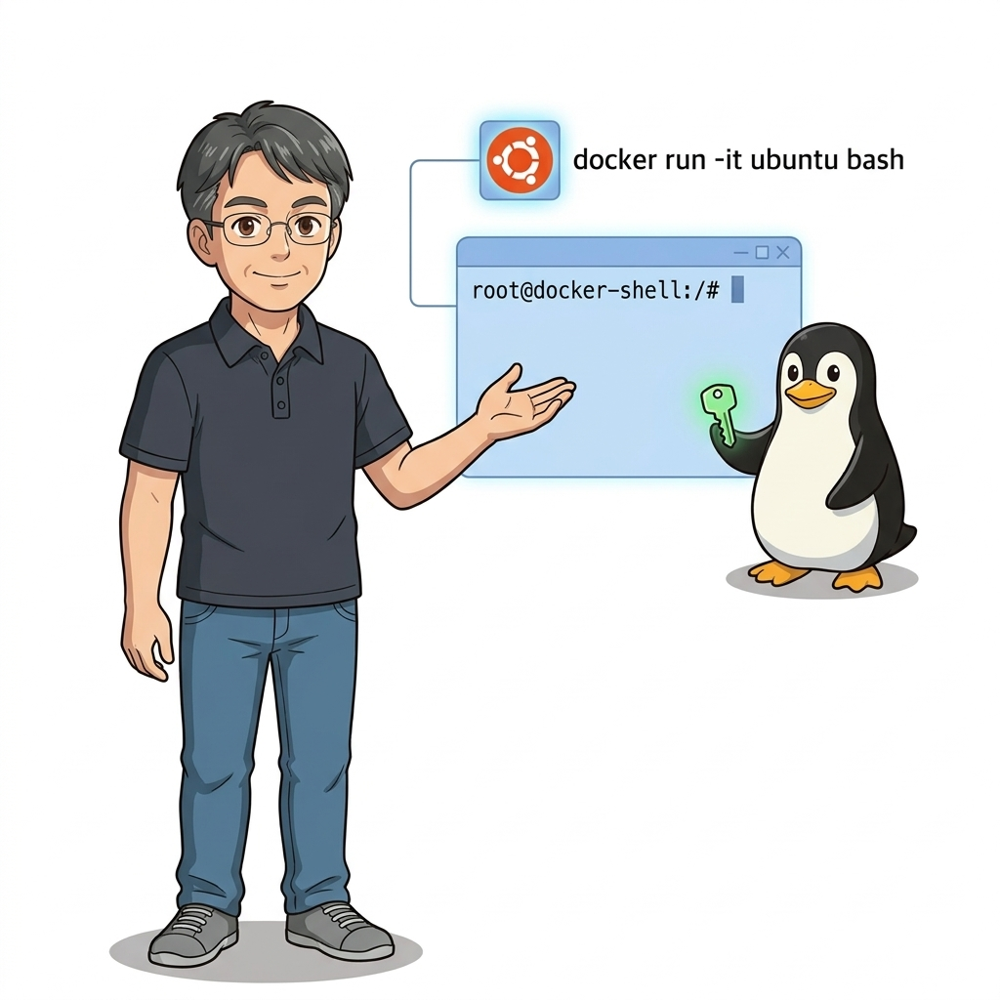
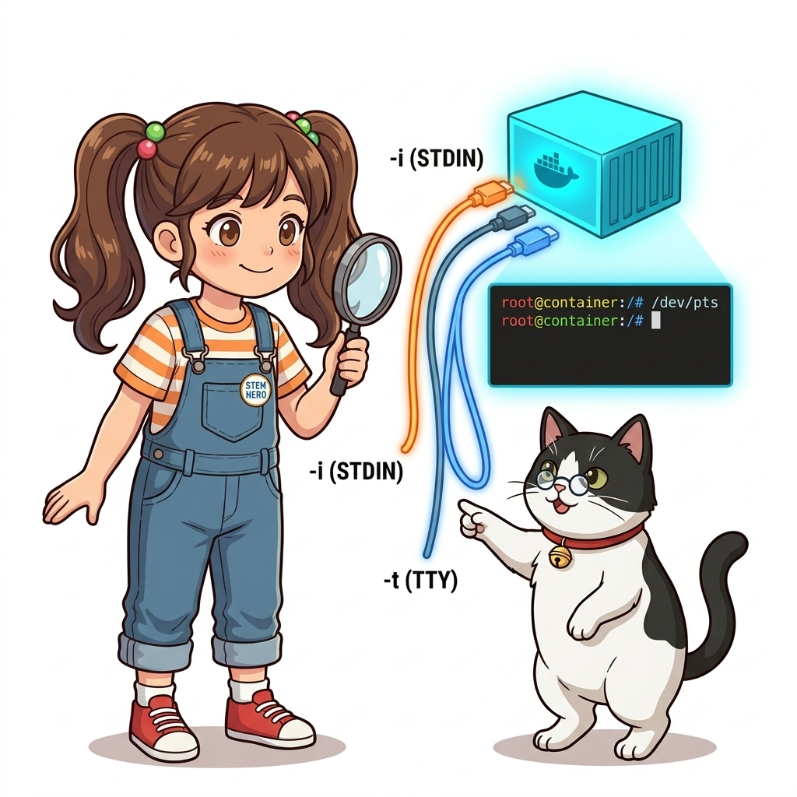
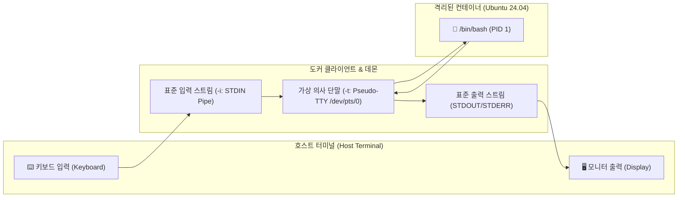
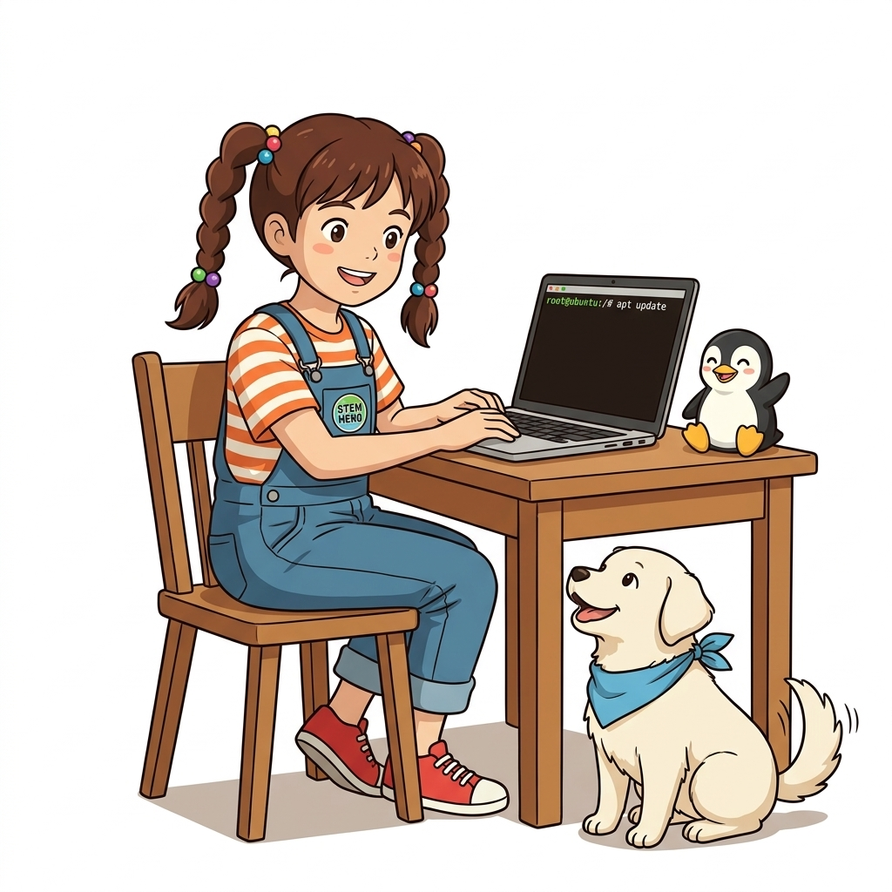
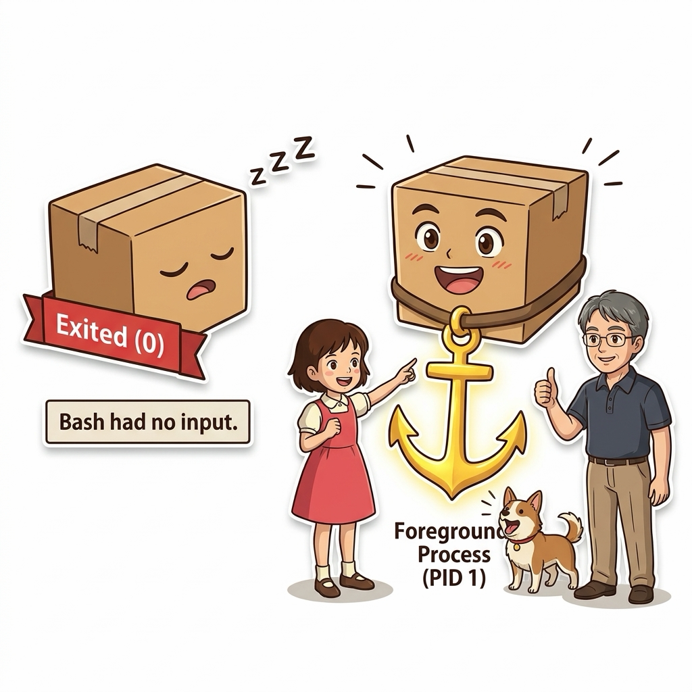
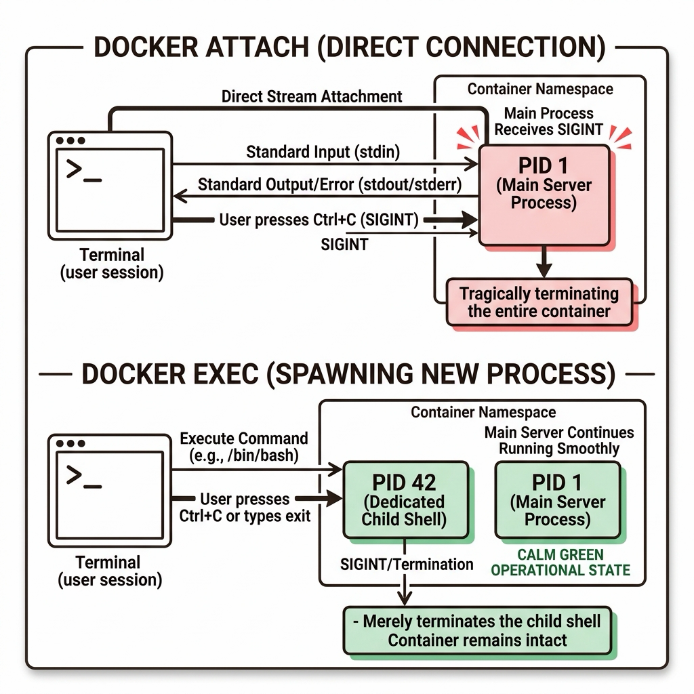

# 008. 대화형 컨테이너: 원격 컴퓨터처럼 셸 접속하기

컨테이너를 처음 다루는 초심자들은 컨테이너를 마치 저 멀리 어딘가에 있는 독립된 리눅스 원격 서버처럼 상상하곤 합니다. 그리고 "어떻게 하면 SSH 프로그램(PuTTY나 터미널) 없이도 저 상자 안으로 직접 걸어 들어가 리눅스 명령어를 마음껏 타이핑해 볼 수 있을까?"라는 자연스러운 호기심을 갖게 됩니다.


**그림 01-9-1** 호스트 터미널의 키보드 입력과 화면 출력을 컨테이너 내부 셸로 직결하는 대화형 세션 아키텍처

도커는 이 요구를 **대화형(Interactive) 실행 옵션인 `-it` 플래그**를 통해 단 한 줄의 명령어로 실현합니다:
```bash
docker container run -it ubuntu:24.04 bash
```
명령어를 실행하는 순간, 우리의 터미널 프롬프트는 즉시 `root@b7f8c12a4d3e:/#`로 바뀌며 완벽히 격리된 우분투 24.04 리눅스 시스템 내부로 텔레포트합니다. 이번 절에서는 `-i`와 `-t`라는 두 글자의 옵션이 내부적으로 유닉스 의사 단말(Pseudo-TTY)과 표준 입출력 스트림을 어떻게 연결하는지 그 정밀한 메커니즘을 파헤칩니다.

---

### 008.1 `-i`와 `-t` 플래그의 해부: STDIN과 가상 터미널

수많은 개발자들이 관성적으로 `-it`를 하나의 단어처럼 외워 쓰지만, 사실 이 둘은 완전히 독립된 두 가지 역할을 수행합니다:


**그림 01-9-2** 표준 입력을 열어두는 `-i`와 컬러 프롬프트 및 커서 제어를 가능케 하는 `-t`의 결합

1. **`-i` (`--interactive`, 표준 입력 스트림 유지)**:
   * 컨테이너 내부 프로세스의 **표준 입력(STDIN)**을 호스트 터미널과 계속 연결해 둡니다. 만약 `-i`가 빠지면 키보드로 아무리 글자를 쳐도 컨테이너가 입력을 받지 못하고 명령어가 즉시 끝나버립니다.
2. **`-t` (`--tty`, 가상 터미널 할당)**:
   * 컨테이너 내부에 리눅스 **의사 단말(Pseudo-TTY, `/dev/pts`)**을 할당합니다. 터미널의 행과 열 크기를 전달하고, `root@hostname:/#`와 같은 알록달록한 컬러 셸 프롬프트, Tab 키 자동 완성, 방향키 커서 이동 기능을 활성화합니다. 만약 `-t` 없이 `-i`만 쓰면 글자는 입력되지만 프롬프트가 보이지 않는 '장님 셸'이 됩니다.

---

### 008.2 컨테이너 내부 탐험: 패키지 설치와 파일 변경의 격리성

컨테이너 셸에 접속한 상태에서 파일을 만들고 패키지를 설치해 봅시다.

```bash
# 컨테이너 내부 프롬프트에서 실행
apt-get update && apt-get install -y figlet
figlet "Docker Dorothy"
ls -la /
exit
```


**그림 01-9-3** 컨테이너 내부에서 패키지를 설치하고 파일을 수정해도 호스트 OS 파일시스템은 완전히 무결함을 증명

여기서 가장 중요한 사실은 컨테이너 내부에서 아무리 위험한 명령어(`rm -rf /` 등)를 실행하거나 무거운 소프트웨어를 설치해도, **호스트 컴퓨터의 파일시스템에는 단 1바이트의 변경도 생기지 않는다는 점**입니다. 모든 변경 사항은 오직 해당 컨테이너 인스턴스 전용의 임시 기록 가능 레이어(Writable Layer)에만 격리되어 기록됩니다.

#### 📊 컨테이너 탈출 테크닉 비교: `exit` vs `Detach (Ctrl+P, Ctrl+Q)`

| 탈출 방식 | 키 입력 방법 | 컨테이너의 상태 전이 | 실무 적용 시나리오 |
| :--- | :--- | :--- | :--- |
| **완전 종료 (Exit)** | `exit` 입력 또는 `Ctrl + D` | PID 1번 셸 프로세스가 종료되며 **컨테이너도 함께 정지(Exited)** | 작업이 끝나 컨테이너를 안전하게 종료하고 리소스를 반환할 때 |
| **백그라운드 전환 (Detach)** | **`Ctrl + P`를 누른 채 `Ctrl + Q`** | 셸 세션 연결만 끊기고 **컨테이너는 백그라운드에서 계속 살아있음(Up)** | 장기 실행 중인 작업이나 데몬을 죽이지 않고 잠시 호스트로 빠져나올 때 |

---

### 008.3 선언적 실습 및 아키텍처 다이어그램

직접 대화형 세션으로 진입하여 파일을 생성하고, `Ctrl+P, Ctrl+Q`를 통해 컨테이너를 살려둔 채 빠져나오는 실무 테크닉을 검증해 봅시다.

```bash
# [실습 008-1] 대화형 우분투 컨테이너 실행
docker container run -it --name test-box ubuntu:24.04 bash

# [실습 008-2] 컨테이너 내부에서 고유 파일 생성 (컨테이너 셸 내부에서 실행)
# echo "Hello from Dorothy Container!" > /root/dorothy.txt
# cat /root/dorothy.txt
# (여기서 키보드로 Ctrl+P 누른 채 Ctrl+Q 눌러서 빠져나옴)

# [실습 008-3] 호스트 터미널로 복귀 후 컨테이너가 여전히 살아서 실행 중인지 확인
docker container ls

# [실습 008-4] 살아있는 컨테이너 세션으로 다시 진입 (attach)
docker container attach test-box
# (다시 컨테이너 프롬프트로 복귀됨! 이제 exit를 입력하여 완전히 종료)
# exit

# [실습 008-5] 종료된 컨테이너 삭제
docker container rm test-box
```

#### 🔍 표준 입출력 파이프와 PTY 터미널 바인딩 구조도 (Mermaid Diagram)




**그림 01-9-4** 대화형 모드 진입, 백그라운드 Detach, 재접속(attach)의 실시간 상태 검증

---

<!-- BIBLE_INTEGRATION_book6_trouble_exit_code_zero -->
---

### 008.B 📚 도커 바이블 심화: 트러블슈팅: 컨테이너가 켜지자마자 꺼지는 이유(Exited 0)와 포그라운드 유지 기법
*출처 도서: 『트러블 슈팅 도커』 핵심 분석*

도커에 입문한 개발자들이 가장 당황하는 순간은 `docker run -d ubuntu`를 실행했는데 `docker ps`에 아무것도 나오지 않고 `docker ps -a`를 쳤을 때 `Exited (0)`으로 죽어 있는 것을 발견할 때입니다.

#### 장애의 근본 원인:
* 리눅스 컨테이너의 생명주기는 **PID 1 프로세스의 실행 상태와 100% 동기화**됩니다.
* `ubuntu:latest`나 `centos:latest` 같은 베이스 이미지의 기본 명령(CMD)은 `/bin/bash`입니다.
* 백그라운드(`-d`)로 실행하면 터미널 입출력 스트림이 연결되어 있지 않으므로, `/bin/bash`는 "더 이상 읽을 표준 입력(stdin)이 없다"고 판단하여 즉시 정상 종료 코드 `0`을 반환하고 스스로 끝납니다.
* **해결 원칙**: 컨테이너가 계속 살아있게 하려면 PID 1 프로세스가 포그라운드에서 블로킹(대기) 상태를 유지해야 합니다.


**그림 008-B-1** 입력 스트림이 없어 즉시 잠들어버리는 컨테이너와 포그라운드 닻을 내려 깨어있는 컨테이너 대조도

```bash
# [실습] 즉시 종료되는 컨테이너 vs 포그라운드 유지 컨테이너 비교
# 1. 즉시 꺼지는 잘못된 예 (Exited 0 발생)
docker container run -d --name dead-container ubuntu
docker container ls -a -f name=dead-container

# 2. 포그라운드 루프를 통해 정상 상주시키는 해결책
docker container run -d --name alive-container ubuntu tail -f /dev/null
docker container ls -f name=alive-container

# 3. Nginx/Apache 등 웹서버 실행 시 데몬화 방지 필수 설정
# Nginx의 경우 백그라운드 분기를 막기 위해 'daemon off;'를 반드시 지정
docker container run -d --name my-web -p 8080:80 nginx:alpine nginx -g 'daemon off;'
```

> 👨‍🏫 **이호진 교수님의 바이블 멘토링 노트**:
> "컨테이너는 가상머신이 아닙니다. 백그라운드 OS가 항상 돌고 있는 것이 아니라, 오직 여러분이 지정한 단 하나의 프로세스가 살아있는 동안만 숨을 쉽니다. 이것이 컨테이너의 제1철칙입니다."
>
> 👧 **도로시의 깨달음**:
> "명령어가 끝나면 컨테이너도 자기 할 일이 다 끝났다고 생각하고 얌전히 잠들어버리는 거였군요!"
>
> 🐱 **조교 지니의 아키텍처 체크포인트**:
> "실무에서는 `tail -f /dev/null` 같은 꼼수 대신, 애플리케이션의 본래 서비스 프로세스를 포그라운드 모드로 구동하는 것이 정석입니다."

---

<!-- BIBLE_INTEGRATION_book2_attach_vs_exec_stream -->
### 008.C 📚 도커 바이블 심화: attach vs exec의 입출력 스트림 차이와 Ctrl+C 컨테이너 즉사 방지 대책
> **출처 및 학술적 배경**: 『Docker Up and Running』 제1장 & 제8장 (8.3 프로세스 점검: attach와 exec)  
> **핵심 주제**: 메인 PID 1 표준 입출력 파이프에 직결되는 `docker attach`의 위험성, 격리된 독립 자식 프로세스를 스폰하는 `docker exec`의 안전성, 그리고 운영 컨테이너 무중단 유지보수 원칙.

#### 1. `docker attach`의 동작 원리와 치명적 위험
* **PID 1 스트림 직결**: `docker attach`는 새로운 프로세스를 띄우는 것이 아니라, 컨테이너가 처음 생성될 때 기동된 **메인 프로세스(PID 1)의 표준 입력(STDIN), 표준 출력(STDOUT), 표준 에러(STDERR) 파이프에 현재 터미널을 그대로 이어 붙이는(Attach)** 명령어입니다.
* **Ctrl+C 즉사 사고**: `attach` 상태에서 로그 출력을 멈추거나 터미널을 빠져나오기 위해 무심코 `Ctrl+C`를 누르면, 키보드 인터럽트 시그널(`SIGINT`)이 PID 1 프로세스로 직접 전달되어 **실행 중이던 프로덕션 웹 서버 컨테이너 전체가 즉시 사망(Killed)**하는 대형 장애가 발생합니다.
* **유일한 안전 탈출구**: `attach` 상태에서는 반드시 도커의 이스케이프 시퀀스인 **`Ctrl+P, Ctrl+Q`**를 연속으로 눌러야만 프로세스를 죽이지 않고 빠져나올 수 있습니다.

#### 2. `docker exec`: 독립된 진단 셸 주입의 정석
* **새로운 프로세스 스폰**: `docker exec -it <container> sh`는 컨테이너의 네임스페이스 안으로 들어가 **완전히 새로운 자식 프로세스(예: PID 58)**를 별도로 생성합니다.
* **완벽한 결함 격리**: `exec` 셸 안에서 `Ctrl+C`를 누르거나 `exit`를 입력하더라도, 오직 새로 띄운 자식 셸 프로세스만 종료될 뿐 컨테이너의 메인 서비스(PID 1)는 아무런 영향 없이 계속 가동됩니다.
* **프로덕션 절대 원칙**: 운영 중인 컨테이너 점검 시에는 `attach` 사용을 전면 금지하고, 무조건 `docker exec`를 사용하는 것이 엔터프라이즈 SRE의 표준 규약입니다.


**그림 008-B-2** docker attach의 PID 1 직결 위험 vs docker exec의 독립 자식 프로세스 격리 구조도

```bash
# [실습] attach와 exec의 프로세스 격리 차이점 직접 검증
# 1. 백그라운드 웹서버 기동
docker container run -d --name stream-test -p 8089:80 nginx:alpine

# 2. exec로 안전하게 접속하여 확인 (exit로 나가도 웹서버는 계속 정상 구동)
docker container exec -it stream-test sh -c "echo '새로운 자식 프로세스 PID:' && ps -ef"
# 여기서 exit로 빠져나와도 docker ps로 확인 시 여전히 Up 상태!

# 3. attach 사용 시 안전 탈출 실습 (Ctrl+P, Ctrl+Q)
# docker container attach stream-test
# (여기서 Ctrl+P 누른 채 Ctrl+Q 누르면 무중단 분리 성공!)

# 4. 실습 완료 후 정리
docker container rm -f stream-test
```

> 👨‍🏫 **이호진 교수님의 바이블 멘토링 노트**:
> "초보 엔지니어들이 운영 서버에서 `docker attach`로 들어갔다가 로그가 너무 빨리 올라와 당황해서 `Ctrl+C`를 누르는 순간 서비스 전체가 다운됩니다. 운영 환경에서는 무조건 `docker exec`만 쓰는 습관을 들이세요."
>
> 👧 **도로시의 깨달음**:
> "메인 스위치(PID 1)에 바로 손을 대는 위험한 `attach` 대신, 안전한 별도의 보조 방(exec)을 열어서 살펴보고 나오는 게 훨씬 안전하네요!"
>
> 🐱 **조교 지니의 아키텍처 체크포인트**:
> * `attach`를 불가피하게 써야 할 때는 `--sig-proxy=false` 옵션을 주면 `Ctrl+C`를 눌러도 컨테이너 프로세스에 시그널이 전달되지 않고 클라이언트만 분리됩니다.

---

### 008.4 핵심 정리: 캐릭터 대화와 3대 교훈

> 👧 **도로시**: "와! 가상머신을 켤 때는 부팅 화면 기다리느라 한참 걸렸는데, `docker run -it`를 치자마자 0.1초 만에 우분투 리눅스 속으로 쏙 들어왔어요!"
> 
> 🐱 **조교 지니**: "야옹~ `-i`는 귀(입력)를 열어두는 것이고, `-t`는 입과 눈(터미널 화면 프롬프트)을 달아주는 것이라는 원리를 잊지 마세요!"
> 
> 🐶 **토토**: "멍멍! 컨테이너를 끄지 않고 잠시 빠져나올 때는 `Ctrl+P, Ctrl+Q`를 누르는 비밀 암호가 정말 유용해요!"
> 
> 👨‍🏫 **이호진 교수님**: "정확하단다. 대화형 컨테이너는 시스템 환경을 빠르게 탐색하고 디버깅할 때 엔지니어에게 없어서는 안 될 가장 친근한 조수란다."


**그림 01-9-5** 대화형 컨테이너 셸 제어의 3대 핵심 교훈

1. **`-i`와 `-t` 플래그의 명확한 역할 구분**:
   * 표준 입력 파이프 유지와 가상 TTY 할당이 결합되어 완전한 대화형 터미널 경험을 제공합니다.
2. **독립된 기록 가능 레이어의 안전성**:
   * 컨테이너 내부에서의 어떤 파괴적 실험이나 패키지 설치도 호스트 OS에 전혀 영향을 주지 않습니다.
3. **`exit`와 `Detach`의 상황별 제어**:
   * 프로세스 정지 종료와 백그라운드 유지 탈출을 능숙하게 구사하여 유연한 디버깅을 수행합니다.

---

### 008.5 랩노트 피날레와 다음 강의 예고


**그림 01-9-6** 백그라운드 데몬 구동과 포트 포워딩을 통한 웹 호스팅 실습을 예고하는 교수님과 연구팀

> 💡 **다음 강의 안내**:
> [009. 백그라운드 컨테이너: 데몬 실행과 포트 포워딩 웹 호스팅](../009_백그라운드컨테이너_데몬실행과_포트포워딩_웹호스팅/)에서는 터미널을 점유하지 않고 24시간 묵묵히 일하는 백그라운드 데몬 모드(`-d`)와, 웹 브라우저의 접속 트래픽을 컨테이너 내부로 배달하는 포트 포워딩(`-p host:container`)의 원리를 배우고 Nginx 웹 서버를 1초 만에 띄워봅니다!

---

## 🧭 강의 네비게이션
* [◀️ 이전 강의: 007_가상머신_VM_vs_도커컨테이너_커널공유의_원리](../007_가상머신_VM_vs_도커컨테이너_커널공유의_원리/)
* [📋 Part 01. 컨테이너 혁명과 도커 엔진 기본기 마스터 (000 ~ 014) 목차로 돌아가기](../)
* [▶️ 다음 강의: 009_백그라운드컨테이너_데몬실행과_포트포워딩_웹호스팅](../009_백그라운드컨테이너_데몬실행과_포트포워딩_웹호스팅/)
