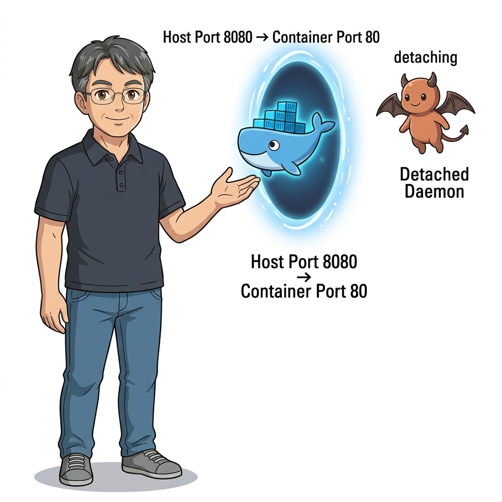
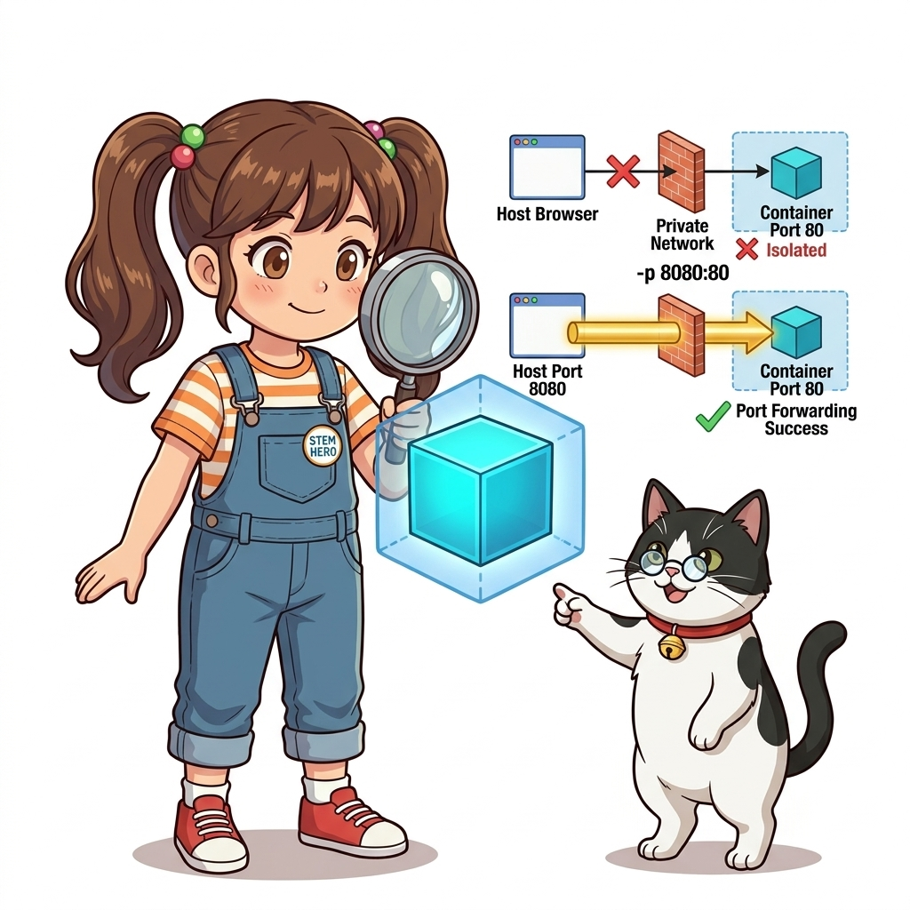
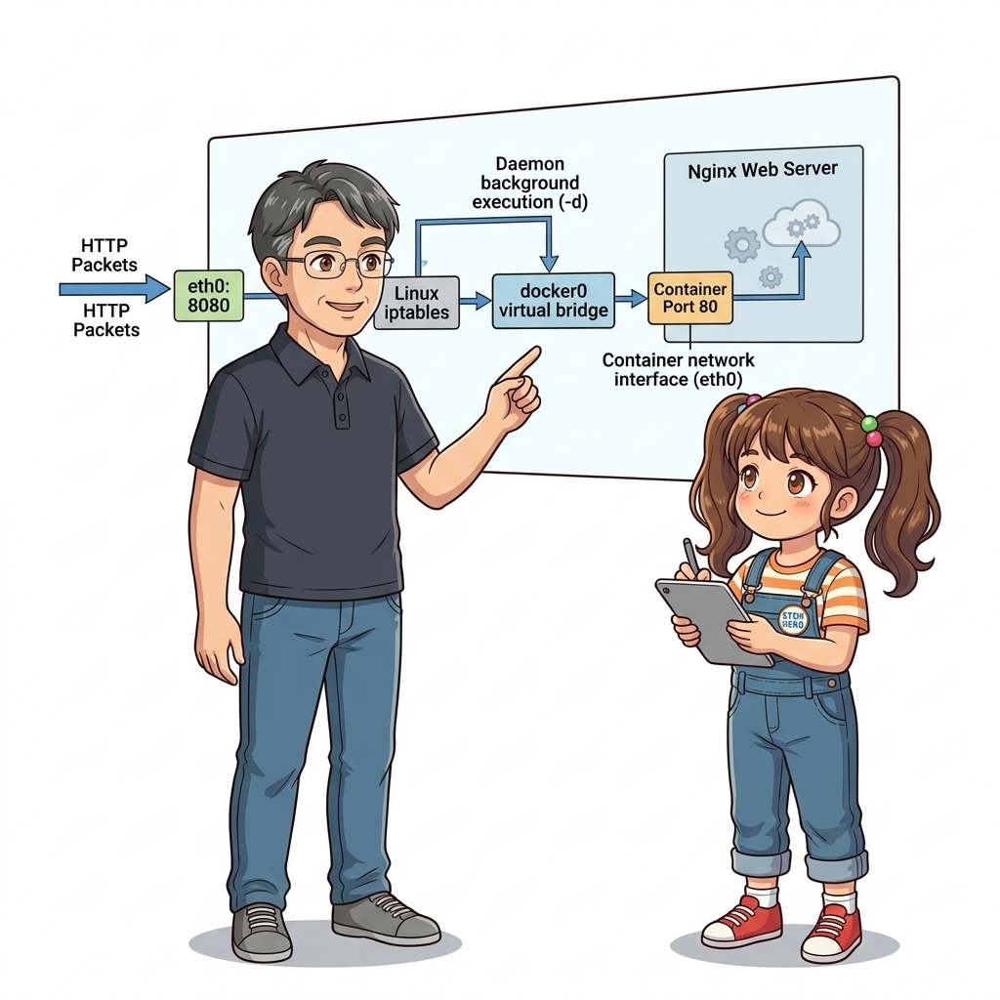
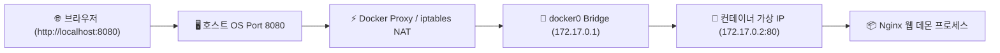
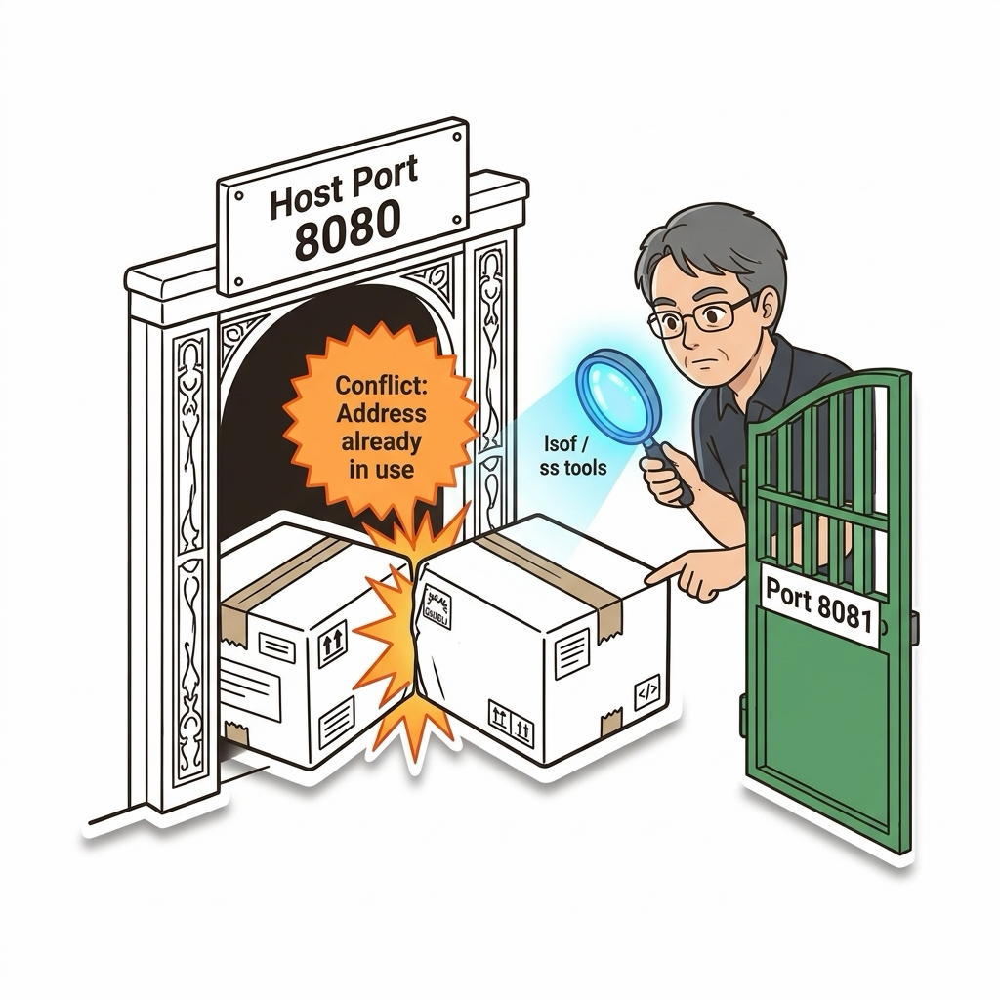
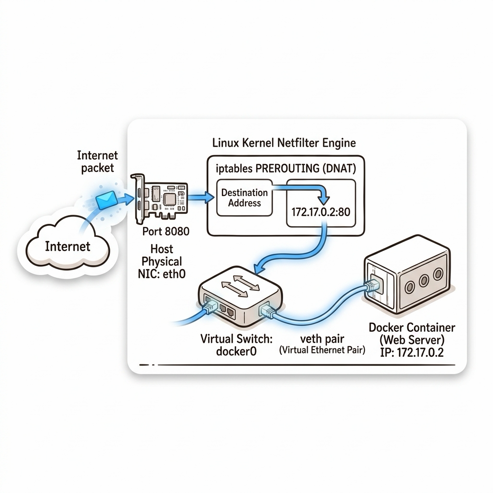
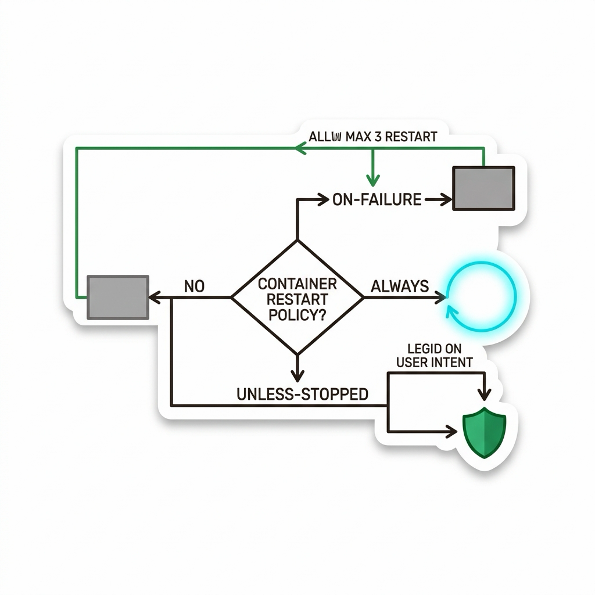

# 009. 백그라운드 컨테이너: 데몬 실행과 포트 포워딩 웹 호스팅

이전 강의에서 살펴본 대화형 모드(`-it`)는 직접 셸에 들어가 디버깅할 때는 유용하지만, Nginx 웹 서버나 MySQL 데이터베이스처럼 **24시간 365일 쉬지 않고 백그라운드에서 실행되어야 하는 상용 프로덕션 서비스**에는 적합하지 않습니다. 만약 터미널 창을 닫거나 컴퓨터 세션이 끊기는 순간 대화형 컨테이너는 즉시 종료되기 때문입니다.


**그림 01-10-1** 터미널을 점유하지 않고 백그라운드에서 상시 구동되며 외부 트래픽을 처리하는 데몬 모드 아키텍처

이 문제를 해결하기 위해 도커는 컨테이너를 시스템 백그라운드 프로세스로 띄우는 **데몬 모드(`-d`, Detached Mode)**를 제공합니다. 또한 외부 인터넷이나 호스트 브라우저의 접속 요청을 격리된 컨테이너 내부로 정확히 전달하기 위해 **네트워크 포트 포워딩(`-p host_port:container_port`)**이라는 마법 같은 라우팅 관문을 구축합니다.

---

### 009.1 데몬 모드(`-d`)의 본질: 콘솔 해방과 컨테이너 ID 반환

`-d` (`--detach`) 플래그를 붙여 컨테이너를 실행하면, 도커는 터미널 화면을 장악하지 않고 즉시 **64자리의 고유한 16진수 컨테이너 해시 ID**만을 화면에 출력한 뒤 프롬프트를 사용자에게 돌려줍니다:

```bash
docker container run -d --name my-web nginx:alpine
# 출력: 8a4c1f2e9b0d3a5c7e8f1b2d4a6c8e0f... (즉시 백그라운드 가동)
```

컨테이너의 표준 출력(stdout)과 표준 에러(stderr)는 터미널에 흩뿌려지지 않고, 도커 데몬의 내부 JSON 파일 로깅 드라이버로 안전하게 격리 수집됩니다. 우리는 언제든지 `docker logs my-web` 명령어로 백그라운드에서 일어난 웹 서버의 접속 로그를 들여다볼 수 있습니다.


**그림 01-10-2** 콘솔을 점유하지 않고 백그라운드에서 동작하며 로그를 JSON 로거에 누적하는 데몬 모드

---

### 009.2 네트워크 포트 포워딩(`-p`)과 NAT(Network Address Translation)의 원리

컨테이너는 자신만의 독립된 네트워크 네임스페이스와 프라이빗 가상 IP(예: `172.17.0.2`)를 가집니다. 이 IP 주소는 호스트 컴퓨터 내부의 브리지 네트워크 안에서만 통하는 사설 주소이므로, 외부 인터넷이나 스마트폰, 심지어 호스트 OS의 웹 브라우저에서도 기본적으로 직접 접속할 수 없습니다.


**그림 01-10-3** 호스트의 물리 포트(8080)로 들어온 TCP 패킷을 도커 프록시와 iptables를 통해 컨테이너 포트(80)로 배달하는 NAT 구조

도커는 **포트 포워딩(`-p <호스트포트>:<컨테이너포트>`)**을 통해 이 고립된 섬에 완벽한 출입구를 개설합니다:
* 예: `-p 8080:80`
  * 호스트 머신의 `8080` 포트를 열고 대기합니다.
  * 외부에서 `http://localhost:8080`으로 웹 요청이 들어오면,
  * 도커의 라우터(`docker-proxy` 및 리눅스 커널 `iptables` NAT 테이블)가 이 패킷을 가로채어 컨테이너 내부의 `80` 포트로 투명하게 전달(Forwarding)합니다.

#### 📊 포트 포워딩 설정 패턴 및 주의점 분석

| 포트 매핑 문법 | 동작 메커니즘 | 실무 적용 시나리오 및 주의점 |
| :--- | :--- | :--- |
| **`-p 80:80`** | 호스트의 표준 웹 80 포트를 컨테이너 80에 1:1 직결 | 호스트에서 이미 다른 웹 서버(Apache 등)가 80을 쓰고 있다면 **포트 충돌 오류(Bind Error)** 발생 |
| **`-p 8080:80`** | 호스트의 8080 포트를 컨테이너 내부의 80 포트로 변환 | 포트 충돌을 피하고 개발 테스트 시 가장 널리 쓰이는 표준 패턴 |
| **`-p 127.0.0.1:3306:3306`** | 호스트의 루프백 로컬 인터페이스에만 포트를 바인딩 | 외부 공인 인터넷에서 DB 포트로 직접 접근하지 못하도록 하는 **강력한 보안 모범 사례** |
| **`-P` (대문자 P)** | Dockerfile의 `EXPOSE` 포트를 호스트의 임의의 고포트(32768~)에 자동 매핑 | 다수의 컨테이너를 포트 충돌 없이 무작위로 빠르게 띄울 때 사용 |

---

### 009.3 선언적 실습 및 아키텍처 다이어그램

Nginx 경량 웹 서버 컨테이너를 백그라운드로 띄우고, 포트 포워딩을 통해 호스트에서 웹 페이지를 호출해 봅시다.

```bash
# [실습 009-1] Nginx 웹 서버를 백그라운드(-d) 및 포트 포워딩(-p 8080:80)으로 실행
docker container run -d --name web-server -p 8080:80 nginx:alpine

# [실습 009-2] 실행 중인 컨테이너와 포트 매핑 상태 확인 (0.0.0.0:8080->80/tcp 확인)
docker container ls

# [실습 009-3] curl 명령어로 웹 서버 정상 응답(HTTP 200 OK) 수신 검증
curl -I http://localhost:8080

# [실습 009-4] 백그라운드 컨테이너의 실시간 접속 로그 확인
docker container logs --tail 10 web-server

# [실습 009-5] 실습 종료 후 컨테이너 강제 중지 및 삭제
docker container rm -f web-server
```

#### 🔍 포트 포워딩 패킷 라우팅 흐름도 (Mermaid Diagram)




**그림 01-10-4** 포트 포워딩을 통해 curl 요청이 Nginx 컨테이너로 전달되어 200 OK를 응답하는 검증

---

<!-- BIBLE_INTEGRATION_book6_trouble_port_collision -->
---

### 009.B 📚 도커 바이블 심화: 트러블슈팅: 포트 바인딩 충돌(bind: address already in use)과 TIME_WAIT 소켓 진단
*출처 도서: 『트러블 슈팅 도커』 핵심 분석*

`docker run -p 8080:80`을 실행했을 때 다음과 같은 에러가 발생하는 것은 실무에서 가장 흔한 장애 중 하나입니다:
`docker: Error response from daemon: driver failed programming external connectivity ... bind: address already in use.`

#### 단계별 긴급 진단 및 해결 3단계:
1. **점유 프로세스 식별**:
   * 호스트 OS에서 어떤 프로세스가 8080 포트를 점유하고 있는지 확인합니다: `sudo lsof -i :8080` 또는 `sudo ss -tulpn | grep 8080`
2. **숨어있는 도커 컨테이너 검사**:
   * 다른 개발자나 배치 스크립트가 띄워놓은 기존 컨테이너가 포트를 잡고 있는지 확인: `docker container ls --filter "publish=8080"`
3. **TIME_WAIT 소켓 대기**:
   * 프로세스가 방금 종료되었더라도 TCP 커널 상태가 `TIME_WAIT`(기본 60초)에 머물러 있어 바인딩이 일시 차단될 수 있습니다. 필요 시 호스트 포트를 `8081` 등으로 즉시 변경하여 우회합니다.


**그림 009-B-1** 동일한 포트 문지기 자리를 두고 충돌하는 두 컨테이너와 진단 도구로 교통정리하는 모습

```bash
# [실습] 포트 충돌 진단 및 강제 정리 워크플로
# 1. 8080 포트를 점유 중인 프로세스 PID 확인
sudo lsof -ti :8080

# 2. 해당 포트를 점유한 컨테이너가 있다면 강제 종료 및 삭제
docker container rm -f $(docker container ps -q --filter "publish=8080") 2>/dev/null

# 3. 만약 호스트 일반 프로세스가 물고 있다면 안전하게 종료
# sudo kill -15 $(sudo lsof -ti :8080)
```

> 👨‍🏫 **이호진 교수님의 바이블 멘토링 노트**:
> "포트 충돌이 났을 때 무작정 서버를 재부팅하지 마세요. lsof나 ss로 범인을 정확히 찾아내고, 개발 환경에서는 포트를 `-p 8080`처럼 생략하여 도커가 호스트의 빈 포트를 자동 매핑(에페머럴 포트)하게 하는 것도 현명한 방법입니다."
>
> 👧 **도로시의 깨달음**:
> "출입문 번호가 겹쳐서 문 앞에서 쾅 부딪힌 셈이네요! 다른 빈 문(8081)으로 돌려주면 바로 해결되겠어요!"
>
> 🐱 **조교 지니의 아키텍처 체크포인트**:
> "개발 서버에서는 `docker run -P`를 쓰면 Dockerfile의 EXPOSE 포트들을 호스트의 32768~60999 사이 빈 포트에 충돌 없이 랜덤으로 매핑해 줍니다."


<!-- BIBLE_INTEGRATION_book9_docker0_iptables_forwarding -->
---

### 009.B 📚 도커 바이블 심화: docker0 가상 브리지와 veth 쌍(Pair) 생성 및 리눅스 iptables NAT PREROUTING 포트포워딩 패킷 흐름
*출처 도서: 『시작하세요! 도커/쿠버네티스』 핵심 분석*

터미널에서 `docker run -p 8080:80`을 입력했을 때, 호스트 리눅스 커널 내부에서는 다음과 같은 정밀한 가상 네트워크 배선 공사가 0.1초 만에 완성됩니다:

1. **가상 이더넷 쌍 (`veth pair`) 생성**:
   * 리눅스 커널은 가상 랜선의 양 끝 역할을 하는 `veth` 쌍(예: `vethxxxx`와 `eth0`)을 만듭니다.
   * 한쪽 끝은 호스트의 가상 소프트웨어 스위치인 `docker0` 브리지에 꽂히고, 다른 쪽 끝은 컨테이너의 네트워크 네임스페이스 안으로 들어가 컨테이너의 `eth0` 인터페이스가 됩니다.
2. **iptables NAT 포트 포워딩 (DNAT)**:
   * 외부 클라이언트가 `호스트IP:8080`으로 패킷을 전송하면, 리눅스 커널의 넷필터(Netfilter) `PREROUTING` 체인이 발동합니다.
   * `DOCKER` 체인 규칙에 따라 목적지 주소를 컨테이너의 내부 사설 IP(예: `172.17.0.2:80`)로 목적지 NAT(DNAT) 처리하여 `docker0` 브리지를 통해 컨테이너로 전달합니다.
3. **마스커레이딩 (MASQUERADE, SNAT)**:
   * 컨테이너 내부에서 외부 인터넷으로 나가는 패킷은 `POSTROUTING` 체인을 통과하며 호스트의 공인 물리 IP로 출발지 NAT(SNAT/Masquerade)되어 나갑니다.


**그림 009-B-1** 외부 패킷이 iptables PREROUTING과 docker0 veth 쌍을 거쳐 컨테이너 내부로 진입하는 패킷 경로도

```bash
# [실습] 리눅스 커널 iptables의 도커 포트포워딩 NAT 테이블 직접 확인
# 1. 8080 포트를 매핑한 테스트 웹 서버 실행
docker container run -d --name nat-demo -p 8080:80 nginx:alpine

# 2. 리눅스 호스트의 iptables NAT 테이블 DOCKER 체인 규칙 확인
sudo iptables -t nat -L DOCKER -n -v

# 3. 호스트 veth 인터페이스와 docker0 브리지 바인딩 상태 확인
ip link show master docker0 2>/dev/null || brctl show docker0 2>/dev/null
```

> 👨‍🏫 **이호진 교수님의 바이블 멘토링 노트**:
> "도커의 포트포워딩은 별도의 중계 프록시 프로세스가 매번 패킷을 복사하는 것이 아니라, 리눅스 커널 넷필터의 초고속 iptables C 레벨 라우팅에 의해 직접 처리됩니다. 따라서 오버헤드가 거의 없습니다."
>
> 👧 **도로시의 깨달음**:
> "호스트에 가상의 미니 스위치(docker0)가 들어있고, 가상의 랜선(veth pair)을 양쪽으로 꽂아서 연결해 주는 거였군요!"
>
> 🐱 **조교 지니의 아키텍처 체크포인트**:
> "만약 컨테이너가 외부와 통신이 안 된다면 `sysctl net.ipv4.ip_forward` 값이 `1`로 활성화되어 있는지 가장 먼저 점검해야 합니다."


<!-- BIBLE_INTEGRATION_book2_deep_009 -->
---

### 009.C 📚 도커 바이블 심화: 컨테이너 4대 재시작 정책(Restart Policies)과 호스트 장애 복원력
*출처 도서: 『Docker Up and Running』 핵심 분석 (Docker Up and Running 제5장 (컨테이너 생성하기 & 기본 설정))*

실무 프로덕션 환경에서 백그라운드(`-d`) 컨테이너를 구동할 때 가장 치명적인 실수는 `--restart` 정책을 생략하는 것입니다. 아무런 재시작 옵션을 지정하지 않으면 호스트 서버가 재부팅되거나 도커 데몬이 재시작되었을 때 컨테이너는 자동으로 살아나지 않고 영원히 꺼져 있게 됩니다.

#### 도커의 4대 재시작 정책 비교 분석:

| 재시작 정책 플래그 | 프로세스 비정상 종료 (Exit != 0) | 프로세스 정상 종료 (Exit == 0) | 도커 데몬 / 호스트 OS 재부팅 | 실무 적용 시점 및 권장 사항 |
| :--- | :---: | :---: | :---: | :--- |
| **`--restart no` (기본값)** | 재시작 안 함 | 재시작 안 함 | 재시작 안 함 | 일회성 배치 스크립트, 디버깅 목적의 임시 컨테이너 |
| **`--restart on-failure[:max]`** | **자동 재시작** (최대 N회) | 재시작 안 함 | 데몬 기동 시 비정상 종료 상태였다면 재시작 | 오류 발생 시에만 재시도를 원하는 데이터베이스 마이그레이션 도구 |
| **`--restart always`** | **자동 재시작** | **자동 재시작** | **자동 재시작** | 사용자가 수동으로 끄기 전까지 무조건 살아있어야 하는 핵심 웹/API 서버 |
| **`--restart unless-stopped`** | **자동 재시작** | **자동 재시작** | **종료 상태였다면 재기동 안 함** | 호스트 재부팅 전 관리자가 명시적으로 `docker stop`해둔 컨테이너를 존중하는 프로덕션 표준 |

특히 `--restart always`와 `--restart unless-stopped`의 차이는 **"호스트 재부팅 직전에 관리자가 수동으로 꺼둔 컨테이너를 다시 살릴 것인가"**에 있습니다. 점검을 위해 잠시 꺼둔 컨테이너가 서버 리부팅 후 제멋대로 다시 켜지는 사고를 방지하려면 **`unless-stopped`**를 프로덕션 기본값으로 채택하는 것이 업계 모범 사례입니다.


**그림 009-B-2** 도커의 4대 재시작 정책(no, on-failure, always, unless-stopped)의 상태 분기 흐름도

```bash
# [실습] 4대 재시작 정책 동작 검증 및 데몬 재기동 테스트
# 1. 3회까지만 재시도하는 on-failure 컨테이너
docker container run -d --name retry-test --restart on-failure:3 alpine \
  sh -c 'sleep 2; exit 1'

# 2. 관리자가 끄지 않는 한 항상 유지되는 프로덕션 표준 웹 서버
docker container run -d --name prod-web --restart unless-stopped -p 8080:80 nginx:alpine

# 3. 컨테이너 재시작 횟수 및 상태 점검
docker container inspect retry-test --format 'RestartCount: {{.RestartCount}}, Status: {{.State.Status}}'
docker container inspect prod-web --format 'RestartPolicy: {{.HostConfig.RestartPolicy.Name}}'
```

> 👨‍🏫 **이호진 교수님의 바이블 멘토링 노트**:
> "프로덕션에 배포하는 모든 상주형 컨테이너(웹서버, DB, 캐시)는 예외 없이 `--restart unless-stopped`를 달아야 합니다. 새벽에 호스트 커널 보안 패치로 리부팅이 일어났을 때 서비스가 자동으로 복구되는 기본 안전장치입니다."
>
> 👧 **도로시의 깨달음**:
> "넘어져도 스스로 일어나는 오뚝이처럼, 컨테이너가 에러로 꺼지거나 컴퓨터가 다시 켜져도 알아서 살아나게 만드는 마법의 주문이었네요!"
>
> 🐱 **조교 지니의 아키텍처 체크포인트**:
> "`on-failure`를 쓸 때는 반드시 `:5`처럼 최대 재시도 횟수를 붙이세요. 무한 재시작 루프에 빠지면 호스트의 CPU와 디스크 로그가 폭발합니다."


### 009.4 핵심 정리: 캐릭터 대화와 3대 교훈

> 👧 **도로시**: "와! `-d`를 붙이니까 터미널이 멈추지 않고 바로 자유로워지고, `-p 8080:80`을 거니까 내 컴퓨터 브라우저에서 컨테이너 속 웹사이트가 환하게 열려요!"
> 
> 🐱 **조교 지니**: "야옹~ 호스트 포트와 컨테이너 포트의 순서(`<호스트>:<컨테이너>`)를 절대 헷갈리지 마세요! 바깥 문의 번호가 앞이고 안쪽 방 번호가 뒤랍니다!"
> 
> 🐶 **토토**: "멍멍! 화면에 로그가 안 보여도 `docker logs` 명령어를 치면 컨테이너가 뭘 했는지 다 적혀 있대요!"
> 
> 👨‍🏫 **이호진 교수님**: "훌륭하구나. 백그라운드 데몬 구동과 포트 포워딩은 웹 서비스, 데이터베이스, API 서버 등 클라우드의 모든 상용 서비스를 떠받치는 가장 핵심적인 기둥이란다."


**그림 01-10-5** 백그라운드 웹 호스팅을 완성하는 3대 핵심 엔지니어링 교훈

1. **`-d` 플래그를 통한 상시 데몬화**:
   * 세션 종료와 무관하게 24시간 가동되는 독립적인 백그라운드 런타임을 확보합니다.
2. **`-p` 포트 포워딩의 네트워크 관문 구축**:
   * 격리된 컨테이너 사설 네트워크와 호스트 공인 네트워크 사이의 안전한 포트 매핑 경로를 개설합니다.
3. **`docker logs`를 통한 원격 관제**:
   * 표준 출력 스트림으로 수집되는 애플리케이션 로그를 추적하여 장애를 신속하게 진단합니다.

---

### 009.5 랩노트 피날레와 다음 강의 예고


**그림 01-10-6** 컨테이너가 태어나서 죽기까지의 5대 생애주기를 예고하는 교수님과 연구팀

> 💡 **다음 강의 안내**:
> [010. 컨테이너 생애주기: Created, Running, Paused, Stopped, Dead 상태 전이와 모니터링](../010_컨테이너_생애주기_관리와_상태모니터링/)에서는 컨테이너가 탄생(`create`)하여 달리고(`start`), 잠시 얼어붙었다가(`pause`), 정지하고(`stop`), 죽음에 이르는(`rm`) 5대 상태 전이도와 SIGTERM/SIGKILL 시그널의 정밀한 라이프사이클을 배웁니다!

---

## 🧭 강의 네비게이션
* [◀️ 이전 강의: 008_대화형컨테이너_원격컴퓨터처럼_쉘접속하기](../008_대화형컨테이너_원격컴퓨터처럼_쉘접속하기/)
* [📋 Part 01. 컨테이너 혁명과 도커 엔진 기본기 마스터 (000 ~ 014) 목차로 돌아가기](../)
* [▶️ 다음 강의: 010_컨테이너_생애주기_관리와_상태모니터링](../010_컨테이너_생애주기_관리와_상태모니터링/)
