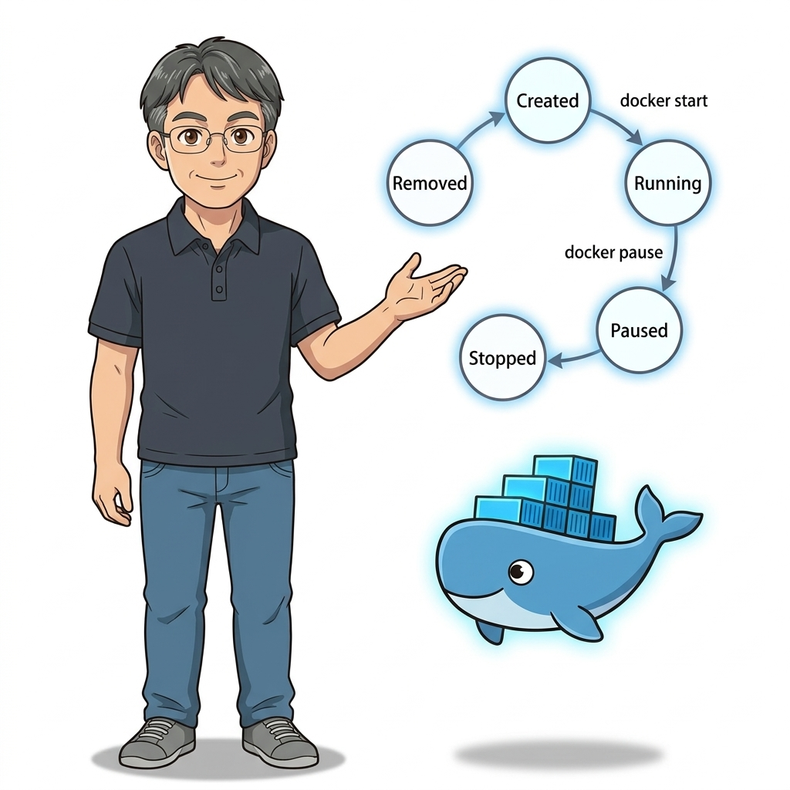
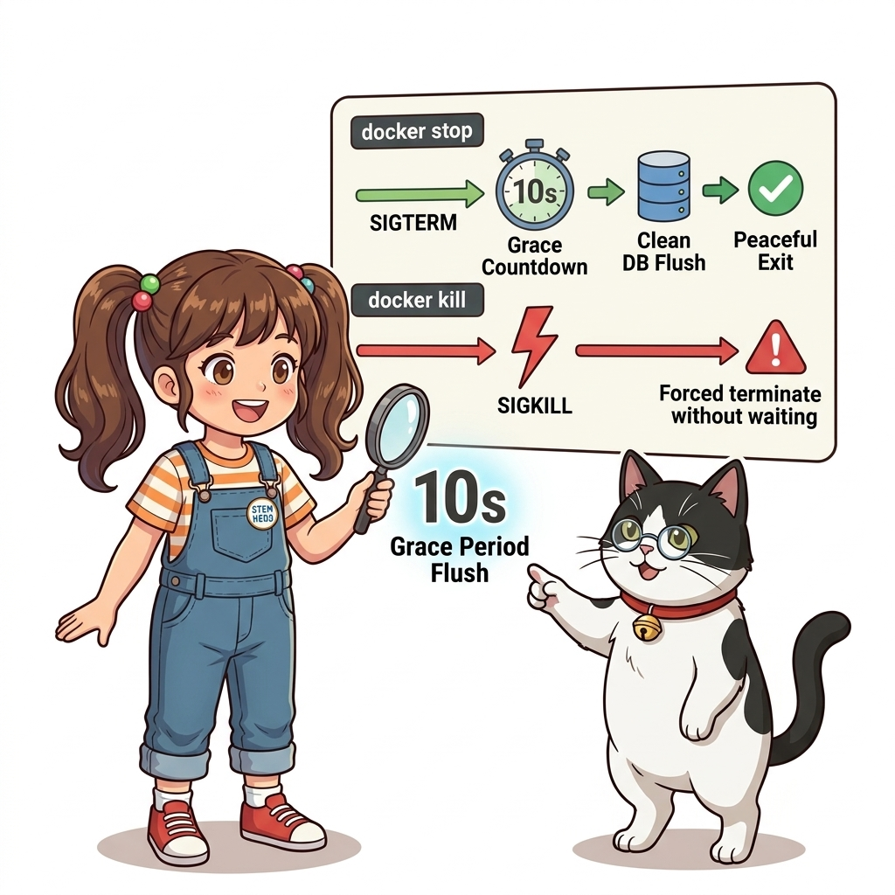
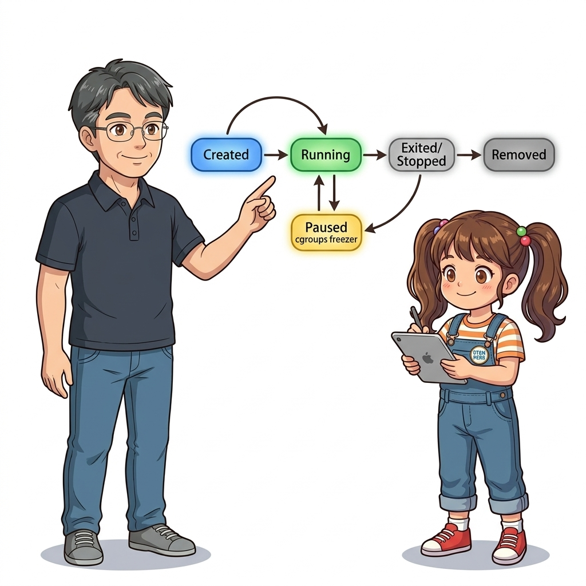
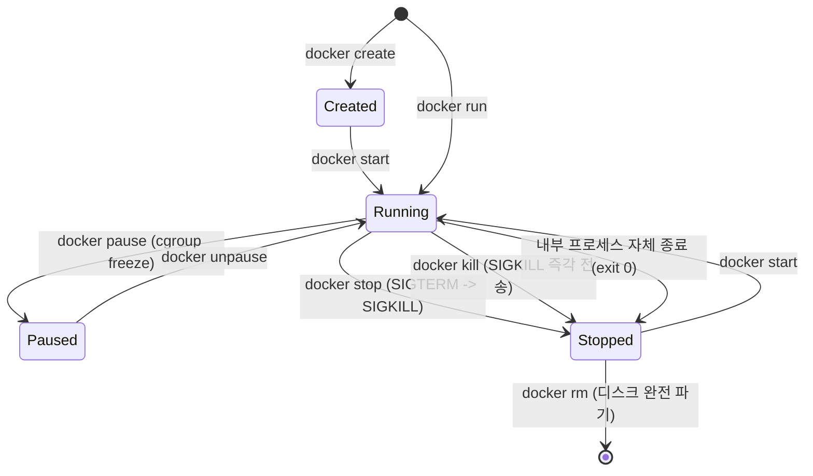
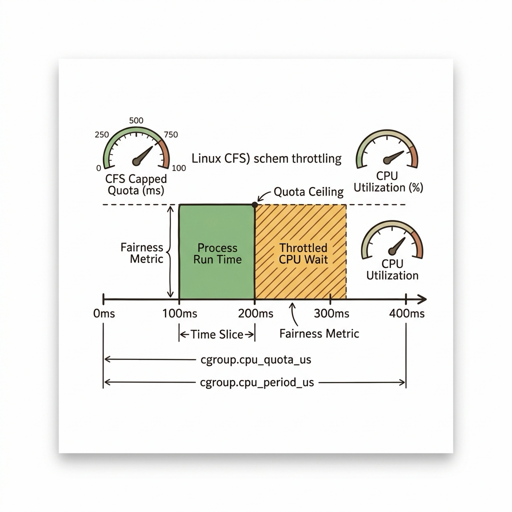
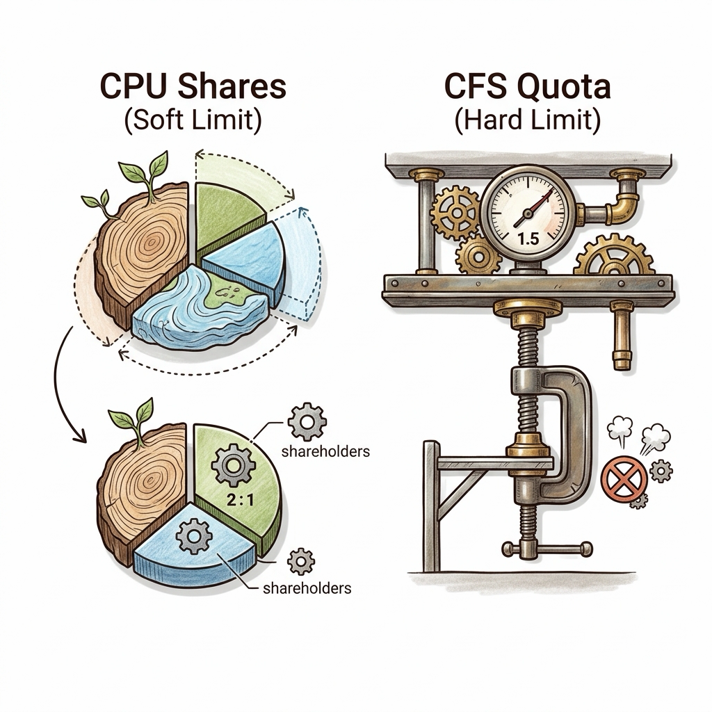

# 010. 컨테이너 생애주기: Created, Running, Paused, Stopped, Dead 상태 전이와 모니터링

소프트웨어 시스템에서 생명주기(Lifecycle)를 정확히 제어하지 못하면 메모리 누수, 프로세스 좀비화, 데이터 유실과 같은 치명적인 운영 장애로 이어집니다. 도커 컨테이너는 결코 단순한 정적 파일이 아니며, **탄생(Create)부터 실행(Run), 일시 정지(Pause), 정상 종료(Stop), 그리고 파기(Destroy)에 이르는 엄밀한 유한 상태 기계(Finite State Machine)**로 동작합니다.


**그림 01-11-1** 컨테이너의 5대 핵심 상태(Created, Running, Paused, Stopped, Dead)와 상태 전이 트리거

특히 상용 무중단 배포를 구축할 때, 실행 중인 컨테이너에 "즉시 죽어라"가 아니라 "진행 중이던 사용자 요청을 안전하게 마무리하고 10초 안에 우아하게 종료하라"는 **그레이스풀 셧다운(Graceful Shutdown)**을 구현하기 위해서는 리눅스 시그널(SIGTERM과 SIGKILL)과 컨테이너 생애주기의 상관관계를 완벽하게 꿰뚫고 있어야 합니다.

---

### 010.1 컨테이너의 5대 핵심 상태(State)와 상태 전이 메커니즘

도커 엔진 내부에서 관리되는 컨테이너의 상태는 다음과 같이 전이됩니다:


**그림 01-11-2** create, start, pause, stop, rm 명령어에 따른 컨테이너 상태 머신과 리눅스 커널 자원 상태

1. **Created (생성됨)**:
   * `docker create` 실행 시 진입합니다. 불변 이미지 위에 기록 가능 레이어가 준비되고 네임스페이스 메타데이터가 할당되었지만, 아직 프로세스는 기동되지 않고 CPU/RAM 자원을 일절 소비하지 않는 상태입니다.
2. **Running (실행 중)**:
   * `docker start` 또는 `docker run` 실행 시 진입합니다. 실제 격리된 프로세스가 CPU 스케줄러에 등록되어 연산을 수행하는 활성 상태입니다.
3. **Paused (일시 중지됨)**:
   * `docker pause` 실행 시 진입합니다. 리눅스 커널의 **cgroups freezer 하위 시스템**을 사용하여 프로세스의 모든 스레드 스케줄링을 동결시킵니다. 프로세스가 메모리에 그대로 유지되지만 CPU 연산은 0%가 되며, `docker unpause`로 밀리초 만에 즉시 깨어납니다.
4. **Stopped / Exited (정지됨)**:
   * `docker stop` 실행 시 진입합니다. 주 프로세스가 종료되었으나, 컨테이너 내부의 파일 변경 사항(기록 가능 레이어)과 로그는 디스크에 그대로 보존되어 있어 언제든 `docker start`로 다시 살려낼 수 있습니다.
5. **Dead / Removed (파기됨)**:
   * `docker rm` 실행 시 진입합니다. 기록 가능 레이어와 메타데이터가 디스크에서 완전히 삭제되어 흔적도 없이 사라진 상태입니다.

---

### 010.2 우아한 종료의 미학: SIGTERM vs SIGKILL

`docker stop` 명령어를 실행하면 왜 즉시 꺼지지 않고 약 10초간 머뭇거리다가 꺼질까요?
그 이유는 도커 엔진이 프로세스를 강제로 도륙하지 않고 **신사적인 퇴장 절차(Graceful Shutdown)**를 밟기 때문입니다:


**그림 01-11-3** SIGTERM 전송 후 10초의 대기 유예(Grace Period)를 거쳐 SIGKILL을 발행하는 2단계 종료 시퀀스

* **1단계 (SIGTERM, Signal 15)**:
  * 도커 데몬은 컨테이너의 PID 1번 프로세스에게 "이제 종료할 준비를 하라"는 `SIGTERM` 시그널을 먼저 보냅니다.
  * 잘 작성된 애플리케이션은 이 신호를 받으면 새로운 HTTP 연결을 거부하고, 처리 중이던 DB 트랜잭션을 커밋하며, 열려 있던 소켓을 닫는 정리(Cleanup) 작업을 수행한 뒤 스스로 정상 종료합니다.
* **2단계 (SIGKILL, Signal 9)**:
  * 만약 프로세스가 버그나 무한 루프로 인해 10초(기본 타임아웃)가 지나도록 스스로 꺼지지 않으면, 도커는 리눅스 커널에게 즉각적인 사살 명령인 `SIGKILL`을 내려 프로세스를 강제로 강제 종료합니다.
  * 즉각적인 강제 종료를 원할 때는 `docker kill`을 사용할 수 있습니다.

#### 📊 컨테이너 생애주기 제어 명령어 비교

| 명령어 문법 | 전송 시그널 / 커널 동작 | 대상 상태 전이 | 실무 사용 시점 및 권장 사항 |
| :--- | :--- | :--- | :--- |
| **`docker stop <id>`** | `SIGTERM` 전송 후 10초 대기 -> `SIGKILL` | Running -> **Exited** | 데이터 유실 없는 정상 종료를 원할 때 (표준 권장) |
| **`docker kill <id>`** | 즉각적인 `SIGKILL` (Signal 9) 직접 전송 | Running -> **Exited** | 프로세스가 먹통(Hang)이 되어 즉시 강제 종료해야 할 때 |
| **`docker pause <id>`** | cgroups freezer 동결 (시그널 없음) | Running -> **Paused** | CPU 자원을 일시적으로 비우고 다른 무거운 배치를 돌릴 때 |
| **`docker restart <id>`** | `docker stop` 후 즉시 `docker start` 수행 | Running -> Exited -> **Running** | 설정 변경 후 프로세스를 새로 고침할 때 |

---

### 010.3 선언적 실습 및 아키텍처 다이어그램

상태 전이 시퀀스를 직접 실행해 보고, `docker inspect`를 통해 컨테이너의 실시간 상태 JSON 객체를 추적해 봅시다.

```bash
# [실습 010-1] 컨테이너 생성(Created) 후 실행(Running) 단계 분리 실습
docker container create --name lifecycle-demo alpine:3.20 ping 127.0.0.1
docker container ls -a --filter name=lifecycle-demo
docker container start lifecycle-demo

# [실습 010-2] 컨테이너 일시 중지(Pause) 및 재개(Unpause)
docker container pause lifecycle-demo
docker container inspect lifecycle-demo --format '{{.State.Status}} (Paused: {{.State.Paused}})'
docker container unpause lifecycle-demo

# [실습 010-3] 정상 종료(Stop)와 종료 코드(ExitCode) 확인
docker container stop -t 3 lifecycle-demo
docker container inspect lifecycle-demo --format 'Status: {{.State.Status}}, ExitCode: {{.State.ExitCode}}'

# [실습 010-4] 멈춘 컨테이너를 다시 살리기(Start) 및 완전 삭제(Rm)
docker container start lifecycle-demo
docker container rm -f lifecycle-demo
```

#### 🔍 컨테이너 유한 상태 기계(FSM) 상태 전이도 (Mermaid Diagram)




**그림 01-11-4** Created에서 Running, Paused, Exited로 이어지는 컨테이너의 상태 전이 실시간 검증

---

<!-- BIBLE_INTEGRATION_book2_cgroups_throttling -->
---

### 010.B 📚 도커 바이블 심화: cgroups v1/v2와 CPU CFS 스케줄러 스로틀링, 그리고 stats API 스트리밍
> **출처 및 학술적 배경**: 『Docker Up and Running』 제5장 (5.8 CPU 분배 & 5.9 메모리 제한), 제6장 (6.11 컨테이너 통계), 제8장 (8.4 프로세스 제어)  
> **핵심 주제**: cgroups 리소스 제한과 완전 공정 스케줄러(CFS)의 주기/쿼터 연산, `docker stats` REST API 스트리밍 내부 구조(`blkio_stats`, `cpu_stats`, `memory_stats`), 그리고 커스텀 시그널(`SIGUSR1`) 제어.

#### 1. CFS 주기와 쿼터 (Period & Quota) 및 스로틀링 메커니즘
도커에서 컨테이너의 CPU를 통제할 때 사용하는 핵심 엔진은 리눅스 커널의 **cgroups(Control Groups)**입니다. 특히 CPU 제한은 완전 공정 스케줄러(CFS, Completely Fair Scheduler)의 쿼터 시스템을 통해 정밀하게 제어됩니다:
* **`cpu.cfs_period_us`**: 스케줄링의 기본 시간 윈도우 단위(기본값 100,000μs = 100ms = 0.1초).
* **`cpu.cfs_quota_us`**: 해당 100ms 주기 동안 컨테이너가 소비할 수 있는 최대 CPU 시간.
* **CPU 스로틀링 (Throttling) 현상**:
  * 할당된 쿼터를 100ms 주기가 끝나기 전에 모두 써버리면, 커널은 해당 컨테이너 프로세스를 강제로 슬립/대기열에 묶어두는(Throttled) 상태로 전환합니다.
  * 전체 CPU 사용률이 40%로 낮게 보이더라도, 순간적인 버스트 트래픽으로 100ms 중 앞선 30ms 동안 쿼터를 소진하면 나머지 70ms 동안 컨테이너가 완전히 멈춰 서서 극심한 레이턴시 스파이크가 발생합니다.

#### 2. `docker stats`의 내부 동작 원리와 /stats API 스트리밍
도커 CLI의 `docker stats`는 단순한 텍스트 출력이 아니라, 도커 데몬의 UNIX 소켓(`/var/run/docker.sock`)에 연결되어 지속적인 JSON 스트림을 수신하는 실시간 관측 파이프라인입니다:
* **`cpu_stats`**: 호스트 커널 전체 CPU 시간 대비 컨테이너가 소비한 나노초(`nanoseconds`) 비율 및 `throttling_data` (스로틀링 주기 횟수) 제공.
* **`memory_stats`**: 단순 RAM 사용량이 아니라 페이지 캐시(Cache)를 제외한 실제 활성 워킹셋 메모리(`usage - cache`)와 OOM-Killer 임계점 한도(`limit`) 제공.
* **`blkio_stats`**: 물리 디스크 메이저/마이너 디바이스별 Read/Write 서비스 바이트 수치 제공.

#### 3. 유닉스 커스텀 시그널 제어 (`docker kill --signal`)
일반적인 `docker stop`(SIGTERM)과 `docker kill`(SIGKILL) 외에도, 컨테이너에 임의의 POSIX 유닉스 시그널을 전달하여 무중단 프로세스 제어를 수행할 수 있습니다:
* **`docker kill -s SIGUSR1 <nginx-container>`**: Nginx 웹 서버를 재시작하지 않고도 새로운 로그 파일 핸들을 열도록 지시하는 **무중단 로그 로테이션(Log Rotate)** 기법.
* **`docker kill -s SIGHUP <app-container>`**: 설정 파일 재로드(Reload Configuration).
* **주의사항**: 컨테이너 내부의 톱레벨(PID 1) 프로세스가 해당 시그널을 처리하는 시그널 핸들러를 등록해 두지 않으면 시그널은 무시되거나 비정상 종료될 수 있습니다.


**그림 010-B-1** 리눅스 CFS 스케줄러의 타임슬라이스 주기와 CPU 스로틀링 메커니즘 인포그래픽

```bash
# [실습] 컨테이너 cgroups CPU CFS 쿼터 및 스로틀링, 커스텀 시그널 실습
# 1. 0.5 코어로 제한된 컨테이너 기동
docker container run -d --name cgroups-demo --cpus 0.5 alpine sh -c 'while :; do :; done'

# 2. cgroups v2 파일시스템에서 직접 설정값 점검 (quota period)
# cat /sys/fs/cgroup/system.slice/docker-*.scope/cpu.max
docker container inspect cgroups-demo --format 'NanoCPUs: {{.HostConfig.NanoCpus}}'

# 3. Nginx 컨테이너에 SIGUSR1 시그널을 보내 무중단 로그 로테이트 시뮬레이션
docker container run -d --name nginx-sig -p 8085:80 nginx:alpine
docker container kill --signal=SIGUSR1 nginx-sig
docker container logs nginx-sig | tail -n 5

# 4. 실습 컨테이너 정리
docker container rm -f cgroups-demo nginx-sig
```

> 👨‍🏫 **이호진 교수님의 바이블 멘토링 노트**:
> "CPU 사용률이 100%가 아니더라도 스로틀링이 걸릴 수 있습니다. 할당된 타임슬라이스를 특정 순간에 몰아서 소진하면 다음 주기까지 강제 대기에 들어가기 때문입니다. 레이턴시가 튀는 서비스는 항상 CFS 스로틀 지표를 먼저 점검하세요. 또한 Nginx나 Apache 같은 프로덕션 서비스는 `kill -s SIGUSR1`을 활용해 다운타임 없이 로그 파일을 교체할 수 있습니다."
>
> 👧 **도로시의 깨달음**:
> "CPU가 여유 있어 보여도 100ms라는 작은 시간 바구니 안에서 먼저 쿼터를 다 써버리면 잠깐잠깐 멈춰 서게 되는 거였군요! 그리고 컨테이너를 껐다 켜지 않고도 신호(SIGUSR1)를 보내서 로그를 바꿀 수 있다는 게 정말 신기해요!"
>
> 🐱 **조교 지니의 아키텍처 체크포인트**:
> * 운영 환경에서는 단순히 CPU 코어 수만 늘릴 게 아니라, 멀티스레드 동시 처리량과 CFS period 비율을 고려하여 쿼터를 튜닝해야 레이턴시를 잡을 수 있습니다.
> * `docker stats`의 메모리 사용량에 버퍼/캐시가 포함되어 OOM 경고가 오탐되는 경우가 많으므로, 프로메테우스 수집기에서는 반드시 캐시를 차감한 `container_memory_working_set_bytes` 지표를 사용해야 합니다.


<!-- BIBLE_INTEGRATION_book2_deep_010 -->
---

### 010.C 📚 도커 바이블 심화: CPU Shares 상대적 가중치 vs CFS Quota 절대 할당량의 차이
*출처 도서: 『Docker Up and Running』 핵심 분석 (Docker Up and Running 제5장 (5.8 CPU 분배 & 5.9 메모리 제한))*

도커에서 컨테이너의 CPU를 통제할 때 엔지니어들이 가장 자주 혼동하는 개념이 **CPU Shares(`-c`, `--cpu-shares`)**와 **CFS Quota(`--cpus`)**의 메커니즘 차이입니다.

1. **CPU Shares (상대적 가중치, Soft Limit)**:
   * 기본값은 `1024`입니다.
   * 이는 호스트 CPU가 100% 포화 상태(경합, Contention)에 달했을 때, 어떤 컨테이너에게 CPU 타임슬라이스를 더 많이 분배할지 결정하는 **상대적 우선순위 비율**입니다.
   * 예를 들어 컨테이너 A가 `1024`, 컨테이너 B가 `512`를 부여받았다면, CPU가 부족할 때 A는 B보다 2배 더 많은 CPU 시간을 보장받습니다.
   * **중요한 특징**: 다른 컨테이너가 유휴(Idle) 상태라면, CPU Shares가 512인 컨테이너라도 호스트 CPU 전체(100%)를 온전히 가져다 쓸 수 있습니다.
2. **CFS Quota (`--cpus`, 절대 상한선, Hard Limit)**:
   * 호스트에 유휴 CPU가 아무리 많이 남아돌더라도, 컨테이너가 지정된 코어 수를 초과하여 쓰지 못하도록 **커널 스케줄러 차원에서 강제로 스로틀링(Throttling)**을 겁니다.
   * 예: `--cpus 1.5`는 100ms 주기마다 최대 150ms의 연산만 허용합니다.


**그림 010-B-2** 상대적 가중치(CPU Shares)와 절대 상한선(CFS Quota)의 자원 분배 원리를 비교하는 도식

```bash
# [실습] CPU Shares(상대 가중치) 경합 테스트
# 가중치 1024 컨테이너와 가중치 512 컨테이너 동시 가동
docker container run -d --name worker-high --cpu-shares 1024 alpine sh -c 'while :; do :; done'
docker container run -d --name worker-low --cpu-shares 512 alpine sh -c 'while :; do :; done'

# 두 컨테이너가 경합할 때의 CPU 점유율 비율(약 2:1) 실시간 관찰
docker container stats worker-high worker-low --no-stream

# 정리
docker container rm -f worker-high worker-low
```

> 👨‍🏫 **이호진 교수님의 바이블 멘토링 노트**:
> "멀티테넌시 클라우드나 잡 배치 환경에서는 고정 쿼터(`--cpus`)만 쓰면 유휴 CPU가 낭비됩니다. 중요도가 높은 핵심 서비스에는 높은 CPU Shares를 주고, 배치 작업에는 낮은 Shares를 주면 하드웨어 가성비를 극한까지 뽑아낼 수 있습니다."
>
> 👧 **도로시의 깨달음**:
> "주변 친구들이 안 쓸 때는 맘껏 쓰다가, 다 같이 바빠질 때만 번호표(Shares) 비율대로 양보하는 유연한 방식이군요!"
>
> 🐱 **조교 지니의 아키텍처 체크포인트**:
> "메모리는 CPU와 달리 '공유'가 불가능한 소모성 자원이므로, 무조건 `--memory`로 하드 리밋을 걸어두지 않으면 OOM 킬러가 호스트 커널을 위협합니다."


### 010.4 핵심 정리: 캐릭터 대화와 3대 교훈

> 👧 **도로시**: "아하! `docker stop`이 10초 동안 기다려주는 건 컴퓨터가 느려서가 아니라, 진행 중이던 소중한 사용자 결제나 데이터 저장을 안전하게 마무리할 시간을 주는 배려였군요!"
> 
> 🐱 **조교 지니**: "야옹~ 아주 훌륭한 이해입니다! 만약 `docker kill`을 무분별하게 날리면 DB 트랜잭션이 깨지거나 파일이 오염될 수 있으니 주의해야 해요!"
> 
> 🐶 **토토**: "멍멍! `pause`를 걸어두면 램에 기억해 둔 채로 CPU만 0%로 쉬게 할 수 있으니 정말 똑똑해요!"
> 
> 👨‍🏫 **이호진 교수님**: "정확하단다. 컨테이너의 상태 전이 메커니즘을 꿰뚫고 있어야 향후 쿠버네티스에서 무중단 롤링 업데이트를 설계할 때 단 한 건의 트래픽 유실도 없는 견고한 시스템을 만들 수 있단다."


**그림 01-11-5** 컨테이너 생애주기 마스터의 3대 핵심 엔지니어링 교훈

1. **상태 전이(State Machine)의 정확한 이해**:
   * Created, Running, Paused, Stopped의 자원 점유 차이를 명확히 인지하고 관리합니다.
2. **그레이스풀 셧다운(Graceful Shutdown) 보장**:
   * SIGTERM을 수신하여 10초 이내에 안전하게 정리 후 종료하도록 애플리케이션 핸들러를 구현합니다.
3. **디스크 찌꺼기(Stopped Containers)의 정기적 청소**:
   * 정지된 컨테이너가 디스크 용량을 낭비하지 않도록 `docker container prune`으로 불필요한 인스턴스를 관리합니다.

---

### 010.5 랩노트 피날레와 다음 강의 예고


**그림 01-11-6** 실행 중인 컨테이너 내부로 들어가 실시간 진단을 수행할 실습을 예고하는 교수님과 연구팀

> 💡 **다음 강의 안내**:
> [011. 실행 중인 컨테이너 내부 진단: exec와 파일 복사 cp](../011_실행중인_컨테이너_내부진단_exec와_파일복사_cp/)에서는 서비스가 멈추지 않고 돌아가는 상태에서 새로운 점검 프로세스를 침투시키는 `docker exec`와, 호스트와 컨테이너 사이에 설정 파일이나 로그를 실시간으로 주고받는 `docker cp`의 실무 트러블슈팅 테크닉을 배웁니다!

---

## 🧭 강의 네비게이션
* [◀️ 이전 강의: 009_백그라운드컨테이너_데몬실행과_포트포워딩_웹호스팅](../009_백그라운드컨테이너_데몬실행과_포트포워딩_웹호스팅/)
* [📋 Part 01. 컨테이너 혁명과 도커 엔진 기본기 마스터 (000 ~ 014) 목차로 돌아가기](../)
* [▶️ 다음 강의: 011_실행중인_컨테이너_내부진단_exec와_파일복사_cp](../011_실행중인_컨테이너_내부진단_exec와_파일복사_cp/)
