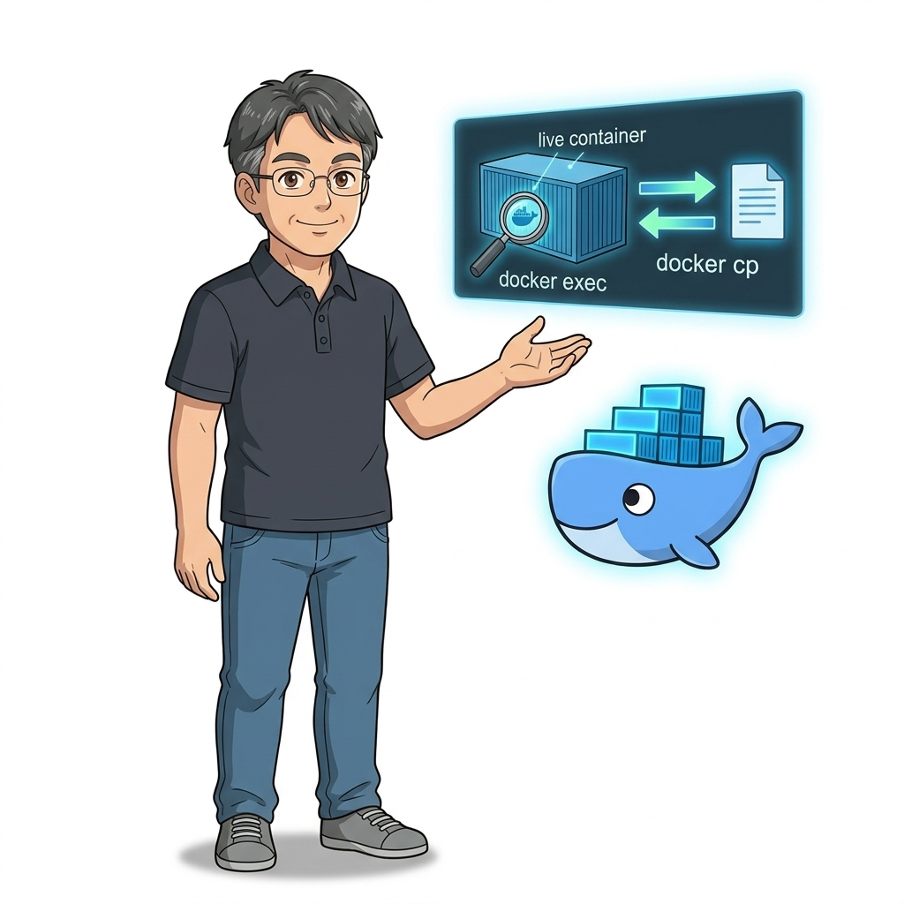
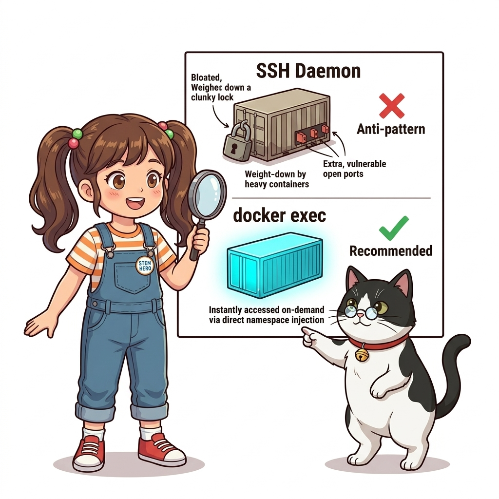
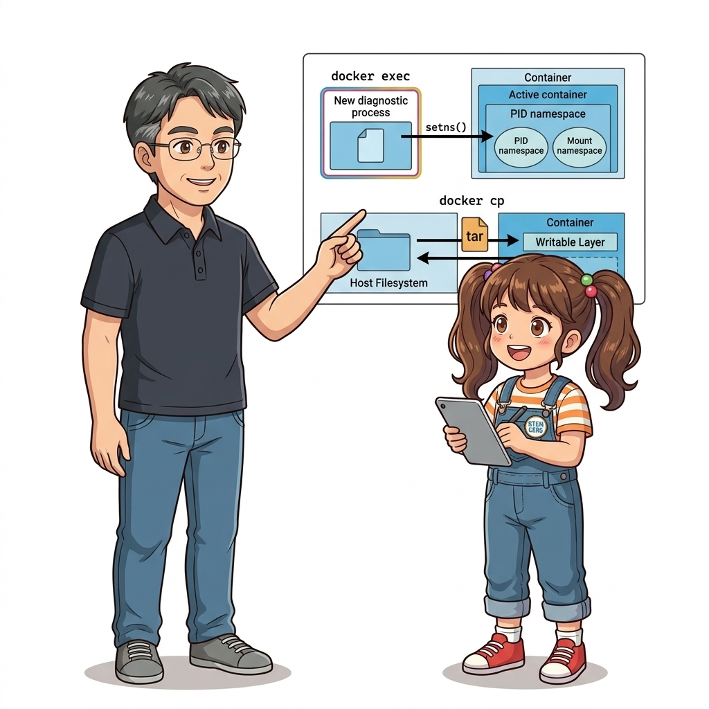
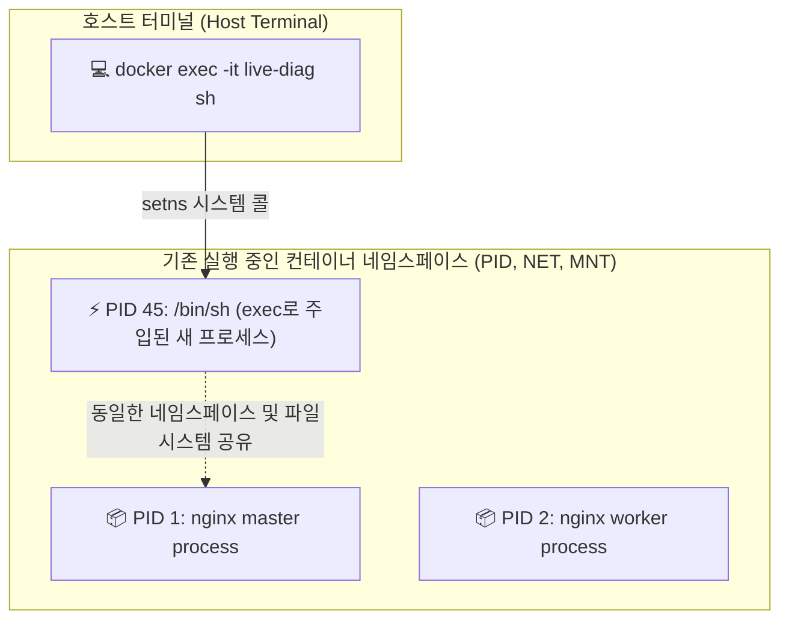
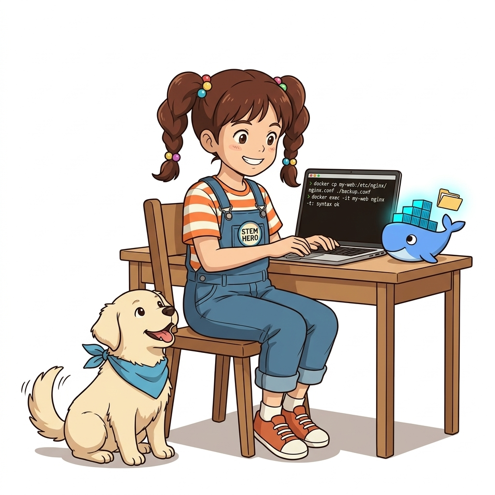
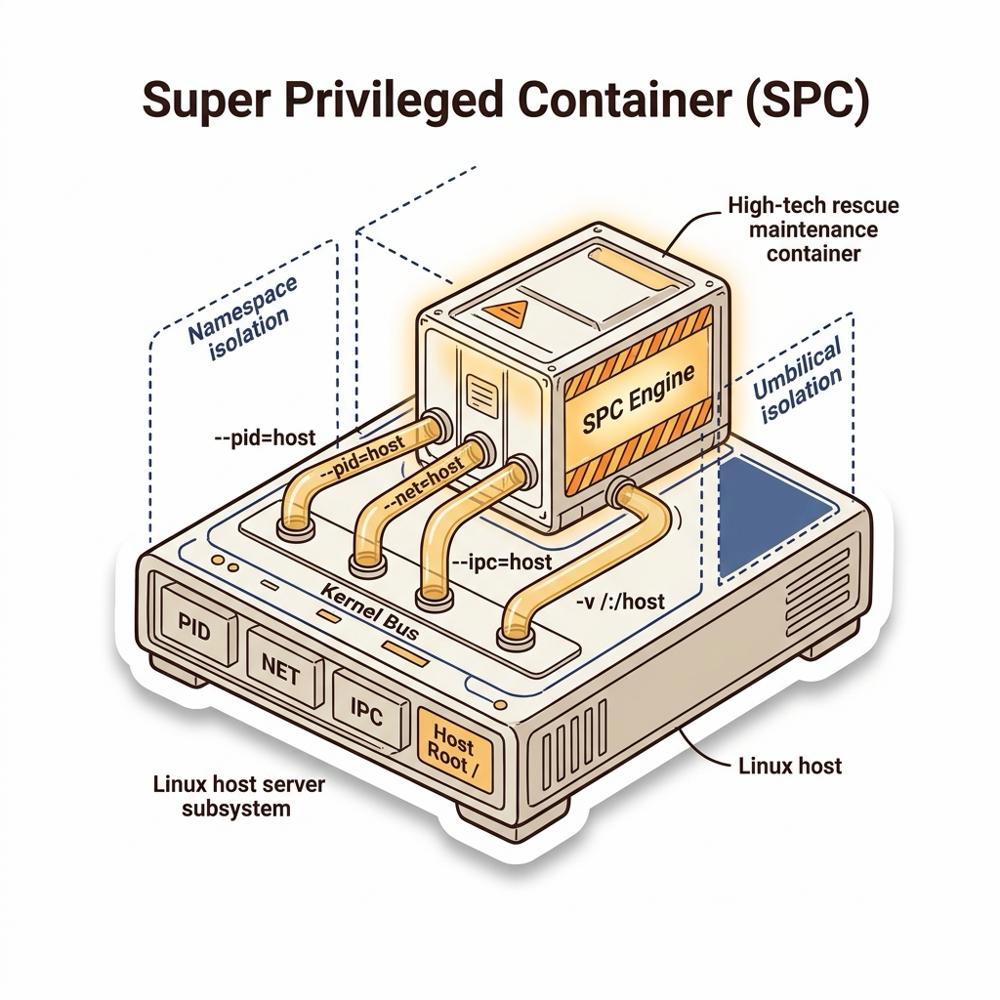

# 011. 실행 중인 컨테이너 내부 진단: exec와 파일 복사 cp

실제 운영 환경(Production)에서 서비스 장애가 발생했을 때 가장 위험한 행동은 무엇일까요?
원인을 모른 채 당황하여 컨테이너를 재시작(`restart`)하거나 죽여버리는 것입니다. 컨테이너를 재시작하는 순간, 메모리에 남아있던 오류 스택트레이스, 휘발성 디버깅 로그, 비정상 소켓 연결 상태가 모두 증발하여 **"장애는 났는데 원인은 영원히 알 수 없는 미궁"**에 빠지게 됩니다.


**그림 01-12-1** 24시간 가동 중인 서비스 컨테이너에 영향을 주지 않고 안전하게 내부로 진입하여 트러블슈팅하는 아키텍처

엔지니어에게 필요한 것은 서비스 프로세스를 절대 죽이지 않고, 마치 외과의사가 내시경을 집어넣듯 실행 중인 컨테이너 내부 네임스페이스로 새로운 디버깅 도구를 투입하는 **`docker container exec`**와, 컨테이너 내부의 의심스러운 설정 파일이나 덤프 로그를 호스트 머신으로 꺼내오는 **`docker container cp`** 기술입니다.

---

### 011.1 `docker run` vs `docker exec`: 본질적인 차이

초심자들은 종종 `run`과 `exec`를 혼동하곤 합니다:


**그림 01-12-2** 새로운 컨테이너를 만드는 run과, 기존 컨테이너의 네임스페이스에 동승하는 exec의 구조적 차이

* **`docker run` (새로운 탄생)**:
  * 완전히 새로운 컨테이너 인스턴스를 하나 만들고, 새로운 네임스페이스와 IP를 할당하여 주 프로세스(PID 1)를 기동합니다.
* **`docker exec` (기존 공간에 동승)**:
  * **이미 실행 중인 기존 컨테이너의 네임스페이스 공간으로 걸어 들어갑니다.**
  * 리눅스 커널의 `setns()` 시스템 콜을 호출하여, 기존 컨테이너의 PID, Mount, Network 네임스페이스에 새로운 자식 프로세스(예: `/bin/sh`)를 주입합니다.
  * 여기서 실행된 디버깅 셸을 종료(`exit`)해도, **기존의 주 프로세스(Nginx, DB 등)는 아무 일 없었다는 듯 계속 정상 가동**됩니다.

---

### 011.2 `docker cp`: 호스트와 컨테이너 간의 안전한 양방향 파일 파이프라인

컨테이너는 기본적으로 격리된 파일시스템을 가지고 있지만, 긴급하게 Nginx의 `nginx.conf` 설정 오류를 수정하거나, 애플리케이션의 힙 덤프(Heap dump) 로그 파일을 로컬로 복사해 와 분석해야 할 때가 있습니다.


**그림 01-12-3** tar 스트림을 통해 호스트와 컨테이너 파일시스템 사이에서 파일을 안전하게 양방향 전송하는 docker cp

`docker cp`의 특징:
1. **컨테이너가 실행 중이든, 심지어 멈춰 있든(Stopped) 언제나 동작합니다.**
2. 컨테이너 내부에 SSH 서버나 FTP 데몬을 설치할 필요가 전혀 없습니다. 도커 데몬이 직접 내부 레이어 파일시스템을 읽고 써서 호스트로 tar 스트림을 전달하기 때문입니다.
3. 양방향 복사를 완벽 지원합니다:
   * 컨테이너 -> 호스트: `docker cp <컨테이너ID>:<컨테이너경로> <호스트경로>`
   * 호스트 -> 컨테이너: `docker cp <호스트경로> <컨테이너ID>:<컨테이너경로>`

#### 📊 실무 트러블슈팅 명령어 비교 분석

| 상황 및 작업 목표 | 권장 명령어 문법 | 내부 동작 원리 및 주의사항 |
| :--- | :--- | :--- |
| **실행 중인 웹 서버 내부 셸 점검** | `docker exec -it my-web sh` | 기존 네임스페이스에 sh 프로세스를 추가 실행 (서비스 무중단) |
| **비루트 사용자 권한으로 셸 접속** | `docker exec -it -u 1000 my-app id` | 특정 UID로 진입하여 파일 권한 문제 및 접근 제어 테스트 |
| **셸 접속 없이 단일 진단 명령만 실행** | `docker exec my-web netstat -tuln` | 대화형 터미널 없이 결과 텍스트만 호스트 콘솔로 즉시 파이핑 |
| **운영 컨테이너 설정 파일 긴급 핫패치** | `docker cp config.json my-app:/app/` | 컨테이너를 재빌드하지 않고 설정 파일만 즉시 교체 적용 |

---

### 011.3 선언적 실습 및 아키텍처 다이어그램

Nginx 웹 서버를 백그라운드로 띄운 뒤, `exec`로 내부 네트워크 환경을 진단하고, `cp`로 커스텀 HTML 파일을 주입하여 웹 화면을 실시간 핫패치해 봅시다.

```bash
# [실습 011-1] Nginx 웹 서버 컨테이너 백그라운드 구동
docker container run -d --name live-diag -p 8085:80 nginx:alpine

# [실습 011-2] docker exec로 내부 네임스페이스 침투하여 프로세스 트리 확인
docker container exec live-diag ps aux

# [실습 011-3] 호스트에서 새로운 커스텀 웹 페이지 파일 생성
echo "<h1>🚀 Docker Live Hotpatch Success!</h1><p>Modified by Dorothy & Jiny</p>" > /tmp/hotpatch.html

# [실습 011-4] docker cp로 컨테이너 내부 웹 루트 디렉터리로 실시간 주입
docker container cp /tmp/hotpatch.html live-diag:/usr/share/nginx/html/index.html

# [실습 011-5] curl을 통해 웹 페이지 내용이 실시간 핫패치되었는지 즉시 검증
curl http://localhost:8085

# [실습 011-6] 컨테이너 내부의 기본 nginx.conf를 호스트로 백업 추출
docker container cp live-diag:/etc/nginx/nginx.conf /tmp/extracted_nginx.conf
cat /tmp/extracted_nginx.conf | head -n 10

# [실습 011-7] 실습 정리
docker container rm -f live-diag
rm -f /tmp/hotpatch.html /tmp/extracted_nginx.conf
```

#### 🔍 docker exec의 네임스페이스 침투 과정 (Mermaid Diagram)




**그림 01-12-4** docker exec를 통한 내부 프로세스 점검과 docker cp를 통한 웹 페이지 실시간 교체 성공 검증

---

<!-- BIBLE_INTEGRATION_book2_nsenter_debugging -->
---

### 011.B 📚 도커 바이블 심화: nsenter와 coredump를 활용한 격리 네임스페이스 로우레벨 디버깅 기법
*출처 도서: 『Docker Up and Running』 핵심 분석*

보안과 경량화를 위해 `scratch`나 `distroless` 베이스 이미지를 사용할 경우, 컨테이너 내부에는 `sh`, `bash`, `curl`, `ps` 같은 기본 진단 도구가 전혀 존재하지 않습니다. 이때 컨테이너 내부를 점검하는 최고급 프로덕션 디버깅 기법이 바로 **`nsenter`(Namespace Enter)**입니다.

#### nsenter의 5대 네임스페이스 결합 옵션:
* `-n` (`--net`): 타깃 컨테이너의 네트워크 네임스페이스로 진입 (호스트의 `tcpdump`, `netstat`, `ip link`로 컨테이너 패킷 직접 캡처)
* `-m` (`--mount`): 타깃 컨테이너의 파일시스템 마운트 네임스페이스로 진입
* `-p` (`--pid`): 타깃 컨테이너의 PID 네임스페이스로 진입하여 프로세스 트리 직접 관찰
* `-i` (`--ipc`): 타깃 컨테이너의 프로세스 간 통신(공유 메모리, 세마포어) 공간 진입
* `-u` (`--uts`): 타깃 컨테이너의 호스트명 격리 공간 진입


**그림 011-B-1** 호스트 관리자가 nsenter를 통해 셸이 없는 컨테이너 네임스페이스에 진단 빔을 투사하는 모습

```bash
# [실습] 셸이 없는 초경량 컨테이너에 호스트 진단 도구 주입하기
# 셸이 없는 컨테이너 실행
docker container run -d --name distroless-test gcr.io/distroless/static-debian12:latest sleep 3600 2>/dev/null || \
docker container run -d --name distroless-test alpine:latest sleep 3600

# 컨테이너의 호스트 실제 PID 획득
TARGET_PID=$(docker container inspect distroless-test --format '{{.State.Pid}}')
echo "Target Container Host PID: $TARGET_PID"

# nsenter를 통해 호스트의 ip 명령어로 컨테이너 네트워크 인터페이스 직접 진단
sudo nsenter -t $TARGET_PID -n ip addr
```

> 👨‍🏫 **이호진 교수님의 바이블 멘토링 노트**:
> "운영 서버의 컨테이너에 디버깅 도구를 미리 설치해 두는 것은 이미지 용량을 키우고 보안 공격 표면(Attack Surface)을 넓히는 나쁜 습관입니다. 깨끗한 불변 이미지를 유지하고, 진단은 호스트의 nsenter로 외부에서 침투하여 해결하세요."
>
> 👧 **도로시의 깨달음**:
> "컨테이너 안에 망치나 드라이버를 넣어두는 게 아니라, 밖에서 특수 열쇠(nsenter)를 꽂아서 안을 들여다보는 방식이군요!"
>
> 🐱 **조교 지니의 아키텍처 체크포인트**:
> "쿠버네티스의 Ephemeral Debug Container(`kubectl debug`)도 내부적으로는 이와 동일하게 네임스페이스를 공유하는 기술에 기반하고 있답니다."


<!-- BIBLE_INTEGRATION_book8_super_privileged_containers -->
---

### 011.D 📚 도커 바이블 심화: Super Privileged Containers(SPC) 패턴을 활용한 호스트 인프라 심층 진단과 긴급 복구
> **출처 및 학술적 배경**: 『도커 컨테이너』 제13장 (SPC 사용하기)  
> **핵심 주제**: 고장 난 호스트 OS 유지보수를 위해 모든 커널 네임스페이스 장벽을 해제하고 루트 파일시스템을 장악하는 슈퍼 특권 컨테이너(SPC) 아키텍처.

#### 1. SPC(Super Privileged Container)란 무엇인가?
일반적인 컨테이너는 커널 네임스페이스와 cgroup, SELinux 보안 문맥 속에 철저히 격리되어 호스트 시스템의 물리 장치나 핵심 프로세스 테이블에 접근할 수 없습니다. 그러나 호스트 OS의 패키지 관리자가 고장 났거나, 시스템 라이브러리가 꼬여 패키지 설치가 불가능할 때, 혹은 호스트 커널 파라미터 긴급 튜닝이나 물리 디스크 복구가 필요할 때 엔터프라이즈 환경에서는 **SPC(Super Privileged Container, 슈퍼 특권 컨테이너)** 패턴을 사용합니다.

#### 2. SPC의 5대 격리 해제 메커니즘:
1. **`--privileged` (모든 권한 개방)**: 리눅스 커널의 40여 가지 Capabilities를 전부 부여하고 디바이스 cgroup 제약을 완전히 해제합니다.
2. **`--pid=host` (호스트 프로세스 가시성)**: 컨테이너 내부의 격리된 PID 1 대신 호스트의 `systemd` 프로세스 테이블을 직접 조회하고 `kill` 시그널을 전달합니다.
3. **`--net=host` (호스트 네트워크 직접 점유)**: 가상 `veth`나 `docker0` 브리지를 거치지 않고 호스트의 물리 NIC(eth0)와 소켓을 직결합니다.
4. **`--ipc=host` (공유 메모리 통신)**: 호스트의 POSIX/SysV 프로세스 간 공유 메모리 및 세마포어에 직접 접근합니다.
5. **`-v /:/host:rw` (호스트 루트 파일시스템 마운트)**: 호스트의 전체 디스크를 컨테이너의 `/host`로 바인드 마운트한 뒤 `chroot /host` 명령으로 호스트 셸을 장악하여 복구 작업을 수행합니다.


**그림 011-D-1** 호스트 OS 전체를 안전하게 투시하고 제어할 수 있는 슈퍼 특권 컨테이너(SPC) 아키텍처

```bash
# [실습] 고장 난 호스트를 긴급 유지보수하는 SPC 실행
# 1. 호스트의 모든 네임스페이스를 개방하고 루트 파일시스템을 연결하여 실행
docker run -it --name host-rescue \
  --privileged \
  --pid=host \
  --net=host \
  --ipc=host \
  -v /:/host:rw \
  -v /run:/run:rw \
  -v /dev:/dev:rw \
  alpine:latest /bin/sh

# 2. 컨테이너 내부에서 호스트 셸로 탈출(chroot)하여 시스템 제어
# chroot /host /bin/bash
# ps -ef | grep dockerd
# systemctl status docker
# cat /proc/sys/fs/file-max
```

> 👨‍🏫 **이호진 교수님의 심화 지도**:
> "SPC는 호스트 OS의 베이스 패키지를 오염시키지 않고 최신 진단 도구 세트(sysstat, tcpdump, gdb, perf)를 즉시 주입하여 장애를 수습할 수 있는 고난도 SRE 기법입니다."
>
> 👧 **도로시의 깨달음**:
> "벽에 갇힌 일반 방과 달리, 지휘통제실처럼 모든 문과 창문을 호스트와 활짝 열어둔 무적의 만능 구급차 컨테이너군요!"
>
> 🐱 **조교 지니의 프로덕션 체크리스트**:
> * SPC는 루트 권한으로 호스트의 모든 것을 조작할 수 있으므로, 장애 복구 후 반드시 `docker rm -f host-rescue`로 완전히 제거해야 합니다.

---

### 011.4 핵심 정리: 캐릭터 대화와 3대 교훈

> 👧 **도로시**: "우와! 서버를 껐다 켜지 않고도 `docker exec`로 살금살금 들어가서 내부 상태를 보고, `docker cp`로 웹사이트 첫 페이지를 실시간으로 뚝딱 바꿨어요!"
> 
> 🐱 **조교 지니**: "야옹~ 맞습니다. 하지만 운영 환경에서는 `exec`로 들어가서 패키지를 설치하거나 수작업으로 코드를 고치는 건 '임시 응급조치'일 뿐, 결국은 Dockerfile로 다시 빌드해야 한다는 점을 잊지 마세요!"
> 
> 🐶 **토토**: "멍멍! 장애가 났을 때 컨테이너를 섣불리 끄지 않고 `cp`로 에러 로그를 먼저 밖으로 꺼내오는 습관이 정말 중요하대요!"
> 
> 👨‍🏫 **이호진 교수님**: "훌륭한 통찰이란다. `exec`와 `cp`는 긴급 상황에서 시스템의 맥박을 짚고 생명을 구하는 엔지니어의 정밀 수술 도구란다."


**그림 01-12-5** 무중단 진단과 파일 파이프라인의 3대 핵심 교훈

1. **서비스 무중단 내부 진단 (`docker exec`)**:
   * 주 프로세스를 방해하지 않고 독립된 진단 셸을 투입하여 실시간 네트워크 및 프로세스 상태를 검증합니다.
2. **양방향 무결성 파일 전송 (`docker cp`)**:
   * SSH 데몬 없이도 호스트와 컨테이너 간에 설정 파일과 덤프 로그를 안전하게 입출력합니다.
3. **불변 인프라 원칙의 보존**:
   * exec를 통한 실시간 변경은 긴급 디버깅용으로 한정하고, 최종 결과물은 반드시 선언적 Dockerfile로 영구화합니다.

---

### 011.5 랩노트 피날레와 다음 강의 예고


**그림 01-12-6** 도커 엔진 내부의 거대한 4계층 아키텍처 해부를 예고하는 교수님과 연구팀

> 💡 **다음 강의 안내**:
> [012. 도커 엔진 내부 아키텍처: CLI, 데몬, containerd, runc](../012_도커엔진_내부아키텍처_CLI_데몬_containerd_runc/)에서는 도커가 단일한 통짜 프로그램이 아니라, 왜 dockerd, containerd, runc라는 4개의 정교한 레이어로 분할되었는지 그 역사적 배경과 OCI 표준의 비밀을 파헤칩니다!

---

## 🧭 강의 네비게이션
* [◀️ 이전 강의: 010_컨테이너_생애주기_관리와_상태모니터링](../010_컨테이너_생애주기_관리와_상태모니터링/)
* [📋 Part 01. 컨테이너 혁명과 도커 엔진 기본기 마스터 (000 ~ 014) 목차로 돌아가기](../)
* [▶️ 다음 강의: 012_도커엔진_내부아키텍처_CLI_데몬_containerd_runc](../012_도커엔진_내부아키텍처_CLI_데몬_containerd_runc/)


