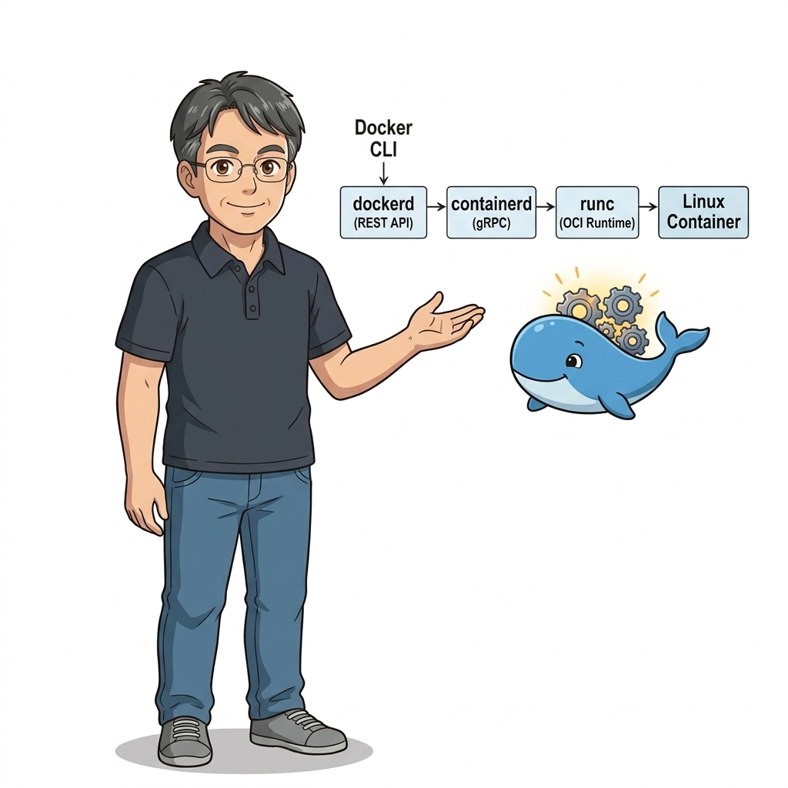
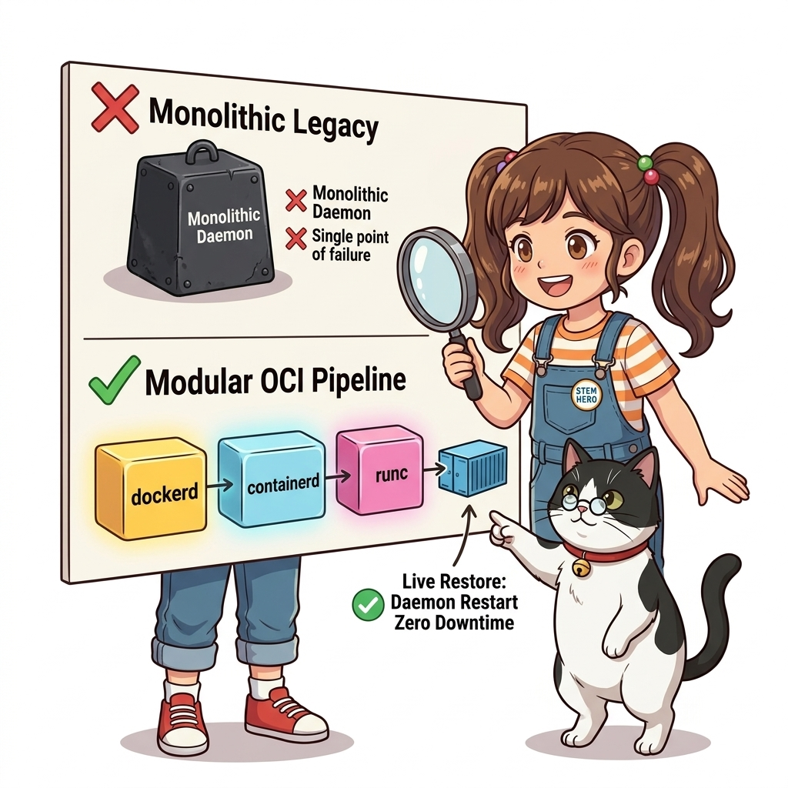
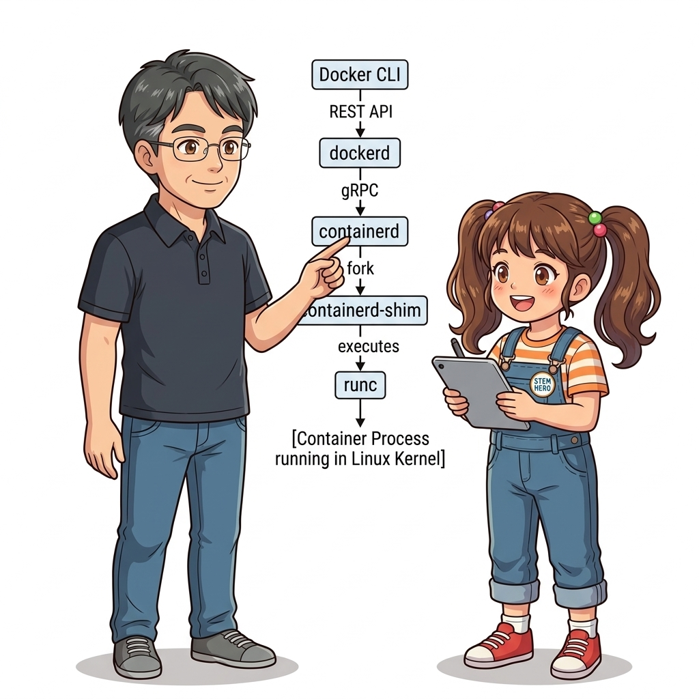
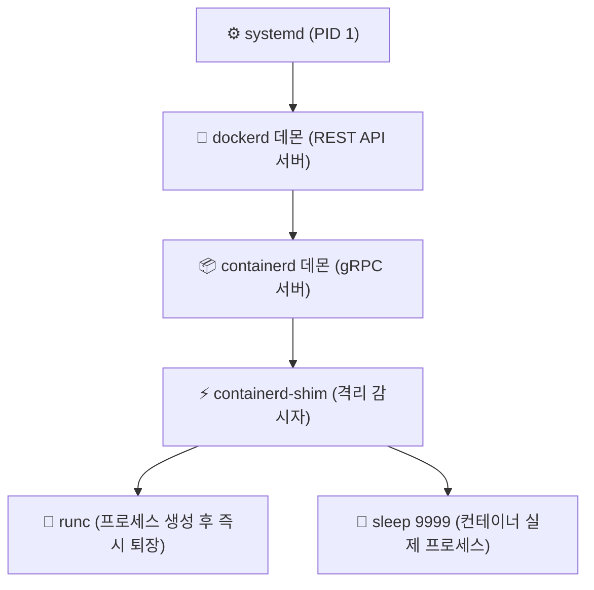
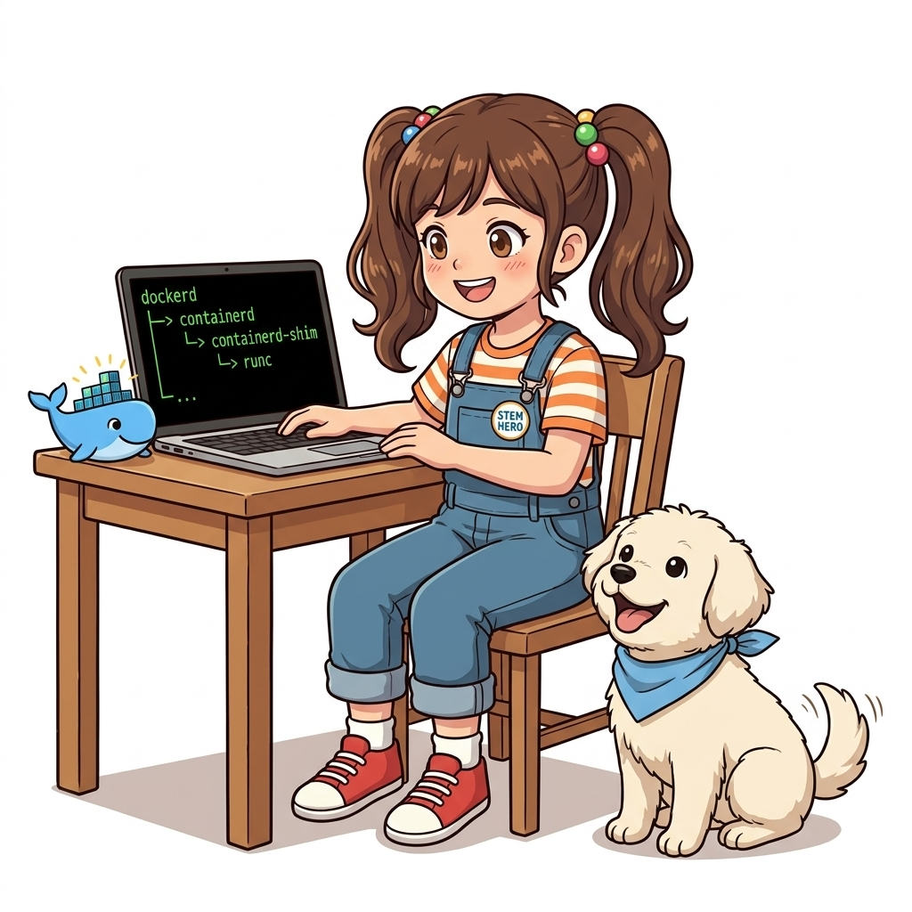
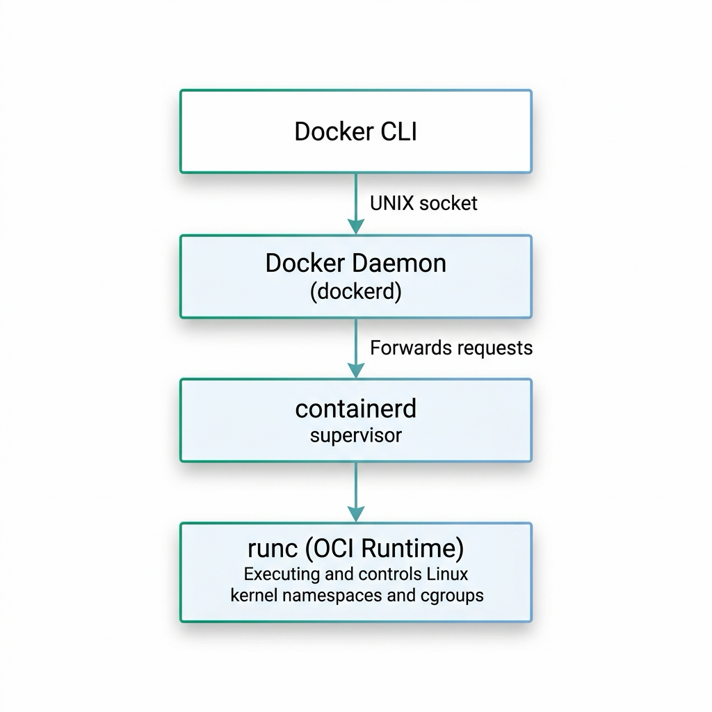
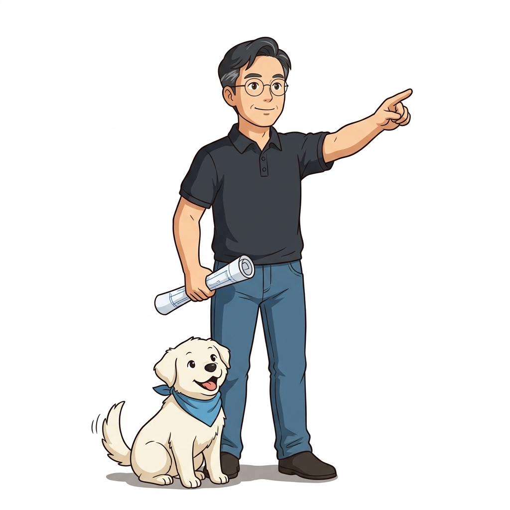

# 012. 도커 엔진 내부 아키텍처: CLI, 데몬, containerd, runc

초창기 2013년의 도커는 모든 기능이 단 하나의 거대한 C/Go 실행 바이너리(`docker`) 안에 몽땅 들어있는 통짜(Monolithic) 데몬이었습니다. 이미지 빌드, 볼륨 관리, 네트워크 라우팅, 컨테이너 프로세스 실행에 이르기까지 모든 것을 단일 데몬이 도맡아 처리했습니다.


**그림 01-13-1** 모놀리식 통짜 데몬에서 OCI 표준 기반의 4계층 분할 아키텍처로 진화한 현대 도커 엔진의 내부 해부

하지만 이 구조는 치명적인 약점을 안고 있었습니다. **도커 데몬(`dockerd`)에 사소한 버그가 생기거나 데몬을 버전 업그레이드하기 위해 재시작하는 순간, 그 위에서 평화롭게 돌아가던 수백 개의 상용 웹 서버와 데이터베이스 컨테이너가 전부 함께 죽어버리는 비극**이 발생했기 때문입니다!

이 문제를 해결하고 업계의 표준화를 이루기 위해, 도커는 자신의 몸체를 과감하게 4개의 전문화된 계층으로 분할했습니다:
**Docker CLI -> dockerd -> containerd -> runc**

이번 절에서는 현대 컨테이너 생태계의 기술적 헌법이라 할 수 있는 **OCI(Open Container Initiative) 표준**과 도커 엔진의 4계층 해부도를 완벽히 정복합니다.

---

### 012.1 4계층 분할 구조의 상세 역할 해부

도커 엔진의 4대 핵심 컴포넌트는 각자 명확한 단일 책임 원칙(SRP)을 수행합니다:


**그림 01-13-2** 사용자 명령부터 OCI 시스템 콜 호출까지 이어지는 4대 컴포넌트의 유기적 분업 체계

1. **Docker CLI (`docker`)**:
   * 사용자가 키보드로 명령어를 입력하는 프론트엔드 도구입니다. 자체적으로 컨테이너를 띄우는 능력은 전혀 없으며, 오직 사용자의 입력을 해석하여 백엔드 데몬에게 표준 REST API(JSON over UNIX Domain Socket) 요청을 날리는 메신저 역할을 합니다.
2. **Docker Daemon (`dockerd`)**:
   * 고급 기능의 총사령관입니다. 이미지 빌드(`build`), 도커 컴포즈 오케스트레이션, 볼륨 마운트 관리, 가상 네트워크 브리지 생성, 비밀값(Secret) 관리 등 **사용자 친화적인 고수준(High-level) 플랫폼 기능**을 총괄합니다.
3. **containerd (`containerd`)**:
   * **컨테이너의 실제 생명주기 관리자**입니다. 도커 재단이 쿠버네티스(CNCF)에 기증한 핵심 오픈소스로, 원격 이미지 레지스트리에서 이미지를 풀(Pull)받고, 디스크 스토리지 레이어를 조립하며, 하위 런타임(runc)에게 프로세스 실행을 지시합니다.
4. **runc (`runc`)**:
   * **OCI 표준을 구현한 초경량 단일 런타임**입니다. 리눅스 커널과 직접 대화하며 `clone()`, `unshare()`, `setns()` 시스템 콜을 호출하여 네임스페이스와 cgroups 자원 장벽을 치고 컨테이너 프로세스를 실제로 탄생시킵니다. 프로세스를 성공적으로 띄운 직후 runc 자신은 메모리에서 즉시 퇴장(Exit)합니다.

---

### 012.2 containerd-shim: 데몬이 죽어도 컨테이너는 영원히 산다

4계층 아키텍처의 가장 위대한 발명품 중 하나는 바로 **`containerd-shim`**이라는 조그마한 프로세스입니다.
* runc가 컨테이너 프로세스를 띄우고 퇴장하면, 컨테이너 프로세스의 부모(Parent) 프로세스가 사라져 고아가 될 위험이 있습니다.
* `containerd-shim`이 컨테이너 바로 앞단에 딱 달라붙어 부모 역할을 대신 맡아줍니다.
* **표준 입출력(stdout/stderr) 파이프를 유지**하고 종료 코드(Exit Code)를 대기합니다.


**그림 01-13-3** dockerd 데몬을 재시작하거나 업그레이드해도 containerd-shim 덕분에 컨테이너가 무중단 가동되는 메커니즘

이 덕분에 우리는 운영 중에 도커 데몬(`dockerd`)이나 `containerd`가 충돌로 죽거나 버전 패치를 위해 재시작되더라도, **실제 서비스 컨테이너 프로세스는 단 1밀리초의 다운타임도 없이 계속해서 고객의 트래픽을 처리하는 기적 같은 무중단 고가용성**을 확보할 수 있게 되었습니다(도커 설정의 `live-restore: true` 옵션).

#### 📊 도커 엔진 4대 컴포넌트 비교표

| 컴포넌트 명칭 | 실행 파일 위치 | 주된 역할 및 책임 | 표준 규격 및 관리 주체 |
| :--- | :--- | :--- | :--- |
| **Docker CLI** | `/usr/bin/docker` | 사용자 명령어 파싱 및 REST API 호출 | Docker Inc. |
| **dockerd** | `/usr/bin/dockerd` | 볼륨, 네트워크, 빌드, 보안 등 고수준 기능 총괄 | Docker Inc. |
| **containerd** | `/usr/bin/containerd` | 이미지 언팩, 스토리지 마운트, 컨테이너 생애주기 관리 | **CNCF (Cloud Native Computing Foundation)** |
| **runc** | `/usr/bin/runc` | 리눅스 커널 시스템 콜 직접 호출 및 프로세스 격리 기동 | **OCI (Open Container Initiative) 표준** |

---

### 012.3 선언적 실습 및 아키텍처 다이어그램

호스트 OS에서 실행 중인 실제 프로세스 트리(`pstree`)를 조회하여, 우리가 배운 4계층 아키텍처(`dockerd -> containerd -> containerd-shim -> 컨테이너 프로세스`)가 리눅스 커널 프로세스 테이블에 그대로 살아 숨 쉬고 있음을 직접 두 눈으로 확인해 봅시다.

```bash
# [실습 012-1] 장기 실행 백그라운드 컨테이너 기동
docker container run -d --name arch-demo alpine:3.20 sleep 9999

# [실습 012-2] 호스트 프로세스 트리에서 도커 엔진 계층 구조 확인
# (리눅스 호스트 터미널에서 실행)
pstree -p $(pgrep dockerd) 2>/dev/null || ps -ef | grep -E "dockerd|containerd|sleep 9999"

# [실습 012-3] containerd 및 runc 바이너리 버전 및 OCI 호환성 확인
runc --version
containerd --version

# [실습 012-4] 실습 컨테이너 정리
docker container rm -f arch-demo
```

#### 🔍 도커 엔진 계층별 프로세스 상속 트리 (Mermaid Diagram)




**그림 01-13-4** pstree를 통해 증명된 dockerd, containerd, containerd-shim, sleep 프로세스의 계층적 부모-자식 관계

---

<!-- BIBLE_INTEGRATION_book1_oci_architecture -->
---

### 012.B 📚 도커 바이블 심화: OCI 표준화 전쟁과 runc 탄생의 역사, 그리고 CLI v1.13 패러다임 전환
> **출처 및 학술적 배경**: 『15단계로 배우는 도커와 쿠버네티스』 제1장 (1.14 도커의 아키텍처, 1.18 OCI: Open Container Initiative)  
> **핵심 주제**: 2015년 OCI 표준화 협의체 설립 배경, CoreOS rkt와의 경쟁, OCI 2대 스펙(runtime-spec vs image-spec), 그리고 도커 v1.13 오브젝트 중심 선언형 명령어 체계 개편.

#### 1. 컨테이너 춘추전국시대와 OCI(Open Container Initiative)의 탄생
2013년 도커가 오픈소스로 등장한 직후 전 세계적인 선풍을 일으켰으나, 2014년경 도커가 플랫폼 독점화(Swarm 내장 등)를 시도하자 경쟁 진영인 CoreOS는 독자적인 컨테이너 런타임 **`rkt`(Rocket)**와 App Container(appc) 규격을 발표하며 거센 표준화 분쟁이 촉발되었습니다.
* **업계의 위기감**: 컨테이너 이미지 포맷이 파편화되면 특정 클라우드 벤더에 종속되어 컨테이너의 본질인 "어디서나 실행된다(Build Once, Run Anywhere)"는 약속이 깨질 위기에 처했습니다.
* **2015년 6월 OCI 발족**: 리눅스 재단(Linux Foundation) 주도 아래 **Docker, CoreOS, Google, Red Hat, AWS, Microsoft, IBM, VMware, Intel** 등 전 세계 주요 빅테크 기업들이 참여하여 중립적인 표준화 기구인 **OCI(Open Container Initiative)**를 전격 설립했습니다.

#### 2. OCI 2대 핵심 표준 스펙 (2017년 7월 v1.0 정식 비준)
1. **OCI Runtime Specification (`runtime-spec`)**:
   * 컨테이너 프로세스의 생애주기(`create`, `start`, `kill`, `delete`)와 리눅스 커널 네임스페이스, cgroups, 파일시스템 루트(`rootfs`), 마운트 명세를 JSON 포맷(`config.json`)으로 표준화했습니다.
   * 도커는 자사의 핵심 런타임 코드인 `libcontainer`를 순수 CLI로 분리하여 **`runc`**라는 이름의 공식 OCI 참조 구현체로 기증했습니다.
2. **OCI Image Specification (`image-spec`)**:
   * 컨테이너 이미지를 구성하는 Tarball 압축 레이어(Layer Changeset), 이미지 메타데이터(Config), 그리고 이들을 묶는 **Manifest와 OCI Image Index** 규격을 표준화했습니다.
   * 이를 통해 도커 허브뿐 아니라 AWS ECR, Google Artifact Registry, Red Hat Quay, 오픈소스 Harbor 등 어떤 레지스트리에서도 OCI 준수 이미지를 상호 호환되게 푸시/풀할 수 있게 되었습니다.

#### 3. 도커 커맨드 체계의 대변혁 (Docker v1.13의 선언적 패러다임)
도커 버전 1.13(2017년 1월) 이전에는 동사 중심의 파편화된 구형 명령어 체계를 사용했습니다. 하지만 쿠버네티스의 선언형 오브젝트 모델 및 OCI 표준화에 맞추어 **`docker <Object> <Verb>`** 형태의 체계적인 2세대 커맨드 체계로 전면 개편되었습니다:

| 관리 대상 오브젝트 | 1세대 레거시 커맨드 (호환 유지) | 2세대 OCI 표준 선언적 커맨드 (권장) | 설계 철학 및 이점 |
| :--- | :--- | :--- | :--- |
| **컨테이너 (Container)** | `docker ps`<br>`docker run`<br>`docker rm` | `docker container ls`<br>`docker container run`<br>`docker container rm` | 컨테이너 프로세스 인스턴스에 대한 일관된 라이프사이클 관리 |
| **이미지 (Image)** | `docker images`<br>`docker rmi`<br>`docker build` | `docker image ls`<br>`docker image rm`<br>`docker image build` | 불변(Immutable) 템플릿 자산에 대한 격리된 스토리지 제어 |
| **볼륨 (Volume)** | 없음 (옵션에 의존) | `docker volume ls`<br>`docker volume create`<br>`docker volume inspect` | 호스트 독립적인 영속 스토리지 오브젝트의 1급 객체화 |
| **네트워크 (Network)** | 없음 (호스트 네트워크 의존) | `docker network ls`<br>`docker network create`<br>`docker network connect` | 소프트웨어 정의 가상 L2 스위치 및 브리지의 모듈식 조작 |

> 💡 **현업 실무 팁**: 타이핑 속도를 위해 터미널에서는 구형 `docker ps`를 많이 쓰지만, **CI/CD 스크립트와 프로덕션 배포 파이프라인에서는 의미가 명확하고 오작동이 없는 2세대 표준 커맨드(`docker container ls`)를 명시하는 것이 엔터프라이즈 모범 표준**입니다.


**그림 012-B-1** docker CLI에서 dockerd, containerd, runc로 이어지는 OCI 4계층 구조 다이어그램

```bash
# [실습] containerd 소켓 및 runc 프로세스 계층 구조 추적
# 1. 도커 소켓 및 containerd 소켓 파일 상태 확인
ls -la /var/run/docker.sock
ls -la /run/containerd/containerd.sock

# 2. OCI 표준 2세대 커맨드로 컨테이너 기동 및 메타데이터 확인
docker container run -d --name oci-inspect-demo alpine:3.20 sleep 3600
docker container inspect oci-inspect-demo | grep -E "Status|Id|Pid"

# 3. 호스트에서 저수준 containerd CLI(ctr)로 moby 네임스페이스 태스크 직접 조회
# (쿠버네티스 CRI 노드에서 도커 데몬을 거치지 않고 containerd를 직접 점검하는 실무 기법)
sudo ctr --namespace moby tasks list 2>/dev/null || echo "ctr requires root privileges"

# 4. 실습 완료 후 컨테이너 정리
docker container rm -f oci-inspect-demo
```

> 👨‍🏫 **이호진 교수님의 바이블 멘토링 노트**:
> "OCI 덕분에 도커는 이제 특정 기업의 전유물이 아닌 전 세계 클라우드 인프라의 표준 헌법이 되었습니다. containerd와 runc의 역할을 이해하면, 훗날 쿠버네티스가 도커를 떼어내고 CRI(Container Runtime Interface)를 통해 containerd와 직접 대화하는 현대적 쿠버네티스 아키텍처를 자연스럽게 이해할 수 있게 됩니다."
>
> 👧 **도로시의 깨달음**:
> "처음에는 `docker ps` 대신 왜 길게 `docker container ls`를 쓰라고 하는지 몰랐는데, 이미지, 볼륨, 네트워크처럼 도커의 모든 자원을 명확한 '오브젝트'로 다루기 위한 거대한 설계 철학이 숨어 있었군요!"
>
> 🐱 **조교 지니의 아키텍처 체크포인트**:
> * `runc`는 컨테이너 프로세스를 커널에 띄운 직후 즉시 프로세스 테이블에서 스스로를 종료(Exit)합니다. 그 자리를 이어받아 컨테이너 프로세스의 부모가 되어주는 것이 바로 `containerd-shim`입니다.
> * 클라우드 네이티브 레지스트리(ECR, Harbor)에 이미지를 올릴 때 OCI 표준 규격(`application/vnd.oci.image.manifest.v1+json`)을 준수하면 플랫폼 간 이미지 이식성이 100% 보장됩니다.


### 012.4 핵심 정리: 캐릭터 대화와 3대 교훈

> 👧 **도로시**: "와! 도커가 그냥 하나의 큰 프로그램인 줄 알았는데, 명령을 전달하는 CLI, 고수준 기능을 챙기는 dockerd, 관리를 총괄하는 containerd, 그리고 진짜 커널 문을 여는 runc까지 정교한 분업 오케스트라였군요!"
> 
> 🐱 **조교 지니**: "야옹~ 맞습니다! 특히 쿠버네티스가 도커를 떼어내고 containerd와 직접 대화할 수 있는 것도, 바로 도커가 자신의 핵심 엔진을 OCI 표준 오픈소스로 분리해 두었기 때문이랍니다!"
> 
> 🐶 **토토**: "멍멍! containerd-shim 덕분에 도커 엔진을 업데이트해도 웹사이트가 절대 꺼지지 않는다니 정말 안심이에요!"
> 
> 👨‍🏫 **이호진 교수님**: "정확하단다. 단일 실패점(SPOF)을 제거하고 인터페이스 표준을 지키는 아키텍처 설계의 교과서가 바로 도커 엔진의 진화 과정이란다."


**그림 01-13-5** 도커 엔진 4계층 아키텍처의 3대 핵심 교훈

1. **단일 책임 원칙에 기반한 계층 분할**:
   * CLI, 데몬, 런타임을 분리하여 각 계층의 독립적 발전과 유지보수성을 극대화했습니다.
2. **OCI 표준 규격 준수**:
   * runc를 기반으로 벤더 종속성 없이 모든 표준 OCI 컨테이너 이미지를 어디서나 상호운용합니다.
3. **containerd-shim을 통한 무중단 고가용성**:
   * 상위 데몬의 충돌이나 재기동 중에도 실제 서비스 프로세스의 영속성을 완벽히 보장합니다.

---

### 012.5 랩노트 피날레와 다음 강의 예고


**그림 01-13-6** 리눅스 커널의 가장 깊은 심장인 네임스페이스와 cgroups를 향해 나아가는 교수님과 연구팀

> 💡 **다음 강의 안내**:
> [013. 리눅스 커널 격리 기술: 네임스페이스와 cgroups](../013_리눅스커널_격리기술_네임스페이스와_cgroups/)에서는 runc가 실제로 호출하는 리눅스 커널의 6대 네임스페이스(PID, NET, MNT, IPC, UTS, USER)와 CPU·메모리 사용량을 칼같이 통제하는 cgroups(Control Groups)의 로우레벨 시스템 원리를 직접 파헤칩니다!

---

## 🧭 강의 네비게이션
* [◀️ 이전 강의: 011_실행중인_컨테이너_내부진단_exec와_파일복사_cp](../011_실행중인_컨테이너_내부진단_exec와_파일복사_cp/)
* [📋 Part 01. 컨테이너 혁명과 도커 엔진 기본기 마스터 (000 ~ 014) 목차로 돌아가기](../)
* [▶️ 다음 강의: 013_리눅스커널_격리기술_네임스페이스와_cgroups](../013_리눅스커널_격리기술_네임스페이스와_cgroups/)
