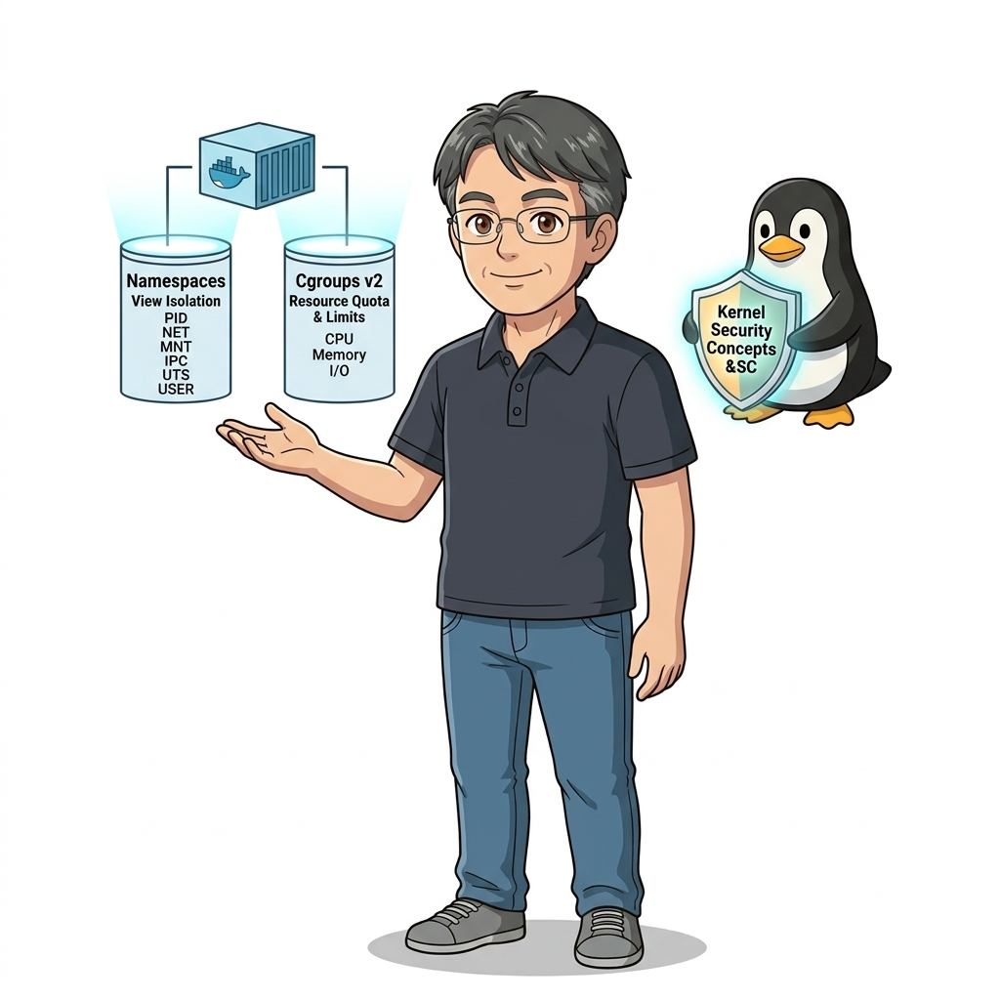
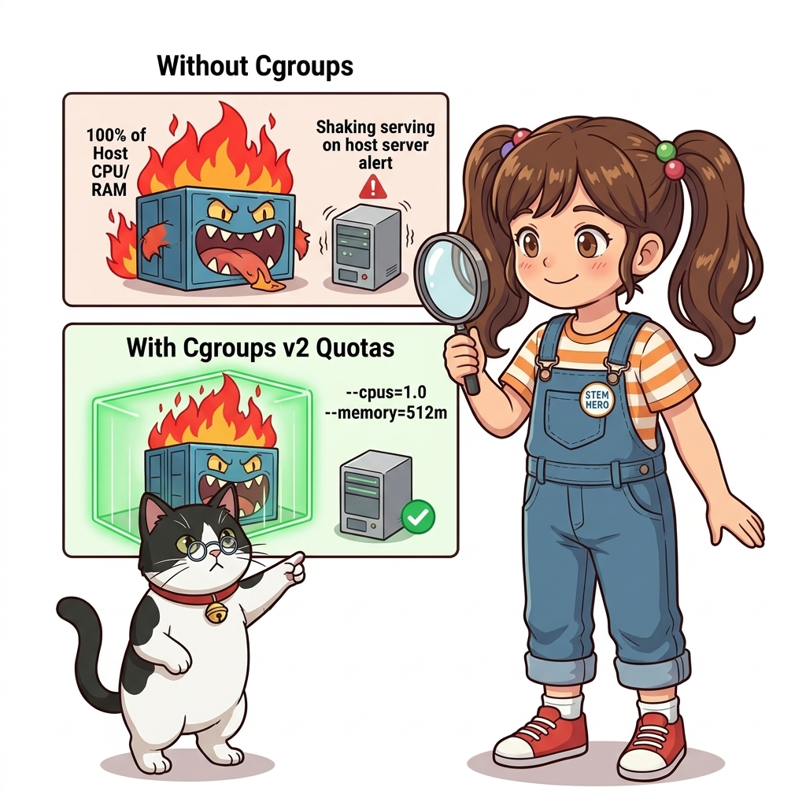
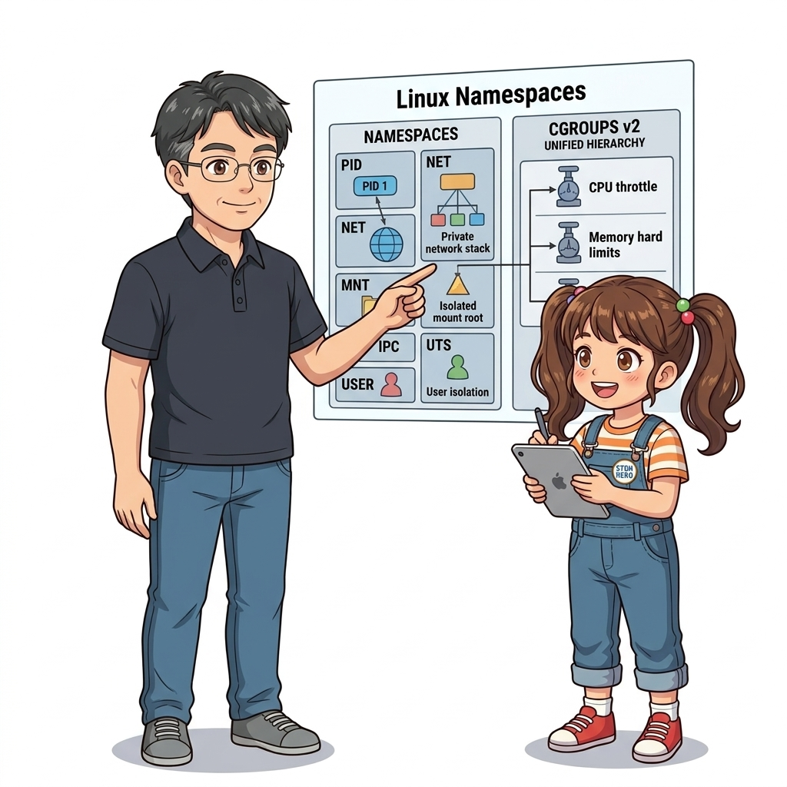
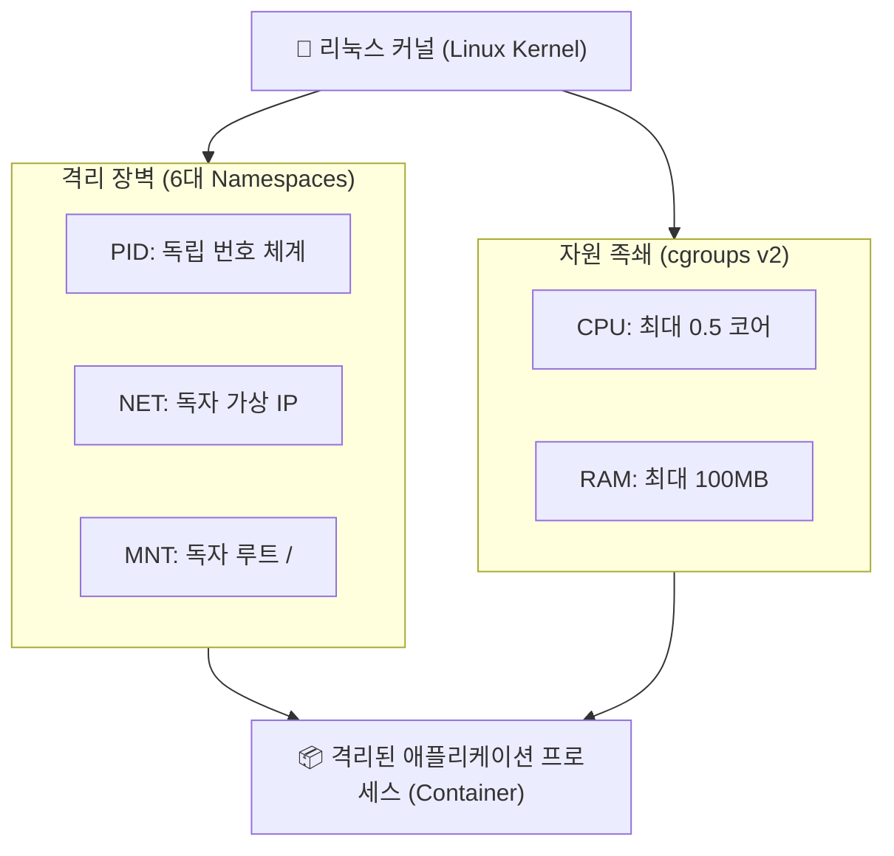
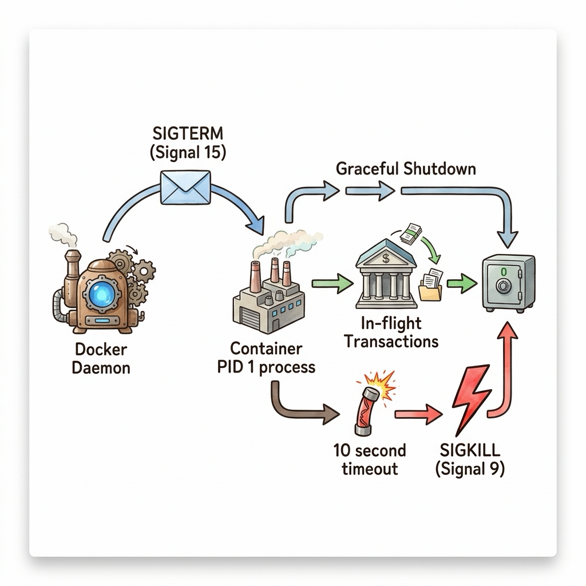
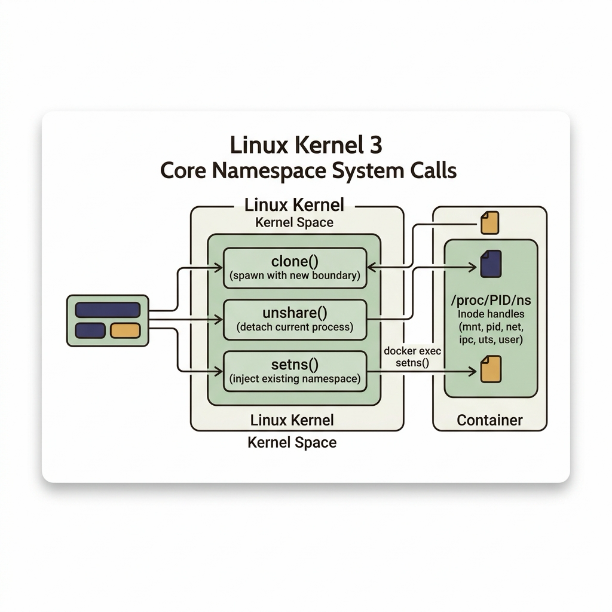

# 013. 리눅스 커널 격리 기술: 네임스페이스와 cgroups

수많은 사람들이 도커를 마치 마법사가 만들어낸 환상적인 신기술처럼 바라봅니다. 하지만 엄밀한 운영체제(OS) 공학의 관점에서 진실을 고백하자면, **리눅스 커널 내부에는 '컨테이너(Container)'라는 이름의 단일 개체나 물리적 실체가 존재하지 않습니다!**


**그림 01-14-1** '컨테이너'라는 환상을 만들어내는 리눅스 커널의 양대 기둥: 네임스페이스(보는 것의 격리)와 cgroups(쓰는 것의 제한)

우리가 컨테이너라고 부르는 것의 정체는 사실 **리눅스 커널이 제공하는 2개의 오래되고 강력한 네이티브 기능이 정교하게 결합된 평범한 리눅스 프로세스**에 불과합니다:
1. **네임스페이스 (Namespaces)**: 프로세스가 시스템을 바라보는 **'시야(View)'**를 제한하여 다른 프로세스를 보지 못하게 차단합니다.
2. **컨트롤 그룹 (cgroups, Control Groups)**: 프로세스가 소비할 수 있는 하드웨어 **'자원(Resource, CPU/RAM/Disk)'**의 상한선을 칼같이 제한합니다.

이 두 가지 커널 기술을 이해하면, 도커의 모든 신비주의가 걷히고 진정한 시스템 엔지니어의 눈으로 컨테이너를 완벽하게 통제할 수 있게 됩니다.

---

### 013.1 리눅스 6대 네임스페이스: 프로세스에게 독방을 선물하다

리눅스 커널은 6가지 차원에서 프로세스에게 완벽한 독방(Namespace)을 선사합니다:


**그림 01-14-2** PID, Network, Mount, IPC, UTS, User 6개 차원에서 프로세스의 시야를 완벽히 격리하는 네임스페이스 구조

1. **PID Namespace (프로세스 ID)**:
   * 호스트 머신에서 수천 번대 PID로 돌아가는 프로세스라도, 컨테이너 안에서는 마치 자기가 컴퓨터의 시조인 양 `PID 1`번으로 보입니다. 다른 컨테이너의 프로세스는 존재조차 알 수 없습니다.
2. **NET Namespace (네트워크 스택)**:
   * 독립된 가상 네트워크 인터페이스(`eth0`), 고유 IP 주소, 독립된 포트 바인딩 테이블을 제공합니다.
3. **MNT Namespace (파일시스템 마운트)**:
   * `chroot`를 현대적으로 확장한 기능으로, 호스트의 디스크 경로를 숨기고 컨테이너만의 독립된 루트 디렉터리(`/`) 마운트 트리를 제공합니다.
4. **IPC Namespace (프로세스 간 통신)**:
   * 공유 메모리(Shared Memory)와 메시지 큐(Message Queue)를 격리하여 다른 컨테이너와의 메모리 침범을 차단합니다.
5. **UTS Namespace (호스트명 및 도메인)**:
   * 컨테이너마다 호스트 시스템과 무관한 고유한 컴퓨터 이름(Hostname)을 가질 수 있게 합니다.
6. **USER Namespace (사용자 계정)**:
   * 컨테이너 내부에서는 전지전능한 `root(UID 0)` 권한을 행사하지만, 호스트 커널의 눈에는 평범한 일반 사용자(`UID 10001` 등)로 맵핑하여 치명적인 호스트 탈취 해킹을 방지합니다.

---

### 013.2 cgroups (Control Groups): 자원 먹는 괴물을 길들이는 족쇄

만약 네임스페이스만 존재한다면 어떻게 될까요?
한 컨테이너 내부의 파이썬 코드가 무한 루프를 돌며 CPU를 100% 태우거나, 메모리를 수십 기가바이트씩 할당해 버리면 호스트 서버 전체의 램이 고갈되어 리눅스 커널의 OOM Killer가 다른 정상 컨테이너들을 무차별 학살하게 됩니다.


**그림 01-14-3** cgroups v2를 통해 컨테이너 프로세스의 CPU 시간(Quota)과 메모리 상한선(Limit)을 칼같이 제어하는 하드웨어 족쇄

이를 방지하는 것이 **cgroups**입니다:
* **CPU 제한 (`--cpus="1.5"`)**: 커널의 완전 공정 스케줄러(CFS) 주기(Period) 동안 프로세스가 사용할 수 있는 CPU 시간(Quota)의 상한선을 강제합니다.
* **메모리 제한 (`-m 512m`)**: 프로세스가 512MB 이상의 메모리를 쓰려고 하면 추가 할당을 즉시 차단하고, 한계를 넘는 순간 해당 컨테이너만 안전하게 OOM 종료시킵니다.
* **블록 I/O 제한 (`--blkio-weight`)**: 특정 컨테이너가 하드디스크 디스크 읽기/쓰기를 독점하지 못하도록 I/O 대역폭을 공평하게 분배합니다.

#### 📊 Namespaces vs Control Groups (cgroups) 역할 대조표

| 비교 항목 | 리눅스 네임스페이스 (Namespaces) | 리눅스 컨트롤 그룹 (cgroups) |
| :--- | :--- | :--- |
| **핵심 목적** | **"무엇을 볼 수 있는가?" (시야의 격리)** | **"얼마나 쓸 수 있는가?" (자원의 제한)** |
| **격리 대상** | 프로세스 트리(PID), 네트워크(IP/Port), 마운트(/), 호스트명 | CPU 연산 시간, 물리 메모리(RAM), 디스크 I/O 속도 |
| **부재 시 발생하는 장애** | 다른 프로세스 염탐, 포트 충돌, 파일 오염 | 자원 고갈로 인한 호스트 서버 전체 다운 (Noisy Neighbor) |
| **관련 커널 시스템 콜 / 경로** | `clone()`, `unshare()`, `setns()` | `/sys/fs/cgroup/` (가상 파일시스템 인터페이스) |

---

### 013.3 선언적 실습 및 아키텍처 다이어그램

메모리를 100MB로 엄격히 제한한 컨테이너를 실행하고, 리눅스 커널의 `/sys/fs/cgroup` 가상 파일시스템에 기록된 실제 자원 한계치를 직접 확인해 봅시다.

```bash
# [실습 013-1] 메모리를 100MB로 엄격히 제한(-m 100m)하여 컨테이너 실행
docker container run -d --name cgroup-demo -m 100m --cpus="0.5" alpine:3.20 sleep 3600

# [실습 013-2] 컨테이너 내부 네임스페이스에서 메모리 제한 확인
docker container exec cgroup-demo cat /sys/fs/cgroup/memory.max 2>/dev/null || docker container exec cgroup-demo cat /sys/fs/cgroup/memory/memory.limit_in_bytes

# [실습 013-3] docker inspect로 설정된 리소스 한도 JSON 검증
docker container inspect cgroup-demo --format 'Memory: {{.HostConfig.Memory}} bytes, NanoCPUs: {{.HostConfig.NanoCPUs}}'

# [실습 013-4] 실시간 자원 사용량 모니터링
docker stats --no-stream cgroup-demo

# [실습 013-5] 실습 컨테이너 정리
docker container rm -f cgroup-demo
```

#### 🔍 리눅스 커널 내부의 네임스페이스와 cgroups 결합도 (Mermaid Diagram)




**그림 01-14-4** cgroups를 통해 100MB 메모리 상한선이 정확히 주입되어 커널에 기록된 실시간 검증

---

<!-- BIBLE_INTEGRATION_book2_pid1_signal_handling -->
---

### 013.B 📚 도커 바이블 심화: PID 1 네임스페이스의 특권과 리눅스 시그널(SIGTERM vs SIGKILL) 처리 원리
*출처 도서: 『Docker Up and Running』 핵심 분석*

도커 컨테이너에서 가장 흔하게 발생하는 '컨테이너 종료 지연(10초 딜레이 후 강제 종료)' 문제는 리눅스 커널의 **PID 1 시그널 처리 규격**에서 비롯됩니다.

1. **리눅스 커널의 PID 1 보호 메커니즘**:
   * 일반 프로세스(PID > 1)는 시그널 핸들러를 등록하지 않아도 기본 핸들러(Default Action)에 의해 SIGTERM 수신 시 즉시 종료됩니다.
   * 하지만 PID 1(init 프로세스)은 커널이 시스템 붕괴를 막기 위해 특별 보호하므로, **프로세스가 명시적으로 핸들러를 등록하지 않은 모든 시그널(SIGTERM 포함)을 커널 차원에서 완전히 무시**합니다.
2. **도커의 종료 라이프사이클**:
   * `docker stop` 실행 시 도커 데몬은 PID 1 프로세스에 먼저 `SIGTERM (15)`을 전송합니다.
   * 애플리케이션(예: Node.js, Python 스크립트)이 이를 직접 수신하여 처리하지 않으면 신호가 씹히게 됩니다.
   * 도커는 기본 유예 시간(10초) 동안 대기하다가, 프로세스가 반응이 없으면 무자비한 `SIGKILL (9)`을 전송하여 프로세스를 강제 사살합니다.


**그림 013-B-1** 도커 데몬의 SIGTERM 신호를 PID 1이 수신하여 우아하게 정리하고 정상 종료하는 흐름도

```bash
# [실습] SIGTERM을 무시하는 나쁜 스크립트 vs 우아한 종료 핸들러 비교
# 우아한 종료를 처리하는 Python 시그널 핸들러 패턴
cat << 'EOF' > graceful.py
import signal, time, sys

def handler(signum, frame):
    print("SIGTERM 수신 완료! 진행 중인 DB 트랜잭션 안전 종료 중...")
    time.sleep(1)
    print("정상 종료 완료 (Exit 0)")
    sys.exit(0)

signal.signal(signal.SIGTERM, handler)
print("애플리케이션 가동 중 (PID: 1)...")
while True:
    time.sleep(1)
EOF
```

> 👨‍🏫 **이호진 교수님의 바이블 멘토링 노트**:
> "docker stop을 쳤을 때 딱 10초 뒤에 꺼진다면, 여러분의 애플리케이션은 정상 종료된 것이 아니라 강제 살해당하고 데이터가 유실되었을 위험이 큽니다. 반드시 SIGTERM 핸들러를 등록하세요."
>
> 👧 **도로시의 깨달음**:
> "10초 동안 아무 응답이 없어서 도커가 마지막 수단으로 강제 종료 펀치를 날리는 거였군요!"
>
> 🐱 **조교 지니의 아키텍처 체크포인트**:
> "Go 언어나 C로 짠 앱이 아니라면, Node.js나 Python에서는 가급적 `tini` 같은 전문 init 프로세스를 PID 1로 세우는 것이 안전합니다."

---

<!-- BIBLE_INTEGRATION_book2_kernel_syscalls_namespaces -->
### 013.C 📚 도커 바이블 심화: 리눅스 커널 3대 네임스페이스 시스템 콜(clone, unshare, setns)과 /proc/PID/ns 해부
> **출처 및 학술적 배경**: 『Docker Up and Running』 제3장 (리눅스 커널 격리) & 『제대로 배우는 도커』 제13장 (13.3 컨테이너와 네임스페이스)  
> **핵심 주제**: 컨테이너 런타임(runc)이 호출하는 리눅스 커널 3대 시스템 콜(`clone`, `unshare`, `setns`), 커널 Inode 기반의 `/proc/<pid>/ns/` 가상 파일시스템 구조.

#### 1. 컨테이너를 탄생시키는 3대 시스템 콜
도커는 마법이 아닙니다. 도커가 컨테이너를 만들고, 제어하고, 내부로 침투할 때 사용하는 실체는 리눅스 커널이 제공하는 단 3가지의 C 시스템 콜 함수입니다:

| 시스템 콜 | 커널 동작 메커니즘 | 도커 CLI 대응 명령어 및 역할 |
| :--- | :--- | :--- |
| **`clone(2)`** | 새로운 자식 프로세스를 생성(fork)할 때 `CLONE_NEW*` 비트마스크 플래그를 조합하여 **생성 즉시 완전히 독립된 네임스페이스**에 가둠 | `docker container run`<br>(새로운 컨테이너 프로세스 탄생) |
| **`unshare(2)`** | 이미 실행 중인 프로세스가 부모나 형제 프로세스와 공유하던 네임스페이스와의 연결을 끊고, **자신만의 새로운 독자 네임스페이스를 생성** | 컨테이너 런타임 초기화 과정에서 루트 격리 |
| **`setns(2)`** | 실행 중인 프로세스가 다른 타깃 프로세스의 네임스페이스 파일 디스크립터(`/proc/<pid>/ns/*`)를 인자로 받아 **그 네임스페이스 안으로 침투** | `docker container exec`<br>(실행 중인 컨테이너 내부 셸 진입) |

#### 2. `/proc/<pid>/ns/` 커널 가상 파일시스템의 Inode 비밀
리눅스 커널은 각 프로세스가 속한 네임스페이스를 가상 심볼릭 링크 형태로 `/proc/<pid>/ns/` 디렉터리에 노출합니다:
* `cgroup`: cgroups 네임스페이스 Inode
* `ipc`: System V IPC 및 POSIX 메시지 큐 Inode
* `mnt`: 파일시스템 마운트 포인트 Inode
* `net`: 네트워크 디바이스 및 라우팅 테이블 Inode
* `pid`: 프로세스 ID 번호 공간 Inode
* `user`: UID/GID 사용자 매핑 Inode
* `uts`: 호스트명 및 도메인명 Inode
* **검증 원리**: 두 프로세스의 `net:[4026531992]` Inode 번호가 동일하면 같은 네트워크 공간을 쓰고 있는 것이며, 번호가 다르면 완벽히 격리된 독립 네트워크에 존재하는 것입니다.


**그림 013-B-2** 리눅스 커널 3대 네임스페이스 시스템 콜과 proc Inode 추적 구조도

```bash
# [실습] 호스트와 컨테이너의 네임스페이스 Inode 직접 비교
# 1. 컨테이너 백그라운드 기동
docker container run -d --name ns-tracer alpine sleep 3600

# 2. 컨테이너의 호스트 PID 추출
CPID=$(docker container inspect ns-tracer --format '{{.State.Pid}}')

# 3. 호스트 터미널(PID $$)과 컨테이너(CPID)의 네임스페이스 Inode 비교
echo "=== 호스트 쉘의 네임스페이스 ==="
ls -l /proc/$$/ns/ | grep -E "pid|net|mnt"

echo "=== 컨테이너 프로세스의 네임스페이스 ==="
ls -l /proc/$CPID/ns/ | grep -E "pid|net|mnt"
# (두 출력의 Inode 번호가 완전히 다름을 확인 -> 완벽한 커널 격리 증명!)

# 4. 정리
docker container rm -f ns-tracer
```

> 👨‍🏫 **이호진 교수님의 바이블 멘토링 노트**:
> "`docker exec`를 실행했을 때 어떻게 실행 중인 컨테이너 안으로 들어가는지 그 마법의 실체가 바로 `setns(2)` 시스템 콜입니다. 커널 레벨에서 네임스페이스 Inode를 갈아 끼우는 시스템 콜의 원리를 이해하면 리눅스 시스템 엔지니어링의 시야가 완전히 달라집니다."
>
> 👧 **도로시의 깨달음**:
> "도커가 새로운 소프트웨어를 만든 게 아니라, 리눅스 커널에 원래 있던 세 가지 열쇠(`clone`, `unshare`, `setns`)를 기가 막히게 잘 다루는 장인이었던 거군요!"
>
> 🐱 **조교 지니의 아키텍처 체크포인트**:
> * 쿠버네티스의 파드(Pod) 내부 컨테이너들이 같은 IP를 공유하는 원리도, Pod 생성 시 Pause 컨테이너가 먼저 `clone()`으로 Network 네임스페이스를 만들고, 나머지 앱 컨테이너들이 `setns()`로 동일한 `net` Inode에 합류하기 때문입니다.

---

### 013.4 핵심 정리: 캐릭터 대화와 3대 교훈

> 👧 **도로시**: "세상에! '도커 컨테이너'라는 외계 기술이 따로 있는 게 아니라, 리눅스 커널이 원래 가지고 있던 '네임스페이스 안경'으로 다른 방을 못 보게 가리고, 'cgroups 줄자'로 밥(자원)을 딱 정해진 만큼만 주는 원리였군요!"
> 
> 🐱 **조교 지니**: "야옹~ 바로 그것이 핵심입니다! 도커는 단지 이 복잡하고 어려운 커널 시스템 콜들을 누구나 명령어 한 줄로 다룰 수 있게 아주 쓰기 편한 리모컨을 만들어 준 것이지요!"
> 
> 🐶 **토토**: "멍멍! 100MB 족쇄를 채워두면 컨테이너가 제아무리 장난을 쳐도 다른 친구들은 안전하게 보호받는대요!"
> 
> 👨‍🏫 **이호진 교수님**: "완벽한 이해란다. 이 커널 격리 원리를 깊이 알고 있는 엔지니어만이, 프로덕션에서 발생하는 난해한 컨테이너 성능 병목과 보안 침해를 근본적으로 해결할 수 있단다."


**그림 01-14-5** 리눅스 커널 격리 기술의 3대 핵심 엔지니어링 교훈

1. **시야의 격리 (Namespaces)**:
   * PID, NET, MNT를 분할하여 프로세스 간 상호 간섭과 보안 침해를 논리적으로 원천 차단합니다.
2. **자원의 통제 (cgroups)**:
   * CPU, 메모리, I/O의 물리적 상한선을 명시하여 단일 서비스 장애가 시스템 전체로 전파되는 것을 방지합니다.
3. **도커의 본질적인 정체성**:
   * 가상머신과 같은 무거운 하드웨어 복제가 아니라, 고도로 정밀하게 격리된 '네이티브 리눅스 프로세스'임을 인지합니다.

---

### 013.5 랩노트 피날레와 다음 강의 예고


**그림 01-14-6** Part 01의 모든 지식을 총동원하여 캡스톤 실전 미션에 도전하는 교수님과 연구팀

> 💡 **다음 강의 안내**:
> [014. Part 01 실전 미션: 컨테이너 파일시스템 탐색과 커스텀 웹 서버](../014_Part01_실전미션_컨테이너파일시스템_탐색과_커스텀웹서버/)에서는 000강부터 013강까지 배운 모든 도커 기본기와 커널 원리를 총동원하여, 격리된 파일시스템을 탐색하고 나만의 멋진 커스텀 웹 서비스를 띄워보는 Part 01 대단원 최종 종합 캡스톤 미션을 수행합니다!

---

## 🧭 강의 네비게이션
* [◀️ 이전 강의: 012_도커엔진_내부아키텍처_CLI_데몬_containerd_runc](../012_도커엔진_내부아키텍처_CLI_데몬_containerd_runc/)
* [📋 Part 01. 컨테이너 혁명과 도커 엔진 기본기 마스터 (000 ~ 014) 목차로 돌아가기](../)
* [▶️ 다음 강의: 014_Part01_실전미션_컨테이너파일시스템_탐색과_커스텀웹서버](../014_Part01_실전미션_컨테이너파일시스템_탐색과_커스텀웹서버/)
