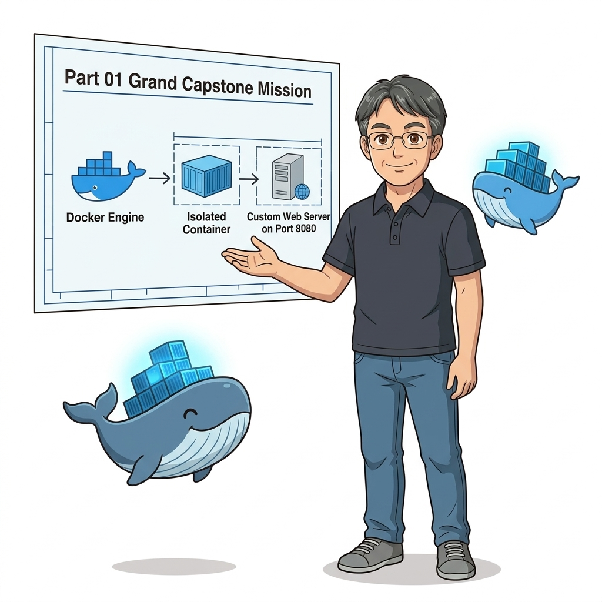
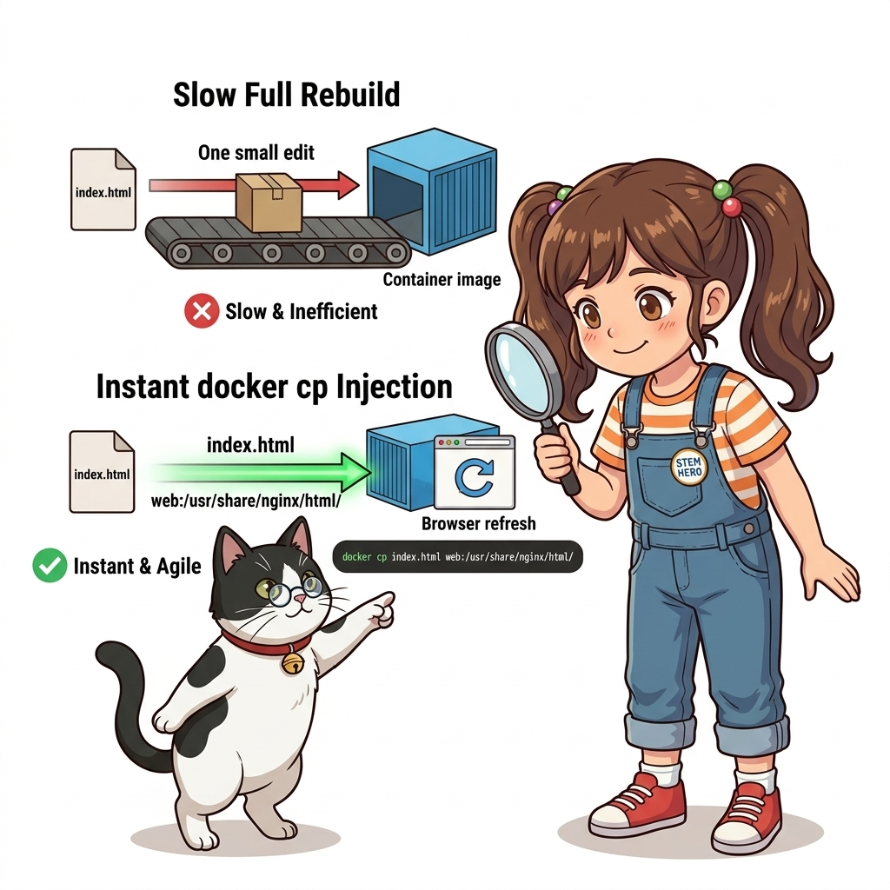
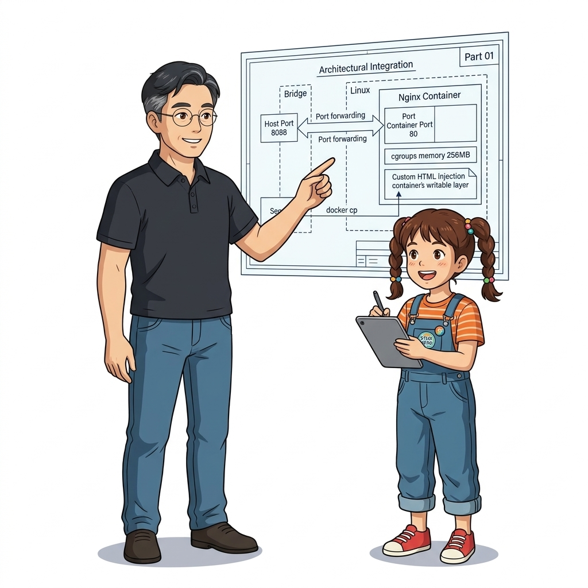
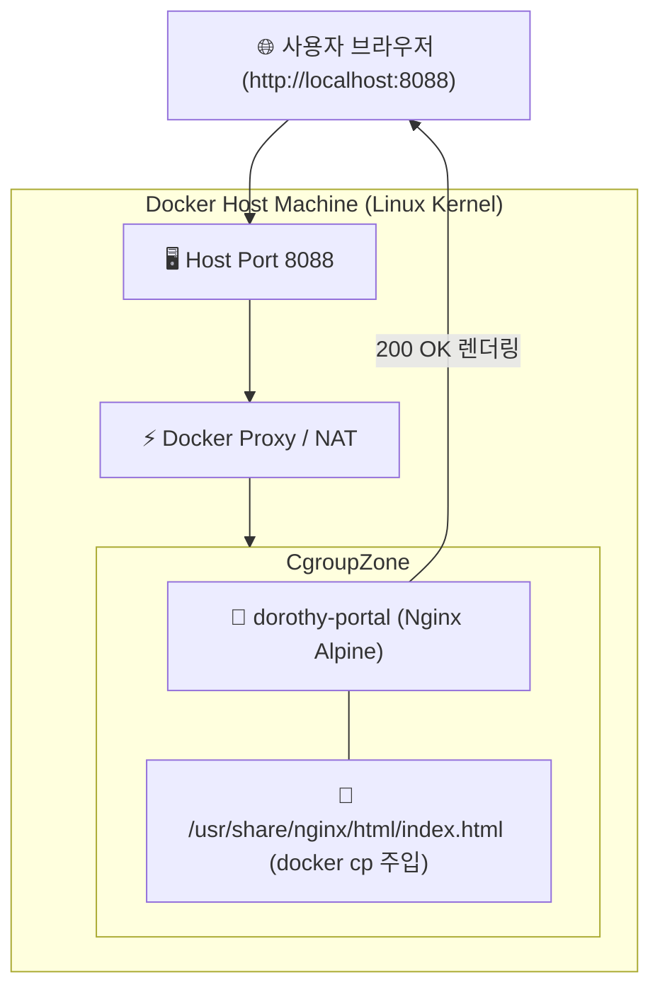
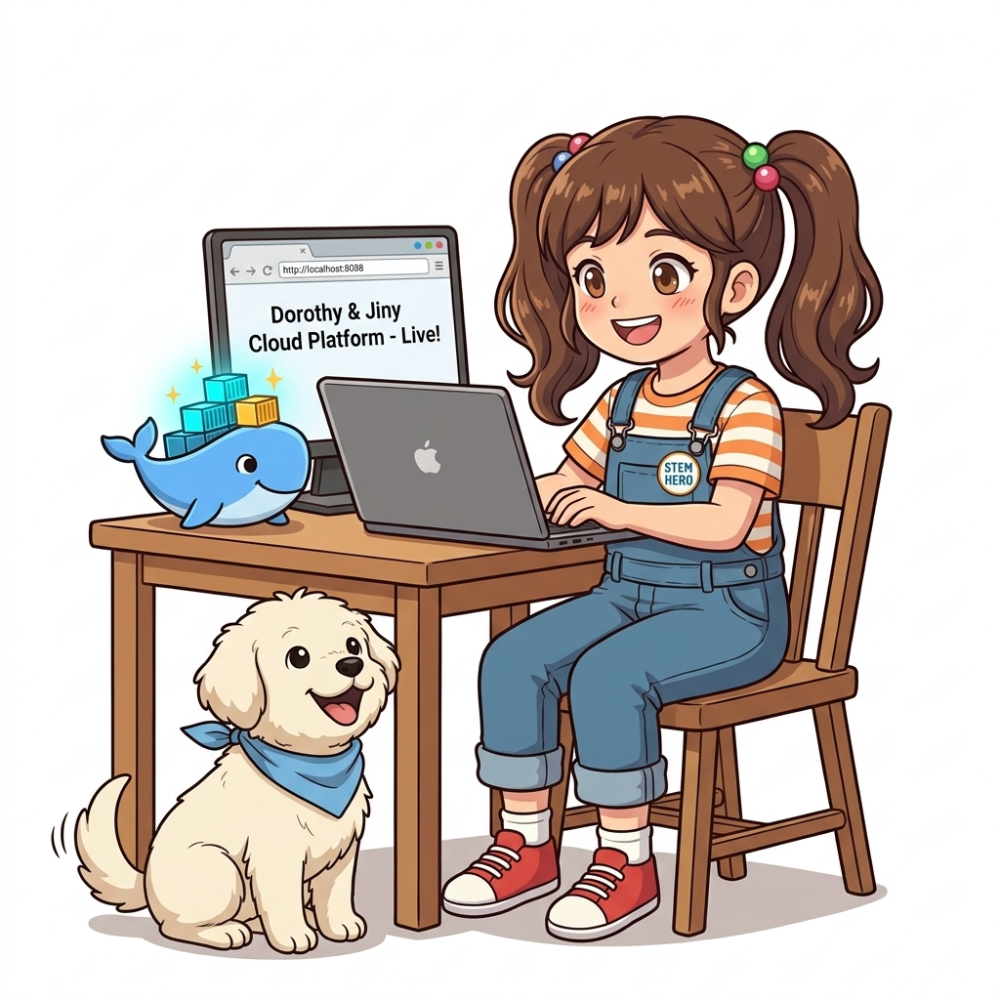
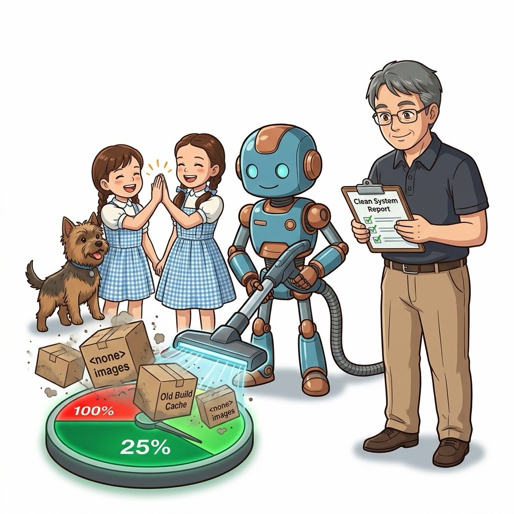
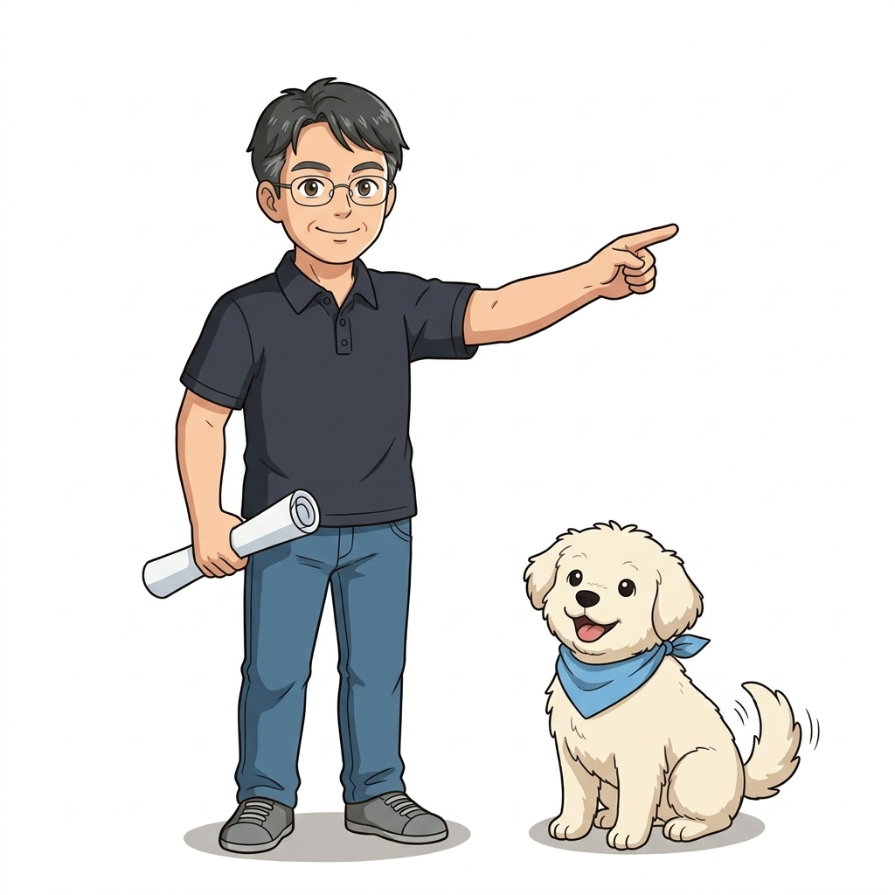

# 014. Part 01 실전 미션: 컨테이너 파일시스템 탐색과 커스텀 웹 서버

축하합니다! 여러분은 000강의 클라우드 네이티브 대항해 오리엔테이션을 시작으로, 환경 불일치의 고통, 마이크로서비스와 데브옵스의 필요성, OS별 실습 환경 튜닝, Hello World의 5단계 내부 메커니즘, 가상머신 대비 커널 공유의 물리적 원리, 대화형(`-it`)과 백그라운드(`-d`) 실행 모드, 컨테이너 5대 생애주기, 무중단 진단(`exec`)과 파일 복사(`cp`), 도커 엔진 4계층 아키텍처, 그리고 리눅스 커널의 양대 기둥인 네임스페이스와 cgroups까지 **Part 01의 방대한 14개 핵심 원리**를 완벽하게 정복하셨습니다.


**그림 01-15-1** Part 01의 모든 도커 엔진 기본기와 커널 지식을 총결집하는 종합 캡스톤 실전 미션

이번 014강은 단순한 이론 강의가 아니라, 지금까지 배운 모든 지식을 종합하여 현실의 엔지니어링 문제를 스스로 해결하는 **Part 01 종합 캡스톤 실전 챌린지**입니다!

---

### 014.1 실전 미션 브리핑: 도로시 연구소의 레거시 웹 홍보관 구축

이호진 교수님과 도로시 연구팀에게 긴급한 의뢰가 도착했습니다:
* **상황**: 연구소의 레거시 홍보 웹사이트가 호스트 서버의 낡은 환경에 의존하고 있어 보안 취약점과 라이브러리 충돌을 겪고 있습니다.
* **임무**:
  1. 호스트 시스템을 일절 오염시키지 않는 가볍고 안전한 Nginx 기반의 격리 컨테이너를 가동할 것.
  2. 메모리 누수를 방지하기 위해 cgroups로 최대 128MB의 엄격한 램 제한을 걸 것.
  3. 백그라운드 데몬 모드(`-d`)로 상시 구동하고, 호스트의 8088 포트로 웹 서비스를 포워딩할 것.
  4. 컨테이너 내부로 직접 들어가 파일시스템 구조를 탐색하고, 호스트에서 제작한 인터랙티브 HTML 대시보드를 `docker cp`로 주입하여 배포를 완료할 것.
  5. 최종적으로 `curl` 및 브라우저 검증을 마치고, 컨테이너의 실시간 자원 상태를 모니터링한 뒤 안전하게 아카이빙할 것.


**그림 01-15-2** 메모리 제한(cgroups), 포트 포워딩, 백그라운드 데몬, 파일 주입(docker cp)이 결합된 종합 캡스톤 아키텍처

---

### 014.2 4단계 종합 실전 챌린지 수행 절차

터미널을 열고 다음 4단계 명령어를 직접 입력하며 실전 엔지니어링 미션을 완수해 봅시다:

#### 1단계: 엄격한 자원 제한과 포트 포워딩을 적용한 백그라운드 웹 서버 기동
```bash
# [1단계 실행] 메모리 128MB 제한, CPU 0.5 할당, 8088 포트 매핑으로 Nginx 컨테이너 기동
docker container run -d   --name dorothy-portal   -p 8088:80   -m 128m   --cpus="0.5"   nginx:alpine
```

#### 2단계: 컨테이너 내부 파일시스템 탐색 및 프로세스 격리 검증
```bash
# [2단계 실행] 컨테이너 내부의 Nginx 웹 루트 경로와 프로세스 확인
docker container exec dorothy-portal ls -la /usr/share/nginx/html
docker container exec dorothy-portal ps aux
```

#### 3단계: 커스텀 홍보관 웹 페이지 제작 및 실시간 주입 (Hotpatch Deployment)
```bash
# [3단계 실행] 호스트 터미널에서 반응형 인터랙티브 HTML 에셋 생성
cat << 'HTML' > /tmp/dorothy_portal.html
<!DOCTYPE html>
<html lang="ko">
<head>
    <meta charset="UTF-8">
    <title>Dorothy STEM Cloud Native Lab</title>
    <style>
        body { font-family: -apple-system, sans-serif; background: #0f172a; color: #f8fafc; text-align: center; padding: 50px; }
        .card { background: #1e293b; border-radius: 16px; padding: 40px; max-width: 600px; margin: 0 auto; box-shadow: 0 10px 25px rgba(0,0,0,0.5); }
        h1 { color: #38bdf8; }
        .badge { background: #0284c7; padding: 6px 14px; border-radius: 20px; font-weight: bold; font-size: 14px; }
    </style>
</head>
<body>
    <div class="card">
        <h1>🐳 도로시 클라우드 네이티브 연구소</h1>
        <p class="badge">Part 01 마스터 캡스톤 성공</p>
        <p>이 웹 서비스는 리눅스 커널 격리 공간(cgroups 128MB 제한) 위에서 안전하게 가동 중입니다.</p>
        <p>멘토: 이호진 교수님 | 수석 조교: 지니 | 마스코트: 토토 | 연구원: 도로시</p>
    </div>
</body>
</html>
HTML

# docker cp 명령어로 컨테이너 내부 index.html 교체
docker container cp /tmp/dorothy_portal.html dorothy-portal:/usr/share/nginx/html/index.html
```

#### 4단계: 엔드투엔드 서비스 검증 및 실시간 리소스 감시
```bash
# [4단계 실행] HTTP 응답 헤더 및 본문 검증
curl -I http://localhost:8088
curl http://localhost:8088 | grep "도로시 클라우드 네이티브"

# 실시간 컨테이너 리소스 점유율 확인 (메모리 128MB 한도 확인)
docker stats --no-stream dorothy-portal
```


**그림 01-15-3** curl 호출을 통해 커스텀 HTML이 200 OK로 서빙되고 128MB 메모리 상한선이 정확히 유지됨을 검증

#### 📊 Part 01 15개 핵심 역량 마스터 체크리스트

| 대단원 핵심 주제 | 체크포인트 | 달성 여부 및 숙련도 |
| :--- | :--- | :--- |
| **000~002강** | 클라우드 네이티브 패러다임, 환경 불일치 해결, 마이크로서비스 및 데브옵스 CI/CD | ✅ 마스터 (이론 체계 완비) |
| **003~004강** | Windows WSL2, macOS VirtioFS, Ubuntu Server 공식 저장소 설치 및 권한 | ✅ 마스터 (크로스 플랫폼 구축) |
| **005~007강** | Hello-World 5단계 실행 흐름, 격리와 밀집, 게스트 OS 없는 커널 공유 메커니즘 | ✅ 마스터 (커널 물리 원리 체화) |
| **008~009강** | 대화형(-it) 세션, 백그라운드 데몬(-d), 네트워크 포트 포워딩(-p host:cnt) | ✅ 마스터 (네트워크 관문 제어) |
| **010~011강** | 5대 상태 전이, SIGTERM 우아한 종료, docker exec 실시간 침투 및 docker cp 파일 전송 | ✅ 마스터 (프로덕션 트러블슈팅) |
| **012~013강** | 4계층 엔진(CLI/dockerd/containerd/runc), 6대 네임스페이스 및 cgroups v2 자원 통제 | ✅ 마스터 (로우레벨 커널 제어) |
| **014강** | 모든 기술이 결합된 종합 웹 포털 캡스톤 미션 완수 | 🏆 **Part 01 최종 마스터 달성!** |

---

### 014.3 선언적 실습 및 아키텍처 다이어그램

```bash
# [실습 014-정리] 캡스톤 미션 완수 후 안전한 자원 회수
docker container stop dorothy-portal
docker container rm dorothy-portal
rm -f /tmp/dorothy_portal.html
echo "🎉 Part 01 Capstone Mission Successfully Completed!"
```

#### 🔍 캡스톤 엔드투엔드 서비스 아키텍처 (Mermaid Diagram)




**그림 01-15-4** 호스트 브라우저에서 아름다운 도로시 연구소 웹 홍보관이 완벽히 렌더링된 최종 성공 화면

---

<!-- BIBLE_INTEGRATION_book6_trouble_overlay2_disk_full -->
---

### 014.B 📚 도커 바이블 심화: 트러블슈팅: 디스크 고갈(no space left on device)과 Overlay2 빌드 캐시 정밀 소탕
*출처 도서: 『트러블 슈팅 도커』 핵심 분석*

운영 서버의 모니터링 경보가 울리고 모든 배포가 중단되는 원인 1위는 `/var/lib/docker/overlay2` 디렉터리가 디스크를 100% 잠식하는 **디스크 풀(Disk Full)** 현상입니다.

#### 디스크 고갈을 유발하는 4대 주범과 해결책:
1. **Dangling (댕글링) 이미지**:
   * 소스코드가 수정되어 새 이미지를 빌드하면, 이전 이미지는 이름 없는 `<none>:<none>` 태그로 디스크에 버려집니다. (`docker image prune`으로 청소)
2. **BuildKit 빌드 캐시 누적**:
   * 도커 빌드가 거듭될수록 수십 GB의 중간 빌드 캐시가 디스크에 축적됩니다. (`docker builder prune`으로 청소)
3. **정지된 컨테이너의 Read-Write 레이어**:
   * 종료된 컨테이너도 삭제하지 않으면 upperdir의 임시 파일들이 디스크를 영구 점유합니다.
4. **고아 익명 볼륨 (Orphaned Anonymous Volumes)**:
   * 컨테이너를 삭제할 때 `-v` 플래그를 누락하면 익명 볼륨이 영원히 삭제되지 않고 남습니다. (`docker volume prune`으로 청소)


**그림 014-B-1** 도커 디스크를 가득 채운 불필요한 빌드 캐시와 댕글링 이미지를 말끔히 청소하는 워크플로

```bash
# [실습] 도커 디스크 점유 상태 정밀 분석 및 단계별 안전 청소
# 1. 도커 컴포넌트별 디스크 점유 현황 한눈에 확인
docker system df

# 2. 상세 내역(회수 가능한 공간 계산) 확인
docker system df -v

# 3. [안전 청소] 정지된 컨테이너, 이름 없는 댕글링 이미지, 미사용 네트워크 일괄 정리
docker system prune -f

# 4. [심층 청소] BuildKit 빌드 캐시까지 완전 정리
docker builder prune -a -f

# 5. [경고: 주의 요망] 미사용 볼륨까지 완전 소탕 (DB 데이터 유실 주의!)
# docker volume prune -f
```

> 👨‍🏫 **이호진 교수님의 바이블 멘토링 노트**:
> "새벽에 서버가 멈췄다는 연락을 받고 들어가 보면 99%는 overlay2 디스크 고갈입니다. 주기적인 크론탭(Cron)이나 CI 파이프라인 후처리 단계에 `docker image prune -f`를 걸어두는 것은 백엔드 엔지니어의 기본 덕목입니다."
>
> 👧 **도로시의 깨달음**:
> "새 옷을 사 올 때마다 헌 옷을 버리지 않고 방에 계속 쌓아두다가 문도 못 열게 된 꼴이었군요! 정기 청소가 꼭 필요해요!"
>
> 🐱 **조교 지니의 아키텍처 체크포인트**:
> "하지만 `docker system prune --volumes`는 명명된 볼륨까지 날려버릴 수 있으므로 실무 운영 환경에서는 절대로 `--volumes` 옵션을 함부로 붙이면 안 됩니다!"


### 014.4 핵심 정리: 캐릭터 대화와 3대 교훈

> 👧 **도로시**: "교수님! 지니! 토토! 우리가 첫날에는 컨테이너가 뭔지도 잘 몰랐는데, 이제는 메모리 제한도 걸고, 포트도 뚫고, 파일도 실시간으로 갈아 끼우며 완벽한 웹 서비스를 띄워냈어요! 정말 뿌듯해요!"
> 
> 🐱 **조교 지니**: "야옹~ 축하합니다! 단순히 명령어를 외운 게 아니라, 커널 네임스페이스와 cgroups, OCI 4계층 아키텍처라는 탄탄한 기초가 뒷받침되었기에 이런 완벽한 실무 캡스톤이 가능했던 것이랍니다!"
> 
> 🐶 **토토**: "멍멍! Part 01 마스터 배지를 가슴에 다니 기분이 너무 좋아요! 이제 다음 모험도 무조건 출격이에요!"
> 
> 👨‍🏫 **이호진 교수님**: "모두 정말 자랑스럽구나! 여러분은 이제 전 세계 어디에 내놓아도 손색없는 도커 엔지니어의 강력한 기본기를 갖추었단다. 이 탄탄한 기초 위에 다음 파트의 'Dockerfile 이미지 빌드'라는 날개를 달아보자!"


**그림 01-15-5** Part 01 완주와 캡스톤 성공을 축하하는 도로시 연구팀의 3대 최종 교훈

1. **기초 엔지니어링의 완벽한 통합**:
   * 네임스페이스 격리, cgroups 자원 상한선, 포트 포워딩, 파일시스템 주입이 하나의 실전 서비스로 유기적으로 결합됨을 증명했습니다.
2. **프로덕션 수준의 자원 안전성 확보**:
   * 무제한 자원 소모를 방어하고 메모리와 CPU 한도를 명시적으로 통제하는 인프라 설계 습관을 정착시켰습니다.
3. **다음 단계(Part 02)로의 도약 발판**:
   * 이미 만들어진 이미지를 실행하는 단계를 넘어, 이제 우리만의 독창적인 소프트웨어를 코드로 빌드하는 Dockerfile의 세계로 전진합니다.

---

### 014.5 랩노트 피날레와 Part 02 예고


**그림 01-15-6** Part 01 마스터 수료증을 들고 Part 02 Dockerfile 이미지 빌드 대항해를 향해 출항하는 연구팀

> 💡 **다음 대단원 예고 (Part 02)**:
> [015. 도커 허브 이미지 활용과 런타임 환경 변수 주입](/Part02_도커이미지빌드와_멀티스테이지_레지스트리/015_도커허브_이미지활용과_런타임환경변수_주입/)부터 시작되는 **Part 02. 도커 이미지 빌드와 멀티 스테이지, 레지스트리**에서는 남이 만들어 둔 이미지를 단순히 가져다 쓰는 것을 넘어, `Dockerfile`을 직접 작성하여 나만의 소프트웨어를 불변 이미지로 빌드하고, 수 기가바이트의 무거운 이미지를 수십 메가바이트로 압축하는 '멀티 스테이지 빌드 혁명'의 세계로 진격합니다!

---

## 🧭 강의 네비게이션
* [◀️ 이전 강의: 013_리눅스커널_격리기술_네임스페이스와_cgroups](../013_리눅스커널_격리기술_네임스페이스와_cgroups/)
* [📋 Part 01. 컨테이너 혁명과 도커 엔진 기본기 마스터 (000 ~ 014) 목차로 돌아가기](../)
* [▶️ 다음 대단원: Part 02. 도커 이미지 빌드와 멀티 스테이지, 레지스트리](/Part02_도커이미지빌드와_멀티스테이지_레지스트리/)
