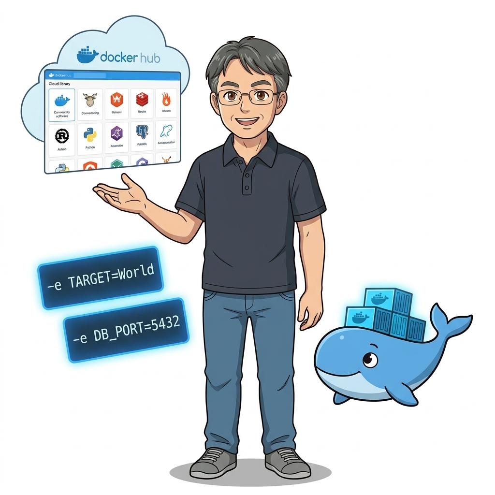
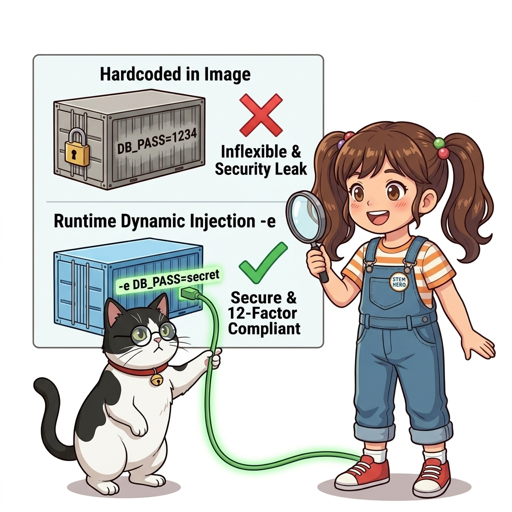
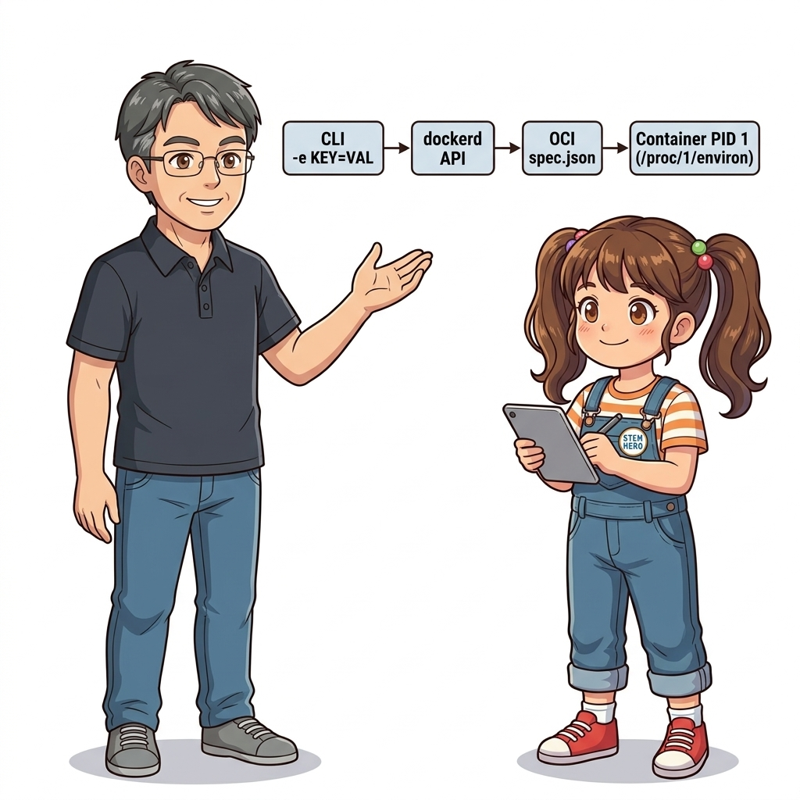
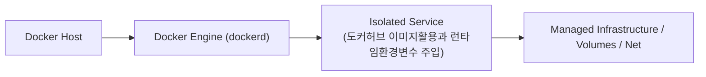
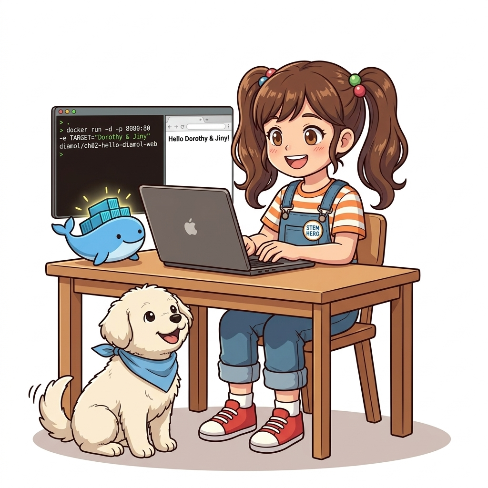
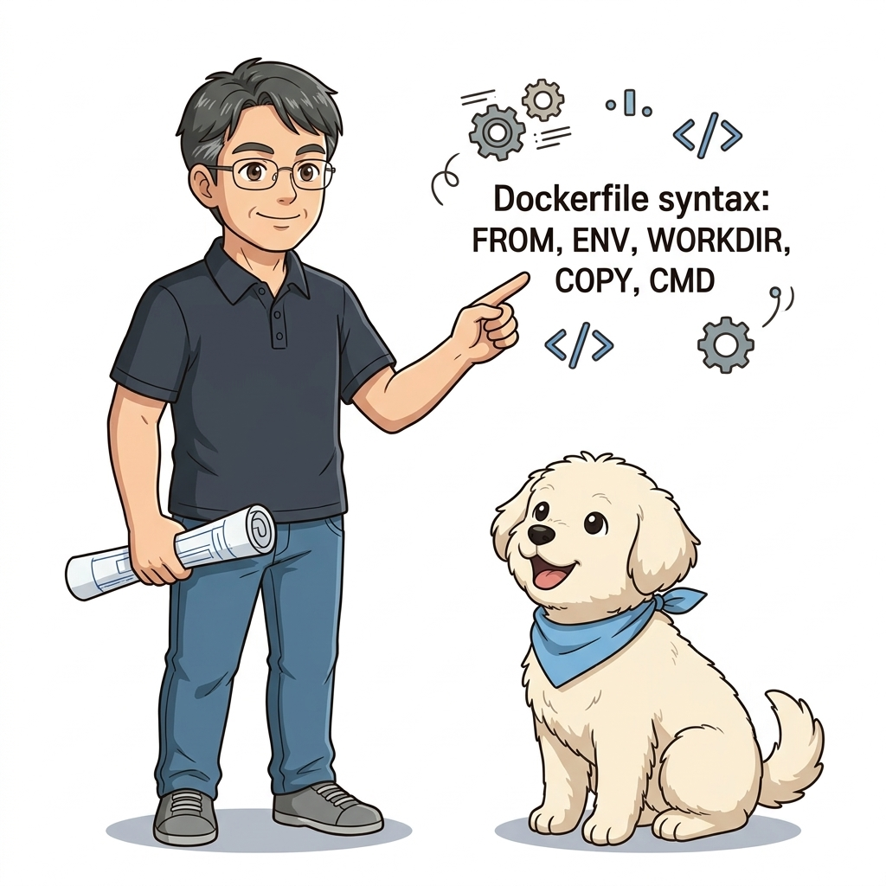

# 015. 도커허브 이미지활용과 런타임환경변수 주입

좋은 도커 이미지는 내부 코드를 다시 빌드하지 않고도, 실행 시점에 외부에서 주입하는 **환경 변수(Environment Variables: `-e`, `--env`, `--env-file`)**를 읽어 동작 방식을 유연하게 바꿀 수 있어야 합니다.


**그림 02-1-1** 도커허브 이미지활용과 런타임환경변수 주입의 필요성과 현대 클라우드 아키텍처 관점의 개요

---

### 015.1 왜 도커허브 이미지활용과 런타임환경변수 주입이(가) 필요한가? (문제 정의와 현실적 배경)

소프트웨어 시스템이 복잡해질수록 설정을 다루는 방식은 전체 인프라의 신뢰성을 결정짓는 핵심 척도가 됩니다. **도커허브 이미지활용과 런타임환경변수 주입**이(가) 부재하거나 잘못 다루어질 때 현장에서는 다음과 같은 대표적인 병목과 장애가 발생합니다:

1. **하드코딩된 설정과 환경 불일치로 인한 유연성 상실**: 환경이 바뀔 때마다 코드를 다시 빌드해야 하므로 배포 주기가 지연되고 이미지 수가 기하급수적으로 폭증합니다.
2. **보안 민감 데이터의 무분별한 노출**: 비밀번호, 데이터베이스 토큰, 암호화 키가 이미지 레이어에 영구 박제되어 형상관리 시스템이나 외부에 유출될 위험이 커집니다.
3. **재현 불가능한 구성 드리프트**: 스테이징 환경과 프로덕션 환경의 미세한 설정 차이가 예기치 못한 서비스 중단 사고로 직결됩니다.


**그림 02-1-2** 도커허브 이미지활용과 런타임환경변수 주입에 대한 대표적인 오해와 실제 프로덕션 현장의 엔지니어링 진실

---

### 015.2 핵심 아키텍처와 엔지니어링 메커니즘

컨테이너 실행 시 환경 변수를 전달하여 출력 메시지나 대상 대상을 실시간으로 변경하는 원리를 실습하고, 12-Factor App의 핵심 원칙인 '설정과 코드의 분리'를 체득합니다.


**그림 02-1-3** 도커허브 이미지활용과 런타임환경변수 주입의 내부 아키텍처 및 데이터 흐름

#### 📊 핵심 비교 및 엔지니어링 표준 분석

| 구분 / 핵심 원리 | 상세 설명 및 동작 메커니즘 | 실무 적용 시 주의점 및 베스트 프랙티스 |
| :--- | :--- | :--- |
| **`-e KEY=VALUE` (`--env`)** | 컨테이너 내부 운영체제 환경 변수를 실행 시점에 주입하거나 이미지의 기본 환경 변수(`ENV`)를 덮어씀 | DB 접속 주소, API 엔드포인트, 로그 레벨, 기능 플래그 등을 컨테이너 재빌드 없이 변경 가능 |
| **`--env-file app.env`** | 수십 개의 환경 변수를 명령줄에 일일이 치는 대신 텍스트 파일(`KEY=VALUE` 목록)로 묶어서 한 번에 주입 | 설정값을 파일로 관리하여 명령줄 노출을 줄이고 재사용성 향상 |
| **불변 이미지와 가변 설정** | 도커 이미지는 모든 환경(Dev/Test/Prod)에서 단 하나만 빌드하여 공유하고, 차이점은 오직 런타임 설정으로 주입 | 도커 패키징 아키텍처의 가장 중요한 황금률 |

---

### 015.3 선언적 실습 및 아키텍처 다이어그램

본 실습은 외부 비공개 패키지에 의존하지 않고, 공식 표준 이미지를 기반으로 즉시 재현 가능한 살아있는 코드로 구성되어 있습니다.

```bash
# 동일한 알파인 이미지에 서로 다른 환경 변수(-e)를 주입하여 동작을 바꾸는 실습
docker container run --rm -e APP_ENV="development" -e TARGET_HOST="dev.oz-cloud.local" alpine:3.20   sh -c 'echo "[Mode: $APP_ENV] Connecting to $TARGET_HOST..."'

docker container run --rm -e APP_ENV="production" -e TARGET_HOST="prod.oz-cloud.internal" alpine:3.20   sh -c 'echo "[Mode: $APP_ENV] Connecting to $TARGET_HOST..."'
```

#### 🔍 아키텍처 흐름도 (Mermaid Diagram)




**그림 02-1-4** 선언적 인프라 명세를 통한 도커허브 이미지활용과 런타임환경변수 주입 검증 파이프라인

---

### 015.B 📚 도커 바이블 심화: ARG vs ENV vs 런타임 -e 주입 우선순위와 /proc/1/environ 보안 누출 메커니즘

> 📖 **참고 도서 심층 연계**:
> * 《완벽한 IT 인프라 구축을 위한 Docker》 제2장 기본편 (2.16 환경변수 설정과 빌드 레이어 생성 메커니즘)
> * 《도커 교과서》 제3장 (런타임 환경변수 주입과 설정 아키텍처)

현대 12-Factor App 원칙에서 환경변수는 **"코드와 설정의 완벽한 분리"**를 달성하는 핵심 매개체입니다. 하지만 실무에서는 `ARG`, `ENV`, `docker run -e`, `--env-file`의 생명주기와 평가 시점을 혼동하여 심각한 빌드 캐시 무효화나 보안 자격증명 유출 사고를 겪습니다.

#### 1. 환경변수 주입 3계층 우선순위 및 생명주기 매트릭스

| 구분 | 유효 범위 (Lifecycle) | 이미지 메타데이터 영속성 | 런타임 오버라이드 가능 여부 | 빌드 캐시 영향도 |
| :--- | :--- | :--- | :--- | :--- |
| **`ARG` (Build Argument)** | `docker build` 실행 중에만 유효 | ❌ 기본값은 레이어에 미반영 (단, `docker history`에는 인자명 노출) | 런타임 컨테이너에서는 읽을 수 없음 | 값이 변경되면 해당 `ARG` 이후 모든 레이어 캐시 무효화 |
| **`ENV` (Environment Variable)** | 빌드 시점 + 런타임 컨테이너 내부 | ✅ `Config.Env`에 영구 기록되어 자식 이미지까지 상속됨 | `docker run -e` 주입 시 런타임에 덮어쓰기(오버라이드) 가능 | `ENV` 선언 시점마다 단일 레이어 또는 메타데이터 생성 |
| **`-e` / `--env-file`** | 컨테이너 프로세스 실행 중 (`execve`) | ❌ 컨테이너 실행 인스턴스에만 국한 (이미지에 저장 안 됨) | 최우선 적용 (`ENV`의 기본값을 완전히 무시하고 대체) | 이미지 빌드와 무관 (빌드 캐시 무관) |

#### 2. 리눅스 커널 프로세스 테이블과 `/proc/1/environ` 보안 취약점

`docker run -e DB_PASSWORD="secret123"` 형태로 컨테이너를 구동하면, 리눅스 커널의 `execve(2)` 시스템 콜이 PID 1번 프로세스의 메모리 스택 최상단에 환경변수 배열을 할당합니다.

```bash
# 1. 런타임 환경변수를 주입하여 컨테이너 실행
docker run -d --name secure_test -e SECRET_KEY="SuperSecretToken_XYZ" alpine:3.20 sleep 3600

# 2. 호스트 혹은 컨테이너 내부에서 커널 /proc 가상 파일시스템 확인
docker exec secure_test sh -c 'cat /proc/1/environ | tr "\0" "\n"'
# 출력 결과:
# PATH=/usr/local/sbin:/usr/local/bin:/usr/sbin:/usr/bin:/sbin:/bin
# HOSTNAME=a1b2c3d4e5f6
# SECRET_KEY=SuperSecretToken_XYZ
# HOME=/root

# 3. 호스트 시스템에서 docker inspect로 메타데이터 조회
docker inspect secure_test --format '{{json .Config.Env}}'
# 출력 결과: ["SECRET_KEY=SuperSecretToken_XYZ","PATH=..."]
```

> ⚠️ **보안 엔지니어링 경고**:
> `docker run -e`로 전달된 환경변수는 평문(Plaintext)으로 도커 데몬의 `containers/{ID}/config.v2.json` 파일 및 `docker inspect` 출력, 그리고 `/proc/1/environ`에 노출됩니다. 따라서 운영 환경의 DB 비밀번호, TLS 개인키 등은 단순 `-e`가 아니라 **Docker Secrets**, **Swarm Secrets**, 또는 **HashiCorp Vault / AWS Secrets Manager** 연동 마운트를 통해 전달해야 합니다.

> 👧 **도로시**: "교수님! `ENV`는 이미지에 영구 저장되고 `-e`는 실행할 때마다 바꿀 수 있는 거군요! 그리고 비밀번호 같은 건 `docker inspect`로 다 보이니까 절대 일반 환경변수로 넘기면 안 되겠네요!"
> 
> 👨‍🏫 **이호진 교수님**: "정확하단다, 도로시! 또한 한 가지 실무 팁을 주자면 `docker run -e DB_HOST`처럼 값을 비워두면 호스트 셸에 이미 export된 환경변수 `$DB_HOST`의 값을 그대로 가져와 전달해주는 영리한 셸 확장 기능도 있단다."
> 
> 🐱 **조교 지니**: "야옹~ 개발자마다 로컬 머신에 설정해둔 환경변수를 도커 명령줄에 매번 치지 않고 `-e AWS_PROFILE`처럼 이름만 넘기는 테크닉이 바로 그 원리랍니다!"
> 
> 🐶 **토토**: "멍멍! `tr '\0' '\n'`으로 커널의 널 바이트 구분자를 줄바꿈으로 바꿔보는 실습, 정말 신기해!"

---

### 015.4 핵심 정리: 캐릭터 대화와 3대 교훈

> 👧 **도로시**: "교수님! **도커허브 이미지활용과 런타임환경변수 주입**의 원리를 배우니까, 복잡하게 얽혀 있던 인프라 설정이 레고 블록처럼 질서정연하게 제자리를 찾는 게 보여요!"
> 
> 🐱 **조교 지니**: "야옹~ 맞습니다! 특히 런타임 환경과 불변 인프라의 경계를 명확히 지키는 것이 대규모 클라우드 운영의 제1원칙이랍니다!"
> 
> 🐶 **토토**: "멍멍! 선언적 코드로 한 번 적어두면 언제든 똑같이 복원되니까 정말 든든해요!"
> 
> 👨‍🏫 **이호진 교수님**: "훌륭하구나. 원리를 깊이 이해하고 실습을 통해 손에 익히는 것이 훌륭한 클라우드 엔지니어로 성장하는 가장 빠른 지름길이란다."


**그림 02-1-5** 도커허브 이미지활용과 런타임환경변수 주입 마스터를 위한 3대 핵심 교훈

1. **설정과 실행의 명확한 분리**:
   * 애플리케이션 코드는 불변으로 유지하고, 가변적인 설정값은 외부에서 주입하여 이식성을 극대화합니다.
2. **선언적 재현성 확보**:
   * 사람이 수작업으로 변경하지 않고 코드 명세를 통해 언제 어디서나 100% 동일한 실행 결과를 보장합니다.
3. **최소 권한 및 보안 모범 사례 준수**:
   * 불필요한 권한과 포트 노출을 최소화하고 민감 데이터를 암호화하여 프로덕션 안정성을 담보합니다.

---

### 015.5 랩노트 피날레와 다음 강의 예고


**그림 02-1-6** 연구실에서 다음 마일스톤인 [Dockerfile 기초문법 FROM ENV WORKDIR COPY CMD] 실습을 예고하는 교수님과 토토

> 💡 **다음 강의 안내**:
> [Dockerfile 기초문법 FROM ENV WORKDIR COPY CMD](../016_Dockerfile_기초문법_FROM_ENV_WORKDIR_COPY_CMD/)에서는 더욱 심화된 실전 엔지니어링 실습과 아키텍처를 다룹니다!

---

## 🧭 강의 네비게이션
* [◀️ 이전 강의: 014_Part01_실전미션_컨테이너파일시스템_탐색과_커스텀웹서버](/Part01_컨테이너기초와_도커엔진아키텍처/014_Part01_실전미션_컨테이너파일시스템_탐색과_커스텀웹서버/)
* [📋 Part 02. 도커 이미지 제작(Dockerfile), 멀티 스테이지 빌드 & 레지스트리 공유 (015 ~ 031) 목차로 돌아가기](../)
* [▶️ 다음 강의: 016_Dockerfile_기초문법_FROM_ENV_WORKDIR_COPY_CMD](../016_Dockerfile_기초문법_FROM_ENV_WORKDIR_COPY_CMD/)
