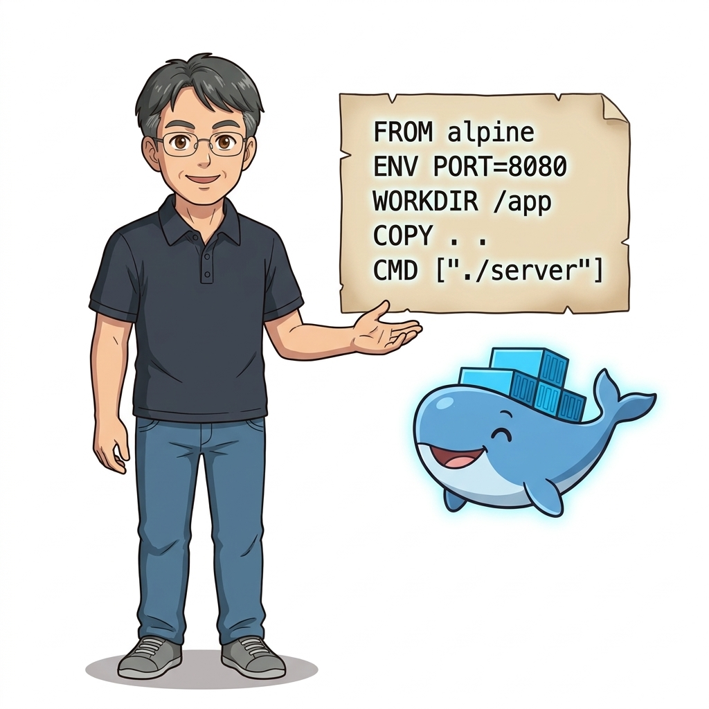
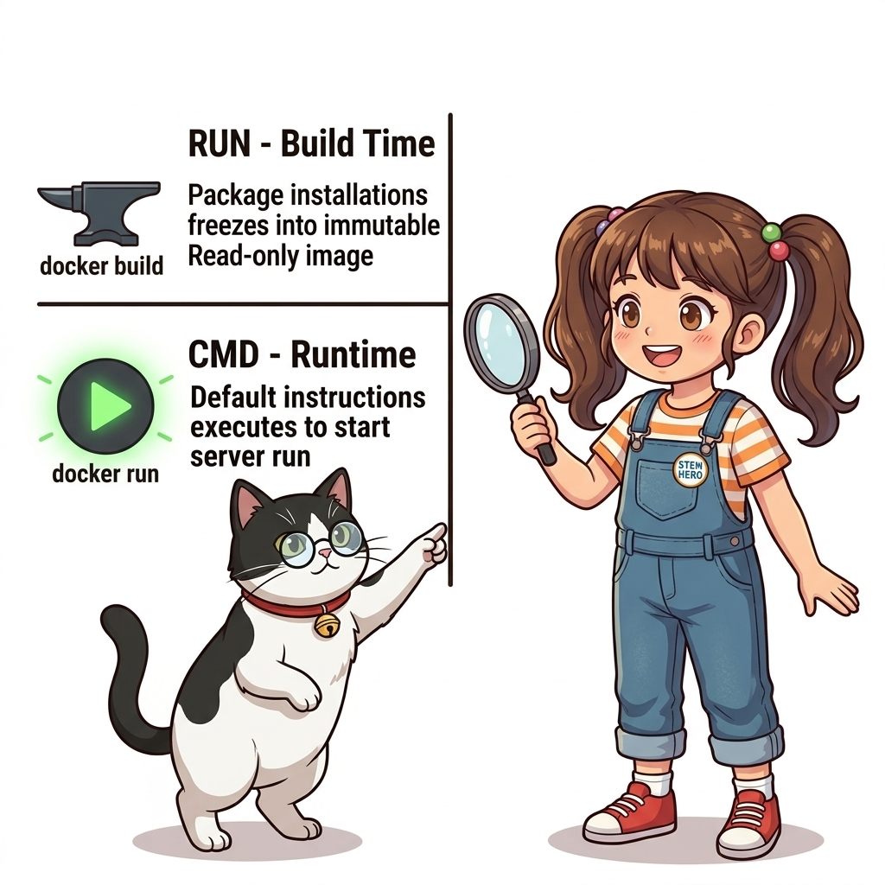
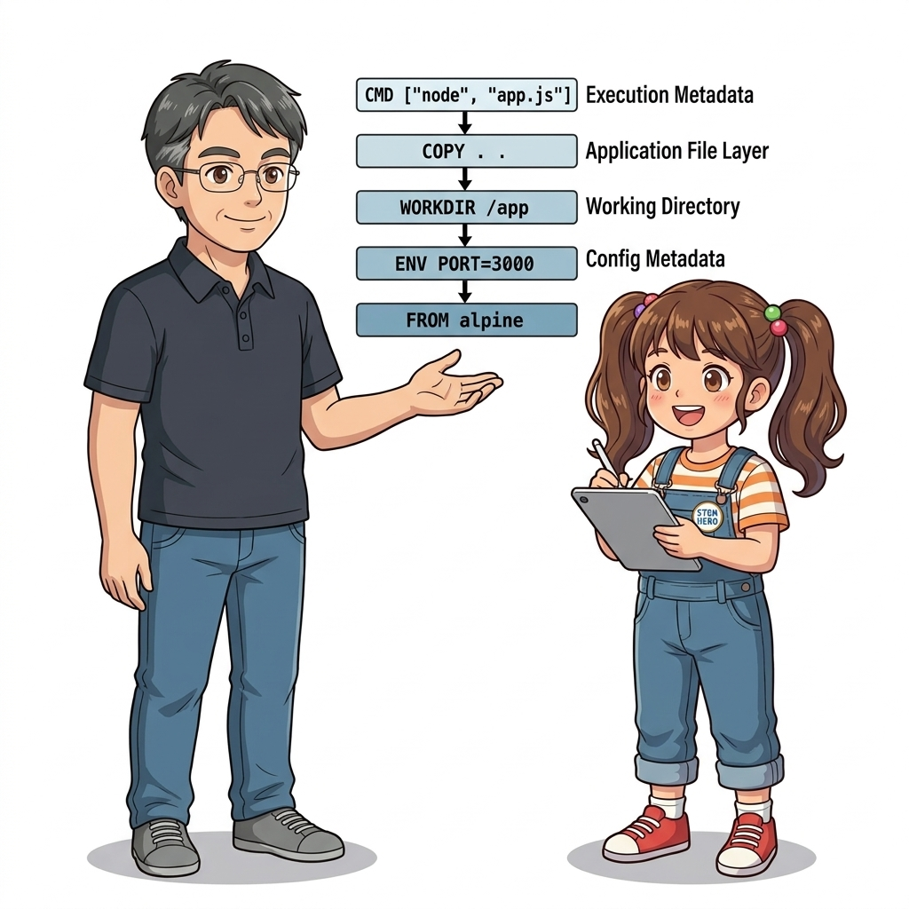
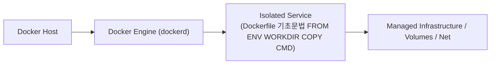
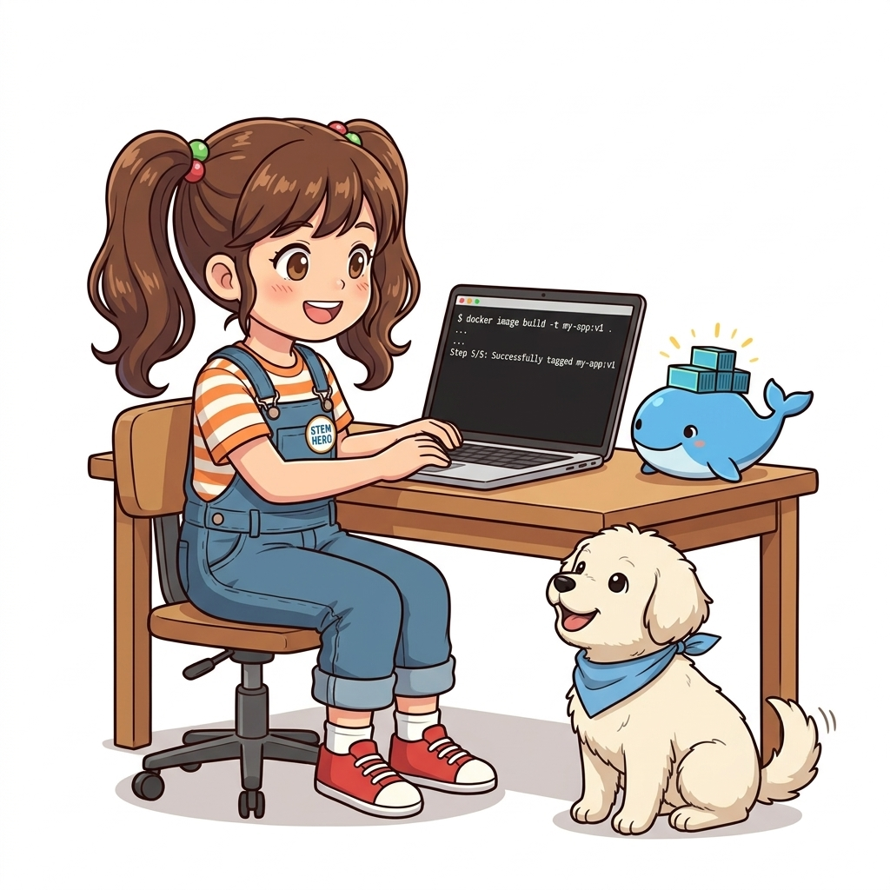
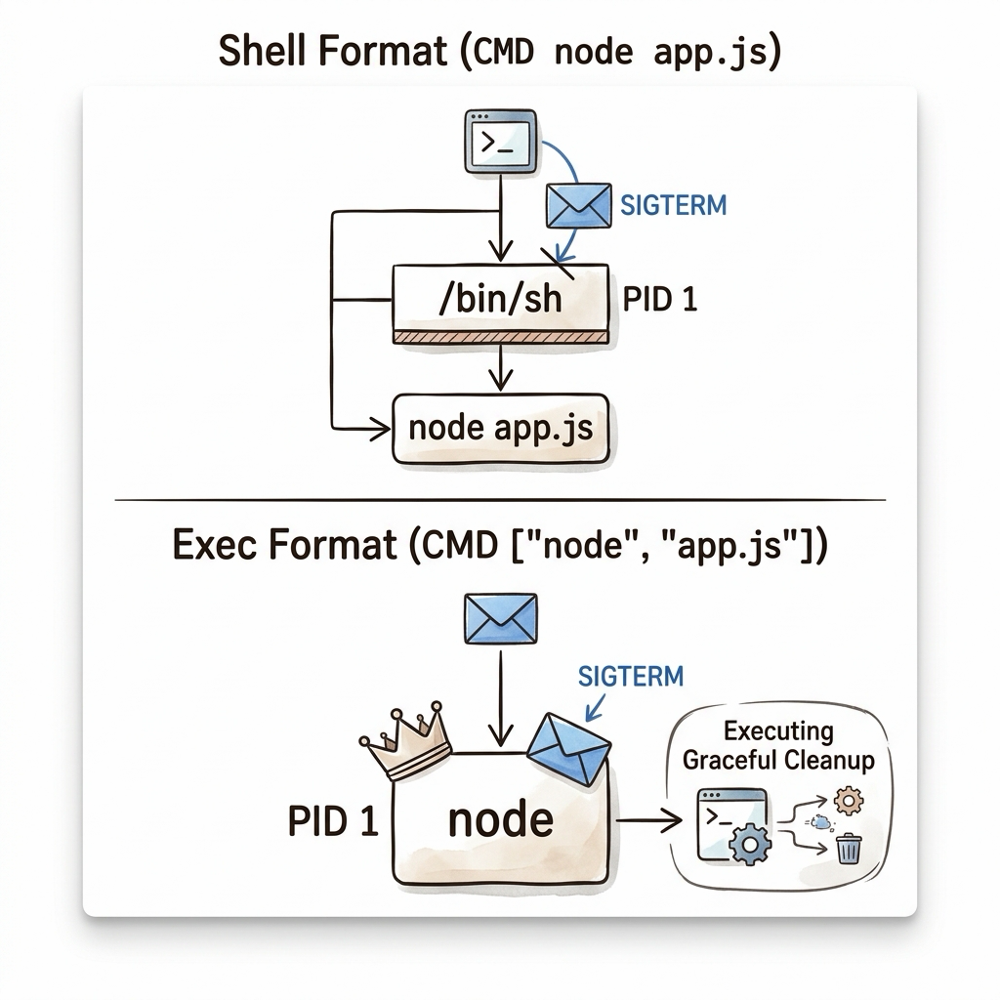
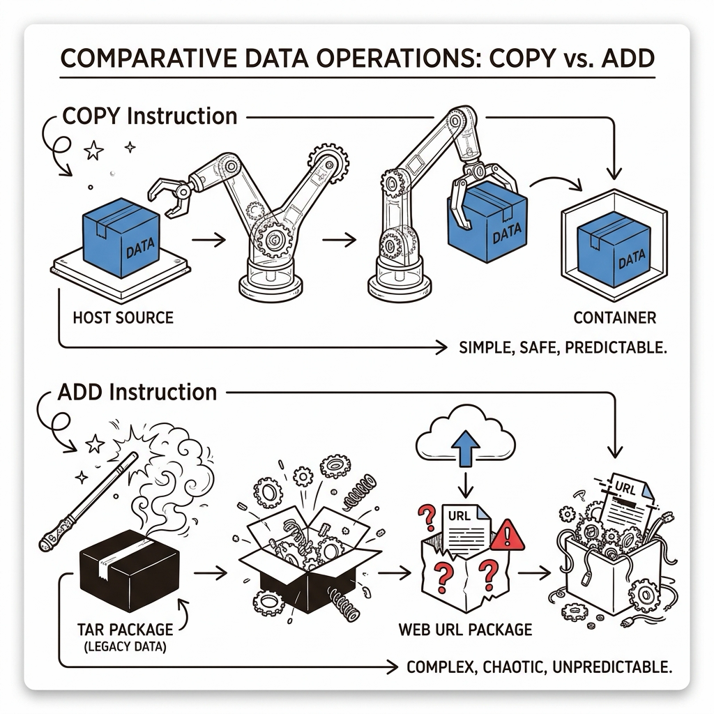
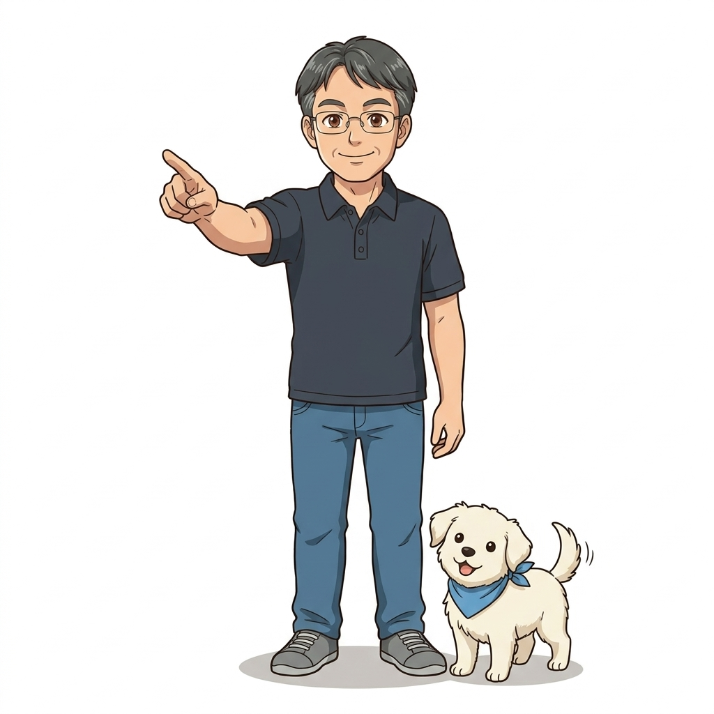

# 016. Dockerfile 기초문법 FROM ENV WORKDIR COPY CMD

수동으로 컨테이너에 들어가 파일을 복사하던 원시적인 방식과 작별하고, 애플리케이션 패키징 전 과정을 코드로 자동화하는 **`Dockerfile` DSL(Domain Specific Language)**의 기본 문법을 배웁니다.


**그림 02-2-1** Dockerfile 기초문법 FROM ENV WORKDIR COPY CMD의 필요성과 현대 클라우드 아키텍처 관점의 개요

---

### 016.1 왜 Dockerfile 기초문법 FROM ENV WORKDIR COPY CMD이(가) 필요한가? (문제 정의와 현실적 배경)

소프트웨어 시스템이 복잡해질수록 설정을 다루는 방식은 전체 인프라의 신뢰성을 결정짓는 핵심 척도가 됩니다. **Dockerfile 기초문법 FROM ENV WORKDIR COPY CMD**이(가) 부재하거나 잘못 다루어질 때 현장에서는 다음과 같은 대표적인 병목과 장애가 발생합니다:

1. **하드코딩된 설정과 환경 불일치로 인한 유연성 상실**: 환경이 바뀔 때마다 코드를 다시 빌드해야 하므로 배포 주기가 지연되고 이미지 수가 기하급수적으로 폭증합니다.
2. **보안 민감 데이터의 무분별한 노출**: 비밀번호, 데이터베이스 토큰, 암호화 키가 이미지 레이어에 영구 박제되어 형상관리 시스템이나 외부에 유출될 위험이 커집니다.
3. **재현 불가능한 구성 드리프트**: 스테이징 환경과 프로덕션 환경의 미세한 설정 차이가 예기치 못한 서비스 중단 사고로 직결됩니다.


**그림 02-2-2** Dockerfile 기초문법 FROM ENV WORKDIR COPY CMD에 대한 대표적인 오해와 실제 프로덕션 현장의 엔지니어링 진실

---

### 016.2 핵심 아키텍처와 엔지니어링 메커니즘

기반 이미지를 지정하는 `FROM`, 환경 변수 기본값을 설정하는 `ENV`, 작업 폴더를 생성·이동하는 `WORKDIR`, 호스트 파일을 복사하는 `COPY`, 컨테이너 시작 시 실행할 명령을 지정하는 `CMD`로 첫 번째 커스텀 이미지를 설계합니다.


**그림 02-2-3** Dockerfile 기초문법 FROM ENV WORKDIR COPY CMD의 내부 아키텍처 및 데이터 흐름

#### 📊 핵심 비교 및 엔지니어링 표준 분석

| 구분 / 핵심 원리 | 상세 설명 및 동작 메커니즘 | 실무 적용 시 주의점 및 베스트 프랙티스 |
| :--- | :--- | :--- |
| **`FROM`** | 모든 `Dockerfile`의 첫 줄(빌드 인자 `ARG` 제외)에 위치하며 기반이 될 부모 이미지(Base Image)를 지정 | 예: `FROM alpine:3.20`, `FROM python:3.12-slim`, `FROM nginx:1.27-alpine` |
| **`ENV` & `WORKDIR`** | `ENV`는 빌드 시점과 컨테이너 실행 시점 모두 유지되는 환경 변수 기본값을 지정, `WORKDIR`는 작업 디렉터리를 생성 및 전환 | `RUN cd /app` 대신 반드시 `WORKDIR /app`을 사용하는 것이 도커의 정석! |
| **`COPY` & `CMD`** | `COPY 원본 대상`은 호스트의 파일을 이미지 안으로 복사하고, `CMD`는 컨테이너가 시작될 때 기본 실행할 프로세스를 정의 | 이 5가지 인스트럭션만으로도 실무 애플리케이션의 80%를 패키징 가능 |

---

### 016.3 선언적 실습 및 아키텍처 다이어그램

본 실습은 외부 비공개 패키지에 의존하지 않고, 공식 표준 이미지를 기반으로 즉시 재현 가능한 살아있는 코드로 구성되어 있습니다.

```dockerfile
# 나만의 환경 상태 리포터 애플리케이션을 패키징하는 첫 번째 Dockerfile
FROM alpine:3.20

ENV REPORT_TITLE="Oz Cloud System Ping"
ENV TARGET_URL="https://example.com"

WORKDIR /app
COPY checker.sh .
RUN chmod +x checker.sh

CMD ["/app/checker.sh"]
```

#### 🔍 아키텍처 흐름도 (Mermaid Diagram)




**그림 02-2-4** 선언적 인프라 명세를 통한 Dockerfile 기초문법 FROM ENV WORKDIR COPY CMD 검증 파이프라인

---

<!-- BIBLE_INTEGRATION_book4_deep_016 -->
---

### 016.C 📚 도커 바이블 심화: 인스트럭션 실행 형식의 비밀: Shell 형식 vs Exec JSON 배열 형식의 프로세스 트리와 시그널 전달
*출처 도서: 『완벽한 IT 인프라 구축을 위한 Docker』 핵심 분석 (완벽한 IT 인프라 구축을 위한 Docker 제2장 (2.4~2.6 RUN/CMD 실행 형식))*

Dockerfile에서 `RUN`, `CMD`, `ENTRYPOINT`를 작성할 때 초보 엔지니어들이 가장 간과하기 쉬운 치명적인 문법 차이가 바로 **Shell 형식**과 **Exec 형식(JSON Array)**의 내부 프로세스 포킹 구조입니다:

1. **Shell 형식 (`CMD node server.js`)**:
   * 도커 데몬은 백그라운드에서 `/bin/sh -c "node server.js"`를 실행합니다.
   * **치명적인 결과**: 컨테이너의 PID 1은 `node`가 아니라 `/bin/sh`가 차지합니다.
   * `sh`는 기본적으로 `SIGTERM` 시그널을 자식 프로세스(`node`)에게 포워딩해주지 않으므로, `docker stop` 실행 시 노드 서버가 정상 종료되지 못하고 10초 뒤 `SIGKILL`로 강제 살해당하여 데이터베이스 연결이 비정상 종료됩니다.
2. **Exec 형식 (`CMD ["node", "server.js"]`)**:
   * 셸을 거치지 않고 리눅스 커널의 `execve()` 시스템 콜을 직접 호출하여 `node` 프로세스를 **컨테이너의 진정한 PID 1**로 직접 기동합니다.
   * 데몬이 보낸 `SIGTERM`이 애플리케이션에 0.1초 만에 다이렉트로 전달되어 우아한 셧다운(Graceful Shutdown)이 완벽히 작동합니다.


**그림 016-B-2** Shell 형식(sh 래핑으로 시그널 차단) vs Exec 형식(바이너리 직결로 SIGTERM 수신) 프로세스 비교도

```bash
# [실습] Shell 형식 vs Exec 형식의 PID 1 프로세스 트리 직접 비교
# 1. Shell 형식: PID 1이 /bin/sh인 나쁜 예
docker container run -d --name shell-bad alpine sh -c 'sleep 3600'
docker container top shell-bad

# 2. Exec 형식: sleep 바이너리가 직접 PID 1이 되는 올바른 예
docker container run -d --name exec-good alpine:3.20 sleep 3600
docker container top exec-good

docker container rm -f shell-bad exec-good
```

> 👨‍🏫 **이호진 교수님의 바이블 멘토링 노트**:
> "CMD와 ENTRYPOINT는 무조건 대괄호가 들어간 Exec JSON 배열 형식(`["executable", "param1"]`)으로 작성하는 것을 철칙으로 삼으세요. 따옴표 없는 Shell 형식은 시그널 차단과 환경 변수 유출 사고의 주범입니다."
>
> 👧 **도로시의 깨달음**:
> "중간에 통역사(sh)를 거치지 않고, 우리 앱이 직접 교장 선생님(PID 1) 자리에 앉아야 종소리(SIGTERM)를 듣고 집에 갈 준비를 할 수 있는 거군요!"
>
> 🐱 **조교 지니의 아키텍처 체크포인트**:
> "만약 환경 변수 치환(`$PORT` 등)이 꼭 필요한 Exec 형식이라면 `CMD ["sh", "-c", "exec node app.js"]`처럼 `exec` 키워드를 붙여 셸을 앱 프로세스로 치환(Replace)해야 합니다."


<!-- BIBLE_INTEGRATION_book6_deep_016 -->
---

### 016.C 📚 도커 바이블 심화: 트러블슈팅: COPY vs ADD의 보안 함정과 tar 자동 압축 해제 사이드 이펙트
*출처 도서: 『트러블 슈팅 도커』 핵심 분석 (트러블 슈팅 도커 제1장 (1.70~1.72 ADD vs COPY 인스트럭션))*

Dockerfile을 작성할 때 호스트 파일을 이미지 안으로 복사하는 명령어로 `COPY`와 `ADD`가 존재합니다. 겉보기에는 비슷해 보이지만, 실무에서는 **"특별한 이유가 없는 한 무조건 COPY만 사용하라"**는 절대 규칙이 존재합니다:

1. **`ADD`의 예측 불가능한 마법(Magic)**:
   * **원격 URL 다운로드 위험**: `ADD http://...`는 압축을 해제하지 않고 파일을 내려받지만, 다운로드 파일의 체크섬(SHA256) 검증 기능이 없어 중간자 공격(MITM)에 취약하며 빌드 캐시를 무효화합니다.
   * **자동 tar 압축 해제**: `ADD archive.tar.gz /app/`를 실행하면 파일 자체를 복사하는 것이 아니라 압축을 풀어서 내부 내용물만 쏟아붓습니다. 만약 순수한 `.tar.gz` 파일 자체를 복사하고 싶었을 때는 심각한 빌드 오류가 발생합니다.
2. **`COPY`의 투명성과 예측 가능성**:
   * 로컬 빌드 컨텍스트의 파일이나 디렉터리를 있는 그대로 정직하게 1:1 복사합니다.
   * 어떤 숨겨진 부작용도 일으키지 않으므로 빌드 레이어 캐시 예측성과 보안 무결성이 100% 보장됩니다.


**그림 016-B-2** 정직한 1:1 복사를 보장하는 COPY vs 예측 불가능한 압축 해제와 다운로드를 수행하는 ADD 비교도

```bash
# [실습] COPY와 ADD의 동작 차이점 직접 검증
# 1. 테스트용 tar 압축 파일 생성
mkdir -p /tmp/pkg-test && echo "내부 데이터" > /tmp/pkg-test/hello.txt
tar -czf /tmp/pkg-test/bundle.tar.gz -C /tmp/pkg-test hello.txt

# 2. COPY 사용: tar.gz 파일 원본이 그대로 복사됨 (권장)
# COPY bundle.tar.gz /app/

# 3. ADD 사용: tar.gz가 자동으로 풀려 /app/hello.txt 로 배치됨
# ADD bundle.tar.gz /app/

rm -rf /tmp/pkg-test
```

> 👨‍🏫 **이호진 교수님의 바이블 멘토링 노트**:
> "도커 공식 모범 사례 가이드라인(Official Best Practices)에서도 명시하듯, 원격 파일은 `RUN curl ... && tar ... && rm ...`으로 한 레이어에서 다운로드, 압축 해제, 원본 삭제를 한 번에 끝내는 것이 이미지 용량을 줄이는 정석이며 ADD는 지양해야 합니다."
>
> 👧 **도로시의 깨달음**:
> "선물 상자를 있는 그대로 배달(COPY)해야 하는데, 택배 기사님이 멋대로 상자를 뜯어서 내용물을 거실에 쏟아놓는(ADD) 것과 같군요!"
>
> 🐱 **조교 지니의 아키텍처 체크포인트**:
> "멀티스테이지 빌드에서 이전 스테이지의 산출물을 가져올 때 쓰는 `--from=builder` 옵션도 오직 `COPY` 인스트럭션에서만 지원됩니다."


### 016.4 핵심 정리: 캐릭터 대화와 3대 교훈

> 👧 **도로시**: "교수님! **Dockerfile 기초문법 FROM ENV WORKDIR COPY CMD**의 원리를 배우니까, 복잡하게 얽혀 있던 인프라 설정이 레고 블록처럼 질서정연하게 제자리를 찾는 게 보여요!"
> 
> 🐱 **조교 지니**: "야옹~ 맞습니다! 특히 런타임 환경과 불변 인프라의 경계를 명확히 지키는 것이 대규모 클라우드 운영의 제1원칙이랍니다!"
> 
> 🐶 **토토**: "멍멍! 선언적 코드로 한 번 적어두면 언제든 똑같이 복원되니까 정말 든든해요!"
> 
> 👨‍🏫 **이호진 교수님**: "훌륭하구나. 원리를 깊이 이해하고 실습을 통해 손에 익히는 것이 훌륭한 클라우드 엔지니어로 성장하는 가장 빠른 지름길이란다."


**그림 02-2-5** Dockerfile 기초문법 FROM ENV WORKDIR COPY CMD 마스터를 위한 3대 핵심 교훈

1. **설정과 실행의 명확한 분리**:
   * 애플리케이션 코드는 불변으로 유지하고, 가변적인 설정값은 외부에서 주입하여 이식성을 극대화합니다.
2. **선언적 재현성 확보**:
   * 사람이 수작업으로 변경하지 않고 코드 명세를 통해 언제 어디서나 100% 동일한 실행 결과를 보장합니다.
3. **최소 권한 및 보안 모범 사례 준수**:
   * 불필요한 권한과 포트 노출을 최소화하고 민감 데이터를 암호화하여 프로덕션 안정성을 담보합니다.

---

### 016.5 랩노트 피날레와 다음 강의 예고


**그림 02-2-6** 연구실에서 다음 마일스톤인 [컨테이너 이미지빌드와 빌드컨텍스트의 원리] 실습을 예고하는 교수님과 토토

> 💡 **다음 강의 안내**:
> [컨테이너 이미지빌드와 빌드컨텍스트의 원리](../017_컨테이너_이미지빌드와_빌드컨텍스트의_원리/)에서는 더욱 심화된 실전 엔지니어링 실습과 아키텍처를 다룹니다!

---

## 🧭 강의 네비게이션
* [◀️ 이전 강의: 015_도커허브_이미지활용과_런타임환경변수_주입](../015_도커허브_이미지활용과_런타임환경변수_주입/)
* [📋 Part 02. 도커 이미지 제작(Dockerfile), 멀티 스테이지 빌드 & 레지스트리 공유 (015 ~ 031) 목차로 돌아가기](../)
* [▶️ 다음 강의: 017_컨테이너_이미지빌드와_빌드컨텍스트의_원리](../017_컨테이너_이미지빌드와_빌드컨텍스트의_원리/)
