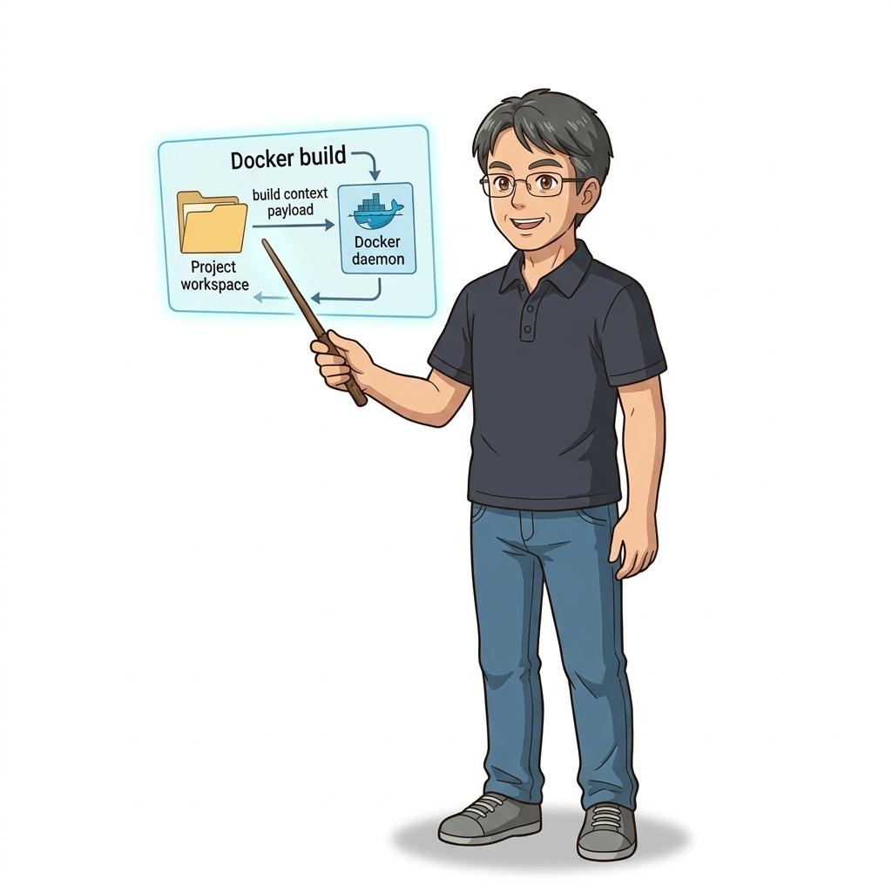
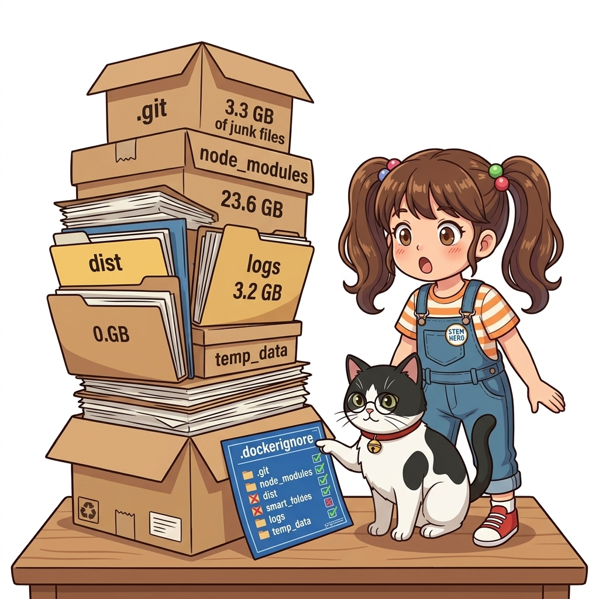
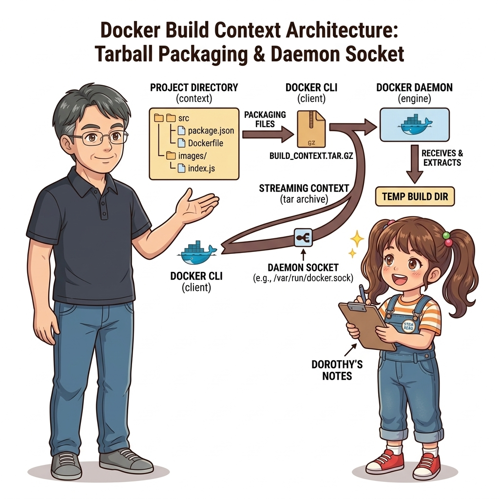
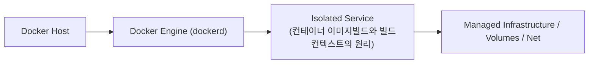
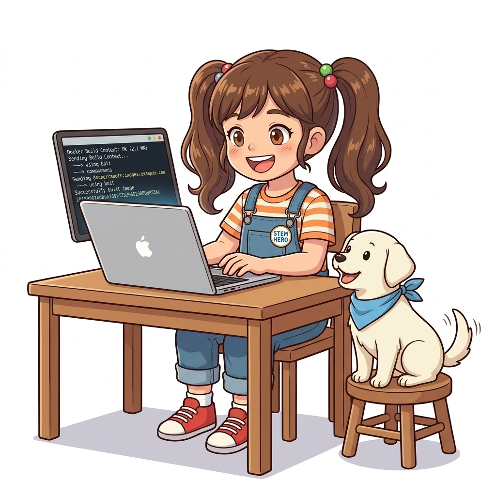
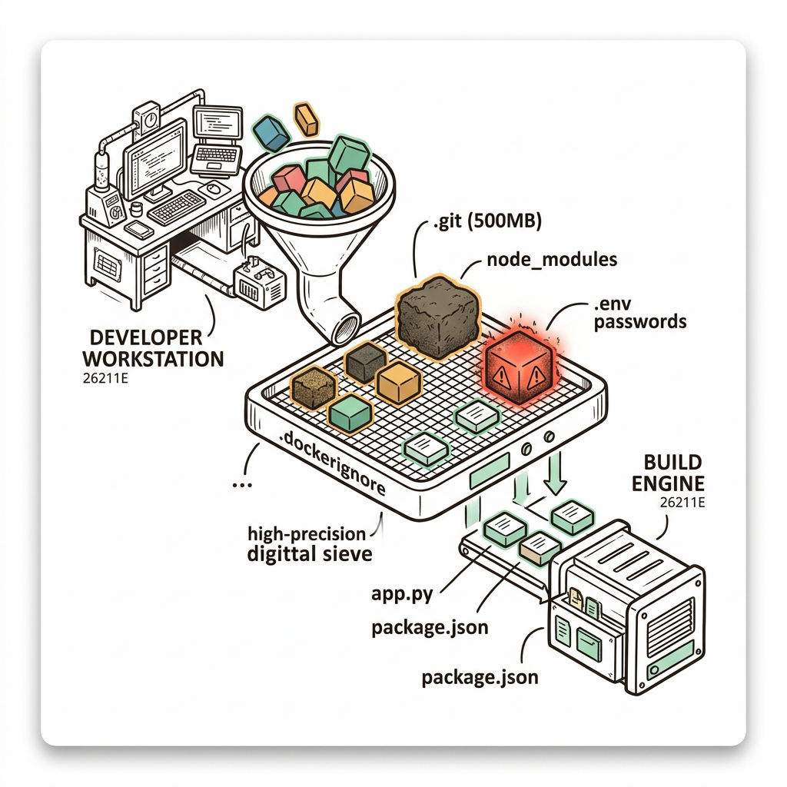
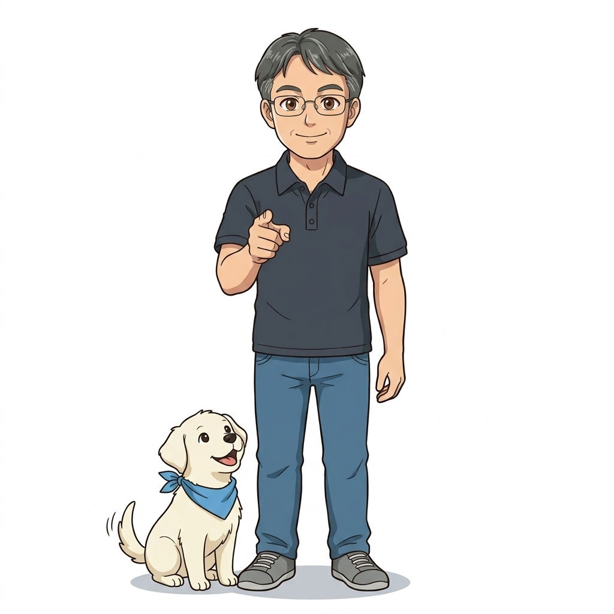

# 017. 컨테이너 이미지빌드와 빌드컨텍스트의 원리

작성한 `Dockerfile`로 실제 컨테이너 이미지를 생성하는 `docker image build` 명령어와, 명령어 마지막에 지정하는 경로인 **빌드 컨텍스트(Build Context)**의 작동 원리를 깊이 있게 파헤칩니다.


**그림 02-3-1** 컨테이너 이미지빌드와 빌드컨텍스트의 원리의 필요성과 현대 클라우드 아키텍처 관점의 개요

---

### 017.1 왜 컨테이너 이미지빌드와 빌드컨텍스트의 원리이(가) 필요한가? (문제 정의와 현실적 배경)

소프트웨어 시스템이 복잡해질수록 설정을 다루는 방식은 전체 인프라의 신뢰성을 결정짓는 핵심 척도가 됩니다. **컨테이너 이미지빌드와 빌드컨텍스트의 원리**이(가) 부재하거나 잘못 다루어질 때 현장에서는 다음과 같은 대표적인 병목과 장애가 발생합니다:

1. **하드코딩된 설정과 환경 불일치로 인한 유연성 상실**: 환경이 바뀔 때마다 코드를 다시 빌드해야 하므로 배포 주기가 지연되고 이미지 수가 기하급수적으로 폭증합니다.
2. **보안 민감 데이터의 무분별한 노출**: 비밀번호, 데이터베이스 토큰, 암호화 키가 이미지 레이어에 영구 박제되어 형상관리 시스템이나 외부에 유출될 위험이 커집니다.
3. **재현 불가능한 구성 드리프트**: 스테이징 환경과 프로덕션 환경의 미세한 설정 차이가 예기치 못한 서비스 중단 사고로 직결됩니다.


**그림 02-3-2** 컨테이너 이미지빌드와 빌드컨텍스트의 원리에 대한 대표적인 오해와 실제 프로덕션 현장의 엔지니어링 진실

---

### 017.2 핵심 아키텍처와 엔지니어링 메커니즘

도커 CLI가 빌드 컨텍스트 폴더 안의 파일들을 압축해 도커 엔진 데몬(`dockerd`)으로 전송하는 과정을 이해하고, 왜 바탕화면이나 홈 디렉터리 루트(`~`)에서 `docker build .`을 실행하면 안 되는지 실습으로 확인합니다.


**그림 02-3-3** 컨테이너 이미지빌드와 빌드컨텍스트의 원리의 내부 아키텍처 및 데이터 흐름

#### 📊 핵심 비교 및 엔지니어링 표준 분석

| 구분 / 핵심 원리 | 상세 설명 및 동작 메커니즘 | 실무 적용 시 주의점 및 베스트 프랙티스 |
| :--- | :--- | :--- |
| **`--tag` (`-t`) 옵션** | `이름:태그` 형식(태그 생략 시 기본값 `:latest`)으로 빌드될 이미지에 사람이 읽기 쉬운 식별자를 부여 | 예: `docker image build -t oz-cloud/web-pinger:1.0.0 .` |
| **빌드 컨텍스트 (`.`)** | `COPY` 인스트럭션이 참조할 수 있는 호스트 측 기준 디렉터리로, 빌드 시작 시 도커 데몬으로 전체 전송됨 | 빌드 컨텍스트 바깥(`../`)에 있는 상위 폴더 파일은 보안상 `COPY`로 절대 가져올 수 없음! |
| **`-f` (`--file`) 옵션** | 기본 이름(`Dockerfile`)이 아닌 다른 이름이나 하위 경로의 스크립트를 지정할 때 사용 | 예: `docker image build -t app:v2 -f docker/Dockerfile.prod .` |

---

### 017.3 선언적 실습 및 아키텍처 다이어그램

본 실습은 외부 비공개 패키지에 의존하지 않고, 공식 표준 이미지를 기반으로 즉시 재현 가능한 살아있는 코드로 구성되어 있습니다.

```bash
# 임시 실습 폴더(빌드 컨텍스트)를 만들고 웹 핑거 이미지를 직접 빌드하여 실행하기
mkdir -p /tmp/oz-pinger && cd /tmp/oz-pinger
cat << 'EOF' > Dockerfile
FROM alpine:3.20
ENV TARGET="example.com"
CMD ["sh", "-c", "echo Pinging $TARGET... && ping -c 2 $TARGET"]
EOF

docker image build --tag oz-pinger:v1 .
docker container run --rm -e TARGET="localhost" oz-pinger:v1
rm -rf /tmp/oz-pinger
```

#### 🔍 아키텍처 흐름도 (Mermaid Diagram)




**그림 02-3-4** 선언적 인프라 명세를 통한 컨테이너 이미지빌드와 빌드컨텍스트의 원리 검증 파이프라인

---

<!-- BIBLE_INTEGRATION_book5_deep_017 -->
---

### 017.C 📚 도커 바이블 심화: 빌드 컨텍스트 최적화의 핵심: .dockerignore 제외 규칙과 수 GB 전송 지연 방지
*출처 도서: 『제대로 배우는 도커』 핵심 분석 (제대로 배우는 도커 제4장 (4.5~4.6 빌드 컨텍스트 & .dockerignore 파일))*

`docker build -t myapp .` 명령어를 내렸을 때 첫 줄에 나타나는 메시지가 있습니다:
`Sending build context to Docker daemon 2.45GB`

#### 빌드 컨텍스트의 동작 원리와 재앙:
1. **클라이언트와 데몬의 물리적 분리**:
   * 도커 CLI는 빌드를 시작할 때, 현재 디렉터리(`.`)의 **모든 파일과 폴더를 tar 압축으로 묶어 도커 데몬 소켓으로 통째로 전송**합니다.
   * `.git`(버전 이력 수백 MB), `node_modules`(수만 개의 소형 파일), 테스트 동영상이나 덤프 파일이 포함되어 있으면 빌드를 시작하기도 전에 네트워크 전송만으로 수 분이 소요됩니다.
2. **비밀값 영구 누출 위협**:
   * 로컬에 보관 중이던 `.env` 파일이나 AWS 자격증명 파일이 빌드 컨텍스트에 포함되어 `COPY . .` 명령으로 이미지 레이어에 복사되면, 해커가 이미지를 풀받아 환경변수 비밀키를 즉시 탈취할 수 있습니다.
3. **`.dockerignore` 필수 작성 표준**:
   * `.git`, `node_modules`, `.env`, `*.log`, `tmp` 등을 반드시 제외해야 합니다.


**그림 017-B-2** 불필요한 대용량 파일과 민감한 시크릿을 빌드 컨텍스트 필터로 안전하게 걸러내는 모습

```bash
# [실습] 프로덕션 표준 .dockerignore 파일 템플릿
cat << 'EOF' > .dockerignore
# 1. 버전 관리 시스템 내부 메타데이터 제외
.git
.gitignore

# 2. 로컬 의존성 디렉터리 (컨테이너 내부에서 새로 설치해야 함)
node_modules
__pycache__
*.pyc
.venv

# 3. 민감한 로컬 환경 변수 및 시크릿
.env
.env.*
*.pem
*.key

# 4. 임시 파일 및 로그
*.log
tmp/
dist/
EOF
```

> 👨‍🏫 **이호진 교수님의 바이블 멘토링 노트**:
> ".dockerignore가 없는 프로젝트는 구멍 난 배와 같습니다. 빌드가 느려질 뿐만 아니라 회사 전체의 AWS 키나 DB 비밀번호가 Docker Hub 공개 저장소에 그대로 박제되어 수억 원의 피해를 입을 수 있습니다. Dockerfile을 만들기 전에 무조건 .dockerignore부터 만드세요."
>
> 👧 **도로시의 깨달음**:
> "소풍 갈 때 집 안의 온갖 잡동사니를 다 싸 짊어지고 가는 대신, 꼭 필요한 도시락과 물통만 가방에 쏙 골라 담는 거군요!"
>
> 🐱 **조교 지니의 아키텍처 체크포인트**:
> "Go 프로젝트에서도 컴파일된 로컬 바이너리가 이미지에 복사되지 않도록 `.dockerignore`에 반드시 바이너리 이름을 등록해야 합니다."


### 017.4 핵심 정리: 캐릭터 대화와 3대 교훈

> 👧 **도로시**: "교수님! **컨테이너 이미지빌드와 빌드컨텍스트의 원리**의 원리를 배우니까, 복잡하게 얽혀 있던 인프라 설정이 레고 블록처럼 질서정연하게 제자리를 찾는 게 보여요!"
> 
> 🐱 **조교 지니**: "야옹~ 맞습니다! 특히 런타임 환경과 불변 인프라의 경계를 명확히 지키는 것이 대규모 클라우드 운영의 제1원칙이랍니다!"
> 
> 🐶 **토토**: "멍멍! 선언적 코드로 한 번 적어두면 언제든 똑같이 복원되니까 정말 든든해요!"
> 
> 👨‍🏫 **이호진 교수님**: "훌륭하구나. 원리를 깊이 이해하고 실습을 통해 손에 익히는 것이 훌륭한 클라우드 엔지니어로 성장하는 가장 빠른 지름길이란다."


**그림 02-3-5** 컨테이너 이미지빌드와 빌드컨텍스트의 원리 마스터를 위한 3대 핵심 교훈

1. **설정과 실행의 명확한 분리**:
   * 애플리케이션 코드는 불변으로 유지하고, 가변적인 설정값은 외부에서 주입하여 이식성을 극대화합니다.
2. **선언적 재현성 확보**:
   * 사람이 수작업으로 변경하지 않고 코드 명세를 통해 언제 어디서나 100% 동일한 실행 결과를 보장합니다.
3. **최소 권한 및 보안 모범 사례 준수**:
   * 불필요한 권한과 포트 노출을 최소화하고 민감 데이터를 암호화하여 프로덕션 안정성을 담보합니다.

---

### 017.5 랩노트 피날레와 다음 강의 예고


**그림 02-3-6** 연구실에서 다음 마일스톤인 [도커이미지 레이어아키텍처와 불변성 Immutability] 실습을 예고하는 교수님과 토토

> 💡 **다음 강의 안내**:
> [도커이미지 레이어아키텍처와 불변성 Immutability](../018_도커이미지_레이어아키텍처와_불변성_Immutability/)에서는 더욱 심화된 실전 엔지니어링 실습과 아키텍처를 다룹니다!

---

## 🧭 강의 네비게이션
* [◀️ 이전 강의: 016_Dockerfile_기초문법_FROM_ENV_WORKDIR_COPY_CMD](../016_Dockerfile_기초문법_FROM_ENV_WORKDIR_COPY_CMD/)
* [📋 Part 02. 도커 이미지 제작(Dockerfile), 멀티 스테이지 빌드 & 레지스트리 공유 (015 ~ 031) 목차로 돌아가기](../)
* [▶️ 다음 강의: 018_도커이미지_레이어아키텍처와_불변성_Immutability](../018_도커이미지_레이어아키텍처와_불변성_Immutability/)
