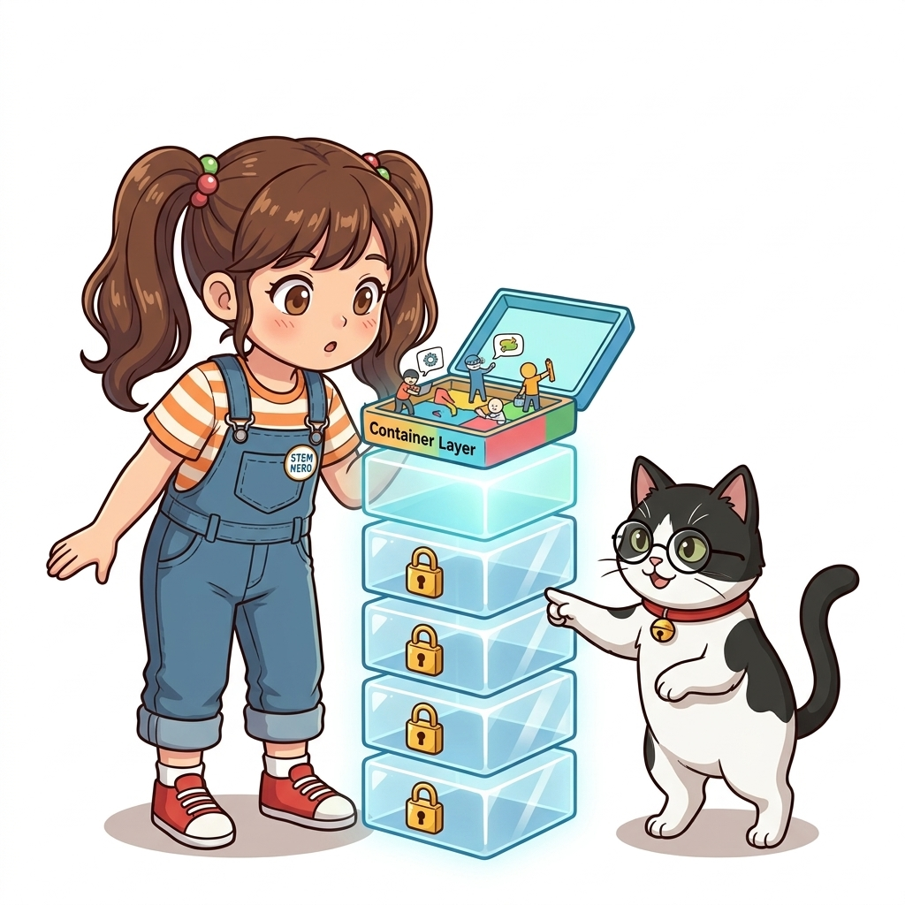
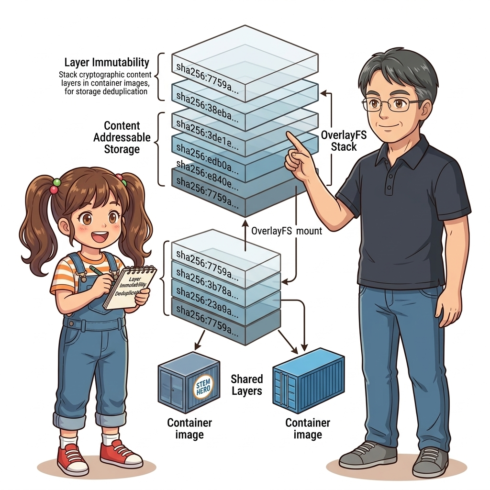
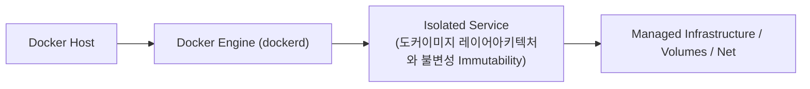
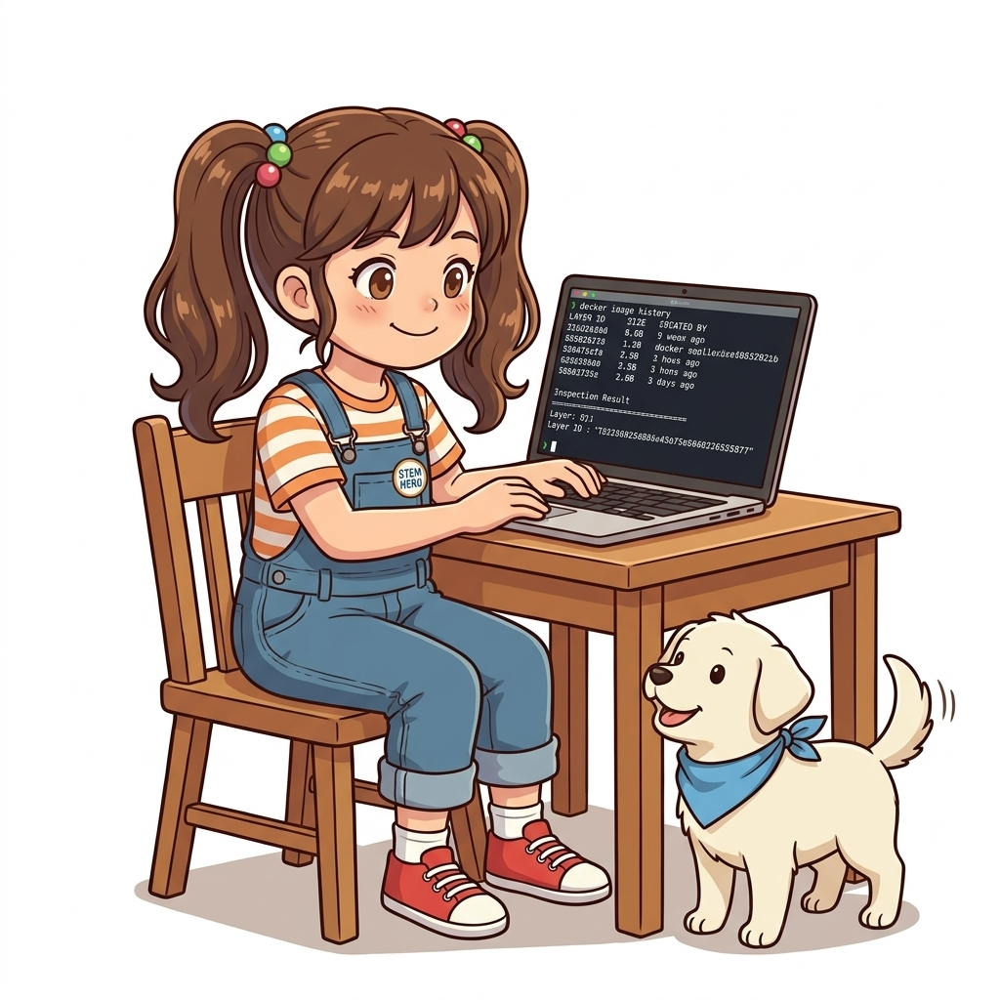
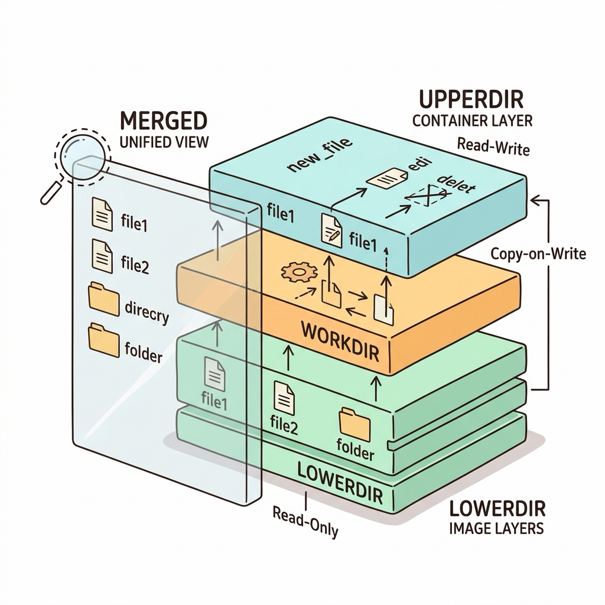
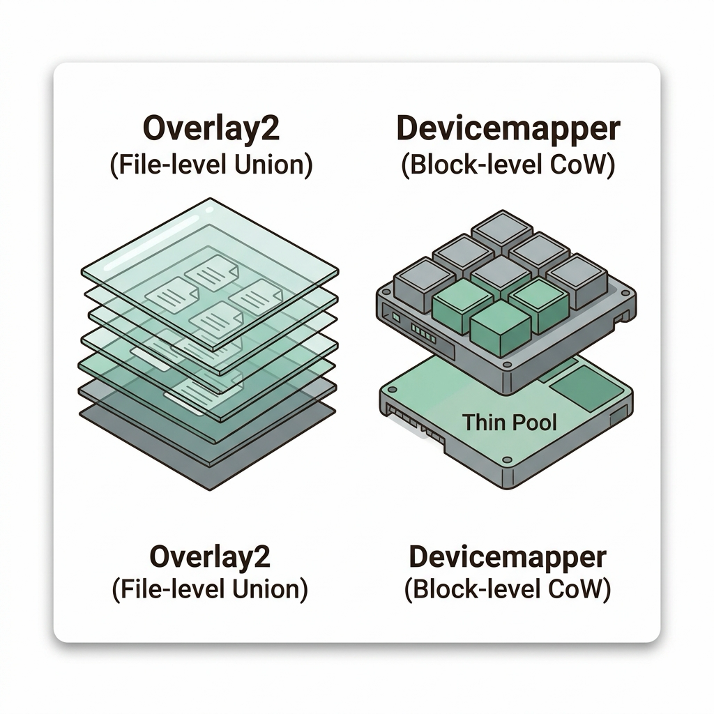
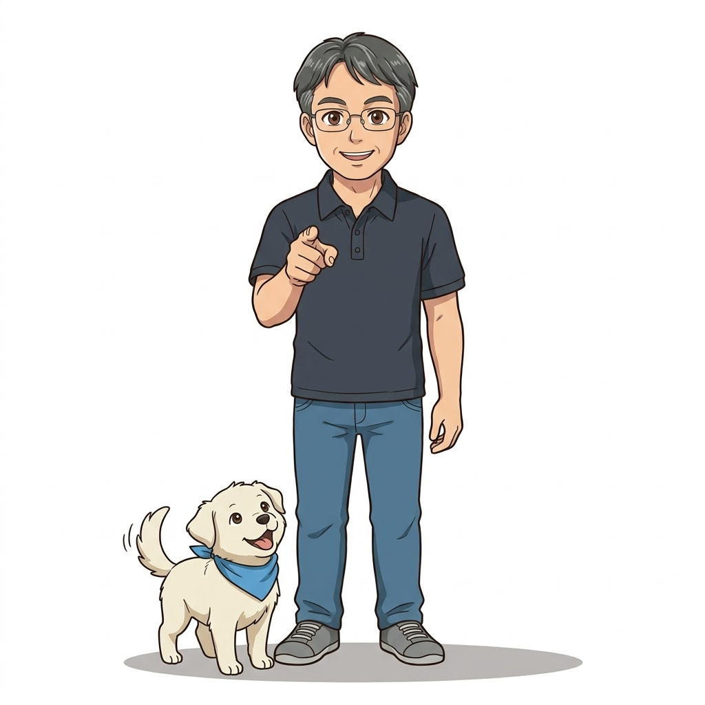

# 018. 도커이미지 레이어아키텍처와 불변성 Immutability

도커 이미지는 논리적으로는 하나의 패키지처럼 보이지만, 물리적으로는 `Dockerfile`의 각 인스트럭션(`FROM`, `WORKDIR`, `COPY`, `RUN`)이 만든 **읽기 전용(Read-Only) 이미지 레이어들의 적층 집합**입니다.


**그림 02-4-1** 도커이미지 레이어아키텍처와 불변성 Immutability의 필요성과 현대 클라우드 아키텍처 관점의 개요

---

### 018.1 왜 도커이미지 레이어아키텍처와 불변성 Immutability이(가) 필요한가? (문제 정의와 현실적 배경)

소프트웨어 시스템이 복잡해질수록 설정을 다루는 방식은 전체 인프라의 신뢰성을 결정짓는 핵심 척도가 됩니다. **도커이미지 레이어아키텍처와 불변성 Immutability**이(가) 부재하거나 잘못 다루어질 때 현장에서는 다음과 같은 대표적인 병목과 장애가 발생합니다:

1. **하드코딩된 설정과 환경 불일치로 인한 유연성 상실**: 환경이 바뀔 때마다 코드를 다시 빌드해야 하므로 배포 주기가 지연되고 이미지 수가 기하급수적으로 폭증합니다.
2. **보안 민감 데이터의 무분별한 노출**: 비밀번호, 데이터베이스 토큰, 암호화 키가 이미지 레이어에 영구 박제되어 형상관리 시스템이나 외부에 유출될 위험이 커집니다.
3. **재현 불가능한 구성 드리프트**: 스테이징 환경과 프로덕션 환경의 미세한 설정 차이가 예기치 못한 서비스 중단 사고로 직결됩니다.


**그림 02-4-2** 도커이미지 레이어아키텍처와 불변성 Immutability에 대한 대표적인 오해와 실제 프로덕션 현장의 엔지니어링 진실

---

### 018.2 핵심 아키텍처와 엔지니어링 메커니즘

`docker image history`로 이미지를 구성하는 각 레이어의 생성 명령과 크기를 해부하고, 여러 이미지가 동일한 기반 레이어(예: `alpine`, `node`)를 디스크에 중복 저장하지 않고 **100% 공유**하는 원리를 확인합니다.


**그림 02-4-3** 도커이미지 레이어아키텍처와 불변성 Immutability의 내부 아키텍처 및 데이터 흐름

#### 📊 핵심 비교 및 엔지니어링 표준 분석

| 구분 / 핵심 원리 | 상세 설명 및 동작 메커니즘 | 실무 적용 시 주의점 및 베스트 프랙티스 |
| :--- | :--- | :--- |
| **인스트럭션과 레이어의 1:1 대응** | 파일시스템에 변화를 주는 `FROM`, `COPY`, `ADD`, `RUN`은 새로운 데이터 레이어를 생성하고, `ENV`, `CMD`, `LABEL`은 메타데이터(0B)만 추가 | `docker image history 이미지명`으로 각 단계별 용량을 정확히 진단 가능 |
| **레이어 공유로 디스크 절약** | Node.js 앱 이미지 10개가 모두 `node:20-alpine`을 기반으로 한다면, 기반 OS/런타임 레이어는 디스크에 딱 1번만 저장됨 | `docker system df`로 전체 이미지 합산 용량과 실제 공유 후 차지하는 용량 비교 가능 |
| **불변성 (Immutability)** | 한 번 생성된 이미지 레이어는 해시(SHA256)로 봉인된 읽기 전용이므로 절대 수정될 수 없음 | 레이어의 불변성 덕분에 안전한 레이어 공유와 강력한 빌드 캐시가 가능해짐 |

---

### 018.3 선언적 실습 및 아키텍처 다이어그램

본 실습은 외부 비공개 패키지에 의존하지 않고, 공식 표준 이미지를 기반으로 즉시 재현 가능한 살아있는 코드로 구성되어 있습니다.

```bash
# 이미지 내부의 레이어 히스토리와 각 레이어가 차지하는 용량, 공유 해시(Layers) 확인하기
docker image history nginx:1.27-alpine
docker image inspect --format 'RootFS Layers: {{json .RootFS.Layers}}' alpine:3.20
```

#### 🔍 아키텍처 흐름도 (Mermaid Diagram)




**그림 02-4-4** 선언적 인프라 명세를 통한 도커이미지 레이어아키텍처와 불변성 Immutability 검증 파이프라인

---

<!-- BIBLE_INTEGRATION_book1_overlay2_unionfs -->
---

### 018.B 📚 도커 바이블 심화: UnionFS 발전사: AUFS에서 Overlay2로의 진화와 Copy-Up I/O 비용 분석
> **출처 및 학술적 배경**: 『15단계로 배우는 도커와 쿠버네티스』 제1장 (1.17 유니온 파일 시스템: UnionFS)  
> **핵심 주제**: UnionFS 다중 계층 마운트 원리, AUFS의 한계와 Overlay2 커널 드라이버의 우위, 4대 디렉터리(`lowerdir`, `upperdir`, `workdir`, `merged`), 그리고 대용량 파일 수정 시 발생하는 Copy-Up I/O 오버헤드 메커니즘.

#### 1. 유니온 파일 시스템(UnionFS)의 발전사와 Overlay2의 승리
유니온 파일 시스템은 서로 다른 물리 디렉터리들을 하나의 단일한 마운트 포인트에 투과적으로 겹쳐서(Overlay) 보여주는 리눅스 커널 가상화 기술입니다:
* **AUFS (Another Union File System)**: 도커 초창기 우분투의 기본 드라이버였으나, 코드가 복잡하고 유지보수가 어려워 리눅스 공식 메인라인 커널(Linus Torvalds 트리)에 병합되지 못했습니다.
* **Devicemapper**: RHEL/CentOS에서 사용되었으나 블록 기반이라 설정이 복잡하고 디스크 공간 관리가 불안정했습니다.
* **Overlay2 (현대 표준)**: 리눅스 커널 4.0 이상에 기본 탑재된 OverlayFS의 개량판으로, Inode를 직접 공유하고 페이지 캐시 효율이 극대화되어 현재 전 세계 모든 리눅스 배포판의 단일 표준으로 정착했습니다.

#### 2. Overlay2의 4대 디렉터리 내부 동작 원리
Overlay2는 호스트 파일시스템의 `/var/lib/docker/overlay2/<cache-id>/` 경로 아래에 다음 4개의 디렉터리를 조립합니다:
1. **`lowerdir` (읽기 전용 레이어들)**: 도커 이미지 빌드 시 생성된 불변의 레이어들입니다. 여러 개의 컨테이너가 동시에 구동되더라도 동일한 `lowerdir`을 읽기 전용으로 안전하게 공유(Shared)하므로 호스트 디스크 낭비가 0에 가깝습니다.
2. **`upperdir` (컨테이너 기록 가능 레이어)**: 컨테이너가 생성될 때 최상단에 마운트되는 R/W 레이어입니다. 신규 생성된 파일이나 변경 사항이 저장됩니다.
3. **`workdir` (원자적 작업 공간)**: 파일을 생성하거나 삭제할 때 데이터 손상을 방지하기 위해 사용하는 커널 내부의 임시 스테이징 버퍼입니다.
4. **`merged` (통합 사용자 뷰)**: 컨테이너 내부 프로세스가 바라보는 최종 루트 파일시스템(`/`)입니다. `lowerdir`과 `upperdir`이 합성되어 사용자에게는 단일 디스크 드라이브처럼 투명하게 보입니다.

#### 3. 대용량 파일 Copy-Up의 함정과 볼륨 우회 설계
* **Copy-Up 오버헤드**: 컨테이너가 `lowerdir`(이미지)에 존재하는 1GB 크기의 데이터베이스 파일에서 단 1바이트만 수정하더라도, 리눅스 커널은 1GB 전체 파일을 `upperdir`로 통째로 복사해 올린 뒤 쓰기 작업을 수행합니다.
* **실무적 위험**: 이 과정에서 일시적인 디스크 용량 2배 급증과 엄청난 디스크 I/O 병목이 발생하여 서비스 응답 지연을 초래합니다.
* **엔터프라이즈 모범 표준**: 데이터베이스, 로그, 캐시 등 빈번하게 쓰기/수정이 일어나는 경로는 절대 컨테이너 레이어에 두지 않고, 반드시 **도커 볼륨(Docker Volume)**으로 우회 마운트해야 합니다.


**그림 018-B-1** Overlay2의 lowerdir, upperdir, workdir, merged 레이어 합성 원리 다이어그램

```bash
# [실습] 컨테이너 마운트 포인트와 Overlay2 디렉터리 구조 해부
# 1. 테스트 컨테이너 기동
docker container run -d --name test-unionfs alpine sleep 3600

# 2. 컨테이너의 GraphDriver 정보에서 lowerdir, upperdir, merged 경로 추출
docker container inspect test-unionfs --format '{{json .GraphDriver.Data}}' | python3 -m json.tool

# 3. 백킹 파일시스템의 d_type 지원 여부 확인 (ftype=1 필수)
docker info | grep -E "Storage Driver|Backing Filesystem|Supports d_type"
```

> 👨‍🏫 **이호진 교수님의 바이블 멘토링 노트**:
> "이미지를 아무리 여러 대의 컨테이너로 띄워도 호스트 디스크 용량이 폭발하지 않는 비밀이 바로 lowerdir의 읽기 전용 공유에 있습니다. 100대의 웹서버도 공유 이미지 레이어 덕분에 단 수십 MB만 소비합니다. 단, 이미지에 들어있는 대용량 파일을 컨테이너 내부에서 직접 수정하면 발생하는 Copy-Up I/O 스파이크를 반드시 경계해야 합니다."
>
> 👧 **도로시의 깨달음**:
> "마치 유리판 위에 투명 셀로판지(lowerdir)를 겹쳐놓고, 수정할 때만 맨 위의 기름종이(upperdir)에 새로 덮어쓰는 것과 같군요! 무거운 책을 통째로 베껴 쓰는 게 아니라 바뀐 페이지만 얹는 거네요!"
>
> 🐱 **조교 지니의 아키텍처 체크포인트**:
> * 컨테이너를 삭제하면 upperdir만 깨끗하게 날아가고 lowerdir은 원본 그대로 유지됩니다. 이것이 컨테이너의 불변성과 무상태(Stateless) 아키텍처의 물리적 근거입니다.
> * XFS 파일시스템 포맷 시 `ftype=1`이 아니면 Overlay2가 기동되지 않으므로 엔터프라이즈 리눅스 구축 시 파일시스템 옵션을 반드시 확인하세요.

---

<!-- BIBLE_INTEGRATION_book8_storage_drivers_comparison -->
### 018.C 📚 도커 바이블 심화: 스토리지 드라이버 심층 해부: Overlay2 vs Devicemapper(direct-lvm) vs Btrfs/ZFS 비교
*출처 도서: 『도커 컨테이너』 핵심 분석*

도커 엔진이 컨테이너의 계층형 파일시스템과 Copy-on-Write를 디스크에 구현하는 방식은 스토리지 드라이버(Storage Driver)에 따라 근본적으로 다릅니다:

| 스토리지 드라이버 | 작동 원리 및 특징 | 장단점 및 실무 적용 가이드 |
| :--- | :--- | :--- |
| **Overlay2** | 리눅스 커널 네이티브 파일 기반 합치기(Union), inode를 고속으로 공유 | 메모리 효율 최고, 초고속 구동, 현대 리눅스(Ubuntu/RHEL 8+)의 사실상 글로벌 표준 |
| **Devicemapper** | 블록 디바이스 레벨 CoW (thin provisioning 블록 할당) | `loop-lvm`은 극심한 성능 저하로 프로덕션 사용 금지. `direct-lvm`은 안정적이나 설정이 매우 복잡함 (현재 Deprecated) |
| **Btrfs / ZFS** | 파일시스템 자체의 CoW 스냅샷 및 서브볼륨 기능 직접 활용 | 스냅샷 성능 우수, 엔터프라이즈 스토리지 풀 구성에 적합하나 메모리 소모량이 큼 |
| **VFS** | 매 레이어마다 파일 전체를 물리적으로 복사 (CoW 없음) | 성능이 가장 느림, 테스트 및 디버깅 목적으로만 제한적 사용 |


**그림 018-B-1** Overlay2의 파일 레벨 합성 vs Devicemapper의 블록 레벨 할당 방식을 비교하는 구조도

```bash
# [실습] 현재 호스트 도커 엔진의 스토리지 드라이버 정보 확인
docker info --format '{{json .DriverStatus}}' | python3 -m json.tool

# 스토리지 드라이버 이름 및 백킹 파일시스템(Backing Filesystem) 확인
docker info | grep -E "(Storage Driver|Backing Filesystem)"
```

> 👨‍🏫 **이호진 교수님의 바이블 멘토링 노트**:
> "과거 RHEL 7 시절 Devicemapper loop-lvm 때문에 서버가 멈추던 악몽은 이제 끝났습니다. 오늘날의 모든 프로덕션 리눅스는 Overlay2 하나로 대동단결되었으며, 백킹 파일시스템은 반드시 ext4나 ftype=1이 켜진 xfs를 사용해야 합니다."
>
> 👧 **도로시의 깨달음**:
> "블록을 하나하나 쪼개서 관리하던 복잡한 방식에서 투명 필름을 겹쳐서 보는 Overlay2로 발전하면서 훨씬 가볍고 빨라졌군요!"
>
> 🐱 **조교 지니의 아키텍처 체크포인트**:
> "xfs 파일시스템에서 ftype=0으로 포맷되어 있으면 Overlay2 드라이버가 아예 기동되지 않으므로 OS 설치 시 `mkfs.xfs -n ftype=1` 옵션을 반드시 확인해야 합니다."


### 018.4 핵심 정리: 캐릭터 대화와 3대 교훈

> 👧 **도로시**: "교수님! **도커이미지 레이어아키텍처와 불변성 Immutability**의 원리를 배우니까, 복잡하게 얽혀 있던 인프라 설정이 레고 블록처럼 질서정연하게 제자리를 찾는 게 보여요!"
> 
> 🐱 **조교 지니**: "야옹~ 맞습니다! 특히 런타임 환경과 불변 인프라의 경계를 명확히 지키는 것이 대규모 클라우드 운영의 제1원칙이랍니다!"
> 
> 🐶 **토토**: "멍멍! 선언적 코드로 한 번 적어두면 언제든 똑같이 복원되니까 정말 든든해요!"
> 
> 👨‍🏫 **이호진 교수님**: "훌륭하구나. 원리를 깊이 이해하고 실습을 통해 손에 익히는 것이 훌륭한 클라우드 엔지니어로 성장하는 가장 빠른 지름길이란다."


**그림 02-4-5** 도커이미지 레이어아키텍처와 불변성 Immutability 마스터를 위한 3대 핵심 교훈

1. **설정과 실행의 명확한 분리**:
   * 애플리케이션 코드는 불변으로 유지하고, 가변적인 설정값은 외부에서 주입하여 이식성을 극대화합니다.
2. **선언적 재현성 확보**:
   * 사람이 수작업으로 변경하지 않고 코드 명세를 통해 언제 어디서나 100% 동일한 실행 결과를 보장합니다.
3. **최소 권한 및 보안 모범 사례 준수**:
   * 불필요한 권한과 포트 노출을 최소화하고 민감 데이터를 암호화하여 프로덕션 안정성을 담보합니다.

---

### 018.5 랩노트 피날레와 다음 강의 예고


**그림 02-4-6** 연구실에서 다음 마일스톤인 [레이어캐시 최적화 수정빈도에따른 Dockerfile배치] 실습을 예고하는 교수님과 토토

> 💡 **다음 강의 안내**:
> [레이어캐시 최적화 수정빈도에따른 Dockerfile배치](../019_레이어캐시_최적화_수정빈도에따른_Dockerfile배치/)에서는 더욱 심화된 실전 엔지니어링 실습과 아키텍처를 다룹니다!

---

## 🧭 강의 네비게이션
* [◀️ 이전 강의: 017_컨테이너_이미지빌드와_빌드컨텍스트의_원리](../017_컨테이너_이미지빌드와_빌드컨텍스트의_원리/)
* [📋 Part 02. 도커 이미지 제작(Dockerfile), 멀티 스테이지 빌드 & 레지스트리 공유 (015 ~ 031) 목차로 돌아가기](../)
* [▶️ 다음 강의: 019_레이어캐시_최적화_수정빈도에따른_Dockerfile배치](../019_레이어캐시_최적화_수정빈도에따른_Dockerfile배치/)
