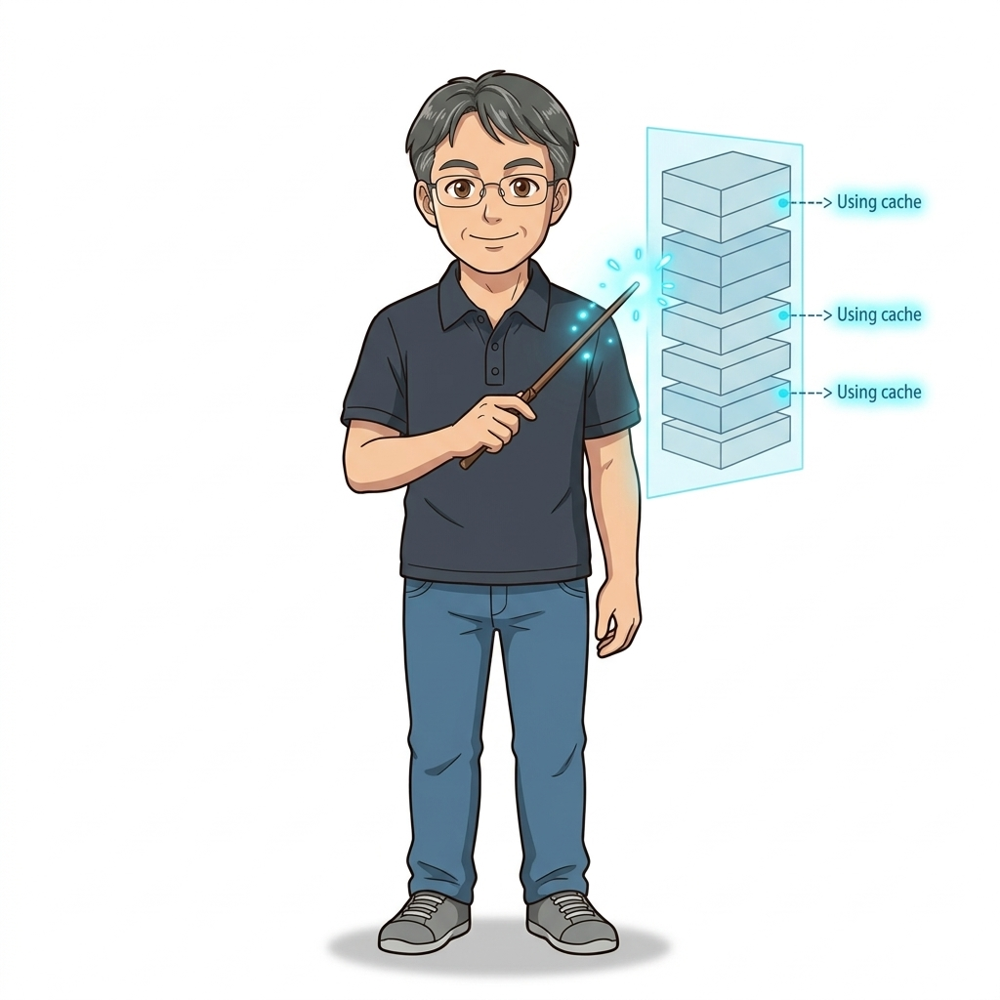
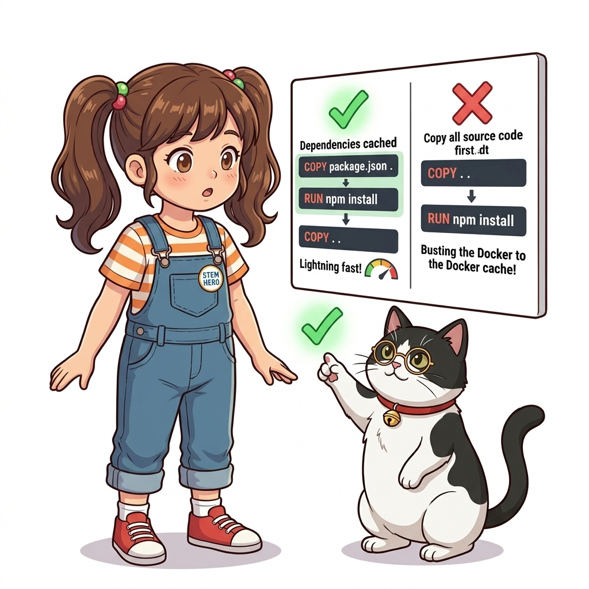
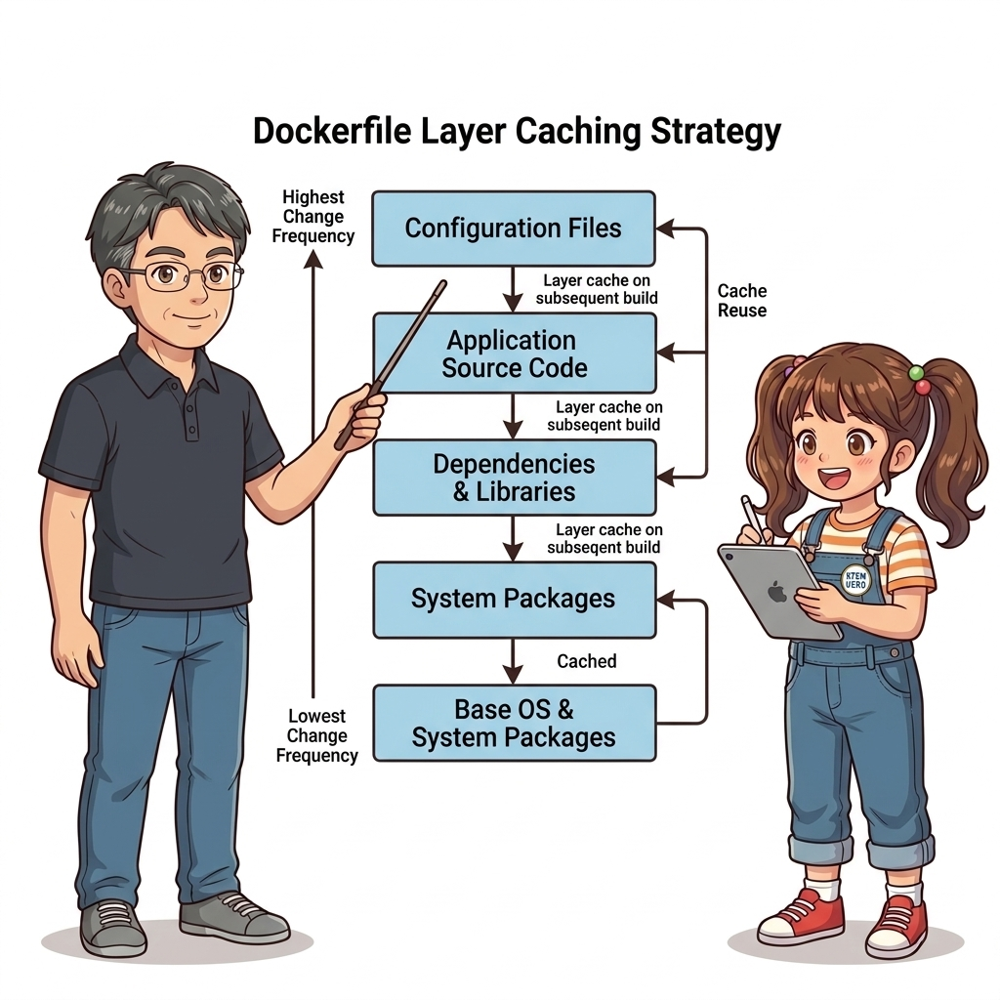
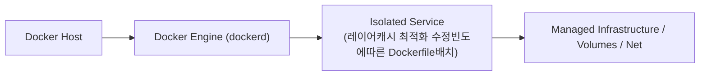
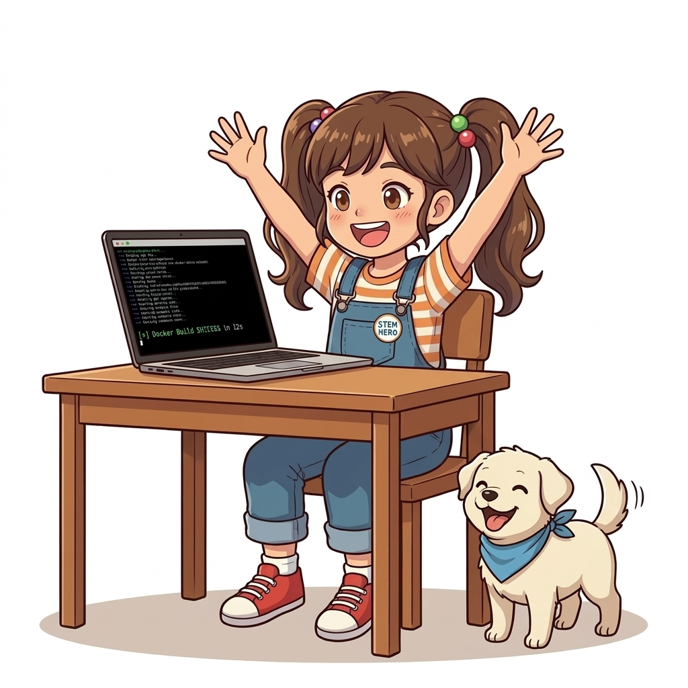
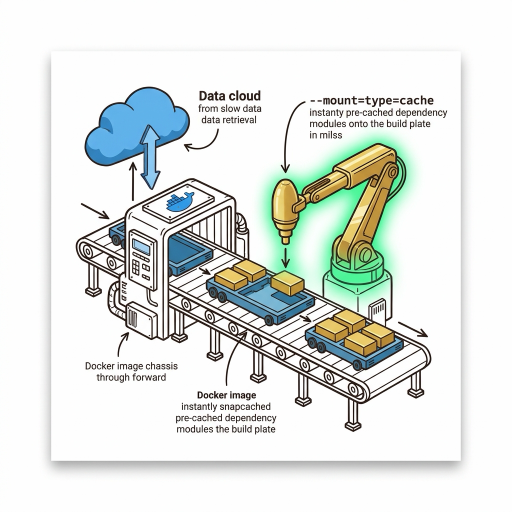
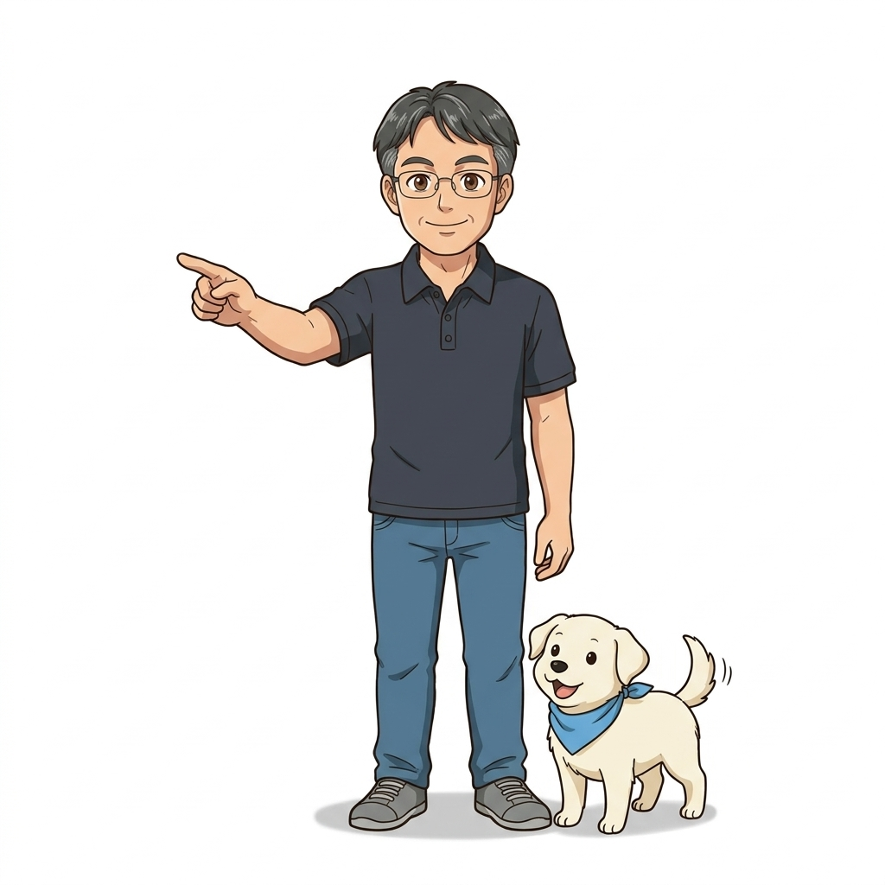

# 019. 레이어캐시 최적화 수정빈도에따른 Dockerfile배치

도커 엔진은 이미지를 다시 빌드할 때 이전 빌드와 동일한 인스트럭션 및 파일 해시(Checksum)를 만나면 다시 실행하지 않고 기존 레이어를 즉시 재사용(`CACHED`)합니다.


**그림 02-5-1** 레이어캐시 최적화 수정빈도에따른 Dockerfile배치의 필요성과 현대 클라우드 아키텍처 관점의 개요

---

### 019.1 왜 레이어캐시 최적화 수정빈도에따른 Dockerfile배치이(가) 필요한가? (문제 정의와 현실적 배경)

소프트웨어 시스템이 복잡해질수록 설정을 다루는 방식은 전체 인프라의 신뢰성을 결정짓는 핵심 척도가 됩니다. **레이어캐시 최적화 수정빈도에따른 Dockerfile배치**이(가) 부재하거나 잘못 다루어질 때 현장에서는 다음과 같은 대표적인 병목과 장애가 발생합니다:

1. **하드코딩된 설정과 환경 불일치로 인한 유연성 상실**: 환경이 바뀔 때마다 코드를 다시 빌드해야 하므로 배포 주기가 지연되고 이미지 수가 기하급수적으로 폭증합니다.
2. **보안 민감 데이터의 무분별한 노출**: 비밀번호, 데이터베이스 토큰, 암호화 키가 이미지 레이어에 영구 박제되어 형상관리 시스템이나 외부에 유출될 위험이 커집니다.
3. **재현 불가능한 구성 드리프트**: 스테이징 환경과 프로덕션 환경의 미세한 설정 차이가 예기치 못한 서비스 중단 사고로 직결됩니다.


**그림 02-5-2** 레이어캐시 최적화 수정빈도에따른 Dockerfile배치에 대한 대표적인 오해와 실제 프로덕션 현장의 엔지니어링 진실

---

### 019.2 핵심 아키텍처와 엔지니어링 메커니즘

하지만 **단 하나의 레이어에서라도 캐시가 깨지면 그 아래에 있는 모든 후속 인스트럭션의 캐시가 연쇄적으로 무효화(Cache Busting)**된다는 원리를 이해하고, **잘 바뀌지 않는 명령은 위로, 자주 바뀌는 소스 코드 복사는 맨 아래로** 배치하는 최적화 기법을 마스터합니다.


**그림 02-5-3** 레이어캐시 최적화 수정빈도에따른 Dockerfile배치의 내부 아키텍처 및 데이터 흐름

#### 📊 핵심 비교 및 엔지니어링 표준 분석

| 구분 / 핵심 원리 | 상세 설명 및 동작 메커니즘 | 실무 적용 시 주의점 및 베스트 프랙티스 |
| :--- | :--- | :--- |
| **캐시 무효화 연쇄 법칙** | `Dockerfile` 상단의 `COPY` 파일이 1바이트만 바뀌어도 그 줄부터 마지막 줄까지 모든 레이어를 새로 빌드함 | 나쁜 예: `COPY . .`를 맨 위에 두고 그 아래에 `RUN apt update`나 `ENV`를 적는 패턴 |
| **황금 배치 순서** | `FROM`(기반 이미지) ➔ `WORKDIR`/`ENV`(메타데이터) ➔ 패키지 매니저 설치(`apt`/`npm`/`pip`) ➔ 애플리케이션 소스 `COPY` ➔ `CMD` | 소스 코드를 수정해 재빌드할 때 패키지 설치 단계가 `CACHED`되어 1초 만에 빌드 완료! |
| **`--no-cache` 플래그** | 원격 패키지 저장소의 최신 보안 패치를 강제로 다시 받아야 할 때는 `docker image build --no-cache` 사용 | 평소에는 레이어 캐시를 극대화하고 정기 보안 빌드 시에만 캐시 무시 활용 |

---

### 019.3 선언적 실습 및 아키텍처 다이어그램

본 실습은 외부 비공개 패키지에 의존하지 않고, 공식 표준 이미지를 기반으로 즉시 재현 가능한 살아있는 코드로 구성되어 있습니다.

```dockerfile
# [최적화 완료된 Dockerfile] 잘 바뀌지 않는 설정과 의존성을 위에, 자주 바뀌는 소스 코드는 맨 아래에!
FROM node:20-alpine

WORKDIR /app
ENV NODE_ENV=production

# 1. 의존성 명세 파일만 먼저 복사하여 npm install 레이어를 캐싱!
COPY package.json package-lock.json* ./
RUN npm install --omit=dev

# 2. 가장 자주 수정되는 애플리케이션 소스 코드는 맨 마지막에 복사!
COPY src/ ./src/
CMD ["node", "src/server.js"]
```

#### 🔍 아키텍처 흐름도 (Mermaid Diagram)




**그림 02-5-4** 선언적 인프라 명세를 통한 레이어캐시 최적화 수정빈도에따른 Dockerfile배치 검증 파이프라인

---

<!-- BIBLE_INTEGRATION_book7_buildkit_cache_mounts -->
---

### 019.B 📚 도커 바이블 심화: BuildKit 캐시 마운트(--mount=type=cache)를 활용한 의존성 다운로드 시간 90% 단축
*출처 도서: 『도커 교과서』 핵심 분석*

Dockerfile을 작성할 때 가장 큰 고통 중 하나는 소스코드 한 줄을 수정했을 뿐인데 `npm install`, `pip install`, `mvn package`가 처음부터 다시 실행되어 수백 MB의 패키지를 인터넷에서 새로 내려받는 현상입니다.

전통적인 해결책은 `COPY package*.json .`을 먼저 하고 `npm install`을 실행하는 레이어 분리였으나, `package.json`에 패키지 하나만 추가되어도 여전히 전체를 재다운로드해야 했습니다.

#### 최신 BuildKit 캐시 마운트의 혁신:
* `RUN --mount=type=cache,target=/root/.cache/pip ...` 지시어를 사용하면, 도커 빌드 엔진이 호스트 디스크의 영구 패키지 캐시 디렉터리를 빌드 컨테이너의 특정 경로에 마운트합니다.
* 이전 레이어가 무효화되어 `RUN` 명령이 다시 실행되더라도, 이미 이전에 다운로드해 둔 라이브러리 파일들을 로컬 캐시에서 즉시 불러오므로 빌드 시간이 수 분에서 수 초로 단축됩니다.


**그림 019-B-1** BuildKit 캐시 마운트가 외부 인터넷 다운로드를 건너뛰고 로컬 고속 캐시로 즉시 조립하는 모습

```bash
# [실습] BuildKit 캐시 마운트가 적용된 최적화 Dockerfile 예시
# syntax=docker/dockerfile:1.4
FROM python:3.11-slim

WORKDIR /app
COPY requirements.txt .

# 호스트 pip 캐시를 마운트하여 의존성 초고속 설치
RUN --mount=type=cache,target=/root/.cache/pip \
    pip install -r requirements.txt

COPY . .
CMD ["python", "app.py"]
```

> 👨‍🏫 **이호진 교수님의 바이블 멘토링 노트**:
> "도커 빌드 캐시의 궁극은 BuildKit의 캐시 마운트입니다. 이 한 줄을 추가하는 것만으로도 팀 전체의 일일 CI 빌드 누적 시간을 수 시간 이상 절약할 수 있습니다."
>
> 👧 **도로시의 깨달음**:
> "새 레고 블록 하나를 끼우려고 매번 마트에 새로 다녀오는 대신, 책상 밑 보물함(캐시 마운트)에서 바로바로 꺼내 끼우는 방식이군요!"
>
> 🐱 **조교 지니의 아키텍처 체크포인트**:
> "Go 언어는 `target=/root/.cache/go-build`, Maven은 `target=/root/.m2`, Node.js는 `target=/root/.npm`으로 캐시 경로를 지정하면 완벽하게 호환됩니다."

---

### 019.C 📚 도커 바이블 심화: RUN(스트링 매칭) vs COPY/ADD(SHA256 체크섬) 캐시 판정 엔진과 CI 원격 캐시(--cache-from)

> 📖 **참고 도서 심층 연계**:
> * 《Docker Up and Running》 제3장 (도커 이미지 빌드 엔진과 레이어 캐시 판정 알고리즘)
> * 《도커 교과서》 제3장 & 제19장 (CI/CD 파이프라인에서의 이미지 빌드 최적화)

도커 엔진이 Dockerfile의 각 인스트럭션을 만났을 때 캐시 적중(Cache Hit) 여부를 판정하는 알고리즘은 지시어 유형에 따라 근본적으로 다릅니다. 이 내부 원리를 알지 못하면 "분명 최신 코드를 빌드했는데 왜 옛날 패키지가 그대로 설치되어 있는가?"라는 전형적인 배포 재앙에 직면하게 됩니다.

#### 1. 인스트럭션별 도커 엔진의 캐시 판정 알고리즘 차이

| 인스트럭션 유형 | 도커 엔진의 캐시 판정 메커니즘 | 실무 주의점 및 발생 가능한 치명적 함정 |
| :--- | :--- | :--- |
| **`RUN`, `ENV`, `WORKDIR`** | **문자열 단순 비교 (Exact String Match)**<br>명령어 텍스트와 부모 레이어 ID가 이전 빌드와 완전히 동일한지만 확인 | `RUN apt-get update`는 저장소에 최신 보안 패치가 나왔더라도 문자열이 같으므로 항상 캐시 적중 처리됨 (보안 패치 미반영 사고) |
| **`COPY`, `ADD`** | **콘텐츠 암호화 체크섬 (SHA-256 Checksum)**<br>복사 대상 파일의 내용(바이트)을 해시화하여 기존 이미지 레이어 파일과 1:1 비교 | 파일 내용이 1비트라도 바뀌면 즉시 캐시 무효화. 단, 파일 수정 시각(mtime)은 해시 계산에서 제외되어 불필요한 캐시 파괴 방지 |
| **`ADD <URL>`** | **URL 문자열 비교만 수행 (원격 콘텐츠 미검증)**<br>원격 웹 서버의 파일이 갱신되어도 도커는 URL 주소만 비교하므로 무조건 캐시 적중 | 원격 URL을 다운로드할 때는 `ADD` 대신 `RUN curl -o ...`를 쓰거나 명시적 체크섬/버전을 명시해야 안전함 |

#### 2. 휘발성 CI/CD 환경에서의 캐시 증발 문제와 Buildx 레지스트리 캐시

GitHub Actions나 GitLab CI의 Runner 인스턴스는 빌드가 끝나면 컨테이너/VM이 즉시 폐기되는 **휘발성(Ephemeral) 환경**입니다. 따라서 로컬 디스크 캐시가 다음 빌드에 남지 않아 매번 10분 이상 전체 빌드가 반복됩니다.

이를 해결하는 현대적 엔지니어링 표준이 **Buildx 원격 레지스트리 캐시(`type=registry`)**입니다:

```bash
# [실무 CI/CD 파이프라인] 원격 레지스트리에 캐시 메타데이터를 저장하고 재사용하는 표준 스크립트
docker buildx build \
  --platform linux/amd64,linux/arm64 \
  --tag myregistry.io/myapp:v1.2.0 \
  --cache-to type=registry,ref=myregistry.io/myapp:buildcache,mode=max \
  --cache-from type=registry,ref=myregistry.io/myapp:buildcache \
  --push .
```

* `--cache-to type=registry,mode=max`: 최종 실행 레이어뿐만 아니라 빌드 중간 단계의 모든 레이어 캐시 메타데이터를 도커 레지스트리에 별도 태그(`:buildcache`)로 푸시합니다.
* `--cache-from type=registry`: 휘발성 CI 워커가 처음 실행되더라도, 레지스트리에서 이전 빌드의 캐시 레이어만 즉시 당겨와 초고속 차분 빌드를 완수합니다.

> 👧 **도로시**: "와! `RUN apt-get update`가 인터넷에 새 패키지가 나와도 글자만 보고 그냥 캐시에서 꺼내 쓴다는 사실이 정말 충격적이에요!"
> 
> 👨‍🏫 **이호진 교수님**: "그렇단다. 그래서 정기적으로 의존성 보안 패치를 강제 적용할 때는 `--no-cache` 옵션을 주거나, BuildKit의 `ARG CACHE_DATE=2026-11-06` 같은 캐시 버스터(Cache Buster) 트릭을 사용하는 것이란다."
> 
> 🐶 **토토**: "멍멍! GitHub Actions에서 매번 15분씩 걸리던 도커 빌드가 `--cache-from type=registry`를 적용하니까 30초 만에 끝나는 마법을 경험했어!"


### 019.4 핵심 정리: 캐릭터 대화와 3대 교훈

> 👧 **도로시**: "교수님! **레이어캐시 최적화 수정빈도에따른 Dockerfile배치**의 원리를 배우니까, 복잡하게 얽혀 있던 인프라 설정이 레고 블록처럼 질서정연하게 제자리를 찾는 게 보여요!"
> 
> 🐱 **조교 지니**: "야옹~ 맞습니다! 특히 런타임 환경과 불변 인프라의 경계를 명확히 지키는 것이 대규모 클라우드 운영의 제1원칙이랍니다!"
> 
> 🐶 **토토**: "멍멍! 선언적 코드로 한 번 적어두면 언제든 똑같이 복원되니까 정말 든든해요!"
> 
> 👨‍🏫 **이호진 교수님**: "훌륭하구나. 원리를 깊이 이해하고 실습을 통해 손에 익히는 것이 훌륭한 클라우드 엔지니어로 성장하는 가장 빠른 지름길이란다."


**그림 02-5-5** 레이어캐시 최적화 수정빈도에따른 Dockerfile배치 마스터를 위한 3대 핵심 교훈

1. **설정과 실행의 명확한 분리**:
   * 애플리케이션 코드는 불변으로 유지하고, 가변적인 설정값은 외부에서 주입하여 이식성을 극대화합니다.
2. **선언적 재현성 확보**:
   * 사람이 수작업으로 변경하지 않고 코드 명세를 통해 언제 어디서나 100% 동일한 실행 결과를 보장합니다.
3. **최소 권한 및 보안 모범 사례 준수**:
   * 불필요한 권한과 포트 노출을 최소화하고 민감 데이터를 암호화하여 프로덕션 안정성을 담보합니다.

---

### 019.5 랩노트 피날레와 다음 강의 예고


**그림 02-5-6** 연구실에서 다음 마일스톤인 [CMD vs ENTRYPOINT 실행명령과 인자전달패턴] 실습을 예고하는 교수님과 토토

> 💡 **다음 강의 안내**:
> [CMD vs ENTRYPOINT 실행명령과 인자전달패턴](../020_CMD_vs_ENTRYPOINT_실행명령과_인자전달패턴/)에서는 더욱 심화된 실전 엔지니어링 실습과 아키텍처를 다룹니다!

---

## 🧭 강의 네비게이션
* [◀️ 이전 강의: 018_도커이미지_레이어아키텍처와_불변성_Immutability](../018_도커이미지_레이어아키텍처와_불변성_Immutability/)
* [📋 Part 02. 도커 이미지 제작(Dockerfile), 멀티 스테이지 빌드 & 레지스트리 공유 (015 ~ 031) 목차로 돌아가기](../)
* [▶️ 다음 강의: 020_CMD_vs_ENTRYPOINT_실행명령과_인자전달패턴](../020_CMD_vs_ENTRYPOINT_실행명령과_인자전달패턴/)
