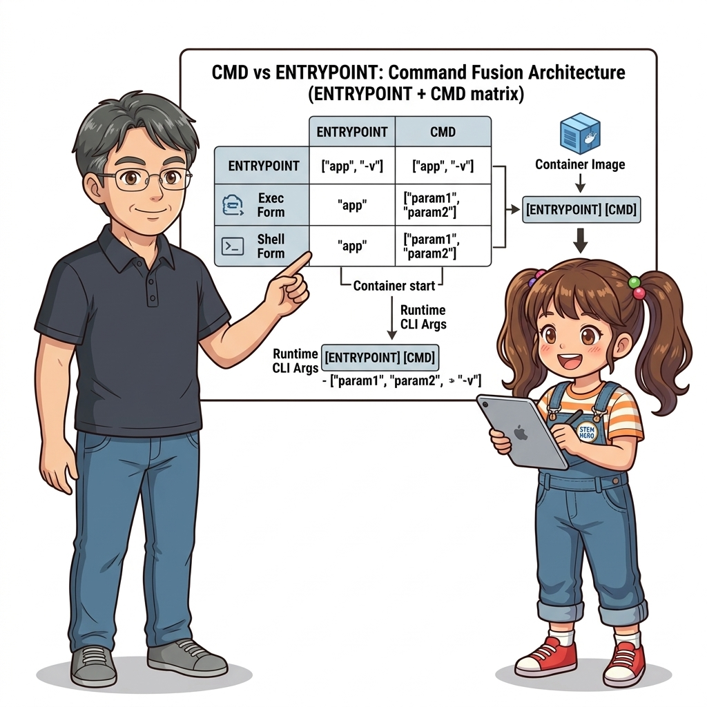
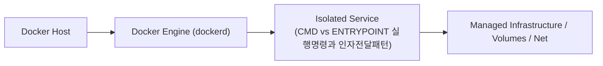
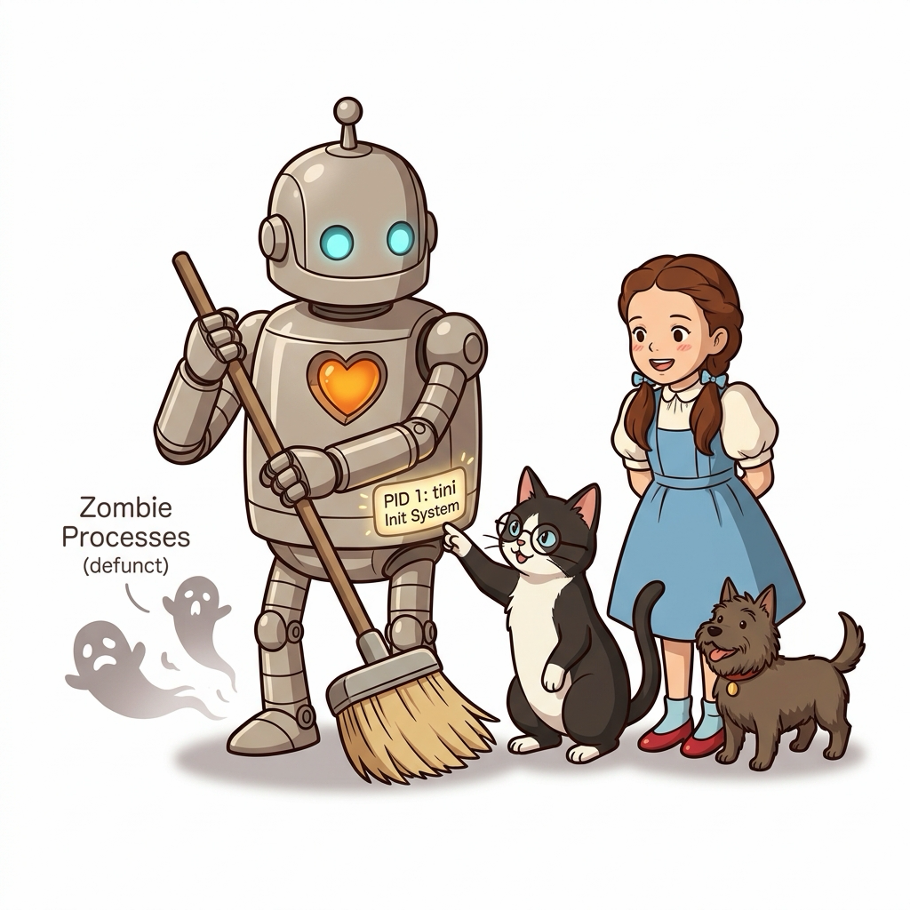

# 020. CMD vs ENTRYPOINT 실행명령과 인자전달패턴

`Dockerfile`에서 시작 명령을 적는 두 가지 문법인 **Shell 형식(`CMD node app.js`)**과 **Exec 배열 형식(`CMD ["node", "app.js"]`)**의 프로세스 시그널 전달 차이를 명확히 비교합니다.


**그림 02-6-1** CMD vs ENTRYPOINT 실행명령과 인자전달패턴의 필요성과 현대 클라우드 아키텍처 관점의 개요

---

### 020.1 왜 CMD vs ENTRYPOINT 실행명령과 인자전달패턴이(가) 필요한가? (문제 정의와 현실적 배경)

소프트웨어 시스템이 복잡해질수록 설정을 다루는 방식은 전체 인프라의 신뢰성을 결정짓는 핵심 척도가 됩니다. **CMD vs ENTRYPOINT 실행명령과 인자전달패턴**이(가) 부재하거나 잘못 다루어질 때 현장에서는 다음과 같은 대표적인 병목과 장애가 발생합니다:

1. **하드코딩된 설정과 환경 불일치로 인한 유연성 상실**: 환경이 바뀔 때마다 코드를 다시 빌드해야 하므로 배포 주기가 지연되고 이미지 수가 기하급수적으로 폭증합니다.
2. **보안 민감 데이터의 무분별한 노출**: 비밀번호, 데이터베이스 토큰, 암호화 키가 이미지 레이어에 영구 박제되어 형상관리 시스템이나 외부에 유출될 위험이 커집니다.
3. **재현 불가능한 구성 드리프트**: 스테이징 환경과 프로덕션 환경의 미세한 설정 차이가 예기치 못한 서비스 중단 사고로 직결됩니다.


**그림 02-6-2** CMD vs ENTRYPOINT 실행명령과 인자전달패턴에 대한 대표적인 오해와 실제 프로덕션 현장의 엔지니어링 진실

---

### 020.2 핵심 아키텍처와 엔지니어링 메커니즘

또한 `docker container run 이미지명 [인자]` 실행 시 기본 명령이 통째로 덮어써지는 `CMD`와 달리, 고정된 실행 파일 뒤에 추가 인자를 이어 붙여주는 **`ENTRYPOINT` + `CMD` 조합 패턴**을 실습합니다.


**그림 02-6-3** CMD vs ENTRYPOINT 실행명령과 인자전달패턴의 내부 아키텍처 및 데이터 흐름

#### 📊 핵심 비교 및 엔지니어링 표준 분석

| 구분 / 핵심 원리 | 상세 설명 및 동작 메커니즘 | 실무 적용 시 주의점 및 베스트 프랙티스 |
| :--- | :--- | :--- |
| **Shell 형식 vs Exec 배열 형식** | Shell 형식은 `/bin/sh -c`가 중간에 끼어 종료 시그널(`SIGTERM`) 전달을 방해할 수 있음 / Exec 형식(`["실행파일", "인자"]`)은 셸 없이 직접 PID 1로 실행 | 실무에서는 특별한 셸 변수 확장이 필요 없는 한 **Exec 배열 형식**을 표준으로 사용! |
| **`CMD` 단독 사용** | 컨테이너 시작 시 기본 명령을 정의하며, `docker run 이미지 새명령` 입력 시 `CMD` 전체가 `새명령`으로 대체됨 | 웹 서버나 일반 데몬 컨테이너의 기본 실행 명령 지정에 적합 |
| **`ENTRYPOINT` + `CMD` 결합** | `ENTRYPOINT`는 고정된 실행 바이너리 역할을 하고, `CMD`는 그 바이너리에 전달할 기본 옵션(Default Arguments) 역할을 수행 | 배치 작업기나 CLI 유틸리티 컨테이너를 만들 때 가장 우아한 설계 패턴 |

---

### 020.3 선언적 실습 및 아키텍처 다이어그램

본 실습은 외부 비공개 패키지에 의존하지 않고, 공식 표준 이미지를 기반으로 즉시 재현 가능한 살아있는 코드로 구성되어 있습니다.

```dockerfile
# ENTRYPOINT에 고정 실행 명령을 두고, CMD에 기본 인자(오버라이드 가능)를 결합하는 패턴
FROM alpine:3.20
ENTRYPOINT ["ping", "-c", "3"]
CMD ["localhost"]

# 1) 인자 없이 실행 시: ping -c 3 localhost 실행
# 2) docker container run --rm my-ping example.com 실행 시: ping -c 3 example.com 실행!
```

#### 🔍 아키텍처 흐름도 (Mermaid Diagram)




**그림 02-6-4** 선언적 인프라 명세를 통한 CMD vs ENTRYPOINT 실행명령과 인자전달패턴 검증 파이프라인

---

<!-- BIBLE_INTEGRATION_book2_tini_zombie_reaping -->
---

### 020.B 📚 도커 바이블 심화: 좀비 프로세스 누적 방지와 경량 init 프로세스(tini / --init) 연동
*출처 도서: 『Docker Up and Running』 핵심 분석*

컨테이너 환경에서 자주 발생하는 또 하나의 심각한 커널 레벨 이슈는 **좀비 프로세스(Zombie / Defunct Process)의 누적**입니다.

* **좀비 프로세스의 발생 원리**:
  * 부모 프로세스가 자식 프로세스를 `fork()`하여 작업을 위임한 뒤, 자식 프로세스가 종료되었을 때 부모가 `wait()` 또는 `waitpid()` 시스템 콜을 호출하여 자식의 종료 상태(Exit Status)를 커널에서 회수해야 합니다.
  * 부모가 이를 회수하지 않은 채 계속 살아있거나 부모 자신이 먼저 비정상 종료되면, 자식 프로세스는 메모리는 해제되었지만 프로세스 테이블(PID 슬롯)에 잔류하는 '좀비' 상태가 됩니다.
* **해결책: `--init` 플래그와 tini**:
  * 일반 리눅스 배포판의 PID 1(systemd)처럼, 컨테이너 전용으로 설계된 초경량 init 바이너리인 **`tini`**를 PID 1로 배치하면, 고아가 된 자식 프로세스를 자동으로 입양(Re-parenting)하여 깨끗하게 수거(Reaping)해 줍니다.


**그림 020-B-1** 경량 init 바이너리 tini가 버려진 자식 프로세스들을 품에 안아 안전하게 정리하는 일러스트

```bash
# [실습] 도커 내장 --init 옵션으로 좀비 프로세스 자동 수거 활성화
# --init 플래그를 붙여 컨테이너 실행 (docker-init 프로세스가 PID 1로 주입됨)
docker container run -d --name init-demo --init alpine sleep 3600

# 컨테이너 내부 프로세스 트리 확인 (/sbin/docker-init이 PID 1인지 확인)
docker container top init-demo
```

> 👨‍🏫 **이호진 교수님의 바이블 멘토링 노트**:
> "Dockerfile의 ENTRYPOINT를 애플리케이션으로 바로 잡기보다, 도커 실행 시 `--init` 옵션을 주거나 Dockerfile에 Tini를 추가하는 것만으로도 운영 서버의 프로세스 테이블 고갈 장애를 완벽히 예방할 수 있습니다."
>
> 👧 **도로시의 깨달음**:
> "로봇 틴맨이 청소부처럼 버려진 프로세스 껍데기들을 깔끔하게 치워주니 시스템이 고장 날 일이 없겠네요!"
>
> 🐱 **조교 지니의 아키텍처 체크포인트**:
> "cgroups가 메모리를 제한하더라도, 프로세스 수(`--pids-limit`)를 별도로 제한하지 않고 좀비가 쌓이면 호스트 전체의 PID 풀이 고갈되어 서버 전체가 뻗을 수 있습니다."

---

### 020.C 📚 도커 바이블 심화: entrypoint.sh 래퍼 패턴과 exec "$@" 신호 전파 메커니즘

> 📖 **참고 도서 심층 연계**:
> * 《트러블 슈팅 도커》 제1장 (컨테이너 라이프사이클과 SIGTERM 신호 차단 트러블슈팅)
> * 《완벽한 IT 인프라 구축을 위한 Docker》 제2장 (Shell 폼과 Exec 폼의 시스템 콜 분기 구조)

프로덕션 환경에서는 컨테이너 기동 전에 데이터베이스 마이그레이션을 실행하거나 동적으로 설정 파일을 템플릿화하기 위해 `entrypoint.sh` 셸 스크립트를 `ENTRYPOINT`로 지정하는 경우가 매우 많습니다. 이때 가장 흔히 저지르는 치명적 실수가 바로 스크립트 마지막에 `exec` 없이 실행 명령을 적는 것입니다.

#### 1. `exec "$@"`의 유무에 따른 커널 프로세스 테이블 차이

```bash
# [나쁜 예: exec 누락 entrypoint.sh]
#!/bin/sh
echo "초기화 작업 수행 중..."
node server.js "$@"   # ❌ /bin/sh가 PID 1로 남고 node는 자식 프로세스(PID 2)가 됨!
```
* **문제점**: `docker stop`이 컨테이너에 `SIGTERM`을 보내면 리눅스 커널은 오직 **PID 1 프로세스(/bin/sh)**에게만 시그널을 전달합니다. 하지만 표준 POSIX 셸은 자식 프로세스에게 `SIGTERM`을 자동으로 포워딩해주지 않고 무시합니다. 결국 10초 타임아웃 뒤 도커 엔진이 보낸 `SIGKILL`에 의해 프로세스가 즉사(하드 킬)하여 DB 트랜잭션이 깨지고 파일이 손상됩니다.

```bash
# [좋은 예: 바이블 표준 entrypoint.sh]
#!/bin/sh
set -e
echo "초기화 작업 완료!"
exec "$@"   # ✅ 커널 execve() 시스템 콜을 통해 현재 셸(PID 1)을 타깃 바이너리로 완전히 치환!
```
* **동작 원리**: 리눅스 커널의 `exec` 시스템 콜은 새로운 프로세스를 생성(`fork`)하지 않고, **기존 프로세스(PID 1)의 메모리 공간과 PID를 그대로 유지한 채 실행할 바이너리(예: node)로 완전히 덮어씌웁니다.** 따라서 애플리케이션 자체가 곧바로 PID 1이 되어 `SIGTERM`을 정상 수신하고 우아한 종료(Graceful Shutdown)를 완수할 수 있습니다.

#### 2. ENTRYPOINT + CMD 협력 및 오버라이드 매트릭스

| Dockerfile 명세 | 실행 명령어 | 최종 실행되는 커맨드라인 및 형태 |
| :--- | :--- | :--- |
| `ENTRYPOINT ["nginx"]`<br>`CMD ["-g", "daemon off;"]` | `docker run my-nginx` | `nginx -g "daemon off;"` (기본 인자 전달) |
| 위와 동일 | `docker run my-nginx -v` | `nginx -v` (`CMD`만 사용자가 입력한 `-v`로 오버라이드됨) |
| 위와 동일 | `docker run --entrypoint /bin/sh my-nginx` | `/bin/sh` (`--entrypoint` 플래그로 바이너리 자체를 강제 교체) |

> 👧 **도로시**: "아하! `exec` 명령어가 셸이라는 껍데기를 벗어던지고 진짜 앱을 PID 1 자리에 앉혀주는 마법의 열쇠였군요!"
> 
> 👨‍🏫 **이호진 교수님**: "정확하단다, 도로시! 컨테이너를 종료할 때마다 10초씩 지연되다가 강제 종료되는 시스템이 있다면 99%가 바로 이 `exec` 누락 때문이란다."
> 
> 🐶 **토토**: "멍멍! `exec "$@"` 뒤에 붙은 `"$@"`는 `CMD`나 `docker run` 뒤에 입력된 모든 인자를 공백 보존해서 그대로 전달해주는 표준 문법이야!"


### 020.4 핵심 정리: 캐릭터 대화와 3대 교훈

> 👧 **도로시**: "교수님! **CMD vs ENTRYPOINT 실행명령과 인자전달패턴**의 원리를 배우니까, 복잡하게 얽혀 있던 인프라 설정이 레고 블록처럼 질서정연하게 제자리를 찾는 게 보여요!"
> 
> 🐱 **조교 지니**: "야옹~ 맞습니다! 특히 런타임 환경과 불변 인프라의 경계를 명확히 지키는 것이 대규모 클라우드 운영의 제1원칙이랍니다!"
> 
> 🐶 **토토**: "멍멍! 선언적 코드로 한 번 적어두면 언제든 똑같이 복원되니까 정말 든든해요!"
> 
> 👨‍🏫 **이호진 교수님**: "훌륭하구나. 원리를 깊이 이해하고 실습을 통해 손에 익히는 것이 훌륭한 클라우드 엔지니어로 성장하는 가장 빠른 지름길이란다."


**그림 02-6-5** CMD vs ENTRYPOINT 실행명령과 인자전달패턴 마스터를 위한 3대 핵심 교훈

1. **설정과 실행의 명확한 분리**:
   * 애플리케이션 코드는 불변으로 유지하고, 가변적인 설정값은 외부에서 주입하여 이식성을 극대화합니다.
2. **선언적 재현성 확보**:
   * 사람이 수작업으로 변경하지 않고 코드 명세를 통해 언제 어디서나 100% 동일한 실행 결과를 보장합니다.
3. **최소 권한 및 보안 모범 사례 준수**:
   * 불필요한 권한과 포트 노출을 최소화하고 민감 데이터를 암호화하여 프로덕션 안정성을 담보합니다.

---

### 020.5 랩노트 피날레와 다음 강의 예고


**그림 02-6-6** 연구실에서 다음 마일스톤인 [빌드서버가 필요없는 멀티스테이지 빌드혁명] 실습을 예고하는 교수님과 토토

> 💡 **다음 강의 안내**:
> [빌드서버가 필요없는 멀티스테이지 빌드혁명](../021_빌드서버가_필요없는_멀티스테이지_빌드혁명/)에서는 더욱 심화된 실전 엔지니어링 실습과 아키텍처를 다룹니다!

---

## 🧭 강의 네비게이션
* [◀️ 이전 강의: 019_레이어캐시_최적화_수정빈도에따른_Dockerfile배치](../019_레이어캐시_최적화_수정빈도에따른_Dockerfile배치/)
* [📋 Part 02. 도커 이미지 제작(Dockerfile), 멀티 스테이지 빌드 & 레지스트리 공유 (015 ~ 031) 목차로 돌아가기](../)
* [▶️ 다음 강의: 021_빌드서버가_필요없는_멀티스테이지_빌드혁명](../021_빌드서버가_필요없는_멀티스테이지_빌드혁명/)
