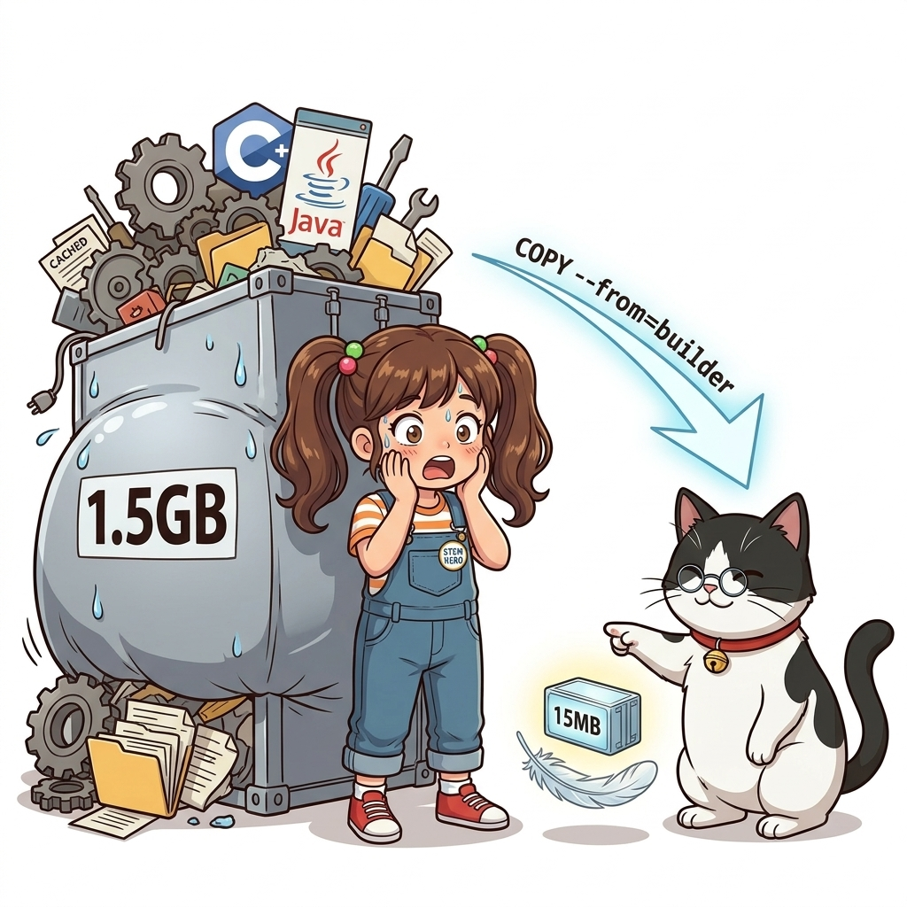
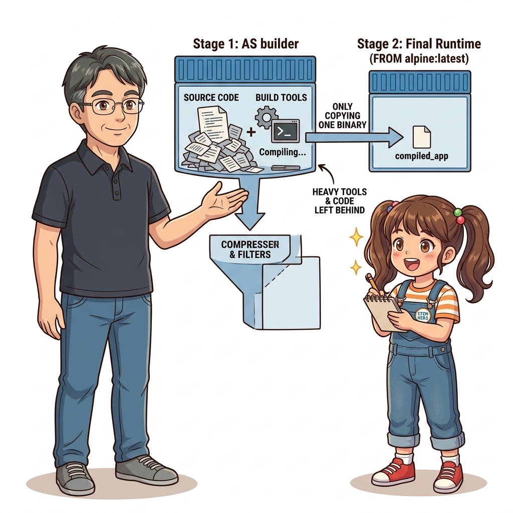
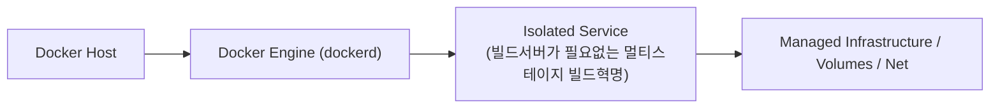
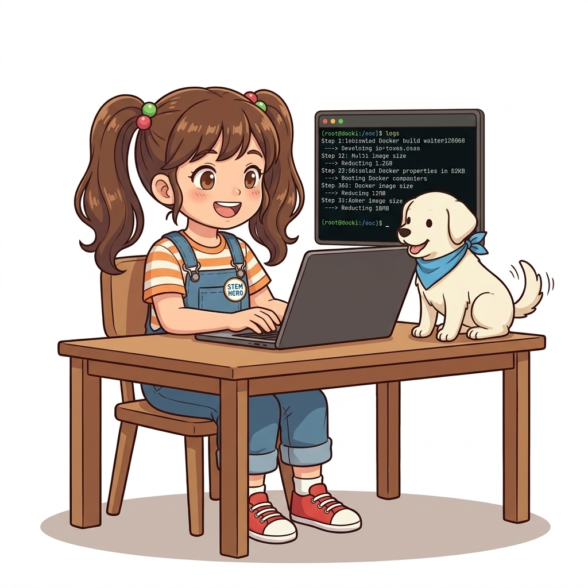
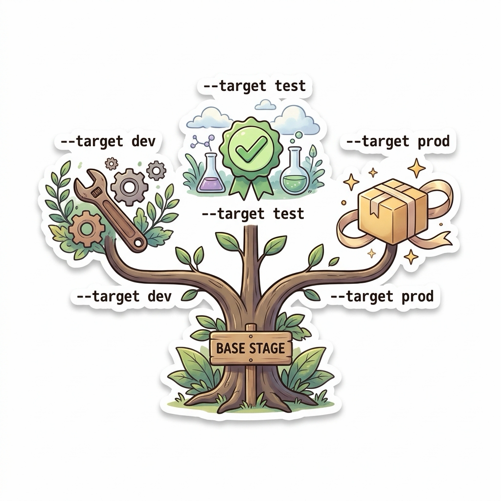

# 021. 빌드서버가 필요없는 멀티스테이지 빌드혁명

과거에는 애플리케이션을 빌드하기 위해 개발자 PC와 빌드 서버마다 특정 버전의 컴파일러, SDK, 빌드 도구(Maven, Gradle, Webpack, GCC)를 직접 설치하고 버전을 맞춰야 하는 고통이 따랐습니다.


**그림 02-7-1** 빌드서버가 필요없는 멀티스테이지 빌드혁명의 필요성과 현대 클라우드 아키텍처 관점의 개요

---

### 021.1 왜 빌드서버가 필요없는 멀티스테이지 빌드혁명이(가) 필요한가? (문제 정의와 현실적 배경)

소프트웨어 시스템이 복잡해질수록 설정을 다루는 방식은 전체 인프라의 신뢰성을 결정짓는 핵심 척도가 됩니다. **빌드서버가 필요없는 멀티스테이지 빌드혁명**이(가) 부재하거나 잘못 다루어질 때 현장에서는 다음과 같은 대표적인 병목과 장애가 발생합니다:

1. **하드코딩된 설정과 환경 불일치로 인한 유연성 상실**: 환경이 바뀔 때마다 코드를 다시 빌드해야 하므로 배포 주기가 지연되고 이미지 수가 기하급수적으로 폭증합니다.
2. **보안 민감 데이터의 무분별한 노출**: 비밀번호, 데이터베이스 토큰, 암호화 키가 이미지 레이어에 영구 박제되어 형상관리 시스템이나 외부에 유출될 위험이 커집니다.
3. **재현 불가능한 구성 드리프트**: 스테이징 환경과 프로덕션 환경의 미세한 설정 차이가 예기치 못한 서비스 중단 사고로 직결됩니다.


**그림 02-7-2** 빌드서버가 필요없는 멀티스테이지 빌드혁명에 대한 대표적인 오해와 실제 프로덕션 현장의 엔지니어링 진실

---

### 021.2 핵심 아키텍처와 엔지니어링 메커니즘

하나의 `Dockerfile` 안에 여러 개의 `FROM` 절을 두어 **1단계(빌드 스테이지)에서는 무거운 SDK 이미지로 소스코드를 컴파일하고, 마지막 단계(런타임 스테이지)에서는 컴파일된 결과물(바이너리/JAR)만 가벼운 런타임 이미지로 쏙 빼오는 멀티 스테이지 빌드(Multi-stage Build)**의 원리를 배웁니다.


**그림 02-7-3** 빌드서버가 필요없는 멀티스테이지 빌드혁명의 내부 아키텍처 및 데이터 흐름

#### 📊 핵심 비교 및 엔지니어링 표준 분석

| 구분 / 핵심 원리 | 상세 설명 및 동작 메커니즘 | 실무 적용 시 주의점 및 베스트 프랙티스 |
| :--- | :--- | :--- |
| **호스트 의존성 100% 제거** | 개발자나 서버에 오직 Docker만 설치되어 있으면 어떤 언어(Java, Go, Rust, C++, Node, .NET)든 즉시 빌드 가능 | 신입 개발자 온보딩 시간이 3일에서 `git clone` 후 `docker build` 5분으로 단축! |
| **극적인 이미지 경량화** | 수백 MB의 컴파일러·헤더 파일·소스 코드·중간 캐시는 `build-stage`에 버려지고 최종 이미지에는 포함되지 않음 | 최종 이미지 크기가 1GB에서 수십 MB로 줄어 배포 속도와 디스크 효율 극대화 |
| **보안 공격 표면 축소** | 운영 컨테이너 내부에 컴파일러(`gcc`, `javac`)나 패키지 매니저, 원본 소스 코드가 존재하지 않음 | 해커가 컨테이너에 침투하더라도 악성코드를 컴파일하거나 소스를 탈취할 수 없음 |

---

### 021.3 선언적 실습 및 아키텍처 다이어그램

본 실습은 외부 비공개 패키지에 의존하지 않고, 공식 표준 이미지를 기반으로 즉시 재현 가능한 살아있는 코드로 구성되어 있습니다.

```dockerfile
# 멀티 스테이지 빌드의 기본 골격: 빌드 도구(1단계)와 실제 운영 런타임(2단계)의 완벽한 분리!
# [Stage 1: build-stage] 컴파일러와 빌드 도구가 포함된 이미지
FROM alpine:3.20 AS build-stage
WORKDIR /src
RUN echo "Building production artifact..." > artifact.txt

# [Stage 2: runtime-stage] 오직 실행에 필요한 결과물만 복사해 담는 최종 초경량 이미지
FROM alpine:3.20 AS runtime-stage
WORKDIR /app
COPY --from=build-stage /src/artifact.txt ./
CMD ["cat", "/app/artifact.txt"]
```

#### 🔍 아키텍처 흐름도 (Mermaid Diagram)




**그림 02-7-4** 선언적 인프라 명세를 통한 빌드서버가 필요없는 멀티스테이지 빌드혁명 검증 파이프라인

---

<!-- BIBLE_INTEGRATION_book7_multistage_target_branching -->
---

### 021.B 📚 도커 바이블 심화: 멀티스테이지 타깃 분기(--target)를 활용한 단일 Dockerfile 기반 Dev/Test/Prod 통합
*출처 도서: 『도커 교과서』 핵심 분석*

개발 환경, 단위 테스트 환경, 프로덕션 배포 환경마다 서로 다른 Dockerfile(`Dockerfile.dev`, `Dockerfile.test`, `Dockerfile.prod`)을 따로 유지보수하는 것은 심각한 설정 드리프트(Drift)를 유발하는 안티패턴입니다.

**멀티스테이지 타깃 분기(`--target`)**를 활용하면 단 하나의 `Dockerfile`로 모든 환경을 통합 제어할 수 있습니다:
1. **`base` 스테이지**: 런타임에 필요한 최소 OS 및 공통 의존성 정의
2. **`dev` 스테이지**: 핫 리로딩 도구 및 디버거 포함
3. **`test` 스테이지**: 린터, 테스트 러너, 목(Mock) 라이브러리를 포함하여 CI 검증 수행
4. **`prod` 스테이지**: 최종 컴파일 산출물만 복사한 초경량 불변 릴리스 이미지 생성


**그림 021-B-1** 단일 Dockerfile 뿌리에서 dev, test, prod의 세 갈래 나뭇가지로 뻗어나가는 타깃 빌드 트리

```bash
# [실습] 단일 Dockerfile에서 타깃 스테이지 지정 빌드 워크플로
# 1. CI 파이프라인에서 테스트 스테이지만 빌드 및 테스트 실행
# docker build --target test -t myapp:test .
# docker run --rm myapp:test npm test

# 2. 운영 환경 배포를 위한 최종 프로덕션 스테이지만 빌드
# docker build --target prod -t myapp:v1.0.0 .
```

> 👨‍🏫 **이호진 교수님의 바이블 멘토링 노트**:
> "하나의 Dockerfile에서 개발, 테스트, 프로덕션이 분기되도록 설계하면 환경 간 불일치가 기술적으로 원천 차단됩니다. 이것이 진정한 불변 인프라의 표준입니다."
>
> 👧 **도로시의 깨달음**:
> "나무 기둥 하나에서 필요한 나뭇가지만 쏙쏙 골라서 열매를 맺게 하는 기술이네요!"
>
> 🐱 **조교 지니의 아키텍처 체크포인트**:
> "CI/CD 파이프라인에서 `--target test`로 먼저 빌드해 테스트가 통과했을 때만 `--target prod`로 최종 이미지를 굽는 워크플로가 업계 모범 사례입니다."

---

### 021.C 📚 도커 바이블 심화: BuildKit DAG(방향성 비순환 그래프) 병렬 빌드와 외부 이미지 직결 COPY(--from=image)

> 📖 **참고 도서 심층 연계**:
> * 《제대로 배우는 도커》 제8장 (멀티스테이지 파이프라인과 빌드 엔진 진화)
> * 《도커 컨테이너》 제6장 (복합 바이너리 추출 및 멀티 아키텍처 결합)

전통적인 레거시 도커 빌더는 Dockerfile의 위에서 아래로 순차 실행하는 단일 스레드 방식이었습니다. 하지만 현대 도커의 기본 빌드 엔진인 **BuildKit**은 멀티스테이지 Dockerfile을 파싱하여 **DAG(Directed Acyclic Graph, 방향성 비순환 그래프)**를 생성하고 고도의 지능적 병렬 처리를 수행합니다.

#### 1. BuildKit 병렬 빌드와 미참조 스테이지 자동 스킵(Stage Pruning)

프론트엔드(React/Vue)와 백엔드(Go/Java)를 하나의 컨테이너 이미지로 서빙하는 풀스택 아키텍처를 작성할 때:

```dockerfile
# 1. 독립적인 프론트엔드 빌드 스테이지
FROM node:20-alpine AS frontend-builder
WORKDIR /app
COPY frontend/package*.json ./
RUN npm ci
COPY frontend/ ./
RUN npm run build   # 결과물: /app/dist

# 2. 독립적인 백엔드 컴파일 스테이지
FROM golang:1.22-alpine AS backend-builder
WORKDIR /src
COPY backend/go.* ./
RUN go mod download
COPY backend/ ./
RUN CGO_ENABLED=0 go build -o /bin/server .

# 3. 최종 프로덕션 런타임 스테이지
FROM alpine:3.20
WORKDIR /app
COPY --from=frontend-builder /app/dist ./public
COPY --from=backend-builder /bin/server ./server
EXPOSE 8080
CMD ["./server"]
```

* **DAG 병렬 실행**: `frontend-builder`와 `backend-builder`는 상호 의존성이 없으므로, BuildKit은 두 스테이지를 **동시에(In Parallel)** CPU 코어를 풀가동하여 빌드합니다. 빌드 시간이 거의 절반으로 단축됩니다.
* **스테이지 자동 가지치기 (Dead Code Elimination)**: 만약 `docker build --target frontend-builder .`를 실행하면, BuildKit은 의존성 그래프를 역추적하여 `backend-builder`와 최종 스테이지에 선언된 모든 인스트럭션을 **아예 단 1초도 실행하지 않고 완전 스킵**합니다.

#### 2. 외부 레지스트리 이미지 직결 복사: `COPY --from=<Image>`

`--from` 옵션은 동일 파일 내의 다른 스테이지만 지정할 수 있는 것이 아닙니다. **원격 도커 허브나 프라이빗 레지스트리의 임의의 이미지를 직접 지정**하여 바이너리나 설정 파일만 빼올 수 있습니다:

```dockerfile
FROM alpine:3.20
# 별도의 복잡한 설치 스크립트 없이, 공식 이미지에서 최신 docker CLI 바이너리만 1초 만에 추출!
COPY --from=docker:27-cli /usr/local/bin/docker /usr/local/bin/docker
```

> 👧 **도로시**: "세상에! 다른 스테이지뿐 아니라 도커 허브에 있는 남의 이미지에서 필요한 실행 파일만 `--from=docker:cli`처럼 복사해 올 수 있다니, 번거롭게 컴파일할 필요가 전혀 없네요!"
> 
> 👨‍🏫 **이호진 교수님**: "그렇단다. 이것이 멀티스테이지가 선사하는 '조립식 인프라'의 진정한 위력이지. 서로 다른 기술 스택의 바이너리를 안전하게 결합하는 표준 기법이란다."
> 
> 🐱 **조교 지니**: "야옹~ BuildKit이 알아서 서로 상관없는 스테이지를 동시에 병렬로 돌려주니까 빌드 서버의 멀티코어 CPU 자원을 100% 활용할 수 있답니다!"


### 021.4 핵심 정리: 캐릭터 대화와 3대 교훈

> 👧 **도로시**: "교수님! **빌드서버가 필요없는 멀티스테이지 빌드혁명**의 원리를 배우니까, 복잡하게 얽혀 있던 인프라 설정이 레고 블록처럼 질서정연하게 제자리를 찾는 게 보여요!"
> 
> 🐱 **조교 지니**: "야옹~ 맞습니다! 특히 런타임 환경과 불변 인프라의 경계를 명확히 지키는 것이 대규모 클라우드 운영의 제1원칙이랍니다!"
> 
> 🐶 **토토**: "멍멍! 선언적 코드로 한 번 적어두면 언제든 똑같이 복원되니까 정말 든든해요!"
> 
> 👨‍🏫 **이호진 교수님**: "훌륭하구나. 원리를 깊이 이해하고 실습을 통해 손에 익히는 것이 훌륭한 클라우드 엔지니어로 성장하는 가장 빠른 지름길이란다."


**그림 02-7-5** 빌드서버가 필요없는 멀티스테이지 빌드혁명 마스터를 위한 3대 핵심 교훈

1. **설정과 실행의 명확한 분리**:
   * 애플리케이션 코드는 불변으로 유지하고, 가변적인 설정값은 외부에서 주입하여 이식성을 극대화합니다.
2. **선언적 재현성 확보**:
   * 사람이 수작업으로 변경하지 않고 코드 명세를 통해 언제 어디서나 100% 동일한 실행 결과를 보장합니다.
3. **최소 권한 및 보안 모범 사례 준수**:
   * 불필요한 권한과 포트 노출을 최소화하고 민감 데이터를 암호화하여 프로덕션 안정성을 담보합니다.

---

### 021.5 랩노트 피날레와 다음 강의 예고


**그림 02-7-6** 연구실에서 다음 마일스톤인 [실전멀티스테이지1 Java Maven Spring 애플리케이션빌드] 실습을 예고하는 교수님과 토토

> 💡 **다음 강의 안내**:
> [실전멀티스테이지1 Java Maven Spring 애플리케이션빌드](../022_실전멀티스테이지1_Java_Maven_Spring_애플리케이션빌드/)에서는 더욱 심화된 실전 엔지니어링 실습과 아키텍처를 다룹니다!

---

## 🧭 강의 네비게이션
* [◀️ 이전 강의: 020_CMD_vs_ENTRYPOINT_실행명령과_인자전달패턴](../020_CMD_vs_ENTRYPOINT_실행명령과_인자전달패턴/)
* [📋 Part 02. 도커 이미지 제작(Dockerfile), 멀티 스테이지 빌드 & 레지스트리 공유 (015 ~ 031) 목차로 돌아가기](../)
* [▶️ 다음 강의: 022_실전멀티스테이지1_Java_Maven_Spring_애플리케이션빌드](../022_실전멀티스테이지1_Java_Maven_Spring_애플리케이션빌드/)
