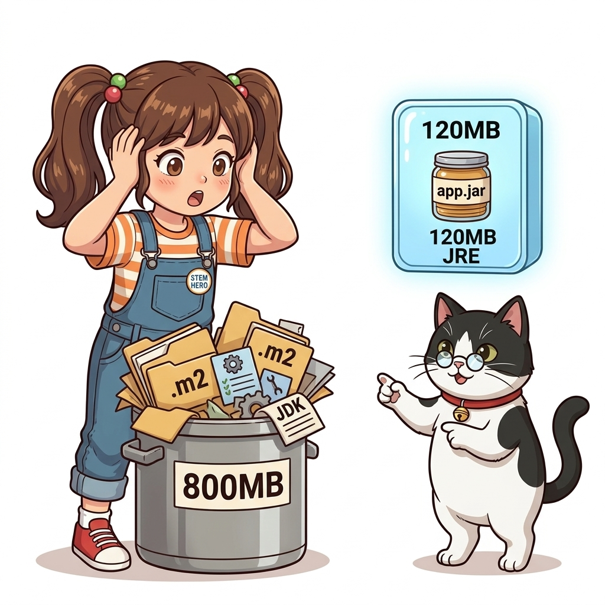
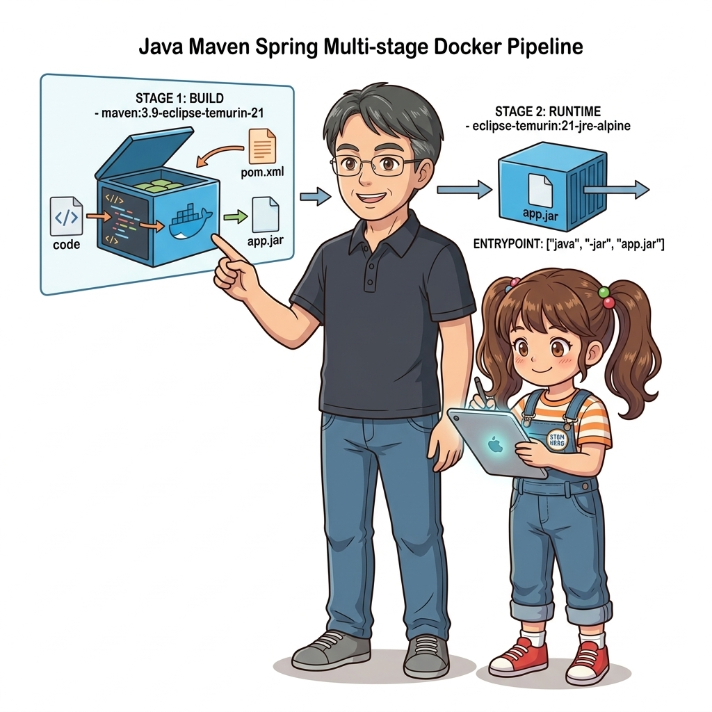
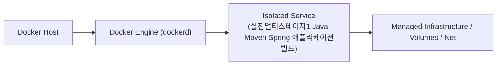

# 022. 실전멀티스테이지1 Java Maven Spring 애플리케이션빌드

자바 애플리케이션을 빌드할 때는 전체 JDK와 Maven이 필요하지만, 빌드된 `.jar` 파일을 실행할 때는 훨씬 가벼운 JRE(Java Runtime Environment)만 있으면 충분합니다.


**그림 02-8-1** 실전멀티스테이지1 Java Maven Spring 애플리케이션빌드의 필요성과 현대 클라우드 아키텍처 관점의 개요

---

### 022.1 왜 실전멀티스테이지1 Java Maven Spring 애플리케이션빌드이(가) 필요한가? (문제 정의와 현실적 배경)

소프트웨어 시스템이 복잡해질수록 설정을 다루는 방식은 전체 인프라의 신뢰성을 결정짓는 핵심 척도가 됩니다. **실전멀티스테이지1 Java Maven Spring 애플리케이션빌드**이(가) 부재하거나 잘못 다루어질 때 현장에서는 다음과 같은 대표적인 병목과 장애가 발생합니다:

1. **하드코딩된 설정과 환경 불일치로 인한 유연성 상실**: 환경이 바뀔 때마다 코드를 다시 빌드해야 하므로 배포 주기가 지연되고 이미지 수가 기하급수적으로 폭증합니다.
2. **보안 민감 데이터의 무분별한 노출**: 비밀번호, 데이터베이스 토큰, 암호화 키가 이미지 레이어에 영구 박제되어 형상관리 시스템이나 외부에 유출될 위험이 커집니다.
3. **재현 불가능한 구성 드리프트**: 스테이징 환경과 프로덕션 환경의 미세한 설정 차이가 예기치 못한 서비스 중단 사고로 직결됩니다.


**그림 02-8-2** 실전멀티스테이지1 Java Maven Spring 애플리케이션빌드에 대한 대표적인 오해와 실제 프로덕션 현장의 엔지니어링 진실

---

### 022.2 핵심 아키텍처와 엔지니어링 메커니즘

1단계(`builder`)에서 `pom.xml`만 먼저 복사해 `mvn dependency:go-offline`으로 수백 개의 라이브러리를 캐싱한 뒤 소스를 컴파일하고, 2단계에서는 `eclipse-temurin:21-jre-alpine` 이미지로 실행용 JAR만 가져오는 실무 정석 `Dockerfile`을 작성합니다.


**그림 02-8-3** 실전멀티스테이지1 Java Maven Spring 애플리케이션빌드의 내부 아키텍처 및 데이터 흐름

#### 📊 핵심 비교 및 엔지니어링 표준 분석

| 구분 / 핵심 원리 | 상세 설명 및 동작 메커니즘 | 실무 적용 시 주의점 및 베스트 프랙티스 |
| :--- | :--- | :--- |
| **1단계: 의존성 캐시 레이어** | Spring Boot/Maven 프로젝트에서는 `COPY pom.xml .` 직후 `RUN mvn dependency:go-offline`을 실행해 외부 JAR 다운로드 레이어를 고정 | `src/` 아래 자바 코드만 고쳤을 때 Maven 중앙 저장소 재다운로드를 100% 생략! |
| **2단계: JRE 전용 런타임** | `eclipse-temurin:21-jdk`(약 330MB+) 대신 `eclipse-temurin:21-jre-alpine`(약 90MB)을 최종 베이스로 선택 | 불필요한 `javac`, `javadoc`, 디버깅 도구를 제거해 메모리와 디스크 절약 |
| **`COPY --from=builder`** | 호스트가 아닌 앞선 `builder` 스테이지의 파일시스템에서 생성된 `/build/target/app.jar`만 정확히 추출 | 스테이지 간 결합도를 낮추고 깔끔한 배포 아티팩트 완성 |

---

### 022.3 선언적 실습 및 아키텍처 다이어그램

본 실습은 외부 비공개 패키지에 의존하지 않고, 공식 표준 이미지를 기반으로 즉시 재현 가능한 살아있는 코드로 구성되어 있습니다.

```dockerfile
# [Java 멀티 스테이지 빌드 정석] 1단계: JDK + 빌드 / 2단계: 경량 JRE 런타임
FROM eclipse-temurin:21-jdk-alpine AS builder
WORKDIR /build
COPY Main.java .
RUN javac Main.java && jar cfe app.jar Main Main.class

FROM eclipse-temurin:21-jre-alpine
WORKDIR /app
COPY --from=builder /build/app.jar ./app.jar
EXPOSE 8080
ENTRYPOINT ["java", "-jar", "/app/app.jar"]
```

#### 🔍 아키텍처 흐름도 (Mermaid Diagram)




**그림 02-8-4** 선언적 인프라 명세를 통한 실전멀티스테이지1 Java Maven Spring 애플리케이션빌드 검증 파이프라인

---

### 022.4 핵심 정리: 캐릭터 대화와 3대 교훈

> 👧 **도로시**: "교수님! **실전멀티스테이지1 Java Maven Spring 애플리케이션빌드**의 원리를 배우니까, 복잡하게 얽혀 있던 인프라 설정이 레고 블록처럼 질서정연하게 제자리를 찾는 게 보여요!"
> 
> 🐱 **조교 지니**: "야옹~ 맞습니다! 특히 런타임 환경과 불변 인프라의 경계를 명확히 지키는 것이 대규모 클라우드 운영의 제1원칙이랍니다!"
> 
> 🐶 **토토**: "멍멍! 선언적 코드로 한 번 적어두면 언제든 똑같이 복원되니까 정말 든든해요!"
> 
> 👨‍🏫 **이호진 교수님**: "훌륭하구나. 원리를 깊이 이해하고 실습을 통해 손에 익히는 것이 훌륭한 클라우드 엔지니어로 성장하는 가장 빠른 지름길이란다."


**그림 02-8-5** 실전멀티스테이지1 Java Maven Spring 애플리케이션빌드 마스터를 위한 3대 핵심 교훈

1. **설정과 실행의 명확한 분리**:
   * 애플리케이션 코드는 불변으로 유지하고, 가변적인 설정값은 외부에서 주입하여 이식성을 극대화합니다.
2. **선언적 재현성 확보**:
   * 사람이 수작업으로 변경하지 않고 코드 명세를 통해 언제 어디서나 100% 동일한 실행 결과를 보장합니다.
3. **최소 권한 및 보안 모범 사례 준수**:
   * 불필요한 권한과 포트 노출을 최소화하고 민감 데이터를 암호화하여 프로덕션 안정성을 담보합니다.

---

### 022.5 랩노트 피날레와 다음 강의 예고


**그림 02-8-6** 연구실에서 다음 마일스톤인 [실전멀티스테이지2 Node js와 Python 패키징최적화] 실습을 예고하는 교수님과 토토

> 💡 **다음 강의 안내**:
> [실전멀티스테이지2 Node js와 Python 패키징최적화](../023_실전멀티스테이지2_Node_js와_Python_패키징최적화/)에서는 더욱 심화된 실전 엔지니어링 실습과 아키텍처를 다룹니다!

---

## 🧭 강의 네비게이션
* [◀️ 이전 강의: 021_빌드서버가_필요없는_멀티스테이지_빌드혁명](../021_빌드서버가_필요없는_멀티스테이지_빌드혁명/)
* [📋 Part 02. 도커 이미지 제작(Dockerfile), 멀티 스테이지 빌드 & 레지스트리 공유 (015 ~ 031) 목차로 돌아가기](../)
* [▶️ 다음 강의: 023_실전멀티스테이지2_Node_js와_Python_패키징최적화](../023_실전멀티스테이지2_Node_js와_Python_패키징최적화/)
