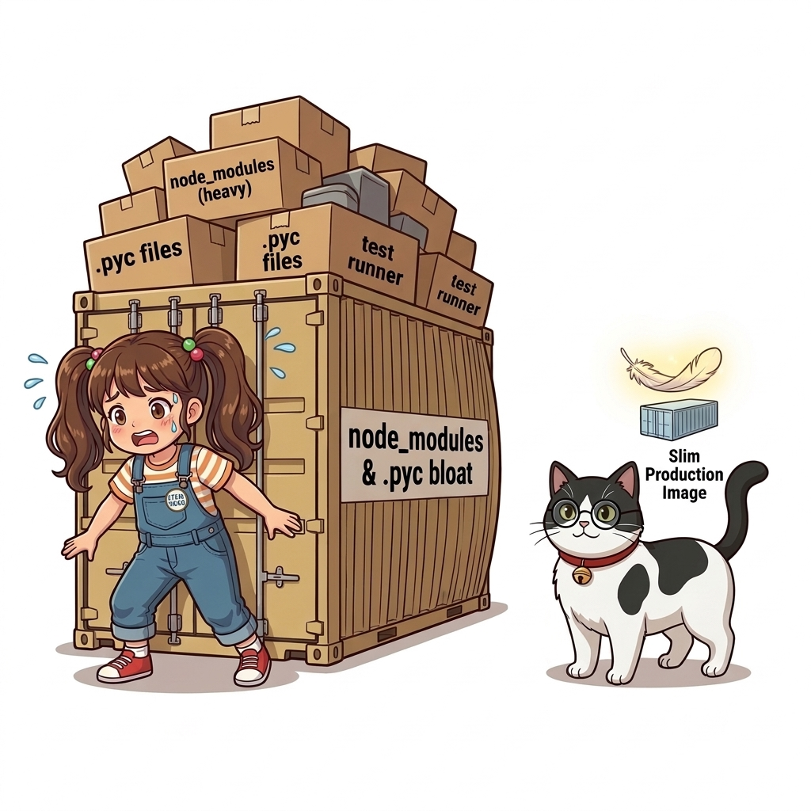
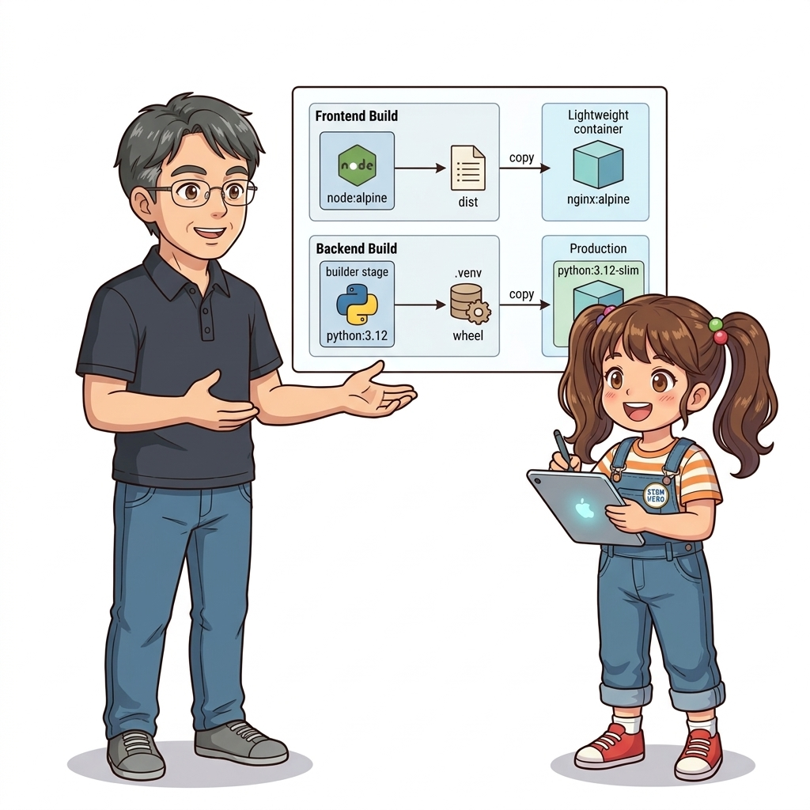
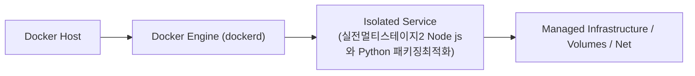

# 023. 실전멀티스테이지2 Node js와 Python 패키징최적화

Node.js(React/Vue/TypeScript)나 Python(C 확장 라이브러리 포함) 애플리케이션에서 왜 멀티 스테이지 빌드가 강력한 효과를 발휘하는지 실전 예제로 확인합니다.


**그림 02-9-1** 실전멀티스테이지2 Node js와 Python 패키징최적화의 필요성과 현대 클라우드 아키텍처 관점의 개요

---

### 023.1 왜 실전멀티스테이지2 Node js와 Python 패키징최적화이(가) 필요한가? (문제 정의와 현실적 배경)

소프트웨어 시스템이 복잡해질수록 설정을 다루는 방식은 전체 인프라의 신뢰성을 결정짓는 핵심 척도가 됩니다. **실전멀티스테이지2 Node js와 Python 패키징최적화**이(가) 부재하거나 잘못 다루어질 때 현장에서는 다음과 같은 대표적인 병목과 장애가 발생합니다:

1. **하드코딩된 설정과 환경 불일치로 인한 유연성 상실**: 환경이 바뀔 때마다 코드를 다시 빌드해야 하므로 배포 주기가 지연되고 이미지 수가 기하급수적으로 폭증합니다.
2. **보안 민감 데이터의 무분별한 노출**: 비밀번호, 데이터베이스 토큰, 암호화 키가 이미지 레이어에 영구 박제되어 형상관리 시스템이나 외부에 유출될 위험이 커집니다.
3. **재현 불가능한 구성 드리프트**: 스테이징 환경과 프로덕션 환경의 미세한 설정 차이가 예기치 못한 서비스 중단 사고로 직결됩니다.


**그림 02-9-2** 실전멀티스테이지2 Node js와 Python 패키징최적화에 대한 대표적인 오해와 실제 프로덕션 현장의 엔지니어링 진실

---

### 023.2 핵심 아키텍처와 엔지니어링 메커니즘

Node.js에서 TypeScript 컴파일 및 정적 웹 빌드를 마친 뒤 런타임에는 순수 실행 파일만 남기거나, Python에서 `gcc`/`build-essential`로 휠(Wheel)을 빌드한 뒤 슬림 이미지로 가상환경(`/opt/venv`)만 복사하는 기법을 실습합니다.


**그림 02-9-3** 실전멀티스테이지2 Node js와 Python 패키징최적화의 내부 아키텍처 및 데이터 흐름

#### 📊 핵심 비교 및 엔지니어링 표준 분석

| 구분 / 핵심 원리 | 상세 설명 및 동작 메커니즘 | 실무 적용 시 주의점 및 베스트 프랙티스 |
| :--- | :--- | :--- |
| **프론트엔드 정적 빌드 분리** | 1단계(`node:20-alpine`)에서 `npm ci && npm run build`로 정적 HTML/JS/CSS 번들 생성 ➔ 2단계(`nginx:alpine`)로 `/dist` 폴더만 복사 | 수백 MB의 `node_modules`와 Node.js 런타임이 최종 웹 서버 이미지에서 완전히 사라짐(최종 20MB 내외)! |
| **Python 가상환경(`venv`) 복사** | 1단계에서 `python -m venv /opt/venv`에 C 확장 패키지를 컴파일 설치 ➔ 2단계 `python:3.12-slim`으로 `/opt/venv`만 통째로 복사 | 운영 이미지에 무거운 `gcc`, `make`, 헤더 패키지를 남기지 않는 파이썬 도커라이징 모범 사례 |
| **`EXPOSE` 인스트럭션의 의미** | 컨테이너가 수신 대기할 포트를 문서화하는 메타데이터 역할 (실제 포트 개방은 실행 시 `-p` 옵션이 수행) | 협업 개발자와 오케스트레이션 도구에게 서비스 포트를 명확히 알려주는 표준 관례 |

---

### 023.3 선언적 실습 및 아키텍처 다이어그램

본 실습은 외부 비공개 패키지에 의존하지 않고, 공식 표준 이미지를 기반으로 즉시 재현 가능한 살아있는 코드로 구성되어 있습니다.

```dockerfile
# [Node.js & 프론트엔드 멀티 스테이지 빌드] 빌드 도구로 번들링 후 Nginx 웹 서버로 서빙!
FROM node:20-alpine AS asset-builder
WORKDIR /build
COPY package.json ./
COPY build.js ./
RUN node build.js > index.html

FROM nginx:1.27-alpine
COPY --from=asset-builder /build/index.html /usr/share/nginx/html/index.html
EXPOSE 80
```

#### 🔍 아키텍처 흐름도 (Mermaid Diagram)




**그림 02-9-4** 선언적 인프라 명세를 통한 실전멀티스테이지2 Node js와 Python 패키징최적화 검증 파이프라인

---

### 023.4 핵심 정리: 캐릭터 대화와 3대 교훈

> 👧 **도로시**: "교수님! **실전멀티스테이지2 Node js와 Python 패키징최적화**의 원리를 배우니까, 복잡하게 얽혀 있던 인프라 설정이 레고 블록처럼 질서정연하게 제자리를 찾는 게 보여요!"
> 
> 🐱 **조교 지니**: "야옹~ 맞습니다! 특히 런타임 환경과 불변 인프라의 경계를 명확히 지키는 것이 대규모 클라우드 운영의 제1원칙이랍니다!"
> 
> 🐶 **토토**: "멍멍! 선언적 코드로 한 번 적어두면 언제든 똑같이 복원되니까 정말 든든해요!"
> 
> 👨‍🏫 **이호진 교수님**: "훌륭하구나. 원리를 깊이 이해하고 실습을 통해 손에 익히는 것이 훌륭한 클라우드 엔지니어로 성장하는 가장 빠른 지름길이란다."


**그림 02-9-5** 실전멀티스테이지2 Node js와 Python 패키징최적화 마스터를 위한 3대 핵심 교훈

1. **설정과 실행의 명확한 분리**:
   * 애플리케이션 코드는 불변으로 유지하고, 가변적인 설정값은 외부에서 주입하여 이식성을 극대화합니다.
2. **선언적 재현성 확보**:
   * 사람이 수작업으로 변경하지 않고 코드 명세를 통해 언제 어디서나 100% 동일한 실행 결과를 보장합니다.
3. **최소 권한 및 보안 모범 사례 준수**:
   * 불필요한 권한과 포트 노출을 최소화하고 민감 데이터를 암호화하여 프로덕션 안정성을 담보합니다.

---

### 023.5 랩노트 피날레와 다음 강의 예고


**그림 02-9-6** 연구실에서 다음 마일스톤인 [실전멀티스테이지3 Go언어 네이티브바이너리와 초경량이미지] 실습을 예고하는 교수님과 토토

> 💡 **다음 강의 안내**:
> [실전멀티스테이지3 Go언어 네이티브바이너리와 초경량이미지](../024_실전멀티스테이지3_Go언어_네이티브바이너리와_초경량이미지/)에서는 더욱 심화된 실전 엔지니어링 실습과 아키텍처를 다룹니다!

---

## 🧭 강의 네비게이션
* [◀️ 이전 강의: 022_실전멀티스테이지1_Java_Maven_Spring_애플리케이션빌드](../022_실전멀티스테이지1_Java_Maven_Spring_애플리케이션빌드/)
* [📋 Part 02. 도커 이미지 제작(Dockerfile), 멀티 스테이지 빌드 & 레지스트리 공유 (015 ~ 031) 목차로 돌아가기](../)
* [▶️ 다음 강의: 024_실전멀티스테이지3_Go언어_네이티브바이너리와_초경량이미지](../024_실전멀티스테이지3_Go언어_네이티브바이너리와_초경량이미지/)
