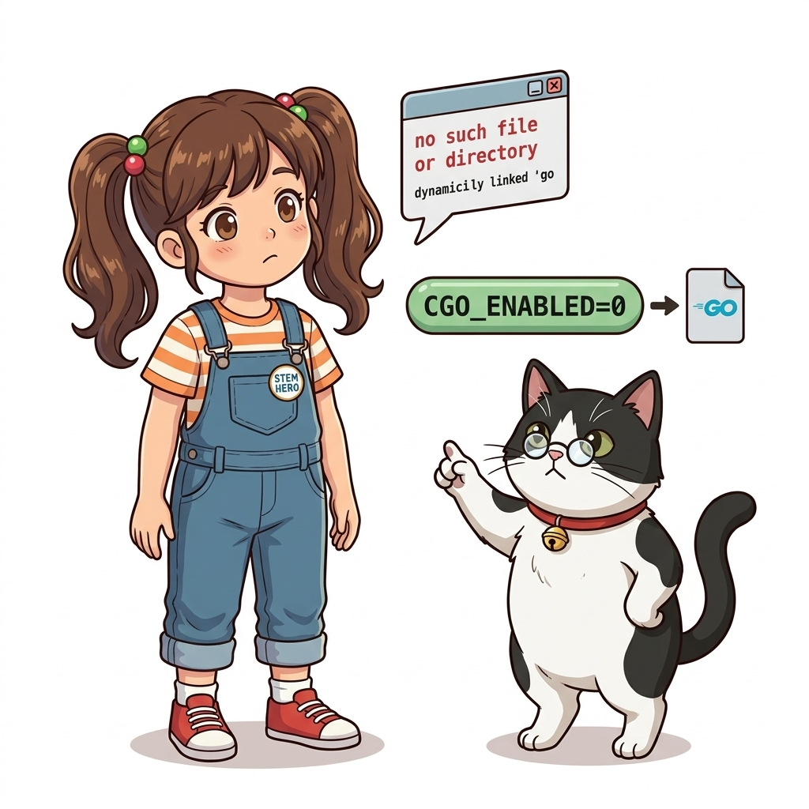
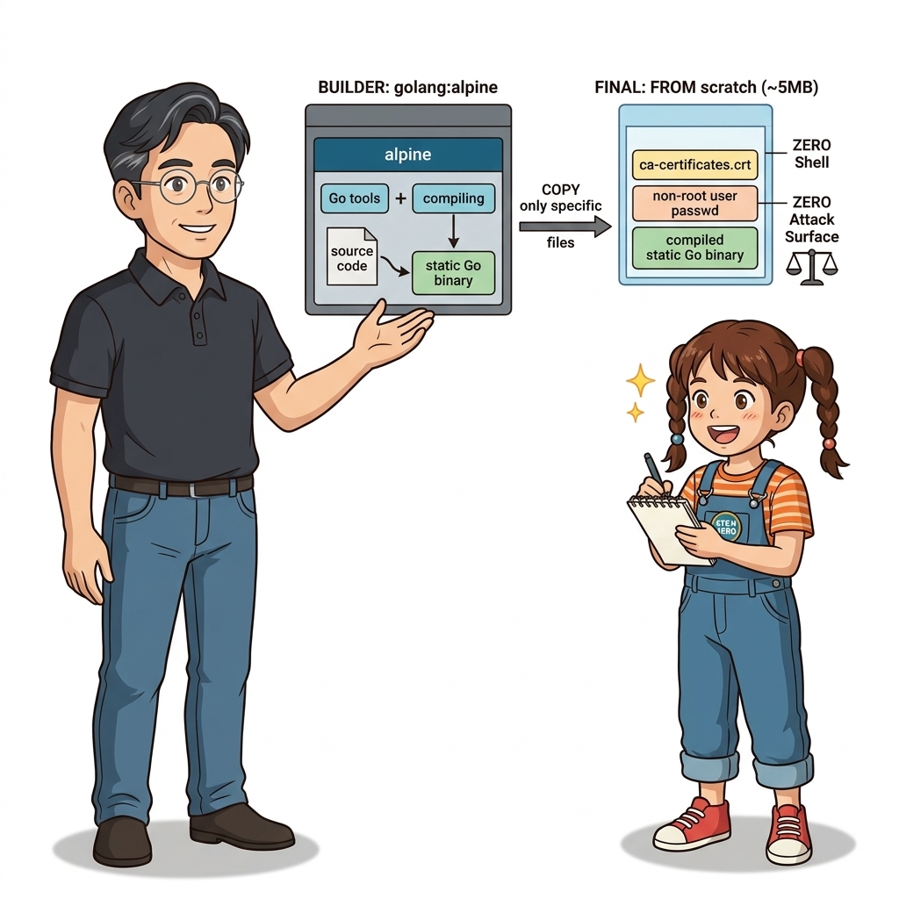
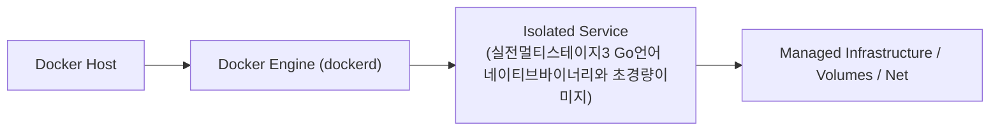

# 024. 실전멀티스테이지3 Go언어 네이티브바이너리와 초경량이미지

Go(Golang)나 Rust처럼 운영체제 네이티브 기계어 바이너리로 정적 컴파일되는 언어는 실행 시점에 별도의 가상머신(JVM)이나 인터프리터(Python/Node)가 전혀 필요하지 않습니다.


**그림 02-10-1** 실전멀티스테이지3 Go언어 네이티브바이너리와 초경량이미지의 필요성과 현대 클라우드 아키텍처 관점의 개요

---

### 024.1 왜 실전멀티스테이지3 Go언어 네이티브바이너리와 초경량이미지이(가) 필요한가? (문제 정의와 현실적 배경)

소프트웨어 시스템이 복잡해질수록 설정을 다루는 방식은 전체 인프라의 신뢰성을 결정짓는 핵심 척도가 됩니다. **실전멀티스테이지3 Go언어 네이티브바이너리와 초경량이미지**이(가) 부재하거나 잘못 다루어질 때 현장에서는 다음과 같은 대표적인 병목과 장애가 발생합니다:

1. **하드코딩된 설정과 환경 불일치로 인한 유연성 상실**: 환경이 바뀔 때마다 코드를 다시 빌드해야 하므로 배포 주기가 지연되고 이미지 수가 기하급수적으로 폭증합니다.
2. **보안 민감 데이터의 무분별한 노출**: 비밀번호, 데이터베이스 토큰, 암호화 키가 이미지 레이어에 영구 박제되어 형상관리 시스템이나 외부에 유출될 위험이 커집니다.
3. **재현 불가능한 구성 드리프트**: 스테이징 환경과 프로덕션 환경의 미세한 설정 차이가 예기치 못한 서비스 중단 사고로 직결됩니다.


**그림 02-10-2** 실전멀티스테이지3 Go언어 네이티브바이너리와 초경량이미지에 대한 대표적인 오해와 실제 프로덕션 현장의 엔지니어링 진실

---

### 024.2 핵심 아키텍처와 엔지니어링 메커니즘

`golang:1.22-alpine` 스테이지에서 `CGO_ENABLED=0`으로 완전 정적 바이너리를 컴파일한 뒤, 아예 리눅스 셸조차 없는 빈 껍데기 이미지(`scratch`) 또는 최소 알파인 이미지에 바이너리 파일 딱 하나만 담아 실행하는 극한의 경량화를 실습합니다.


**그림 02-10-3** 실전멀티스테이지3 Go언어 네이티브바이너리와 초경량이미지의 내부 아키텍처 및 데이터 흐름

#### 📊 핵심 비교 및 엔지니어링 표준 분석

| 구분 / 핵심 원리 | 상세 설명 및 동작 메커니즘 | 실무 적용 시 주의점 및 베스트 프랙티스 |
| :--- | :--- | :--- |
| **`CGO_ENABLED=0` 정적 링크** | 외부 C 라이브러리(`libc`) 동적 링크를 끄고 모든 의존성을 단일 실행 파일 하나에 정적으로 포함시킴 | 어떤 리눅스 배포판이나 빈 `scratch` 이미지 위에서도 라이브러리 누락 에러 없이 즉시 실행! |
| **`-ldflags="-s -w"`** | 컴파일된 바이너리에서 심볼 테이블과 디버그 정보를 제거하여 실행 파일 크기를 30% 이상 추가 축소 | 클라우드 네이티브 도구(Docker, Kubernetes, Prometheus, Terraform)가 모두 Go로 작성된 이유 |
| **`scratch` vs `alpine`** | `scratch`는 크기 0B의 완전 빈 이미지(보안 극대화), `alpine`은 5MB 크기에 기본 셸/인증서 제공(디버깅 편리) | 팀의 디버깅 정책과 보안 수준에 따라 선택 |

---

### 024.3 선언적 실습 및 아키텍처 다이어그램

본 실습은 외부 비공개 패키지에 의존하지 않고, 공식 표준 이미지를 기반으로 즉시 재현 가능한 살아있는 코드로 구성되어 있습니다.

```dockerfile
# [Go 초경량 멀티 스테이지 빌드] 1단계: Go 컴파일러 / 2단계: 순수 바이너리만 탑재!
FROM golang:1.22-alpine AS builder
WORKDIR /src
COPY main.go .
RUN CGO_ENABLED=0 GOOS=linux go build -ldflags="-s -w" -o /out/api-server main.go

FROM alpine:3.20
WORKDIR /app
COPY --from=builder /out/api-server ./api-server
EXPOSE 8080
ENTRYPOINT ["/app/api-server"]
```

#### 🔍 아키텍처 흐름도 (Mermaid Diagram)




**그림 02-10-4** 선언적 인프라 명세를 통한 실전멀티스테이지3 Go언어 네이티브바이너리와 초경량이미지 검증 파이프라인

---

### 024.4 핵심 정리: 캐릭터 대화와 3대 교훈

> 👧 **도로시**: "교수님! **실전멀티스테이지3 Go언어 네이티브바이너리와 초경량이미지**의 원리를 배우니까, 복잡하게 얽혀 있던 인프라 설정이 레고 블록처럼 질서정연하게 제자리를 찾는 게 보여요!"
> 
> 🐱 **조교 지니**: "야옹~ 맞습니다! 특히 런타임 환경과 불변 인프라의 경계를 명확히 지키는 것이 대규모 클라우드 운영의 제1원칙이랍니다!"
> 
> 🐶 **토토**: "멍멍! 선언적 코드로 한 번 적어두면 언제든 똑같이 복원되니까 정말 든든해요!"
> 
> 👨‍🏫 **이호진 교수님**: "훌륭하구나. 원리를 깊이 이해하고 실습을 통해 손에 익히는 것이 훌륭한 클라우드 엔지니어로 성장하는 가장 빠른 지름길이란다."


**그림 02-10-5** 실전멀티스테이지3 Go언어 네이티브바이너리와 초경량이미지 마스터를 위한 3대 핵심 교훈

1. **설정과 실행의 명확한 분리**:
   * 애플리케이션 코드는 불변으로 유지하고, 가변적인 설정값은 외부에서 주입하여 이식성을 극대화합니다.
2. **선언적 재현성 확보**:
   * 사람이 수작업으로 변경하지 않고 코드 명세를 통해 언제 어디서나 100% 동일한 실행 결과를 보장합니다.
3. **최소 권한 및 보안 모범 사례 준수**:
   * 불필요한 권한과 포트 노출을 최소화하고 민감 데이터를 암호화하여 프로덕션 안정성을 담보합니다.

---

### 024.5 랩노트 피날레와 다음 강의 예고


**그림 02-10-6** 연구실에서 다음 마일스톤인 [컨테이너간 네트워크연결 사용자정의 브리지네트워크] 실습을 예고하는 교수님과 토토

> 💡 **다음 강의 안내**:
> [컨테이너간 네트워크연결 사용자정의 브리지네트워크](../025_컨테이너간_네트워크연결_사용자정의_브리지네트워크/)에서는 더욱 심화된 실전 엔지니어링 실습과 아키텍처를 다룹니다!

---

## 🧭 강의 네비게이션
* [◀️ 이전 강의: 023_실전멀티스테이지2_Node_js와_Python_패키징최적화](../023_실전멀티스테이지2_Node_js와_Python_패키징최적화/)
* [📋 Part 02. 도커 이미지 제작(Dockerfile), 멀티 스테이지 빌드 & 레지스트리 공유 (015 ~ 031) 목차로 돌아가기](../)
* [▶️ 다음 강의: 025_컨테이너간_네트워크연결_사용자정의_브리지네트워크](../025_컨테이너간_네트워크연결_사용자정의_브리지네트워크/)
