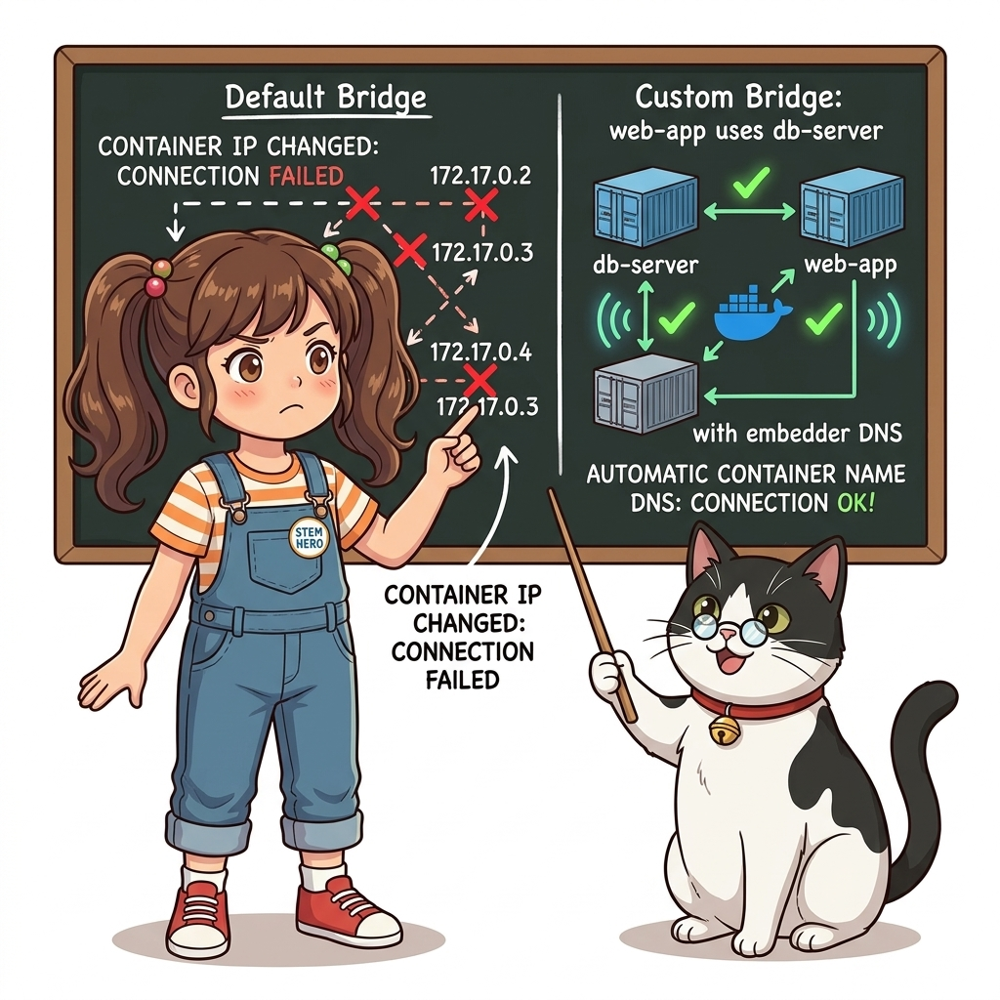
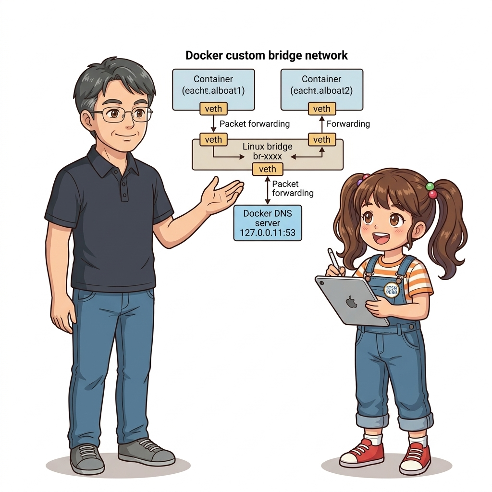
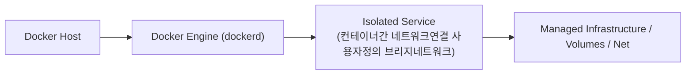
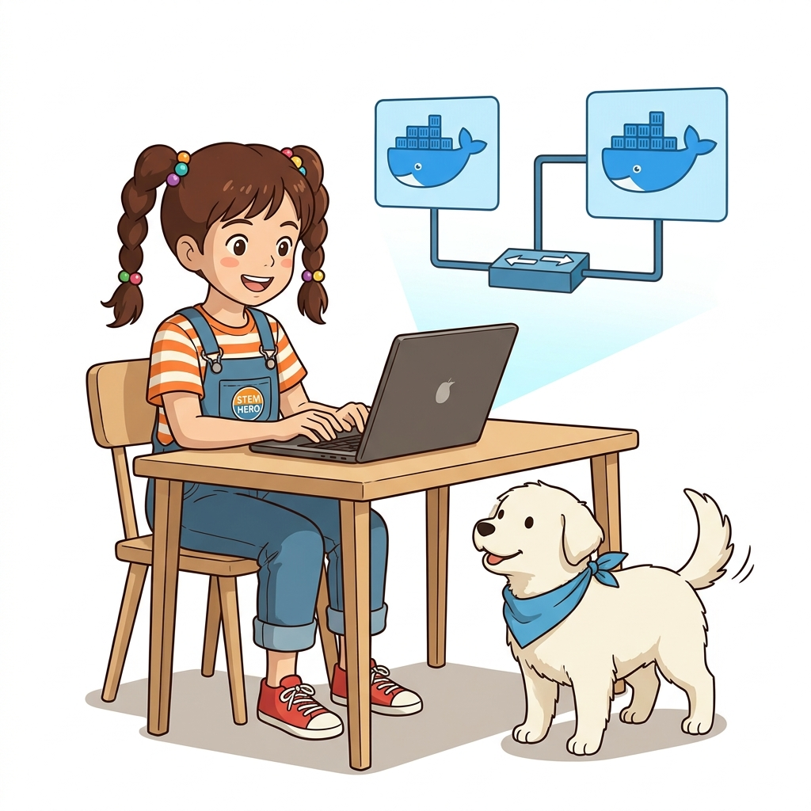
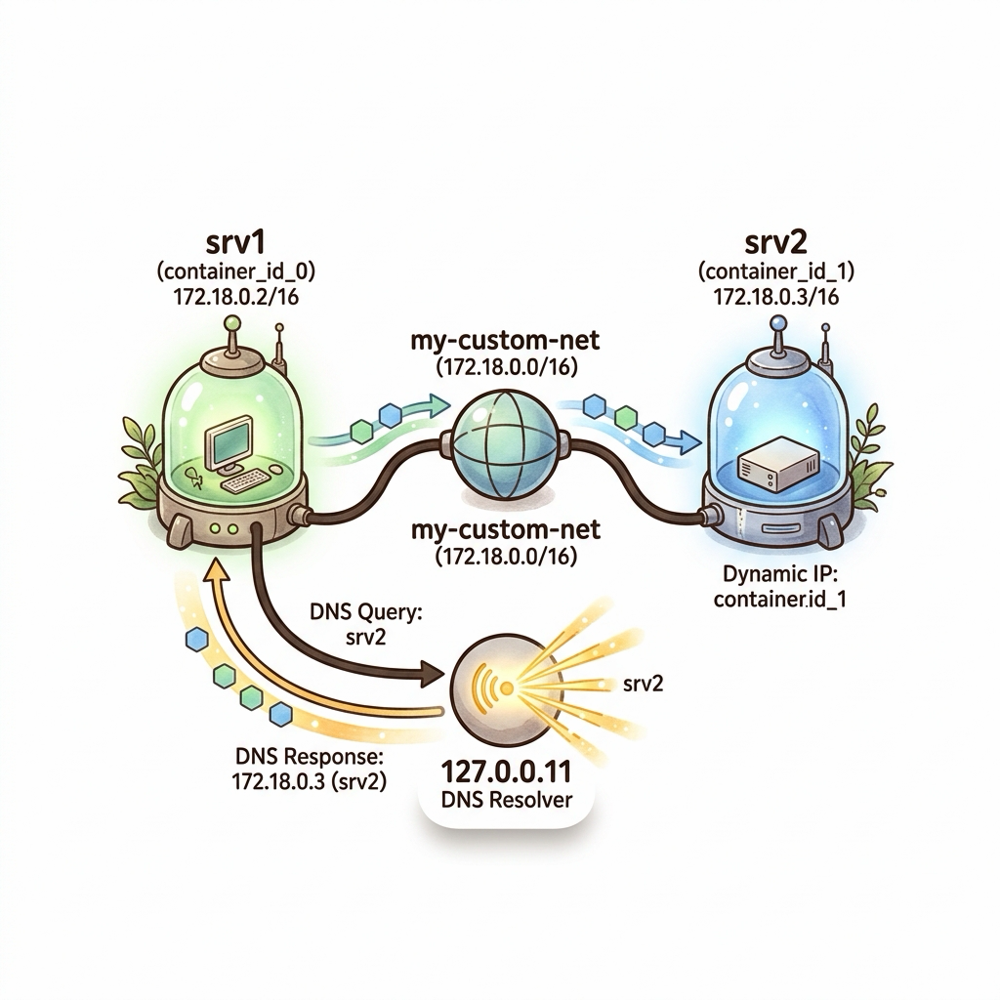
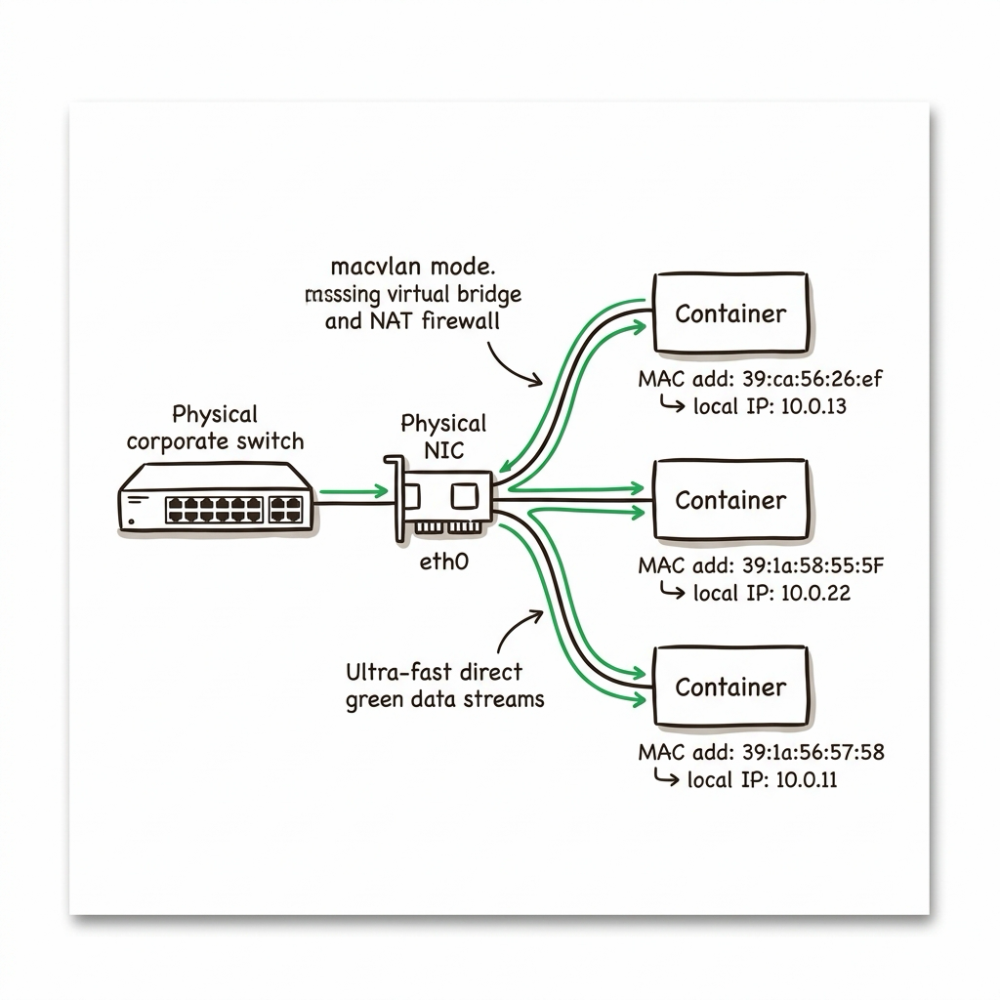
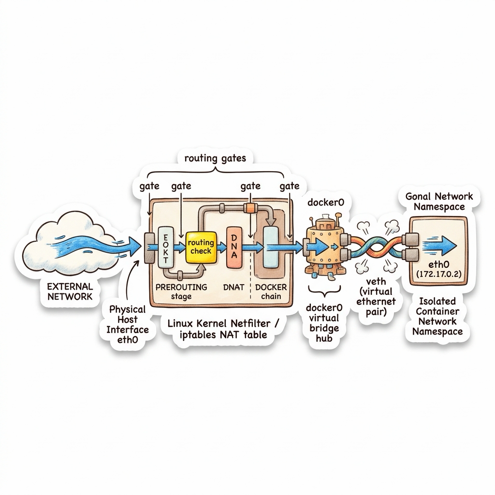

# 025. 컨테이너간 네트워크연결 사용자정의 브리지네트워크

분산 애플리케이션(예: Java/Node 웹 프론트엔드 + Go REST API + Python 로그 수집기)에서 컨테이너들이 서로의 유동적인 IP 주소를 하드코딩하지 않고 **컨테이너 이름(Host Name)**으로 통신하는 원리를 배웁니다.


**그림 02-11-1** 컨테이너간 네트워크연결 사용자정의 브리지네트워크의 필요성과 현대 클라우드 아키텍처 관점의 개요

---

### 025.1 왜 컨테이너간 네트워크연결 사용자정의 브리지네트워크이(가) 필요한가? (문제 정의와 현실적 배경)

소프트웨어 시스템이 복잡해질수록 설정을 다루는 방식은 전체 인프라의 신뢰성을 결정짓는 핵심 척도가 됩니다. **컨테이너간 네트워크연결 사용자정의 브리지네트워크**이(가) 부재하거나 잘못 다루어질 때 현장에서는 다음과 같은 대표적인 병목과 장애가 발생합니다:

1. **하드코딩된 설정과 환경 불일치로 인한 유연성 상실**: 환경이 바뀔 때마다 코드를 다시 빌드해야 하므로 배포 주기가 지연되고 이미지 수가 기하급수적으로 폭증합니다.
2. **보안 민감 데이터의 무분별한 노출**: 비밀번호, 데이터베이스 토큰, 암호화 키가 이미지 레이어에 영구 박제되어 형상관리 시스템이나 외부에 유출될 위험이 커집니다.
3. **재현 불가능한 구성 드리프트**: 스테이징 환경과 프로덕션 환경의 미세한 설정 차이가 예기치 못한 서비스 중단 사고로 직결됩니다.


**그림 02-11-2** 컨테이너간 네트워크연결 사용자정의 브리지네트워크에 대한 대표적인 오해와 실제 프로덕션 현장의 엔지니어링 진실

---

### 025.2 핵심 아키텍처와 엔지니어링 메커니즘

`docker network create`로 사용자 정의 브리지 네트워크(User-defined Bridge Network)를 생성하고, `--network` 옵션으로 연결된 컨테이너들이 도커 내장 DNS 서버(`127.0.0.11`)를 통해 이름으로 서로를 찾아내는 과정을 실습합니다.


**그림 02-11-3** 컨테이너간 네트워크연결 사용자정의 브리지네트워크의 내부 아키텍처 및 데이터 흐름

#### 📊 핵심 비교 및 엔지니어링 표준 분석

| 구분 / 핵심 원리 | 상세 설명 및 동작 메커니즘 | 실무 적용 시 주의점 및 베스트 프랙티스 |
| :--- | :--- | :--- |
| **기본 `bridge` vs 사용자 정의 네트워크** | 기본 `bridge` 네트워크는 컨테이너 이름 DNS 조회를 지원하지 않음! 반드시 `docker network create`로 만든 네트워크를 써야 이름 통신 가능 | 실무에서는 애플리케이션 단위로 전용 네트워크를 생성해 격리 및 DNS 디스커버리 활성화 |
| **도커 내장 DNS (`127.0.0.11`)** | 사용자 정의 네트워크에 붙은 컨테이너 내부의 `/etc/resolv.conf`를 보면 도커 내장 DNS가 자동 등록되어 있음 | 컨테이너가 죽었다가 새 IP로 다시 떠도 컨테이너 이름(`quote-api`)으로 항상 정확히 라우팅됨 |
| **마이크로서비스 연동의 기초** | 프론트엔드 설정에는 `API_URL=http://quote-api:80/api`처럼 서비스 이름만 환경 변수로 지정 | Part 04에서 배울 도커 컴포즈(Docker Compose) 네트워크 자동화의 핵심 기반! |

---

### 025.3 선언적 실습 및 아키텍처 다이어그램

본 실습은 외부 비공개 패키지에 의존하지 않고, 공식 표준 이미지를 기반으로 즉시 재현 가능한 살아있는 코드로 구성되어 있습니다.

```bash
# 전용 도커 네트워크(oz-net)를 만들고 백엔드 API 컨테이너와 클라이언트 컨테이너를 이름으로 연결하기
docker network create oz-net
docker container run -d --name quote-api --network oz-net nginx:1.27-alpine

# 같은 oz-net 네트워크에 속한 다른 컨테이너에서 IP가 아닌 'quote-api' 이름으로 HTTP 요청!
docker container run --rm --network oz-net alpine:3.20 wget -qO- http://quote-api | head -n 4

docker container rm -f quote-api && docker network rm oz-net
```

#### 🔍 아키텍처 흐름도 (Mermaid Diagram)




**그림 02-11-4** 선언적 인프라 명세를 통한 컨테이너간 네트워크연결 사용자정의 브리지네트워크 검증 파이프라인

---

<!-- BIBLE_INTEGRATION_book1_custom_bridge_dns -->
---

### 025.B 📚 도커 바이블 심화: 기본 bridge vs 사용자 정의 bridge: 127.0.0.11 내장 DNS와 역방향 PTR 패킷 분석
> **출처 및 학술적 배경**: 『15단계로 배우는 도커와 쿠버네티스』 제2장 (Step 04 컨테이너와 네트워크: 2.18 ~ 2.21 내부 DNS 역 이름 해결 테스트)  
> **핵심 주제**: 기본 bridge의 레거시 `--link` 한계, 사용자 정의 브리지 네트워크의 `127.0.0.11` 임베디드 DNS 프록시 주입 원리, 그리고 역방향 PTR 쿼리 시 `NXDOMAIN` 반환 메커니즘.

#### 1. 기본 브리지(Default bridge)의 치명적 한계
도커 설치 시 기본 제공되는 `docker0` 브리지는 과거 1세대 도커의 유물입니다:
* 기본 브리지에 속한 컨테이너들은 `/etc/hosts` 파일에 자신의 호스트명과 IP만 기록될 뿐, **도커 엔진의 내장 DNS 서비스가 완전히 비활성화**되어 있습니다.
* 다른 컨테이너를 찾으려면 유동적으로 변하는 사설 IP를 직접 입력해야 하며, 이름을 쓰려면 비표준 레거시 옵션인 `--link`를 써야 했습니다. `--link`는 컨테이너 재부팅 시 `/etc/hosts` 동기화가 깨지는 치명적인 결함이 있어 현재 폐기(Deprecated)되었습니다.

#### 2. 사용자 정의 네트워크와 127.0.0.11 임베디드 DNS의 마법
`docker network create` 명령으로 생성된 사용자 정의 브리지 네트워크에 컨테이너가 참여하면, 도커 엔진은 컨테이너의 `/etc/resolv.conf`를 다음과 같이 자동 구성합니다:
```
nameserver 127.0.0.11
options ndots:0
```
* **동작 원리**: 컨테이너 내부의 프로세스가 `http://db-server:3306`으로 요청을 보내면, 운영체제 리졸버는 `127.0.0.11:53`으로 표준 DNS UDP 쿼리를 던집니다.
* **iptables 루프백 인터셉트**: 리눅스 커널의 iptables 규칙이 이 패킷을 가로채 도커 데몬(`dockerd`) 내부의 고성능 DNS 서버로 전달합니다.
* **서비스 디스커버리**: 도커 데몬은 자신이 관리하는 인메모리 컨테이너 라우팅 테이블에서 `db-server`의 최신 가상 IP(`172.18.0.3`)를 0.1밀리초 만에 조회하여 A 레코드 응답을 반환합니다.

#### 3. 내부 DNS 역방향 조회(PTR Record)와 NXDOMAIN의 진실
실무에서 컨테이너 내부에서 `nslookup 172.18.0.2`처럼 IP 주소로 역방향 조회를 수행하면 다음과 같은 결과가 발생합니다:
```bash
** server can't find 2.0.18.172.in-addr.arpa: NXDOMAIN
```
* **왜 실패하는가?**: 도커의 임베디드 DNS 서버(`127.0.0.11`)는 **오직 정방향 이름 해석(A Record: 서비스명 -> IP)**만을 로컬에서 캐싱 및 응답하도록 경량화 설계되었습니다.
* **패킷 포워딩 흐름**: 역방향 조회(`in-addr.arpa`) 요청이 들어오면 도커 내장 DNS는 이를 자신이 처리하지 않고 호스트의 외부 업스트림 DNS(8.8.8.8 등)로 패스스루(Pass-through)합니다.
* 공용 인터넷 DNS 서버는 사설 대역 IP(`172.18.0.0/16`)의 소유권을 알 수 없으므로 `NXDOMAIN (Non-Existent Domain)`을 반환하는 것이 정상적인 네트워크 표준 동작입니다.


**그림 025-B-1** 도커 127.0.0.11 임베디드 DNS가 컨테이너 이름을 자동 IP로 변환해주는 통신 구조도

```bash
# [실습] 사용자 정의 브리지 네트워크와 127.0.0.11 DNS 해석 검증
# 1. 격리된 사용자 정의 브리지 네트워크 생성
docker network create my-custom-net

# 2. 네트워크에 컨테이너 2대 기동
docker container run -d --name srv1 --network my-custom-net alpine sleep 3600
docker container run -d --name srv2 --network my-custom-net alpine sleep 3600

# 3. srv1 내부에서 srv2 이름으로 핑 및 정방향 DNS 해석 테스트
docker container exec srv1 nslookup srv2
docker container exec srv1 ping -c 2 srv2

# 4. 역방향 DNS 조회 시 NXDOMAIN 동작 확인
docker container exec srv1 nslookup $(docker container inspect srv2 --format '{{range .NetworkSettings.Networks}}{{.IPAddress}}{{end}}')
```

> 👨‍🏫 **이호진 교수님의 바이블 멘토링 노트**:
> "실무에서 서비스 간 통신을 구성할 때 절대로 기본 bridge를 쓰지 마세요. 항상 `docker network create`나 Docker Compose로 전용 격리 네트워크를 만들어야 127.0.0.11 내장 DNS를 통한 안정적인 서비스 디스커버리를 누릴 수 있습니다."
>
> 👧 **도로시의 깨달음**:
> "아이피 주소가 컨테이너를 재시작할 때마다 바뀌어도 서비스 이름만 부르면 도커 우체부(127.0.0.11)가 알아서 척척 주소를 찾아주는 마법이었네요!"
>
> 🐱 **조교 지니의 아키텍처 체크포인트**:
> * 컨테이너 내부에서 `cat /etc/resolv.conf`를 실행했을 때 `nameserver 127.0.0.11`이 보인다면 사용자 정의 네트워크가 완벽하게 작동하고 있다는 증거입니다.
> * 마이크로서비스 간에 여러 개의 격리 네트워크(`frontend-net`, `backend-net`)를 분리 생성하면 보안 망분리 효과를 손쉽게 달성할 수 있습니다.

---

<!-- BIBLE_INTEGRATION_book9_macvlan_high_performance_network -->
### 025.C 📚 도커 바이블 심화: 고성능 네트워크 드라이버 macvlan: 호스트 물리 인터페이스 직결과 L2 직접 통신
*출처 도서: 『시작하세요! 도커/쿠버네티스』 핵심 분석*

도커의 기본 브리지 네트워크는 iptables NAT 변환을 거치기 때문에, 극단적인 초저지연(Low Latency)을 요구하는 실시간 통신이나 금융 트랜잭션, 통신사 네트워크 장비 가상화 환경에서는 미세한 성능 손실이 발생할 수 있습니다.

이때 사용하는 궁극의 고성능 네트워크 드라이버가 바로 **`macvlan`**입니다:
* **물리 네트워크 직접 참여**: 호스트의 물리 NIC(예: `eth0`)를 부모 인터페이스로 삼아, 컨테이너마다 고유한 독립된 **물리 MAC 주소**를 직접 할당합니다.
* **NAT 제거**: 컨테이너가 공유기나 사내 L2 스위치로부터 호스트와 동일한 물리 서브넷(예: `192.168.1.50/24`)의 실제 IP를 직접 할당받습니다.
* **초고속 패킷 처리**: 호스트 커널의 iptables NAT 변환을 전혀 거치지 않고 리눅스 커널 드라이버가 L2 레벨에서 물리 패킷을 직접 스위칭하므로 베어메탈과 100% 동일한 네트워크 속도를 자랑합니다.


**그림 025-B-1** NAT 없이 물리 스위치와 직접 통신하는 고성능 macvlan 네트워크 아키텍처 다이어그램

```bash
# [실습] macvlan 고성능 네트워크 생성 및 컨테이너 직접 바인딩
# (실습 예시: 호스트 물리 인터페이스가 eth0, 서브넷이 192.168.0.0/24인 경우)
# docker network create -d macvlan \
#   --subnet=192.168.0.0/24 \
#   --gateway=192.168.0.1 \
#   -o parent=eth0 direct-macvlan-net

# docker container run -d --name direct-app \
#   --net=direct-macvlan-net \
#   --ip=192.168.0.55 \
#   nginx:alpine
```

> 👨‍🏫 **이호진 교수님의 바이블 멘토링 노트**:
> "macvlan을 쓰면 컨테이너가 마치 허브에 직접 랜선을 꽂은 독립된 물리 컴퓨터처럼 동작합니다. 단, 보안상 기본적으로 호스트 OS와 macvlan 컨테이너 간의 직접 통신은 커널이 차단하므로 주의가 필요합니다."
>
> 👧 **도로시의 깨달음**:
> "중간 통역사(NAT)를 거치지 않고 직접 물리 스위치와 바로바로 대화하니 속도가 번개처럼 빠르겠어요!"
>
> 🐱 **조교 지니의 아키텍처 체크포인트**:
> "AWS 같은 퍼블릭 클라우드 환경에서는 네트워크 보안 정책상 단일 인스턴스에 임의의 다중 MAC 주소 생성을 차단하므로, macvlan은 온프레미스 사내 데이터센터 환경에 최적화되어 있습니다."


### 025.4 핵심 정리: 캐릭터 대화와 3대 교훈

> 👧 **도로시**: "교수님! **컨테이너간 네트워크연결 사용자정의 브리지네트워크**의 원리를 배우니까, 복잡하게 얽혀 있던 인프라 설정이 레고 블록처럼 질서정연하게 제자리를 찾는 게 보여요!"
> 
> 🐱 **조교 지니**: "야옹~ 맞습니다! 특히 런타임 환경과 불변 인프라의 경계를 명확히 지키는 것이 대규모 클라우드 운영의 제1원칙이랍니다!"
> 
> 🐶 **토토**: "멍멍! 선언적 코드로 한 번 적어두면 언제든 똑같이 복원되니까 정말 든든해요!"
> 
> 👨‍🏫 **이호진 교수님**: "훌륭하구나. 원리를 깊이 이해하고 실습을 통해 손에 익히는 것이 훌륭한 클라우드 엔지니어로 성장하는 가장 빠른 지름길이란다."


**그림 02-11-5** 컨테이너간 네트워크연결 사용자정의 브리지네트워크 마스터를 위한 3대 핵심 교훈

1. **설정과 실행의 명확한 분리**:
   * 애플리케이션 코드는 불변으로 유지하고, 가변적인 설정값은 외부에서 주입하여 이식성을 극대화합니다.
2. **선언적 재현성 확보**:
   * 사람이 수작업으로 변경하지 않고 코드 명세를 통해 언제 어디서나 100% 동일한 실행 결과를 보장합니다.
3. **최소 권한 및 보안 모범 사례 준수**:
   * 불필요한 권한과 포트 노출을 최소화하고 민감 데이터를 암호화하여 프로덕션 안정성을 담보합니다.

---

### 025.5 랩노트 피날레와 다음 강의 예고


**그림 02-11-6** 연구실에서 다음 마일스톤인 [레지스트리 리포지터리 이미지태그의 정확한구조] 실습을 예고하는 교수님과 토토

> 💡 **다음 강의 안내**:
> [레지스트리 리포지터리 이미지태그의 정확한구조](../026_레지스트리_리포지터리_이미지태그의_정확한구조/)에서는 더욱 심화된 실전 엔지니어링 실습과 아키텍처를 다룹니다!

---

## 🧭 강의 네비게이션
* [◀️ 이전 강의: 024_실전멀티스테이지3_Go언어_네이티브바이너리와_초경량이미지](../024_실전멀티스테이지3_Go언어_네이티브바이너리와_초경량이미지/)
* [📋 Part 02. 도커 이미지 제작(Dockerfile), 멀티 스테이지 빌드 & 레지스트리 공유 (015 ~ 031) 목차로 돌아가기](../)
* [▶️ 다음 강의: 026_레지스트리_리포지터리_이미지태그의_정확한구조](../026_레지스트리_리포지터리_이미지태그의_정확한구조/)


<!-- BIBLE_INTEGRATION_book9_deep_025 -->
---

### 025.C 📚 도커 바이블 심화: 도커 네트워크 심층 해부: veth 페어, docker0 브리지, 그리고 iptables NAT 패킷 흐름
> **출처 및 학술적 배경**: 시작하세요! 도커/쿠버네티스 제2장 (도커 엔진 - 네트워크)  
> **핵심 주제**: 대규모 클러스터 오케스트레이션, 분산 합의 알고리즘(Raft), 오버레이 네트워킹 및 프로덕션 데몬 튜닝을 심층 학습합니다.

#### 1. 아키텍처 및 내부 메커니즘 분석
컨테이너가 호스트 외부와 자유롭게 통신하고, 외부 트래픽이 호스트 포트를 통해 컨테이너 내부로 도달하는 원리는 리눅스 커널의 네트워크 가상화 3단계 파이프라인으로 동작합니다.

#### 리눅스 커널 가상 네트워크 3단계 파이프라인:
1. **veth 페어 (Virtual Ethernet Pair)**:
   * 컨테이너 내부의 `eth0`과 호스트의 `vethXXXX`가 마치 한 가닥의 물리 UTP 케이블 양 끝처럼 1:1로 직결되어 패킷을 양방향 전달합니다.
2. **docker0 소프트웨어 스위치 (Linux Bridge)**:
   * 호스트에 상주하는 가상 L2 스위치로서 모든 `veth` 인터페이스를 묶어 172.17.0.0/16 서브넷 브로드캐스트 도메인을 형성합니다.
3. **iptables PREROUTING & DOCKER 체인**:
   * **Inbound (DNAT)**: 외부에서 `호스트IP:8080`으로 들어온 패킷은 `PREROUTING` 체인에서 목적지가 `컨테이너IP:80`으로 변환(Destination NAT)됩니다.
   * **Outbound (MASQUERADE/SNAT)**: 컨테이너가 외부 인터넷으로 나갈 때는 `POSTROUTING` 체인에서 송신자 IP가 호스트의 공인/사설 IP로 변환(Source NAT)됩니다.



#### 2. 엔터프라이즈 실전 검증 실습
```bash
# [실습] veth 인터페이스와 iptables NAT 규칙 심층 추적
# 1. 호스트의 브리지 및 연결된 veth 인터페이스 확인
ip link show type veth
bridge link show docker0

# 2. 도커가 자동 생성한 iptables NAT 규칙 확인
sudo iptables -t nat -L DOCKER -n -v --line-numbers

# 3. 호스트 커널 IP 포워딩 활성화 여부 점검 (반드시 1이어야 함)
sysctl net.ipv4.ip_forward
```

#### 3. 프로덕션 운영을 위한 핵심 멘토링
> 👨‍🏫 **이호진 교수님의 심화 지도**:
> "컨테이너 내부에서 외부 접속이 안 될 때는 DNS 문제 외에도 호스트의 net.ipv4.ip_forward=1 커널 포워딩 파라미터가 0으로 꺼져있는지 반드시 확인해야 합니다."
>
> 👧 **도로시의 깨달음**:
> "호스트 집 주소로 온 편지를 우체부(iptables)가 방 번호(컨테이너 사설 IP)로 고쳐 써서 전용 파이프(veth)로 쏙 넣어주는 거네요!"
>
> 🐱 **조교 지니의 프로덕션 체크리스트**:
> * docker network inspect bridge 명령으로 컨테이너별 할당 IP와 MAC 주소를 한눈에 조회할 수 있습니다.
