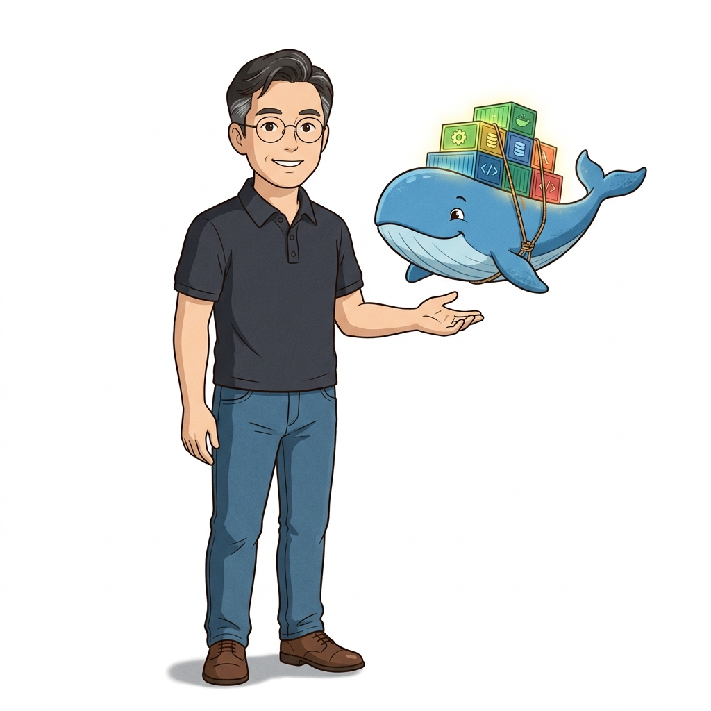
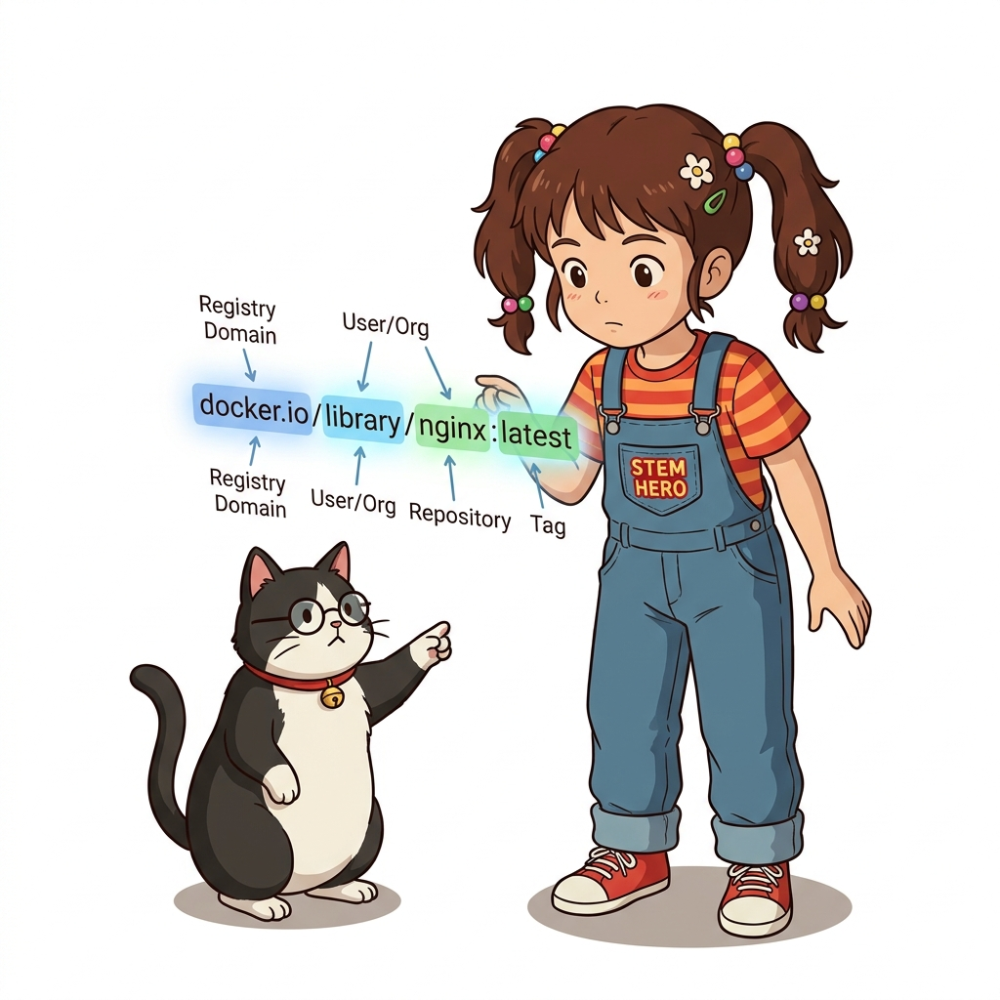
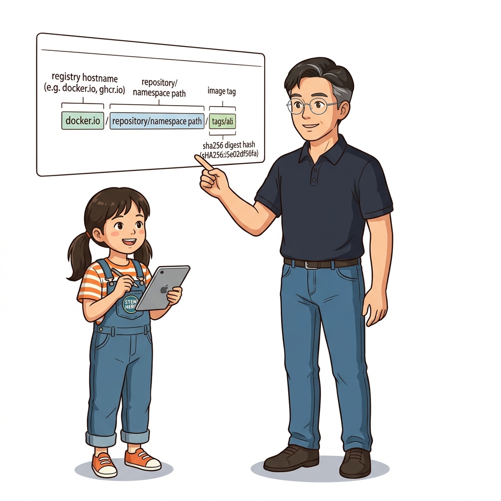
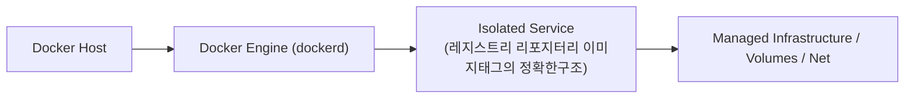
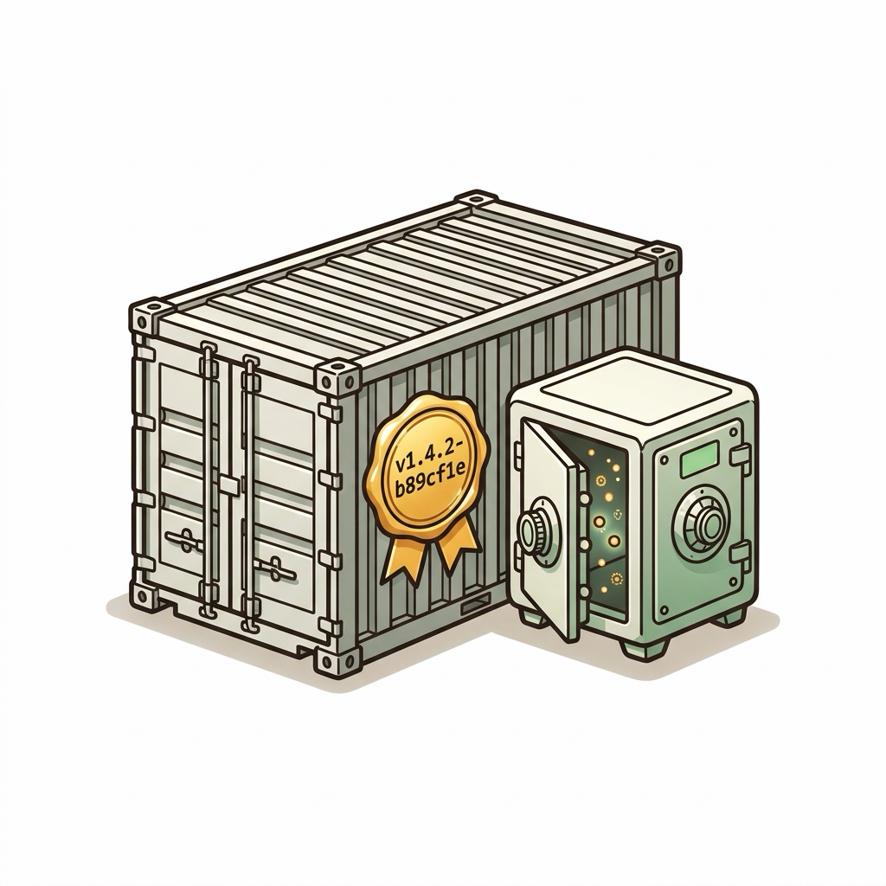
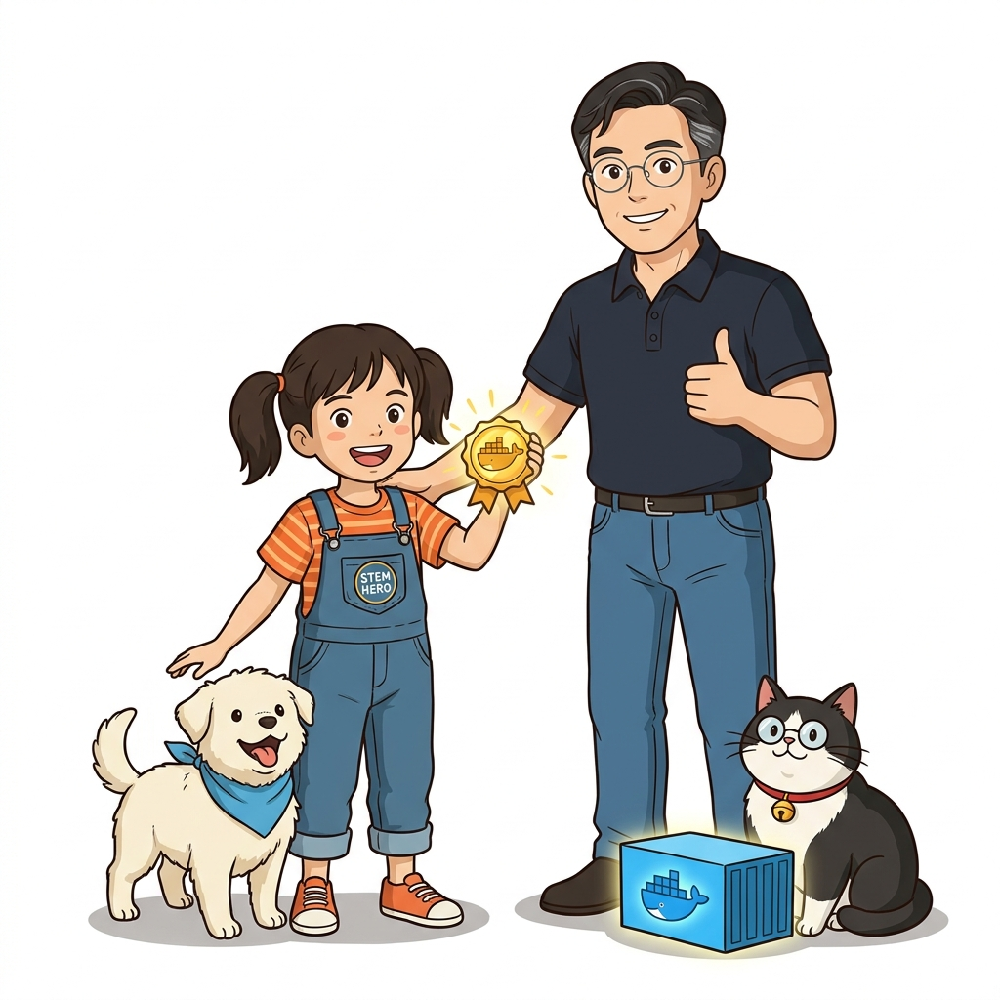

# 026. 레지스트리 리포지터리 이미지태그의 정확한구조

빌드한 이미지를 전 세계 또는 사내 서버와 공유(Share)하기 위해 반드시 알아야 할 **이미지 전체 참조 경로(Full Image Reference)**의 4단계 구성을 해부합니다.


**그림 02-12-1** 레지스트리 리포지터리 이미지태그의 정확한구조의 필요성과 현대 클라우드 아키텍처 관점의 개요

---

### 026.1 왜 레지스트리 리포지터리 이미지태그의 정확한구조이(가) 필요한가? (문제 정의와 현실적 배경)

소프트웨어 시스템이 복잡해질수록 설정을 다루는 방식은 전체 인프라의 신뢰성을 결정짓는 핵심 척도가 됩니다. **레지스트리 리포지터리 이미지태그의 정확한구조**이(가) 부재하거나 잘못 다루어질 때 현장에서는 다음과 같은 대표적인 병목과 장애가 발생합니다:

1. **하드코딩된 설정과 환경 불일치로 인한 유연성 상실**: 환경이 바뀔 때마다 코드를 다시 빌드해야 하므로 배포 주기가 지연되고 이미지 수가 기하급수적으로 폭증합니다.
2. **보안 민감 데이터의 무분별한 노출**: 비밀번호, 데이터베이스 토큰, 암호화 키가 이미지 레이어에 영구 박제되어 형상관리 시스템이나 외부에 유출될 위험이 커집니다.
3. **재현 불가능한 구성 드리프트**: 스테이징 환경과 프로덕션 환경의 미세한 설정 차이가 예기치 못한 서비스 중단 사고로 직결됩니다.


**그림 02-12-2** 레지스트리 리포지터리 이미지태그의 정확한구조에 대한 대표적인 오해와 실제 프로덕션 현장의 엔지니어링 진실

---

### 026.2 핵심 아키텍처와 엔지니어링 메커니즘

`[레지스트리 도메인]/[계정 또는 조직 이름]/[리포지터리 이름]:[태그]`의 각 요소가 의미하는 바와, `docker image tag` 명령을 사용해 기존 이미지에 새로운 레지스트리 주소와 버전 별칭(Alias)을 부여하는 방법을 배웁니다.


**그림 02-12-3** 레지스트리 리포지터리 이미지태그의 정확한구조의 내부 아키텍처 및 데이터 흐름

#### 📊 핵심 비교 및 엔지니어링 표준 분석

| 구분 / 핵심 원리 | 상세 설명 및 동작 메커니즘 | 실무 적용 시 주의점 및 베스트 프랙티스 |
| :--- | :--- | :--- |
| **1. 레지스트리 도메인** | 이미지가 저장된 서버 주소 (생략 시 기본값은 도커 허브인 `docker.io`) | 기타 주요 레지스트리: `ghcr.io`(GitHub), `gcr.io`(Google), `ecr.aws`(AWS), `localhost:5000`(사설) |
| **2. 계정 / 네임스페이스** | 리포지터리를 소유한 개인 또는 조직의 계정 ID (도커 허브 공식 이미지는 기본값 `library`가 생략된 형태) | 내 도커 허브에 푸시하려면 반드시 내 계정명(`내아이디/앱이름:태그`)이 포함되어야 권한이 허용됨 |
| **3. 리포지터리명 & 4. 태그** | 애플리케이션 이름과 버전 식별자 (태그 생략 시 기본값 `:latest`가 자동 부여됨) | `docker image tag`는 파일을 복제하는 것이 아니라 동일한 이미지 ID에 새 이름표(포인터)만 추가함(용량 증가 0B)! |

---

### 026.3 선언적 실습 및 아키텍처 다이어그램

본 실습은 외부 비공개 패키지에 의존하지 않고, 공식 표준 이미지를 기반으로 즉시 재현 가능한 살아있는 코드로 구성되어 있습니다.

```bash
# 로컬 이미지에 레지스트리 도메인·계정·버전 태그 별칭(Tag)을 부여하고 이미지 ID가 동일함을 확인하기
docker image pull alpine:3.20
docker image tag alpine:3.20 registry.oz-cloud.local:5000/devops-team/base-os:1.0.0
docker image ls --filter "reference=*alpine*" --filter "reference=registry.oz-cloud.local*" 
```

#### 🔍 아키텍처 흐름도 (Mermaid Diagram)




**그림 02-12-4** 선언적 인프라 명세를 통한 레지스트리 리포지터리 이미지태그의 정확한구조 검증 파이프라인

---

<!-- BIBLE_INTEGRATION_book5_registry_auth_config -->
---

### 026.B 📚 도커 바이블 심화: 시맨틱 버저닝 태깅 전략과 ~/.docker/config.json 레지스트리 인증 보안
*출처 도서: 『제대로 배우는 도커』 핵심 분석*

엔터프라이즈 환경에서 이미지를 빌드하고 배포할 때 가장 위험한 안티패턴은 `latest` 태그에 의존하는 것입니다. `latest`는 단순한 관례적 문자열일 뿐, '가장 최신'임을 기술적으로 보장하지 않으며 환경 간 재현성을 완전히 파괴합니다.

#### 엔터프라이즈 불변 태깅 3원칙:
1. **시맨틱 버저닝 (SemVer)**: `v1.2.3` (Major.Minor.Patch) 체계를 준수하여 API 호환성 파괴 여부를 태그만으로 즉시 판별합니다.
2. **Git 커밋 SHA 결합**: `v1.2.3-a8f3b2c` 형태로 Git 커밋 해시를 결합하여 배포된 컨테이너가 정확히 어떤 소스코드 스냅샷에서 빌드되었는지 100% 역추적 가능하게 만듭니다.
3. **인증 정보 보호 (`~/.docker/config.json`)**:
   * 기본적으로 Base64로 인코딩된 패스워드가 평문 저장될 위험이 있습니다.
   * `osxkeychain`(Mac), `wincred`(Windows), `pass`(Linux) 같은 공식 자격증명 도우미(Credential Helper)를 연동하여 시스템 키체인에 암호화 보관해야 합니다.


**그림 026-B-1** Git 커밋 SHA와 시맨틱 버저닝이 단단하게 결합된 불변 컨테이너 태그 스탬프 인포그래픽

```bash
# [실습] Git 커밋 해시 결합 시맨틱 태깅 및 자격증명 상태 점검
GIT_HASH=$(git rev-parse --short HEAD 2>/dev/null || echo "manual")
VERSION="v1.0.0"
FULL_TAG="mycorp/api-server:${VERSION}-${GIT_HASH}"

echo "빌드 대상 불변 태그: $FULL_TAG"
docker image tag alpine:latest "$FULL_TAG"

# 도커 인증 설정 파일 보안 확인 (credHelpers 등록 여부 점검)
cat ~/.docker/config.json | grep -E "(auths|credsStore|credHelpers)"
```

> 👨‍🏫 **이호진 교수님의 바이블 멘토링 노트**:
> "프로덕션 배포 파이프라인에서 latest 태그를 사용하는 것은 날짜가 적히지 않은 약병을 환자에게 건네는 것과 같습니다. 반드시 Git SHA가 포함된 불변 태그를 사용하세요."
>
> 👧 **도로시의 깨달음**:
> "이름표에 버전 번호뿐만 아니라 깃 커밋 번호까지 딱 박아두니 문제 생겼을 때 어떤 코드가 잘못되었는지 단번에 찾을 수 있겠네요!"
>
> 🐱 **조교 지니의 아키텍처 체크포인트**:
> "쿠버네티스에서도 `imagePullPolicy`가 Always로 설정되어 있지 않은 이상 `latest` 태그 이미지는 노드에 캐시된 구버전이 그대로 실행되어 롤아웃 장애를 일으킨답니다."

---

### 026.C 📚 도커 바이블 심화: OCI Image Manifest v2 구조와 위변조 불가능한 다이제스트 고정(Digest Pinning)

> 📖 **참고 도서 심층 연계**:
> * 《도커 컨테이너》 제6장 (도커 레지스트리 V2 프로토콜과 매니페스트 해부)
> * 《제대로 배우는 도커》 제7장 (컨테이너 이미지 배포와 레지스트리 무결성 검증)

태그(Tag)는 단순한 **가변 포인터(Mutable Pointer)**에 불과합니다. 악의적인 해커가 레지스트리 권한을 탈취하거나 동료 개발자가 실수로 동일한 태그(`v1.0.0`)로 다른 바이너리를 덮어씌워 푸시(Force Push)하면, 시스템 전체가 의도치 않은 코드로 오염될 수 있습니다.

#### 1. OCI 매니페스트(Manifest)와 콘텐츠 주소 지정 스토리지 (CAS)

도커 레지스트리 V2 API의 핵심은 **콘텐츠 주소 지정(Content-Addressable Storage, CAS)** 원리입니다. 이미지를 구성하는 모든 것은 고유한 암호화 해시(SHA-256 Digest)로 식별됩니다:

```json
// OCI Image Manifest v2 (application/vnd.oci.image.manifest.v1+json)
{
  "schemaVersion": 2,
  "mediaType": "application/vnd.oci.image.manifest.v1+json",
  "config": {
    "mediaType": "application/vnd.oci.image.config.v1+json",
    "size": 7023,
    "digest": "sha256:8b449b2512f4625b1b4c6e93... (환경변수, CMD, 레이어 diff_id 포함)"
  },
  "layers": [
    {
      "mediaType": "application/vnd.oci.image.layer.v1.tar+gzip",
      "size": 3260714,
      "digest": "sha256:d4fc045c9e3a848011de66f3... (실제 압축된 파일시스템 블롭)"
    }
  ]
}
```

* **매니페스트 다이제스트**: 위 JSON 텍스트 자체를 SHA-256으로 해싱한 값이 바로 `sha256:1a2b3c...` 형태의 매니페스트 다이제스트입니다.
* 단 1글자의 메타데이터나 레이어가 바뀌어도 다이제스트는 수학적으로 완전히 달라집니다.

#### 2. 실전 프로덕션 다이제스트 고정(Digest Pinning) 실습

금융권이나 미션 크리티컬 인프라에서는 태그 대신 다이제스트를 직접 참조하여 0.0001%의 코드 위변조 가능성도 원천 차단합니다:

```bash
# 1. 이미지의 정확한 매니페스트 RepoDigests 해시값 조회
docker image inspect alpine:3.20 --format '{{index .RepoDigests 0}}'
# 출력: alpine@sha256:beefdbd8a1da6d2915566fde36db9db0b524eb737357fa17849d5ad6b6340280

# 2. 태그가 아닌 다이제스트를 직접 지정하여 컨테이너 실행 (100% 무결성 보장)
docker container run --rm alpine@sha256:beefdbd8a1da6d2915566fde36db9db0b524eb737357fa17849d5ad6b6340280 cat /etc/os-release
```

> 👧 **도로시**: "태그는 언제든 다른 곳으로 옮겨 붙일 수 있는 스티커지만, 다이제스트는 지문처럼 절대로 위조할 수 없는 이미지의 고유한 유전자군요!"
> 
> 👨‍🏫 **이호진 교수님**: "정확하단다, 도로시! 쿠버네티스 프로덕션 파드 정의서나 보안 통제 환경에서 `image: myapp@sha256:...` 형태로 고정하는 기법이 바로 이 완벽한 불변성을 보장하기 위함이란다."
> 
> 🐱 **조교 지니**: "야옹~ 사내 프라이빗 레지스트리를 구축할 때도 도커 데몬이 이 매니페스트 다이제스트를 먼저 조회하여 필요한 레이어만 스마트하게 다운로드한답니다!"


### 026.4 핵심 정리: 캐릭터 대화와 3대 교훈

> 👧 **도로시**: "교수님! **레지스트리 리포지터리 이미지태그의 정확한구조**의 원리를 배우니까, 복잡하게 얽혀 있던 인프라 설정이 레고 블록처럼 질서정연하게 제자리를 찾는 게 보여요!"
> 
> 🐱 **조교 지니**: "야옹~ 맞습니다! 특히 런타임 환경과 불변 인프라의 경계를 명확히 지키는 것이 대규모 클라우드 운영의 제1원칙이랍니다!"
> 
> 🐶 **토토**: "멍멍! 선언적 코드로 한 번 적어두면 언제든 똑같이 복원되니까 정말 든든해요!"
> 
> 👨‍🏫 **이호진 교수님**: "훌륭하구나. 원리를 깊이 이해하고 실습을 통해 손에 익히는 것이 훌륭한 클라우드 엔지니어로 성장하는 가장 빠른 지름길이란다."


**그림 02-12-5** 레지스트리 리포지터리 이미지태그의 정확한구조 마스터를 위한 3대 핵심 교훈

1. **설정과 실행의 명확한 분리**:
   * 애플리케이션 코드는 불변으로 유지하고, 가변적인 설정값은 외부에서 주입하여 이식성을 극대화합니다.
2. **선언적 재현성 확보**:
   * 사람이 수작업으로 변경하지 않고 코드 명세를 통해 언제 어디서나 100% 동일한 실행 결과를 보장합니다.
3. **최소 권한 및 보안 모범 사례 준수**:
   * 불필요한 권한과 포트 노출을 최소화하고 민감 데이터를 암호화하여 프로덕션 안정성을 담보합니다.

---

### 026.5 랩노트 피날레와 다음 강의 예고


**그림 02-12-6** 연구실에서 다음 마일스톤인 [도커허브와 GHCR에 나만의이미지 Push 배포하기] 실습을 예고하는 교수님과 토토

> 💡 **다음 강의 안내**:
> [도커허브와 GHCR에 나만의이미지 Push 배포하기](../027_도커허브와_GHCR에_나만의이미지_Push_배포하기/)에서는 더욱 심화된 실전 엔지니어링 실습과 아키텍처를 다룹니다!

---

## 🧭 강의 네비게이션
* [◀️ 이전 강의: 025_컨테이너간_네트워크연결_사용자정의_브리지네트워크](../025_컨테이너간_네트워크연결_사용자정의_브리지네트워크/)
* [📋 Part 02. 도커 이미지 제작(Dockerfile), 멀티 스테이지 빌드 & 레지스트리 공유 (015 ~ 031) 목차로 돌아가기](../)
* [▶️ 다음 강의: 027_도커허브와_GHCR에_나만의이미지_Push_배포하기](../027_도커허브와_GHCR에_나만의이미지_Push_배포하기/)
