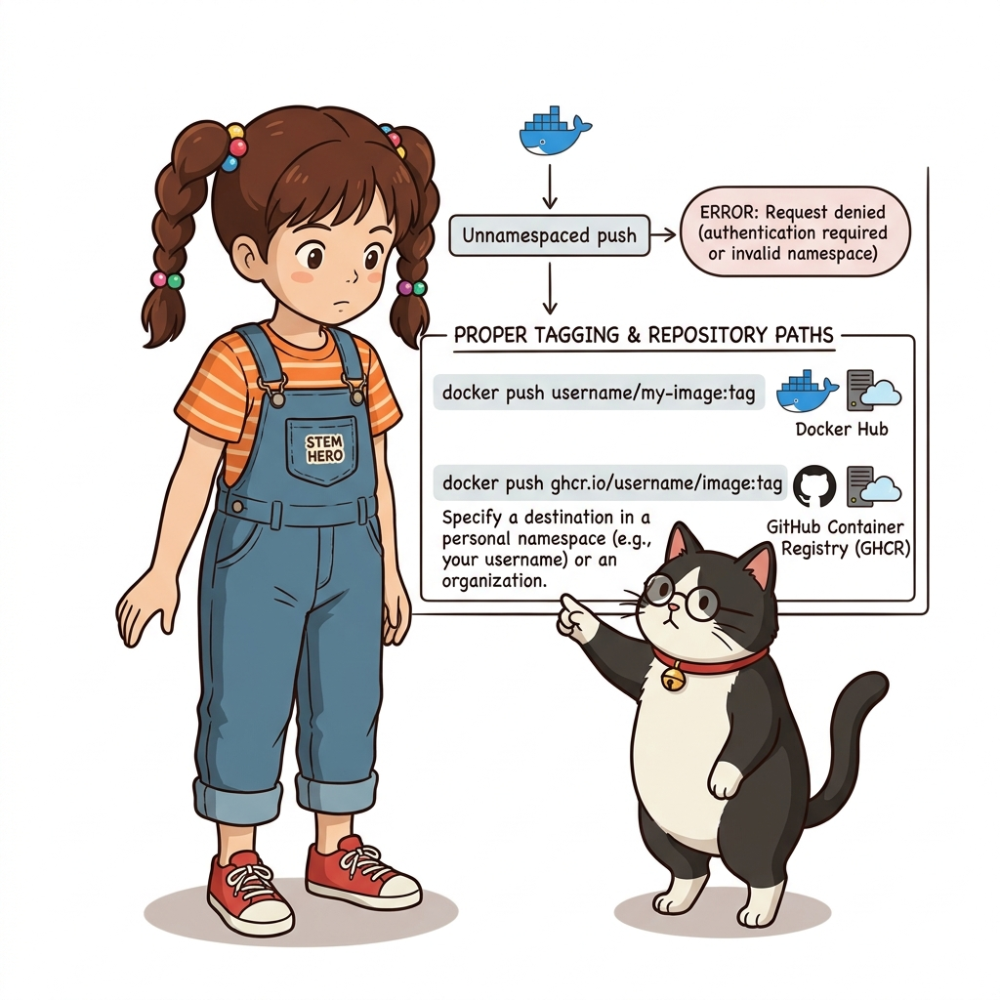
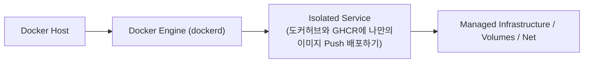
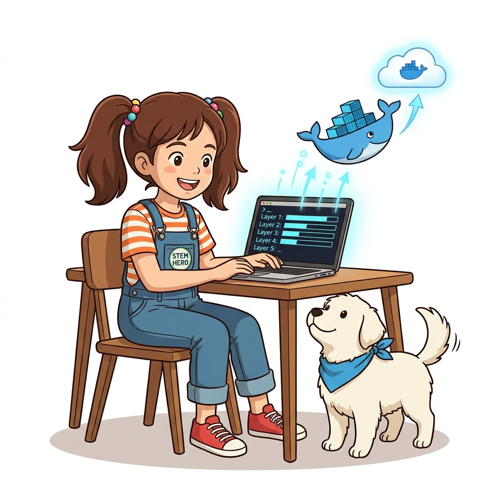

# 027. 도커허브와 GHCR에 나만의이미지 Push 배포하기

`docker login` 명령을 통해 Docker Hub(또는 GitHub Container Registry `ghcr.io`)에 인증하고, 내 계정 네임스페이스로 태그된 이미지를 `docker image push`로 업로드하는 전체 절차를 익힙니다.


**그림 02-13-1** 도커허브와 GHCR에 나만의이미지 Push 배포하기의 필요성과 현대 클라우드 아키텍처 관점의 개요

---

### 027.1 왜 도커허브와 GHCR에 나만의이미지 Push 배포하기이(가) 필요한가? (문제 정의와 현실적 배경)

소프트웨어 시스템이 복잡해질수록 설정을 다루는 방식은 전체 인프라의 신뢰성을 결정짓는 핵심 척도가 됩니다. **도커허브와 GHCR에 나만의이미지 Push 배포하기**이(가) 부재하거나 잘못 다루어질 때 현장에서는 다음과 같은 대표적인 병목과 장애가 발생합니다:

1. **하드코딩된 설정과 환경 불일치로 인한 유연성 상실**: 환경이 바뀔 때마다 코드를 다시 빌드해야 하므로 배포 주기가 지연되고 이미지 수가 기하급수적으로 폭증합니다.
2. **보안 민감 데이터의 무분별한 노출**: 비밀번호, 데이터베이스 토큰, 암호화 키가 이미지 레이어에 영구 박제되어 형상관리 시스템이나 외부에 유출될 위험이 커집니다.
3. **재현 불가능한 구성 드리프트**: 스테이징 환경과 프로덕션 환경의 미세한 설정 차이가 예기치 못한 서비스 중단 사고로 직결됩니다.


**그림 02-13-2** 도커허브와 GHCR에 나만의이미지 Push 배포하기에 대한 대표적인 오해와 실제 프로덕션 현장의 엔지니어링 진실

---

### 027.2 핵심 아키텍처와 엔지니어링 메커니즘

전체 이미지 용량이 100MB라도 **기반 레이어(예: `alpine`, `node`)는 이미 도커 허브에 존재하므로 `Mounted from library/...`로 생략되고 내가 추가한 수 KB짜리 레이어만 초고속으로 업로드**되는 레이어 공유의 진가를 확인합니다.


**그림 02-13-3** 도커허브와 GHCR에 나만의이미지 Push 배포하기의 내부 아키텍처 및 데이터 흐름

#### 📊 핵심 비교 및 엔지니어링 표준 분석

| 구분 / 핵심 원리 | 상세 설명 및 동작 메커니즘 | 실무 적용 시 주의점 및 베스트 프랙티스 |
| :--- | :--- | :--- |
| **보안 인증 (PAT 토큰 권장)** | `docker login` 시 계정 비밀번호 대신 권한 범위(Read/Write)가 제한된 Personal Access Token(PAT) 사용 권장 | CI/CD 서버에 인증 정보를 등록할 때도 언제든 폐기 가능한 토큰 방식이 안전 |
| **레이어 단위 증분 Push** | 도커 엔진과 레지스트리가 레이어 해시를 먼저 비교하여 변경·추가된 레이어만 네트워크로 전송 | 수십 번 버전을 업데이트해 Push해도 소스 코드 레이어(수십 KB)만 전송되어 대역폭 절약 |
| **Public vs Private 리포지터리** | 오픈소스나 공개 실습 이미지는 Public으로, 사내 비즈니스 로직이 담긴 이미지는 반드시 Private 리포지터리로 설정 | Private 이미지는 `docker login`으로 권한을 인증한 호스트만 `pull` 가능 |

---

### 027.3 선언적 실습 및 아키텍처 다이어그램

본 실습은 외부 비공개 패키지에 의존하지 않고, 공식 표준 이미지를 기반으로 즉시 재현 가능한 살아있는 코드로 구성되어 있습니다.

```bash
# 도커 허브(또는 GHCR) 로그인, 태그 부여, Push 배포 표준 워크플로
export DOCKER_USER="hojin-ozlab"
echo "1. Login  : docker login -u $DOCKER_USER"
echo "2. Tag    : docker image tag alpine:3.20 $DOCKER_USER/hello-oz:1.0"
echo "3. Push   : docker image push $DOCKER_USER/hello-oz:1.0" 
```

#### 🔍 아키텍처 흐름도 (Mermaid Diagram)




**그림 02-13-4** 선언적 인프라 명세를 통한 도커허브와 GHCR에 나만의이미지 Push 배포하기 검증 파이프라인

---

### 027.B 📚 도커 바이블 심화: 레지스트리 V2 크로스 리포지터리 블롭 마운트(Blob Mount)와 GHCR vs Docker Hub 엔터프라이즈 푸시 메커니즘

> 📖 **참고 도서 심층 연계**:
> * 《도커 컨테이너》 제3장 & 제6장 (도커 레지스트리 V2 HTTP API 명세와 블롭 마운트 최적화)
> * 《제대로 배우는 도커》 제7장 (원격 레지스트리 인증 체계 및 레이어 푸시 파이프라인)

로컬에서 수백 MB짜리 이미지를 빌드한 뒤 `docker push`를 실행했을 때, 불과 1~2초 만에 `Mounted from library/ubuntu` 또는 `Layer already exists`라는 메시지가 뜨며 순식간에 푸시가 완료되는 경험을 하게 됩니다. 이것은 단순한 로컬 캐시가 아니라 **도커 레지스트리 V2 HTTP API 사양의 핵심 기능인 크로스 리포지터리 블롭 마운트(Cross-Repository Blob Mount)** 덕분입니다.

#### 1. 크로스 리포지터리 블롭 마운트 동작 원리

```http
POST /v2/mycorp/my-service/blobs/uploads/?mount=sha256:d4fc045c...&from=library/ubuntu HTTP/1.1
Host: registry-1.docker.io
Authorization: Bearer <Token>
```

1. **블롭 마운트 요청**: 도커 클라이언트는 새로운 리포지터리(`mycorp/my-service`)에 레이어를 업로드하기 전, 해당 레이어의 SHA-256 해시가 이미 기반 이미지(`library/ubuntu`)에 존재하는지 확인하고 레지스트리에 위와 같은 HTTP `POST` 요청을 보냅니다.
2. **서버 측 소프트 링크(Soft Link)**: 레지스트리 백엔드 스토리지(S3 등)에 이미 동일한 다이제스트의 블롭 파일이 저장되어 있다면, 레지스트리는 클라이언트로부터 데이터를 재전송받지 않고 **`201 Created`와 `Location` 헤더**를 반환하여 내부 스토리지 메타데이터 포인터만 즉시 연결합니다.
3. **네트워크 대역폭 절약**: 이를 통해 수백 MB에 달하는 OS 기본 레이어의 업로드 네트워크 트래픽이 0바이트로 줄어들며, 개발자가 작성한 실제 애플리케이션 변경 레이어(수십 KB~수 MB)만 네트워크를 타게 됩니다.

#### 2. 도커 허브(Docker Hub) vs GHCR (GitHub Packages) 엔터프라이즈 비교

| 비교 항목 | Docker Hub (`docker.io`) | GitHub Container Registry (`ghcr.io`) |
| :--- | :--- | :--- |
| **인증 주체** | 도커 허브 ID + Personal Access Token (PAT) | GitHub 계정 + GitHub Personal Access Token (`write:packages`, `read:packages`) |
| **CI/CD 통합성** | 별도 Secret에 DOCKER_USERNAME/TOKEN 등록 필요 | GitHub Actions 워크플로 내에서 `${{ secrets.GITHUB_TOKEN }}`으로 무설정 원클릭 인증 |
| **Pull Rate Limit** | 비인증: IP당 100건/6시간, 무료 계정: 200건/6시간 (대규모 배포 시 장애 위험) | GitHub 퍼블릭 리포지터리 무료, 프라이빗은 GitHub 계정 스토리지/전송 할당량 연동 (IP 차단 위험 현저히 낮음) |
| **패키지 스코프** | 조직(Organization) 또는 사용자 네임스페이스 | GitHub 리포지터리와 1:1 완벽 연결되어 코드 커밋 및 PR과 컨테이너 릴리스가 자동 바인딩 |

```bash
# [실습] GHCR에 나만의 컨테이너 이미지 배포 완벽 스텝
# 1. GitHub CLI 또는 환경변수로 토큰 로그인
echo $GH_CR_TOKEN | docker login ghcr.io -u $GITHUB_USERNAME --password-stdin

# 2. GHCR 표준 주소 체계로 태깅
docker image tag my-app:1.0.0 ghcr.io/$GITHUB_USERNAME/my-app:1.0.0

# 3. GHCR로 푸시
docker image push ghcr.io/$GITHUB_USERNAME/my-app:1.0.0
```

> 👧 **도로시**: "우와! 내가 올리려는 레이어가 이미 도커 허브 서버에 있으면, 레지스트리가 알아서 링크만 척척 걸어주고 파일 전송을 건너뛰는 거였군요!"
> 
> 👨‍🏫 **이호진 교수님**: "그렇단다. 이것이 도커의 콘텐츠 주소 지정(CAS) 방식이 선사하는 네트워크 효율의 극치란다. 그리고 GitHub Actions를 쓸 때는 도커 허브의 Rate Limit을 피하기 위해 `ghcr.io`를 기본 레지스트리로 사용하는 것이 오늘날의 산업 표준이란다."
> 
> 🐱 **조교 지니**: "야옹~ `daemon.json`에 `max-concurrent-uploads: 10` 설정을 추가하면 멀티코어 환경에서 레이어 여러 개를 동시에 병렬로 푸시하여 전송 속도를 더욱 끌어올릴 수 있답니다!"

---

### 027.4 핵심 정리: 캐릭터 대화와 3대 교훈

> 👧 **도로시**: "교수님! **도커허브와 GHCR에 나만의이미지 Push 배포하기**의 원리를 배우니까, 복잡하게 얽혀 있던 인프라 설정이 레고 블록처럼 질서정연하게 제자리를 찾는 게 보여요!"
> 
> 🐱 **조교 지니**: "야옹~ 맞습니다! 특히 런타임 환경과 불변 인프라의 경계를 명확히 지키는 것이 대규모 클라우드 운영의 제1원칙이랍니다!"
> 
> 🐶 **토토**: "멍멍! 선언적 코드로 한 번 적어두면 언제든 똑같이 복원되니까 정말 든든해요!"
> 
> 👨‍🏫 **이호진 교수님**: "훌륭하구나. 원리를 깊이 이해하고 실습을 통해 손에 익히는 것이 훌륭한 클라우드 엔지니어로 성장하는 가장 빠른 지름길이란다."


**그림 02-13-5** 도커허브와 GHCR에 나만의이미지 Push 배포하기 마스터를 위한 3대 핵심 교훈

1. **설정과 실행의 명확한 분리**:
   * 애플리케이션 코드는 불변으로 유지하고, 가변적인 설정값은 외부에서 주입하여 이식성을 극대화합니다.
2. **선언적 재현성 확보**:
   * 사람이 수작업으로 변경하지 않고 코드 명세를 통해 언제 어디서나 100% 동일한 실행 결과를 보장합니다.
3. **최소 권한 및 보안 모범 사례 준수**:
   * 불필요한 권한과 포트 노출을 최소화하고 민감 데이터를 암호화하여 프로덕션 안정성을 담보합니다.

---

### 027.5 랩노트 피날레와 다음 강의 예고


**그림 02-13-6** 연구실에서 다음 마일스톤인 [사설도커레지스트리 구축과 insecure registries 설정] 실습을 예고하는 교수님과 토토

> 💡 **다음 강의 안내**:
> [사설도커레지스트리 구축과 insecure registries 설정](../028_사설도커레지스트리_구축과_insecure_registries_설정/)에서는 더욱 심화된 실전 엔지니어링 실습과 아키텍처를 다룹니다!

---

## 🧭 강의 네비게이션
* [◀️ 이전 강의: 026_레지스트리_리포지터리_이미지태그의_정확한구조](../026_레지스트리_리포지터리_이미지태그의_정확한구조/)
* [📋 Part 02. 도커 이미지 제작(Dockerfile), 멀티 스테이지 빌드 & 레지스트리 공유 (015 ~ 031) 목차로 돌아가기](../)
* [▶️ 다음 강의: 028_사설도커레지스트리_구축과_insecure_registries_설정](../028_사설도커레지스트리_구축과_insecure_registries_설정/)
