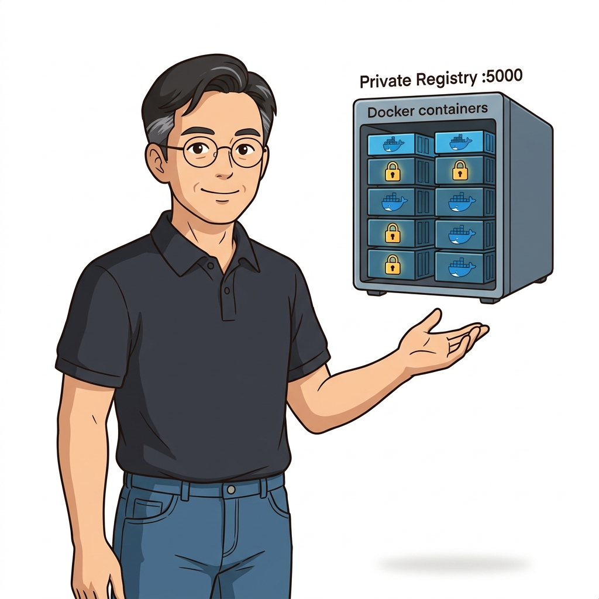
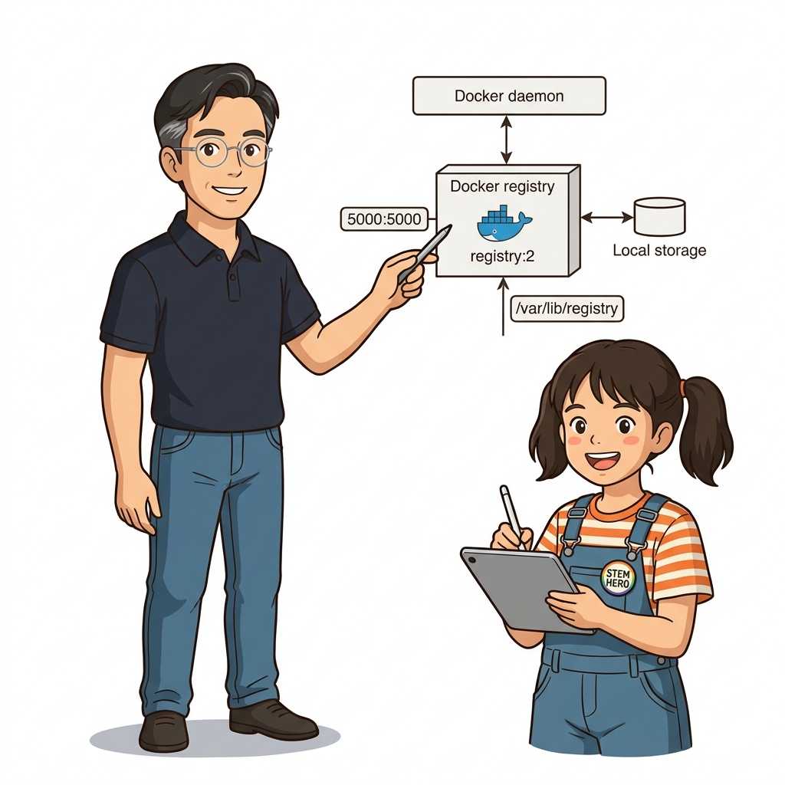
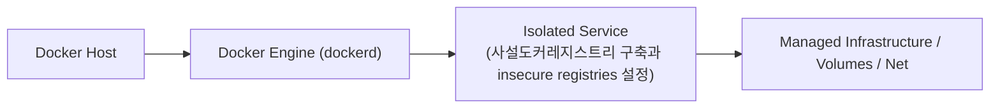
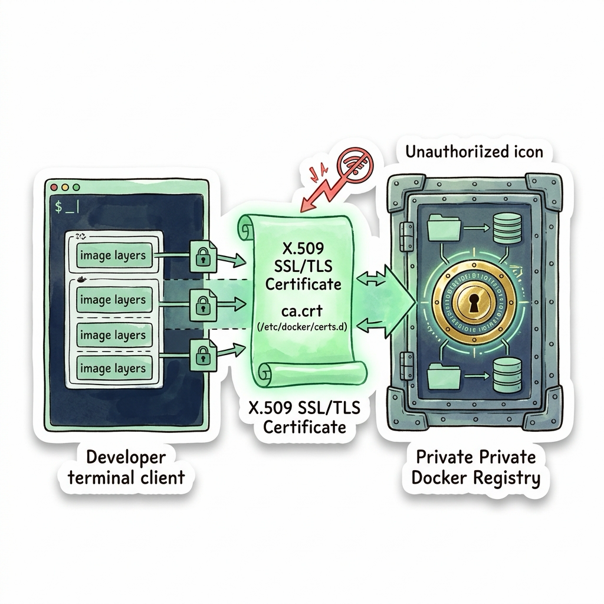

# 028. 사설도커레지스트리 구축과 insecure registries 설정

도커가 공식 제공하는 오픈소스 레지스트리 이미지(`registry:2`)를 컨테이너로 실행하여 단 10초 만에 `localhost:5000`에서 동작하는 사설 도커 레지스트리(Private Registry)를 구축합니다.


**그림 02-14-1** 사설도커레지스트리 구축과 insecure registries 설정의 필요성과 현대 클라우드 아키텍처 관점의 개요

---

### 028.1 왜 사설도커레지스트리 구축과 insecure registries 설정이(가) 필요한가? (문제 정의와 현실적 배경)

소프트웨어 시스템이 복잡해질수록 설정을 다루는 방식은 전체 인프라의 신뢰성을 결정짓는 핵심 척도가 됩니다. **사설도커레지스트리 구축과 insecure registries 설정**이(가) 부재하거나 잘못 다루어질 때 현장에서는 다음과 같은 대표적인 병목과 장애가 발생합니다:

1. **하드코딩된 설정과 환경 불일치로 인한 유연성 상실**: 환경이 바뀔 때마다 코드를 다시 빌드해야 하므로 배포 주기가 지연되고 이미지 수가 기하급수적으로 폭증합니다.
2. **보안 민감 데이터의 무분별한 노출**: 비밀번호, 데이터베이스 토큰, 암호화 키가 이미지 레이어에 영구 박제되어 형상관리 시스템이나 외부에 유출될 위험이 커집니다.
3. **재현 불가능한 구성 드리프트**: 스테이징 환경과 프로덕션 환경의 미세한 설정 차이가 예기치 못한 서비스 중단 사고로 직결됩니다.


**그림 02-14-2** 사설도커레지스트리 구축과 insecure registries 설정에 대한 대표적인 오해와 실제 프로덕션 현장의 엔지니어링 진실

---

### 028.2 핵심 아키텍처와 엔지니어링 메커니즘

또한 도커 엔진은 기본적으로 HTTPS(TLS)가 적용되지 않은 원격 레지스트리와 통신을 거부하므로, 사내 테스트망 도메인을 `daemon.json`의 **`insecure-registries`** 목록에 등록해 활용하는 실무 설정법을 배웁니다.


**그림 02-14-3** 사설도커레지스트리 구축과 insecure registries 설정의 내부 아키텍처 및 데이터 흐름

#### 📊 핵심 비교 및 엔지니어링 표준 분석

| 구분 / 핵심 원리 | 상세 설명 및 동작 메커니즘 | 실무 적용 시 주의점 및 베스트 프랙티스 |
| :--- | :--- | :--- |
| **`--restart always` 플래그** | 호스트 서버나 도커 데몬이 재부팅되더라도 레지스트리 컨테이너를 자동으로 다시 켜주는 재시작 정책 | 사내 핵심 인프라 컨테이너(레지스트리, 모니터링, 프록시) 기동 시 필수 옵션 |
| **`localhost:5000` 예외 규칙** | 도커 엔진은 로컬 루프백(`localhost`, `127.0.0.1`)에 한해서는 별도 설정 없이도 HTTP 통신을 기본 허용함 | 다른 PC나 도메인(`registry.local:5000`)으로 접근할 때는 `insecure-registries` 설정 또는 TLS 인증서 필요 |
| **Registry V2 HTTP API** | `GET /v2/_catalog`(리포지터리 목록) 및 `GET /v2/<이름>/tags/list`(태그 목록) 엔드포인트 제공 | Part 05의 CI 파이프라인에서 빌드 결과 검증에 그대로 활용! |

---

### 028.3 선언적 실습 및 아키텍처 다이어그램

본 실습은 외부 비공개 패키지에 의존하지 않고, 공식 표준 이미지를 기반으로 즉시 재현 가능한 살아있는 코드로 구성되어 있습니다.

```bash
# 로컬 5000번 포트에 나만의 사설 도커 레지스트리 컨테이너를 띄우고 이미지를 Push & Pull 해보기!
docker container run -d -p 5000:5000 --restart always --name local-registry registry:2
docker image tag alpine:3.20 localhost:5000/oz-internal/alpine:3.20
docker image push localhost:5000/oz-internal/alpine:3.20

# 레지스트리 REST API(/v2/_catalog)를 호출해 저장된 이미지 목록 직접 확인!
curl -s http://localhost:5000/v2/_catalog
docker container rm -f local-registry
```

#### 🔍 아키텍처 흐름도 (Mermaid Diagram)




**그림 02-14-4** 선언적 인프라 명세를 통한 사설도커레지스트리 구축과 insecure registries 설정 검증 파이프라인

---

### 028.4 핵심 정리: 캐릭터 대화와 3대 교훈

> 👧 **도로시**: "교수님! **사설도커레지스트리 구축과 insecure registries 설정**의 원리를 배우니까, 복잡하게 얽혀 있던 인프라 설정이 레고 블록처럼 질서정연하게 제자리를 찾는 게 보여요!"
> 
> 🐱 **조교 지니**: "야옹~ 맞습니다! 특히 런타임 환경과 불변 인프라의 경계를 명확히 지키는 것이 대규모 클라우드 운영의 제1원칙이랍니다!"
> 
> 🐶 **토토**: "멍멍! 선언적 코드로 한 번 적어두면 언제든 똑같이 복원되니까 정말 든든해요!"
> 
> 👨‍🏫 **이호진 교수님**: "훌륭하구나. 원리를 깊이 이해하고 실습을 통해 손에 익히는 것이 훌륭한 클라우드 엔지니어로 성장하는 가장 빠른 지름길이란다."


**그림 02-14-5** 사설도커레지스트리 구축과 insecure registries 설정 마스터를 위한 3대 핵심 교훈

1. **설정과 실행의 명확한 분리**:
   * 애플리케이션 코드는 불변으로 유지하고, 가변적인 설정값은 외부에서 주입하여 이식성을 극대화합니다.
2. **선언적 재현성 확보**:
   * 사람이 수작업으로 변경하지 않고 코드 명세를 통해 언제 어디서나 100% 동일한 실행 결과를 보장합니다.
3. **최소 권한 및 보안 모범 사례 준수**:
   * 불필요한 권한과 포트 노출을 최소화하고 민감 데이터를 암호화하여 프로덕션 안정성을 담보합니다.

---

### 028.5 랩노트 피날레와 다음 강의 예고


**그림 02-14-6** 연구실에서 다음 마일스톤인 [시맨틱버저닝 이미지태그전략과 샤256 다이제스트] 실습을 예고하는 교수님과 토토

> 💡 **다음 강의 안내**:
> [시맨틱버저닝 이미지태그전략과 샤256 다이제스트](../029_시맨틱버저닝_이미지태그전략과_샤256_다이제스트/)에서는 더욱 심화된 실전 엔지니어링 실습과 아키텍처를 다룹니다!

---

## 🧭 강의 네비게이션
* [◀️ 이전 강의: 027_도커허브와_GHCR에_나만의이미지_Push_배포하기](../027_도커허브와_GHCR에_나만의이미지_Push_배포하기/)
* [📋 Part 02. 도커 이미지 제작(Dockerfile), 멀티 스테이지 빌드 & 레지스트리 공유 (015 ~ 031) 목차로 돌아가기](../)
* [▶️ 다음 강의: 029_시맨틱버저닝_이미지태그전략과_샤256_다이제스트](../029_시맨틱버저닝_이미지태그전략과_샤256_다이제스트/)


<!-- BIBLE_INTEGRATION_book8_deep_028 -->
---

### 028.C 📚 도커 바이블 심화: 엔터프라이즈 사설 레지스트리 v2 구축과 자체 서명 TLS(CA) 신뢰 체인 구성
> **출처 및 학술적 배경**: 도커 컨테이너 제3장 (개인 도커 레지스트리 구축하기)  
> **핵심 주제**: 엔터프라이즈 환경에서의 실전 시스템 연동, 보안 인프라, 그리고 커널 레벨의 스토리지/런타임 제어 메커니즘을 심층 학습합니다.

#### 1. 아키텍처 및 내부 메커니즘 분석
보안 규정이 엄격한 엔터프라이즈 환경에서는 퍼블릭 도커 허브에 사내 핵심 자산인 이미지를 올릴 수 없으므로 사내 폐쇄망에 전용 Docker Registry v2 서버를 자체 구축해야 합니다.
개발 편의를 위해 `daemon.json`에 `insecure-registries`를 등록하고 평문 HTTP(80) 통신을 허용하는 것은 실무 운영 환경에서 중간자 공격(MITM)과 이미지 위변조를 유발하는 위험한 안티패턴입니다.

#### 프로덕션 사설 레지스트리 보안 3단계:
1. **OpenSSL 기반 사설 CA 및 인증서 발급**: IP 및 내부 도메인(SAN)이 명시된 TLS X.509 인증서 페어 생성.
2. **`htpasswd` 기반 bcrypt 인증 연동**: 레지스트리 컨테이너의 인증 미들웨어에 사용자 계정 데이터베이스 마운트.
3. **클라이언트 신뢰 체인 배포**: 각 도커 호스트의 `/etc/docker/certs.d/<registry-domain>/ca.crt` 경로에 사설 CA 인증서를 복사하여 데몬 재시작 없이 HTTPS 상호 검증 완료.



#### 2. 엔터프라이즈 실전 검증 실습
```bash
# [실습] 보안 사설 레지스트리 v2 기동 및 인증 설정
# 1. 사설 인증서 디렉터리 및 SAN 인증서 생성
mkdir -p /opt/registry/{certs,auth,data}
openssl req -newkey rsa:4096 -nodes -sha256 -keyout /opt/registry/certs/domain.key \
  -x509 -days 365 -out /opt/registry/certs/domain.crt \
  -subj "/CN=registry.corp.internal"

# 2. 접근 제어를 위한 bcrypt htpasswd 파일 생성
docker run --entrypoint htpasswd httpd:alpine -Bbn devops securePass123! > /opt/registry/auth/htpasswd

# 3. TLS 암호화 및 기본 인증이 적용된 레지스트리 실행
docker run -d --name enterprise-registry -p 443:5000 --restart always \
  -v /opt/registry/data:/var/lib/registry \
  -v /opt/registry/certs:/certs \
  -v /opt/registry/auth:/auth \
  -e REGISTRY_HTTP_ADDR=0.0.0.0:5000 \
  -e REGISTRY_HTTP_TLS_CERTIFICATE=/certs/domain.crt \
  -e REGISTRY_HTTP_TLS_KEY=/certs/domain.key \
  -e REGISTRY_AUTH=htpasswd \
  -e REGISTRY_AUTH_HTPASSWD_PATH=/auth/htpasswd \
  -e REGISTRY_AUTH_HTPASSWD_REALM="Corporate Registry" \
  registry:2
```

#### 3. 프로덕션 운영을 위한 핵심 멘토링
> 👨‍🏫 **이호진 교수님의 심화 지도**:
> "사내 프로덕션 환경에서는 반드시 사내 사설 루트 CA가 서명한 인증서를 도커 호스트의 /etc/docker/certs.d/ 디렉터리에 배포하여 완전한 TLS 암호화 파이프라인을 구축해야 합니다."
>
> 👧 **도로시의 깨달음**:
> "비밀 금고에 들어갈 때 암호(htpasswd)도 확인하고, 믿을 수 있는 신분증(ca.crt)을 주고받아야 안전하게 소중한 이미지를 보관할 수 있군요!"
>
> 🐱 **조교 지니의 프로덕션 체크리스트**:
> * 레지스트리 컨테이너의 영구 데이터 볼륨(/var/lib/registry)은 정기적인 LVM 스냅샷이나 클라우드 오브젝트 스토리지(S3, GCS) 백엔드로 연동하는 것이 필수입니다.
