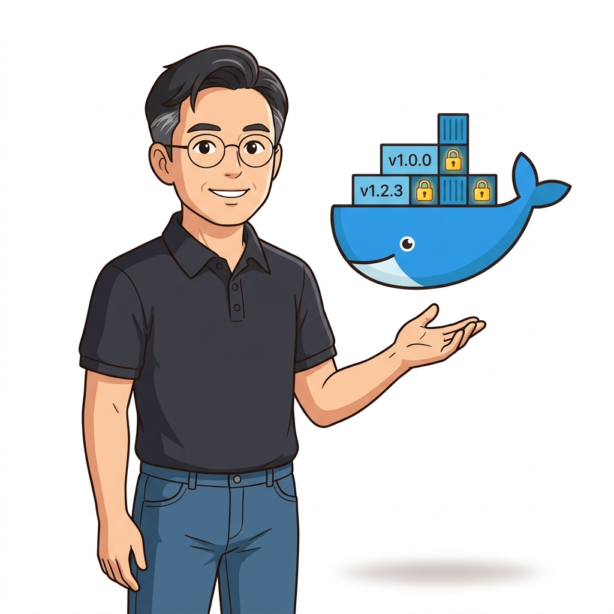
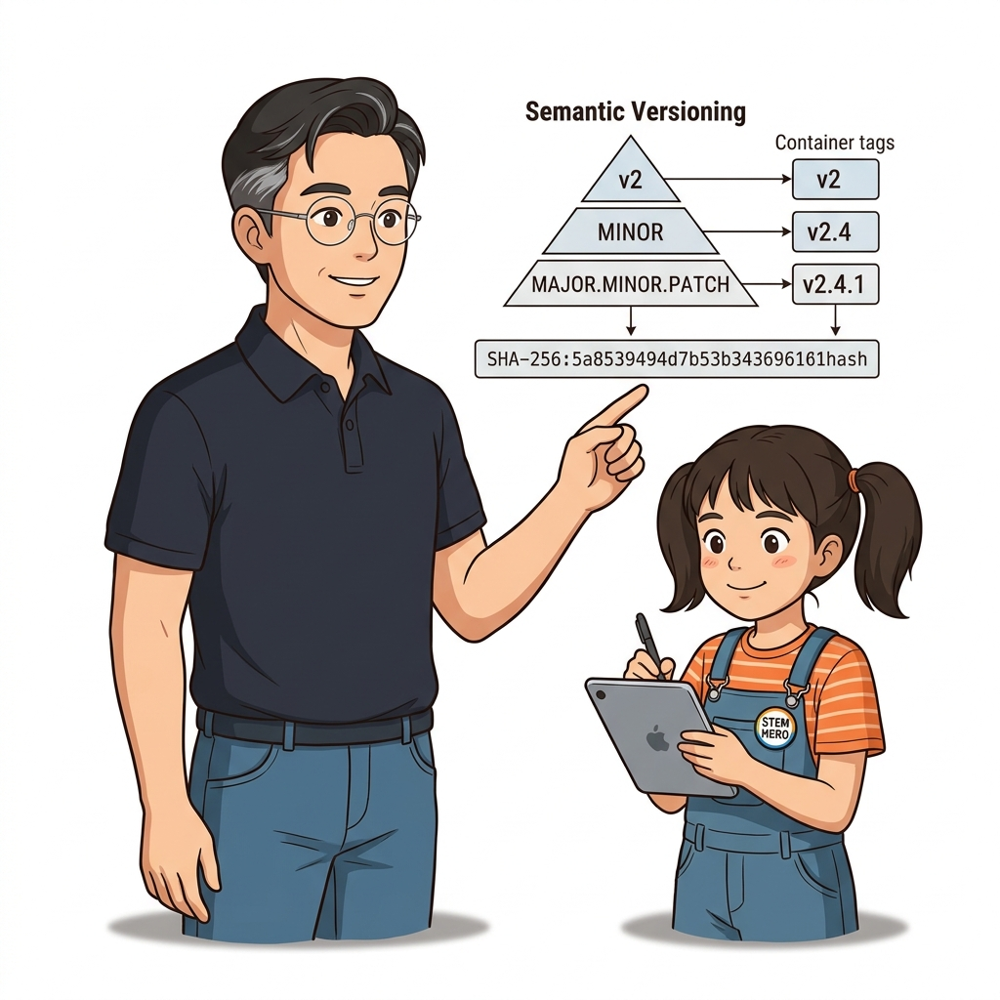
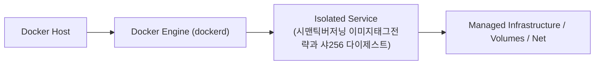
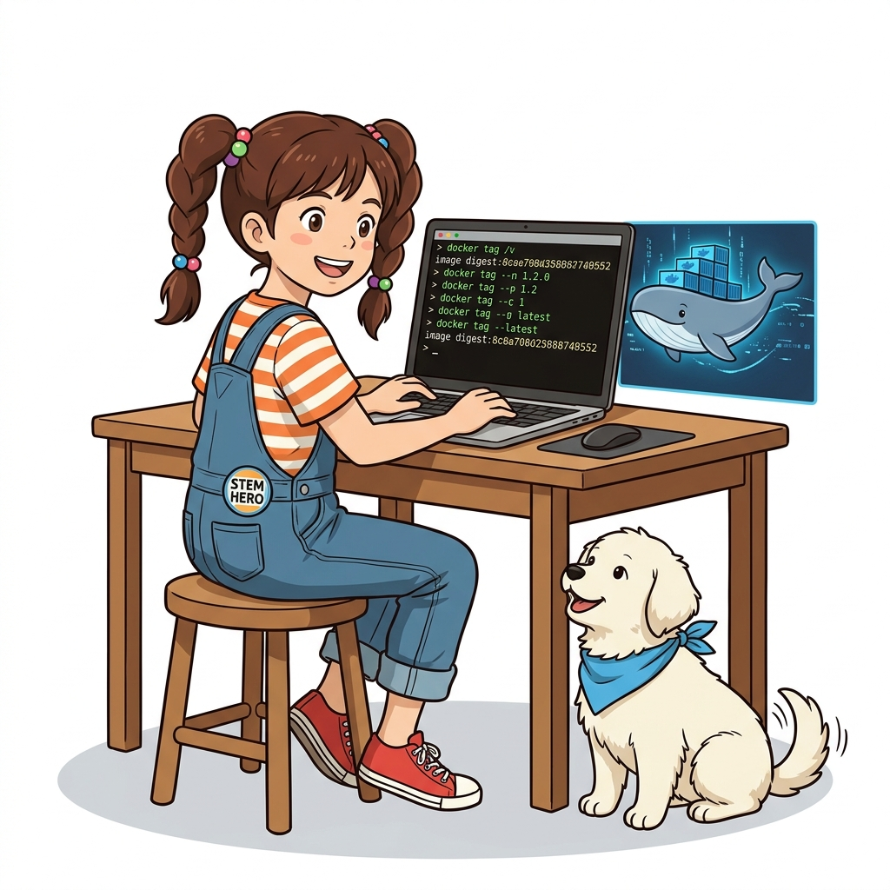
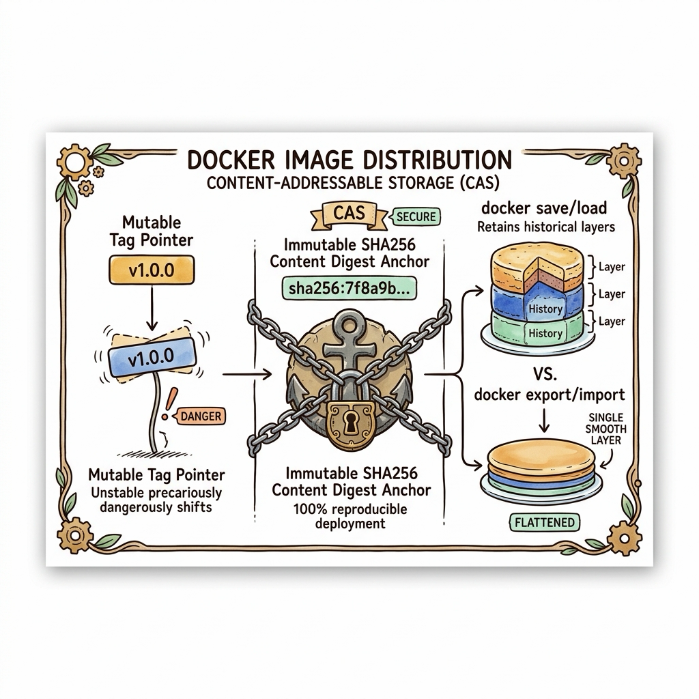
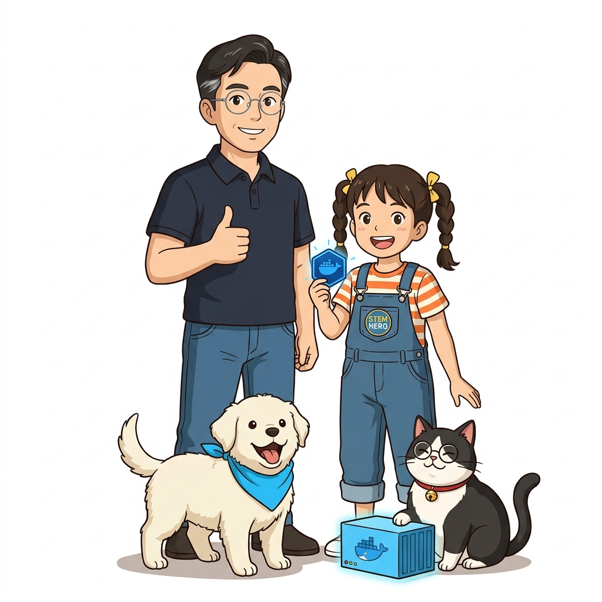
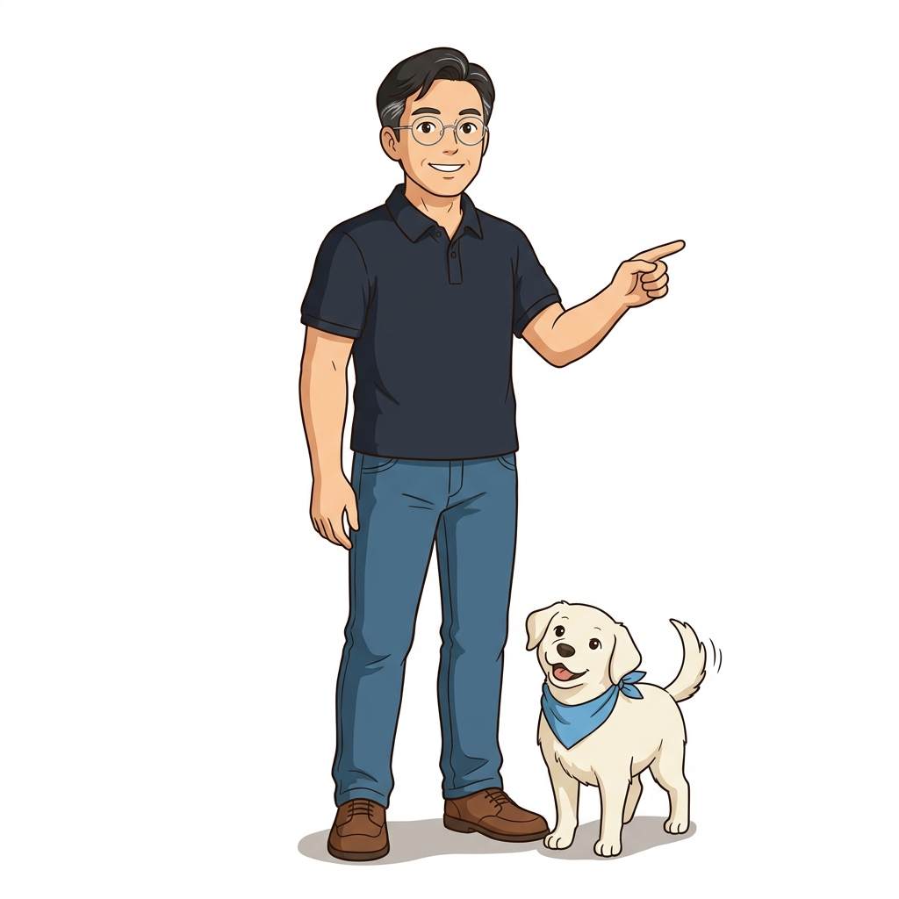

# 029. 시맨틱버저닝 이미지태그전략과 샤256 다이제스트

`:latest` 태그는 '가장 최신 버전'을 보장하는 마법 기능이 아니라 단지 태그를 생략했을 때 붙는 단순 기본 문자열일 뿐이며, 언제든 다른 내용으로 덮어써질 수(Mutable) 있습니다.


**그림 02-15-1** 시맨틱버저닝 이미지태그전략과 샤256 다이제스트의 필요성과 현대 클라우드 아키텍처 관점의 개요

---

### 029.1 왜 시맨틱버저닝 이미지태그전략과 샤256 다이제스트이(가) 필요한가? (문제 정의와 현실적 배경)

소프트웨어 시스템이 복잡해질수록 설정을 다루는 방식은 전체 인프라의 신뢰성을 결정짓는 핵심 척도가 됩니다. **시맨틱버저닝 이미지태그전략과 샤256 다이제스트**이(가) 부재하거나 잘못 다루어질 때 현장에서는 다음과 같은 대표적인 병목과 장애가 발생합니다:

1. **하드코딩된 설정과 환경 불일치로 인한 유연성 상실**: 환경이 바뀔 때마다 코드를 다시 빌드해야 하므로 배포 주기가 지연되고 이미지 수가 기하급수적으로 폭증합니다.
2. **보안 민감 데이터의 무분별한 노출**: 비밀번호, 데이터베이스 토큰, 암호화 키가 이미지 레이어에 영구 박제되어 형상관리 시스템이나 외부에 유출될 위험이 커집니다.
3. **재현 불가능한 구성 드리프트**: 스테이징 환경과 프로덕션 환경의 미세한 설정 차이가 예기치 못한 서비스 중단 사고로 직결됩니다.


**그림 02-15-2** 시맨틱버저닝 이미지태그전략과 샤256 다이제스트에 대한 대표적인 오해와 실제 프로덕션 현장의 엔지니어링 진실

---

### 029.2 핵심 아키텍처와 엔지니어링 메커니즘

하나의 릴리스 이미지에 **`1`, `1.4`, `1.4.2`처럼 정밀도가 다른 복수의 시맨틱 버전 태그(Semantic Versioning)를 동시에 부여**하여 보안 패치 자동 수용과 메이저 버전 고정 중 선택권을 주는 기법과, 절대 변하지 않는 **`@sha256` 이미지 다이제스트(Digest)** 고정법을 마스터합니다.


**그림 02-15-3** 시맨틱버저닝 이미지태그전략과 샤256 다이제스트의 내부 아키텍처 및 데이터 흐름

#### 📊 핵심 비교 및 엔지니어링 표준 분석

| 구분 / 핵심 원리 | 상세 설명 및 동작 메커니즘 | 실무 적용 시 주의점 및 베스트 프랙티스 |
| :--- | :--- | :--- |
| **다중 태깅 전략 (`1`, `1.2`, `1.2.0`)** | `1.2.0`은 특정 빌드 완전 고정, `1.2`는 패치(`1.2.x`) 업데이트 수용, `1`은 호환 가능한 마이너(`1.x`) 업데이트 수용 | 도커 허브의 공식 이미지(`node:20`, `node:20.15`, `node:20.15.1-alpine3.20`)가 모두 사용하는 표준 방식! |
| **`:latest` 태그의 위험성** | 오늘 `pull` 받은 `:latest`와 내일 오토스케일링될 때 `pull` 받은 `:latest`의 버전이 달라져 서버 간 동작 불일치 발생 | 운영(Production) 배포 명세서에서는 절대 `:latest`를 쓰지 말고 명시적 버전 태그를 지정해야 함 |
| **이미지 다이제스트 (`@sha256:...`)** | 태그와 달리 이미지 내용 자체로 계산된 암호화 해시이므로 단 1비트도 변조나 덮어쓰기가 불가능 | 금융·국방 등 최고 수준 보안 환경에서 `image@sha256:해시값`으로 배포 이미지 완전 고정 |

---

### 029.3 선언적 실습 및 아키텍처 다이어그램

본 실습은 외부 비공개 패키지에 의존하지 않고, 공식 표준 이미지를 기반으로 즉시 재현 가능한 살아있는 코드로 구성되어 있습니다.

```bash
# 하나의 빌드된 이미지에 다중 시맨틱 버전 태그(Multi-tagging)를 부여하는 실무 패턴
docker image tag alpine:3.20 localhost:5000/oz-api:latest
docker image tag alpine:3.20 localhost:5000/oz-api:1
docker image tag alpine:3.20 localhost:5000/oz-api:1.2
docker image tag alpine:3.20 localhost:5000/oz-api:1.2.0

# 이미지의 불변 암호화 해시(RepoDigests) 확인
docker image inspect --format '{{json .RepoDigests}}' alpine:3.20
```

#### 🔍 아키텍처 흐름도 (Mermaid Diagram)




**그림 02-15-4** 선언적 인프라 명세를 통한 시맨틱버저닝 이미지태그전략과 샤256 다이제스트 검증 파이프라인

---

<!-- BIBLE_INTEGRATION_book8_digest_save_export -->
### 029.B 📚 도커 바이블 심화: 불변 SHA256 다이제스트 고정과 이미지 오프라인 마이그레이션(save/load vs export/import)
> **출처 및 학술적 배경**: 『도커 컨테이너』 제5장 (5.19 이미지 저장하고 불러오기) & 『제대로 배우는 도커』 제7장 (7.2 다이제스트와 태그)  
> **핵심 주제**: 가변 태그(Mutable Tag)의 보안 공급망 취약점을 극복하는 CAS(Content Addressable Storage) 다이제스트 고정 기법, 그리고 레이어 히스토리를 보존하는 `save/load`와 단일 레이어로 압축 평탄화하는 `export/import`의 실무 선택 기준.

#### 1. 가변 태그의 위험성과 SHA256 다이제스트 고정 (Pinning)
많은 개발팀이 배포 매니페스트에 `mycorp/app:v1.2.0`처럼 시맨틱 버저닝 태그를 사용하지만, 도커 레지스트리에서 태그는 언제든지 다른 이미지 레이어로 덮어쓰기(Overwrite)가 가능한 가변적인 '이름표(Pointer)'에 불과합니다:
* **보안 취약점**: 해커가 동일한 태그로 악성코드가 삽입된 이미지를 푸시하거나, 개발자의 실수로 태그가 재할당되면 스테이징 환경에서 테스트했던 바이너리와 운영 환경에서 돌아가는 바이너리가 달라지는 치명적인 사고가 발생합니다.
* **불변 다이제스트 고정(Pinning)**: 도커는 이미지 레이어의 내용물 전체를 암호학적 해시로 계산한 **SHA256 다이제스트**를 부여합니다 (`repo@sha256:7f8a9b...`).
* 다이제스트를 지정하면 단 1바이트라도 이미지가 변조될 경우 다운로드가 즉시 거부되므로, 100% 무결성과 재현성을 담보하는 프로덕션 엔터프라이즈 모범 표준입니다.

#### 2. 오프라인 이미지 이관: `save/load` vs `export/import` 심층 비교
인터넷이 차단된 폐쇄망(에어갭, Air-gapped) 환경이나 재해 복구(DR) 시 이미지를 파일로 아카이브하여 이관할 때 두 가지 상이한 명령어가 사용됩니다:

| 비교 항목 | `docker image save` & `load` | `docker container export` & `import` |
| :--- | :--- | :--- |
| **추출 대상** | **도커 이미지 (Docker Image)** | **실행/정지 중인 컨테이너 (Container)** |
| **레이어 히스토리** | **모든 개별 레이어 및 Dockerfile 히스토리 완벽 보존** | **모든 레이어를 하나로 평탄화(Flatten), 히스토리 영구 소멸** |
| **메타데이터 보존** | `CMD`, `ENV`, `EXPOSE`, 레이블 등 이미지 메타데이터 유지 | 메타데이터 소멸 (import 시 수동으로 CMD 재지정 필요) |
| **용량 및 보안 특성** | 레이어가 분리되어 있어 과거 삭제된 임시 파일도 tar 내부에 잔존 | 최종 파일시스템 스냅샷만 남겨 **용량이 대폭 줄고 과거 비밀키 유출 차단** |
| **적합한 유즈케이스** | 완벽한 이미지 복제, 폐쇄망 레지스트리 시딩(Seeding) | 불필요한 빌드 히스토리를 세탁하고 경량화된 골든 베이스 이미지 제작 |


**그림 029-B-1** 불변 다이제스트 앵커와 save/load 레이어 보존 vs export/import 단일 레이어 평탄화 구조도

```bash
# [실습] 다이제스트 고정 배포 및 save vs export 차이 검증
# 1. 특정 이미지의 고유 SHA256 다이제스트 확인
docker image ls --digests alpine:3.20

# 2. 다이제스트를 지정하여 안전하게 무결성 컨테이너 기동
# (알파인 3.20의 특정 고유 해시로 고정)
docker container run -d --name secure-digest-app alpine@sha256:beefdbd8a1da6d2915566fde36db9db0b524eb7371ec85c3b1523121401e8100 sleep 3600

# 3. docker save로 레이어 히스토리 보존 백업 tar 생성
docker image save -o /tmp/alpine-save.tar alpine:3.20
tar -tvf /tmp/alpine-save.tar | head -n 5  # 여러 개의 레이어 tar 및 manifest.json 확인

# 4. docker export로 컨테이너 파일시스템 평탄화 tar 생성
docker container export -o /tmp/alpine-export.tar secure-digest-app
tar -tvf /tmp/alpine-export.tar | head -n 5  # 레이어 없이 순수 파일트리만 확인

# 5. 정리
docker container rm -f secure-digest-app
rm -f /tmp/alpine-save.tar /tmp/alpine-export.tar
```

> 👨‍🏫 **이호진 교수님의 바이블 멘토링 노트**:
> "프로덕션 배포에서 태그는 사람을 위한 '별명'일 뿐입니다. CI/CD 파이프라인에서 쿠버네티스나 스웜으로 전달되는 최종 배포 명세서에는 반드시 레지스트리가 발급한 불변 `@sha256:` 다이제스트를 기록해야 공급망 공격(Supply Chain Attack)을 원천 방어할 수 있습니다."
>
> 👧 **도로시의 깨달음**:
> "태그는 언제든 뗐다 붙였다 할 수 있는 스티커지만, 다이제스트는 내용물 자체로 지문처럼 파낸 절대 도장이군요! 그리고 비밀을 지우고 날씬하게 만들고 싶을 땐 `export`로 한 장으로 압축할 수 있다는 것도 배웠어요!"
>
> 🐱 **조교 지니의 아키텍처 체크포인트**:
> * `docker export`로 추출한 tar 파일을 `docker import`할 때는 기본 엔트리포인트가 초기화되므로 `docker import --change "CMD ['/bin/sh']" ...` 옵션을 주어야 합니다.

---

### 029.4 핵심 정리: 캐릭터 대화와 3대 교훈

> 👧 **도로시**: "교수님! **시맨틱버저닝 이미지태그전략과 샤256 다이제스트**의 원리를 배우니까, 복잡하게 얽혀 있던 인프라 설정이 레고 블록처럼 질서정연하게 제자리를 찾는 게 보여요!"
> 
> 🐱 **조교 지니**: "야옹~ 맞습니다! 특히 런타임 환경과 불변 인프라의 경계를 명확히 지키는 것이 대규모 클라우드 운영의 제1원칙이랍니다!"
> 
> 🐶 **토토**: "멍멍! 선언적 코드로 한 번 적어두면 언제든 똑같이 복원되니까 정말 든든해요!"
> 
> 👨‍🏫 **이호진 교수님**: "훌륭하구나. 원리를 깊이 이해하고 실습을 통해 손에 익히는 것이 훌륭한 클라우드 엔지니어로 성장하는 가장 빠른 지름길이란다."


**그림 02-15-5** 시맨틱버저닝 이미지태그전략과 샤256 다이제스트 마스터를 위한 3대 핵심 교훈

1. **설정과 실행의 명확한 분리**:
   * 애플리케이션 코드는 불변으로 유지하고, 가변적인 설정값은 외부에서 주입하여 이식성을 극대화합니다.
2. **선언적 재현성 확보**:
   * 사람이 수작업으로 변경하지 않고 코드 명세를 통해 언제 어디서나 100% 동일한 실행 결과를 보장합니다.
3. **최소 권한 및 보안 모범 사례 준수**:
   * 불필요한 권한과 포트 노출을 최소화하고 민감 데이터를 암호화하여 프로덕션 안정성을 담보합니다.

---

### 029.5 랩노트 피날레와 다음 강의 예고


**그림 02-15-6** 연구실에서 다음 마일스톤인 [검증된 공식이미지에서 기업표준 골든이미지로] 실습을 예고하는 교수님과 토토

> 💡 **다음 강의 안내**:
> [검증된 공식이미지에서 기업표준 골든이미지로](../030_검증된_공식이미지에서_기업표준_골든이미지로/)에서는 더욱 심화된 실전 엔지니어링 실습과 아키텍처를 다룹니다!

---

## 🧭 강의 네비게이션
* [◀️ 이전 강의: 028_사설도커레지스트리_구축과_insecure_registries_설정](../028_사설도커레지스트리_구축과_insecure_registries_설정/)
* [📋 Part 02. 도커 이미지 제작(Dockerfile), 멀티 스테이지 빌드 & 레지스트리 공유 (015 ~ 031) 목차로 돌아가기](../)
* [▶️ 다음 강의: 030_검증된_공식이미지에서_기업표준_골든이미지로](../030_검증된_공식이미지에서_기업표준_골든이미지로/)
