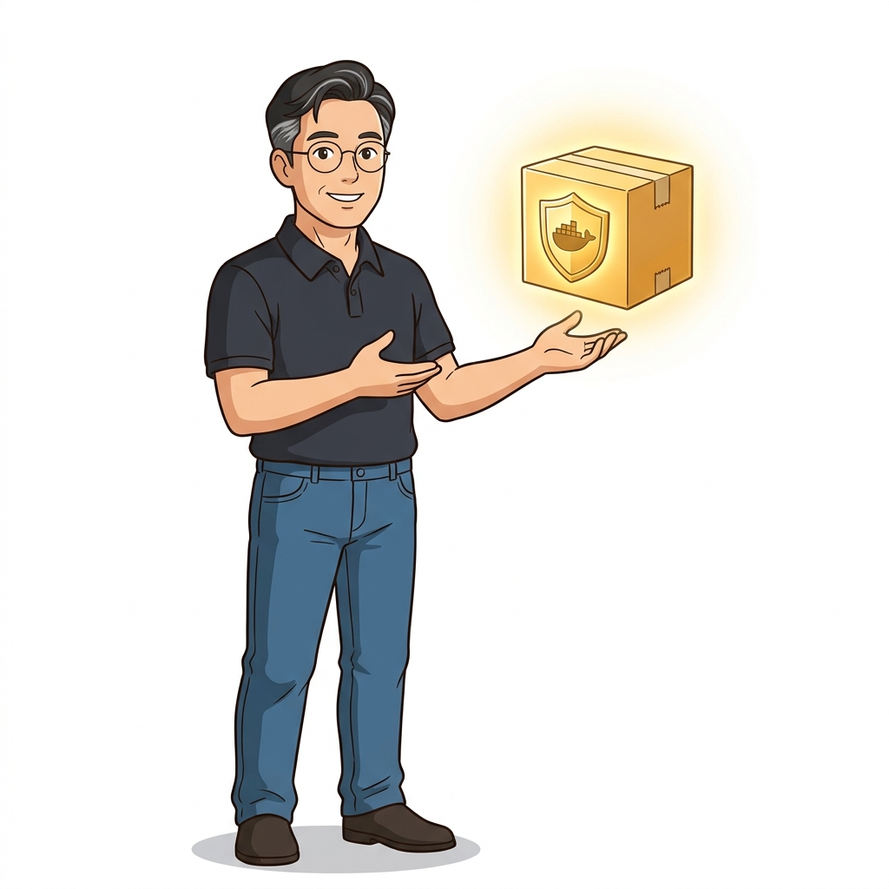
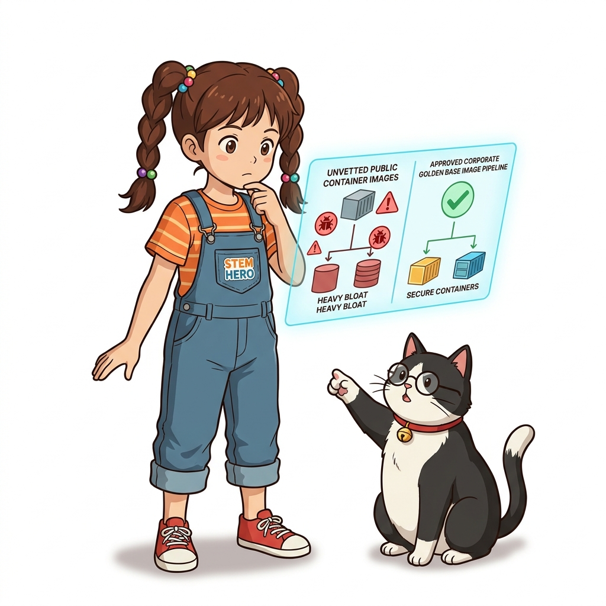
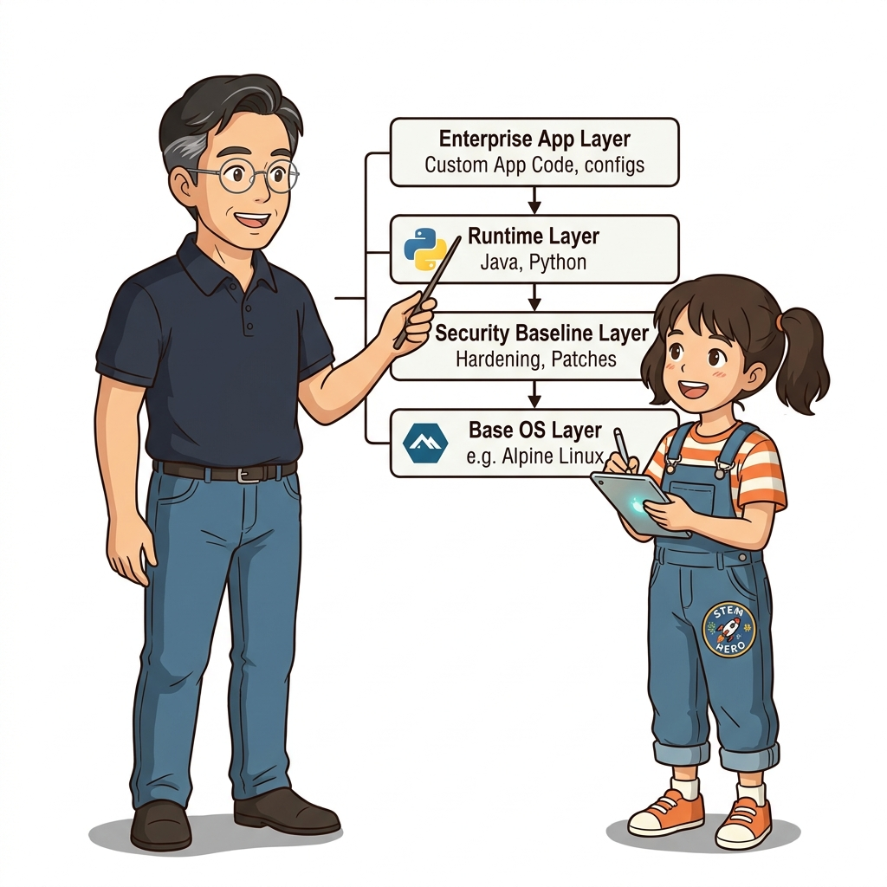
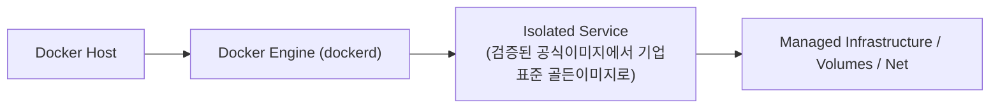
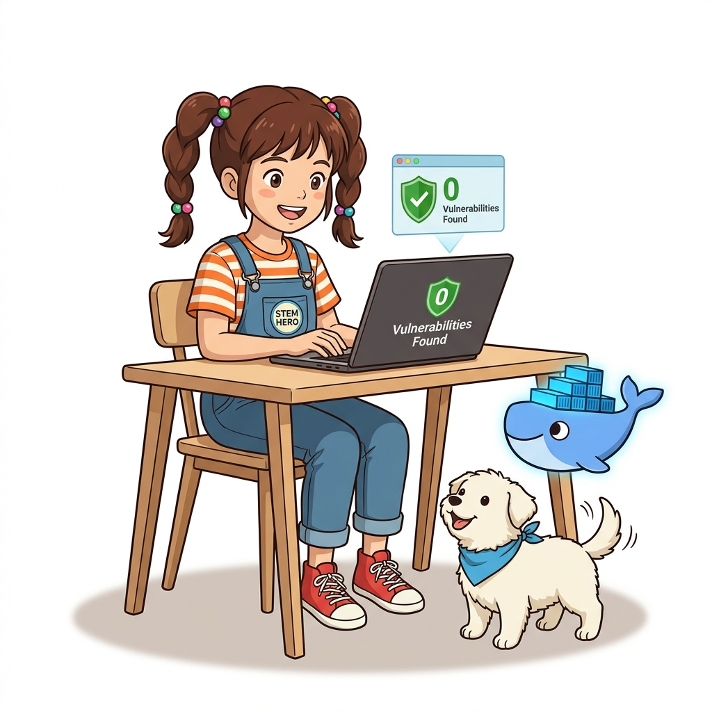
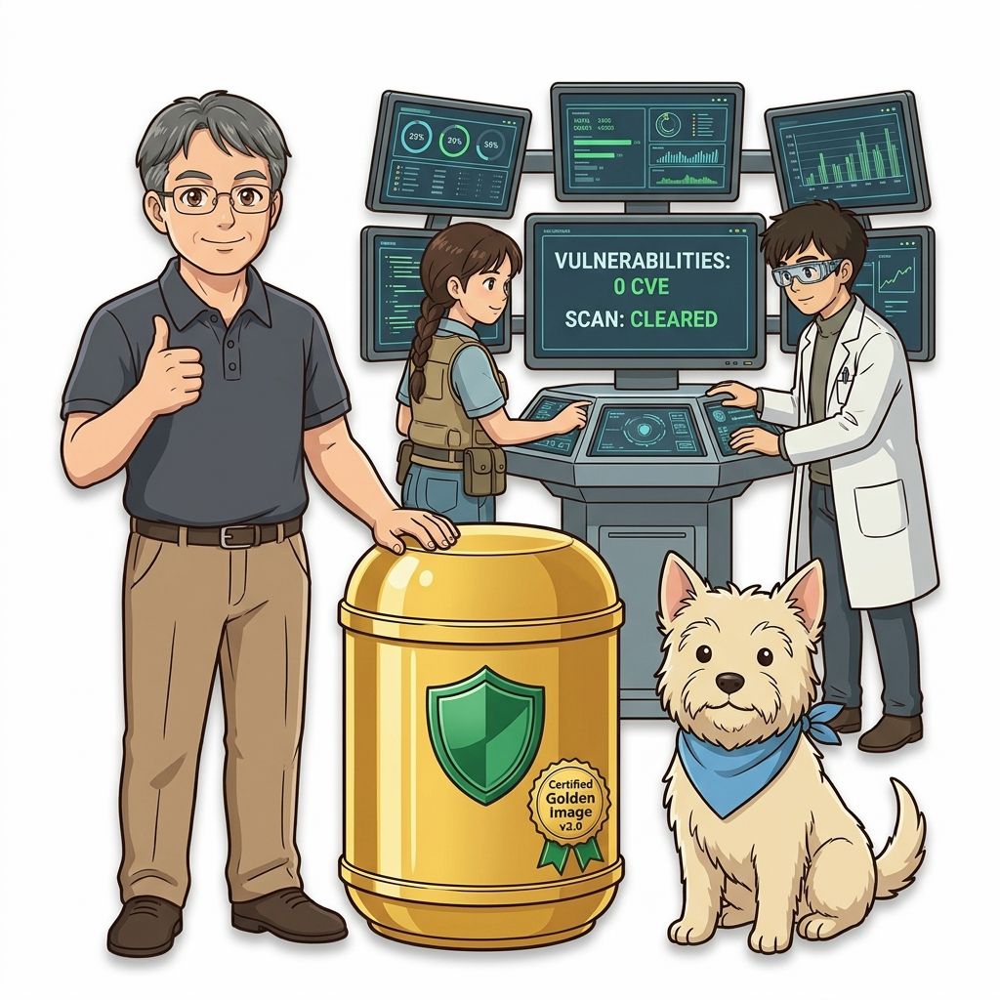
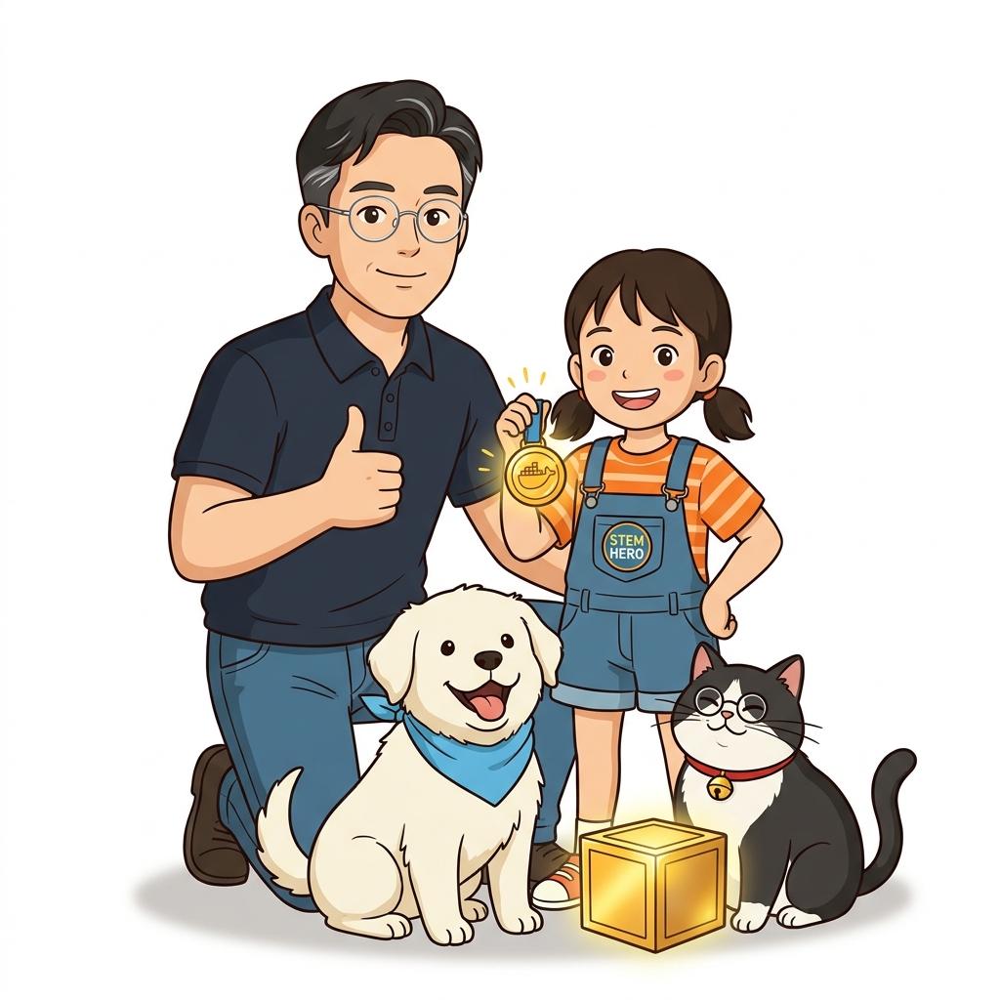
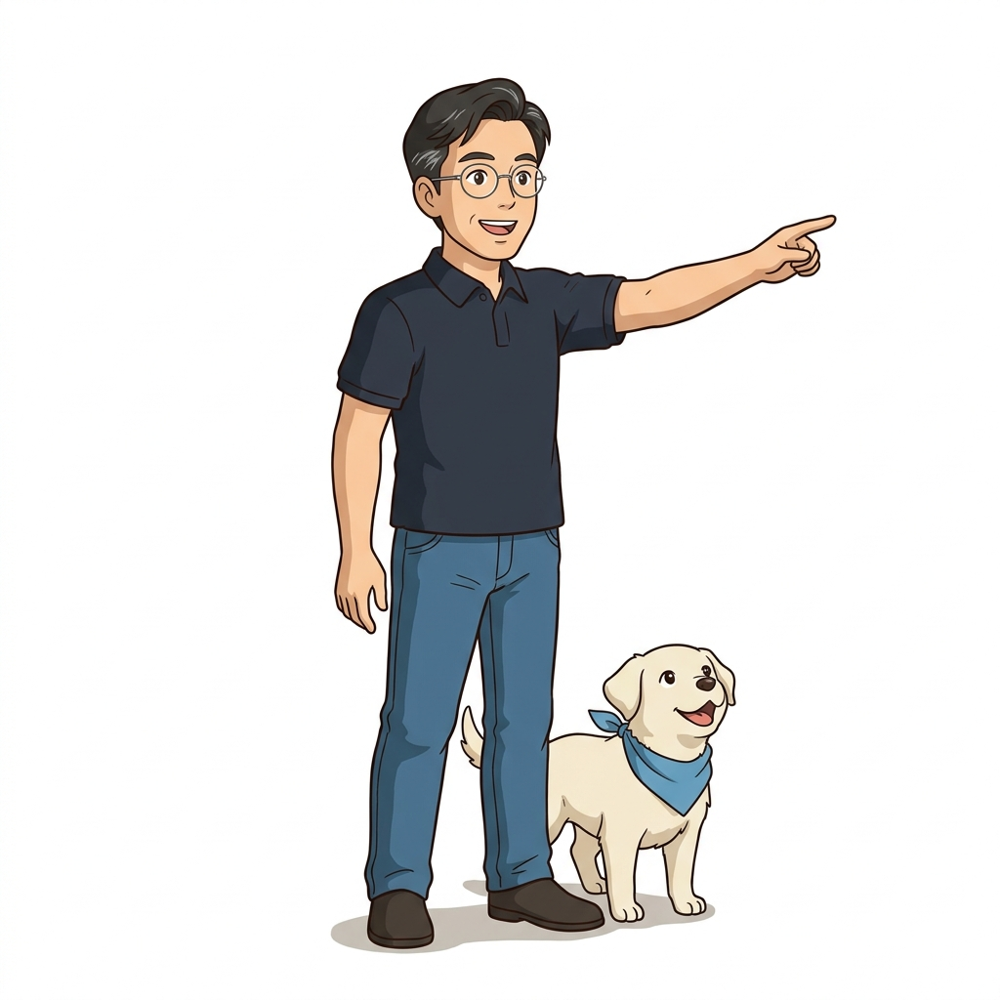

# 030. 검증된 공식이미지에서 기업표준 골든이미지로

도커 허브에서 **Docker Official Image(공식 이미지)**와 **Verified Publisher(인증된 발행자)** 배지를 확인해야 하는 보안상의 이유를 살펴봅니다.


**그림 02-16-1** 검증된 공식이미지에서 기업표준 골든이미지로의 필요성과 현대 클라우드 아키텍처 관점의 개요

---

### 030.1 왜 검증된 공식이미지에서 기업표준 골든이미지로이(가) 필요한가? (문제 정의와 현실적 배경)

소프트웨어 시스템이 복잡해질수록 설정을 다루는 방식은 전체 인프라의 신뢰성을 결정짓는 핵심 척도가 됩니다. **검증된 공식이미지에서 기업표준 골든이미지로**이(가) 부재하거나 잘못 다루어질 때 현장에서는 다음과 같은 대표적인 병목과 장애가 발생합니다:

1. **하드코딩된 설정과 환경 불일치로 인한 유연성 상실**: 환경이 바뀔 때마다 코드를 다시 빌드해야 하므로 배포 주기가 지연되고 이미지 수가 기하급수적으로 폭증합니다.
2. **보안 민감 데이터의 무분별한 노출**: 비밀번호, 데이터베이스 토큰, 암호화 키가 이미지 레이어에 영구 박제되어 형상관리 시스템이나 외부에 유출될 위험이 커집니다.
3. **재현 불가능한 구성 드리프트**: 스테이징 환경과 프로덕션 환경의 미세한 설정 차이가 예기치 못한 서비스 중단 사고로 직결됩니다.


**그림 02-16-2** 검증된 공식이미지에서 기업표준 골든이미지로에 대한 대표적인 오해와 실제 프로덕션 현장의 엔지니어링 진실

---

### 030.2 핵심 아키텍처와 엔지니어링 메커니즘

나아가 우리 회사의 모든 마이크로서비스가 공통으로 필요로 하는 사내 루트 인증서, 타임존(`Asia/Seoul`), 보안 설정, 그리고 자식 이미지가 빌드될 때 자동으로 실행되는 **`ONBUILD` 트리거**를 담은 **골든 이미지(Golden Image)** 설계 패턴을 실습합니다.


**그림 02-16-3** 검증된 공식이미지에서 기업표준 골든이미지로의 내부 아키텍처 및 데이터 흐름

#### 📊 핵심 비교 및 엔지니어링 표준 분석

| 구분 / 핵심 원리 | 상세 설명 및 동작 메커니즘 | 실무 적용 시 주의점 및 베스트 프랙티스 |
| :--- | :--- | :--- |
| **골든 이미지 (Golden Image)** | 검증된 공식 이미지를 기반으로 사내 보안 패치·모니터링 에이전트·공통 라이브러리를 미리 구성해 사설 레지스트리에 배포한 표준 기반 이미지 | 전사 개발팀이 통일된 보안 기준과 최신 패치 위에서 애플리케이션을 개발하도록 보장 |
| **`ONBUILD` 인스트럭션** | 골든 이미지 자체를 빌드할 때는 실행되지 않고, 이 이미지를 `FROM`으로 지정한 **자식 이미지가 빌드될 때** 자동으로 실행되는 예약 명령 | 자식 프로젝트의 `Dockerfile`을 단 2줄(`FROM oz-golden-python:3.12` + `CMD [...]`)로 극단적 단순화 가능! |
| **정기 리빌드 파이프라인** | 기반 OS의 보안 패치를 반영하기 위해 골든 이미지를 매주/매월 자동 리빌드하여 사설 레지스트리에 업데이트 | 엔터프라이즈 컨테이너 거버넌스의 핵심 축 |

---

### 030.3 선언적 실습 및 아키텍처 다이어그램

본 실습은 외부 비공개 패키지에 의존하지 않고, 공식 표준 이미지를 기반으로 즉시 재현 가능한 살아있는 코드로 구성되어 있습니다.

```dockerfile
# [1. 사내 표준 골든 이미지 Dockerfile (oz-golden-python:3.12)]
FROM python:3.12-slim
ENV TZ=Asia/Seoul PYTHONDONTWRITEBYTECODE=1 PYTHONUNBUFFERED=1
WORKDIR /app
# 이 골든 이미지를 FROM으로 상속받는 자식 이미지가 빌드될 때 자동 실행될 트리거(ONBUILD)!
ONBUILD COPY requirements.txt /app/
ONBUILD RUN pip install --no-cache-dir -r requirements.txt
ONBUILD COPY . /app/
```

#### 🔍 아키텍처 흐름도 (Mermaid Diagram)




**그림 02-16-4** 선언적 인프라 명세를 통한 검증된 공식이미지에서 기업표준 골든이미지로 검증 파이프라인

---

<!-- BIBLE_INTEGRATION_book8_enterprise_golden_images -->
---

### 030.B 📚 도커 바이블 심화: 엔터프라이즈 골든 이미지(Golden Image) 표준 규격 및 사내 베이스 이미지 거버넌스
*출처 도서: 『도커 컨테이너』 핵심 분석*

개발자들이 인터넷(Docker Hub)에서 각자 마음에 드는 베이스 이미지를 무분별하게 `FROM` 지시어로 끌어다 쓰는 조직은 심각한 보안 공급망 공격(Supply Chain Attack)과 CVE 취약점에 무방비로 노출됩니다.

이를 통제하는 엔터프라이즈 핵심 인프라 기법이 바로 **사내 골든 이미지(Corporate Golden Image)** 거버넌스입니다:
1. **보안 하드닝 완료**: 사내 보안팀이 공식 경량 이미지(Alpine/Debian)를 기반으로 불필요한 패키지(`curl`, `netcat`, `gcc` 등 공격 도구)를 전면 제거합니다.
2. **사내 신뢰 루트 주입**: 사내 사설 PKI(CA) 인증서를 `/etc/ssl/certs`에 미리 탑재하여 외부 중간자 공격을 방어하고 사내 HTTPS 프록시 통신을 보장합니다.
3. **표준 비특권 사용자 강제**: `USER appuser (UID: 10001)` 계정을 기본 탑재하여 root 실행을 원천 금지합니다.
4. **골든 이미지 레지스트리 독점**: 사내 Nexus/Harbor 레지스트리(`registry.mycorp.internal/golden/*`)를 통해서만 빌드가 허용되도록 CI 정책을 강제합니다.


**그림 030-B-1** 철저한 보안 검증과 CA 인증서가 탑재된 사내 표준 골든 이미지를 검증하는 인포그래픽

```bash
# [실습] 엔터프라이즈 사내 골든 베이스 이미지 Dockerfile 표준 규격 예시
cat << 'EOF' > Dockerfile.golden-base
FROM alpine:3.19

# 1. 최신 보안 패치 및 최소 필수 유틸리티만 설치
RUN apk update && apk upgrade && \
    apk add --no-cache ca-certificates tzdata && \
    rm -rf /var/cache/apk/*

# 2. 표준 타임존 설정 (Asia/Seoul)
ENV TZ=Asia/Seoul

# 3. 고정 UID 비특권 서비스 계정 생성
RUN addgroup -g 10001 appgroup && \
    adduser -u 10001 -G appgroup -s /sbin/nologin -D appuser

# 4. 기본 실행 계정 전환 (Non-root 강제)
USER appuser
WORKDIR /home/appuser
EOF
```

> 👨‍🏫 **이호진 교수님의 바이블 멘토링 노트**:
> "기업의 모든 애플리케이션이 공통 골든 이미지를 상속받게 하면, 새로운 심각한 보안 취약점(예: OpenSSL 버그)이 터졌을 때 골든 이미지 하나만 패치해서 재빌드하면 사내 수백 개의 서비스가 1시간 안에 일괄 치료됩니다."
>
> 👧 **도로시의 깨달음**:
> "회사 건물에 들어오는 모든 벽돌의 품질과 안전성을 중앙에서 검사하고 승인된 황금 벽돌만 쓰게 하는 거네요!"
>
> 🐱 **조교 지니의 아키텍처 체크포인트**:
> "골든 이미지를 기반으로 만든 서비스들은 공통 레이어가 완전히 일치하므로, 쿠버네티스 노드에서 이미지를 풀받을 때 네트워크 대역폭과 디스크 용량을 거의 쓰지 않는 엄청난 부가 이점도 누립니다."


### 030.4 핵심 정리: 캐릭터 대화와 3대 교훈

> 👧 **도로시**: "교수님! **검증된 공식이미지에서 기업표준 골든이미지로**의 원리를 배우니까, 복잡하게 얽혀 있던 인프라 설정이 레고 블록처럼 질서정연하게 제자리를 찾는 게 보여요!"
> 
> 🐱 **조교 지니**: "야옹~ 맞습니다! 특히 런타임 환경과 불변 인프라의 경계를 명확히 지키는 것이 대규모 클라우드 운영의 제1원칙이랍니다!"
> 
> 🐶 **토토**: "멍멍! 선언적 코드로 한 번 적어두면 언제든 똑같이 복원되니까 정말 든든해요!"
> 
> 👨‍🏫 **이호진 교수님**: "훌륭하구나. 원리를 깊이 이해하고 실습을 통해 손에 익히는 것이 훌륭한 클라우드 엔지니어로 성장하는 가장 빠른 지름길이란다."


**그림 02-16-5** 검증된 공식이미지에서 기업표준 골든이미지로 마스터를 위한 3대 핵심 교훈

1. **설정과 실행의 명확한 분리**:
   * 애플리케이션 코드는 불변으로 유지하고, 가변적인 설정값은 외부에서 주입하여 이식성을 극대화합니다.
2. **선언적 재현성 확보**:
   * 사람이 수작업으로 변경하지 않고 코드 명세를 통해 언제 어디서나 100% 동일한 실행 결과를 보장합니다.
3. **최소 권한 및 보안 모범 사례 준수**:
   * 불필요한 권한과 포트 노출을 최소화하고 민감 데이터를 암호화하여 프로덕션 안정성을 담보합니다.

---

### 030.5 랩노트 피날레와 다음 강의 예고


**그림 02-16-6** 연구실에서 다음 마일스톤인 [Part02 실전미션 폴리글랏 마이크로서비스 빌드및레지스트리배포] 실습을 예고하는 교수님과 토토

> 💡 **다음 강의 안내**:
> [Part02 실전미션 폴리글랏 마이크로서비스 빌드및레지스트리배포](../031_Part02_실전미션_폴리글랏_마이크로서비스_빌드및레지스트리배포/)에서는 더욱 심화된 실전 엔지니어링 실습과 아키텍처를 다룹니다!

---

## 🧭 강의 네비게이션
* [◀️ 이전 강의: 029_시맨틱버저닝_이미지태그전략과_샤256_다이제스트](../029_시맨틱버저닝_이미지태그전략과_샤256_다이제스트/)
* [📋 Part 02. 도커 이미지 제작(Dockerfile), 멀티 스테이지 빌드 & 레지스트리 공유 (015 ~ 031) 목차로 돌아가기](../)
* [▶️ 다음 강의: 031_Part02_실전미션_폴리글랏_마이크로서비스_빌드및레지스트리배포](../031_Part02_실전미션_폴리글랏_마이크로서비스_빌드및레지스트리배포/)
