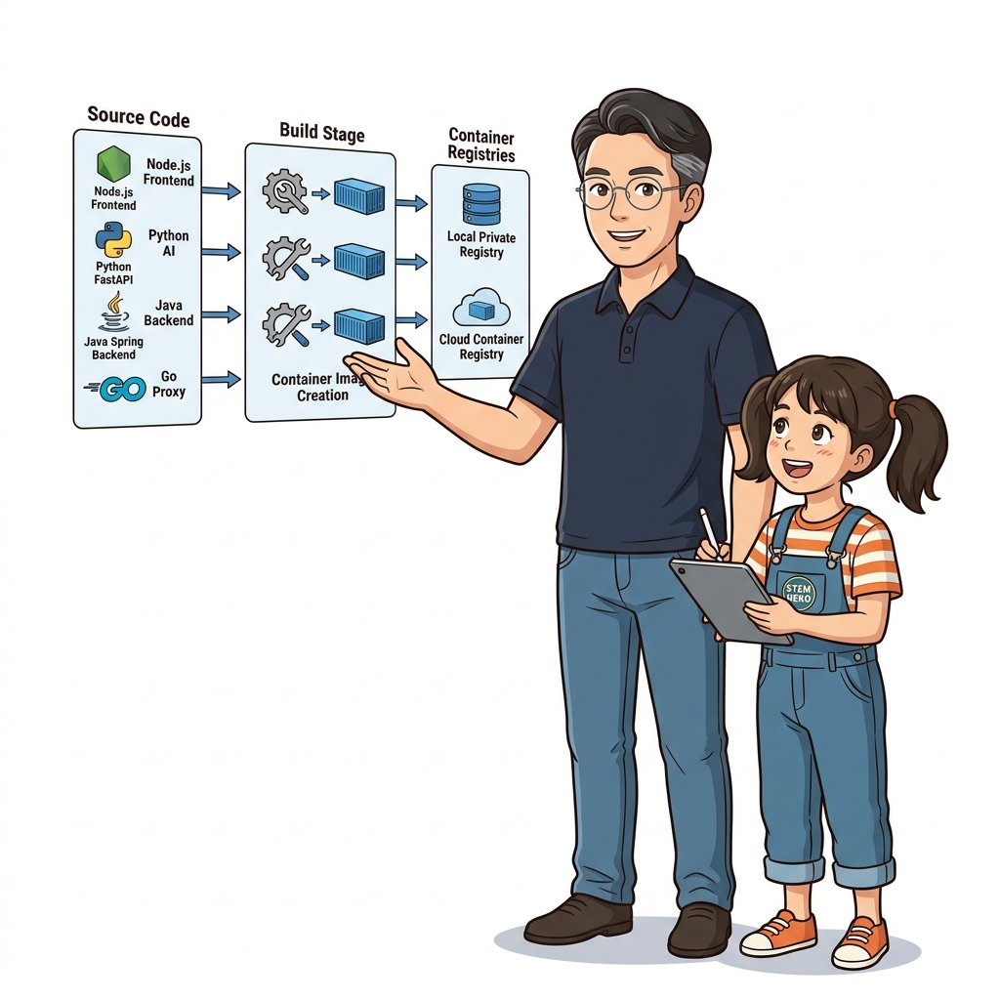
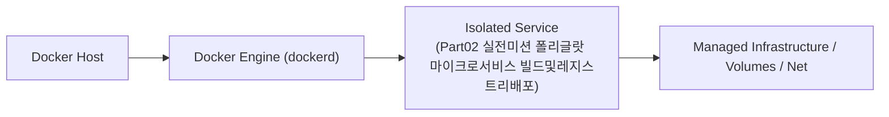

# 031. Part02 실전미션 폴리글랏 마이크로서비스 빌드및레지스트리배포

3~5장에서 배운 레이어 캐시 최적화, 멀티 스테이지 빌드, 사설 레지스트리 운영, 시맨틱 버전 태깅, 사용자 정의 네트워크를 하나의 시나리오로 통합합니다.


**그림 02-17-1** Part02 실전미션 폴리글랏 마이크로서비스 빌드및레지스트리배포의 필요성과 현대 클라우드 아키텍처 관점의 개요

---

### 031.1 왜 Part02 실전미션 폴리글랏 마이크로서비스 빌드및레지스트리배포이(가) 필요한가? (문제 정의와 현실적 배경)

소프트웨어 시스템이 복잡해질수록 설정을 다루는 방식은 전체 인프라의 신뢰성을 결정짓는 핵심 척도가 됩니다. **Part02 실전미션 폴리글랏 마이크로서비스 빌드및레지스트리배포**이(가) 부재하거나 잘못 다루어질 때 현장에서는 다음과 같은 대표적인 병목과 장애가 발생합니다:

1. **하드코딩된 설정과 환경 불일치로 인한 유연성 상실**: 환경이 바뀔 때마다 코드를 다시 빌드해야 하므로 배포 주기가 지연되고 이미지 수가 기하급수적으로 폭증합니다.
2. **보안 민감 데이터의 무분별한 노출**: 비밀번호, 데이터베이스 토큰, 암호화 키가 이미지 레이어에 영구 박제되어 형상관리 시스템이나 외부에 유출될 위험이 커집니다.
3. **재현 불가능한 구성 드리프트**: 스테이징 환경과 프로덕션 환경의 미세한 설정 차이가 예기치 못한 서비스 중단 사고로 직결됩니다.


**그림 02-17-2** Part02 실전미션 폴리글랏 마이크로서비스 빌드및레지스트리배포에 대한 대표적인 오해와 실제 프로덕션 현장의 엔지니어링 진실

---

### 031.2 핵심 아키텍처와 엔지니어링 메커니즘

로컬 레지스트리(`localhost:5000`)를 띄우고, 멀티 스테이지로 빌드한 커스텀 웹/API 이미지를 `1.0.0`과 `1.0` 태그로 푸시한 뒤, 다시 풀 받아 브리지 네트워크 위에서 구동하는 전 과정을 완벽히 완수합니다!


**그림 02-17-3** Part02 실전미션 폴리글랏 마이크로서비스 빌드및레지스트리배포의 내부 아키텍처 및 데이터 흐름

#### 📊 핵심 비교 및 엔지니어링 표준 분석

| 구분 / 핵심 원리 | 상세 설명 및 동작 메커니즘 | 실무 적용 시 주의점 및 베스트 프랙티스 |
| :--- | :--- | :--- |
| **`docker image push --all-tags`** | 동일한 리포지터리에 부여된 모든 버전 태그(`1.0.0`, `1.0` 등)를 한 번의 명령으로 레지스트리에 일괄 푸시 | 실제 데이터 레이어는 한 번만 전송되고 태그 포인터만 추가로 등록되어 매우 빠름 |
| **레지스트리 태그 목록 검증** | `curl http://localhost:5000/v2/<리포지터리>/tags/list` 호출 시 `{"name":"...","tags":["1.0","1.0.0"]}` 응답 확인 | 사설 레지스트리에 배포 아티팩트가 정상 등록되었음을 증명 |
| **Part 02 핵심 요약** | `Dockerfile` 레이어 캐시와 멀티 스테이지 빌드로 작고 빠른 이미지를 만들고, 레지스트리로 안전하게 공유! | 다음 Part 03에서는 컨테이너가 삭제되어도 데이터를 영구 보존하는 **퍼시스턴트 스토리지(볼륨과 마운트)**를 정복합니다! |

---

### 031.3 선언적 실습 및 아키텍처 다이어그램

본 실습은 외부 비공개 패키지에 의존하지 않고, 공식 표준 이미지를 기반으로 즉시 재현 가능한 살아있는 코드로 구성되어 있습니다.

```bash
# [Part 02 실전 미션] 로컬 레지스트리 가동 ➔ 멀티 스테이지 이미지 빌드 ➔ 시맨틱 태그 Push ➔ 실행 검증
docker container run -d -p 5000:5000 --name p2-registry registry:2

mkdir -p /tmp/p2-mission && cd /tmp/p2-mission
cat << 'EOF' > Dockerfile
FROM alpine:3.20 AS builder
RUN echo "Oz Polyglot Service v1.0.0 Ready!" > /message.txt

FROM alpine:3.20
COPY --from=builder /message.txt /app/message.txt
CMD ["cat", "/app/message.txt"]
EOF

docker image build -t localhost:5000/oz-team/service:1.0.0 -t localhost:5000/oz-team/service:1.0 .
docker image push --all-tags localhost:5000/oz-team/service
curl -s http://localhost:5000/v2/oz-team/service/tags/list
docker container run --rm localhost:5000/oz-team/service:1.0.0

docker container rm -f p2-registry && rm -rf /tmp/p2-mission
```

#### 🔍 아키텍처 흐름도 (Mermaid Diagram)




**그림 02-17-4** 선언적 인프라 명세를 통한 Part02 실전미션 폴리글랏 마이크로서비스 빌드및레지스트리배포 검증 파이프라인

---

### 031.4 핵심 정리: 캐릭터 대화와 3대 교훈

> 👧 **도로시**: "교수님! **Part02 실전미션 폴리글랏 마이크로서비스 빌드및레지스트리배포**의 원리를 배우니까, 복잡하게 얽혀 있던 인프라 설정이 레고 블록처럼 질서정연하게 제자리를 찾는 게 보여요!"
> 
> 🐱 **조교 지니**: "야옹~ 맞습니다! 특히 런타임 환경과 불변 인프라의 경계를 명확히 지키는 것이 대규모 클라우드 운영의 제1원칙이랍니다!"
> 
> 🐶 **토토**: "멍멍! 선언적 코드로 한 번 적어두면 언제든 똑같이 복원되니까 정말 든든해요!"
> 
> 👨‍🏫 **이호진 교수님**: "훌륭하구나. 원리를 깊이 이해하고 실습을 통해 손에 익히는 것이 훌륭한 클라우드 엔지니어로 성장하는 가장 빠른 지름길이란다."


**그림 02-17-5** Part02 실전미션 폴리글랏 마이크로서비스 빌드및레지스트리배포 마스터를 위한 3대 핵심 교훈

1. **설정과 실행의 명확한 분리**:
   * 애플리케이션 코드는 불변으로 유지하고, 가변적인 설정값은 외부에서 주입하여 이식성을 극대화합니다.
2. **선언적 재현성 확보**:
   * 사람이 수작업으로 변경하지 않고 코드 명세를 통해 언제 어디서나 100% 동일한 실행 결과를 보장합니다.
3. **최소 권한 및 보안 모범 사례 준수**:
   * 불필요한 권한과 포트 노출을 최소화하고 민감 데이터를 암호화하여 프로덕션 안정성을 담보합니다.

---

### 031.5 랩노트 피날레와 다음 강의 예고


**그림 02-17-6** 연구실에서 다음 마일스톤인 [컨테이너속 데이터가 사라지는이유 기록가능레이어와 CoW] 실습을 예고하는 교수님과 토토

> 💡 **다음 강의 안내**:
> [컨테이너속 데이터가 사라지는이유 기록가능레이어와 CoW](/Part03_퍼시스턴트스토리지와_도커볼륨_마운트/032_컨테이너속_데이터가_사라지는이유_기록가능레이어와_CoW/)에서는 더욱 심화된 실전 엔지니어링 실습과 아키텍처를 다룹니다!

---

## 🧭 강의 네비게이션
* [◀️ 이전 강의: 030_검증된_공식이미지에서_기업표준_골든이미지로](../030_검증된_공식이미지에서_기업표준_골든이미지로/)
* [📋 Part 02. 도커 이미지 제작(Dockerfile), 멀티 스테이지 빌드 & 레지스트리 공유 (015 ~ 031) 목차로 돌아가기](../)
* [▶️ 다음 강의: 032_컨테이너속_데이터가_사라지는이유_기록가능레이어와_CoW](/Part03_퍼시스턴트스토리지와_도커볼륨_마운트/032_컨테이너속_데이터가_사라지는이유_기록가능레이어와_CoW/)
