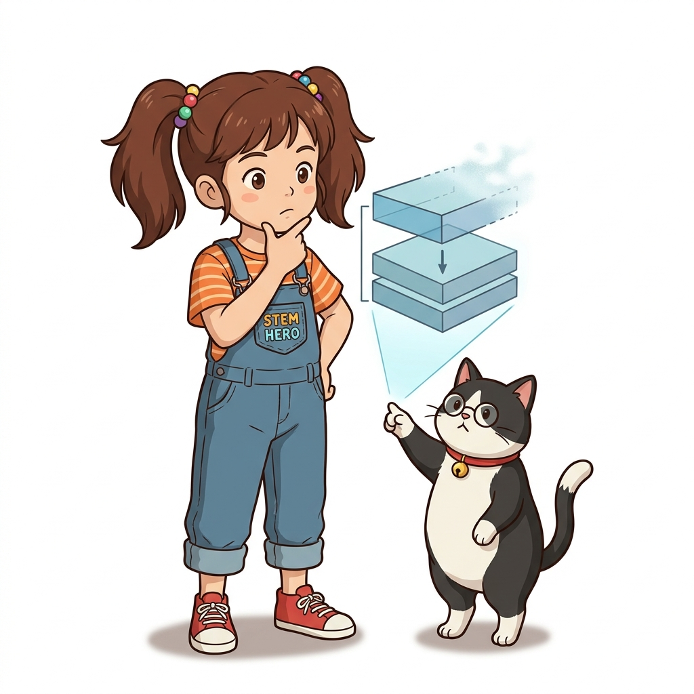
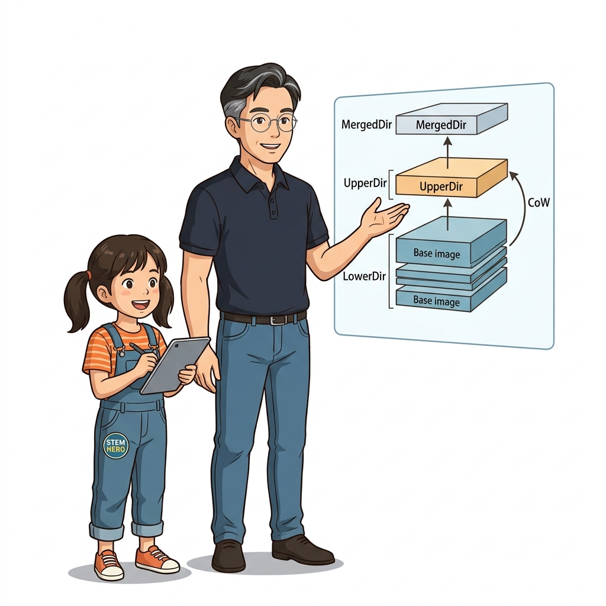
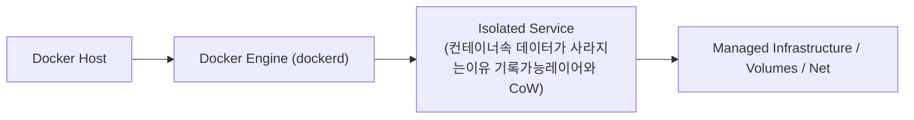
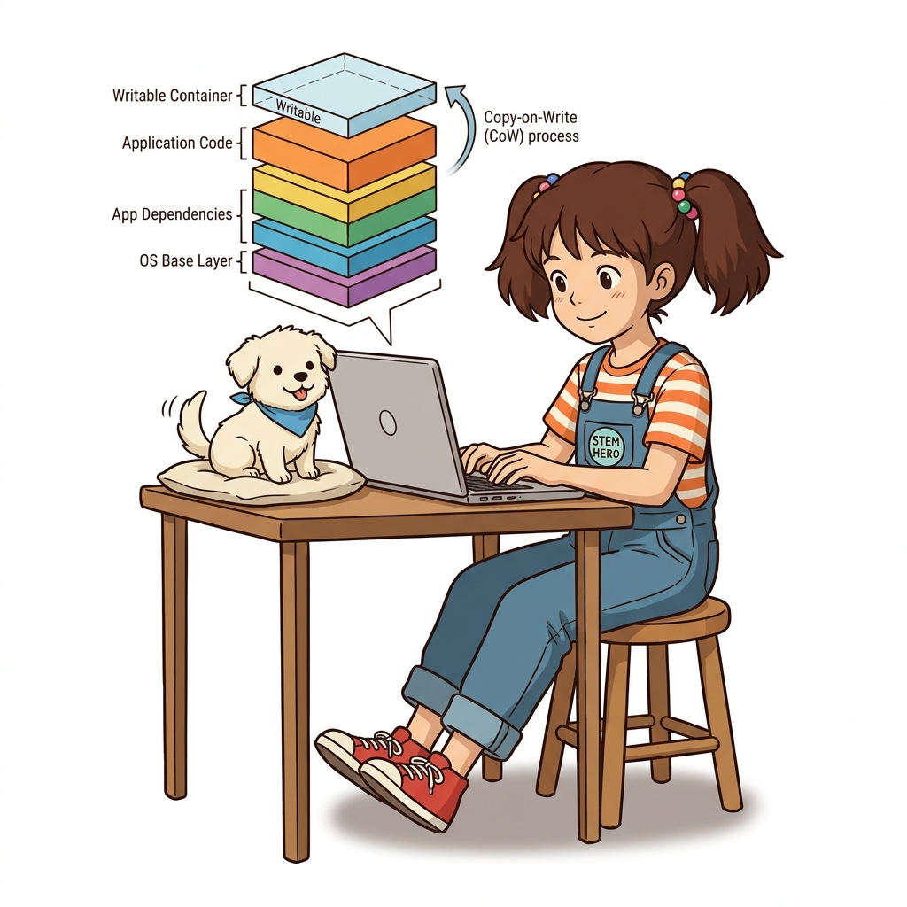
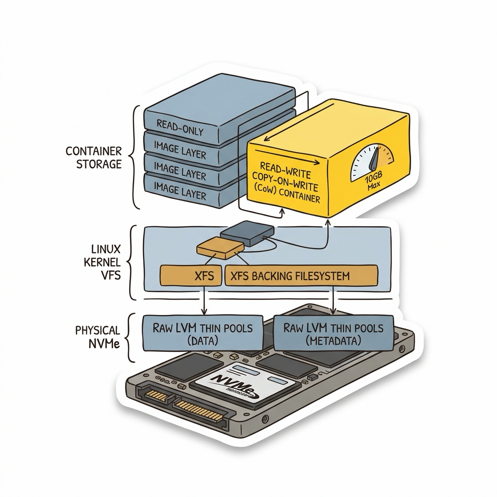

# 032. 컨테이너속 데이터가 사라지는이유 기록가능레이어와 CoW

도커 컨테이너의 파일시스템은 여러 겹의 **읽기 전용(Read-Only) 이미지 레이어** 맨 위에, 해당 컨테이너 전용의 얇은 **기록 가능 레이어(Writable Layer)** 한 장을 얹어 놓은 구조입니다.


**그림 03-1-1** 컨테이너속 데이터가 사라지는이유 기록가능레이어와 CoW의 필요성과 현대 클라우드 아키텍처 관점의 개요

---

### 032.1 왜 컨테이너속 데이터가 사라지는이유 기록가능레이어와 CoW이(가) 필요한가? (문제 정의와 현실적 배경)

소프트웨어 시스템이 복잡해질수록 설정을 다루는 방식은 전체 인프라의 신뢰성을 결정짓는 핵심 척도가 됩니다. **컨테이너속 데이터가 사라지는이유 기록가능레이어와 CoW**이(가) 부재하거나 잘못 다루어질 때 현장에서는 다음과 같은 대표적인 병목과 장애가 발생합니다:

1. **하드코딩된 설정과 환경 불일치로 인한 유연성 상실**: 환경이 바뀔 때마다 코드를 다시 빌드해야 하므로 배포 주기가 지연되고 이미지 수가 기하급수적으로 폭증합니다.
2. **보안 민감 데이터의 무분별한 노출**: 비밀번호, 데이터베이스 토큰, 암호화 키가 이미지 레이어에 영구 박제되어 형상관리 시스템이나 외부에 유출될 위험이 커집니다.
3. **재현 불가능한 구성 드리프트**: 스테이징 환경과 프로덕션 환경의 미세한 설정 차이가 예기치 못한 서비스 중단 사고로 직결됩니다.


**그림 03-1-2** 컨테이너속 데이터가 사라지는이유 기록가능레이어와 CoW에 대한 대표적인 오해와 실제 프로덕션 현장의 엔지니어링 진실

---

### 032.2 핵심 아키텍처와 엔지니어링 메커니즘

이미지 레이어에 있던 파일을 컨테이너가 수정하려 할 때 발생하는 **Copy-on-Write(CoW, 쓰기 시 복사)** 메커니즘을 실험으로 확인하고, 왜 컨테이너 삭제와 동시에 기록 가능 레이어의 모든 데이터가 소멸하는지 명확히 이해합니다.


**그림 03-1-3** 컨테이너속 데이터가 사라지는이유 기록가능레이어와 CoW의 내부 아키텍처 및 데이터 흐름

#### 📊 핵심 비교 및 엔지니어링 표준 분석

| 구분 / 핵심 원리 | 상세 설명 및 동작 메커니즘 | 실무 적용 시 주의점 및 베스트 프랙티스 |
| :--- | :--- | :--- |
| **기록 가능 레이어 (Writable Layer)** | 컨테이너마다 생성되는 고유한 최상단 읽기/쓰기 계층으로, 컨테이너의 생명주기와 운명을 함께함 | `docker container stop` 후 `start`하면 유지되지만, `docker container rm` 하는 순간 영구 삭제됨! |
| **Copy-on-Write (CoW)** | 하위 읽기 전용 이미지 레이어의 파일을 수정할 때, 해당 파일을 최상단 기록 가능 레이어로 먼저 복사한 뒤 수정본을 기록 | 원본 이미지 레이어는 전혀 훼손되지 않으므로 다른 컨테이너들에게 영향을 주지 않음 |
| **스테이트리스 vs 스테이트풀** | 웹/API 서버처럼 상태가 없는(Stateless) 앱은 기록 가능 레이어만으로 충분하지만, DB나 파일 업로드 데이터는 반드시 외부 볼륨에 분리해야 함 | 도커 볼륨(Volume)과 바인드 마운트(Bind Mount)가 탄생한 핵심 이유 |

---

### 032.3 선언적 실습 및 아키텍처 다이어그램

본 실습은 외부 비공개 패키지에 의존하지 않고, 공식 표준 이미지를 기반으로 즉시 재현 가능한 살아있는 코드로 구성되어 있습니다.

```bash
# 1번 컨테이너에서 만든 파일이 2번 컨테이너에서는 보이지 않고, 컨테이너 삭제 시 사라짐을 확인
docker container run --name cow-test1 alpine:3.20 sh -c "echo 'Secret Data 123' > /data.txt && cat /data.txt"
docker container run --rm alpine:3.20 sh -c "ls -la /data.txt 2>&1 || echo 'File does not exist in new container!'"
docker container rm cow-test1
```

#### 🔍 아키텍처 흐름도 (Mermaid Diagram)




**그림 03-1-4** 선언적 인프라 명세를 통한 컨테이너속 데이터가 사라지는이유 기록가능레이어와 CoW 검증 파이프라인

---

### 032.4 핵심 정리: 캐릭터 대화와 3대 교훈

> 👧 **도로시**: "교수님! **컨테이너속 데이터가 사라지는이유 기록가능레이어와 CoW**의 원리를 배우니까, 복잡하게 얽혀 있던 인프라 설정이 레고 블록처럼 질서정연하게 제자리를 찾는 게 보여요!"
> 
> 🐱 **조교 지니**: "야옹~ 맞습니다! 특히 런타임 환경과 불변 인프라의 경계를 명확히 지키는 것이 대규모 클라우드 운영의 제1원칙이랍니다!"
> 
> 🐶 **토토**: "멍멍! 선언적 코드로 한 번 적어두면 언제든 똑같이 복원되니까 정말 든든해요!"
> 
> 👨‍🏫 **이호진 교수님**: "훌륭하구나. 원리를 깊이 이해하고 실습을 통해 손에 익히는 것이 훌륭한 클라우드 엔지니어로 성장하는 가장 빠른 지름길이란다."


**그림 03-1-5** 컨테이너속 데이터가 사라지는이유 기록가능레이어와 CoW 마스터를 위한 3대 핵심 교훈

1. **설정과 실행의 명확한 분리**:
   * 애플리케이션 코드는 불변으로 유지하고, 가변적인 설정값은 외부에서 주입하여 이식성을 극대화합니다.
2. **선언적 재현성 확보**:
   * 사람이 수작업으로 변경하지 않고 코드 명세를 통해 언제 어디서나 100% 동일한 실행 결과를 보장합니다.
3. **최소 권한 및 보안 모범 사례 준수**:
   * 불필요한 권한과 포트 노출을 최소화하고 민감 데이터를 암호화하여 프로덕션 안정성을 담보합니다.

---

### 032.5 랩노트 피날레와 다음 강의 예고


**그림 03-1-6** 연구실에서 다음 마일스톤인 [도커볼륨 기초 생애주기가 독립된 영속적스토리지] 실습을 예고하는 교수님과 토토

> 💡 **다음 강의 안내**:
> [도커볼륨 기초 생애주기가 독립된 영속적스토리지](../033_도커볼륨_기초_생애주기가_독립된_영속적스토리지/)에서는 더욱 심화된 실전 엔지니어링 실습과 아키텍처를 다룹니다!

---

## 🧭 강의 네비게이션
* [◀️ 이전 강의: 031_Part02_실전미션_폴리글랏_마이크로서비스_빌드및레지스트리배포](/Part02_도커이미지빌드와_멀티스테이지_레지스트리/031_Part02_실전미션_폴리글랏_마이크로서비스_빌드및레지스트리배포/)
* [📋 Part 03. 퍼시스턴트 스토리지: 도커 볼륨(Volume)과 파일시스템 마운트 (032 ~ 041) 목차로 돌아가기](../)
* [▶️ 다음 강의: 033_도커볼륨_기초_생애주기가_독립된_영속적스토리지](../033_도커볼륨_기초_생애주기가_독립된_영속적스토리지/)


<!-- BIBLE_INTEGRATION_book8_deep_032 -->
---

### 032.C 📚 도커 바이블 심화: 엔터프라이즈 블록 스토리지 direct-lvm과 Overlay2 드라이버의 I/O 및 쿼터 메커니즘
> **출처 및 학술적 배경**: 도커 컨테이너 제9장 (컨테이너 스토리지 설정하기)  
> **핵심 주제**: 엔터프라이즈 환경에서의 실전 시스템 연동, 보안 인프라, 그리고 커널 레벨의 스토리지/런타임 제어 메커니즘을 심층 학습합니다.

#### 1. 아키텍처 및 내부 메커니즘 분석
도커의 컨테이너는 Copy-on-Write(CoW) 전략을 사용하므로, 베이스 이미지의 읽기 전용 레이어 위에 얇은 R/W 레이어가 쌓입니다.
대규모 엔터프라이즈 환경(특히 Red Hat Enterprise Linux)에서는 과거 `loop-lvm` 방식의 스파스 파일 손상 위험을 극복하기 위해 전용 물리 블록 디바이스를 LVM Thin-Pool로 묶는 **direct-lvm 모드**를 장기간 표준으로 사용했습니다.

#### 스토리지 드라이버 아키텍처 비교:
1. **Devicemapper (direct-lvm)**:
   * 블록 레벨 가상화 기술을 사용하여 디스크 I/O가 안정적이고 컨테이너별 용량 쿼터 할당이 매우 엄격합니다.
   * 물리 SSD/NVMe 파티션을 별도의 Data Pool과 Metadata Pool로 분리 구성합니다.
2. **Overlay2 (현대 표준)**:
   * 리눅스 커널의 파일 레벨 유니온 마운트 기술로서 Inode 오버헤드가 적고 페이지 캐시를 완벽히 공유하여 메모리 효율이 극대화됩니다.
   * XFS 파일시스템의 `pquota` 옵션을 통해 컨테이너별 쓰기 레이어 크기를 제한할 수 있습니다.



#### 2. 엔터프라이즈 실전 검증 실습
```bash
# [실습] 스토리지 드라이버 상세 정보 및 디스크 쿼터 확인
# 1. 호스트 스토리지 드라이버 및 지원 파일시스템 점검
docker info | grep -E "Storage Driver|Backing Filesystem|Supports d_type"

# 2. Overlay2 환경에서 컨테이너 쓰기 가능 레이어의 디스크 용량 상한 제한 (XFS pquota 필요)
docker run -d --name quota-app \
  --storage-opt size=10G \
  nginx:alpine

# 3. 컨테이너의 가상 크기(Virtual Size) vs 실제 R/W 레이어 크기 점검
docker ps -s
```

#### 3. 프로덕션 운영을 위한 핵심 멘토링
> 👨‍🏫 **이호진 교수님의 심화 지도**:
> "데이터베이스나 대용량 로그를 파일시스템 레이어에 직접 쓰면 CoW 오버헤드로 인해 심각한 I/O 병목이 발생합니다. 대규모 I/O는 반드시 이름 있는 볼륨(Named Volume)이나 호스트 바인드 마운트로 우회해야 합니다."
>
> 👧 **도로시의 깨달음**:
> "책을 복사해서 직접 낙서하면 책장이 엄청 무거워지니까, 낙서장(볼륨)을 따로 옆에 두고 쓰는 게 훨씬 빠르다는 거군요!"
>
> 🐱 **조교 지니의 프로덕션 체크리스트**:
> * docker ps -s에서 size는 컨테이너 R/W 레이어에 쓰여진 실제 바이트이며, virtual size는 하위 읽기 전용 이미지 레이어를 모두 합산한 크기입니다.
