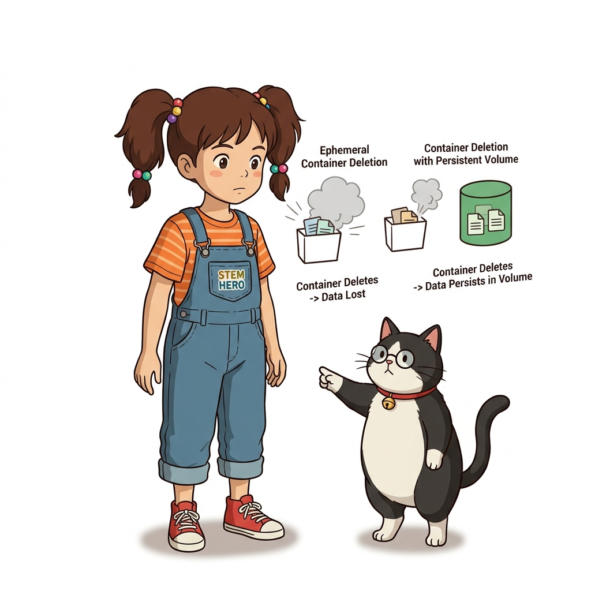
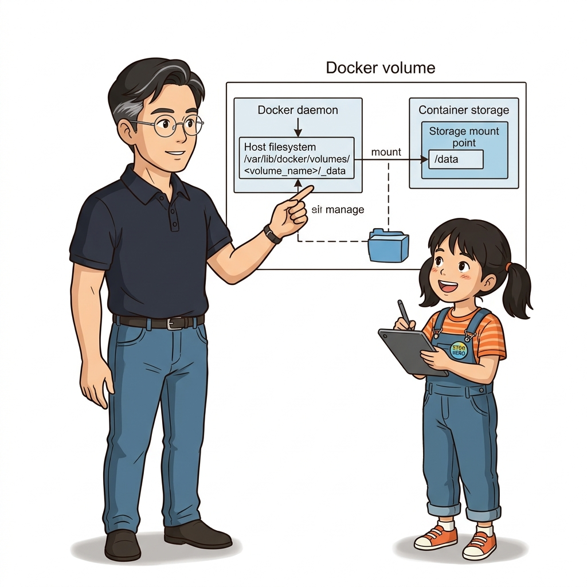
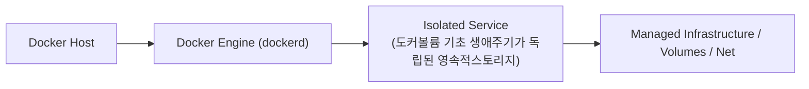
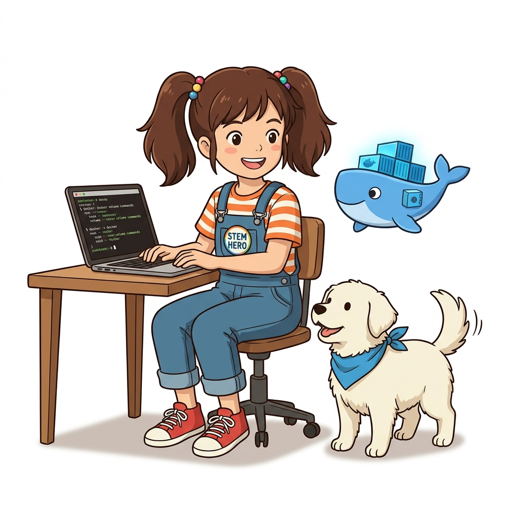
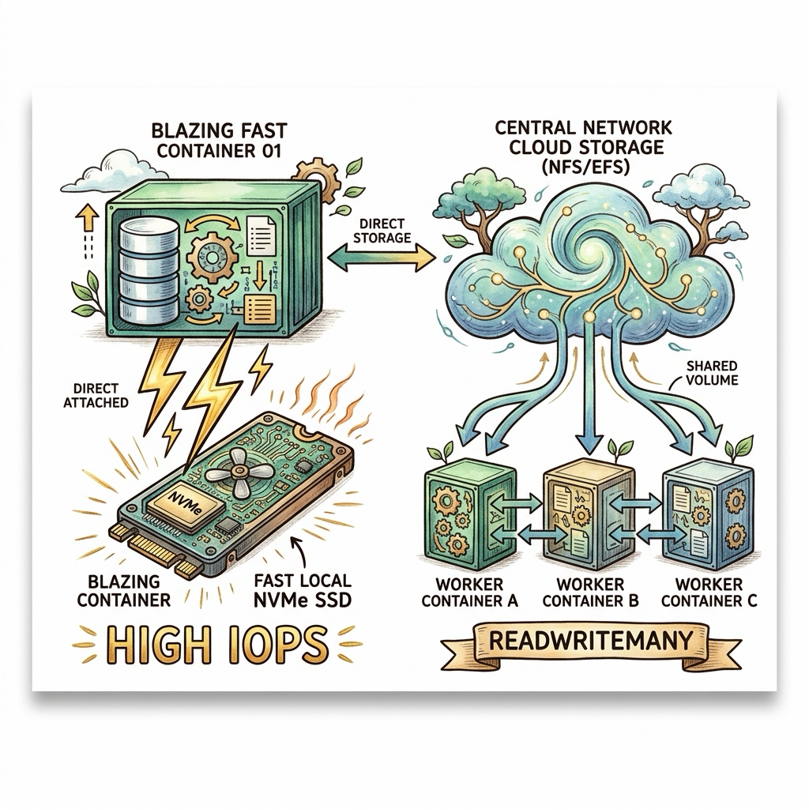

# 033. 도커볼륨 기초 생애주기가 독립된 영속적스토리지

**도커 볼륨(Docker Volume)**은 도커 엔진이 호스트 디스크의 전용 영역(`/var/lib/docker/volumes/`)에서 직접 생성·관리하며, 컨테이너와 완전히 독립된 생명주기를 가지는 일급(First-class) 스토리지 객체입니다.


**그림 03-2-1** 도커볼륨 기초 생애주기가 독립된 영속적스토리지의 필요성과 현대 클라우드 아키텍처 관점의 개요

---

### 033.1 왜 도커볼륨 기초 생애주기가 독립된 영속적스토리지이(가) 필요한가? (문제 정의와 현실적 배경)

소프트웨어 시스템이 복잡해질수록 설정을 다루는 방식은 전체 인프라의 신뢰성을 결정짓는 핵심 척도가 됩니다. **도커볼륨 기초 생애주기가 독립된 영속적스토리지**이(가) 부재하거나 잘못 다루어질 때 현장에서는 다음과 같은 대표적인 병목과 장애가 발생합니다:

1. **하드코딩된 설정과 환경 불일치로 인한 유연성 상실**: 환경이 바뀔 때마다 코드를 다시 빌드해야 하므로 배포 주기가 지연되고 이미지 수가 기하급수적으로 폭증합니다.
2. **보안 민감 데이터의 무분별한 노출**: 비밀번호, 데이터베이스 토큰, 암호화 키가 이미지 레이어에 영구 박제되어 형상관리 시스템이나 외부에 유출될 위험이 커집니다.
3. **재현 불가능한 구성 드리프트**: 스테이징 환경과 프로덕션 환경의 미세한 설정 차이가 예기치 못한 서비스 중단 사고로 직결됩니다.


**그림 03-2-2** 도커볼륨 기초 생애주기가 독립된 영속적스토리지에 대한 대표적인 오해와 실제 프로덕션 현장의 엔지니어링 진실

---

### 033.2 핵심 아키텍처와 엔지니어링 메커니즘

`docker volume create`, `ls`, `inspect`, `rm` 명령어로 명명된 볼륨(Named Volume)을 만들고, 컨테이너 내부의 특정 디렉터리(`/data`)에 마운트하여 컨테이너 삭제 후에도 데이터가 100% 보존됨을 확인합니다.


**그림 03-2-3** 도커볼륨 기초 생애주기가 독립된 영속적스토리지의 내부 아키텍처 및 데이터 흐름

#### 📊 핵심 비교 및 엔지니어링 표준 분석

| 구분 / 핵심 원리 | 상세 설명 및 동작 메커니즘 | 실무 적용 시 주의점 및 베스트 프랙티스 |
| :--- | :--- | :--- |
| **독립된 생명주기** | 컨테이너를 `docker container rm -f`로 지워도 연결되었던 명명된 볼륨(`oz-db-vol`)은 절대 삭제되지 않음 | 데이터베이스(PostgreSQL, MySQL, MongoDB, SQLite) 컨테이너 운영의 필수 표준 |
| **볼륨 마운트 문법** | 단축 문법 `-v 볼륨이름:컨테이너내부경로` 또는 명시적 문법 `--mount type=volume,source=볼륨이름,target=내부경로` | 오타 시 폴더를 자동 생성해 버리는 `-v`보다 실무 스크립트에서는 명시적인 `--mount` 문법도 널리 권장됨 |
| **자동 초기 데이터 복제** | 비어 있는 새 볼륨을 컨테이너의 비어 있지 않은 폴더에 마운트하면, 이미지 폴더 안의 파일들이 볼륨으로 자동 복사됨! | 초기 기본 설정 파일이나 시드 데이터를 볼륨에 자연스럽게 부트스트래핑하는 도커 볼륨만의 장점 |

---

### 033.3 선언적 실습 및 아키텍처 다이어그램

본 실습은 외부 비공개 패키지에 의존하지 않고, 공식 표준 이미지를 기반으로 즉시 재현 가능한 살아있는 코드로 구성되어 있습니다.

```bash
# 명명된 도커 볼륨(oz-db-vol)을 생성하고 컨테이너가 삭제된 뒤에도 데이터가 살아남는지 검증!
docker volume create oz-db-vol
docker container run --rm -v oz-db-vol:/data alpine:3.20 sh -c "echo 'Persistent Order #1001' >> /data/orders.log"

# 완전히 새로운 컨테이너에 같은 볼륨을 연결해 이전 데이터 읽기!
docker container run --rm -v oz-db-vol:/data alpine:3.20 cat /data/orders.log
docker volume inspect --format 'Mountpoint: {{.Mountpoint}}' oz-db-vol
docker volume rm oz-db-vol
```

#### 🔍 아키텍처 흐름도 (Mermaid Diagram)




**그림 03-2-4** 선언적 인프라 명세를 통한 도커볼륨 기초 생애주기가 독립된 영속적스토리지 검증 파이프라인

---

<!-- BIBLE_INTEGRATION_book4_deep_033 -->
---

### 033.C 📚 도커 바이블 심화: 인프라 엔지니어링 관점의 스토리지: 로컬 볼륨 vs 네트워크 공유 스토리지(NFS/EFS)와 분산 파일 락
*출처 도서: 『완벽한 IT 인프라 구축을 위한 Docker』 핵심 분석 (완벽한 IT 인프라 구축을 위한 Docker 제1장 및 제3장 (스토리지 인프라))*

엔터프라이즈 인프라에서 상태 저장(Stateful) 애플리케이션을 도커로 운영할 때, 스토리지 선택은 시스템 전체의 I/O 처리량과 장애 복구 시간을 좌우합니다:

1. **로컬 고성능 볼륨 (Local NVMe Volume)**:
   * 호스트 머신의 고속 NVMe/SSD에 마운트합니다.
   * **장점**: 극단적인 초고속 IOPS 보장, 제로 네트워크 오버헤드 (MySQL, PostgreSQL, Redis에 필수).
   * **단점**: 호스트 머신이 물리적으로 고장 나면 다른 노드에서 해당 데이터를 즉시 볼 수 없음 (파드 이동 시 복제 지연).
2. **네트워크 공유 스토리지 (NFS, AWS EFS, Ceph, GlusterFS)**:
   * 여러 대의 컨테이너가 서로 다른 물리 서버에서 동시에 동일한 디렉터리에 읽기/쓰기를 수행(`ReadWriteMany, RWX`).
   * **주의점**: SQLite나 임베디드 DB처럼 파일 락(POSIX File Locking)에 의존하는 애플리케이션을 NFS에 올리면 네트워크 지연으로 인해 **DB 파일이 손상(Corrupted)**되는 치명적 사고가 발생합니다.


**그림 033-B-2** 초고속 로컬 NVMe 블록 스토리지와 다중 노드 공유 네트워크 파일시스템(NFS)의 인프라 비교도

```bash
# [실습] 도커 볼륨 드라이버를 활용한 NFS 원격 스토리지 마운트 구문
# (실제 NFS 서버가 존재할 때 nfs 드라이버 옵션 매핑 예시)
# docker volume create --driver local \
#   --opt type=nfs \
#   --opt o=addr=192.168.1.100,rw,nfsvers=4 \
#   --opt device=:/data/shared-storage \
#   nfs-prod-volume
```

> 👨‍🏫 **이호진 교수님의 바이블 멘토링 노트**:
> "RDBMS나 고성능 캐시는 무조건 로컬 블록 스토리지에 두고 데이터베이스 레벨의 복제(Master-Slave Replication)로 고가용성을 풀어야 합니다. NFS 위에 DB 파일을 올려두는 것은 시한폭탄을 안고 운영하는 것과 같습니다."
>
> 👧 **도로시의 깨달음**:
> "초고속 개인 금고(로컬 볼륨)와 여러 친구들이 함께 쓰는 공유 도서관(NFS)의 차이점을 명확히 알고 골라야겠어요!"
>
> 🐱 **조교 지니의 아키텍처 체크포인트**:
> "사용자 업로드 이미지나 PDF 같은 비구조화 정적 파일은 NFS나 S3 오브젝트 스토리지에 보관하는 것이 가장 이상적인 분리 아키텍처입니다."


### 033.4 핵심 정리: 캐릭터 대화와 3대 교훈

> 👧 **도로시**: "교수님! **도커볼륨 기초 생애주기가 독립된 영속적스토리지**의 원리를 배우니까, 복잡하게 얽혀 있던 인프라 설정이 레고 블록처럼 질서정연하게 제자리를 찾는 게 보여요!"
> 
> 🐱 **조교 지니**: "야옹~ 맞습니다! 특히 런타임 환경과 불변 인프라의 경계를 명확히 지키는 것이 대규모 클라우드 운영의 제1원칙이랍니다!"
> 
> 🐶 **토토**: "멍멍! 선언적 코드로 한 번 적어두면 언제든 똑같이 복원되니까 정말 든든해요!"
> 
> 👨‍🏫 **이호진 교수님**: "훌륭하구나. 원리를 깊이 이해하고 실습을 통해 손에 익히는 것이 훌륭한 클라우드 엔지니어로 성장하는 가장 빠른 지름길이란다."


**그림 03-2-5** 도커볼륨 기초 생애주기가 독립된 영속적스토리지 마스터를 위한 3대 핵심 교훈

1. **설정과 실행의 명확한 분리**:
   * 애플리케이션 코드는 불변으로 유지하고, 가변적인 설정값은 외부에서 주입하여 이식성을 극대화합니다.
2. **선언적 재현성 확보**:
   * 사람이 수작업으로 변경하지 않고 코드 명세를 통해 언제 어디서나 100% 동일한 실행 결과를 보장합니다.
3. **최소 권한 및 보안 모범 사례 준수**:
   * 불필요한 권한과 포트 노출을 최소화하고 민감 데이터를 암호화하여 프로덕션 안정성을 담보합니다.

---

### 033.5 랩노트 피날레와 다음 강의 예고


**그림 03-2-6** 연구실에서 다음 마일스톤인 [도커볼륨을 활용한 무중단 애플리케이션 버전업그레이드] 실습을 예고하는 교수님과 토토

> 💡 **다음 강의 안내**:
> [도커볼륨을 활용한 무중단 애플리케이션 버전업그레이드](../034_도커볼륨을_활용한_무중단_애플리케이션_버전업그레이드/)에서는 더욱 심화된 실전 엔지니어링 실습과 아키텍처를 다룹니다!

---

## 🧭 강의 네비게이션
* [◀️ 이전 강의: 032_컨테이너속_데이터가_사라지는이유_기록가능레이어와_CoW](../032_컨테이너속_데이터가_사라지는이유_기록가능레이어와_CoW/)
* [📋 Part 03. 퍼시스턴트 스토리지: 도커 볼륨(Volume)과 파일시스템 마운트 (032 ~ 041) 목차로 돌아가기](../)
* [▶️ 다음 강의: 034_도커볼륨을_활용한_무중단_애플리케이션_버전업그레이드](../034_도커볼륨을_활용한_무중단_애플리케이션_버전업그레이드/)
