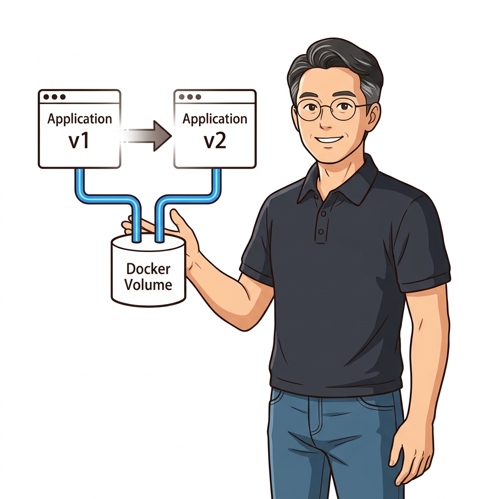
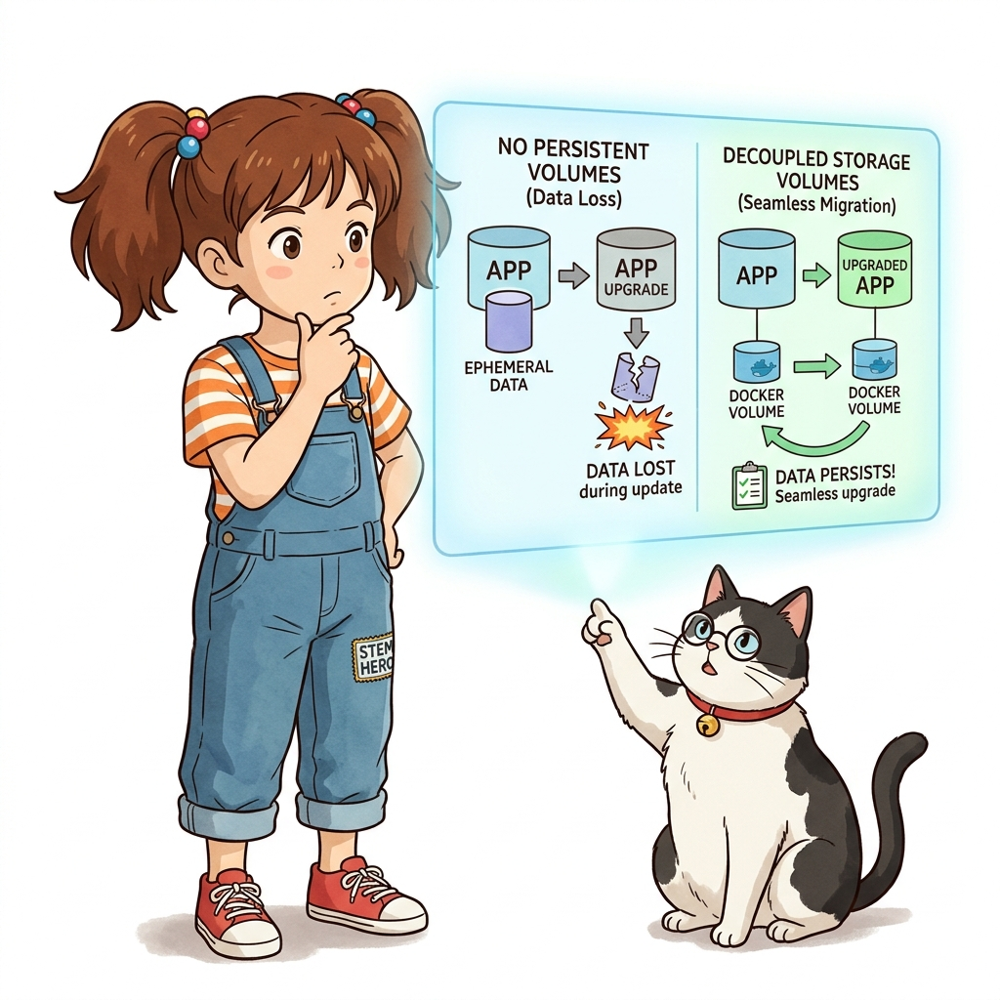
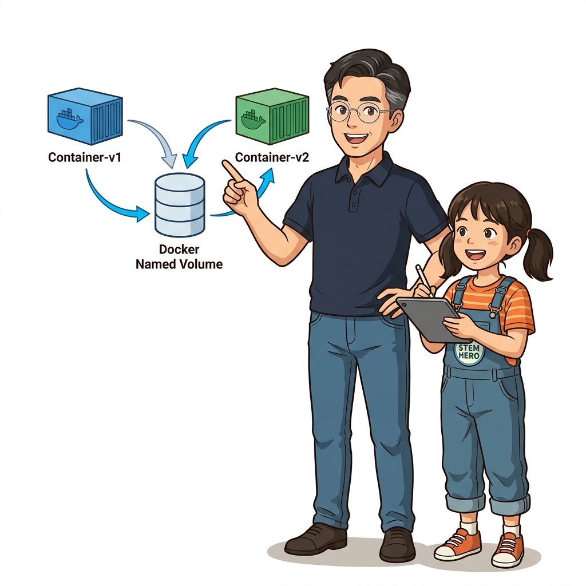
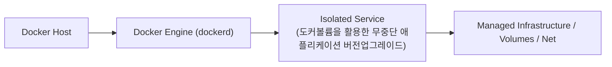
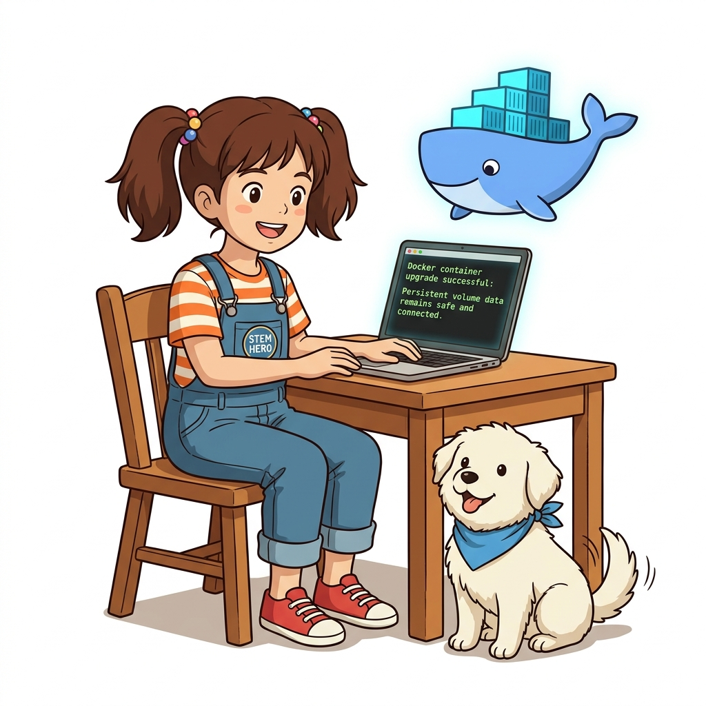

# 034. 도커볼륨을 활용한 무중단 애플리케이션 버전업그레이드

할 일 목록(To-Do)이나 주문 관리 웹 애플리케이션이 SQLite/PostgreSQL 데이터를 도커 볼륨에 저장하고 있을 때, 애플리케이션 이미지를 `v1`에서 `v2`로 업그레이드하는 실전 워크플로를 실습합니다.


**그림 03-3-1** 도커볼륨을 활용한 무중단 애플리케이션 버전업그레이드의 필요성과 현대 클라우드 아키텍처 관점의 개요

---

### 034.1 왜 도커볼륨을 활용한 무중단 애플리케이션 버전업그레이드이(가) 필요한가? (문제 정의와 현실적 배경)

소프트웨어 시스템이 복잡해질수록 설정을 다루는 방식은 전체 인프라의 신뢰성을 결정짓는 핵심 척도가 됩니다. **도커볼륨을 활용한 무중단 애플리케이션 버전업그레이드**이(가) 부재하거나 잘못 다루어질 때 현장에서는 다음과 같은 대표적인 병목과 장애가 발생합니다:

1. **하드코딩된 설정과 환경 불일치로 인한 유연성 상실**: 환경이 바뀔 때마다 코드를 다시 빌드해야 하므로 배포 주기가 지연되고 이미지 수가 기하급수적으로 폭증합니다.
2. **보안 민감 데이터의 무분별한 노출**: 비밀번호, 데이터베이스 토큰, 암호화 키가 이미지 레이어에 영구 박제되어 형상관리 시스템이나 외부에 유출될 위험이 커집니다.
3. **재현 불가능한 구성 드리프트**: 스테이징 환경과 프로덕션 환경의 미세한 설정 차이가 예기치 못한 서비스 중단 사고로 직결됩니다.


**그림 03-3-2** 도커볼륨을 활용한 무중단 애플리케이션 버전업그레이드에 대한 대표적인 오해와 실제 프로덕션 현장의 엔지니어링 진실

---

### 034.2 핵심 아키텍처와 엔지니어링 메커니즘

또한 실행 중인 두 컨테이너가 하나의 볼륨을 동시에 공유(`--volumes-from` 또는 동일 볼륨 지정)할 때 주의해야 할 **파일 잠금(File Lock) 및 동시 쓰기 충돌** 문제를 짚어봅니다.


**그림 03-3-3** 도커볼륨을 활용한 무중단 애플리케이션 버전업그레이드의 내부 아키텍처 및 데이터 흐름

#### 📊 핵심 비교 및 엔지니어링 표준 분석

| 구분 / 핵심 원리 | 상세 설명 및 동작 메커니즘 | 실무 적용 시 주의점 및 베스트 프랙티스 |
| :--- | :--- | :--- |
| **컨테이너 교체형 업그레이드** | 컨테이너 내부에서 패치를 설치하지 않고, 기존 v1 컨테이너를 삭제한 뒤 같은 볼륨을 물려 v2 컨테이너를 새로 기동 | 불변 인프라(Immutable Infrastructure) 철학에 부합하는 깔끔한 업그레이드 방식 |
| **다중 컨테이너 볼륨 공유 주의점** | 일반적인 관계형 DB 데이터 파일(예: `/var/lib/postgresql/data`)은 단일 DB 프로세스만 독점 접근하도록 설계됨 | 여러 웹 컨테이너가 데이터를 공유해야 할 때는 볼륨 직접 공유 대신 1개의 DB 컨테이너에 네트워크로 접속해야 안전! |
| **로그 수집 사이드카 패턴** | 웹 컨테이너는 볼륨에 로그를 쓰고(Write), 로그 수집 컨테이너는 같은 볼륨을 읽기 전용(`:ro`)으로 마운트해 읽는 구조 | 쓰기 주체를 1개로 제한하면 볼륨 공유도 100% 안전하게 활용 가능 |

---

### 034.3 선언적 실습 및 아키텍처 다이어그램

본 실습은 외부 비공개 패키지에 의존하지 않고, 공식 표준 이미지를 기반으로 즉시 재현 가능한 살아있는 코드로 구성되어 있습니다.

```bash
# v1 컨테이너가 기록한 볼륨 데이터를 v2 컨테이너가 그대로 이어받아 업그레이드하는 실습
docker volume create todo-data
docker container run --rm -v todo-data:/var/lib/todo alpine:3.20 sh -c "echo '[v1] Buy Raspberry Pi 5' > /var/lib/todo/items.txt"

# v1 종료 후 새로운 v2 컨테이너가 동일한 todo-data 볼륨을 마운트해 기능 확장
docker container run --rm -v todo-data:/var/lib/todo alpine:3.20 sh -c "echo '[v2] Learn Docker Compose' >> /var/lib/todo/items.txt && cat /var/lib/todo/items.txt"
docker volume rm todo-data
```

#### 🔍 아키텍처 흐름도 (Mermaid Diagram)




**그림 03-3-4** 선언적 인프라 명세를 통한 도커볼륨을 활용한 무중단 애플리케이션 버전업그레이드 검증 파이프라인

---

### 034.B 📚 도커 바이블 심화: /var/lib/docker/volumes 구조와 무중단 백업/복원을 위한 임시 tar 컨테이너 패턴

> 📖 **참고 도서 심층 연계**:
> * 《도커 컨테이너》 제9장 (도커 볼륨 스토리지 드라이버와 로컬 볼륨 해부)
> * 《완벽한 IT 인프라 구축을 위한 Docker》 제2장 (데이터 영속화와 컨테이너 간 데이터 마이그레이션)

도커 볼륨은 마법의 공간이 아닙니다. 리눅스 호스트의 `/var/lib/docker/volumes/<볼륨명>/_data` 디렉터리를 도커 데몬이 격리된 컨테이너의 마운트 네임스페이스에 바인드 마운트해 주는 것입니다. 그렇다면 운영 중인 볼륨 데이터를 호스트 파일시스템을 직접 건드리지 않고 어떻게 안전하게 백업 및 복원할 수 있을까요?

#### 1. 도커 엔지니어링 표준: 임시 사이드카 tar 백업 패턴

운영 중인 DB 컨테이너를 중단시키지 않고 일관된 볼륨 스냅샷을 압축 백업하는 산업 표준 패턴입니다:

```bash
# 1. 원본 볼륨 생성 및 샘플 데이터 주입
docker volume create db_production_data
docker run --rm -v db_production_data:/data alpine:3.20 sh -c "echo 'Important DB records 2026' > /data/core.db"

# 2. [핵심] 읽기 전용(:ro) 마운트와 호스트 바인드 마운트를 결합한 1회성 백업 컨테이너 실행
docker run --rm \
  -v db_production_data:/source:ro \
  -v $(pwd):/backup \
  alpine:3.20 \
  tar -czf /backup/db_backup_$(date +%Y%m%d).tar.gz -C /source .

# 3. 새로운 서버나 복구용 볼륨(db_recovery_data)에 백업 데이터 즉시 복원
docker volume create db_recovery_data
docker run --rm \
  -v db_recovery_data:/target \
  -v $(pwd):/backup \
  alpine:3.20 \
  tar -xzf /backup/db_backup_*.tar.gz -C /target

# 4. 복원된 데이터 검증
docker run --rm -v db_recovery_data:/check:ro alpine:3.20 cat /check/core.db
```

#### 2. 백업/복원 아키텍처 핵심 설계 장점

| 설계 요소 | 엔지니어링 메커니즘 | 실무 효과 및 신뢰성 보장 |
| :--- | :--- | :--- |
| **`:ro` (Read-Only) 플래그** | 백업 컨테이너가 원본 볼륨에 단 1바이트의 쓰기 작업도 수행하지 못하도록 커널 차단 | 백업 도중 발생할 수 있는 스크립트 실수나 데이터 오염 100% 방지 |
| **`--rm` 자동 삭제** | 백업 아카이빙 작업이 완료되는 즉시 컨테이너 프로세스와 격리 네임스페이스 자동 소멸 | 유휴 컨테이너 잔여물 없이 호스트 자원과 디스크 완벽 정리 |
| **호스트 OS 독립성** | 호스트에 tar나 압축 라이브러리가 없어도, 컨테이너 내부의 표준 POSIX 툴체인으로 백업 수행 | macOS, Windows WSL2, Ubuntu, RHEL 어디서나 100% 동일하게 동작 |

> 👧 **도로시**: "호스트의 복잡한 권한 설정을 건드리지 않고, 임시 작업자 컨테이너를 잠깐 불러서 `:ro`로 읽어 안전하게 압축하고 사라지게 만드는 패턴이 정말 기발해요!"
> 
> 👨‍🏫 **이호진 교수님**: "그렇단다. 이것이 컨테이너의 유연성을 극한으로 활용한 '유틸리티 컨테이너 패턴'이란다. 운영 환경의 데이터베이스 마이그레이션과 재해 복구(DR) 파이프라인의 뼈대가 되지."
> 
> 🐱 **조교 지니**: "야옹~ 복원할 때도 새 볼륨에 압축을 푼 뒤 v2 애플리케이션 컨테이너를 새 볼륨에 연결하기만 하면 롤백도 손쉽게 구현할 수 있답니다!"

---

### 034.4 핵심 정리: 캐릭터 대화와 3대 교훈

> 👧 **도로시**: "교수님! **도커볼륨을 활용한 무중단 애플리케이션 버전업그레이드**의 원리를 배우니까, 복잡하게 얽혀 있던 인프라 설정이 레고 블록처럼 질서정연하게 제자리를 찾는 게 보여요!"
> 
> 🐱 **조교 지니**: "야옹~ 맞습니다! 특히 런타임 환경과 불변 인프라의 경계를 명확히 지키는 것이 대규모 클라우드 운영의 제1원칙이랍니다!"
> 
> 🐶 **토토**: "멍멍! 선언적 코드로 한 번 적어두면 언제든 똑같이 복원되니까 정말 든든해요!"
> 
> 👨‍🏫 **이호진 교수님**: "훌륭하구나. 원리를 깊이 이해하고 실습을 통해 손에 익히는 것이 훌륭한 클라우드 엔지니어로 성장하는 가장 빠른 지름길이란다."


**그림 03-3-5** 도커볼륨을 활용한 무중단 애플리케이션 버전업그레이드 마스터를 위한 3대 핵심 교훈

1. **설정과 실행의 명확한 분리**:
   * 애플리케이션 코드는 불변으로 유지하고, 가변적인 설정값은 외부에서 주입하여 이식성을 극대화합니다.
2. **선언적 재현성 확보**:
   * 사람이 수작업으로 변경하지 않고 코드 명세를 통해 언제 어디서나 100% 동일한 실행 결과를 보장합니다.
3. **최소 권한 및 보안 모범 사례 준수**:
   * 불필요한 권한과 포트 노출을 최소화하고 민감 데이터를 암호화하여 프로덕션 안정성을 담보합니다.

---

### 034.5 랩노트 피날레와 다음 강의 예고


**그림 03-3-6** 연구실에서 다음 마일스톤인 [Dockerfile VOLUME 인스트럭션과 익명볼륨의 함정] 실습을 예고하는 교수님과 토토

> 💡 **다음 강의 안내**:
> [Dockerfile VOLUME 인스트럭션과 익명볼륨의 함정](../035_Dockerfile_VOLUME_인스트럭션과_익명볼륨의_함정/)에서는 더욱 심화된 실전 엔지니어링 실습과 아키텍처를 다룹니다!

---

## 🧭 강의 네비게이션
* [◀️ 이전 강의: 033_도커볼륨_기초_생애주기가_독립된_영속적스토리지](../033_도커볼륨_기초_생애주기가_독립된_영속적스토리지/)
* [📋 Part 03. 퍼시스턴트 스토리지: 도커 볼륨(Volume)과 파일시스템 마운트 (032 ~ 041) 목차로 돌아가기](../)
* [▶️ 다음 강의: 035_Dockerfile_VOLUME_인스트럭션과_익명볼륨의_함정](../035_Dockerfile_VOLUME_인스트럭션과_익명볼륨의_함정/)
