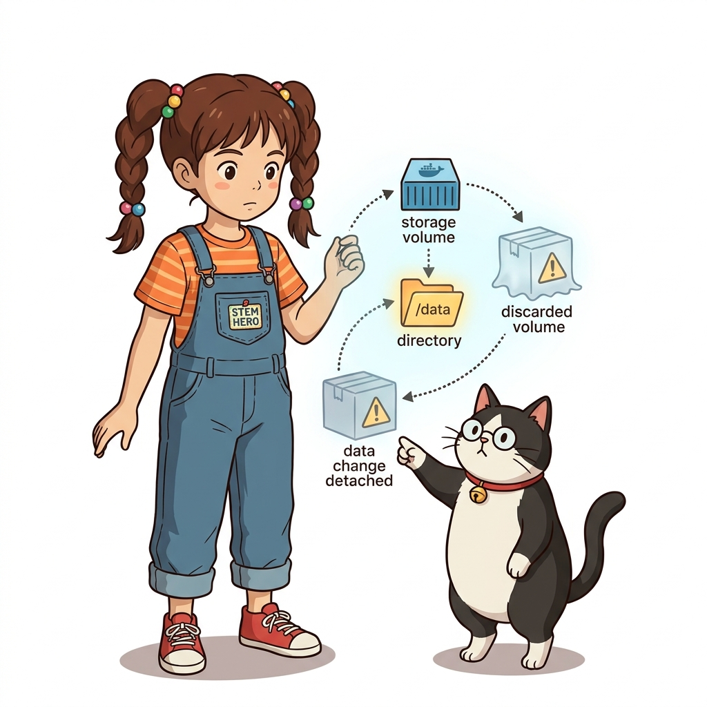
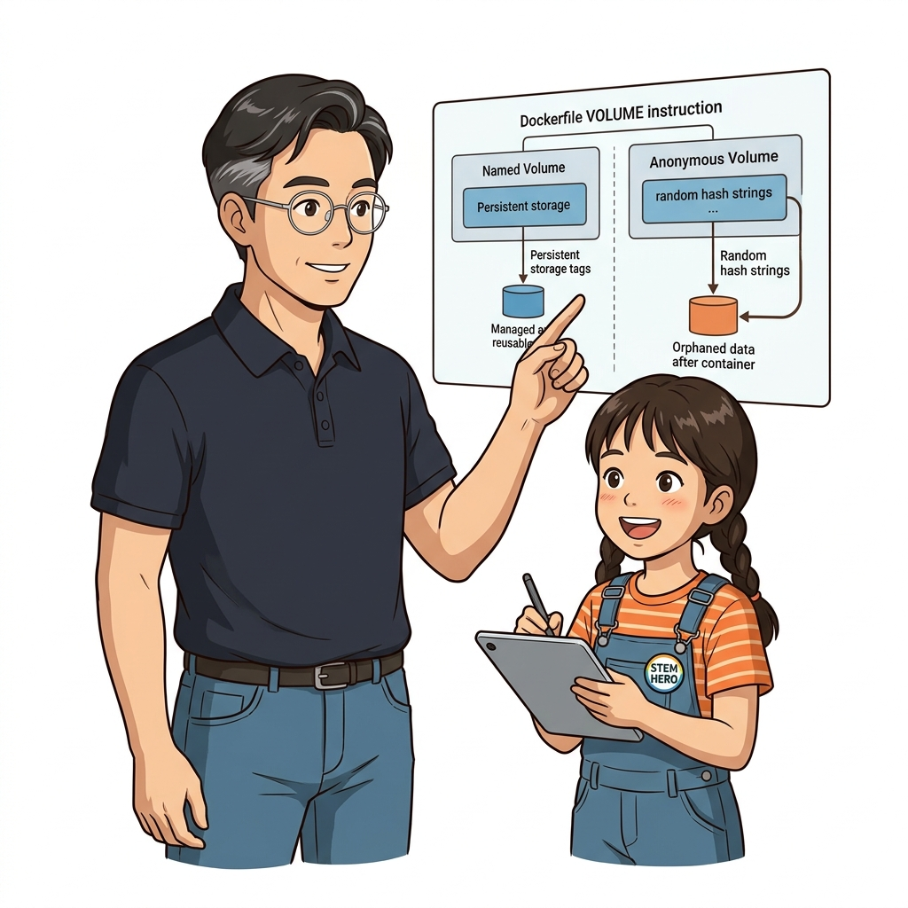
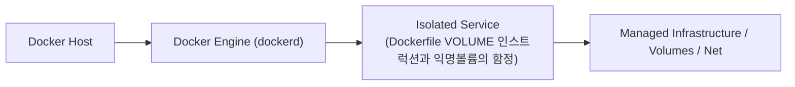

# 035. Dockerfile VOLUME 인스트럭션과 익명볼륨의 함정

PostgreSQL이나 MySQL 같은 공식 이미지의 `Dockerfile`에는 실수로 컨테이너를 그냥 실행하더라도 데이터가 날아가지 않도록 **`VOLUME ["/var/lib/..."]` 인스트럭션**이 미리 선언되어 있습니다.


**그림 03-4-1** Dockerfile VOLUME 인스트럭션과 익명볼륨의 함정의 필요성과 현대 클라우드 아키텍처 관점의 개요

---

### 035.1 왜 Dockerfile VOLUME 인스트럭션과 익명볼륨의 함정이(가) 필요한가? (문제 정의와 현실적 배경)

소프트웨어 시스템이 복잡해질수록 설정을 다루는 방식은 전체 인프라의 신뢰성을 결정짓는 핵심 척도가 됩니다. **Dockerfile VOLUME 인스트럭션과 익명볼륨의 함정**이(가) 부재하거나 잘못 다루어질 때 현장에서는 다음과 같은 대표적인 병목과 장애가 발생합니다:

1. **하드코딩된 설정과 환경 불일치로 인한 유연성 상실**: 환경이 바뀔 때마다 코드를 다시 빌드해야 하므로 배포 주기가 지연되고 이미지 수가 기하급수적으로 폭증합니다.
2. **보안 민감 데이터의 무분별한 노출**: 비밀번호, 데이터베이스 토큰, 암호화 키가 이미지 레이어에 영구 박제되어 형상관리 시스템이나 외부에 유출될 위험이 커집니다.
3. **재현 불가능한 구성 드리프트**: 스테이징 환경과 프로덕션 환경의 미세한 설정 차이가 예기치 못한 서비스 중단 사고로 직결됩니다.


**그림 03-4-2** Dockerfile VOLUME 인스트럭션과 익명볼륨의 함정에 대한 대표적인 오해와 실제 프로덕션 현장의 엔지니어링 진실

---

### 035.2 핵심 아키텍처와 엔지니어링 메커니즘

이때 사용자가 `-v 이름:경로`를 지정하지 않고 컨테이너를 실행하면 도커가 무작위 해시 이름의 **익명 볼륨(Anonymous Volume)**을 자동 생성한다는 사실을 확인하고, 왜 실무에서는 항상 **명명된 볼륨(Named Volume)**을 명시해야 하는지 배웁니다.


**그림 03-4-3** Dockerfile VOLUME 인스트럭션과 익명볼륨의 함정의 내부 아키텍처 및 데이터 흐름

#### 📊 핵심 비교 및 엔지니어링 표준 분석

| 구분 / 핵심 원리 | 상세 설명 및 동작 메커니즘 | 실무 적용 시 주의점 및 베스트 프랙티스 |
| :--- | :--- | :--- |
| **`VOLUME ["/data"]` 인스트럭션** | `Dockerfile`에서 특정 경로를 영속 스토리지 마운트 지점으로 강제 선언하는 명령 | 해당 줄 이후의 `Dockerfile` `RUN` 단계에서 `/data` 내부를 수정해도 이미지 레이어에 저장되지 않음에 주의! |
| **익명 볼륨 (Anonymous Volume)** | 호스트 소스를 생략하고 `-v /data`로 실행하거나 `VOLUME`이 선언된 이미지를 그냥 실행할 때 무작위 ID로 생성됨 | 어떤 볼륨이 어떤 컨테이너의 데이터인지 식별하기 어려워 디스크 쓰레기가 되기 쉬움 |
| **실무 골든 룰** | 데이터를 보존할 때는 반드시 `-v 명시적볼륨명:/경로`를 쓰고, 일회성 테스트 컨테이너는 `docker run --rm -v`(익명 볼륨 동시 삭제) 사용 | `docker volume ls -f dangling=true`로 고아 볼륨을 주기적으로 점검 |

---

### 035.3 선언적 실습 및 아키텍처 다이어그램

본 실습은 외부 비공개 패키지에 의존하지 않고, 공식 표준 이미지를 기반으로 즉시 재현 가능한 살아있는 코드로 구성되어 있습니다.

```bash
# VOLUME 인스트럭션이 포함된 이미지를 이름 지정 없이 실행했을 때 생성되는 익명 볼륨 확인 및 청소
docker container run --rm -v /app/cache alpine:3.20 sh -c "df -h /app/cache"
# 사용되지 않는 익명 볼륨(Anonymous Volumes) 일괄 정리 명령
docker volume prune -f
```

#### 🔍 아키텍처 흐름도 (Mermaid Diagram)




**그림 03-4-4** 선언적 인프라 명세를 통한 Dockerfile VOLUME 인스트럭션과 익명볼륨의 함정 검증 파이프라인

---

### 035.4 핵심 정리: 캐릭터 대화와 3대 교훈

> 👧 **도로시**: "교수님! **Dockerfile VOLUME 인스트럭션과 익명볼륨의 함정**의 원리를 배우니까, 복잡하게 얽혀 있던 인프라 설정이 레고 블록처럼 질서정연하게 제자리를 찾는 게 보여요!"
> 
> 🐱 **조교 지니**: "야옹~ 맞습니다! 특히 런타임 환경과 불변 인프라의 경계를 명확히 지키는 것이 대규모 클라우드 운영의 제1원칙이랍니다!"
> 
> 🐶 **토토**: "멍멍! 선언적 코드로 한 번 적어두면 언제든 똑같이 복원되니까 정말 든든해요!"
> 
> 👨‍🏫 **이호진 교수님**: "훌륭하구나. 원리를 깊이 이해하고 실습을 통해 손에 익히는 것이 훌륭한 클라우드 엔지니어로 성장하는 가장 빠른 지름길이란다."


**그림 03-4-5** Dockerfile VOLUME 인스트럭션과 익명볼륨의 함정 마스터를 위한 3대 핵심 교훈

1. **설정과 실행의 명확한 분리**:
   * 애플리케이션 코드는 불변으로 유지하고, 가변적인 설정값은 외부에서 주입하여 이식성을 극대화합니다.
2. **선언적 재현성 확보**:
   * 사람이 수작업으로 변경하지 않고 코드 명세를 통해 언제 어디서나 100% 동일한 실행 결과를 보장합니다.
3. **최소 권한 및 보안 모범 사례 준수**:
   * 불필요한 권한과 포트 노출을 최소화하고 민감 데이터를 암호화하여 프로덕션 안정성을 담보합니다.

---

### 035.5 랩노트 피날레와 다음 강의 예고


**그림 03-4-6** 연구실에서 다음 마일스톤인 [바인드마운트 호스트디렉터리를 컨테이너에 직결하기] 실습을 예고하는 교수님과 토토

> 💡 **다음 강의 안내**:
> [바인드마운트 호스트디렉터리를 컨테이너에 직결하기](../036_바인드마운트_호스트디렉터리를_컨테이너에_직결하기/)에서는 더욱 심화된 실전 엔지니어링 실습과 아키텍처를 다룹니다!

---

## 🧭 강의 네비게이션
* [◀️ 이전 강의: 034_도커볼륨을_활용한_무중단_애플리케이션_버전업그레이드](../034_도커볼륨을_활용한_무중단_애플리케이션_버전업그레이드/)
* [📋 Part 03. 퍼시스턴트 스토리지: 도커 볼륨(Volume)과 파일시스템 마운트 (032 ~ 041) 목차로 돌아가기](../)
* [▶️ 다음 강의: 036_바인드마운트_호스트디렉터리를_컨테이너에_직결하기](../036_바인드마운트_호스트디렉터리를_컨테이너에_직결하기/)
