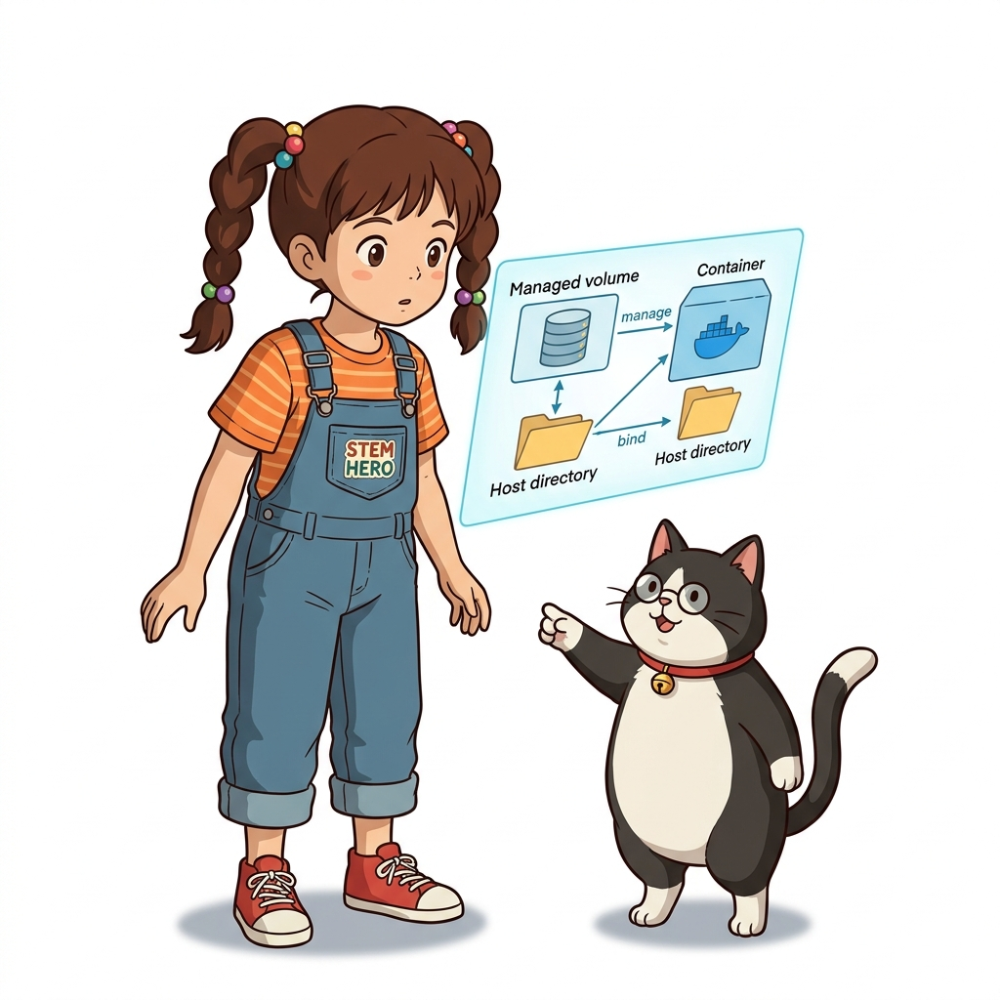
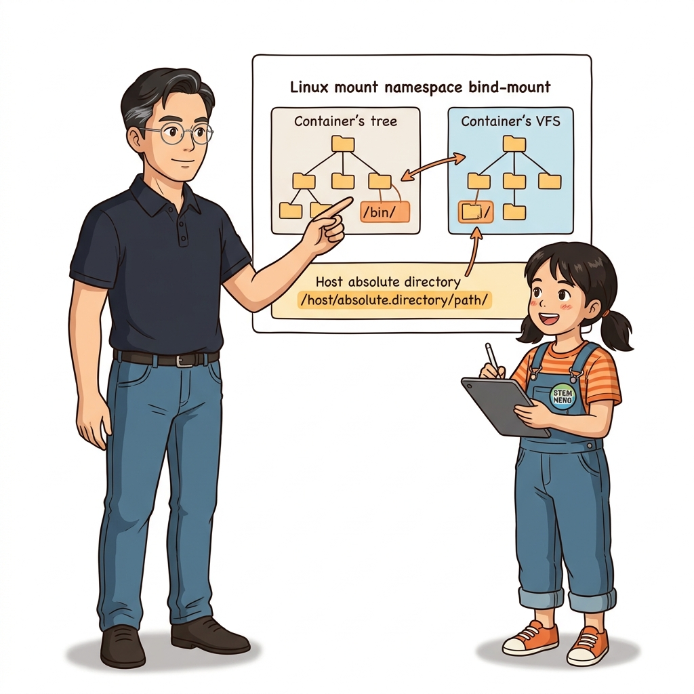
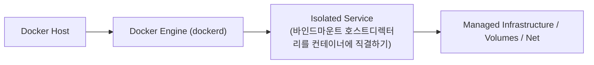
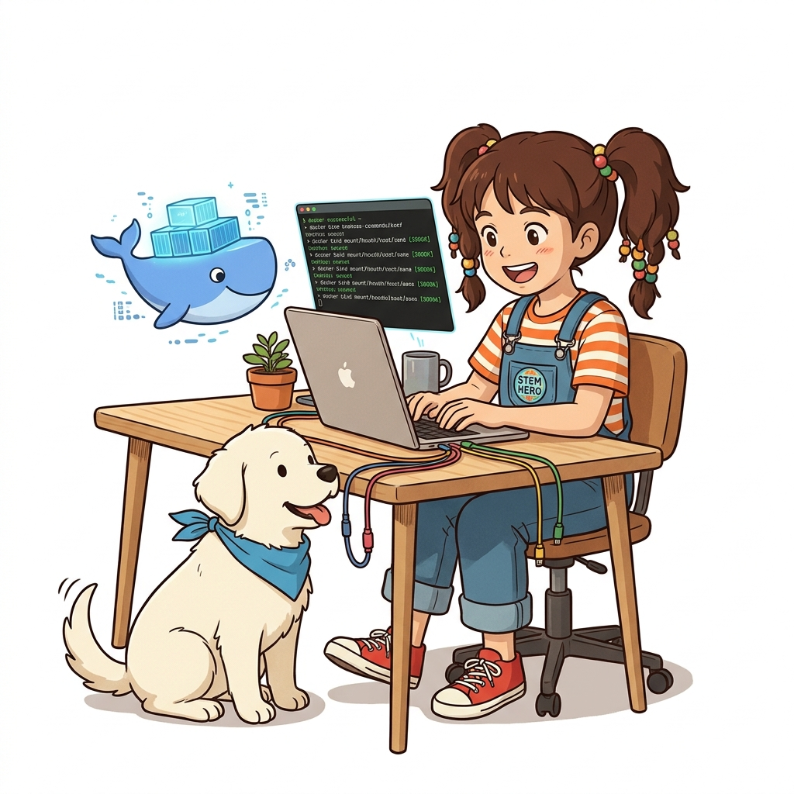
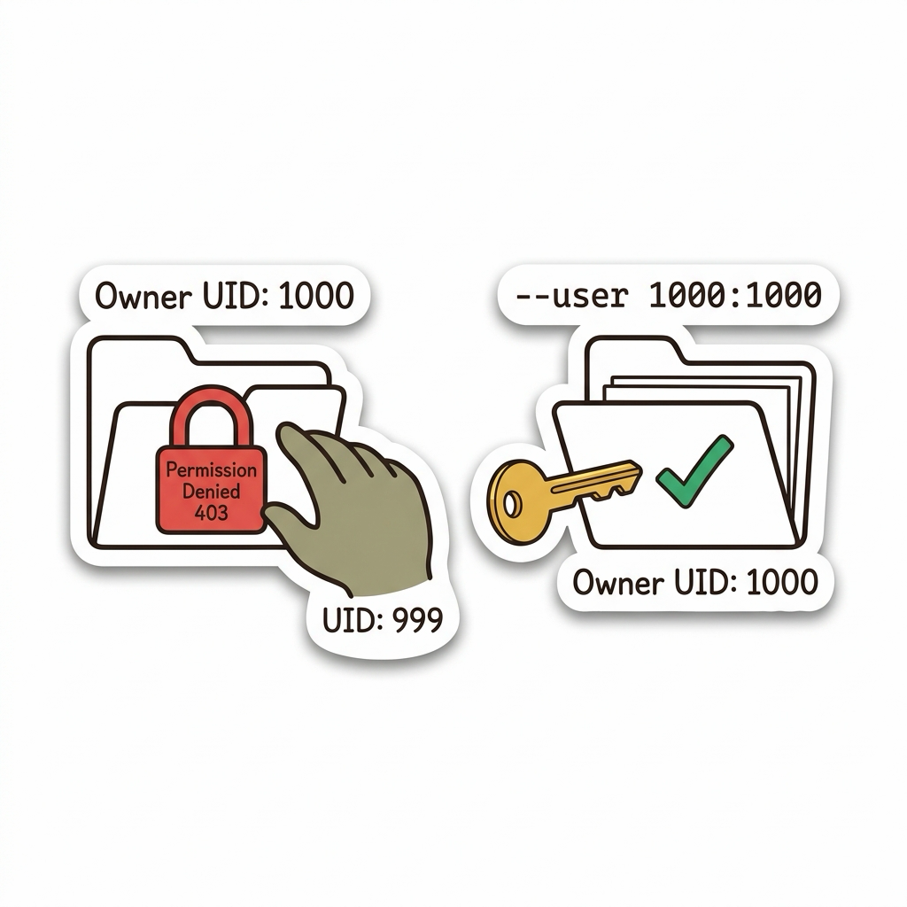

# 036. 바인드마운트 호스트디렉터리를 컨테이너에 직결하기

도커 엔진이 숨겨진 영역에서 관리하는 '도커 볼륨'과 달리, **호스트 컴퓨터의 특정 폴더나 파일 경로를 컨테이너 내부 경로에 1:1로 투명하게 직결하는 바인드 마운트(`--mount type=bind`)**를 배웁니다.


**그림 03-5-1** 바인드마운트 호스트디렉터리를 컨테이너에 직결하기의 필요성과 현대 클라우드 아키텍처 관점의 개요

---

### 036.1 왜 바인드마운트 호스트디렉터리를 컨테이너에 직결하기이(가) 필요한가? (문제 정의와 현실적 배경)

소프트웨어 시스템이 복잡해질수록 설정을 다루는 방식은 전체 인프라의 신뢰성을 결정짓는 핵심 척도가 됩니다. **바인드마운트 호스트디렉터리를 컨테이너에 직결하기**이(가) 부재하거나 잘못 다루어질 때 현장에서는 다음과 같은 대표적인 병목과 장애가 발생합니다:

1. **하드코딩된 설정과 환경 불일치로 인한 유연성 상실**: 환경이 바뀔 때마다 코드를 다시 빌드해야 하므로 배포 주기가 지연되고 이미지 수가 기하급수적으로 폭증합니다.
2. **보안 민감 데이터의 무분별한 노출**: 비밀번호, 데이터베이스 토큰, 암호화 키가 이미지 레이어에 영구 박제되어 형상관리 시스템이나 외부에 유출될 위험이 커집니다.
3. **재현 불가능한 구성 드리프트**: 스테이징 환경과 프로덕션 환경의 미세한 설정 차이가 예기치 못한 서비스 중단 사고로 직결됩니다.


**그림 03-5-2** 바인드마운트 호스트디렉터리를 컨테이너에 직결하기에 대한 대표적인 오해와 실제 프로덕션 현장의 엔지니어링 진실

---

### 036.2 핵심 아키텍처와 엔지니어링 메커니즘

로컬 개발 환경에서 소스 코드를 수정할 때마다 이미지를 다시 빌드하지 않고 바인드 마운트로 라이브 리로드(Live Reload) 개발 환경을 꾸미거나, 호스트의 설정 파일(`nginx.conf`)을 컨테이너에 주입하는 실습을 진행합니다.


**그림 03-5-3** 바인드마운트 호스트디렉터리를 컨테이너에 직결하기의 내부 아키텍처 및 데이터 흐름

#### 📊 핵심 비교 및 엔지니어링 표준 분석

| 구분 / 핵심 원리 | 상세 설명 및 동작 메커니즘 | 실무 적용 시 주의점 및 베스트 프랙티스 |
| :--- | :--- | :--- |
| **도커 볼륨 vs 바인드 마운트** | 도커 볼륨은 도커가 관리하는 최적화된 스토리지(운영 DB용) / 바인드 마운트는 호스트의 지정 경로를 직접 노출(개발 소스/설정 주입용) | 바인드 마운트의 `source` 경로는 반드시 **절대 경로(`$(pwd)/...`)**로 지정해야 함 |
| **양방향 실시간 동기화** | 호스트와 컨테이너가 정확히 동일한 디스크 아이노드(Inode)를 바라보므로 양쪽 어디서 수정하든 0초 만에 반영 | 로컬 개발 생산성을 극대화하는 최고의 무기 |
| **빈 디렉터리 덮어쓰기 주의** | 비어 있는 호스트 폴더를 바인드 마운트하면 컨테이너 원래 폴더 안의 파일들이 가려져(Hidden) 빈 폴더처럼 보임! | 새 도커 볼륨과 달리 바인드 마운트는 이미지 내부 파일을 호스트로 자동 복사해 주지 않음 |

---

### 036.3 선언적 실습 및 아키텍처 다이어그램

본 실습은 외부 비공개 패키지에 의존하지 않고, 공식 표준 이미지를 기반으로 즉시 재현 가능한 살아있는 코드로 구성되어 있습니다.

```bash
# 호스트의 /tmp/oz-bind-html 폴더를 Nginx 컨테이너의 웹 루트 폴더에 바인드 마운트로 직결하기!
mkdir -p /tmp/oz-bind-html
echo "<h1>Live Bind Mount from Host!</h1>" > /tmp/oz-bind-html/index.html

docker container run -d -p 8091:80   --mount type=bind,source=/tmp/oz-bind-html,target=/usr/share/nginx/html   --name bind-web nginx:1.27-alpine

curl -s http://localhost:8091
# 호스트에서 파일을 수정하면 컨테이너 재시작 없이 즉시 반영됨!
echo "<h1>Updated Instantly without Rebuild!</h1>" > /tmp/oz-bind-html/index.html
curl -s http://localhost:8091

docker container rm -f bind-web && rm -rf /tmp/oz-bind-html
```

#### 🔍 아키텍처 흐름도 (Mermaid Diagram)




**그림 03-5-4** 선언적 인프라 명세를 통한 바인드마운트 호스트디렉터리를 컨테이너에 직결하기 검증 파이프라인

---

<!-- BIBLE_INTEGRATION_book6_trouble_volume_permission -->
---

### 036.B 📚 도커 바이블 심화: 트러블슈팅: 볼륨 마운트 권한 거부(Permission Denied)와 UID/GID 불일치 해결 기법
*출처 도서: 『트러블 슈팅 도커』 핵심 분석*

호스트의 특정 디렉터리를 컨테이너에 바인드 마운트(`-v $(pwd):/app`)했을 때, 애플리케이션이 파일을 쓰려고 하면 어김없이 터지는 에러가 있습니다:
`EACCES: permission denied, open '/app/logs/server.log'`

#### 권한 거부의 진실: 리눅스 UID 매핑 원리:
* 도커 컨테이너는 호스트 커널을 공유하므로, 파일시스템 권한은 '사용자 이름(문자열)'이 아니라 오직 **숫자 UID/GID**로만 판정됩니다.
* 호스트 개발자 계정은 보통 `UID: 1000`입니다.
* 컨테이너 내부 애플리케이션이 `node` 계정(보통 `UID: 1000`)으로 돌면 문제가 없지만, 보안을 위해 `nobody`(UID: 65534)나 특정 비특권 계정으로 돌면서 호스트 디렉터리(소유자: 1000)에 쓰기를 시도하면 커널이 쓰기 권한을 즉시 차단합니다.
* **해결책 3가지**:
  1. `docker run --user $(id -u):$(id -g)`로 호스트 UID와 1:1 일치시키기
  2. Dockerfile에서 `USER` 지시어의 UID를 호스트와 통일하기
  3. 엔트리포인트 셸 스크립트에서 초기화 시 `chown` 후 `gosu`로 권한 강등 실행


**그림 036-B-1** 호스트 UID 1000과 컨테이너 UID의 불일치 자물쇠를 올바른 열쇠로 풀어내는 도식

```bash
# [실습] UID 불일치로 인한 쓰기 에러 재현 및 --user 해결책
mkdir -p /tmp/docker-perm-test
chmod 755 /tmp/docker-perm-test

# 1. 비특권 사용자로 구동되어 쓰기 실패하는 상황
docker container run --rm -v /tmp/docker-perm-test:/data --user 999:999 alpine \
  touch /data/test.txt 2>&1 || echo ">> 권한 거부 발생!"

# 2. 호스트 현재 사용자의 UID/GID를 주입하여 완벽 해결
docker container run --rm -v /tmp/docker-perm-test:/data --user $(id -u):$(id -g) \
  touch /data/test.txt && echo ">> 쓰기 성공!"

rm -rf /tmp/docker-perm-test
```

> 👨‍🏫 **이호진 교수님의 바이블 멘토링 노트**:
> "권한 에러가 난다고 해서 호스트 디렉터리에 `chmod 777`을 주는 것은 보안상 대단히 위험한 최악의 임시방편입니다. 항상 실행 계정의 UID를 호스트 사용자와 일치시키는 `--user` 옵션이나 gosu 패턴을 사용하세요."
>
> 👧 **도로시의 깨달음**:
> "열쇠 구멍 번호(UID)가 서로 달라서 문이 안 열렸던 거네요! 번호를 똑같이 맞춰주니 깔끔하게 열려요!"
>
> 🐱 **조교 지니의 아키텍처 체크포인트**:
> "CI/CD 환경에서는 빌드 아티팩트가 root 소유로 호스트에 남아 `git clean`이 실패하는 경우가 많은데, 이때도 `--user $(id -u):$(id -g)`를 주입하면 완벽히 해결됩니다."

---

### 036.C 📚 도커 바이블 심화: 엔터프라이즈 SELinux 보안 컨텍스트(:z vs :Z)와 호스트 시스템 디렉터리 오염 방지

> 📖 **참고 도서 심층 연계**:
> * 《제대로 배우는 도커》 제13장 (리눅스 커널 보안: SELinux와 AppArmor 컨텍스트 제어)
> * 《완벽한 IT 인프라 구축을 위한 Docker》 제2장 (엔터프라이즈 OS에서의 볼륨 바인드 마운트 트러블슈팅)

RHEL(Red Hat Enterprise Linux), CentOS, Rocky Linux, Fedora 등 엔터프라이즈 리눅스 환경에서는 디렉터리 권한을 `chmod 777`로 풀어주어도 컨테이너 내부에서 `Permission denied` 에러가 발생합니다. 이는 리눅스 커널의 강력한 보안 서브시스템인 **SELinux(Security-Enhanced Linux)**가 컨테이너 프로세스의 파일시스템 접근을 차단하기 때문입니다.

#### 1. SELinux 보안 레이블과 `:z` vs `:Z` 마운트 플래그

컨테이너 프로세스는 일반적으로 `container_t` 도메인 레이블로 격리되어 실행되며, 호스트의 일반 파일(`user_home_t` 등)에 접근할 수 없습니다. 도커는 마운트 시 자동으로 SELinux 컨텍스트를 재지정(Relabel)하는 두 가지 플래그를 제공합니다:

| 마운트 플래그 | 리눅스 커널 내부 동작 (`chcon`) | 권한 공유 범위 | 권장 실무 시나리오 |
| :--- | :--- | :--- | :--- |
| **`:z` (소문자)** | 마운트 경로의 SELinux 타입을 **공유 컨테이너 파일(`container_file_t`)**로 재지정 | 모든 컨테이너가 해당 호스트 경로를 **동시에 읽고 쓰기 가능** | 여러 컨테이너가 공유하는 공용 설정 폴더, 웹 소스코드 라이브 마운트 |
| **`:Z` (대문자)** | 마운트 경로에 고유한 카테고리(MCS, 예: `container_file_t:s0:c123,c456`)를 부여 | **오직 현재 기동된 해당 컨테이너만 배타적(Exclusive)으로 독점 접근** | 단일 데이터베이스(MySQL, Redis)의 전용 트랜잭션 데이터 디렉터리 |

```bash
# [실습] SELinux 활성화 환경에서의 바인드 마운트 구동 예시
# 1. 여러 컨테이너가 함께 읽고 쓸 수 있도록 공유 레이블(:z)로 마운트
docker run -d -v /opt/web-contents:/usr/share/nginx/html:z nginx:alpine

# 2. 전용 DB 컨테이너만 독점할 수 있도록 배타적 비공개 레이블(:Z)로 마운트
docker run -d -v /var/data/mysql:/var/lib/mysql:Z mysql:8.0
```

> ⚠️ **엔터프라이즈 치명적 금기 사항**:
> 호스트 시스템의 루트 디렉터리나 중요 시스템 폴더(예: `-v /:/host:Z` 또는 `-v /etc:/host_etc:z`)에 절대로 `:z`나 `:Z` 플래그를 붙여 마운트하지 마십시오! 도커 데몬이 호스트의 핵심 시스템 파일들의 SELinux 레이블을 `container_file_t`로 강제 변경하여, 호스트의 sshd, systemd, 감사 로그 데몬이 먹통이 되는 **호스트 OS 파괴 장애**가 발생합니다.

> 👧 **도로시**: "와! 리눅스 보안관인 SELinux가 컨테이너를 지켜보고 있었군요! 공유할 때는 소문자 `:z`, 혼자만 쓸 때는 대문자 `:Z`를 붙여주면 권한 에러가 깔끔하게 풀리네요!"
> 
> 👨‍🏫 **이호진 교수님**: "그렇단다. 하지만 호스트 시스템 폴더에는 절대로 `:z`나 `:Z`를 붙이면 안 된다는 경고를 반드시 명심해야 한단다."
> 
> 🐶 **토토**: "멍멍! `ls -lZ` 명령어로 파일의 SELinux 보안 라벨을 직접 확인해볼 수 있어!"


### 036.4 핵심 정리: 캐릭터 대화와 3대 교훈

> 👧 **도로시**: "교수님! **바인드마운트 호스트디렉터리를 컨테이너에 직결하기**의 원리를 배우니까, 복잡하게 얽혀 있던 인프라 설정이 레고 블록처럼 질서정연하게 제자리를 찾는 게 보여요!"
> 
> 🐱 **조교 지니**: "야옹~ 맞습니다! 특히 런타임 환경과 불변 인프라의 경계를 명확히 지키는 것이 대규모 클라우드 운영의 제1원칙이랍니다!"
> 
> 🐶 **토토**: "멍멍! 선언적 코드로 한 번 적어두면 언제든 똑같이 복원되니까 정말 든든해요!"
> 
> 👨‍🏫 **이호진 교수님**: "훌륭하구나. 원리를 깊이 이해하고 실습을 통해 손에 익히는 것이 훌륭한 클라우드 엔지니어로 성장하는 가장 빠른 지름길이란다."


**그림 03-5-5** 바인드마운트 호스트디렉터리를 컨테이너에 직결하기 마스터를 위한 3대 핵심 교훈

1. **설정과 실행의 명확한 분리**:
   * 애플리케이션 코드는 불변으로 유지하고, 가변적인 설정값은 외부에서 주입하여 이식성을 극대화합니다.
2. **선언적 재현성 확보**:
   * 사람이 수작업으로 변경하지 않고 코드 명세를 통해 언제 어디서나 100% 동일한 실행 결과를 보장합니다.
3. **최소 권한 및 보안 모범 사례 준수**:
   * 불필요한 권한과 포트 노출을 최소화하고 민감 데이터를 암호화하여 프로덕션 안정성을 담보합니다.

---

### 036.5 랩노트 피날레와 다음 강의 예고


**그림 03-5-6** 연구실에서 다음 마일스톤인 [읽기전용 마운트와 컨테이너파일시스템 합집합원리] 실습을 예고하는 교수님과 토토

> 💡 **다음 강의 안내**:
> [읽기전용 마운트와 컨테이너파일시스템 합집합원리](../037_읽기전용_마운트와_컨테이너파일시스템_합집합원리/)에서는 더욱 심화된 실전 엔지니어링 실습과 아키텍처를 다룹니다!

---

## 🧭 강의 네비게이션
* [◀️ 이전 강의: 035_Dockerfile_VOLUME_인스트럭션과_익명볼륨의_함정](../035_Dockerfile_VOLUME_인스트럭션과_익명볼륨의_함정/)
* [📋 Part 03. 퍼시스턴트 스토리지: 도커 볼륨(Volume)과 파일시스템 마운트 (032 ~ 041) 목차로 돌아가기](../)
* [▶️ 다음 강의: 037_읽기전용_마운트와_컨테이너파일시스템_합집합원리](../037_읽기전용_마운트와_컨테이너파일시스템_합집합원리/)
