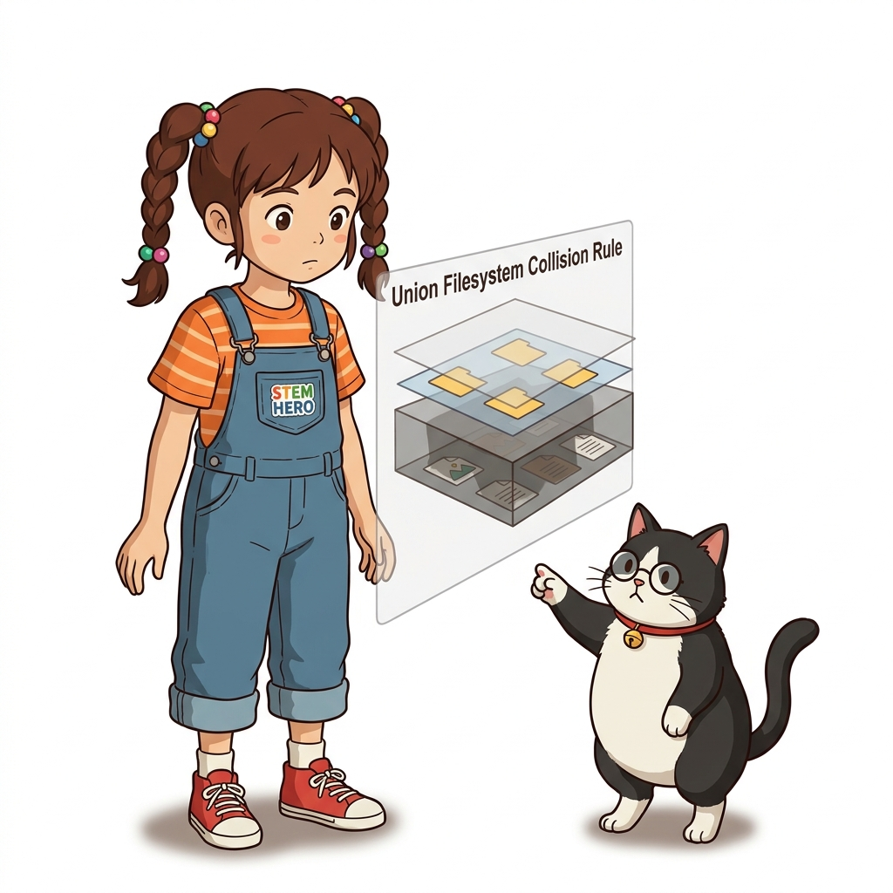
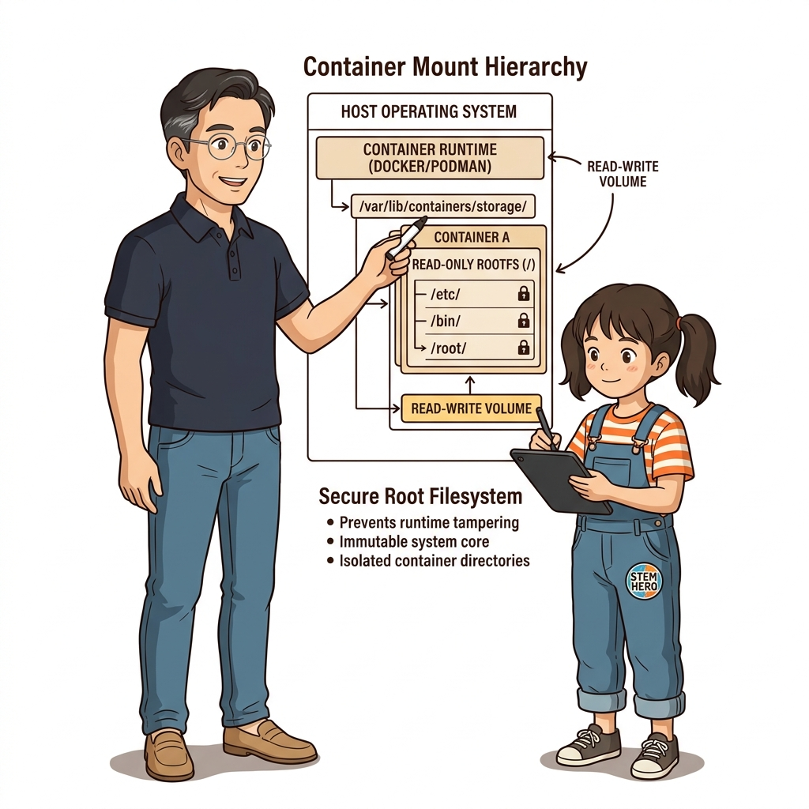
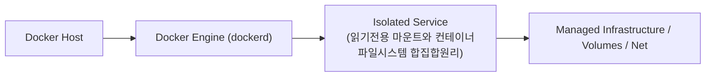
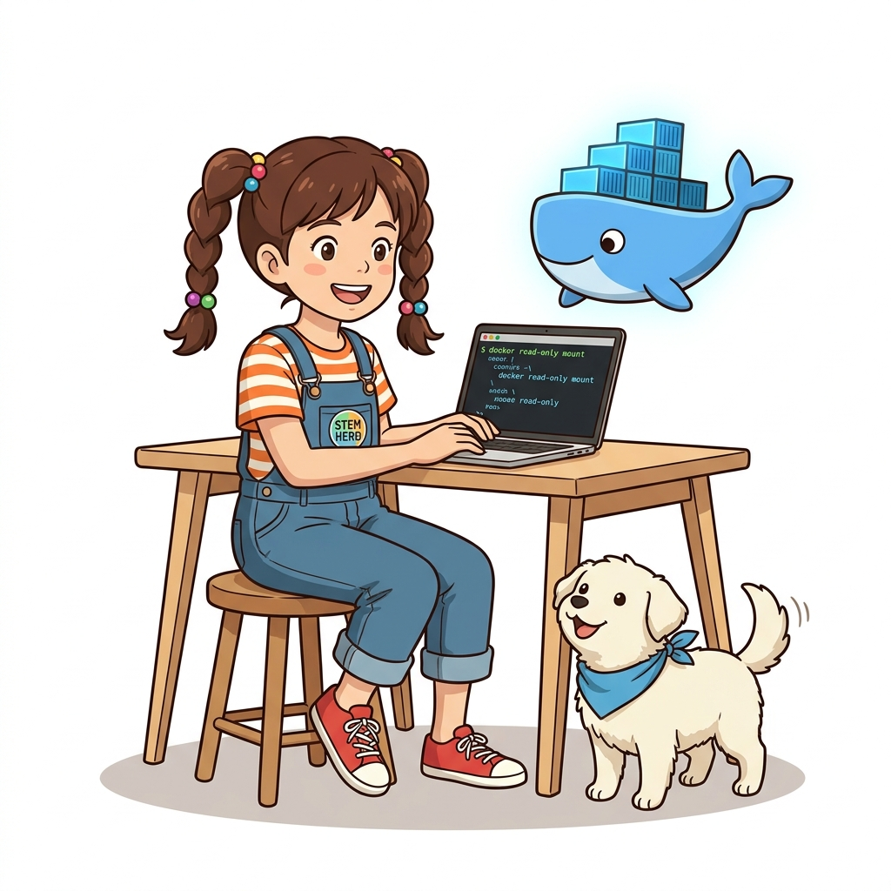

# 037. 읽기전용 마운트와 컨테이너파일시스템 합집합원리

바인드 마운트는 양방향 수정이 가능하기 때문에, 컨테이너 내부 프로세스가 해킹당하거나 버그가 발생하면 호스트의 원본 파일까지 훼손될 위험이 있습니다.


**그림 03-6-1** 읽기전용 마운트와 컨테이너파일시스템 합집합원리의 필요성과 현대 클라우드 아키텍처 관점의 개요

---

### 037.1 왜 읽기전용 마운트와 컨테이너파일시스템 합집합원리이(가) 필요한가? (문제 정의와 현실적 배경)

소프트웨어 시스템이 복잡해질수록 설정을 다루는 방식은 전체 인프라의 신뢰성을 결정짓는 핵심 척도가 됩니다. **읽기전용 마운트와 컨테이너파일시스템 합집합원리**이(가) 부재하거나 잘못 다루어질 때 현장에서는 다음과 같은 대표적인 병목과 장애가 발생합니다:

1. **하드코딩된 설정과 환경 불일치로 인한 유연성 상실**: 환경이 바뀔 때마다 코드를 다시 빌드해야 하므로 배포 주기가 지연되고 이미지 수가 기하급수적으로 폭증합니다.
2. **보안 민감 데이터의 무분별한 노출**: 비밀번호, 데이터베이스 토큰, 암호화 키가 이미지 레이어에 영구 박제되어 형상관리 시스템이나 외부에 유출될 위험이 커집니다.
3. **재현 불가능한 구성 드리프트**: 스테이징 환경과 프로덕션 환경의 미세한 설정 차이가 예기치 못한 서비스 중단 사고로 직결됩니다.


**그림 03-6-2** 읽기전용 마운트와 컨테이너파일시스템 합집합원리에 대한 대표적인 오해와 실제 프로덕션 현장의 엔지니어링 진실

---

### 037.2 핵심 아키텍처와 엔지니어링 메커니즘

`readonly`(`ro`) 플래그를 부여해 컨테이너에는 오직 **읽기 권한만 허용**하는 보안 마운트 기법과, 도커의 **합집합 파일시스템(Union File System / Overlay2)**이 이미지 레이어·기록 가능 레이어·볼륨·바인드 마운트를 단일 디렉터리 트리로 합쳐 보여주는 원리를 마스터합니다.


**그림 03-6-3** 읽기전용 마운트와 컨테이너파일시스템 합집합원리의 내부 아키텍처 및 데이터 흐름

#### 📊 핵심 비교 및 엔지니어링 표준 분석

| 구분 / 핵심 원리 | 상세 설명 및 동작 메커니즘 | 실무 적용 시 주의점 및 베스트 프랙티스 |
| :--- | :--- | :--- |
| **`readonly` (`:ro`) 옵션** | `--mount type=bind,source=...,target=...,readonly` 또는 `-v 호스트경로:컨테이너경로:ro`로 설정 | 설정 파일(`nginx.conf`), SSL 인증서, 정적 웹 에셋 마운트 시 반드시 `readonly`를 붙이는 것이 보안 정석! |
| **Overlay2 합집합 파일시스템** | `lowerdir`(읽기 전용 이미지 레이어들) + `upperdir`(컨테이너 기록 가능 레이어) + `merged`(통합 뷰)로 구성 | 여기에 특정 하위 경로(`/data`, `/config`)만 외부 볼륨과 바인드 마운트가 마운트 포인트로 연결됨 |
| **단일 통합 파일시스템의 우아함** | 애플리케이션 코드는 상대 경로가 볼륨인지 이미지 레이어인지 전혀 신경 쓸 필요 없이 일반 로컬 파일처럼 읽고 쓰면 됨 | 스토리지 인프라와 애플리케이션 로직의 완벽한 분리 |

---

### 037.3 선언적 실습 및 아키텍처 다이어그램

본 실습은 외부 비공개 패키지에 의존하지 않고, 공식 표준 이미지를 기반으로 즉시 재현 가능한 살아있는 코드로 구성되어 있습니다.

```bash
# 호스트 설정 폴더를 읽기 전용(readonly)으로 마운트하여 컨테이너 내부에서의 파일 변조 원천 차단!
mkdir -p /tmp/oz-ro-conf && echo "port=8080" > /tmp/oz-ro-conf/app.conf

docker container run --rm   --mount type=bind,source=/tmp/oz-ro-conf,target=/config,readonly   alpine:3.20 sh -c "cat /config/app.conf && (echo 'hack' >> /config/app.conf 2>&1 || echo 'Blocked: Read-only file system!')"

rm -rf /tmp/oz-ro-conf
```

#### 🔍 아키텍처 흐름도 (Mermaid Diagram)




**그림 03-6-4** 선언적 인프라 명세를 통한 읽기전용 마운트와 컨테이너파일시스템 합집합원리 검증 파이프라인

---

### 037.4 핵심 정리: 캐릭터 대화와 3대 교훈

> 👧 **도로시**: "교수님! **읽기전용 마운트와 컨테이너파일시스템 합집합원리**의 원리를 배우니까, 복잡하게 얽혀 있던 인프라 설정이 레고 블록처럼 질서정연하게 제자리를 찾는 게 보여요!"
> 
> 🐱 **조교 지니**: "야옹~ 맞습니다! 특히 런타임 환경과 불변 인프라의 경계를 명확히 지키는 것이 대규모 클라우드 운영의 제1원칙이랍니다!"
> 
> 🐶 **토토**: "멍멍! 선언적 코드로 한 번 적어두면 언제든 똑같이 복원되니까 정말 든든해요!"
> 
> 👨‍🏫 **이호진 교수님**: "훌륭하구나. 원리를 깊이 이해하고 실습을 통해 손에 익히는 것이 훌륭한 클라우드 엔지니어로 성장하는 가장 빠른 지름길이란다."


**그림 03-6-5** 읽기전용 마운트와 컨테이너파일시스템 합집합원리 마스터를 위한 3대 핵심 교훈

1. **설정과 실행의 명확한 분리**:
   * 애플리케이션 코드는 불변으로 유지하고, 가변적인 설정값은 외부에서 주입하여 이식성을 극대화합니다.
2. **선언적 재현성 확보**:
   * 사람이 수작업으로 변경하지 않고 코드 명세를 통해 언제 어디서나 100% 동일한 실행 결과를 보장합니다.
3. **최소 권한 및 보안 모범 사례 준수**:
   * 불필요한 권한과 포트 노출을 최소화하고 민감 데이터를 암호화하여 프로덕션 안정성을 담보합니다.

---

### 037.5 랩노트 피날레와 다음 강의 예고


**그림 03-6-6** 연구실에서 다음 마일스톤인 [파일시스템 마운트의 한계와 운영체제간 호환성이슈] 실습을 예고하는 교수님과 토토

> 💡 **다음 강의 안내**:
> [파일시스템 마운트의 한계와 운영체제간 호환성이슈](../038_파일시스템_마운트의_한계와_운영체제간_호환성이슈/)에서는 더욱 심화된 실전 엔지니어링 실습과 아키텍처를 다룹니다!

---

## 🧭 강의 네비게이션
* [◀️ 이전 강의: 036_바인드마운트_호스트디렉터리를_컨테이너에_직결하기](../036_바인드마운트_호스트디렉터리를_컨테이너에_직결하기/)
* [📋 Part 03. 퍼시스턴트 스토리지: 도커 볼륨(Volume)과 파일시스템 마운트 (032 ~ 041) 목차로 돌아가기](../)
* [▶️ 다음 강의: 038_파일시스템_마운트의_한계와_운영체제간_호환성이슈](../038_파일시스템_마운트의_한계와_운영체제간_호환성이슈/)
