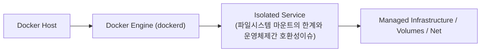

# 038. 파일시스템 마운트의 한계와 운영체제간 호환성이슈

이미 파일들이 들어 있는 컨테이너 디렉터리(예: `/app`)에 호스트 폴더를 바인드 마운트하면 기존 이미지 속 파일들이 전부 가려져 애플리케이션이 실행조차 되지 않는 현상을 실험으로 확인합니다.


**그림 03-7-1** 파일시스템 마운트의 한계와 운영체제간 호환성이슈의 필요성과 현대 클라우드 아키텍처 관점의 개요

---

### 038.1 왜 파일시스템 마운트의 한계와 운영체제간 호환성이슈이(가) 필요한가? (문제 정의와 현실적 배경)

소프트웨어 시스템이 복잡해질수록 설정을 다루는 방식은 전체 인프라의 신뢰성을 결정짓는 핵심 척도가 됩니다. **파일시스템 마운트의 한계와 운영체제간 호환성이슈**이(가) 부재하거나 잘못 다루어질 때 현장에서는 다음과 같은 대표적인 병목과 장애가 발생합니다:

1. **하드코딩된 설정과 환경 불일치로 인한 유연성 상실**: 환경이 바뀔 때마다 코드를 다시 빌드해야 하므로 배포 주기가 지연되고 이미지 수가 기하급수적으로 폭증합니다.
2. **보안 민감 데이터의 무분별한 노출**: 비밀번호, 데이터베이스 토큰, 암호화 키가 이미지 레이어에 영구 박제되어 형상관리 시스템이나 외부에 유출될 위험이 커집니다.
3. **재현 불가능한 구성 드리프트**: 스테이징 환경과 프로덕션 환경의 미세한 설정 차이가 예기치 못한 서비스 중단 사고로 직결됩니다.


**그림 03-7-2** 파일시스템 마운트의 한계와 운영체제간 호환성이슈에 대한 대표적인 오해와 실제 프로덕션 현장의 엔지니어링 진실

---

### 038.2 핵심 아키텍처와 엔지니어링 메커니즘

또한 리눅스와 윈도우/macOS 간의 파일 권한(`chmod`), 대소문자 구분 여부, 줄바꿈 문자(`CRLF` vs `LF`), 그리고 Docker Desktop(WSL2/macOS VirtioFS) 환경에서 바인드 마운트 I/O 성능을 최적화하는 실무 팁을 정리합니다.


**그림 03-7-3** 파일시스템 마운트의 한계와 운영체제간 호환성이슈의 내부 아키텍처 및 데이터 흐름

#### 📊 핵심 비교 및 엔지니어링 표준 분석

| 구분 / 핵심 원리 | 상세 설명 및 동작 메커니즘 | 실무 적용 시 주의점 및 베스트 프랙티스 |
| :--- | :--- | :--- |
| **디렉터리 가림 (Directory Shadowing)** | 리눅스 `mount` 명령과 동일하게 마운트 대상 경로에 원래 있던 파일들은 마운트가 해제되기 전까지 보이지 않게 가려짐 | 실행 바이너리가 있는 `/app` 전체 대신 `/app/config`나 `/app/logs`처럼 하위 전용 폴더만 마운트해야 안전! |
| **단일 파일 마운트와 `vim` 저장 이슈** | 단일 파일을 바인드 마운트한 상태에서 호스트 에디터가 '임시 파일 생성 후 이름 변경(inode 교체)' 방식으로 저장하면 컨테이너에 반영되지 않을 수 있음 | 단일 파일 대신 **설정 파일이 담긴 상위 디렉터리를 마운트**하는 것이 훨씬 안정적 |
| **OS 간 호환성 (CRLF & UID)** | Windows Git에서 체크아웃된 셸 스크립트(`.sh`)가 `\r\n(CRLF)` 때문에 컨테이너에서 `not found` 에러를 내는 현상 | 프로젝트 루트에 `.gitattributes`(`*.sh text eol=lf`)를 추가해 원천 예방! |

---

### 038.3 선언적 실습 및 아키텍처 다이어그램

본 실습은 외부 비공개 패키지에 의존하지 않고, 공식 표준 이미지를 기반으로 즉시 재현 가능한 살아있는 코드로 구성되어 있습니다.

```bash
# 이미지 내부의 /etc 폴더에 빈 호스트 폴더를 마운트하면 기존 설정 파일들이 가려짐(Shadowing)을 확인
mkdir -p /tmp/empty-dir
docker container run --rm --mount type=bind,source=/tmp/empty-dir,target=/mnt alpine:3.20 ls -la /mnt
rm -rf /tmp/empty-dir
```

#### 🔍 아키텍처 흐름도 (Mermaid Diagram)




**그림 03-7-4** 선언적 인프라 명세를 통한 파일시스템 마운트의 한계와 운영체제간 호환성이슈 검증 파이프라인

---

### 038.4 핵심 정리: 캐릭터 대화와 3대 교훈

> 👧 **도로시**: "교수님! **파일시스템 마운트의 한계와 운영체제간 호환성이슈**의 원리를 배우니까, 복잡하게 얽혀 있던 인프라 설정이 레고 블록처럼 질서정연하게 제자리를 찾는 게 보여요!"
> 
> 🐱 **조교 지니**: "야옹~ 맞습니다! 특히 런타임 환경과 불변 인프라의 경계를 명확히 지키는 것이 대규모 클라우드 운영의 제1원칙이랍니다!"
> 
> 🐶 **토토**: "멍멍! 선언적 코드로 한 번 적어두면 언제든 똑같이 복원되니까 정말 든든해요!"
> 
> 👨‍🏫 **이호진 교수님**: "훌륭하구나. 원리를 깊이 이해하고 실습을 통해 손에 익히는 것이 훌륭한 클라우드 엔지니어로 성장하는 가장 빠른 지름길이란다."


**그림 03-7-5** 파일시스템 마운트의 한계와 운영체제간 호환성이슈 마스터를 위한 3대 핵심 교훈

1. **설정과 실행의 명확한 분리**:
   * 애플리케이션 코드는 불변으로 유지하고, 가변적인 설정값은 외부에서 주입하여 이식성을 극대화합니다.
2. **선언적 재현성 확보**:
   * 사람이 수작업으로 변경하지 않고 코드 명세를 통해 언제 어디서나 100% 동일한 실행 결과를 보장합니다.
3. **최소 권한 및 보안 모범 사례 준수**:
   * 불필요한 권한과 포트 노출을 최소화하고 민감 데이터를 암호화하여 프로덕션 안정성을 담보합니다.

---

### 038.5 랩노트 피날레와 다음 강의 예고


**그림 03-7-6** 연구실에서 다음 마일스톤인 [인메모리 스토리지 tmpfs마운트와 고속캐시처리] 실습을 예고하는 교수님과 토토

> 💡 **다음 강의 안내**:
> [인메모리 스토리지 tmpfs마운트와 고속캐시처리](../039_인메모리_스토리지_tmpfs마운트와_고속캐시처리/)에서는 더욱 심화된 실전 엔지니어링 실습과 아키텍처를 다룹니다!

---

## 🧭 강의 네비게이션
* [◀️ 이전 강의: 037_읽기전용_마운트와_컨테이너파일시스템_합집합원리](../037_읽기전용_마운트와_컨테이너파일시스템_합집합원리/)
* [📋 Part 03. 퍼시스턴트 스토리지: 도커 볼륨(Volume)과 파일시스템 마운트 (032 ~ 041) 목차로 돌아가기](../)
* [▶️ 다음 강의: 039_인메모리_스토리지_tmpfs마운트와_고속캐시처리](../039_인메모리_스토리지_tmpfs마운트와_고속캐시처리/)
