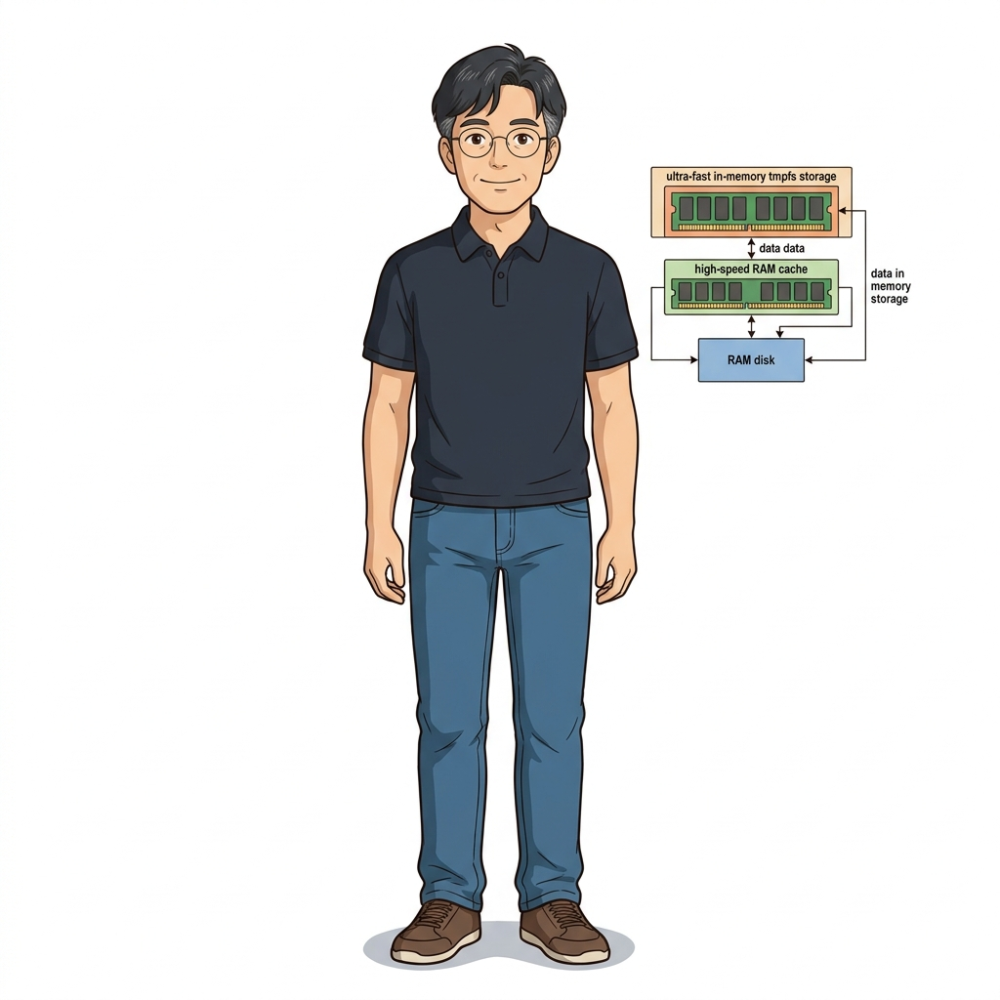
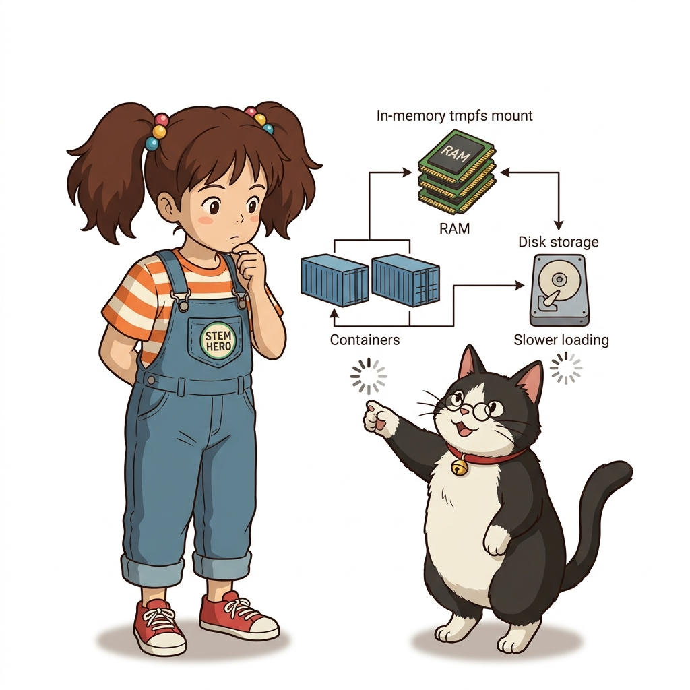
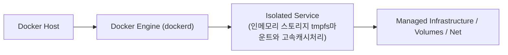

# 039. 인메모리 스토리지 tmpfs마운트와 고속캐시처리

도커 볼륨과 바인드 마운트가 호스트의 물리 디스크(SSD/HDD)에 데이터를 저장하는 것과 달리, **`--mount type=tmpfs`는 호스트의 메모리(RAM) 공간에만 임시 파일시스템을 생성**합니다.


**그림 03-8-1** 인메모리 스토리지 tmpfs마운트와 고속캐시처리의 필요성과 현대 클라우드 아키텍처 관점의 개요

---

### 039.1 왜 인메모리 스토리지 tmpfs마운트와 고속캐시처리이(가) 필요한가? (문제 정의와 현실적 배경)

소프트웨어 시스템이 복잡해질수록 설정을 다루는 방식은 전체 인프라의 신뢰성을 결정짓는 핵심 척도가 됩니다. **인메모리 스토리지 tmpfs마운트와 고속캐시처리**이(가) 부재하거나 잘못 다루어질 때 현장에서는 다음과 같은 대표적인 병목과 장애가 발생합니다:

1. **하드코딩된 설정과 환경 불일치로 인한 유연성 상실**: 환경이 바뀔 때마다 코드를 다시 빌드해야 하므로 배포 주기가 지연되고 이미지 수가 기하급수적으로 폭증합니다.
2. **보안 민감 데이터의 무분별한 노출**: 비밀번호, 데이터베이스 토큰, 암호화 키가 이미지 레이어에 영구 박제되어 형상관리 시스템이나 외부에 유출될 위험이 커집니다.
3. **재현 불가능한 구성 드리프트**: 스테이징 환경과 프로덕션 환경의 미세한 설정 차이가 예기치 못한 서비스 중단 사고로 직결됩니다.


**그림 03-8-2** 인메모리 스토리지 tmpfs마운트와 고속캐시처리에 대한 대표적인 오해와 실제 프로덕션 현장의 엔지니어링 진실

---

### 039.2 핵심 아키텍처와 엔지니어링 메커니즘

컨테이너가 중지되는 즉시 메모리에서 완전히 소거되므로 임시 복호화 키나 세션 토큰을 안전하게 다루거나, 초고속 디스크 I/O가 필요한 임시 캐시 디렉터리(`/tmp`, `/run`)를 가속하는 데 활용합니다.


**그림 03-8-3** 인메모리 스토리지 tmpfs마운트와 고속캐시처리의 내부 아키텍처 및 데이터 흐름

#### 📊 핵심 비교 및 엔지니어링 표준 분석

| 구분 / 핵심 원리 | 상세 설명 및 동작 메커니즘 | 실무 적용 시 주의점 및 베스트 프랙티스 |
| :--- | :--- | :--- |
| **3대 도커 마운트 타입 비교** | 1) `volume`(도커 관리 디스크 영역), 2) `bind`(호스트 지정 폴더/파일), 3) `tmpfs`(호스트 RAM 휘발성 영역) | 데이터의 성격(영구 DB vs 개발 코드/설정 vs 초고속 임시/보안 데이터)에 맞춰 선택 |
| **`tmpfs-size` & `tmpfs-mode`** | 메모리 고갈을 막기 위해 `tmpfs-size`(바이트 단위)로 상한선을 지정하고 `tmpfs-mode=1770` 등으로 권한 제어 | 컨테이너가 무한정 로그나 임시 파일을 써서 호스트 RAM을 고갈시키는 사고 방지 |
| **`--read-only` 컨테이너와의 조합** | 보안을 위해 컨테이너 루트 파일시스템 전체를 읽기 전용(`docker run --read-only`)으로 잠그고, 꼭 쓰기가 필요한 `/tmp`만 `tmpfs`로 열어주는 기법 | 금융권 및 쿠버네티스 고보안 환경의 대표적인 컨테이너 하드닝(Hardening) 패턴 |

---

### 039.3 선언적 실습 및 아키텍처 다이어그램

본 실습은 외부 비공개 패키지에 의존하지 않고, 공식 표준 이미지를 기반으로 즉시 재현 가능한 살아있는 코드로 구성되어 있습니다.

```bash
# 최대 크기 32MB로 제한된 초고속 인메모리 tmpfs를 /app/ramcache 경로에 마운트하여 실행하기
docker container run --rm   --mount type=tmpfs,destination=/app/ramcache,tmpfs-size=33554432   alpine:3.20 sh -c "df -h /app/ramcache && echo 'In-memory token' > /app/ramcache/token.txt && cat /app/ramcache/token.txt" 
```

#### 🔍 아키텍처 흐름도 (Mermaid Diagram)




**그림 03-8-4** 선언적 인프라 명세를 통한 인메모리 스토리지 tmpfs마운트와 고속캐시처리 검증 파이프라인

---

### 039.4 핵심 정리: 캐릭터 대화와 3대 교훈

> 👧 **도로시**: "교수님! **인메모리 스토리지 tmpfs마운트와 고속캐시처리**의 원리를 배우니까, 복잡하게 얽혀 있던 인프라 설정이 레고 블록처럼 질서정연하게 제자리를 찾는 게 보여요!"
> 
> 🐱 **조교 지니**: "야옹~ 맞습니다! 특히 런타임 환경과 불변 인프라의 경계를 명확히 지키는 것이 대규모 클라우드 운영의 제1원칙이랍니다!"
> 
> 🐶 **토토**: "멍멍! 선언적 코드로 한 번 적어두면 언제든 똑같이 복원되니까 정말 든든해요!"
> 
> 👨‍🏫 **이호진 교수님**: "훌륭하구나. 원리를 깊이 이해하고 실습을 통해 손에 익히는 것이 훌륭한 클라우드 엔지니어로 성장하는 가장 빠른 지름길이란다."


**그림 03-8-5** 인메모리 스토리지 tmpfs마운트와 고속캐시처리 마스터를 위한 3대 핵심 교훈

1. **설정과 실행의 명확한 분리**:
   * 애플리케이션 코드는 불변으로 유지하고, 가변적인 설정값은 외부에서 주입하여 이식성을 극대화합니다.
2. **선언적 재현성 확보**:
   * 사람이 수작업으로 변경하지 않고 코드 명세를 통해 언제 어디서나 100% 동일한 실행 결과를 보장합니다.
3. **최소 권한 및 보안 모범 사례 준수**:
   * 불필요한 권한과 포트 노출을 최소화하고 민감 데이터를 암호화하여 프로덕션 안정성을 담보합니다.

---

### 039.5 랩노트 피날레와 다음 강의 예고


**그림 03-8-6** 연구실에서 다음 마일스톤인 [볼륨데이터 백업 복원 마이그레이션 실전테크닉] 실습을 예고하는 교수님과 토토

> 💡 **다음 강의 안내**:
> [볼륨데이터 백업 복원 마이그레이션 실전테크닉](../040_볼륨데이터_백업_복원_마이그레이션_실전테크닉/)에서는 더욱 심화된 실전 엔지니어링 실습과 아키텍처를 다룹니다!

---

## 🧭 강의 네비게이션
* [◀️ 이전 강의: 038_파일시스템_마운트의_한계와_운영체제간_호환성이슈](../038_파일시스템_마운트의_한계와_운영체제간_호환성이슈/)
* [📋 Part 03. 퍼시스턴트 스토리지: 도커 볼륨(Volume)과 파일시스템 마운트 (032 ~ 041) 목차로 돌아가기](../)
* [▶️ 다음 강의: 040_볼륨데이터_백업_복원_마이그레이션_실전테크닉](../040_볼륨데이터_백업_복원_마이그레이션_실전테크닉/)
