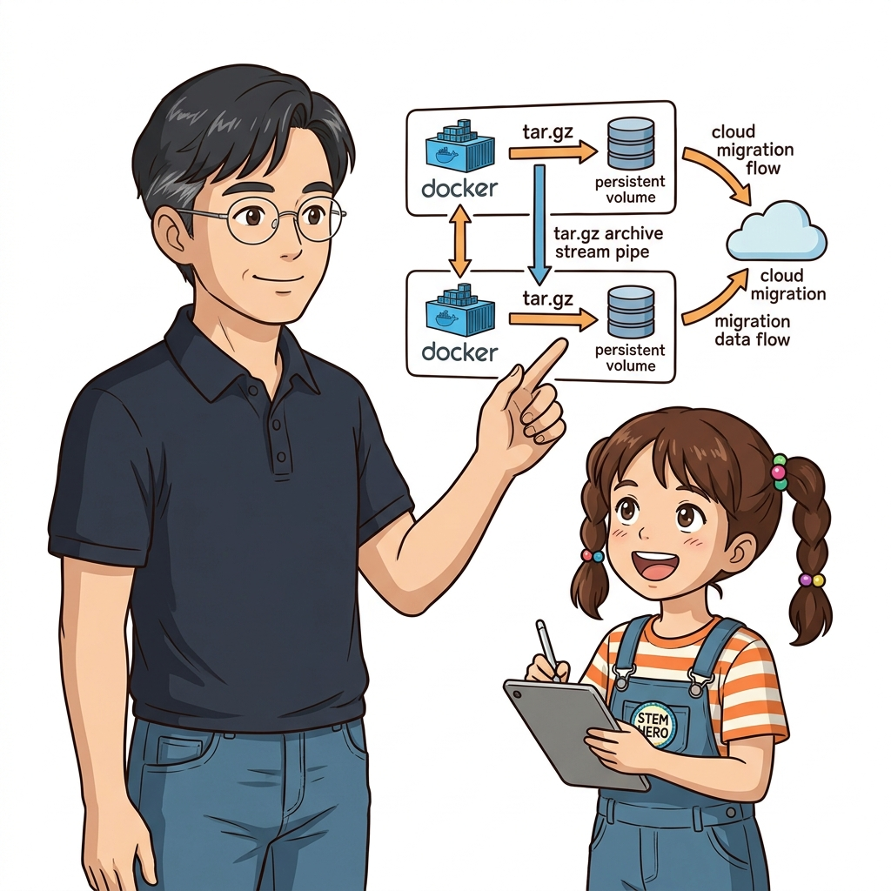
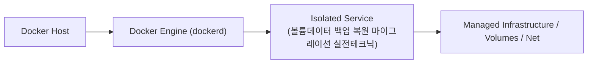
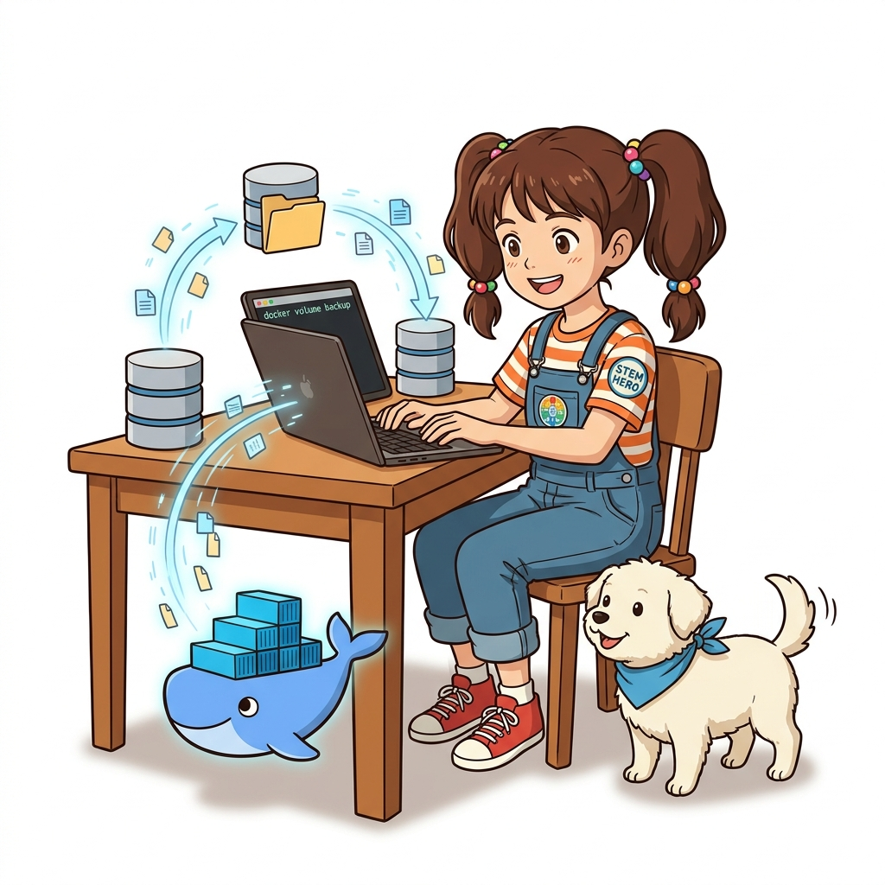

# 040. 볼륨데이터 백업 복원 마이그레이션 실전테크닉

도커 볼륨은 `/var/lib/docker/volumes/` 아래에 숨겨져 있어 호스트에서 직접 복사하면 권한 문제나 데이터 깨짐이 발생할 수 있습니다.


**그림 03-9-1** 볼륨데이터 백업 복원 마이그레이션 실전테크닉의 필요성과 현대 클라우드 아키텍처 관점의 개요

---

### 040.1 왜 볼륨데이터 백업 복원 마이그레이션 실전테크닉이(가) 필요한가? (문제 정의와 현실적 배경)

소프트웨어 시스템이 복잡해질수록 설정을 다루는 방식은 전체 인프라의 신뢰성을 결정짓는 핵심 척도가 됩니다. **볼륨데이터 백업 복원 마이그레이션 실전테크닉**이(가) 부재하거나 잘못 다루어질 때 현장에서는 다음과 같은 대표적인 병목과 장애가 발생합니다:

1. **하드코딩된 설정과 환경 불일치로 인한 유연성 상실**: 환경이 바뀔 때마다 코드를 다시 빌드해야 하므로 배포 주기가 지연되고 이미지 수가 기하급수적으로 폭증합니다.
2. **보안 민감 데이터의 무분별한 노출**: 비밀번호, 데이터베이스 토큰, 암호화 키가 이미지 레이어에 영구 박제되어 형상관리 시스템이나 외부에 유출될 위험이 커집니다.
3. **재현 불가능한 구성 드리프트**: 스테이징 환경과 프로덕션 환경의 미세한 설정 차이가 예기치 못한 서비스 중단 사고로 직결됩니다.


**그림 03-9-2** 볼륨데이터 백업 복원 마이그레이션 실전테크닉에 대한 대표적인 오해와 실제 프로덕션 현장의 엔지니어링 진실

---

### 040.2 핵심 아키텍처와 엔지니어링 메커니즘

일회성 `alpine` 컨테이너에 **백업 대상 볼륨(`-v`)과 호스트 백업 폴더(바인드 마운트)를 동시에 연결**하여 `tar czf`(백업) 및 `tar xzf`(복원)를 수행하는 도커 공식 표준 백업/복원 레시피를 마스터합니다.


**그림 03-9-3** 볼륨데이터 백업 복원 마이그레이션 실전테크닉의 내부 아키텍처 및 데이터 흐름

#### 📊 핵심 비교 및 엔지니어링 표준 분석

| 구분 / 핵심 원리 | 상세 설명 및 동작 메커니즘 | 실무 적용 시 주의점 및 베스트 프랙티스 |
| :--- | :--- | :--- |
| **임시 백업 컨테이너 패턴** | 호스트 OS(Windows/macOS/Linux)의 경로 차이에 상관없이 모든 환경에서 100% 동일하게 동작하는 백업 방식 | 백업 시 원본 볼륨은 `:ro`(읽기 전용)로 마운트하여 실수로 인한 원본 훼손을 원천 차단 |
| **`tar -C /dbdata .` 옵션** | 압축 시 상위 폴더 경로(`/dbdata`)를 빼고 내부 파일들만 상대 경로(`.`)로 깔끔하게 아카이빙 | 복원할 때 타깃 마운트 경로 이름이 달라져도 문제없이 원하는 위치에 정확히 풀림 |
| **정기 크론(Cron) 백업 연동** | 이 한 줄짜리 명령을 리눅스 `cron`이나 CI 스케줄러에 등록하면 매일 새벽 볼륨 스냅샷 자동 백업 완성 | 소규모 서버에서 가장 가성비 높고 확실한 재해 복구(DR) 대책 |

---

### 040.3 선언적 실습 및 아키텍처 다이어그램

본 실습은 외부 비공개 패키지에 의존하지 않고, 공식 표준 이미지를 기반으로 즉시 재현 가능한 살아있는 코드로 구성되어 있습니다.

```bash
# [도커 볼륨 표준 백업 & 복원 레시피]
docker volume create prod-db-vol
docker container run --rm -v prod-db-vol:/dbdata alpine:3.20 sh -c "echo 'User1: Dorothy' > /dbdata/users.db"

# 1. 임시 컨테이너로 prod-db-vol 볼륨 내용을 호스트의 /tmp/db-backup.tar.gz로 압축 백업!
docker container run --rm -v prod-db-vol:/dbdata:ro -v /tmp:/backup alpine:3.20   tar czf /backup/db-backup.tar.gz -C /dbdata .

# 2. 새 볼륨(restored-vol)을 만들고 백업 아카이브에서 100% 복원 검증!
docker volume create restored-vol
docker container run --rm -v restored-vol:/dbdata -v /tmp:/backup alpine:3.20   sh -c "tar xzf /backup/db-backup.tar.gz -C /dbdata && cat /dbdata/users.db"

docker volume rm prod-db-vol restored-vol && rm -f /tmp/db-backup.tar.gz
```

#### 🔍 아키텍처 흐름도 (Mermaid Diagram)




**그림 03-9-4** 선언적 인프라 명세를 통한 볼륨데이터 백업 복원 마이그레이션 실전테크닉 검증 파이프라인

---

### 040.4 핵심 정리: 캐릭터 대화와 3대 교훈

> 👧 **도로시**: "교수님! **볼륨데이터 백업 복원 마이그레이션 실전테크닉**의 원리를 배우니까, 복잡하게 얽혀 있던 인프라 설정이 레고 블록처럼 질서정연하게 제자리를 찾는 게 보여요!"
> 
> 🐱 **조교 지니**: "야옹~ 맞습니다! 특히 런타임 환경과 불변 인프라의 경계를 명확히 지키는 것이 대규모 클라우드 운영의 제1원칙이랍니다!"
> 
> 🐶 **토토**: "멍멍! 선언적 코드로 한 번 적어두면 언제든 똑같이 복원되니까 정말 든든해요!"
> 
> 👨‍🏫 **이호진 교수님**: "훌륭하구나. 원리를 깊이 이해하고 실습을 통해 손에 익히는 것이 훌륭한 클라우드 엔지니어로 성장하는 가장 빠른 지름길이란다."


**그림 03-9-5** 볼륨데이터 백업 복원 마이그레이션 실전테크닉 마스터를 위한 3대 핵심 교훈

1. **설정과 실행의 명확한 분리**:
   * 애플리케이션 코드는 불변으로 유지하고, 가변적인 설정값은 외부에서 주입하여 이식성을 극대화합니다.
2. **선언적 재현성 확보**:
   * 사람이 수작업으로 변경하지 않고 코드 명세를 통해 언제 어디서나 100% 동일한 실행 결과를 보장합니다.
3. **최소 권한 및 보안 모범 사례 준수**:
   * 불필요한 권한과 포트 노출을 최소화하고 민감 데이터를 암호화하여 프로덕션 안정성을 담보합니다.

---

### 040.5 랩노트 피날레와 다음 강의 예고


**그림 03-9-6** 연구실에서 다음 마일스톤인 [Part03 실전미션 영속적DB볼륨과 바인드마운트 통합웹앱구축] 실습을 예고하는 교수님과 토토

> 💡 **다음 강의 안내**:
> [Part03 실전미션 영속적DB볼륨과 바인드마운트 통합웹앱구축](../041_Part03_실전미션_영속적DB볼륨과_바인드마운트_통합웹앱구축/)에서는 더욱 심화된 실전 엔지니어링 실습과 아키텍처를 다룹니다!

---

## 🧭 강의 네비게이션
* [◀️ 이전 강의: 039_인메모리_스토리지_tmpfs마운트와_고속캐시처리](../039_인메모리_스토리지_tmpfs마운트와_고속캐시처리/)
* [📋 Part 03. 퍼시스턴트 스토리지: 도커 볼륨(Volume)과 파일시스템 마운트 (032 ~ 041) 목차로 돌아가기](../)
* [▶️ 다음 강의: 041_Part03_실전미션_영속적DB볼륨과_바인드마운트_통합웹앱구축](../041_Part03_실전미션_영속적DB볼륨과_바인드마운트_통합웹앱구축/)
