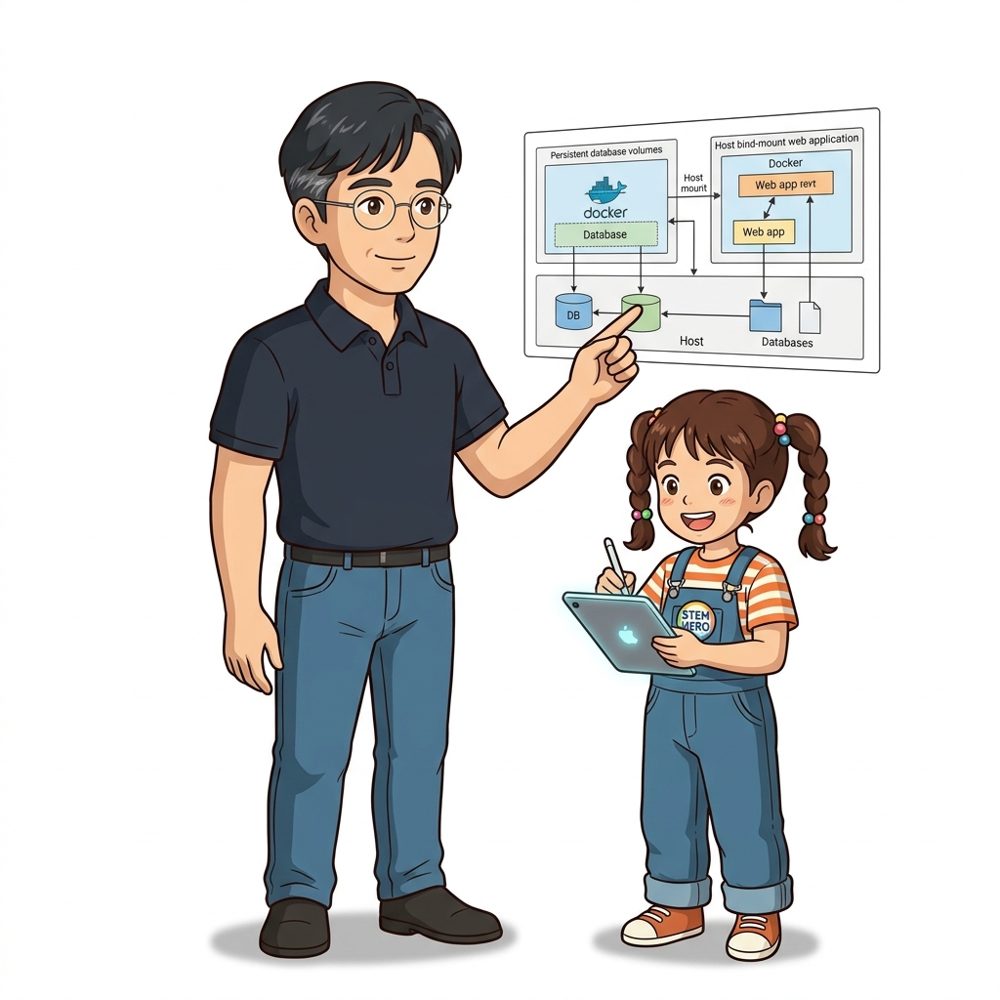
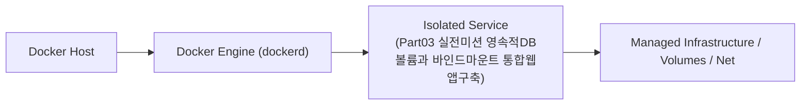

# 041. Part03 실전미션 영속적DB볼륨과 바인드마운트 통합웹앱구축

6장에서 배운 3대 스토리지 메커니즘(Named Volume, Read-Only Bind Mount, tmpfs)을 하나의 컨테이너 아키텍처에 모두 결합하는 종합 실습을 수행합니다.


**그림 03-10-1** Part03 실전미션 영속적DB볼륨과 바인드마운트 통합웹앱구축의 필요성과 현대 클라우드 아키텍처 관점의 개요

---

### 041.1 왜 Part03 실전미션 영속적DB볼륨과 바인드마운트 통합웹앱구축이(가) 필요한가? (문제 정의와 현실적 배경)

소프트웨어 시스템이 복잡해질수록 설정을 다루는 방식은 전체 인프라의 신뢰성을 결정짓는 핵심 척도가 됩니다. **Part03 실전미션 영속적DB볼륨과 바인드마운트 통합웹앱구축**이(가) 부재하거나 잘못 다루어질 때 현장에서는 다음과 같은 대표적인 병목과 장애가 발생합니다:

1. **하드코딩된 설정과 환경 불일치로 인한 유연성 상실**: 환경이 바뀔 때마다 코드를 다시 빌드해야 하므로 배포 주기가 지연되고 이미지 수가 기하급수적으로 폭증합니다.
2. **보안 민감 데이터의 무분별한 노출**: 비밀번호, 데이터베이스 토큰, 암호화 키가 이미지 레이어에 영구 박제되어 형상관리 시스템이나 외부에 유출될 위험이 커집니다.
3. **재현 불가능한 구성 드리프트**: 스테이징 환경과 프로덕션 환경의 미세한 설정 차이가 예기치 못한 서비스 중단 사고로 직결됩니다.


**그림 03-10-2** Part03 실전미션 영속적DB볼륨과 바인드마운트 통합웹앱구축에 대한 대표적인 오해와 실제 프로덕션 현장의 엔지니어링 진실

---

### 041.2 핵심 아키텍처와 엔지니어링 메커니즘

컨테이너를 강제로 삭제하고 새로 띄워도 볼륨의 데이터는 그대로 보존되고, 호스트 설정 파일 수정은 즉시 반영되는 프로덕션 스토리지 구성을 직접 완성합니다!


**그림 03-10-3** Part03 실전미션 영속적DB볼륨과 바인드마운트 통합웹앱구축의 내부 아키텍처 및 데이터 흐름

#### 📊 핵심 비교 및 엔지니어링 표준 분석

| 구분 / 핵심 원리 | 상세 설명 및 동작 메커니즘 | 실무 적용 시 주의점 및 베스트 프랙티스 |
| :--- | :--- | :--- |
| **스토리지 3분법 아키텍처** | 영속 데이터(`/var/lib/app`) ➔ `volume`, 외부 주입 설정(`/etc/app`) ➔ `bind,readonly`, 임시 런타임 파일(`/run`) ➔ `tmpfs` | 컨테이너를 언제든 폐기·교체(Cattle)할 수 있게 만드는 클라우드 네이티브 스토리지 설계의 정석 |
| **마운트 상태 확인법** | `docker container inspect --format '{{json .Mounts}}' 컨테이너명`으로 현재 연결된 모든 마운트 타입과 경로를 한눈에 검증 | 트러블슈팅 시 마운트 누락이나 권한 여부를 즉시 파악 |
| **Part 03 핵심 요약** | 컨테이너는 일시적이지만 볼륨과 마운트를 통해 데이터 영속성과 설정 유연성을 완벽히 확보할 수 있음 | 이제 Part 04에서는 여러 개의 컨테이너와 볼륨·네트워크를 단 한 장의 파일로 지휘하는 **도커 컴포즈(Docker Compose)**로 나아갑니다! |

---

### 041.3 선언적 실습 및 아키텍처 다이어그램

본 실습은 외부 비공개 패키지에 의존하지 않고, 공식 표준 이미지를 기반으로 즉시 재현 가능한 살아있는 코드로 구성되어 있습니다.

```bash
# [Part 03 실전 미션] Volume(영구 데이터) + Bind Mount(읽기전용 설정) + tmpfs(고속 캐시) 통합 실행!
docker volume create p3-mission-vol
mkdir -p /tmp/p3-conf && echo "SERVER_MODE=HIGH_RELIABILITY" > /tmp/p3-conf/service.env

docker container run --rm   --mount type=volume,source=p3-mission-vol,target=/var/lib/app   --mount type=bind,source=/tmp/p3-conf,target=/etc/app,readonly   --mount type=tmpfs,destination=/run/app-cache   alpine:3.20 sh -c '
    echo "1. Config Read : $(cat /etc/app/service.env)"
    echo "2. Saving State to Volume..." && echo "Record #1 Saved" > /var/lib/app/state.txt
    echo "3. Volume Data : $(cat /var/lib/app/state.txt)"
  '

docker volume rm p3-mission-vol && rm -rf /tmp/p3-conf
```

#### 🔍 아키텍처 흐름도 (Mermaid Diagram)




**그림 03-10-4** 선언적 인프라 명세를 통한 Part03 실전미션 영속적DB볼륨과 바인드마운트 통합웹앱구축 검증 파이프라인

---

### 041.4 핵심 정리: 캐릭터 대화와 3대 교훈

> 👧 **도로시**: "교수님! **Part03 실전미션 영속적DB볼륨과 바인드마운트 통합웹앱구축**의 원리를 배우니까, 복잡하게 얽혀 있던 인프라 설정이 레고 블록처럼 질서정연하게 제자리를 찾는 게 보여요!"
> 
> 🐱 **조교 지니**: "야옹~ 맞습니다! 특히 런타임 환경과 불변 인프라의 경계를 명확히 지키는 것이 대규모 클라우드 운영의 제1원칙이랍니다!"
> 
> 🐶 **토토**: "멍멍! 선언적 코드로 한 번 적어두면 언제든 똑같이 복원되니까 정말 든든해요!"
> 
> 👨‍🏫 **이호진 교수님**: "훌륭하구나. 원리를 깊이 이해하고 실습을 통해 손에 익히는 것이 훌륭한 클라우드 엔지니어로 성장하는 가장 빠른 지름길이란다."


**그림 03-10-5** Part03 실전미션 영속적DB볼륨과 바인드마운트 통합웹앱구축 마스터를 위한 3대 핵심 교훈

1. **설정과 실행의 명확한 분리**:
   * 애플리케이션 코드는 불변으로 유지하고, 가변적인 설정값은 외부에서 주입하여 이식성을 극대화합니다.
2. **선언적 재현성 확보**:
   * 사람이 수작업으로 변경하지 않고 코드 명세를 통해 언제 어디서나 100% 동일한 실행 결과를 보장합니다.
3. **최소 권한 및 보안 모범 사례 준수**:
   * 불필요한 권한과 포트 노출을 최소화하고 민감 데이터를 암호화하여 프로덕션 안정성을 담보합니다.

---

### 041.5 랩노트 피날레와 다음 강의 예고


**그림 03-10-6** 연구실에서 다음 마일스톤인 [도커컴포즈 소개와 compose yaml 선언적구조] 실습을 예고하는 교수님과 토토

> 💡 **다음 강의 안내**:
> [도커컴포즈 소개와 compose yaml 선언적구조](/Part04_도커컴포즈와_신뢰성_헬스체크_모니터링/042_도커컴포즈_소개와_compose_yaml_선언적구조/)에서는 더욱 심화된 실전 엔지니어링 실습과 아키텍처를 다룹니다!

---

## 🧭 강의 네비게이션
* [◀️ 이전 강의: 040_볼륨데이터_백업_복원_마이그레이션_실전테크닉](../040_볼륨데이터_백업_복원_마이그레이션_실전테크닉/)
* [📋 Part 03. 퍼시스턴트 스토리지: 도커 볼륨(Volume)과 파일시스템 마운트 (032 ~ 041) 목차로 돌아가기](../)
* [▶️ 다음 강의: 042_도커컴포즈_소개와_compose_yaml_선언적구조](/Part04_도커컴포즈와_신뢰성_헬스체크_모니터링/042_도커컴포즈_소개와_compose_yaml_선언적구조/)
