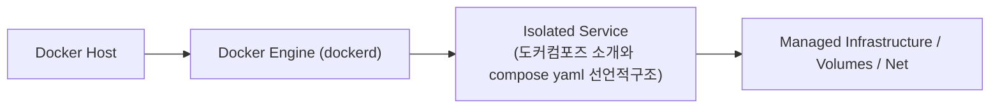

# 042. 도커컴포즈 소개와 compose yaml 선언적구조

프론트엔드 웹, 백엔드 REST API, 데이터베이스, 캐시, 로그 수집기로 이루어진 현대적인 분산 애플리케이션에서 개별 컨테이너를 수동으로 실행하면 순서 착오와 옵션 오타가 발생할 수밖에 없습니다.


**그림 04-1-1** 도커컴포즈 소개와 compose yaml 선언적구조의 필요성과 현대 클라우드 아키텍처 관점의 개요

---

### 042.1 왜 도커컴포즈 소개와 compose yaml 선언적구조이(가) 필요한가? (문제 정의와 현실적 배경)

소프트웨어 시스템이 복잡해질수록 설정을 다루는 방식은 전체 인프라의 신뢰성을 결정짓는 핵심 척도가 됩니다. **도커컴포즈 소개와 compose yaml 선언적구조**이(가) 부재하거나 잘못 다루어질 때 현장에서는 다음과 같은 대표적인 병목과 장애가 발생합니다:

1. **하드코딩된 설정과 환경 불일치로 인한 유연성 상실**: 환경이 바뀔 때마다 코드를 다시 빌드해야 하므로 배포 주기가 지연되고 이미지 수가 기하급수적으로 폭증합니다.
2. **보안 민감 데이터의 무분별한 노출**: 비밀번호, 데이터베이스 토큰, 암호화 키가 이미지 레이어에 영구 박제되어 형상관리 시스템이나 외부에 유출될 위험이 커집니다.
3. **재현 불가능한 구성 드리프트**: 스테이징 환경과 프로덕션 환경의 미세한 설정 차이가 예기치 못한 서비스 중단 사고로 직결됩니다.


**그림 04-1-2** 도커컴포즈 소개와 compose yaml 선언적구조에 대한 대표적인 오해와 실제 프로덕션 현장의 엔지니어링 진실

---

### 042.2 핵심 아키텍처와 엔지니어링 메커니즘

애플리케이션의 **원하는 최종 상태(Desired State)**를 YAML 문법으로 기술하는 **`compose.yaml` (`docker-compose.yml`)**의 3대 최상위 블록(`services`, `networks`, `volumes`)을 이해하고 첫 번째 컴포즈 명세서를 작성합니다.


**그림 04-1-3** 도커컴포즈 소개와 compose yaml 선언적구조의 내부 아키텍처 및 데이터 흐름

#### 📊 핵심 비교 및 엔지니어링 표준 분석

| 구분 / 핵심 원리 | 상세 설명 및 동작 메커니즘 | 실무 적용 시 주의점 및 베스트 프랙티스 |
| :--- | :--- | :--- |
| **절차적(`docker run`) vs 선언적(`compose.yaml`)** | `docker run`은 '어떻게 실행할지' 매번 명령을 내리는 방식 / `compose.yaml`은 '어떤 상태여야 하는지' 코드로 선언하는 방식 | `compose.yaml` 파일 자체가 살아있는 아키텍처 설계 문서 역할을 수행하여 별도의 실행 매뉴얼이 불필요해짐 |
| **Docker Compose V2 표준** | 구형 파이썬 기반 `docker-compose`(하이픈) 대신 최신 Go 기반 내장 플러그인 **`docker compose`**(공백)와 `compose.yaml`(영문 `version:` 생략 가능)이 공식 표준! | 기존 `docker-compose.yml` 및 `version: '3.8'` 파일과도 100% 하위 호환됨 |
| **3대 최상위 섹션** | `services:`(컨테이너 컴포넌트 정의), `networks:`(가상 네트워크 정의), `volumes:`(퍼시스턴트 볼륨 정의) | `docker compose up` 실행 시 필요한 네트워크와 볼륨을 먼저 생성한 뒤 서비스 컨테이너들을 기동! |

---

### 042.3 선언적 실습 및 아키텍처 다이어그램

본 실습은 외부 비공개 패키지에 의존하지 않고, 공식 표준 이미지를 기반으로 즉시 재현 가능한 살아있는 코드로 구성되어 있습니다.

```yaml
# [compose.yaml] 단일 웹 서비스와 전용 네트워크를 선언적으로 정의한 도커 컴포즈 파일
services:
  oz-portal:
    image: nginx:1.27-alpine
    ports:
      - "8080:80"
    networks:
      - oz-app-net

networks:
  oz-app-net:
    driver: bridge
```

#### 🔍 아키텍처 흐름도 (Mermaid Diagram)




**그림 04-1-4** 선언적 인프라 명세를 통한 도커컴포즈 소개와 compose yaml 선언적구조 검증 파이프라인

---

### 042.4 핵심 정리: 캐릭터 대화와 3대 교훈

> 👧 **도로시**: "교수님! **도커컴포즈 소개와 compose yaml 선언적구조**의 원리를 배우니까, 복잡하게 얽혀 있던 인프라 설정이 레고 블록처럼 질서정연하게 제자리를 찾는 게 보여요!"
> 
> 🐱 **조교 지니**: "야옹~ 맞습니다! 특히 런타임 환경과 불변 인프라의 경계를 명확히 지키는 것이 대규모 클라우드 운영의 제1원칙이랍니다!"
> 
> 🐶 **토토**: "멍멍! 선언적 코드로 한 번 적어두면 언제든 똑같이 복원되니까 정말 든든해요!"
> 
> 👨‍🏫 **이호진 교수님**: "훌륭하구나. 원리를 깊이 이해하고 실습을 통해 손에 익히는 것이 훌륭한 클라우드 엔지니어로 성장하는 가장 빠른 지름길이란다."


**그림 04-1-5** 도커컴포즈 소개와 compose yaml 선언적구조 마스터를 위한 3대 핵심 교훈

1. **설정과 실행의 명확한 분리**:
   * 애플리케이션 코드는 불변으로 유지하고, 가변적인 설정값은 외부에서 주입하여 이식성을 극대화합니다.
2. **선언적 재현성 확보**:
   * 사람이 수작업으로 변경하지 않고 코드 명세를 통해 언제 어디서나 100% 동일한 실행 결과를 보장합니다.
3. **최소 권한 및 보안 모범 사례 준수**:
   * 불필요한 권한과 포트 노출을 최소화하고 민감 데이터를 암호화하여 프로덕션 안정성을 담보합니다.

---

### 042.5 랩노트 피날레와 다음 강의 예고


**그림 04-1-6** 연구실에서 다음 마일스톤인 [도커컴포즈로 다중컨테이너 분산애플리케이션 일괄기동] 실습을 예고하는 교수님과 토토

> 💡 **다음 강의 안내**:
> [도커컴포즈로 다중컨테이너 분산애플리케이션 일괄기동](../043_도커컴포즈로_다중컨테이너_분산애플리케이션_일괄기동/)에서는 더욱 심화된 실전 엔지니어링 실습과 아키텍처를 다룹니다!

---

## 🧭 강의 네비게이션
* [◀️ 이전 강의: 041_Part03_실전미션_영속적DB볼륨과_바인드마운트_통합웹앱구축](/Part03_퍼시스턴트스토리지와_도커볼륨_마운트/041_Part03_실전미션_영속적DB볼륨과_바인드마운트_통합웹앱구축/)
* [📋 Part 04. 도커 컴포즈(Compose) 분산 앱 실행, 헬스/디펜던시 체크 & 모니터링 (042 ~ 061) 목차로 돌아가기](../)
* [▶️ 다음 강의: 043_도커컴포즈로_다중컨테이너_분산애플리케이션_일괄기동](../043_도커컴포즈로_다중컨테이너_분산애플리케이션_일괄기동/)
