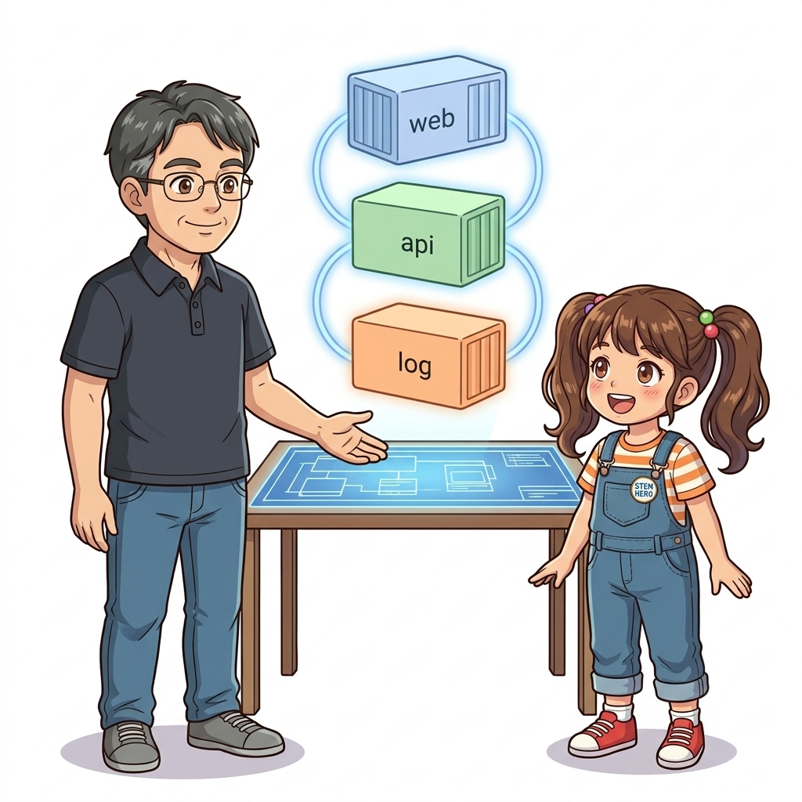
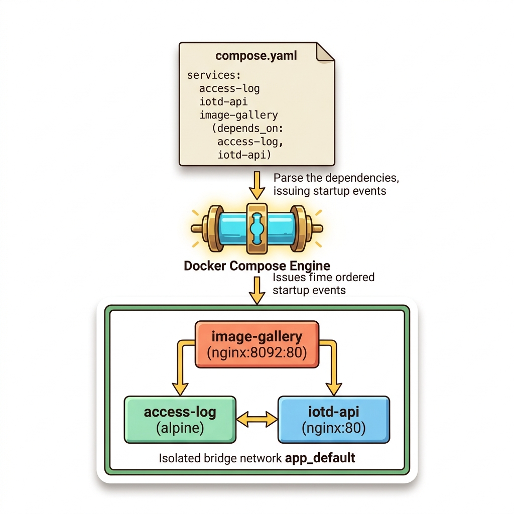
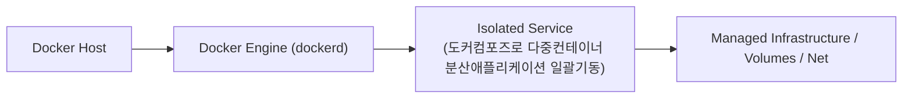
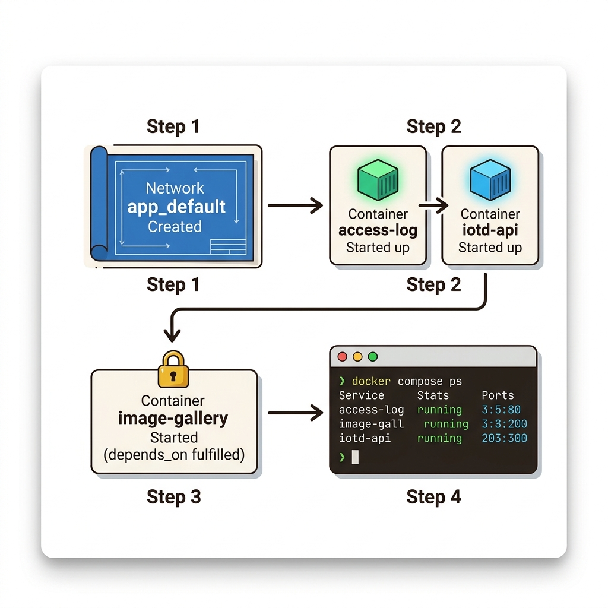
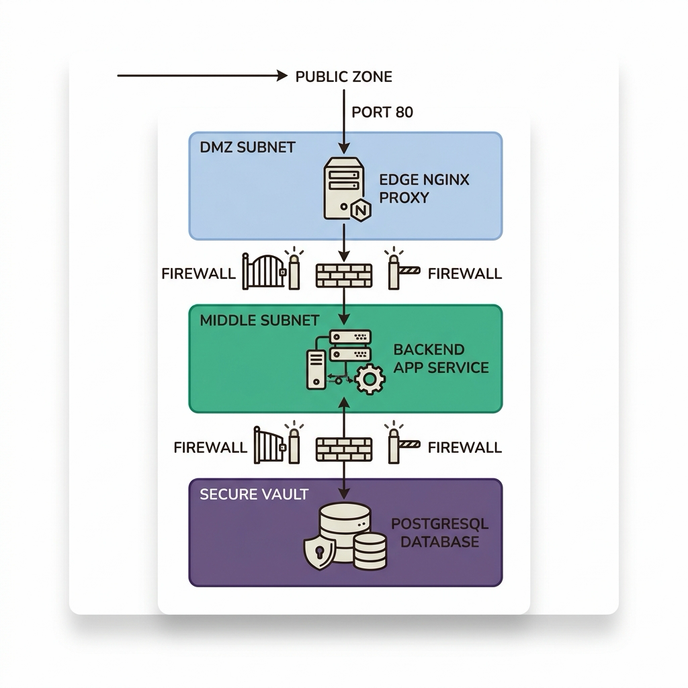
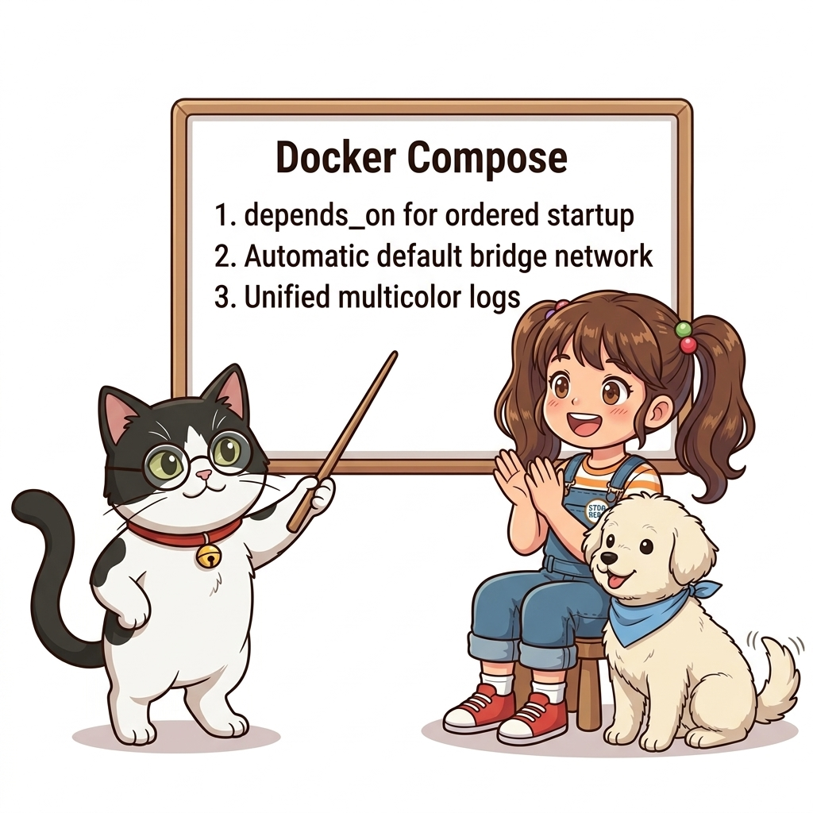

# 043. 도커컴포즈로 다중컨테이너 분산애플리케이션 일괄기동

서로 다른 역할을 하는 3개의 서비스(`web`, `iotd-api`, `access-log`)를 하나의 `compose.yaml`에 정의하고, 서비스 간 시작 순서를 지정하는 **`depends_on`** 속성을 실습합니다.


**그림 04-2-1** 도커컴포즈로 다중컨테이너 분산애플리케이션 일괄기동의 필요성과 현대 클라우드 아키텍처 관점의 개요

---

### 043.1 왜 도커컴포즈로 다중컨테이너 분산애플리케이션 일괄기동이(가) 필요한가? (문제 정의와 현실적 배경)

소프트웨어 시스템이 복잡해질수록 설정을 다루는 방식은 전체 인프라의 신뢰성을 결정짓는 핵심 척도가 됩니다. **도커컴포즈로 다중컨테이너 분산애플리케이션 일괄기동**이(가) 부재하거나 잘못 다루어질 때 현장에서는 다음과 같은 대표적인 병목과 장애가 발생합니다:

1. **하드코딩된 설정과 환경 불일치로 인한 유연성 상실**: 환경이 바뀔 때마다 코드를 다시 빌드해야 하므로 배포 주기가 지연되고 이미지 수가 기하급수적으로 폭증합니다.
2. **보안 민감 데이터의 무분별한 노출**: 비밀번호, 데이터베이스 토큰, 암호화 키가 이미지 레이어에 영구 박제되어 형상관리 시스템이나 외부에 유출될 위험이 커집니다.
3. **재현 불가능한 구성 드리프트**: 스테이징 환경과 프로덕션 환경의 미세한 설정 차이가 예기치 못한 서비스 중단 사고로 직결됩니다.


**그림 04-2-2** 도커컴포즈로 다중컨테이너 분산애플리케이션 일괄기동에 대한 대표적인 오해와 실제 프로덕션 현장의 엔지니어링 진실

---

### 043.2 핵심 아키텍처와 엔지니어링 메커니즘

`docker compose up -d`로 전체 분산 시스템을 1초 만에 백그라운드로 띄우고, 각 서비스의 로그가 색상별로 구분되어 통합 출력되는 `docker compose logs`의 편리함을 체험합니다.


**그림 04-2-3** 도커컴포즈로 다중컨테이너 분산애플리케이션 일괄기동의 내부 아키텍처 및 데이터 흐름

#### 📊 핵심 비교 및 엔지니어링 표준 분석

| 구분 / 핵심 원리 | 상세 설명 및 동작 메커니즘 | 실무 적용 시 주의점 및 베스트 프랙티스 |
| :--- | :--- | :--- |
| **`depends_on` 시작 순서 제어** | `image-gallery` 서비스를 시작하기 전에 `access-log`와 `iotd-api` 컨테이너를 먼저 생성·시작하도록 지시 | 종료(`docker compose down`)할 때는 반대로 의존성의 역순으로 안전하게 정리됨 |
| **통합 로그 스트리밍** | `docker compose logs` 실행 시 여러 컨테이너의 표준 출력을 서비스 이름 프리픽스와 함께 시간순으로 병합 출력 | 분산 시스템에서 요청이 웹 ➔ API ➔ 로그 서비스로 흘러가는 과정을 한 화면에서 추적 가능 |
| **자동 기본 네트워크 생성** | 별도의 `networks:`를 적지 않아도 프로젝트 이름 기반의 기본 브리지 네트워크(`폴더명_default`)를 자동 생성해 모든 서비스를 연결함 | 모든 서비스가 처음부터 서로의 서비스 이름으로 통신 가능! |

---

### 043.3 선언적 실습 및 아키텍처 다이어그램

본 실습은 외부 비공개 패키지에 의존하지 않고, 공식 표준 이미지를 기반으로 즉시 재현 가능한 살아있는 코드로 구성되어 있습니다.

```bash
# 3-티어 분산 애플리케이션 compose.yaml 생성 및 일괄 기동 실습
mkdir -p /tmp/oz-compose-app && cd /tmp/oz-compose-app
cat << 'EOF' > compose.yaml
services:
  access-log:
    image: alpine:3.20
    command: ["sh", "-c", "echo 'Access Log Service Ready'; sleep 60"]

  iotd-api:
    image: nginx:1.27-alpine
    expose: ["80"]

  image-gallery:
    image: nginx:1.27-alpine
    ports: ["8092:80"]
    depends_on:
      - access-log
      - iotd-api
EOF

docker compose up -d
docker compose ps
docker compose down && rm -rf /tmp/oz-compose-app
```

#### 🔍 아키텍처 흐름도 (Mermaid Diagram)




**그림 04-2-4** 선언적 인프라 명세를 통한 도커컴포즈로 다중컨테이너 분산애플리케이션 일괄기동 검증 파이프라인

---

<!-- BIBLE_INTEGRATION_book4_ntier_ha_infrastructure -->
---

### 043.B 📚 도커 바이블 심화: N-Tier(웹/WAS/DB) 고가용성 프로덕션 인프라 오케스트레이션
*출처 도서: 『완벽한 IT 인프라 구축을 위한 Docker』 핵심 분석*

실무 기업 인프라의 표준 모델인 **3-Tier 웹 아키텍처(Web -> WAS -> DB)**를 도커로 구현할 때는 물리적인 네트워크 분리 원칙을 가상 브리지 네트워크로 완벽히 재현해야 합니다:

1. **프런트엔드 DMZ 네트워크 (`frontend-net`)**:
   * 외부 인터넷에 80/443 포트를 개방하는 Nginx 리버스 프록시만 접속할 수 있습니다.
2. **백엔드 애플리케이션 네트워크 (`backend-net`)**:
   * Nginx 프록시와 WAS(애플리케이션) 컨테이너만 공유합니다. 외부에서 직접 접근하는 포트 포워딩은 완전히 차단됩니다.
3. **데이터베이스 격리 네트워크 (`database-net`)**:
   * 오직 WAS 컨테이너와 DB 컨테이너만 접속할 수 있는 초고보안 폐쇄 구역입니다. 프런트엔드 웹서버나 외부 클라이언트는 DB IP를 감지조차 할 수 없습니다.


**그림 043-B-1** DMZ-프런트엔드-DB로 엄격하게 망분리된 3티어 엔터프라이즈 컨테이너 네트워크 다이어그램

```bash
# [실습] 3-Tier 망분리 네트워크 아키텍처 선언적 구축
docker network create dmz-frontend-net
docker network create secure-database-net

# 1. DB 컨테이너: DB 네트워크에만 격리 (포트 노출 없음)
docker container run -d --name internal-db --network secure-database-net \
  -e POSTGRES_PASSWORD=secret postgres:alpine

# 2. WAS 컨테이너: 두 네트워크의 징검다리 역할 (DB와 프런트엔드 연결)
docker container run -d --name backend-was --network secure-database-net alpine sleep 3600
docker network connect dmz-frontend-net backend-was

# 3. Web 컨테이너: DMZ 네트워크에만 연결 (포트 80 개방)
docker container run -d --name edge-proxy --network dmz-frontend-net -p 8080:80 nginx:alpine
```

> 👨‍🏫 **이호진 교수님의 바이블 멘토링 노트**:
> "보안의 핵심은 '필요하지 않은 연결은 물리적으로 불가능하게 만드는 것'입니다. DB 컨테이너에 `-p 5432:5432`를 거는 순간 사내 모든 보안 감사를 통과할 수 없습니다. 포트는 열지 말고 내부 네트워크로만 연결하세요."
>
> 👧 **도로시의 깨달음**:
> "방을 세 개 만들고 가운데 문만 통과할 수 있게 자물쇠를 채우니 외부 해커가 아무리 공격해도 DB에는 손끝 하나 닿지 못하겠어요!"
>
> 🐱 **조교 지니의 아키텍처 체크포인트**:
> "이처럼 컨테이너를 두 개의 네트워크에 동시에 연결(`docker network connect`)하여 안전한 통신 프록시 징검다리를 구축하는 것이 핵심 테크닉입니다."


### 043.4 핵심 정리: 캐릭터 대화와 3대 교훈

> 👧 **도로시**: "교수님! **도커컴포즈로 다중컨테이너 분산애플리케이션 일괄기동**의 원리를 배우니까, 복잡하게 얽혀 있던 인프라 설정이 레고 블록처럼 질서정연하게 제자리를 찾는 게 보여요!"
> 
> 🐱 **조교 지니**: "야옹~ 맞습니다! 특히 런타임 환경과 불변 인프라의 경계를 명확히 지키는 것이 대규모 클라우드 운영의 제1원칙이랍니다!"
> 
> 🐶 **토토**: "멍멍! 선언적 코드로 한 번 적어두면 언제든 똑같이 복원되니까 정말 든든해요!"
> 
> 👨‍🏫 **이호진 교수님**: "훌륭하구나. 원리를 깊이 이해하고 실습을 통해 손에 익히는 것이 훌륭한 클라우드 엔지니어로 성장하는 가장 빠른 지름길이란다."


**그림 04-2-5** 도커컴포즈로 다중컨테이너 분산애플리케이션 일괄기동 마스터를 위한 3대 핵심 교훈

1. **설정과 실행의 명확한 분리**:
   * 애플리케이션 코드는 불변으로 유지하고, 가변적인 설정값은 외부에서 주입하여 이식성을 극대화합니다.
2. **선언적 재현성 확보**:
   * 사람이 수작업으로 변경하지 않고 코드 명세를 통해 언제 어디서나 100% 동일한 실행 결과를 보장합니다.
3. **최소 권한 및 보안 모범 사례 준수**:
   * 불필요한 권한과 포트 노출을 최소화하고 민감 데이터를 암호화하여 프로덕션 안정성을 담보합니다.

---

### 043.5 랩노트 피날레와 다음 강의 예고


**그림 04-2-6** 연구실에서 다음 마일스톤인 [도커컴포즈 내장DNS 서비스디스커버리와 수평스케일링] 실습을 예고하는 교수님과 토토

> 💡 **다음 강의 안내**:
> [도커컴포즈 내장DNS 서비스디스커버리와 수평스케일링](../044_도커컴포즈_내장DNS_서비스디스커버리와_수평스케일링/)에서는 더욱 심화된 실전 엔지니어링 실습과 아키텍처를 다룹니다!

---

## 🧭 강의 네비게이션
* [◀️ 이전 강의: 042_도커컴포즈_소개와_compose_yaml_선언적구조](../042_도커컴포즈_소개와_compose_yaml_선언적구조/)
* [📋 Part 04. 도커 컴포즈(Compose) 분산 앱 실행, 헬스/디펜던시 체크 & 모니터링 (042 ~ 061) 목차로 돌아가기](../)
* [▶️ 다음 강의: 044_도커컴포즈_내장DNS_서비스디스커버리와_수평스케일링](../044_도커컴포즈_내장DNS_서비스디스커버리와_수평스케일링/)
