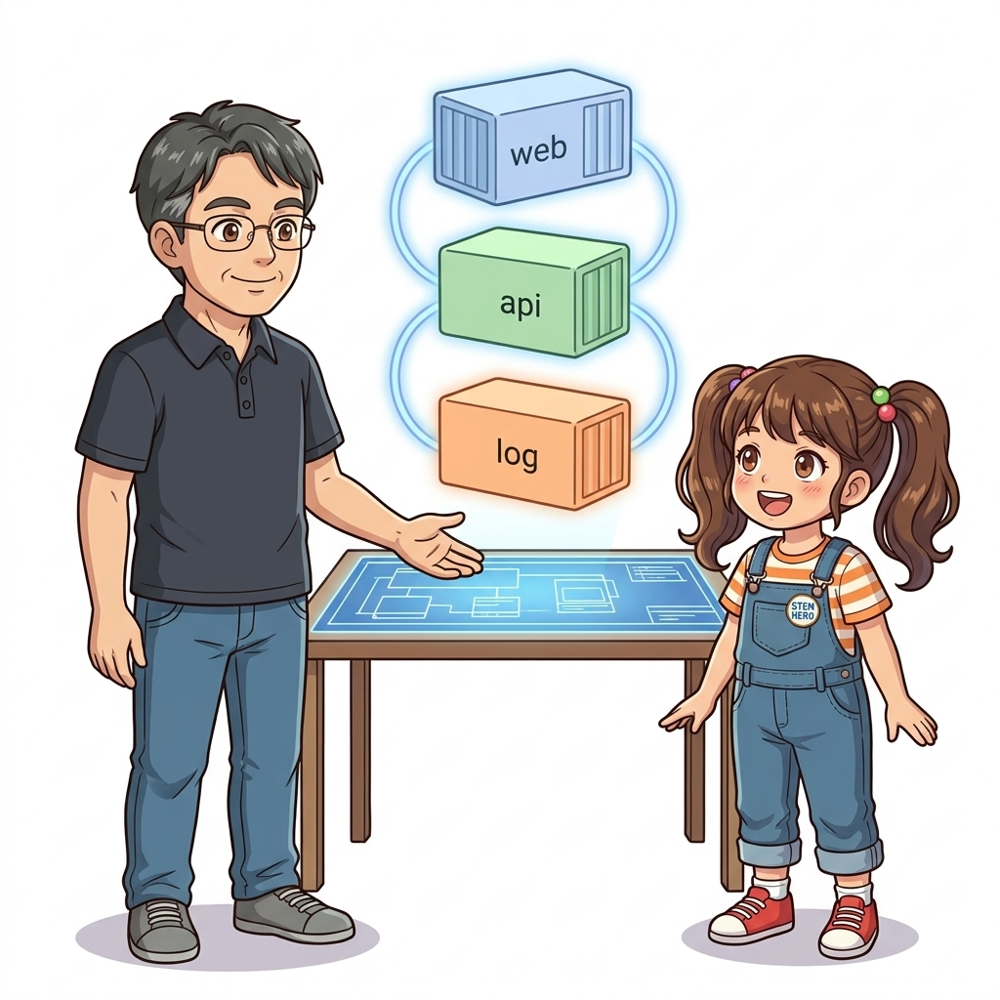
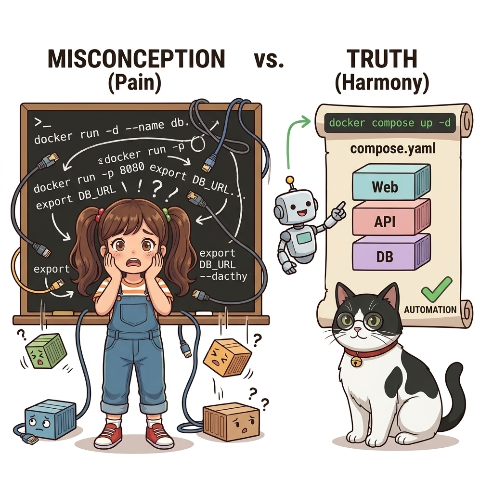
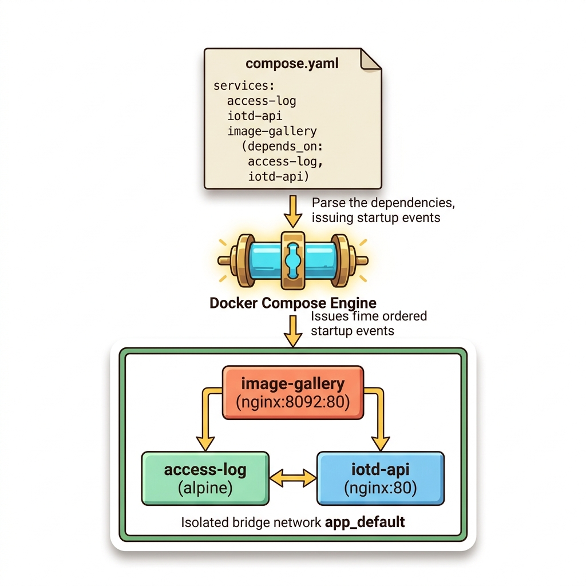
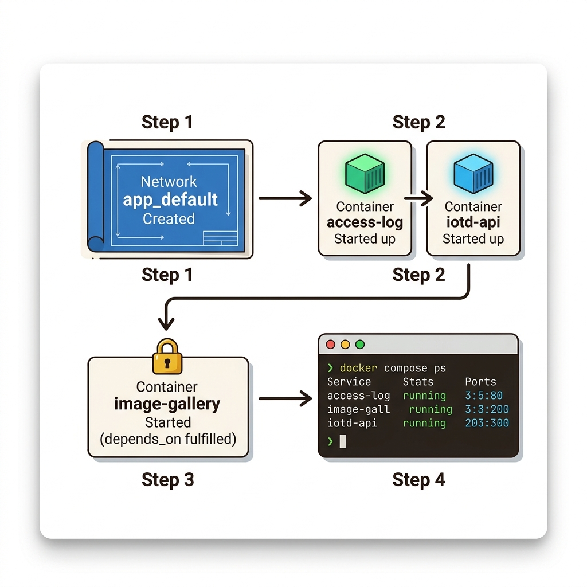
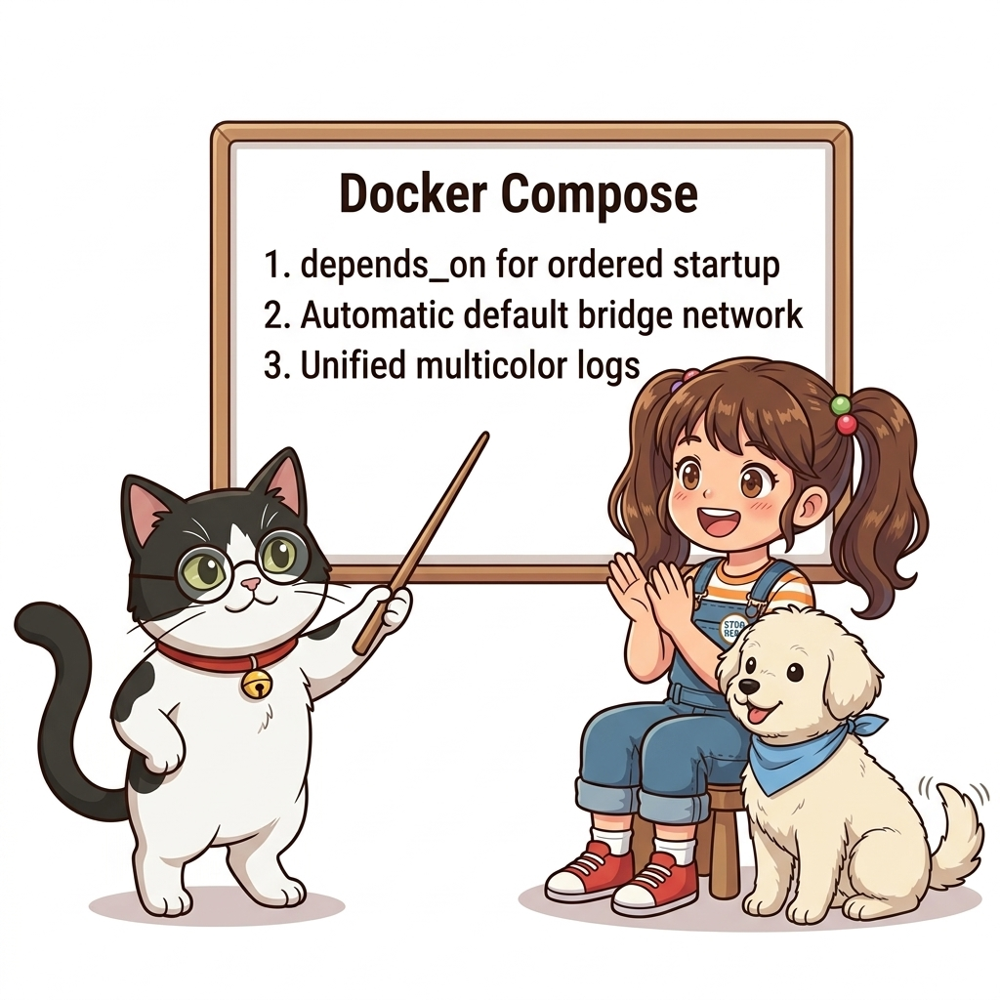
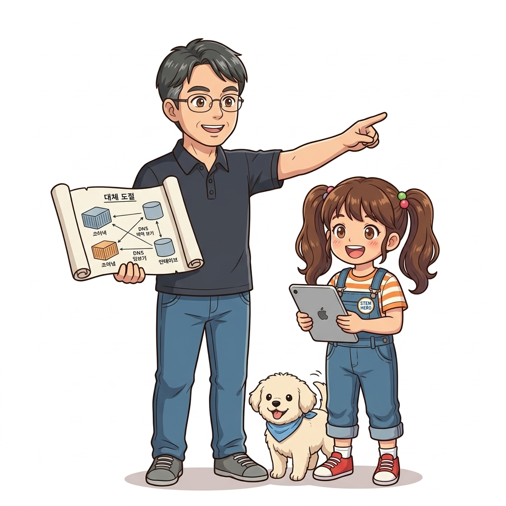

# 043. 도커컴포즈로 다중컨테이너 분산애플리케이션 일괄기동

## Slide 01: 도커컴포즈로 다중컨테이너 분산애플리케이션 일괄기동 도입 개요

*도커컴포즈로 다중컨테이너 분산애플리케이션 일괄기동의 필요성과 클라우드 네이티브 아키텍처 개요*

### 📌 핵심 개념
- **클라우드 네이티브 표준**: 도커 컨테이너를 통한 불변 인프라 구현
- **격리와 이식성**: 호스트 OS에 구애받지 않는 독립된 실행 환경
- **실무 엔지니어링**: 실전 프로덕션 환경의 핵심 아키텍처 이해

### 🎙️ 강의 내레이션 (30초)
> "안녕하세요! 오늘 다룰 주제는 '도커컴포즈로 다중컨테이너 분산애플리케이션 일괄기동'입니다. 클라우드 네이티브 환경에서 컨테이너 기술은 단순한 가상화를 넘어 현대 소프트웨어 배포의 표준이 되었습니다. 이번 장에서는 기초 동작부터 실무 아키텍처까지 한 단계씩 깊이 있게 파헤쳐 보겠습니다."

---

## Slide 02: 흔히 오해하는 개념과 실무적 진실

*도커컴포즈로 다중컨테이너 분산애플리케이션 일괄기동에 대한 흔한 선입견과 실제 프로덕션 현장의 기술적 진실*

### 📌 핵심 개념
- **피상적 오해 극복**: 단순 가상머신 대체제가 아닌 리눅스 커널 격리 프로세스
- **보안과 리소스 경계**: cgroups와 namespaces의 엄격한 자원 통제
- **프로덕션 신뢰성**: 레이어 캐시 및 불변성 원칙 준수의 중요성

### 🎙️ 강의 내레이션 (30초)
> "초심자들이 흔히 빠지는 함정은 도커를 가벼운 가상머신 정도로 오해하는 것입니다. 하지만 컨테이너는 커널을 공유하며 프로세스를 격리하는 고도의 OS 레벨 가상화입니다. 실무에서 신뢰성 있는 컨테이너를 운영하려면 내부 격리 메커니즘을 정확히 파악해야 합니다."

---

## Slide 03: 핵심 아키텍처와 엔지니어링 메커니즘

*도커컴포즈로 다중컨테이너 분산애플리케이션 일괄기동의 내부 아키텍처와 핵심 동작 메커니즘*

### 📌 핵심 개념
- **도커 엔진 컴포넌트**: dockerd, containerd, runc의 유기적 통신 구조
- **스토리지 드라이버**: 오버레이 파일시스템(OverlayFS)과 CoW(Copy-on-Write)
- **표준 OCI 규격**: 개방형 컨테이너 이니셔티브에 기반한 상호운용성

### 🎙️ 강의 내레이션 (30초)
> "도커 엔진 내부를 들여다보면 데몬과 OCI 런타임이 긴밀하게 협업합니다. 특히 OverlayFS를 통한 계층형 레이어 관리는 이미지 크기를 줄이고 빌드 속도를 비약적으로 높여줍니다. 이러한 핵심 구조가 실무 성능의 핵심입니다."

---

## Slide 04: 선언적 실습 및 아키텍처 다이어그램

*도커컴포즈로 다중컨테이너 분산애플리케이션 일괄기동의 선언적 인프라 실습 파이프라인 및 컨테이너 워크플로*

### 📌 핵심 개념
- **살아있는 재현 코드**: 공식 표준 이미지 기반의 즉시 실행 가능한 스크립트
- **코드로 관리하는 인프라**: 선언적 구성 파일을 통한 인프라의 버전 관리
- **엔지니어링 검증**: 컨테이너 생명주기와 네트워크/스토리지 연동 테스트

### 🎙️ 강의 내레이션 (30초)
> "이제 직접 터미널에서 선언적 실습 코드를 실행해 봅시다. 공식 베이스 이미지를 활용하여 불필요한 의존성을 없애고, 어디서나 100% 동일하게 재현되는 컨테이너 실행 환경을 직접 검증해 봅니다."

---

## Slide 05: 캐릭터 토론 및 3대 핵심 교훈

*도커컴포즈로 다중컨테이너 분산애플리케이션 일괄기동의 3대 핵심 교훈 총정리*

### 📌 핵심 개념
- **불변 인프라(Immutable Infrastructure)**: 일관된 컨테이너 배포
- **선언적 자동화(Declarative Automation)**: 휴먼 에러 방지
- **최소 권한 및 경량화(Security & Optimization)**: 프로덕션 표준 준수

### 🎙️ 강의 내레이션 (30초)
> "오늘 학습한 3대 핵심 교훈을 정리해 봅시다. 첫째, 런타임 불변성을 통해 배포 일관성을 확보하고, 둘째, 코드로 인프라를 선언하며, 셋째, 보안과 경량화 베스트 프랙티스를 반드시 지키는 것입니다."

---

## Slide 06: 랩노트 피날레와 다음 실습 예고

*연구실에서 다음 단계 도커 실습을 예고하는 이호진 교수님과 토토*

### 📌 핵심 개념
- **학습 마일스톤 달성**: 본 챕터의 핵심 기술 역량 내재화 완료
- **연계 심화 로드맵**: 다음 챕터와의 유기적 학습 연결
- **실전 과제 도전**: 배운 원리를 활용한 응용 미션 수행

### 🎙️ 강의 내레이션 (30초)
> "수고 많으셨습니다! 이번 장의 기본기를 탄탄하게 다졌으니, 다음 강의에서는 한 걸음 더 나아가 더욱 흥미진진한 클라우드 네이티브 실무 세계로 떠나보겠습니다. 다음 강의에서 뵙겠습니다!"
