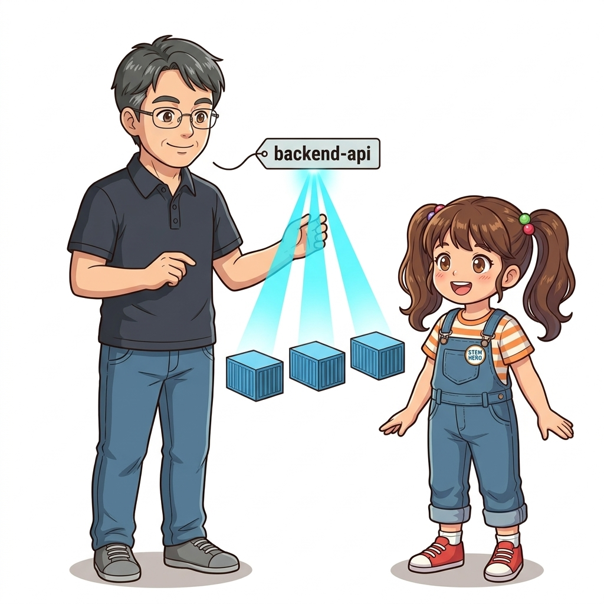
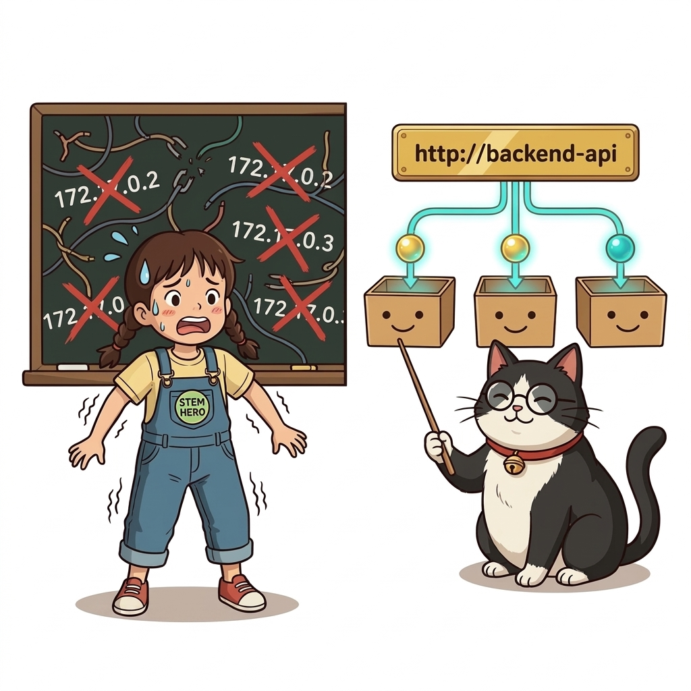
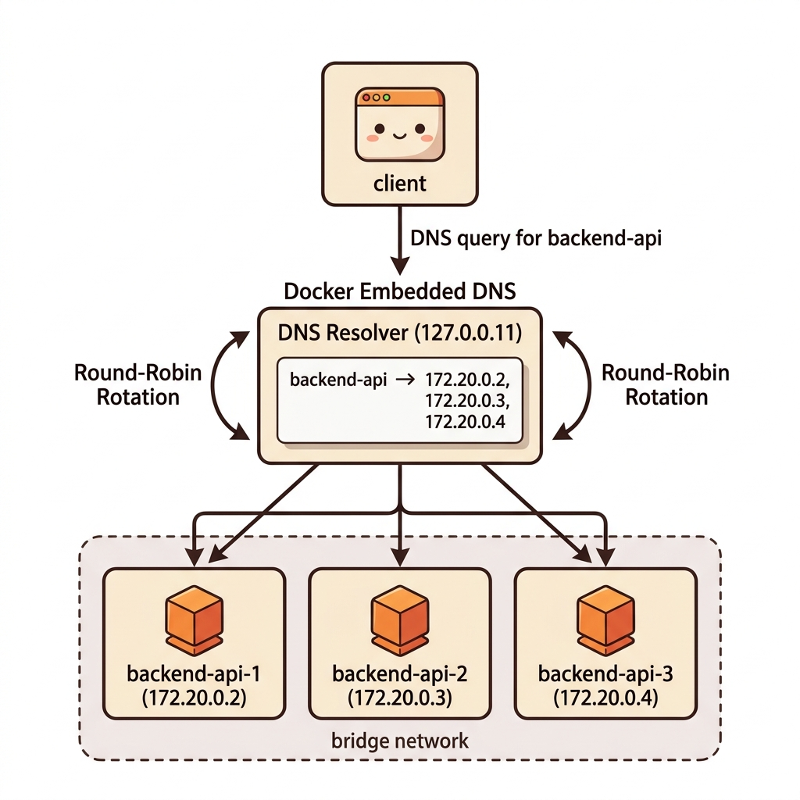
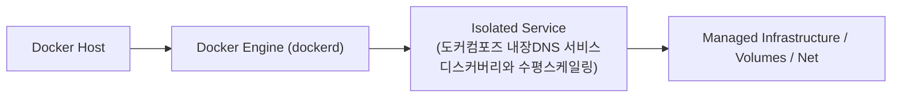
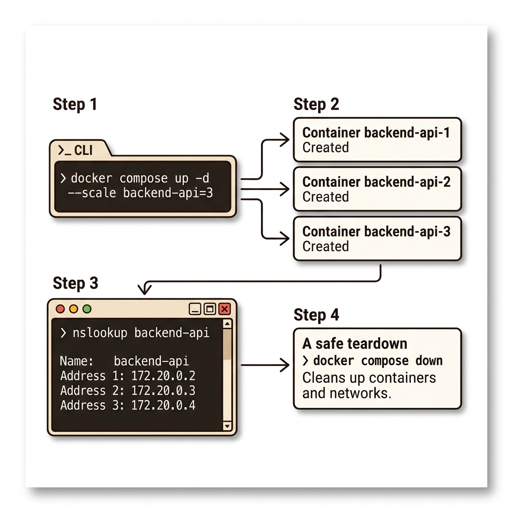
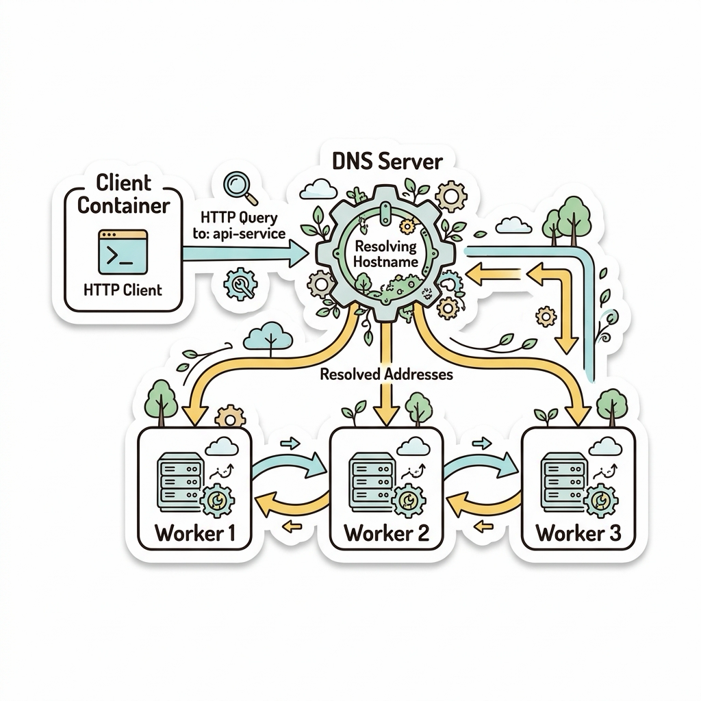
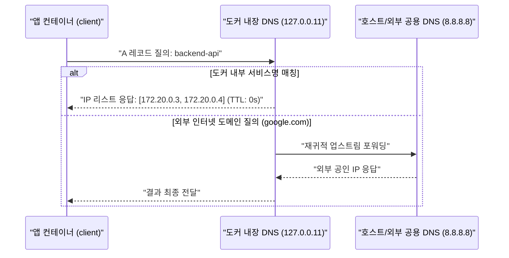
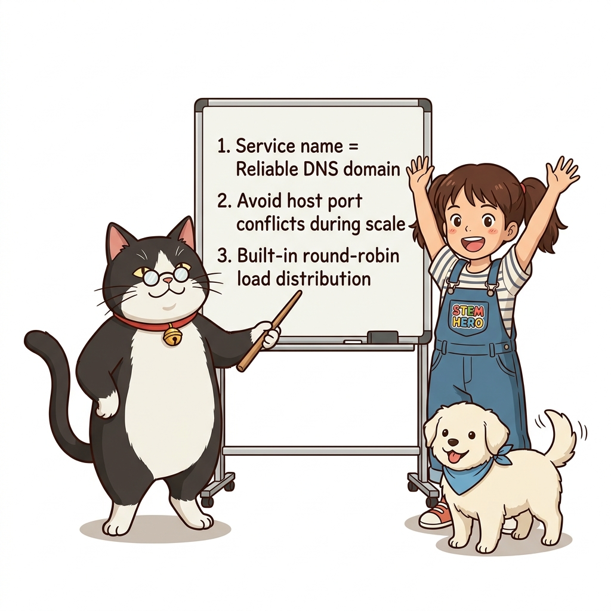
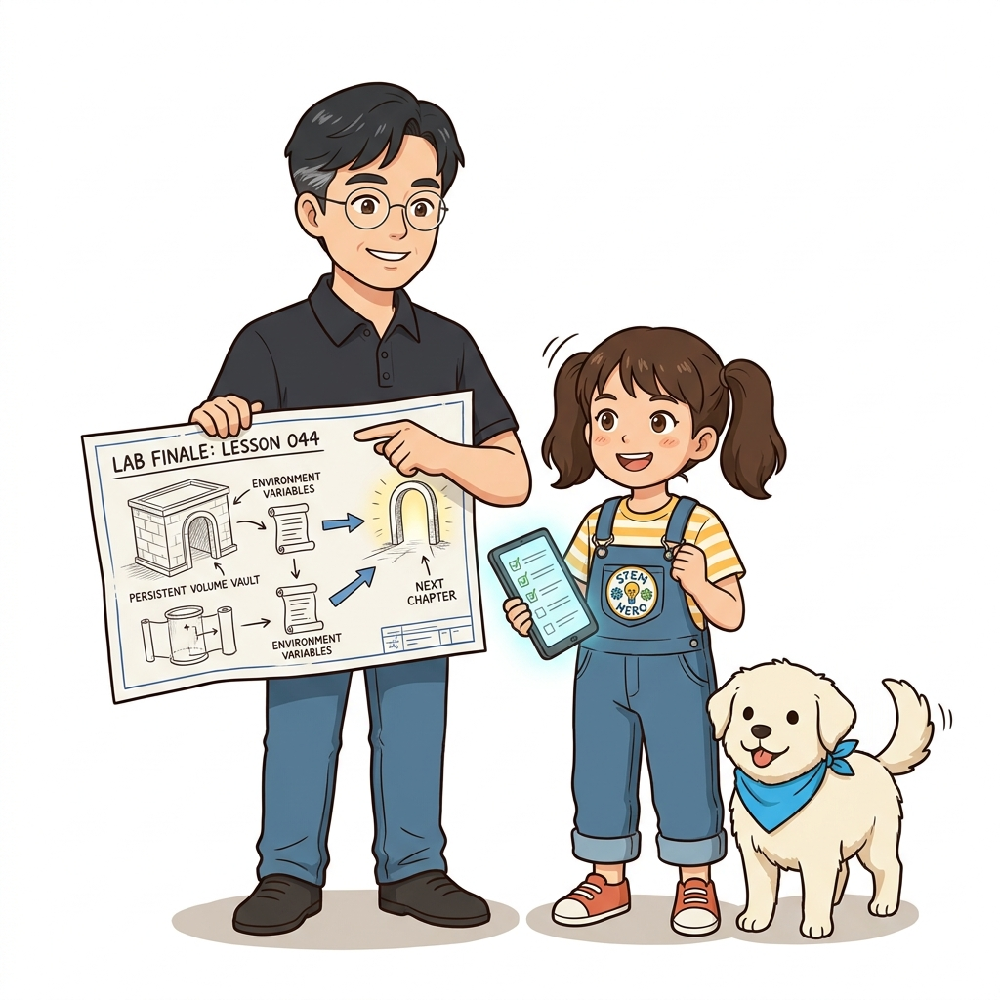

# 044. 도커컴포즈 내장DNS 서비스디스커버리와 수평스케일링

도커 컴포즈에서는 개별 컨테이너 이름이 아니라 **서비스 이름(Service Name, 예: `iotd-api`)**이 도커 내장 DNS에 등록됩니다.


**그림 04-3-1** 도커컴포즈 내장DNS 서비스디스커버리와 수평스케일링의 필요성과 현대 클라우드 아키텍처 관점의 개요

---

### 044.1 왜 도커컴포즈 내장DNS 서비스디스커버리와 수평스케일링이(가) 필요한가? (문제 정의와 현실적 배경)

소프트웨어 시스템이 복잡해질수록 설정을 다루는 방식은 전체 인프라의 신뢰성을 결정짓는 핵심 척도가 됩니다. **도커컴포즈 내장DNS 서비스디스커버리와 수평스케일링**이(가) 부재하거나 잘못 다루어질 때 현장에서는 다음과 같은 대표적인 병목과 장애가 발생합니다:

1. **하드코딩된 설정과 환경 불일치로 인한 유연성 상실**: 환경이 바뀔 때마다 코드를 다시 빌드해야 하므로 배포 주기가 지연되고 이미지 수가 기하급수적으로 폭증합니다.
2. **보안 민감 데이터의 무분별한 노출**: 비밀번호, 데이터베이스 토큰, 암호화 키가 이미지 레이어에 영구 박제되어 형상관리 시스템이나 외부에 유출될 위험이 커집니다.
3. **재현 불가능한 구성 드리프트**: 스테이징 환경과 프로덕션 환경의 미세한 설정 차이가 예기치 못한 서비스 중단 사고로 직결됩니다.


**그림 04-3-2** 도커컴포즈 내장DNS 서비스디스커버리와 수평스케일링에 대한 대표적인 오해와 실제 프로덕션 현장의 엔지니어링 진실

---

### 044.2 핵심 아키텍처와 엔지니어링 메커니즘

`--scale iotd-api=3` 옵션으로 백엔드 API 컨테이너를 3개로 스케일 아웃했을 때, 도커 내장 DNS가 `iotd-api` 도메인 조회 시 **3개 컨테이너의 IP 주소를 라운드 로빈(Round-Robin) 방식으로 번갈아 반환**하여 자연스러운 클라이언트 측 로드 밸런싱을 수행하는 원리를 직접 확인합니다!


**그림 04-3-3** 도커컴포즈 내장DNS 서비스디스커버리와 수평스케일링의 내부 아키텍처 및 데이터 흐름

#### 📊 핵심 비교 및 엔지니어링 표준 분석

| 구분 / 핵심 원리 | 상세 설명 및 동작 메커니즘 | 실무 적용 시 주의점 및 베스트 프랙티스 |
| :--- | :--- | :--- |
| **서비스 이름 = DNS 도메인** | 웹 컨테이너가 `http://backend-api/data`를 호출하면 도커 DNS(`127.0.0.11`)가 현재 실행 중인 `backend-api` 컨테이너들의 IP 목록을 응답 | IP 주소를 전혀 몰라도 서비스 이름만으로 완벽한 서비스 디스커버리(Service Discovery) 달성 |
| **스케일링 시 포트 충돌 주의** | 호스트 포트를 고정(`ports: ["8080:80"]`)한 서비스는 호스트의 8080 포트가 1개뿐이므로 `--scale=3` 실행 시 포트 충돌 에러 발생! | 스케일 아웃할 내부 백엔드 서비스는 호스트 포트를 열지 않거나 범위 포트(`8080-8082:80`)를 사용해야 함 |
| **DNS 라운드 로빈 부하 분산** | `nslookup backend-api`를 반복 실행하면 반환되는 IP 주소의 순서가 매번 순환하며 트래픽을 고르게 분배 | 별도의 외부 로드밸런서 없이도 내부 마이크로서비스 간 기본 부하 분산 작동 |

---

### 044.3 선언적 실습 및 아키텍처 다이어그램

본 실습은 외부 비공개 패키지에 의존하지 않고, 공식 표준 이미지를 기반으로 즉시 재현 가능한 살아있는 코드로 구성되어 있습니다.

```bash
# 백엔드 서비스를 3개의 컨테이너로 스케일 아웃(--scale)하고 내장 DNS가 3개의 IP를 반환하는지 검증!
mkdir -p /tmp/oz-scale && cd /tmp/oz-scale
cat << 'EOF' > compose.yaml
services:
  backend-api:
    image: nginx:1.27-alpine
  client:
    image: alpine:3.20
    command: ["sh", "-c", "nslookup backend-api"]
    depends_on: [backend-api]
EOF

docker compose up -d --scale backend-api=3 backend-api
docker compose run --rm client
docker compose down && rm -rf /tmp/oz-scale
```

#### 🔍 아키텍처 흐름도 (Mermaid Diagram)




**그림 04-3-4** 선언적 인프라 명세를 통한 도커컴포즈 내장DNS 서비스디스커버리와 수평스케일링 검증 파이프라인

---

<!-- BIBLE_INTEGRATION_book3_service_discovery_patterns -->
---

### 044.B 📚 도커 바이블 심화: 분산 마이크로서비스 서비스 디스커버리 3대 패턴(Client/Server/DNS)
*출처 도서: 『도커를 활용한 마이크로서비스』 핵심 분석*

수십 수백 개의 동적 컨테이너가 생성되고 소멸하는 분산 환경에서는 고정 IP를 사용할 수 없습니다. 서비스 디스커버리(Service Discovery)는 다음 세 가지 패턴으로 진화해 왔습니다:

| 디스커버리 패턴 | 동작 방식 | 대표 기술 및 장단점 |
| :--- | :--- | :--- |
| **클라이언트 사이드** | 클라이언트가 서비스 레지스트리(Consul, Eureka)에 직접 쿼리하여 가용 인스턴스 중 하나를 선택 | 클라이언트 지능화, 로드밸런싱 자유도 높음, 언어 종속적 라이브러리 필요 |
| **서버 사이드** | 클라이언트는 로드밸런서(F5, AWS ALB, Nginx)에만 요청하고, 로드밸런서가 백엔드 풀로 프록시 | 클라이언트가 단순해짐, 로드밸런서가 단일 장애점(SPOF)이 될 위험 |
| **DNS 기반 (도커/K8s)** | 컨테이너 런타임의 내장 DNS(127.0.0.11 / CoreDNS)가 서비스 이름 조회 시 라운드로빈 IP 목록 반환 | 표준 소켓 통신을 그대로 활용, 언어 중립적, TTL 캐싱 이슈 주의 필요 |


**그림 044-B-1** 도커 내장 DNS가 서비스 별칭(Alias) 요청을 여러 백엔드 워커 컨테이너로 분산하는 구조도

```bash
# [실습] 도커 내장 DNS의 라운드로빈 서비스 디스커버리 검증
docker network create lb-net
docker container run -d --name api-worker-1 --network lb-net --network-alias api-service nginx:alpine
docker container run -d --name api-worker-2 --network lb-net --network-alias api-service nginx:alpine

# 클라이언트 컨테이너에서 alias 조회 시 2개의 IP가 번갈아 반환되는지 확인
docker container run --rm --network lb-net alpine nslookup api-service
```

> 👨‍🏫 **이호진 교수님의 바이블 멘토링 노트**:
> "도커에서는 `--network-alias`를 적극 활용하세요. 여러 컨테이너에 동일한 alias를 부여하는 것만으로도 별도의 무거운 외부 로드밸런서 없이 내장 DNS 기반의 L4 라운드로빈 부하 분산이 즉시 완성됩니다."
>
> 👧 **도로시의 깨달음**:
> "컨테이너 두 대에 똑같은 닉네임('api-service')을 붙여두면 도커가 알아서 번갈아가며 손님을 보내주는 거군요!"
>
> 🐱 **조교 지니의 아키텍처 체크포인트**:
> "다만 JVM이나 일부 언어 런타임은 DNS 결과를 무기한 영구 캐싱(networkaddress.cache.ttl = -1)하는 기본값을 가지므로, TTL을 수 초 단위로 반드시 낮춰야 합니다."

---

### 044.C 📚 도커 바이블 심화: 내장 DNS 127.0.0.11의 동작 구조와 JVM/Node.js DNS 영구 캐싱 고착 장애 해결

> 📖 **참고 도서 심층 연계**:
> * 《도커 교과서》 제7장 (도커 컴포즈 네트워킹과 내장 DNS 서비스 탐색)
> * 《시작하세요! 도커/쿠버네티스》 제3장 (도커 사용자 정의 브리지와 127.0.0.11 DNS 포워더)

사용자 정의 네트워크(Custom Bridge)에 연결된 모든 도커 컨테이너의 `/etc/resolv.conf`를 열어보면 `nameserver 127.0.0.11`이라는 고정 루프백 IP가 적혀 있습니다. 이것이 바로 도커 엔진이 컨테이너 네임스페이스마다 독립적으로 띄워둔 **내장 임베디드 DNS 프록시**입니다.

#### 1. 내장 DNS(127.0.0.11)의 서비스 질의 처리 순서



#### 2. 동적 스케일링 시 DNS TTL 캐싱 트랩과 언어별 튜닝

컨테이너가 수평 확장(`--scale backend-api=5`)되거나 배포로 인해 기존 컨테이너가 죽고 새 컨테이너로 교체될 때, 자바 스프링(Spring)이나 Node.js 애플리케이션에서 `No route to host` 또는 `Connection refused`가 빈번히 발생합니다.

* **원인: 런타임의 영구 DNS 캐싱**:
  * 도커 DNS는 컨테이너의 잦은 변동을 반영하기 위해 응답 TTL(Time To Live)을 0초 또는 극도로 짧게 설정합니다.
  * 하지만 **JVM(Java Virtual Machine)**의 기본 보안 설정(`security.properties`)은 성공한 DNS 조회를 **무기한 영구(`networkaddress.cache.ttl = -1`)** 메모리에 캐시합니다!
  * 따라서 백엔드 컨테이너가 재배포되어 새 IP를 부여받았음에도 자바 앱은 죽은 옛날 IP로만 계속 패킷을 보내게 됩니다.

#### 3. 언어별 DNS 캐시 만료 표준 설정법

```bash
# [Java/JVM 애플리케이션] 도커 환경 컨테이너 기동 옵션 추가
java -Dnetworkaddress.cache.ttl=2 -Dnetworkaddress.cache.negative.ttl=1 -jar app.jar

# [Node.js 애플리케이션] Keep-Alive 커넥션 풀 강제 리프레시
# axios나 http.Agent 사용 시 keepAliveMaxTimeout을 3~5초로 제한하여 주기적 DNS 재해석 유도
```

> 👧 **도로시**: "와! 도커 내장 DNS는 새 IP를 알려주려고 TTL을 0초로 주는데, 자바 앱이 옛날 IP를 영원히 기억하고 있어서 생긴 통신 장애였군요!"
> 
> 👨‍🏫 **이호진 교수님**: "정확하단다, 도로시! 컨테이너 기반 마이크로서비스로 전향할 때 수많은 백엔드 개발자들이 가장 먼저 부딪히는 불가사의한 네트워크 유령 장애가 바로 이 DNS 캐싱 문제란다."
> 
> 🐶 **토토**: "멍멍! `-Dnetworkaddress.cache.ttl=2`를 주는 순간 동적 스케일링 트래픽이 모든 새 컨테이너로 골고루 흘러가는 걸 확인했어!"


### 044.4 핵심 정리: 캐릭터 대화와 3대 교훈

> 👧 **도로시**: "교수님! **도커컴포즈 내장DNS 서비스디스커버리와 수평스케일링**의 원리를 배우니까, 복잡하게 얽혀 있던 인프라 설정이 레고 블록처럼 질서정연하게 제자리를 찾는 게 보여요!"
> 
> 🐱 **조교 지니**: "야옹~ 맞습니다! 특히 런타임 환경과 불변 인프라의 경계를 명확히 지키는 것이 대규모 클라우드 운영의 제1원칙이랍니다!"
> 
> 🐶 **토토**: "멍멍! 선언적 코드로 한 번 적어두면 언제든 똑같이 복원되니까 정말 든든해요!"
> 
> 👨‍🏫 **이호진 교수님**: "훌륭하구나. 원리를 깊이 이해하고 실습을 통해 손에 익히는 것이 훌륭한 클라우드 엔지니어로 성장하는 가장 빠른 지름길이란다."


**그림 04-3-5** 도커컴포즈 내장DNS 서비스디스커버리와 수평스케일링 마스터를 위한 3대 핵심 교훈

1. **설정과 실행의 명확한 분리**:
   * 애플리케이션 코드는 불변으로 유지하고, 가변적인 설정값은 외부에서 주입하여 이식성을 극대화합니다.
2. **선언적 재현성 확보**:
   * 사람이 수작업으로 변경하지 않고 코드 명세를 통해 언제 어디서나 100% 동일한 실행 결과를 보장합니다.
3. **최소 권한 및 보안 모범 사례 준수**:
   * 불필요한 권한과 포트 노출을 최소화하고 민감 데이터를 암호화하여 프로덕션 안정성을 담보합니다.

---

### 044.5 랩노트 피날레와 다음 강의 예고


**그림 04-3-6** 연구실에서 다음 마일스톤인 [도커컴포즈 환경변수 environment env file과 볼륨연결] 실습을 예고하는 교수님과 토토

> 💡 **다음 강의 안내**:
> [도커컴포즈 환경변수 environment env file과 볼륨연결](../045_도커컴포즈_환경변수_environment_env_file과_볼륨연결/)에서는 더욱 심화된 실전 엔지니어링 실습과 아키텍처를 다룹니다!

---

## 🧭 강의 네비게이션
* [◀️ 이전 강의: 043_도커컴포즈로_다중컨테이너_분산애플리케이션_일괄기동](../043_도커컴포즈로_다중컨테이너_분산애플리케이션_일괄기동/)
* [📋 Part 04. 도커 컴포즈(Compose) 분산 앱 실행, 헬스/디펜던시 체크 & 모니터링 (042 ~ 061) 목차로 돌아가기](../)
* [▶️ 다음 강의: 045_도커컴포즈_환경변수_environment_env_file과_볼륨연결](../045_도커컴포즈_환경변수_environment_env_file과_볼륨연결/)
