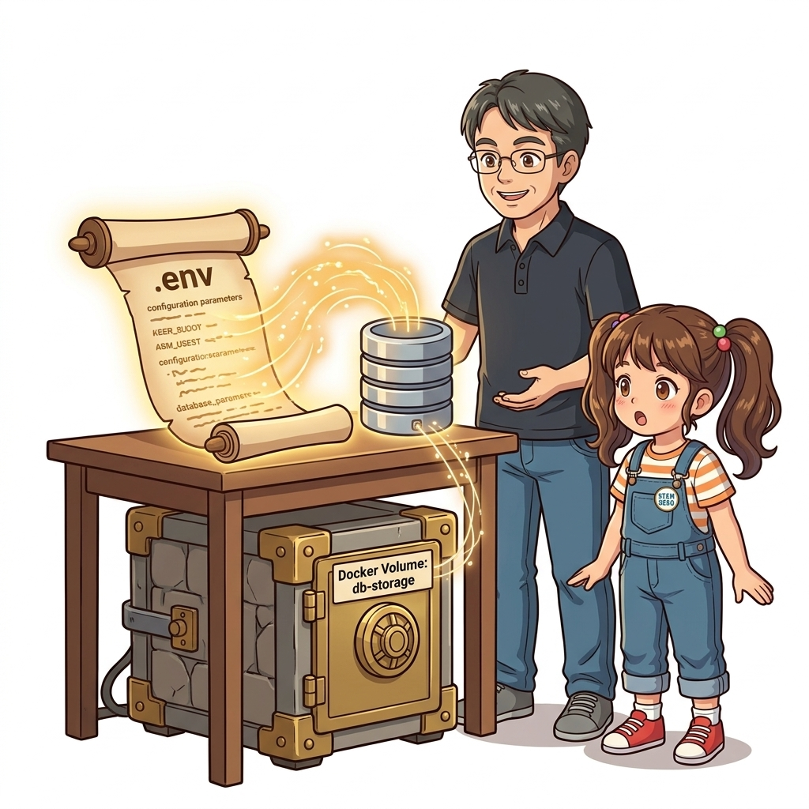
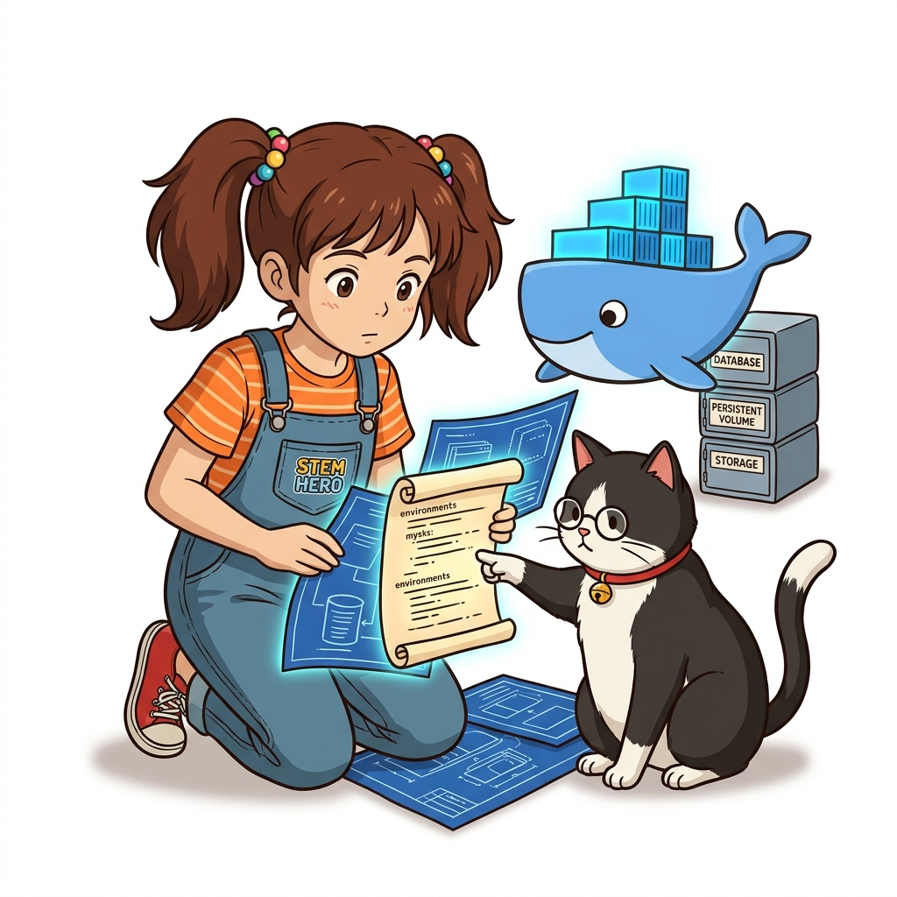
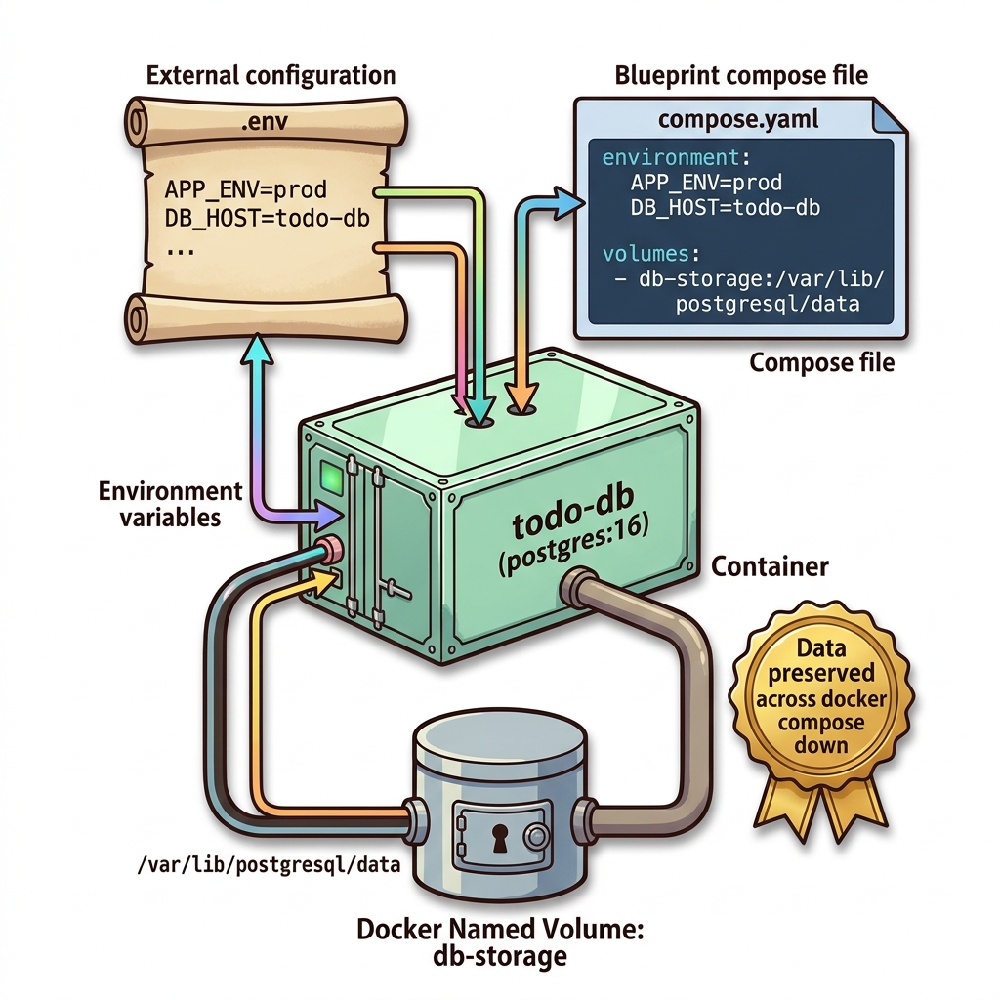
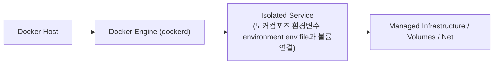
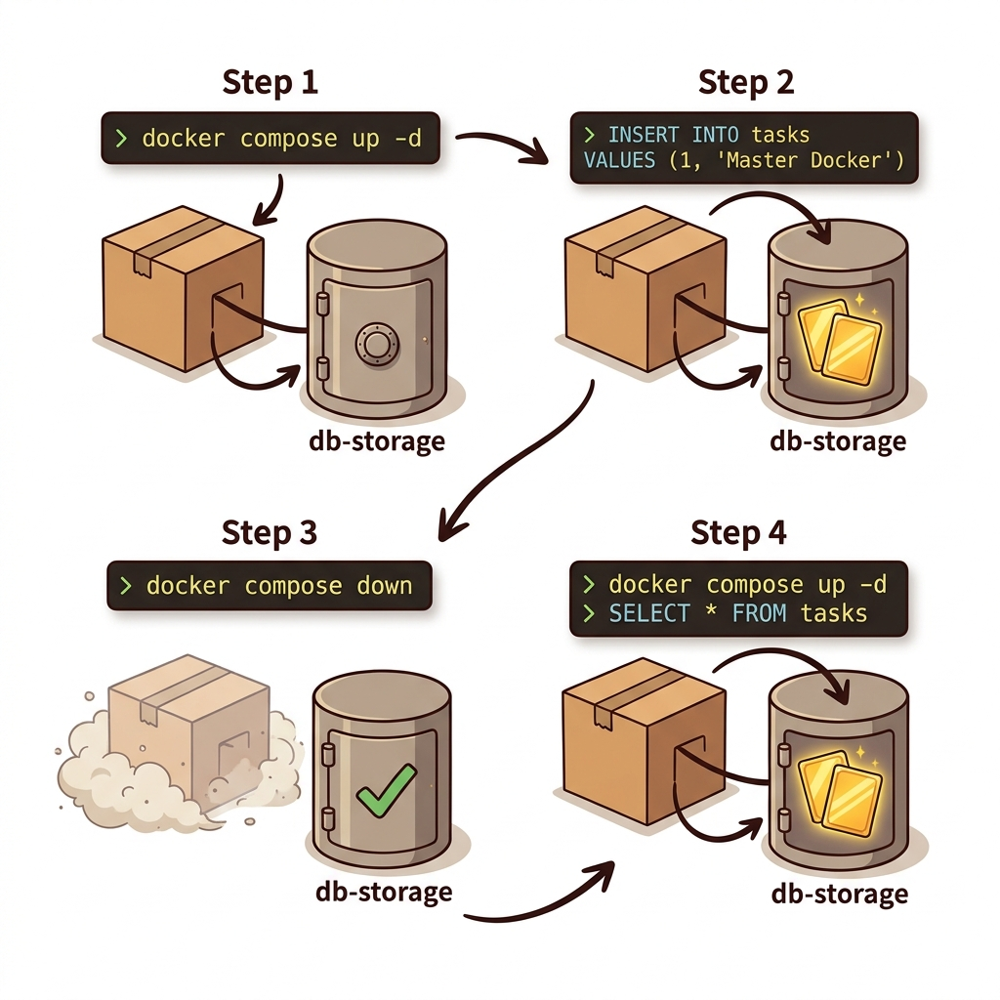
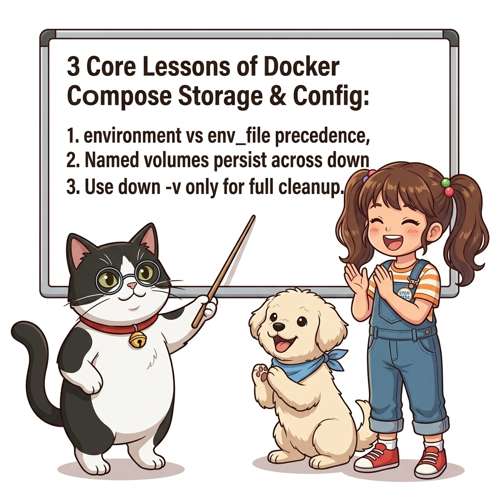

# 045. 도커컴포즈 환경변수 environment env file과 볼륨연결

`compose.yaml`의 서비스 정의 안에 **`environment:`(개별 키-값 지정)**와 **`env_file:`(외부 `.env` 파일 로드)**을 사용하여 컨테이너에 런타임 설정을 주입하는 방법을 배웁니다.


**그림 04-4-1** 도커컴포즈 환경변수 environment env file과 볼륨연결의 필요성과 현대 클라우드 아키텍처 관점의 개요

---

### 045.1 왜 도커컴포즈 환경변수 environment env file과 볼륨연결이(가) 필요한가? (문제 정의와 현실적 배경)

소프트웨어 시스템이 복잡해질수록 설정을 다루는 방식은 전체 인프라의 신뢰성을 결정짓는 핵심 척도가 됩니다. **도커컴포즈 환경변수 environment env file과 볼륨연결**이(가) 부재하거나 잘못 다루어질 때 현장에서는 다음과 같은 대표적인 병목과 장애가 발생합니다:

1. **하드코딩된 설정과 환경 불일치로 인한 유연성 상실**: 환경이 바뀔 때마다 코드를 다시 빌드해야 하므로 배포 주기가 지연되고 이미지 수가 기하급수적으로 폭증합니다.
2. **보안 민감 데이터의 무분별한 노출**: 비밀번호, 데이터베이스 토큰, 암호화 키가 이미지 레이어에 영구 박제되어 형상관리 시스템이나 외부에 유출될 위험이 커집니다.
3. **재현 불가능한 구성 드리프트**: 스테이징 환경과 프로덕션 환경의 미세한 설정 차이가 예기치 못한 서비스 중단 사고로 직결됩니다.


**그림 04-4-2** 도커컴포즈 환경변수 environment env file과 볼륨연결에 대한 대표적인 오해와 실제 프로덕션 현장의 엔지니어링 진실

---

### 045.2 핵심 아키텍처와 엔지니어링 메커니즘

또한 최상위 `volumes:` 블록에 도커 볼륨을 선언하고 서비스의 `volumes:` 속성에 연결하여, `docker compose down`으로 컨테이너와 네트워크를 내렸다 다시 올려도 데이터베이스 파일이 안전하게 유지되는 구조를 실습합니다.


**그림 04-4-3** 도커컴포즈 환경변수 environment env file과 볼륨연결의 내부 아키텍처 및 데이터 흐름

#### 📊 핵심 비교 및 엔지니어링 표준 분석

| 구분 / 핵심 원리 | 상세 설명 및 동작 메커니즘 | 실무 적용 시 주의점 및 베스트 프랙티스 |
| :--- | :--- | :--- |
| **`environment:` 두 가지 문법** | 맵(Dictionary) 문법(`KEY: value`)과 리스트(Array) 문법(`- KEY=value`) 모두 지원하며, 값 없이 `- SECRET_KEY`만 적으면 호스트 셸의 환경 변수 값을 그대로 전달! | 민감한 값을 `compose.yaml`에 하드코딩하지 않고 호스트에서 주입할 때 매우 유용 |
| **`env_file:` 일괄 주입** | 여러 서비스가 공통으로 사용하는 설정 파일(`common.env`)을 배열로 지정해 중복 작성을 제거 | `environment:`와 `env_file:`에 같은 키가 있으면 더 구체적인 `environment:` 값이 우선 적용됨 |
| **`docker compose down` vs `down -v`** | 일반 `docker compose down`은 컨테이너와 네트워크만 삭제하고 **명명된 볼륨(`db-storage`)은 안전하게 보존**함! | 볼륨 데이터까지 완전히 초기화하고 싶을 때만 명시적으로 `docker compose down --volumes`(`-v`)를 실행 |

---

### 045.3 선언적 실습 및 아키텍처 다이어그램

본 실습은 외부 비공개 패키지에 의존하지 않고, 공식 표준 이미지를 기반으로 즉시 재현 가능한 살아있는 코드로 구성되어 있습니다.

```yaml
# 환경 변수(environment / env_file)와 영속적 도커 볼륨(volumes)을 결합한 표준 컴포즈 패턴
services:
  todo-db:
    image: postgres:16-alpine
    environment:
      POSTGRES_DB: oz_todo
      POSTGRES_USER: dorothy
      POSTGRES_PASSWORD: secret_password_123
    volumes:
      - db-storage:/var/lib/postgresql/data

  todo-web:
    image: nginx:1.27-alpine
    ports: ["8080:80"]
    environment:
      - DB_HOST=todo-db
      - DB_PORT=5432
    depends_on: [todo-db]

volumes:
  db-storage:
```

#### 🔍 아키텍처 흐름도 (Mermaid Diagram)




**그림 04-4-4** 선언적 인프라 명세를 통한 도커컴포즈 환경변수 environment env file과 볼륨연결 검증 파이프라인

---

### 045.4 핵심 정리: 캐릭터 대화와 3대 교훈

> 👧 **도로시**: "교수님! **도커컴포즈 환경변수 environment env file과 볼륨연결**의 원리를 배우니까, 복잡하게 얽혀 있던 인프라 설정이 레고 블록처럼 질서정연하게 제자리를 찾는 게 보여요!"
> 
> 🐱 **조교 지니**: "야옹~ 맞습니다! 특히 런타임 환경과 불변 인프라의 경계를 명확히 지키는 것이 대규모 클라우드 운영의 제1원칙이랍니다!"
> 
> 🐶 **토토**: "멍멍! 선언적 코드로 한 번 적어두면 언제든 똑같이 복원되니까 정말 든든해요!"
> 
> 👨‍🏫 **이호진 교수님**: "훌륭하구나. 원리를 깊이 이해하고 실습을 통해 손에 익히는 것이 훌륭한 클라우드 엔지니어로 성장하는 가장 빠른 지름길이란다."


**그림 04-4-5** 도커컴포즈 환경변수 environment env file과 볼륨연결 마스터를 위한 3대 핵심 교훈

1. **설정과 실행의 명확한 분리**:
   * 애플리케이션 코드는 불변으로 유지하고, 가변적인 설정값은 외부에서 주입하여 이식성을 극대화합니다.
2. **선언적 재현성 확보**:
   * 사람이 수작업으로 변경하지 않고 코드 명세를 통해 언제 어디서나 100% 동일한 실행 결과를 보장합니다.
3. **최소 권한 및 보안 모범 사례 준수**:
   * 불필요한 권한과 포트 노출을 최소화하고 민감 데이터를 암호화하여 프로덕션 안정성을 담보합니다.

---

### 045.5 랩노트 피날레와 다음 강의 예고


**그림 04-4-6** 연구실에서 다음 마일스톤인 [도커컴포즈 생애주기명령어와 단일호스트 한계점] 실습을 예고하는 교수님과 토토

> 💡 **다음 강의 안내**:
> [도커컴포즈 생애주기명령어와 단일호스트 한계점](../046_도커컴포즈_생애주기명령어와_단일호스트_한계점/)에서는 더욱 심화된 실전 엔지니어링 실습과 아키텍처를 다룹니다!

---

## 🧭 강의 네비게이션
* [◀️ 이전 강의: 044_도커컴포즈_내장DNS_서비스디스커버리와_수평스케일링](../044_도커컴포즈_내장DNS_서비스디스커버리와_수평스케일링/)
* [📋 Part 04. 도커 컴포즈(Compose) 분산 앱 실행, 헬스/디펜던시 체크 & 모니터링 (042 ~ 061) 목차로 돌아가기](../)
* [▶️ 다음 강의: 046_도커컴포즈_생애주기명령어와_단일호스트_한계점](../046_도커컴포즈_생애주기명령어와_단일호스트_한계점/)
